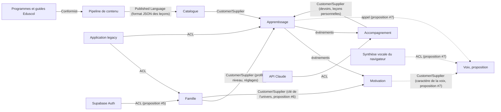

# Context map

Première version, tirée de l'application existante. Les contextes sont des **pistes** que `domain-modeler` confirme ou corrige à chaque story.

## Bounded contexts

| Contexte | Responsabilité | Dossier |
|---|---|---|
| Catalogue pédagogique | Leçons, exercices, compétences, rattachement aux programmes officiels et aux guides fondamentaux. Lecture seule pour les autres contextes. | `supabase/functions/_shared/catalogue/` |
| Apprentissage | Séances, réponses, étoiles, parcours et verrous, test de départ, révisions. Doit fonctionner hors ligne (domaine importé par le front). | `supabase/functions/_shared/apprentissage/` |
| Motivation | Série, badges, cabane, épisodes de l'histoire, univers. | `supabase/functions/_shared/motivation/` |
| Famille | Parents, profils enfants, rattachements et invitations, réglages, contrôle parental, données personnelles et RGPD. | `supabase/functions/_shared/famille/` |
| Accompagnement | Suivi, rapport de la semaine, carte des compétences, devoirs, mots de la semaine, enregistrements de lecture, leçons personnelles. | `supabase/functions/_shared/accompagnement/` |

### Proposition de sous-domaine générique (à valider, story #7)

| Contexte | Responsabilité | Dossier |
|---|---|---|
| Voix (proposition) | Lecture à voix haute : nettoyage et découpage du texte, choix de la voix de l'appareil, hauteur et rythme selon le caractère de la voix du personnage guide. Port de lecture (voix du navigateur aujourd'hui, MP3 plus tard). Fonctionne entièrement dans le navigateur. | `supabase/functions/_shared/voix/` |

### Systèmes externes

| Système | Rôle |
|---|---|
| Programmes officiels et guides Eduscol | Source de vérité pédagogique (`sources/`) |
| Pipeline de contenu (`scripts/`, Python) | Produit `bibliotheque.json` et `programmes-index.json` |
| API Claude | Création de leçons personnelles, lecture de photos de devoirs |
| Synthèse vocale | Voix qui lit les consignes (MP3 pré-générés, ou voix du navigateur) |
| Supabase Auth | Connexion du parent par lien de connexion envoyé par e-mail (story #5) |
| Application legacy (`app/`) | Source des règles métier à reprendre. Pas de reprise des données (décision de démarrage n°7) |

## Relations

| Amont | Aval | Type de relation | Mécanisme (événement, appel, ACL) |
|---|---|---|---|
| Programmes officiels et guides | Pipeline de contenu | Conformist | Citations recopiées mot pour mot, vérifiées au build |
| Pipeline de contenu | Catalogue pédagogique | Published Language | Fichier `bibliotheque.json` au format `docs/format-lecons.md`, lu par un mapper d'infrastructure |
| Catalogue pédagogique | Apprentissage | Customer/Supplier | Appel en lecture : leçon par identifiant, leçons d'une matière et d'un niveau |
| Famille | Apprentissage | Customer/Supplier | Appel en lecture : niveau et réglages du profil enfant (parcours libre) |
| Apprentissage | Motivation | Événements | `SeanceTerminee` et `LeconAcquise` (à valider), qui font avancer la série, les badges, la cabane et les épisodes |
| Apprentissage | Accompagnement | Événements | `SeanceTerminee` (à valider) alimente le suivi et le rapport de la semaine |
| Accompagnement | Apprentissage | Customer/Supplier | Appel en lecture : les devoirs du jour et les leçons personnelles de la famille, que l'enfant joue comme les autres leçons |
| API Claude | Accompagnement | Anti-Corruption Layer | Port `GenerateurDeLecon` (à valider) : la réponse de l'IA est validée et traduite en leçon avant d'entrer dans le domaine |
| Application legacy | Famille, Apprentissage | Anti-Corruption Layer | Traducteur de migration ponctuel : profils et progression de l'artifact → agrégats du domaine |
| Supabase Auth | Famille | Anti-Corruption Layer (proposition, story #5) | Port `ServiceDeConnexion` : l'utilisateur et les erreurs de Supabase sont traduits en `ParentId` et en erreurs métier (`AdresseEmailInvalide`, `LienDeConnexionExpire`, `LienDeConnexionDejaUtilise`) |
| Famille | Motivation | Customer/Supplier (proposition, story #6) | Le profil enfant garde la clé de son univers ; Motivation retrouve l'univers et son personnage guide (clé inconnue → `animaux`) |
| Motivation | Voix (proposition) | Customer/Supplier (proposition, story #7) | Le personnage guide fournit son caractère de la voix ; Voix ne connaît pas les univers |
| Synthèse vocale du navigateur | Voix (proposition) | Anti-Corruption Layer (proposition, story #7) | Port `VoixDeLAppareil` (voix traduites en nom et langue) et port `LecteurAVoixHaute` (adaptateur `speechSynthesis`, plus tard MP3) |
| Apprentissage, Motivation | Voix (proposition) | Appel (proposition, story #7) | Depuis le front : lire une consigne, une étape de leçon, une félicitation ou un encouragement |

## Décisions

- Les leçons personnelles appartiennent à Accompagnement. Elles respectent le même format JSON que la bibliothèque, pour qu'Apprentissage les joue de la même façon.

- **Motivation est un contexte à part.** Apprentissage annonce seulement les faits (« séance terminée avec 2 étoiles »). Motivation décide seule des récompenses (série, badges, cabane, épisodes). Une récompense ne modifie jamais une note.
- **Pas de temps d'écran** dans l'application : aucune limite de durée de jeu, ni dans Famille ni dans Apprentissage.
