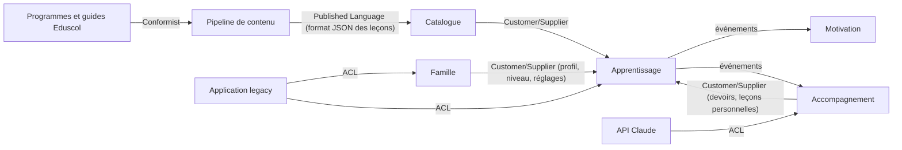

# Context map

Première version, tirée de l'application existante. Les contextes sont des **pistes** que `domain-modeler` confirme ou corrige à chaque story.

## Bounded contexts

| Contexte | Responsabilité | Dossier |
|---|---|---|
| Catalogue pédagogique | Leçons, exercices, compétences, rattachement aux programmes officiels et aux guides fondamentaux. Lecture seule pour les autres contextes. | `supabase/functions/_shared/catalogue/` |
| Apprentissage | Séances, réponses, étoiles, parcours et verrous, test de départ, révisions. Doit fonctionner hors ligne (domaine importé par le front). | `supabase/functions/_shared/apprentissage/` |
| Motivation | Série, badges, cabane, épisodes de l'histoire, univers. | `supabase/functions/_shared/motivation/` |
| Famille | Compte famille, parent, profils enfants, réglages, temps d'écran, contrôle parental, données personnelles et RGPD. | `supabase/functions/_shared/famille/` |
| Accompagnement | Suivi, rapport de la semaine, carte des compétences, devoirs, mots de la semaine, enregistrements de lecture, leçons personnelles. | `supabase/functions/_shared/accompagnement/` |

### Systèmes externes

| Système | Rôle |
|---|---|
| Programmes officiels et guides Eduscol | Source de vérité pédagogique (`sources/`) |
| Pipeline de contenu (`scripts/`, Python) | Produit `bibliotheque.json` et `programmes-index.json` |
| API Claude | Création de leçons personnelles, lecture de photos de devoirs |
| Synthèse vocale | Voix qui lit les consignes (MP3 pré-générés, ou voix du navigateur) |
| Application legacy (`app/`) | Données existantes des profils et de la progression, à reprendre |

## Relations

| Amont | Aval | Type de relation | Mécanisme (événement, appel, ACL) |
|---|---|---|---|
| Programmes officiels et guides | Pipeline de contenu | Conformist | Citations recopiées mot pour mot, vérifiées au build |
| Pipeline de contenu | Catalogue pédagogique | Published Language | Fichier `bibliotheque.json` au format `docs/format-lecons.md`, lu par un mapper d'infrastructure |
| Catalogue pédagogique | Apprentissage | Customer/Supplier | Appel en lecture : leçon par identifiant, leçons d'une matière et d'un niveau |
| Famille | Apprentissage | Customer/Supplier | Appel en lecture : niveau et réglages du profil enfant (parcours libre, temps d'écran) |
| Apprentissage | Motivation | Événements | `SeanceTerminee` et `LeconAcquise` (à valider), qui font avancer la série, les badges, la cabane et les épisodes |
| Apprentissage | Accompagnement | Événements | `SeanceTerminee` (à valider) alimente le suivi et le rapport de la semaine |
| Accompagnement | Apprentissage | Customer/Supplier | Appel en lecture : les devoirs du jour et les leçons personnelles de la famille, que l'enfant joue comme les autres leçons |
| API Claude | Accompagnement | Anti-Corruption Layer | Port `GenerateurDeLecon` (à valider) : la réponse de l'IA est validée et traduite en leçon avant d'entrer dans le domaine |
| Application legacy | Famille, Apprentissage | Anti-Corruption Layer | Traducteur de migration ponctuel : profils et progression de l'artifact → agrégats du domaine |

## Décisions

- Les leçons personnelles appartiennent à Accompagnement. Elles respectent le même format JSON que la bibliothèque, pour qu'Apprentissage les joue de la même façon.

## Questions ouvertes

1. La Motivation est-elle un contexte à part, ou une partie de l'Apprentissage ? Elle n'a pas de règle propre en dehors des seuils.
2. Le temps d'écran relève-t-il de Famille (règle fixée par le parent) ou d'Apprentissage (il interrompt une séance) ?
