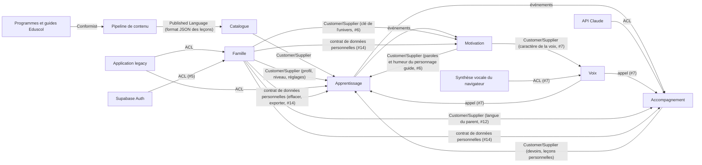

# Context map

Première version, tirée de l'application existante. Les contextes sont des **pistes** que `domain-modeler` confirme ou corrige à chaque story.

## Bounded contexts

| Contexte | Responsabilité | Dossier |
|---|---|---|
| Catalogue pédagogique | Leçons, exercices, compétences, rattachement aux programmes officiels et aux guides fondamentaux. Lecture seule pour les autres contextes. | `supabase/functions/_shared/catalogue/` |
| Apprentissage | Séances, réponses, étoiles, parcours et verrous, test de départ, révisions. Doit fonctionner hors ligne (domaine importé par le front). | `supabase/functions/_shared/apprentissage/` |
| Motivation | Série, badges, cabane, épisodes de l'histoire, univers. | `supabase/functions/_shared/motivation/` |
| Famille | Parents, profils enfants, rattachements et invitations, réglages, contrôle parental, données personnelles et RGPD. | `supabase/functions/_shared/famille/` |
| Accompagnement | Suivi, rapport de la semaine, carte des compétences, devoirs, mots de la semaine, enregistrements de lecture, leçons personnelles. | `supabase/functions/_shared/accompagnement/` |

### Sous-domaine générique

Décidé à la validation n°1 du lot 1 (décision 0007).

| Contexte | Responsabilité | Dossier |
|---|---|---|
| Voix | Lecture à voix haute : nettoyage et découpage du texte, choix de la voix de l'appareil, hauteur et rythme selon le caractère de la voix du personnage guide. Port de lecture (voix du navigateur aujourd'hui, MP3 plus tard). Fonctionne entièrement dans le navigateur, importé par le front via `@domain/voix`. Utilisé par Apprentissage, Motivation et Accompagnement. | `supabase/functions/_shared/voix/` |

### Systèmes externes

| Système | Rôle |
|---|---|
| Programmes officiels et guides Eduscol | Source de vérité pédagogique (`sources/`) |
| Pipeline de contenu (`scripts/`, Python) | Produit `bibliotheque.json` et `programmes-index.json` |
| API Claude | Création de leçons personnelles, lecture de photos de devoirs |
| Synthèse vocale | Voix qui lit les consignes (MP3 pré-générés, ou voix du navigateur) |
| Supabase Auth | Connexion du parent par lien de connexion ou code de connexion envoyés par e-mail (story #5) |
| Application legacy (`app/`) | Source des règles métier à reprendre. Pas de reprise des données (décision de démarrage n°7) |

## Relations

| Amont | Aval | Type de relation | Mécanisme (événement, appel, ACL) |
|---|---|---|---|
| Programmes officiels et guides | Pipeline de contenu | Conformist | Citations recopiées mot pour mot, vérifiées au build |
| Pipeline de contenu | Catalogue pédagogique | Published Language | Fichier `bibliotheque.json` au format `docs/format-lecons.md`, lu par un mapper d'infrastructure |
| Catalogue pédagogique | Apprentissage | Customer/Supplier | Appel en lecture : leçon par identifiant, leçons d'une matière et d'un niveau |
| Famille | Apprentissage | Customer/Supplier | Appel en lecture : niveau et réglages du profil enfant (parcours libre, clavier des dictées, tout lire à voix haute, #12) |
| Apprentissage | Motivation | Événements | `SeanceTerminee` et `LeconAcquise` (à valider), qui font avancer la série, les badges, la cabane et les épisodes |
| Apprentissage | Accompagnement | Événements | `SeanceTerminee` (à valider) alimente le suivi et le rapport de la semaine |
| Accompagnement | Apprentissage | Customer/Supplier | Appel en lecture : les devoirs du jour et les leçons personnelles de la famille, que l'enfant joue comme les autres leçons |
| API Claude | Accompagnement | Anti-Corruption Layer | Port `GenerateurDeLecon` (à valider) : la réponse de l'IA est validée et traduite en leçon avant d'entrer dans le domaine |
| Application legacy | Famille, Apprentissage | Anti-Corruption Layer | Traducteur de migration ponctuel : profils et progression de l'artifact → agrégats du domaine |
| Supabase Auth | Famille | Anti-Corruption Layer (stories #5 et #13) | Port `ServiceDeConnexion` (aussi utilisé par le parent invité avant d'accepter une invitation) : l'utilisateur et les erreurs de Supabase sont traduits en `ParentId` et en erreurs métier (`AdresseEmailInvalide`, `LienDeConnexionInvalide`, `CodeDeConnexionMalForme`, `CodeDeConnexionInvalide`) |
| Famille | Motivation | Customer/Supplier (story #6) | Le profil enfant garde la clé de son univers ; Motivation retrouve l'univers et son personnage guide (clé inconnue → `animaux`) |
| Motivation | Apprentissage | Customer/Supplier (story #6) | Appel en lecture au domaine de Motivation, depuis le front : pendant une séance, Apprentissage dit seulement « réponse juste / fausse » ; Motivation donne la félicitation ou l'encouragement et l'humeur du personnage guide. Aucune note n'est modifiée. |
| Voix | Motivation | Published Language (story #7, décision 0008) | Voix publie le type `CaractereDeLaVoix` ; Motivation l'importe et fournit les valeurs de chaque personnage guide. Voix ne connaît pas les univers |
| Famille | Accompagnement | Customer/Supplier (story #12, à valider) | Appel en lecture : la langue du parent d'un profil, pour la traduction des consignes (lot 6) |
| Famille | Apprentissage, Motivation, Accompagnement | Contrat de données personnelles (story #14, à valider) | Famille publie le port `DonneesPersonnellesDuProfil` (effacer, exporter) et l'événement `ProfilEnfantSupprime`. Chaque contexte qui détient des données d'un enfant fournit son adaptateur ; Famille orchestre la suppression et l'export sans lire leurs tables |
| Motivation | Famille | Published Language (story #11, à valider) | Famille valide la clé de l'univers d'un profil avec le type `CleUnivers` publié par Motivation (question technique T1 de #11) |
| Synthèse vocale du navigateur | Voix | Anti-Corruption Layer (story #7) | Port `VoixDeLAppareil` (voix traduites en nom et langue) et port `LecteurAVoixHaute` (adaptateur `speechSynthesis`, plus tard MP3) |
| Voix | Apprentissage, Motivation, Accompagnement | Appel (story #7) | Depuis le front, par le port `LecteurAVoixHaute` déclaré dans `voix/domain/` (décision 0007) : lire une consigne, une étape de leçon, une félicitation ou un encouragement |

## Décisions

- Les leçons personnelles appartiennent à Accompagnement. Elles respectent le même format JSON que la bibliothèque, pour qu'Apprentissage les joue de la même façon.

- **Motivation est un contexte à part.** Apprentissage annonce seulement les faits (« séance terminée avec 2 étoiles »). Motivation décide seule des récompenses (série, badges, cabane, épisodes). Une récompense ne modifie jamais une note.
- **Pas de temps d'écran** dans l'application : aucune limite de durée de jeu, ni dans Famille ni dans Apprentissage.
- **Voix est un sous-domaine générique** (décision 0007) : aucun des cinq contextes ne le possède. Les interfaces des ports qu'une règle du domaine utilise dans le navigateur (`Hasard`, `LecteurAVoixHaute`, `VoixDeLAppareil`) sont déclarées dans `domain/`.
- **La connexion du parent est obligatoire** (lot 1, décision n°5) : Supabase Auth reste derrière l'ACL de Famille, avec un lien de connexion et un code de connexion.
- **Rattachements et invitations dans l'agrégat `ProfilEnfant`** (proposition des stories #11 et #13, à valider) : les invariants « un ou deux parents » et « une invitation acceptée rattache un seul parent » demandent une seule frontière de cohérence. Le `Parent` reste un agrégat à part ; « les enfants d'un parent » est une lecture.
- **Accès** : toute table d'un contexte qui porte un identifiant de profil enfant a des policies RLS fondées sur le rattachement du parent connecté, et une suppression en cascade avec le profil (#11, #14). Le domaine vérifie aussi le rattachement : la RLS protège l'accès, elle n'est pas le modèle.
- **Écritures de Famille** : création, modification, invitation, acceptation, suppression et export passent par des Edge Functions avec le JWT du parent (proposition, questions techniques T2 et T4). Le contrôle parental, le choix du profil en cours et le choix de voix tournent dans le navigateur.
