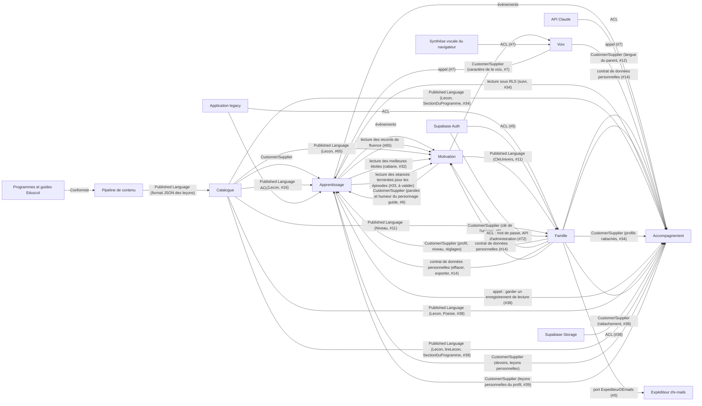

# Context map

Première version, tirée de l'application existante. Les contextes sont des **pistes** que `domain-modeler` confirme ou corrige à chaque story.

## Bounded contexts

| Contexte | Responsabilité | Dossier |
|---|---|---|
| Catalogue pédagogique | Leçons, exercices, compétences, rattachement aux programmes officiels et aux guides fondamentaux. Lit et valide le format JSON des leçons (`lireLecon`, dans `domain/`, importé par le front via `@domain/catalogue`, #16) : texte à trous découpé, réponse et écriture des schémas en barres calculées, consignes par défaut. Lecture seule pour les autres contextes. | `supabase/functions/_shared/catalogue/` |
| Apprentissage | Séances (agrégat `Seance` : plan, questions jouées, réponses, erreurs, avancement, étoiles), correction de chaque type d'exercice, aide et « Je ne sais pas », résultat de la leçon, record de fluence (#16 à #24) ; parcours et verrous, test de départ, révisions (lot 4). Doit fonctionner hors ligne (domaine importé par le front). | `supabase/functions/_shared/apprentissage/` |
| Motivation | Série, badges, cabane, épisodes de l'histoire, univers. | `supabase/functions/_shared/motivation/` |
| Famille | Parents, profils enfants, rattachements et invitations, réglages, contrôle parental, données personnelles et RGPD. | `supabase/functions/_shared/famille/` |
| Accompagnement | Suivi, rapport de la semaine, carte des compétences, devoirs, mots de la semaine, enregistrements de lecture, leçons personnelles. | `supabase/functions/_shared/accompagnement/` |

### Sous-domaine générique

Décidé à la validation n°1 du lot 1 (décision 0007).

| Contexte | Responsabilité | Dossier |
|---|---|---|
| Voix | Lecture à voix haute : nettoyage et découpage du texte, choix de la voix de l'appareil, hauteur et rythme selon le caractère de la voix du personnage guide. Port de lecture (voix du navigateur aujourd'hui, MP3 plus tard). Fonctionne entièrement dans le navigateur, importé par le front via `@domain/voix`. Utilisé par Apprentissage, Motivation et Accompagnement. | `supabase/functions/_shared/voix/` |

### Systèmes externes

| Système | Rôle |
|---|---|
| Programmes officiels et guides Eduscol | Source de vérité pédagogique (`sources/`) |
| Pipeline de contenu (`scripts/`, Python) | Produit `bibliotheque.json` et `programmes-index.json` |
| API Claude | Création de leçons personnelles, lecture de photos de devoirs |
| Synthèse vocale | Voix qui lit les consignes (MP3 pré-générés, ou voix du navigateur) |
| Supabase Auth | Connexion du parent par lien de connexion ou code de connexion envoyés par e-mail (story #5). Émet et vérifie le lien et le code ; confie l'e-mail à une Edge Function (hook « Send Email », décision 0011) |
| Supabase Auth (beta, #72) | Connexion du parent par adresse e-mail et mot de passe du parent, sans aucun e-mail (confirmation désactivée, inscriptions publiques fermées). Garde l'empreinte du mot de passe ; son API d'administration crée le parent à l'inscription et change le mot de passe lors d'une réinitialisation (deux Edge Functions, `service_role` dans `Deno.env`) (décision 0019) |
| Expéditeur d'e-mails | Envoi de l'e-mail de connexion : boîte de test sur le projet de développement, fournisseur européen en production (#45) (décision 0011) |
| Application legacy (`app/`) | Source des règles métier à reprendre. Pas de reprise des données (décision de démarrage n°7) |
| Supabase Storage | Garde les fichiers des enregistrements de lecture (bucket privé `enregistrements-de-lecture`, région UE), lus par URL signée courte (#38) |
| Planificateur `pg_cron` et `pg_net` | Déclenche toutes les heures l'effacement des enregistrements de lecture expirés (Edge Function protégée par un secret, #38) |

## Relations

| Amont | Aval | Type de relation | Mécanisme (événement, appel, ACL) |
|---|---|---|---|
| Programmes officiels et guides | Pipeline de contenu | Conformist | Citations recopiées mot pour mot, vérifiées au build |
| Pipeline de contenu | Catalogue pédagogique | Published Language | Fichier `bibliotheque.json` au format `docs/format-lecons.md`, lu par un mapper d'infrastructure |
| Catalogue pédagogique | Apprentissage | Customer/Supplier | Appel en lecture : leçon par identifiant, leçons d'une matière et d'un niveau. Côté serveur, port `LeconsDuCatalogue` : `TerminerLaSeance` relit la leçon pour revalider la séance (#24) |
| Catalogue pédagogique | Apprentissage | Published Language (stories #16 à #22) | Le Catalogue publie le type `Lecon` (étapes de leçon, exercices validés de chaque type) dans `@domain/catalogue` ; Apprentissage l'importe et ne lit jamais le JSON brut (ni les crochets d'un texte à trous, ni les `null` d'un schéma en barres). Lecture du format dans `catalogue/domain/` (décision 0012) ; un type d'exercice inconnu est écarté |
| Famille | Apprentissage | Customer/Supplier | Appel en lecture : niveau, prénom et réglages du profil enfant (parcours libre, clavier des dictées, tout lire à voix haute, #12). Au lot 3, le front les passe à la séance (`ContexteDeSeance`, #16) : choix des calculs au CP (#20), clavier des dictées (#19), lecture des choix (#17). `TerminerLaSeance` vérifie le rattachement du parent au profil (#24) |
| Apprentissage | Motivation | Événements | `SeanceTerminee` et `LeconAcquise` (données précisées par #24), qui font avancer la série, les badges, la cabane et les épisodes (lot 5). Motivation remplit la zone « nouveautés » de l'écran de fin, sans jamais modifier une étoile |
| Apprentissage | Apprentissage | Événements internes (story #24) | `SeanceTerminee` met à jour le `ResultatDeLaLecon` et le `RecordDeFluence` (un agrégat par transaction) ; `LeconReussie` servira au parcours et aux verrous (lot 4) |
| Apprentissage | Accompagnement | Événements | `SeanceTerminee` (#24) alimente le suivi et le rapport de la semaine |
| Accompagnement | Apprentissage | Customer/Supplier | Appel en lecture : les devoirs du jour et les leçons personnelles de la famille, que l'enfant joue comme les autres leçons |
| API Claude | Accompagnement | Anti-Corruption Layer | Port `GenerateurDeLecon` (à valider) : la réponse de l'IA est validée et traduite en leçon avant d'entrer dans le domaine |
| Application legacy | Famille, Apprentissage | Anti-Corruption Layer | Traducteur de migration ponctuel : profils et progression de l'artifact → agrégats du domaine |
| Supabase Auth | Famille | Anti-Corruption Layer (stories #5 et #13) | Port `ServiceDeConnexion` (aussi utilisé par le parent invité avant d'accepter une invitation ; l'acceptation elle-même passe par une fonction Postgres `security definer` appelée avec son JWT, décision 0009, n°3) : l'utilisateur et les erreurs de Supabase sont traduits en `ParentId` et en erreurs métier (`AdresseEmailInvalide`, `LienDeConnexionInvalide`, `CodeDeConnexionMalForme`, `CodeDeConnexionInvalide`) |
| Supabase Auth | Famille | Anti-Corruption Layer (story #5, décision 0011) | Hook « Send Email » : l'ACL `DemandeDEmailSupabase` traduit la demande signée (adresse, `token`, `token_hash`, `redirect_to`, type d'action) en adresse, lien de connexion et code de connexion, puis appelle le cas d'usage serveur `EnvoyerEmailDeConnexion` |
| Famille | Expéditeur d'e-mails | Port et adaptateurs (story #5, décision 0011) | Port `ExpediteurDEmails` (couche `application/`) : adaptateur boîte de test (développement), fournisseur européen (production, #45). Le domaine compose l'e-mail de connexion, l'adaptateur ne fait que l'envoyer |
| Supabase Auth | Famille | Anti-Corruption Layer (story #72, décision 0019) | Port `ServiceDeConnexion` élargi (navigateur) : appel des Edge Functions d'inscription et de réinitialisation, connexion par mot de passe, fermeture des autres connexions du parent après une réinitialisation ; erreurs de Supabase traduites en `AdresseOuMotDePasseIncorrect`, `AdresseDejaUtilisee`, `MotDePasseNonConforme`, `MotDePasseTropLong`, `ServiceDeConnexionIndisponible`. Côté serveur, port `InscriptionsDesParents` (API d'administration) pour le cas d'usage `InscrireLeParent`, qui revérifie les règles du mot de passe ; ports `ParentsDesAdresses` et `MotsDePasseDesParents` (API d'administration) pour le cas d'usage `ReinitialiserLeMotDePasse`, qui lit seulement les prénoms des enfants rattachés (port `PrenomsDesEnfantsRattaches`) et compte les essais de réinitialisation (port `RegistreDesEssaisDeReinitialisation`, table sans policy). Les règles du mot de passe sont dans `famille/domain/`, importées par le front via `@domain/famille` |
| Famille | Motivation | Customer/Supplier (story #6) | Le profil enfant garde la clé de son univers ; Motivation retrouve l'univers et son personnage guide (clé inconnue → `animaux`) |
| Motivation | Apprentissage | Customer/Supplier (story #6) | Appel en lecture au domaine de Motivation, depuis le front : pendant une séance, Apprentissage dit seulement « réponse juste / fausse » ; Motivation donne la félicitation ou l'encouragement et l'humeur du personnage guide. Aucune note n'est modifiée. Au lot 3, Motivation ajoute les paroles de séance : accueil de la leçon, fin des étapes, annonce de l'exercice, « Je ne sais pas », phrase de fin selon les étoiles (#16, #23, #24). Les aides et explications propres aux exercices restent dans Apprentissage |
| Voix | Motivation | Published Language (story #7, décision 0008) | Voix publie le type `CaractereDeLaVoix` ; Motivation l'importe et fournit les valeurs de chaque personnage guide. Voix ne connaît pas les univers |
| Famille | Accompagnement | Customer/Supplier (story #12) | Appel en lecture : la langue du parent, réglage de chaque profil enfant (décision n°8 du lot 2), pour la traduction des consignes (lot 6). Seul le texte de la consigne part à l'IA |
| Famille | Apprentissage, Motivation, Accompagnement | Contrat de données personnelles (story #14, décision 0009, n°4) | Suppression en cascade en base pour les tables du profil, plus le port `DonneesPersonnellesDuProfil` (effacer, exporter) pour ce qui n'est pas en base (Storage, caches), et l'événement `ProfilEnfantSupprime`. Chaque contexte qui détient des données d'un enfant fournit son adaptateur ; Famille orchestre la suppression et l'export sans lire leurs tables. Toute story qui ajoute une donnée d'enfant l'ajoute à la suppression et à l'export |
| Motivation | Famille | Published Language (story #11, décision 0009, n°5) | Famille valide la clé de l'univers d'un profil avec le value object `CleUnivers` publié par Motivation (`@domain/motivation`) |
| Catalogue pédagogique | Famille | Published Language (story #11, décision 0009, n°5) | Famille importe le value object `Niveau` (CP à CM2) publié par le Catalogue (`@domain/catalogue`, créé avec #11) |
| Synthèse vocale du navigateur | Voix | Anti-Corruption Layer (story #7) | Port `VoixDeLAppareil` (voix traduites en nom et langue) et port `LecteurAVoixHaute` (adaptateur `speechSynthesis`, plus tard MP3) |
| Voix | Apprentissage, Motivation, Accompagnement | Appel (story #7) | Depuis le front, par le port `LecteurAVoixHaute` déclaré dans `voix/domain/` (décision 0007) : lire une consigne, une étape de leçon, une félicitation ou un encouragement. Au lot 3 : le mot à écouter avec la voix anglaise (#17), le mot dicté à vitesse normale ou lente (#19), les vers (#22) ; l'état Muet ou « ne sait pas lire » décide des messages de la dictée et de l'écoute |
| Catalogue pédagogique, Famille, Apprentissage | Apprentissage (parcours) | Calcul dans le domaine (story #25) | Le parcours n'est pas enregistré : le service de domaine pur `parcoursDeLaMatiere` (`@domain/apprentissage`, navigateur) le calcule à partir des leçons du Catalogue, du niveau du profil en cours (Famille) et des meilleures étoiles du profil, lues par le front sous RLS dans `resultats_des_lecons` (#24, aucune écriture, décisions 0013 et 0016). Aucune leçon n'y est verrouillée (réponse 25.1) : il ne lit pas le réglage parcours libre et n'écoute pas `LeconReussie`. La leçon suivante de fin de séance passe du Catalogue (`leconSuivante`, #24) à ce calcul |
| Catalogue pédagogique, Famille | Apprentissage (test de départ) | Customer/Supplier (story #27) | Le choix des questions (`planDuTestDeDepart`, `@domain/apprentissage`, navigateur, port `Hasard`) lit toutes les leçons du Catalogue et le niveau du profil en cours. Côté serveur, `TerminerLeTestDeDepart` relit les leçons (port `LeconsDuCatalogue`, étendu à toutes les leçons) et le niveau du profil (port `NiveauDuProfil`), rejoue les réponses et enregistre l'agrégat `ResultatDuTestDeDepart` (leçons réussies au test de départ), à part de `ResultatDeLaLecon` |
| Apprentissage (test de départ) | Apprentissage (parcours) | Calcul dans le domaine (story #27) | Le parcours reçoit les leçons réussies au test de départ en plus des meilleures étoiles, lues par le front sous RLS ; aucune étoile n'est créée ni modifiée |
| Apprentissage (test de départ) | Motivation, Accompagnement | Événement (story #27) | `TestDeDepartTermine`. Le test de départ n'est pas une séance : ni `SeanceTerminee`, ni `LeconReussie`, ni jour de séance. Motivation n'y réagit pas (ni série, ni épisode, ni cabane, ni objectif du jour) ; Accompagnement (#34) s'en sert pour le suivi. Les questions du test de départ ne vont jamais dans les révisions |
| Apprentissage (parcours, test de départ, file de révision), Catalogue pédagogique, Famille | Apprentissage (accueil de l'enfant) | Calcul dans le domaine (story #29) | La leçon du jour, les tuiles du jour et les tuiles de matière sont calculées par des fonctions pures de `@domain/apprentissage` (navigateur) à partir des entrées du parcours (#25, #27), du test de départ fait (#27), des questions dues au jour de l'appareil (#28, réponse 28.9) et de la matière de la dernière séance terminée. Aucune écriture, aucune migration, aucune Edge Function |
| Apprentissage | Motivation (objectif du jour) | Lecture seule (story #29, réponse 29.3) | Le front lit sous RLS les séances terminées du jour (leçon, date de fin) et les séances de révision terminées (jour), plus celles gardées sur l'appareil, et les passe à `objectifDuJour` (`@domain/motivation`) sous une forme propre. Le test de départ n'y entre pas (réponse 27.4). Motivation n'écrit rien et ne modifie aucune note |
| Accompagnement | Apprentissage (accueil de l'enfant) | Customer/Supplier (lot 6, place réservée par #29) | Les devoirs du jour et la dictée du jour deviendront des tuiles du jour, placées avant « À revoir » et « Mon test de départ » |
| Apprentissage, Catalogue pédagogique, Famille | Accompagnement (suivi) | Lecture seule et calcul dans le domaine (story #34, décision 34.19) | Le suivi n'enregistre rien et n'écoute aucun événement. Le front lit sous RLS (parent rattaché, policies existantes) les profils rattachés (`profils_enfants`, Famille), le parent choisit l'**enfant suivi** (`enfantSuivi`, décision 34.8), puis le front lit, pour ce seul profil, les meilleures étoiles (`resultats_des_lecons`), les leçons réussies au test de départ (`resultats_des_tests_de_depart`), les séances terminées (`seances_terminees` : leçon, date, erreurs, étoiles), le nombre de séances de révision terminées et le compteur d'erreurs corrigées pour de bon (`seances_de_revision_terminees`, `files_de_revision`, #28). Il calcule les chiffres du suivi (classe en cours seulement, décision 34.11), la carte des compétences et les leçons jouées (classes passées à part) avec les fonctions pures de `@domain/accompagnement`, sur les leçons et les sections du programme du Catalogue (`@domain/catalogue`, `SectionDuProgramme` étendu de sa matière, question 34.20). Les seuils réussie / acquise sont importés de `@domain/apprentissage`, jamais recopiés ; aucun agrégat d'Apprentissage n'est importé. Ni table, ni Edge Function, ni donnée d'enfant nouvelle : rien pour l'export (#14). La relation « événements » Apprentissage → Accompagnement reste pour le rapport de la semaine (#35) |
| Apprentissage | Accompagnement | Appel (story #38) | Pendant une séance de leçon, les exercices `lecture` et `memoriser` proposent de s'enregistrer : le front utilise `@domain/accompagnement` (sorte d'enregistrement, libellé, durée maximale, port `Enregistreur`) puis appelle l'Edge Function `garder-l-enregistrement-de-lecture`. Aucun événement : l'enregistrement de lecture n'est pas noté et ne change rien à la séance |
| Catalogue pédagogique | Accompagnement | Published Language et Customer/Supplier (story #38) | Accompagnement importe `Lecon` et `Poesie.estUneChanson` (`@domain/catalogue`) pour la sorte d'enregistrement ; côté serveur, port `LeconsDuCatalogue` d'Accompagnement pour vérifier que l'exercice est un `lecture` ou un `memoriser`, et titre de la leçon relu à l'affichage du suivi |
| Famille | Accompagnement | Customer/Supplier (story #38) | Port `RattachementsDuParent` d'Accompagnement, lu avec le JWT de l'appelant (RLS) : seul un parent rattaché garde, liste, écoute ou supprime un enregistrement de lecture |
| Supabase Storage | Accompagnement | Anti-Corruption Layer (story #38) | Port `RangementDesEnregistrements` : ranger, effacer, lister les fichiers orphelins ; écritures et effacements par Edge Function avec `service_role` après vérification (décision 0016), lecture par URL signée créée avec le JWT du parent |
| Apprentissage, Catalogue pédagogique | Motivation (écran des récompenses de l'enfant) | Lecture seule (story #65, à valider) | L'écran (nom à valider, legacy « Mes trophées ») est calculé par des fonctions pures de `@domain/motivation` (ordre des sections, pastilles de record). Le front lit les records de fluence du **profil en cours** sous RLS dans `records_de_fluence` (#20, aucune écriture, décisions 0013 et 0016 ; pas de migration ni d'Edge Function) et les passe à Motivation sous une forme propre (leçon, clé de l'exercice, meilleur score) : Motivation n'importe pas l'agrégat `RecordDeFluence`. Le libellé vient du Catalogue (`Lecon`, titre de l'exercice de fluence). Motivation n'écrit jamais un record ni une étoile |
| Apprentissage (séance) | Apprentissage (file de révision) | Même enregistrement (story #28) | Après la revalidation, `TerminerLaSeance` retient les questions ratées de la séance (avec leur leçon d'origine, la position de l'exercice et le tirage d'une question générée) dans l'agrégat `FileDeRevision` du profil, dans le même enregistrement que la séance et le résultat de la leçon (tout ou rien, question 28.11). Le test de départ n'y met rien. Tables `files_de_revision` et `questions_retenues`, sous RLS fondée sur le rattachement, écrites par `service_role` seulement (décision 0016), en cascade avec le profil et dans l'export (#14) |
| Catalogue pédagogique, Famille | Apprentissage (séance de révision) | Customer/Supplier (story #28) | La séance de révision (`SeanceDeRevision`, `@domain/apprentissage`, navigateur) relit dans le Catalogue la leçon d'origine de chaque question due pour la reposer seule (`questionDeRevision`), et le niveau du profil en cours pour le mode de réponse. Côté serveur, `TerminerLaSeanceDeRevision` (Edge Function `terminer-la-seance-de-revision`) relit la file et les leçons (port `LeconsDuCatalogue`), rejoue les réponses et applique les résultats à la file. Aucune étoile, aucun résultat de la leçon |
| Apprentissage (séance de révision) | Motivation, Accompagnement | Événements (story #28) | `SeanceDeRevisionTerminee` (série et épisodes au lot 5, #30 et #33 ; le jour de séance compte aussi la séance de révision, question 28.16) et `ErreursCorrigeesPourDeBon` (suivi du parent, #34 et #35). Rien n'est consommé dans #28. Motivation fournit les paroles d'accueil et de fin de la séance de révision |
| Apprentissage | Motivation (cabane) | Lecture seule, calcul dans le domaine (story #32, à valider : question 32.20) | La cabane n'est pas enregistrée : `cabaneDe(totalDesEtoiles(…))` (`@domain/motivation`, navigateur) la recalcule à partir des meilleures étoiles du **profil en cours**, lues par le front sous RLS dans `resultats_des_lecons` (#24) et réunies avec les étoiles gagnées pendant l'utilisation (lecture existante du parcours, #25), passées sous une forme propre (leçon → 1 à 3) : Motivation n'importe pas `ResultatDeLaLecon`. À l'écran de fin, `objetRecuParLaSeance` reçoit les meilleures étoiles d'avant la séance et les étoiles de la séance, et rend l'objet reçu pour la zone « nouveautés ». Pas d'abonnement à `SeanceTerminee`, pas de migration ni d'Edge Function ; le résultat du test de départ n'est pas lu (aucune étoile) |
| Catalogue pédagogique | Accompagnement | Published Language (story #39) | Accompagnement produit chaque leçon personnelle **au format** `docs/format-lecons.md` et la valide avec `lireLecon` (`@domain/catalogue`), plus ses règles propres (section existante, de sa matière, couvrant son niveau ; citation mot pour mot dans l'extrait ; mots dictés dictables). Il lit l'index des programmes avec `lireSectionDuProgramme`, étendue de `matiere` et `extrait` (champs déjà présents dans `programmes-index.json`), et importe `Niveau`, `Matiere`, `toutesLesMatieres`, `libelleDuType`. Le Catalogue ne connaît pas les leçons personnelles |
| Accompagnement | Apprentissage | Customer/Supplier (story #39) | Navigateur : le front lit sous RLS les leçons personnelles du **profil en cours**, les passe par `lireLecon` (une leçon illisible est écartée) et les donne à Apprentissage à part de la bibliothèque (`EntreesDuParcours.leconsPersonnelles`) : partie « Pour toi » de `toutesLesLecons`, hors du parcours (ni place, ni prochaine leçon, ni leçon suivante), jamais dans le test de départ. Serveur : `terminer-la-seance` retrouve aussi une leçon `perso-…` (adaptateur d'Apprentissage, lecture avec le JWT de l'appelant, profil de la leçon = profil de la séance, décision 0024). Apprentissage ne voit jamais le texte du parent. Une séance d'une leçon personnelle émet `SeanceTerminee` comme les autres ; sans `competence`, aucun badge |

Note (#25, réponses 25.1 et N3, 2026-10-24) : **il n'y a plus de verrou**. Dans les tableaux ci-dessus, « parcours et verrous » (ligne Apprentissage des contextes) se lit « parcours » ; le réglage « parcours libre » (ligne Famille → Apprentissage) n'est plus lu par le parcours et sera retiré par une story de Famille (réponse N2) ; `LeconReussie` (ligne des événements internes) ne sert ni au parcours ni à des verrous : le parcours se recalcule à la lecture, sans écouter d'événement. Le parcours lit aussi, dans le Published Language du Catalogue (`@domain/catalogue`), `toutesLesMatieres` (ordre des matières) et `Niveau#estAuDessusDe` (leçons réussies d'une classe au-dessus, réponse N1) ; il remplace `leconSuivante` du Catalogue, retirée.

Note (#29, réponses du PO du 2026-10-25) : l'**accueil de l'enfant** (le legacy dit « Aujourd'hui », réponse 29.5) est un écran composé : Famille (salutation, « Changer d'enfant »), Apprentissage (leçon du jour, tuiles du jour, tuiles de matière), Motivation (pastille de série #30, objectif du jour, réponse 29.3) et Accompagnement (devoirs et dictée du jour, lot 6). Aucun contexte nouveau. Chaque contexte fournit sa partie par son domaine (`@domain/<contexte>`) ; l'écran ne contient aucune règle.

Note (#26, 2026-10-25) : les leçons des classes d'avant (bloc de « Mon parcours ») et « Toutes les leçons » sont des vues calculées d'Apprentissage (`parcoursDeLaMatiere` étendu, `toutesLesLecons`), sur les mêmes lectures que #25 et #27 (Catalogue, niveau du profil, meilleures étoiles, leçons réussies au test de départ). Aucune nouvelle relation ; le réglage parcours libre de Famille n'est pas lu (réponse N2 de #25).

Note (#32, décision 32.20, 2026-10-25) : la relation Apprentissage → Motivation (cabane) est **validée** par le PO : dans la ligne du tableau ci-dessus, « à valider : question 32.20 » se lit « décision 32.20 ». Une lecture des meilleures étoiles en échec donne `undefined` (`lireToutesLesMeilleuresEtoilesSiPossible`) : ni section de la cabane, ni annonce à l'écran de fin (décisions 32.13 et 32.22) ; la lecture des étoiles d'avant la séance, faite au lancement de la séance, est abandonnée au bout de 5 s. La phrase de fin complétée est composée dans le domaine (`phraseDeFinAvecLaCabane`).

Note (#39, 2026-10-25) : les deux lignes « Catalogue pédagogique → Accompagnement » et « Accompagnement → Apprentissage (story #39) » ci-dessus précisent, pour les leçons personnelles, la ligne plus ancienne « Accompagnement → Apprentissage » (« leçons personnelles de la famille ») : une leçon personnelle appartient à **un profil enfant**, pas à la famille (réponse 39.1). Les écritures des leçons personnelles passent par deux Edge Functions avec le JWT du parent, sous RLS (décision 0024). La ligne « API Claude → Accompagnement » reste pour #40.
Note (#31, validée par le PO le 2026-10-25) : les badges se recalculent comme la cabane (décision 32.20), sans les enregistrer ni s'abonner à `LeconAcquise` (décision 31.3 de `docs/stories/31/domain-model.md`). Le front lit les meilleures étoiles du profil en cours sous RLS (lecture de #32), obtient de `@domain/apprentissage` les leçons acquises et celle que la séance vient de rendre acquise (fonctions pures, seuil de `ResultatDeLaLecon`), puis passe ces identifiants à `@domain/motivation`, avec les leçons du Catalogue (`competence`, `titre`, `matiere`). Les leçons personnelles ne donnent pas de badge (réponse du PO, 39.12) : Motivation ne lit rien d'Accompagnement pour les badges. La ligne « Apprentissage → Motivation : Événements » se lit, pour les badges, « lecture seule et calcul dans le domaine » ; `LeconAcquise` reste publié, sans abonné. Aucune donnée d'enfant nouvelle.

Note (#33, cadrage, à valider) : proposition de recalculer les épisodes ouverts comme la cabane (décision 32.20) et la série (décision 30.5 a), sans les enregistrer ni s'abonner à `SeanceTerminee` ou `SeanceDeRevisionTerminee` (question 33.8 de `docs/stories/33/domain-model.md`). Le front lit les identifiants des séances terminées et des séances de révision terminées du profil en cours sous RLS (`seances_terminees`, `seances_de_revision_terminees`, même lecture que #29 et #30), les réunit avec les séances gardées sur l'appareil, et passe le résultat à `@domain/motivation` sous une forme propre (`SeancesTermineesDuProfil`) : Motivation n'importe aucun agrégat d'Apprentissage. Le nombre « avant » est lu au lancement de la séance, comme les meilleures étoiles de la cabane. Le texte d'un épisode est lu par le port `LecteurAVoixHaute` (Voix, relation existante). Le test de départ n'ouvre rien (27.4). Aucune migration, aucune Edge Function, aucune donnée d'enfant nouvelle. Si la proposition est retenue, la ligne « Apprentissage → Motivation : Événements » se lit, pour les épisodes, « lecture seule et calcul dans le domaine ».

Note (#97, cadrage, à valider) : **effets sonores**. Voix publie le value object `EffetSonore` (les 8 sons choisis par le PO) et le port `LecteurDEffetsSonores` dans `@domain/voix` (Published Language vers Motivation, comme `CaractereDeLaVoix`) ; `LectureAVoixHaute` joue les effets sonores, toujours avant la parole, rien en voix suspendue ; le Muet ne coupe que la voix, pas les effets sonores (décision 97.2 du PO, 2026-10-28). Motivation choisit l'effet sonore de chaque fait d'Apprentissage, à côté de l'humeur (relation « paroles et humeur du personnage guide » de #6, étendue), à partir des faits existants (résultat de la réponse, avancement, exercice complété, issue du record, leçon acquise, objet reçu, épisode ouvert), sans importer d'agrégat. Apprentissage publie une lecture de plus, « la dernière réponse complète l'exercice » (**exercice complété**, décision 97.6), sans changer aucune règle de correction. Les fichiers (`public/sons/`, cache du service worker) passent par un adaptateur du navigateur dans `src/voix/` (ACL, comme la synthèse vocale). Aucun événement, aucune migration, aucune Edge Function, aucune donnée d'enfant. Voix voit sa responsabilité élargie : « lecture à voix haute et effets sonores ».

Note (#99, cadrage, à valider) : **dessin de « Mon parcours »**. Aucune relation nouvelle. Apprentissage publie une lecture pure de plus dans `@domain/apprentissage`, l'**avancée dans le parcours** (de la prochaine leçon connue à la nouvelle prochaine leçon), que le front montre par la marche du personnage guide (Motivation, composants de #96). Motivation ne lit ni ne modifie le parcours ; aucun effet sonore nouveau ; la prochaine leçon connue reste en mémoire le temps de l'utilisation, jamais enregistrée.

Note (#102, réponses du PO du 2026-10-29) : **tenues du personnage guide**. Aucune relation nouvelle. Les tenues reçues se recalculent comme la cabane (décision 32.20), à partir du même total des étoiles (lecture « Apprentissage → Motivation (cabane) », inchangée) : `tenuesDe`, `tenueRecueParLaSeance` (`@domain/motivation`). La tenue portée est gardée sur l'appareil, par profil (réponse 102.8 A), par un adaptateur de `src/` ajouté à `DonneesDeLAppareil` (Famille) : ni migration, ni Edge Function, ni événement, ni donnée d'enfant côté serveur, donc rien de nouveau dans le contrat de données personnelles (#14). Une story suivante qui retrouverait la tenue portée sur tous les appareils ajouterait une donnée de Motivation sous RLS et son adaptateur d'export et de suppression.

## Décisions

- Les leçons personnelles appartiennent à Accompagnement. Elles respectent le même format JSON que la bibliothèque, pour qu'Apprentissage les joue de la même façon.

- **Motivation est un contexte à part.** Apprentissage annonce seulement les faits (« séance terminée avec 2 étoiles »). Motivation décide seule des récompenses (série, badges, cabane, épisodes). Une récompense ne modifie jamais une note.
- **Pas de temps d'écran** dans l'application : aucune limite de durée de jeu, ni dans Famille ni dans Apprentissage.
- **Voix est un sous-domaine générique** (décision 0007) : aucun des cinq contextes ne le possède. Les interfaces des ports qu'une règle du domaine utilise dans le navigateur (`Hasard`, `LecteurAVoixHaute`, `VoixDeLAppareil`) sont déclarées dans `domain/`.
- **La connexion du parent est obligatoire** (lot 1, décision n°5) : Supabase Auth reste derrière l'ACL de Famille, avec un lien de connexion et un code de connexion.
- **Rattachements et invitation en attente dans l'agrégat `ProfilEnfant`** (proposition des stories #11 et #13, appliquée à la validation n°1 du lot 2) : les invariants « un ou deux parents » et « une invitation acceptée rattache un seul parent » demandent une seule frontière de cohérence. Le `Parent` reste un agrégat à part ; « les enfants d'un parent » est une lecture. Les deux parents ont les mêmes droits (décision n°1 du lot 2).
- **Accès** : toute table d'un contexte qui porte un identifiant de profil enfant a des policies RLS fondées sur le rattachement du parent connecté, et une suppression en cascade avec le profil (#11, #14). Le domaine vérifie aussi le rattachement : la RLS protège l'accès, elle n'est pas le modèle.
- **Séance dans le navigateur, revalidée par le serveur** (proposition des stories #16 et #24, appliquée à la validation n°1 du lot 3 ; décision 0013) : la séance se joue entièrement dans le navigateur (`@domain/apprentissage`). À la fin, le front envoie la séance (tirages et réponses) à l'Edge Function `terminer-la-seance`, avec le JWT du parent ; le serveur relit la leçon, **rejoue les réponses** avec le même domaine et recalcule les étoiles (décision 0003). Il garde seulement le résumé (étoiles, erreurs par question, « Je ne sais pas »). Les écritures d'Apprentissage passent toutes par des Edge Functions, comme celles de Famille (décision 0013) ; une séance incohérente est refusée sans rien enregistrer, et l'enregistrement est idempotent (identifiant de séance) : une séance gardée sur l'appareil après un envoi impossible et renvoyée au retour du réseau n'est comptée qu'une fois. Tables d'Apprentissage (`seances_terminees`, `questions_des_seances`, `resultats_des_lecons`, `records_de_fluence`) sous RLS fondée sur le rattachement, supprimées en cascade avec le profil et incluses dans l'export (contrat de #14).
- **Écritures de Famille** (décision 0009) : création, modification, réglages, invitation, annulation, suppression et export passent par des Edge Functions avec le JWT du parent ; le front ne fait que des lectures directes, sous RLS. Le profil et son premier rattachement sont créés en une seule transaction. L'acceptation d'une invitation passe par une fonction Postgres `security definer` à périmètre minimal, appelée avec le JWT du parent invité ; jamais de `service_role`. Le contrôle parental, le choix du profil en cours et le choix de voix tournent dans le navigateur.

Note (#30, réponses du PO du 2026-10-25) : **Apprentissage → Motivation (série), lecture seule.** La série n'est pas enregistrée et Motivation n'écrit rien : le front lit sous RLS les **jours de séance** du profil en cours, c'est-à-dire le jour des séances terminées (`seances_terminees`, #24) et des séances de révision terminées (`seances_de_revision_terminees`, #28), plus celles gardées sur l'appareil, et les passe à `serieDeJours` et `texteDeLaPastille` (`@domain/motivation`) avec le jour de l'appareil. Le **Jour de séance** reste un fait d'Apprentissage (réponse 30.5, pas de journal propre à Motivation ni à Accompagnement) ; le test de départ n'en donne pas (27.4). Apprentissage publie aussi le value object `Jour` et `jourDe` (#28, réponse 28.9) dans `@domain/apprentissage`, que Motivation importe (Published Language). Réponse 30.6 : la séance terminée garde le jour envoyé par l'appareil (nouvelle colonne de jour), comme la séance de révision, pour que la série (#30), l'objectif du jour (#29) et les épisodes (#33) lisent le même jour. Les épisodes (#33) et le suivi (#34, #35) liront les mêmes jours de séance.

- **Connexion par mot de passe dans la beta** (story #72, décision 0019) : aucun e-mail n'est envoyé dans la beta. Le lien de connexion et le code de connexion (#5) restent dans le domaine sans être proposés par l'écran. L'inscription du parent et la réinitialisation du mot de passe par le prénom d'un enfant rattaché sont les deux seules Edge Functions de Famille qui utilisent `service_role`, parce que l'appelant n'est pas connecté ; la réinitialisation par prénom est une exception de la beta, retirée par #45.
