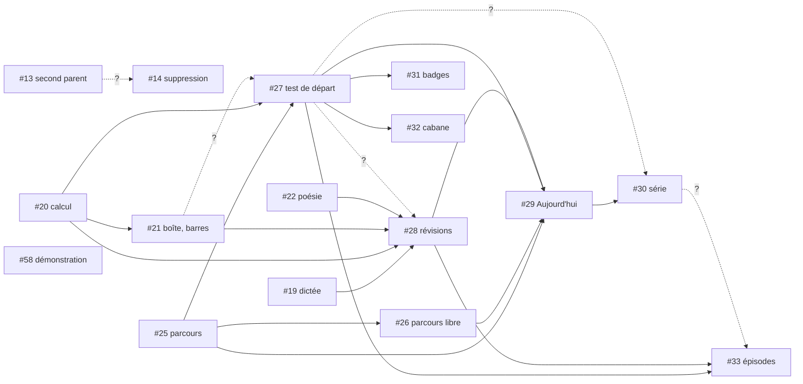

# Graphe des stories

Mise à jour : 2026-10-24, par le chef d'orchestre seulement (décision 0017).
Une story ne commence son code que quand **toutes** ses dépendances sont mergées dans `main`. L'état courant (en cours, en revue…) est dans les labels `graphe:*` des issues, pas ici.

Les dépendances viennent des issues (relevé du 2026-10-24). Une dépendance suivie de `?` est une **hypothèse** : le PO la confirme ou l'écarte avant le lancement de la story. Tant qu'elle n'est pas tranchée, elle bloque.

## Livrées

#5, #6, #7, #8, #10, #11, #12, #15, #16, #17, #18, #23, #24.

## Nœuds ouverts

Ressources : `base` = migration sur `savanturier-dev` ; `email` = scénarios `@envoi-email` ; `ia` = appel à l'API Claude (clé pas encore fournie, décision de démarrage n°6).

| # | Story | Contexte | Dépend de (ouvertes) | Ressources | Beta | Niveau |
|---|---|---|---|---|---|---|
| 13 | Inviter un second parent | Famille | — | base, email | oui | 0 |
| 19 | Dictée, conjugaison | Apprentissage | — | — | oui | 0 |
| 20 | Calcul, fluence, addition posée | Apprentissage | — | base | oui | 0 |
| 22 | Mémoriser une poésie | Apprentissage | — | — | oui | 0 |
| 25 | Parcours par matière et verrous | Apprentissage | — | base? | oui | 0 |
| 58 | Retirer la page de démonstration | transverse | — | — | oui | 0 |
| 14 | Supprimer et exporter un profil | Famille | 13? | base | oui | 1 |
| 21 | Boîte, barres | Apprentissage | 20 | — | oui | 1 |
| 26 | Parcours libre et classes d'avant | Apprentissage | 25 | — | oui | 1 |
| 27 | Test de départ | Apprentissage | 25, 20, 21? | base | oui | 2 |
| 28 | Révisions des erreurs | Apprentissage | 19, 20, 21, 22, 27? | base | oui | 3 |
| 31 | Badges et compétences | Motivation | 27, 39? | base? | oui | 3 |
| 32 | Cabane | Motivation | 27 | base? | oui | 3 |
| 29 | Écran « Aujourd'hui » | Apprentissage | 25, 26, 27, 28 | — | oui | 4 |
| 30 | Série | Motivation | 29, 27? | base | oui | 5 |
| 33 | Épisodes de l'histoire | Motivation | 27, 28, 30? | base | oui | 6 |
| 45 | Mise en ligne | transverse | toute la beta, 58?, 38? | email, base? | oui | 7 |
| 43 | Traduction des consignes | Accompagnement | — | ia, base? | non | 0 |
| 34 | Suivi et carte des compétences | Accompagnement | 25, 27, 28, 13? | — | non | 4 |
| 37 | Mots de la semaine | Accompagnement | 19, 29 | base | non | 5 |
| 35 | Rapport de la semaine | Accompagnement | 34, 28, 30? | base | non | 6 |
| 39 | Leçons personnelles (générateurs locaux) | Accompagnement | 25, 26, 19, 20, 22, 14 | base | non | 2 |
| 36 | Devoirs : leçon à faire | Accompagnement | 29, 39? | base | non | 5 |
| 38 | Enregistrements de lecture | Accompagnement | 22, 14, 34 | base | non | 5 |
| 40 | Leçons personnelles avec l'IA | Accompagnement | 39 | ia | non | 3 |
| 41 | Photographier le cahier | Accompagnement | 39, 40 | ia | non | 4 |
| 42 | Audio des poésies | Accompagnement | 22, 39, 14 | base | non | 3 |
| 44 | Hors ligne et synchronisation | transverse | 13, 14, 28?, 30? à 33? | base | non | 7 |
| 46 | Retrait de `app/` | transverse | #13 à #43, 58, 45 | — | non | 8 |

Le **niveau** est la longueur de la plus longue chaîne de dépendances ouvertes : toutes les stories d'un même niveau peuvent avancer en parallèle dès que le niveau précédent qui les concerne est mergé.

## Graphe de la beta

## Chemin critique de la beta

`#20 → #21 → #27 → #28 → #29 → #30 → #33 → #45` : 8 stories en série. C'est la durée minimale de la beta, quel que soit le nombre d'équipes. Les stories du chemin critique passent en premier dans chaque vague.

## Vague 1 proposée (au plus 3 équipes)

| Équipe | Story | Pourquoi | Verrous |
|---|---|---|---|
| A | #20 calcul | chemin critique | base |
| B | #25 parcours | ouvre #26, #27, #29 | base? |
| C | #19 dictée | ouvre #28, sans ressource partagée | — |

En attente d'une place : #22, #13, #58 (niveau 0), puis #21 dès que #20 est mergée, #26 dès que #25 est mergée.

## Questions pour le PO avant de lancer les stories concernées

1. **#14 dépend-elle de #13 ?** La suppression efface aussi les invitations : sans #13, il n'y a pas d'invitation à effacer.
2. **#27 dépend-elle de #21 ?** Le test de départ pose-t-il des questions de boîte et de barres ?
3. **#28 dépend-elle de #27 ?** Les révisions ignorent le test de départ : faut-il qu'il existe d'abord ?
4. **#31 (beta) cite #39 (hors beta)** pour les leçons personnelles : on livre #31 sans ce cas, et #39 l'ajoutera ?
5. **#45 (beta) suppose l'expiration à 30 jours** des enregistrements, qui vient de #38 (hors beta) : on la sort de #45 ?
6. **#30 dépend-elle de #27 ?** et **#33 de #30 ?** (le comptage des séances vient-il du journal de la série ?)
7. Pas d'issue pour l'écran « Mes trophées » (#31, #32, #33) ni pour le type d'exercice `lecture` (#38) : faut-il en créer ?

## Scénarios déjà écrits qui attendent une story ouverte

Livrer ces stories rend exécutables des scénarios déjà au vert ailleurs (tags `@depend-de-<n>`) : #19, #20, #21 (scénarios de #23), #14 et #20 (scénarios de #24), #44 (scénarios de #12). L'équipe qui les livre relance ces scénarios en non-régression.
