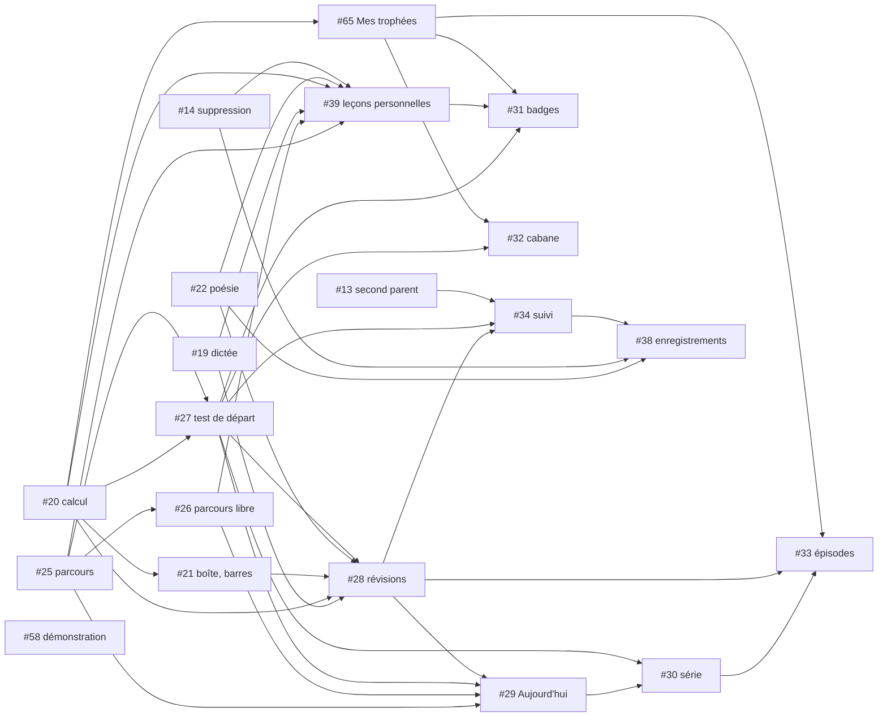

# Graphe des stories

Mise à jour : 2026-10-24, par le responsable des équipes seulement (décision 0017).
Une story ne commence son code que quand **toutes** ses dépendances sont mergées dans `main`. L'état courant (en cours, en revue…) est dans les labels `graphe:*` des issues et dans l'issue `[Coordination des équipes] Vague <k>`, pas ici.

Les dépendances viennent des issues (relevé du 2026-10-24), corrigées par le PO le 2026-10-24. Une dépendance suivie de `?` est une **hypothèse** : le PO la confirme ou l'écarte avant le lancement de la story. Tant qu'elle n'est pas tranchée, elle bloque.

## Livrées

#5, #6, #7, #8, #10, #11, #12, #15, #16, #17, #18, #23, #24.

## Nœuds ouverts

Ressources : `base` = migration sur `savanturier-dev` ; `email` = scénarios `@envoi-email` ; `ia` = appel à l'API Claude (clé pas encore fournie, décision de démarrage n°6).

### Beta

| # | Story | Contexte | Dépend de (ouvertes) | Ressources | Niveau |
|---|---|---|---|---|---|
| 13 | Inviter un second parent | Famille | — | base, email | 0 |
| 14 | Supprimer et exporter un profil | Famille | — | base | 0 |
| 19 | Dictée, conjugaison | Apprentissage | — | — | 0 |
| 20 | Calcul, fluence, addition posée | Apprentissage | — | base | 0 |
| 22 | Mémoriser une poésie | Apprentissage | — | — | 0 |
| 25 | Parcours par matière et verrous | Apprentissage | — | base? | 0 |
| 58 | Retirer la page de démonstration | transverse | — | — | 0 |
| 21 | Boîte, barres | Apprentissage | 20 | — | 1 |
| 26 | Parcours libre et classes d'avant | Apprentissage | 25 | — | 1 |
| 27 | Test de départ | Apprentissage | 25, 20 | base | 1 |
| 65 | Écran « Mes trophées » (nom à trancher) | Motivation | 20 | — | 1 |
| 28 | Révisions des erreurs | Apprentissage | 19, 20, 21, 22, 27 | base | 2 |
| 32 | Cabane | Motivation | 27, 65 | base? | 2 |
| 39 | Leçons personnelles (générateurs locaux) | Accompagnement | 25, 26, 19, 20, 22, 14 | base | 2 |
| 29 | Écran « Aujourd'hui » | Apprentissage | 25, 26, 27, 28 | — | 3 |
| 31 | Badges et compétences | Motivation | 27, 39, 65 | base? | 3 |
| 34 | Suivi et carte des compétences | Accompagnement | 25, 27, 28, 13 | — | 3 |
| 30 | Série | Motivation | 29, 27 | base | 4 |
| 38 | Enregistrements de lecture | Accompagnement | 22, 14, 34 | base | 4 |
| 33 | Épisodes de l'histoire | Motivation | 27, 28, 30, 65 | base | 5 |
| 45 | Mise en ligne | transverse | toute la beta | email, base? | 6 |

#39, #38 et #34 entrent dans la beta (décisions du PO du 2026-10-24).

### Après la beta

| # | Story | Contexte | Dépend de (ouvertes) | Ressources |
|---|---|---|---|---|
| 43 | Traduction des consignes | Accompagnement | — | ia, base? |
| 37 | Mots de la semaine | Accompagnement | 19, 29 | base |
| 35 | Rapport de la semaine | Accompagnement | 34, 28, 30? | base |
| 36 | Devoirs : leçon à faire | Accompagnement | 29, 39? | base |
| 40 | Leçons personnelles avec l'IA | Accompagnement | 39 | ia |
| 41 | Photographier le cahier | Accompagnement | 39, 40 | ia |
| 42 | Audio des poésies | Accompagnement | 22, 39, 14 | base |
| 44 | Hors ligne et synchronisation | transverse | 13, 14, 28?, 30? à 33? | base |
| 46 | Retrait de `app/` | transverse | toutes les autres, 58, 45 | — |

Le **niveau** est la longueur de la plus longue chaîne de dépendances ouvertes : toutes les stories d'un même niveau peuvent avancer en parallèle dès que le niveau précédent qui les concerne est mergé.

## Graphe de la beta

## Chemin critique de la beta

`#20 → #21 → #28 → #29 → #30 → #33 → #45` : 7 stories en série (8 avant les réponses du PO). C'est la durée minimale de la beta, quel que soit le nombre d'équipes. Les stories du chemin critique passent en premier dans chaque vague ; #25 et #27 sont presque aussi critiques (`#25 → #27 → #28`).

## Vague 1 proposée (2 équipes, voir `nombre-d-equipes.md`)

| Équipe | Story | Pourquoi | Verrous |
|---|---|---|---|
| A | #20 calcul | chemin critique ; ouvre #21, #27, #65 | base |
| B | #25 parcours | ouvre #26, #27, #29, #39 | base? |

En attente d'une place : #19, #22, #14, #13, #58 (niveau 0), puis #21 et #65 dès que #20 est mergée, #26 dès que #25 est mergée, #27 quand les deux le sont.

## Réponses du PO (2026-10-24)

| Question | Réponse | Effet sur le graphe |
|---|---|---|
| #14 dépend-elle de #13 ? | non | #14 passe au niveau 0 |
| #27 dépend-elle de #21 ? | non | #27 ne dépend plus que de #25 et #20 |
| #28 dépend-elle de #27 ? | oui | arête confirmée |
| #31 cite #39 (hors beta) | #31 dépend de #39, et #39 entre dans la beta | #39 dans la beta |
| #45 suppose l'expiration à 30 jours de #38 | #38 entre dans la beta | #38 dans la beta |
| #30 dépend-elle de #27 ? #33 de #30 ? | oui et oui (lecture de la réponse « #30 dépend de #27, #33 de #30 », à corriger si elle est fausse) | arêtes confirmées |
| #38 dépend de #34 : #34 entre aussi dans la beta ? | oui, #38 et #34 entrent dans la beta | #34 dans la beta |
| #34 dépend-elle de #13 ? | oui | arête confirmée |
| Écran « Mes trophées » et type `lecture` sans issue | créer les issues | **#65** créée pour l'écran ; pas d'issue pour `lecture` : le type est déjà livré par #17 (« Lecture : Le petit chat Plume »), et le bouton d'enregistrement qui lui manque est décrit dans #38 |

## Questions encore ouvertes

Aucune hypothèse `?` ne reste dans la beta.

1. Les questions ouvertes de **#65**, dont le nom de l'écran (« trophée » est un synonyme interdit de badge). Elles se tranchent à la validation du cadrage de #65, comme pour toute story.

## Scénarios déjà écrits qui attendent une story ouverte

Livrer ces stories rend exécutables des scénarios déjà au vert ailleurs (tags `@depend-de-<n>`) : #19, #20, #21 (scénarios de #23), #14 et #20 (scénarios de #24), #44 (scénarios de #12). L'équipe qui les livre relance ces scénarios en non-régression.
