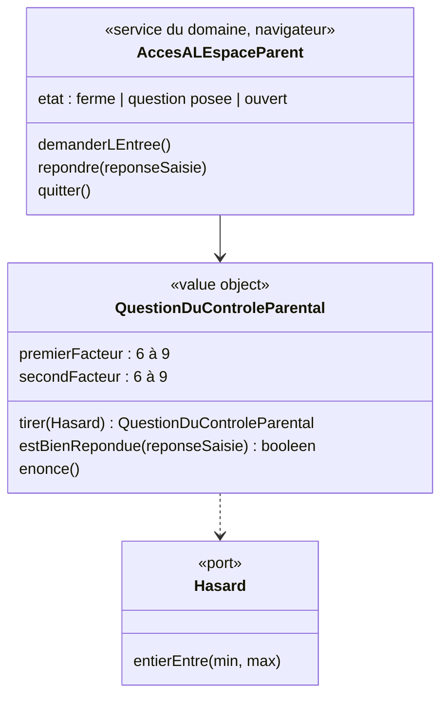

# Modèle du domaine : issue #10, Contrôle parental de l'espace parent

## Contexte

**Famille** (contexte existant). Le contrôle parental protège l'**espace parent** sur un appareil où l'enfant joue. Ce n'est **pas** une mesure de sécurité : le parent est déjà reconnu par la connexion du parent (story #5), et l'accès aux données est protégé par la RLS. Le contrôle parental évite seulement qu'un enfant change un réglage ou supprime un profil par erreur.

Toute la story tourne **dans le navigateur**, hors ligne compris : aucun appel au serveur, rien d'enregistré. Le domaine est importé par le front via `@domain/famille`, comme `LectureAVoixHaute` pour Voix (décision 0008 : un service navigateur avec état vit dans `domain/` s'il ne dépend que de ports déclarés dans `domain/`).

Relations : aucune nouvelle. Le tirage de la question passe par un port `Hasard` déclaré dans `famille/domain/` (décision 0008, n°2 : chaque contexte déclare le sien).

### Comportement actuel (`app/`, `adultGate` l. 1978, `gateForm` l. 1803)

- Bouton « Espace adulte » de l'en-tête. Titre de l'écran : « Espace adulte ».
- Question : « Question pour un adulte : combien font a × b ? », a et b tirés **chacun** entre 6 et 9 (bornes comprises). Champ « Réponse » avec pavé numérique (`inputmode="numeric"`), focus automatique, bouton « Entrer ».
- Réponse comparée en nombre (`+saisie === a × b`) : espaces autour ignorés ; champ vide ou non numérique = mauvaise réponse.
- Bonne réponse : l'espace s'ouvre sur l'onglet « Suivi ». En entrant, **le profil en cours est désélectionné** (`setChild(null)`), et le retour mène à « Qui joue aujourd'hui ? ».
- Mauvaise réponse : « Ce n'est pas la bonne réponse. », **même question**, nombre d'essais illimité.
- Retour depuis l'écran de la question : vers la carte de l'enfant s'il y en a un, sinon vers « Qui joue ? ».
- `gateForm` n'est appelé **qu'une seule fois** dans le code (`adultGate`). L'issue dit qu'il protège d'autres actions : ce n'est pas le cas aujourd'hui (voir question ouverte n°3). « Refaire le test de départ » est un bouton de l'onglet « Profils », donc déjà derrière le contrôle.
- Onglets : Suivi, Devoirs et dictée, Profils, Créer une leçon, Mes leçons, Audio des chansons, Voix.

## Termes

| Terme | Statut | Remarque |
|---|---|---|
| Contrôle parental | au glossaire (à valider) | Confirmé par l'issue et la décision de démarrage n°5 (multiplication). Définition précisée : question **de multiplication**. |
| Espace parent | **nouveau** (à valider) | Partie de l'application réservée au parent, protégée par le contrôle parental. L'interface dit « Espace parent ». |
| Espace adulte | **conflit** | Nom du legacy. Synonyme interdit de « Espace parent » (décision n°2 du glossaire : Parent est le seul rôle adulte). |
| Question du contrôle parental | **nouveau** (à valider) | La multiplication posée (deux facteurs entre 6 et 9). |
| Code | **attention** | « code » seul reste interdit (décision n°13) : le contrôle parental n'est pas un code PIN. |
| Onglet | terme d'interface | Hors glossaire (les onglets arrivent avec leurs stories). |

## Modèle



Il n'y a **pas d'agrégat** : rien n'est enregistré, ni sur le serveur ni sur l'appareil.

### Value object `QuestionDuControleParental`

| Règle | Détail |
|---|---|
| Facteurs | Deux entiers tirés **indépendamment** entre 6 et 9, bornes comprises (16 questions possibles, le carré compris). |
| Tirage | Par le port `Hasard`, jamais `Math.random` dans le domaine (décision 0003). |
| Réponse | Saisie libre. Les espaces autour sont ignorés. Une saisie vide, non numérique, ou un autre nombre que le produit est une mauvaise réponse. Le traitement de « 56,0 », « 056 » ou d'espaces au milieu est la question ouverte n°6. |
| Énoncé | « combien font a × b ? » (texte exact : question ouverte n°7). |

### Service `AccesALEspaceParent` (dans `domain/`, décision 0008)

- `demanderLEntree()` : tire une nouvelle question (chaque ouverture pose une nouvelle question, piste de l'issue).
- `repondre(saisie)` : bonne réponse → l'espace parent est **ouvert** ; mauvaise réponse → il reste fermé, message non punitif, nouvel essai possible. Même question ou nouvelle question : question ouverte n°1.
- `quitter()` : l'espace parent est **fermé**. Pour y revenir, il faut répondre à une nouvelle question.
- Dépend seulement du port `Hasard` (et, si la question ouverte n°2 le demande, d'un port `Horloge` déclaré dans `domain/`).

### Commandes

| Commande | Effet | Erreur |
|---|---|---|
| `DemanderLEntreeDeLEspaceParent` | Pose une nouvelle question du contrôle parental. | (aucune) |
| `RepondreAuControleParental(saisie)` | Ouvre l'espace parent si la réponse est juste. | `ReponseDuControleParentalFausse` (présentée « Ce n'est pas la bonne réponse. », sans blocage) |
| `QuitterLEspaceParent` | Ferme l'espace parent. | (aucune) |

`ReponseDuControleParentalFausse` peut aussi être un simple résultat (« refusé ») plutôt qu'une erreur levée : choix de l'implementer, sans effet sur les scénarios.

## Invariants

1. L'espace parent ne s'ouvre qu'après une bonne réponse à la question du contrôle parental.
2. Chaque demande d'entrée pose une question tirée au hasard ; les deux facteurs sont entre 6 et 9.
3. Quitter l'espace parent le ferme : y revenir demande de répondre de nouveau.
4. Une mauvaise réponse n'est jamais punitive : un message, puis une nouvelle chance, sans limite d'essais (sauf réponse contraire à la question ouverte n°4).
5. La déconnexion du parent (story #5) n'est possible que depuis l'espace parent ouvert.
6. Le contrôle parental ne remplace jamais la connexion du parent ni la RLS : il ne protège aucune donnée, seulement l'accès à l'écran.

## Événements

Aucun : aucun autre contexte ne réagit à l'ouverture de l'espace parent.

## Partage avec le front

Tout est dans le navigateur : `QuestionDuControleParental`, `AccesALEspaceParent` et l'interface `Hasard` sont exportés par `famille/domain/index.ts`. L'adaptateur `Math.random` vit dans `src/`. La coquille de l'espace parent (en-tête « Espace parent », bouton de déconnexion, emplacement des onglets) est de l'interface, sans règle.

## Données d'enfants

Aucune donnée nouvelle. Rien n'est enregistré.

## Emplacement

```
supabase/functions/_shared/famille/
  domain/
    hasard.ts                               # interface du port Hasard (décision 0008, n°2)
    question-du-controle-parental.ts        # value object
    acces-a-l-espace-parent.ts              # service navigateur (décision 0008)
    erreurs.ts                              # + ReponseDuControleParentalFausse (si erreur)
    index.ts                                # exports pour @domain/famille
  test_utils/
    hasard-fixe.ts
src/famille/                                # écran du contrôle parental, coquille de l'espace parent, adaptateur Hasard
```

## Questions ouvertes

1. (issue n°1) Après une mauvaise réponse, garde-t-on **la même question**, comme aujourd'hui (oui), ou en pose-t-on une nouvelle (non) ?
2. (issue n°2) L'espace parent se referme-t-il **tout seul** après un temps sans utilisation (oui : combien de minutes ?) ou seulement quand le parent le quitte (non) ? Et quand l'application passe en arrière-plan ou est rouverte ?
3. (issue n°3) Le contrôle parental protège-t-il d'**autres actions hors de l'espace parent** (oui : lesquelles ?) ? Aujourd'hui, il ne protège que l'entrée de l'espace (le seul appel de `gateForm`).
4. (nouvelle) Faut-il limiter le **nombre d'essais** (par exemple : après 3 mauvaises réponses, attendre une minute) ? (oui / non ; aujourd'hui : illimité)
5. (nouvelle) En entrant dans l'espace parent, le **profil en cours est-il désélectionné**, et le retour mène-t-il à « Qui joue ? », comme aujourd'hui (oui) ? Ou le parent revient-il sur la carte de l'enfant qui jouait (non) ?
6. (nouvelle) Réponse saisie « 056 », « 56,0 » ou « 5 6 » : acceptée comme 56 (oui / non) ? Aujourd'hui « 056 » et « 56.0 » sont acceptés, « 56,0 » et « 5 6 » refusés (effet de la conversion en nombre, pas une règle voulue).
7. (nouvelle) **Textes** : garde-t-on « Question pour un adulte : combien font a × b ? » et « Ce n'est pas la bonne réponse. » (oui), ou faut-il « Question pour un parent » (non : donner le texte) ?
8. (nouvelle) Sur quel **onglet** l'espace parent s'ouvre-t-il tant que « Suivi » (lot 6) n'existe pas ? Proposition à valider : « Profils » (story #11).
