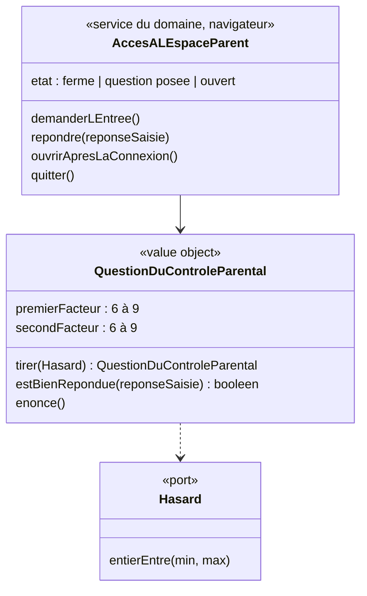

# Modèle du domaine : issue #10, Contrôle parental de l'espace parent

## Contexte

**Famille** (contexte existant). Le contrôle parental protège l'**espace parent** sur un appareil où l'enfant joue. Ce n'est **pas** une mesure de sécurité : le parent est déjà reconnu par la connexion du parent (story #5), et l'accès aux données est protégé par la RLS. Le contrôle parental évite seulement qu'un enfant change un réglage ou supprime un profil par erreur.

Toute la story tourne **dans le navigateur**, hors ligne compris : aucun appel au serveur, rien d'enregistré. Le domaine est importé par le front via `@domain/famille`, comme `LectureAVoixHaute` pour Voix (décision 0008 : un service navigateur avec état vit dans `domain/` s'il ne dépend que de ports déclarés dans `domain/`).

Relations : aucune nouvelle. Le tirage de la question passe par un port `Hasard` déclaré dans `famille/domain/` (décision 0008, n°2 : chaque contexte déclare le sien).

### Comportement actuel (`app/`, `adultGate` l. 1978, `gateForm` l. 1803)

- Bouton « Espace adulte » de l'en-tête. Titre de l'écran : « Espace adulte ».
- Question : « Question pour un adulte : combien font a × b ? », a et b tirés **chacun** entre 6 et 9 (bornes comprises). Champ « Réponse » avec pavé numérique (`inputmode="numeric"`), focus automatique, bouton « Entrer ».
- Réponse comparée en nombre (`+saisie === a × b`) : espaces autour ignorés ; champ vide ou non numérique = mauvaise réponse.
- Bonne réponse : l'espace s'ouvre sur l'onglet « Suivi ». En entrant, **le profil en cours est désélectionné** (`setChild(null)`), et le retour mène à « Qui joue aujourd'hui ? ».
- Mauvaise réponse : « Ce n'est pas la bonne réponse. », **même question**, nombre d'essais illimité.
- Retour depuis l'écran de la question : vers la carte de l'enfant s'il y en a un, sinon vers « Qui joue ? ».
- `gateForm` n'est appelé **qu'une seule fois** dans le code (`adultGate`). L'issue dit qu'il protège d'autres actions : ce n'est pas le cas aujourd'hui, et la cible garde ce périmètre (décision n°4 du lot 2). « Refaire le test de départ » est un bouton de l'onglet « Profils », donc déjà derrière le contrôle.
- Onglets : Suivi, Devoirs et dictée, Profils, Créer une leçon, Mes leçons, Audio des chansons, Voix.

## Termes

| Terme | Statut | Remarque |
|---|---|---|
| Contrôle parental | au glossaire (confirmé) | Confirmé par l'issue, la décision de démarrage n°5 (multiplication) et la décision n°4 du lot 2 (même question après une erreur, essais illimités, seule l'entrée de l'espace parent est protégée). |
| Espace parent | **nouveau** (à valider) | Partie de l'application réservée au parent, protégée par le contrôle parental. L'interface dit « Espace parent ». |
| Espace adulte | **synonyme interdit** | Nom du legacy. Synonyme interdit de « Espace parent » (décision n°2 du glossaire ; proposition appliquée, validation n°1 du lot 2). |
| Question du contrôle parental | **nouveau** (à valider) | La multiplication posée (deux facteurs entre 6 et 9). |
| Code | **attention** | « code » seul reste interdit (décision n°13) : le contrôle parental n'est pas un code PIN. |
| Onglet | terme d'interface | Hors glossaire (les onglets arrivent avec leurs stories). |

## Modèle



Il n'y a **pas d'agrégat** : rien n'est enregistré, ni sur le serveur ni sur l'appareil.

### Value object `QuestionDuControleParental`

| Règle | Détail |
|---|---|
| Facteurs | Deux entiers tirés **indépendamment** entre 6 et 9, bornes comprises (16 questions possibles, le carré compris). |
| Tirage | Par le port `Hasard`, jamais `Math.random` dans le domaine (décision 0003). |
| Réponse | Saisie libre. Les espaces autour sont ignorés. Une saisie vide, non numérique, ou un autre nombre que le produit est une mauvaise réponse. Le traitement de « 56,0 », « 056 » ou d'espaces au milieu est la question ouverte n°2. |
| Énoncé | « combien font a × b ? » (texte exact : question ouverte n°3). |

### Service `AccesALEspaceParent` (dans `domain/`, décision 0008)

- `demanderLEntree()` : tire une nouvelle question (chaque ouverture pose une nouvelle question, piste de l'issue).
- `repondre(saisie)` : bonne réponse → l'espace parent est **ouvert** ; mauvaise réponse → il reste fermé, message non punitif, **la même question** reste posée, sans limite d'essais (décision n°4 du lot 2).
- `ouvrirApresLaConnexion()` : juste après la connexion du parent (#5), l'espace parent s'ouvre **sans question** (décision n°4 du lot 2).
- `quitter()` : l'espace parent est **fermé** et l'on revient sur « Qui joue ? » (décision n°4 du lot 2). Pour y revenir, il faut répondre à une nouvelle question.
- À chaque ouverture de l'application, le service part de l'état **fermé** : rien n'est mémorisé sur l'appareil (décision n°4 du lot 2).
- Dépend seulement du port `Hasard` (et, si la question ouverte n°1 demande une fermeture après un temps sans utilisation, d'un port `Horloge` déclaré dans `domain/`).

### Commandes

| Commande | Effet | Erreur |
|---|---|---|
| `DemanderLEntreeDeLEspaceParent` | Pose une nouvelle question du contrôle parental. | (aucune) |
| `RepondreAuControleParental(saisie)` | Ouvre l'espace parent si la réponse est juste ; sinon la même question reste posée. | `ReponseDuControleParentalFausse` (présentée « Ce n'est pas la bonne réponse. », sans blocage) |
| `OuvrirLEspaceParentApresLaConnexion` | Juste après la connexion du parent, ouvre l'espace parent sans question. | (aucune) |
| `QuitterLEspaceParent` | Ferme l'espace parent et ramène à « Qui joue ? ». | (aucune) |

`ReponseDuControleParentalFausse` peut aussi être un simple résultat (« refusé ») plutôt qu'une erreur levée : choix de l'implementer, sans effet sur les scénarios.

## Invariants

1. L'espace parent ne s'ouvre qu'après une bonne réponse à la question du contrôle parental, sauf juste après la connexion du parent (décision n°4 du lot 2).
2. Chaque demande d'entrée pose une question tirée au hasard ; les deux facteurs sont entre 6 et 9.
3. Quitter l'espace parent le ferme et ramène à « Qui joue ? » : y revenir demande de répondre de nouveau. Rouvrir l'application trouve l'espace parent fermé.
4. Une mauvaise réponse n'est jamais punitive : un message, puis la même question, sans limite d'essais.
5. La déconnexion du parent (story #5) n'est possible que depuis l'espace parent ouvert.
6. Le contrôle parental ne remplace jamais la connexion du parent ni la RLS : il ne protège aucune donnée, seulement l'accès à l'écran.
7. Le contrôle parental ne protège que l'**entrée** de l'espace parent. « + Ajouter un enfant » dans « Qui joue ? » le demande parce que la création d'un profil se fait dans l'espace parent (décision n°5 du lot 2, story #11).

## Événements

Aucun : aucun autre contexte ne réagit à l'ouverture de l'espace parent.

## Partage avec le front

Tout est dans le navigateur : `QuestionDuControleParental`, `AccesALEspaceParent` et l'interface `Hasard` sont exportés par `famille/domain/index.ts`. L'adaptateur `Math.random` vit dans `src/`. La coquille de l'espace parent (en-tête « Espace parent », bouton de déconnexion, emplacement des onglets) est de l'interface, sans règle.

## Données d'enfants

Aucune donnée nouvelle. Rien n'est enregistré.

## Emplacement

```
supabase/functions/_shared/famille/
  domain/
    hasard.ts                               # interface du port Hasard (décision 0008, n°2)
    question-du-controle-parental.ts        # value object
    acces-a-l-espace-parent.ts              # service navigateur (décision 0008)
    erreurs.ts                              # + ReponseDuControleParentalFausse (si erreur)
    index.ts                                # exports pour @domain/famille
  test_utils/
    hasard-fixe.ts
src/famille/                                # écran du contrôle parental, coquille de l'espace parent, adaptateur Hasard
```

## Décisions

Validation n°1 du lot 2 par le PO, le 2026-10-22 (`docs/stories/lot-2-decisions.md`). « Tranchée » = réponse explicite du PO ; « proposition appliquée » = question de détail qui suit la proposition déjà faite (règle générale de la validation).

Numéros d'origine : « M » = ancienne liste du modèle, « A » = `docs/stories/10/acceptance.md`.

| Question | Réponse | Source |
|---|---|---|
| M1. Même question après une erreur ? | **Oui**, la même question est reposée. | Tranchée, décision n°4 |
| M2 (en partie). Espace parent à la réouverture | À la réouverture de l'application, l'espace parent est **refermé**. | Tranchée, décision n°4 |
| M3. Autres actions protégées ? | **Non** : seule l'entrée de l'espace parent est protégée. « + Ajouter un enfant » y mène (#11, décision n°5). | Tranchée, décision n°4 |
| M4. Nombre d'essais limité ? | **Non**, essais illimités. | Tranchée, décision n°4 |
| M5. Où mène la sortie ? | En sortant de l'espace parent, on revient sur **« Qui joue ? »**. | Tranchée, décision n°4 |
| A-A. Question juste après la connexion du parent ? | **Non** : l'espace parent s'ouvre sans question juste après la connexion. | Tranchée, décision n°4 |
| M8. Onglet d'ouverture | **« Profils »** (story #11), tant que « Suivi » (lot 6) n'existe pas. | Proposition appliquée (modèle, scénario `@a-valider`) |
| A-C. Renoncer à la question | L'enfant revient là où il jouait (son écran s'il y a un profil en cours, sinon « Qui joue ? »), comme le legacy. | Proposition appliquée (scénario « Léa renonce… ») |
| Glossaire. « Espace adulte » | Synonyme interdit de **Espace parent**. | Proposition appliquée (modèle) |

## Questions ouvertes

Aucune n'est bloquante pour la story.

1. (ancienne M2, suite) L'espace parent se referme-t-il **tout seul** après un temps sans utilisation, ou quand l'application passe en arrière-plan (oui : combien de minutes ?) ? Sinon (non), il reste ouvert jusqu'à ce que le parent le quitte ou ferme l'application.
2. (ancienne M6) Réponse saisie « 056 », « 56,0 » ou « 5 6 » : acceptée comme 56 (oui / non) ? Aujourd'hui « 056 » et « 56.0 » sont acceptés, « 56,0 » et « 5 6 » refusés (effet de la conversion en nombre, pas une règle voulue).
3. (ancienne M7) **Textes** : garde-t-on « Question pour un adulte : combien font a × b ? » et « Ce n'est pas la bonne réponse. » (oui), ou faut-il « Question pour un parent » (non : donner le texte) ?
4. (ancienne A-B) La **question du contrôle parental est-elle lue à voix haute**, comme toute consigne (oui), ou reste-t-elle seulement écrite, puisqu'elle s'adresse au parent (non) ?
5. (ancienne M5, suite ; lien avec la décision n°11, story #15) **Pendant** que le parent est dans l'espace parent, le profil qui jouait juste avant reste-t-il le **profil en cours** (oui : l'essai de voix fait parler son personnage guide) ? Aujourd'hui, il est désélectionné dès l'entrée (non : l'essai de voix fait alors toujours parler Noisette). Dans les deux cas, la sortie ramène à « Qui joue ? ».
