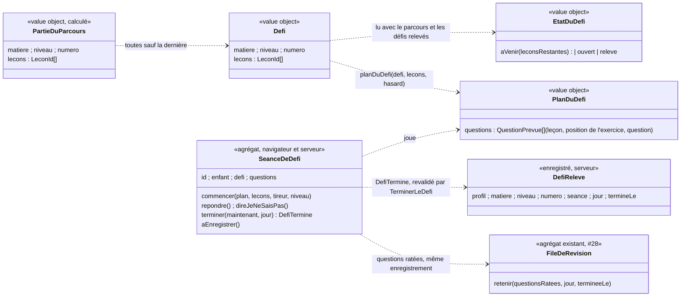

# Modèle du domaine : issue #100, Défi de fin de partie du parcours (« défi de fin de chapitre »)

État : **cadrage validé** par le PO le 2026-10-29 (réponses aux questions #100.1 à #100.28, commentaire 6507264741 de l'issue, annonce du responsable 6507280845 de #64). Il ne reste **aucune question ouverte**.

Réponse du PO du 2026-10-25 : le défi arrive « à la fin d'un chapitre ou d'une matière ». Le 2026-10-29, le PO a **allégé la story** : le défi de la matière (le « grand défi ») sort de #100 et devient la story **#137 « Grand défi de la matière »**, qui dépend de #100 (voir « Gardé pour #137 »). **#100 ne livre que le défi d'une partie du parcours.**

## Réponses du PO

| Question | Réponse | Conséquence dans le modèle |
|---|---|---|
| Découpage de la story | « OK pour alléger » | Le grand défi (ancienne règle R6) sort de #100 et devient #137. #100 n'a qu'une sorte de défi : le défi d'une partie du parcours |
| #100.1 Partie du parcours | A | **Blocs de 5 leçons consécutives** du parcours d'une matière et d'une classe, dans l'`ordre` ; un dernier bloc de moins de 3 leçons est rattaché au précédent. Calculé, jamais enregistré. Le format des leçons ne change pas. Un champ `partie` du format (D) viendra plus tard, par une autre story |
| #100.2 Chapitre = partie du parcours | oui | « Chapitre » reste interdit |
| #100.3 Texte de l'écran | A | « Défi 1 », « Défi 2 »… « Grand défi » est gardé pour #137 |
| #100.4 Conflit avec « Nouveau défi » | A | L'annonce d'exercice « Nouveau défi » (`motivation/domain/paroles-de-seance.ts`) devient **« Nouveau jeu »** ; la ligne « Durée d'affichage sans voix » du glossaire est mise à jour |
| #100.5 Nombre de questions | A | **10** pour le défi d'une partie. Les 12 questions de la matière sont gardées pour #137 |
| #100.6 Répartition | A | À parts égales entre les leçons qui ont des questions posables |
| #100.7 Questions mélangées | oui | L'ordre des questions est tiré au hasard |
| #100.8 Défi relevé | A | Relevé dès qu'il est terminé, avec ou sans erreur |
| #100.9 Rejouable | oui | Nouveau tirage, sans nouvelle récompense |
| #100.10 Question manquée et révision | **oui** (écart à la reco) | **Une question ratée pendant le défi entre dans la file de révision**, avec la même règle qu'en séance de leçon (règle 9 ci-dessous), dans le même enregistrement que le défi terminé |
| #100.11 Série, épisodes, objectif et quête du jour | A (non) | Le défi terminé ne compte pour aucun : ni jour de séance, ni épisode, ni objectif du jour, ni quête du jour |
| #100.12 Récompense | A | Le défi relevé lui-même : repère sur le dessin, célébration, parole du personnage guide, section « Mes défis relevés » |
| #100.13 Étoiles pour la cabane | non | Aucune étoile créée, le total des étoiles ne change pas |
| #100.14 Matière d'une seule partie | **1.b** | **Dans #100, une matière d'une seule partie du parcours n'a aucun défi** (elle attend #137) |
| #100.15 Bibliothèque changée | A | Un défi relevé reste relevé |
| #100.16 Défi à venir | A | Visible, discret, sans cadenas |
| #100.17 Ordre des nouveautés en fin de séance | reco | Le défi ouvert en dernier, juste au-dessus de « Relever le défi ». Ordre complet à accorder avec #101 |
| #100.18 Suivi du parent | non | Rien dans #100 |
| #100.19 Mise en scène | A | Paysage de #96, effets sonores de #97, paroles du personnage guide, pas de musique nouvelle |
| #100.20 Termes | oui | Partie du parcours, Défi, Défi à venir, Défi ouvert, Défi relevé, Séance de défi validés et ajoutés au glossaire. Défi de la matière et grand défi gardés pour #137 |
| #100.21 Textes | reco | Retenus, sauf l'annonce « Le grand défi des maths est ouvert ! », gardée pour #137 |
| #100.22 Moins de questions possibles que prévu | A | **S'applique au défi d'une partie** : si ses leçons ont moins de 10 questions posables, il les pose toutes, une fois chacune |
| #100.23 Défi de la dernière partie | **1.b** | **La dernière partie du parcours d'une matière n'a pas de défi dans #100** (elle attend #137) |
| #100.24 Repère d'un défi à venir | A | Ce n'est pas un bouton |
| #100.25 Effets sonores à la fin | A | « grande victoire » au premier défi relevé, « séance terminée » quand il est rejoué |
| #100.26 Défi quitté | A | Rien n'est gardé : il reste ouvert et se rejoue avec un nouveau tirage, sans reproche |
| #100.27 Place de « Mes défis relevés » | A | À la fin de « Mes médailles », après les records de fluence |
| #100.28 « Fin du défi » et écrans de l'enfant | oui | Ajoutés au glossaire |

## Contexte

**Apprentissage** pour le défi lui-même, **Motivation** pour sa mise en scène et sa récompense.
- Apprentissage : savoir quand un défi s'ouvre se lit dans le parcours (leçons réussies, #25, #27). Tirer les questions, les corriger, donner l'aide et la nouvelle chance, puis revalider côté serveur : c'est le travail de la séance de révision (#28) et du test de départ (#27). Le défi suit ce modèle et se joue dans le navigateur, hors ligne compris. Ses questions ratées vont dans la **file de révision**, qui est déjà un agrégat d'Apprentissage (#28).
- Motivation : paroles du personnage guide, humeur, effets sonores, décor, annonce à la fin, section « Mes défis relevés ». Motivation **lit** les défis relevés, comme elle lit les meilleures étoiles pour la cabane (décision 32.20). Elle n'écrit rien, ne crée ni étoile ni défi relevé.
- Catalogue : les leçons (`ordre`, `exercices`) sont lues telles quelles. Le format des leçons ne change pas.
- Famille : le niveau du profil en cours (existant). Le contrat de données personnelles (#14) s'étend à la nouvelle donnée.

| Relation | Mécanisme |
|---|---|
| Apprentissage → Motivation | Lecture seule des **défis relevés** du profil en cours, sous RLS, passés sous une forme propre (matière, classe, numéro de la partie). Même schéma que la cabane (#32) : pas d'abonnement à un événement |
| Apprentissage (séance de défi) → Apprentissage (file de révision) | **Même enregistrement** (#100.10) : `TerminerLeDefi` retient les questions ratées du défi dans la `FileDeRevision` du profil, en un seul geste avec le défi terminé, comme `TerminerLaSeance` (#28) |
| Apprentissage → Accompagnement | Fait `DefiTermine` publié ; rien ne le consomme dans #100 (#100.18) |
| Motivation → Apprentissage | Paroles du défi (proposition, accueil, encouragement, fin), comme les paroles de séance (#6) |
| Famille → Apprentissage | Contrat de données personnelles (#14) : la nouvelle donnée est supprimée en cascade et ajoutée à l'export |

### Ce qui est réutilisé tel quel

- `parcoursDeLaMatiere` (place, état, prochaine leçon), `estReussie`, `matieresDuParcours` (#25, #26, #27).
- Pour poser une question seule : `questionDeRevision` (#28), qui sait le faire pour bulles, lecture, écoute, trous, conjugaison, classer, boîte, barres, calcul, addition et dictée. Le principe du plan du test de départ (`planDuTestDeDepart`, port `Hasard`, #27) sert à tirer les questions.
- Pour retenir les questions ratées : `FileDeRevision.retenir` et le type `QuestionRateeARetenir` (#28), sans changement de règle.
- Le chemin d'écriture de la séance de révision : Edge Function, JWT de l'appelant, revalidation, écriture `service_role`, idempotence par identifiant, écriture de la file « tout ou rien » avec sa version lue (décisions 0013, 0016).
- Les exercices **ne changent pas** : aucune question nouvelle n'est écrite pour le défi.

## Mesures sur `app/bibliotheque.json` (2026-10-29)

Il y a 265 leçons et 26 couples matière et classe. Le français et les maths ont de 17 à 31 leçons par classe (10 couples). L'anglais, l'histoire, les sciences et l'EMC en ont de 2 à 5 (16 couples).

| Découpage (leçons consécutives, par matière et classe) | Parties | Tailles | Remarque |
|---|---|---|---|
| Par section du programme | 245 | 93 % d'une seule leçon, au plus 3 | écarté |
| Par `competence` | 264 | 99 % d'une seule leçon | écarté |
| Par domaine du programme | 118 | 45 % d'une seule leçon, au plus 10 | écarté |
| Par domaine, petits groupes rattachés | 53 | de 2 à 13 | écarté |
| **Blocs de 5, dernier bloc de moins de 3 leçons rattaché (retenu, #100.1 A)** | 57, dont 41 dans les 10 grands couples | 37 de 5 leçons, de 2 à 7 (maths CP : 5, 5, 5, 5, 5, 6) | 16 couples n'ont qu'une partie |

Avec 1.b, la dernière partie de chaque matière n'a pas de défi : #100 donne donc **31 défis** (41 − 10 dernières parties des grands couples ; les 16 petits couples n'en ont aucun).

Questions posables (types de la révision) : au moins 8 par bloc de 5 ; la médiane est de 4 par leçon. Cinq leçons n'en ont aucune (deux chansons, deux poèmes, une leçon de sciences en `ordre`). Les types `ordre`, `memoriser` et `fluence` ne se posent pas seuls, et la fluence est chronométrée.

## Termes

| Terme | Statut | Remarque |
|---|---|---|
| Parcours, Place, Prochaine leçon, Leçon réussie, Leçon réussie au test de départ, Matière réussie, Séance, Séance de révision, Question, Question ratée, File de révision, Question retenue, Leçon d'origine, Aide, Nouvelle chance, Encouragement, Étoile, Total des étoiles, Personnage guide, Fin de la séance | existants | Réutilisés sans les redéfinir |
| **Partie du parcours** | **validé** (100.1, 100.2, 100.20) | Bloc de 5 leçons consécutives du parcours d'une matière et d'une classe ; un dernier bloc de moins de 3 leçons est rattaché au précédent. Le « chapitre » de l'issue |
| **Défi** (d'une partie du parcours) | **validé** | Séance sans leçon ni étape de leçon qui pose, mélangées, au plus 10 questions des leçons d'une partie du parcours qui n'est pas la dernière de sa matière. Il ne donne ni étoile ni résultat de la leçon. Écran : « Défi 1 », « Défi 2 »… |
| **Défi à venir** | **validé** | Défi dont au moins une leçon n'est pas réussie. Visible, sans cadenas, pas un bouton. Jamais « verrouillé » |
| **Défi ouvert** | **validé** | Défi dont toutes les leçons sont réussies, jamais relevé |
| **Défi relevé** | **validé** | Défi terminé au moins une fois, avec ou sans erreur. Il ne se perd jamais, même si la bibliothèque change |
| **Séance de défi** | **validé** | Le défi joué, de la première question à la fin. C'est une séance, mais elle ne compte ni comme jour de séance, ni pour les épisodes, l'objectif du jour ou la quête du jour (100.11) |
| **Fin du défi** | **validé** (100.28) | Écran qui suit la dernière question du défi, comme la fin de la séance |
| **Défi terminé** | fait (`DefiTermine`) | Toutes les questions du défi ont été trouvées, erreurs comprises |
| Leçon d'origine (précision) | existant, précisé | Pour une question ratée pendant un défi, c'est la leçon d'où vient la question (la séance de défi n'a pas de leçon) |
| « Chapitre » | **interdit** | Synonyme interdit de Section du programme, de Leçon et d'Épisode : on dit **partie du parcours** |
| « Partie » seul | **interdit** | Synonyme interdit de **Séance** (« faire une partie ») : on dit toujours « partie du parcours » |
| « Épreuve », « examen », « contrôle », « boss » | **interdits** pour le défi | « Épreuve » est déjà interdit pour Question du test de départ ; les autres font penser à une note |
| « Défi du jour » | **interdit** | Écarté par #29, interdit pour la Quête du jour (#101) |
| « Carte », « chemin », « étape » | **interdits** | Décision n°34, 99.2, 99.3 |
| « Nouveau défi » | **retiré** (100.4) | L'annonce d'exercice de la séance devient « Nouveau jeu » |

## Modèle

Un défi est identifié par **(matière, classe, numéro de la partie)**. Le numéro est celui de la partie du parcours : « Défi 1 » est le défi de la partie 1.

### Fonctions pures d'Apprentissage (`@domain/apprentissage`, navigateur et serveur)

- `partiesDuParcours(parcours)` → `PartieDuParcours[]` : les leçons de la classe, dans l'ordre des places, découpées en blocs de 5 ; un dernier bloc de 1 ou 2 leçons rejoint le précédent. Parties numérotées à partir de 1.
- `defisDeLaMatiere(parcours, defisReleves)` → les défis de la matière, un par partie **sauf la dernière**, chacun avec son `EtatDuDefi`. Une matière d'une seule partie n'en a aucun.
- `etatDuDefi(defi, parcours, defisReleves)` : `releve` si un défi relevé a la même matière, la même classe et le même numéro (règle 7) ; sinon `ouvert` si toutes ses leçons sont réussies ; sinon `aVenir`, avec le nombre de leçons qui manquent.
- `defiOuvertParLaSeance(avant, apres)` (nom de calcul) : le défi passé de `aVenir` à `ouvert` par la séance, pour l'annonce de la fin de la séance. Il n'y en a jamais deux pour une même séance : une séance ne rend réussie qu'une leçon, qui n'est que dans une partie.
- `questionsPosablesDuDefi(defi, lecons)` : les questions des leçons du défi qui se posent seules (types de `questionDeRevision`), sans fluence, `ordre` ni `memoriser`.
- `planDuDefi(defi, lecons, hasard)` → `PlanDuDefi` (règle 5).
- `revaliderLeDefi(defi, etat, lecons, defiTermineAEnregistrer)` → `DefiTermine` ou une erreur métier (règle 10), sur le modèle de `revaliderLaSeanceDeRevision`.

### Commande, événement, erreurs

- Commande : **`TerminerLeDefi`** (cas d'usage serveur, Edge Function `terminer-le-defi`).
- Événement : **`DefiTermine`**.
- Erreurs métier : `DefiInconnu` (aucune partie du parcours de ce numéro, ou dernière partie de la matière : elle n'a pas de défi), `DefiAVenir`, `QuestionHorsDuDefi` (leçon hors du défi, exercice qui ne se pose pas seul, question posée deux fois), `PlanDuDefiIncoherent` (nombre de questions ou répartition contraire à la règle 5), `AucuneQuestionPourLeDefi`, `DefiNonFini` (une question ne finit pas par la bonne réponse), `DefiDejaTermine` (répondre après la fin). `ParentNonRattache` et `LeconIntrouvable` existent déjà.

### Motivation (`@domain/motivation`)

- `paroles-du-defi.ts` : proposition à la fin de la séance, parole du début, fin la première fois et quand le défi est rejoué (textes de 100.21) ; l'encouragement après une erreur reste celui de la séance.
- `defis-releves.ts` : `defiReleveParLaSeance(relevesAvant, defi)` (première fois ou rejoué, pour l'annonce et l'effet sonore de 100.25) et la section « Mes défis relevés » (une ligne par défi relevé, « Défi 1 · Maths · CE1 », placée après les records de fluence, 100.27).
- `paroles-de-seance.ts` : l'annonce « Nouveau défi » devient « Nouveau jeu » (100.4).

## Règles et invariants

1. **Découpage** (100.1 A) : chaque leçon du parcours de la classe est dans une partie et une seule. Mises bout à bout, les parties redonnent le parcours, sans changer l'ordre ni les places. Une partie a de 3 à 7 leçons, sauf quand la matière a moins de 3 leçons dans la classe (une seule partie). Les parties sont recalculées et jamais enregistrées. Les leçons hors du parcours (classes d'avant, classe au-dessus, leçons personnelles) ne sont dans aucune partie.
2. **Quelles parties ont un défi** (1.b) : toutes **sauf la dernière** de la matière. Une matière d'une seule partie n'a pas de défi dans #100. Exemples, en nombre de leçons de la classe :
   - 3, 5 ou 7 leçons → une seule partie (1-3, 1-5, 1-7) → **aucun défi** ;
   - 8 leçons → parties 1-5, 6-8 → **Défi 1** ;
   - 10 leçons → parties 1-5, 6-10 → **Défi 1** ;
   - 12 leçons → parties 1-5, 6-12 (le bloc 11-12 a moins de 3 leçons et rejoint le précédent) → **Défi 1** ;
   - 13 leçons → parties 1-5, 6-10, 11-13 → **Défi 1** et **Défi 2** ;
   - maths du CP, 31 leçons → 5, 5, 5, 5, 5, 6 → **Défi 1 à Défi 5**.
3. **Ouverture** : un défi s'ouvre quand toutes les leçons de sa partie sont réussies (une étoile ou plus, ou réussie au test de départ). Avec 4 leçons sur 5 réussies, il est à venir (« Encore 1 leçon pour ouvrir le défi »).
4. **Le défi ne bloque rien** : la prochaine leçon, l'avancée dans le parcours (#99) et la leçon du jour (#29) l'ignorent. La partie suivante est jouable sans lui.
5. **Questions** (100.5, 100.6, 100.7, 100.22) :
   - elles viennent seulement des leçons du défi, et seulement d'exercices qui se posent seuls, sans chrono (pas de fluence, d'`ordre` ni de `memoriser`) ;
   - chaque question posable est posée **au plus une fois** dans un défi ;
   - il y en a **10**, ou **toutes les questions posables, une fois chacune**, quand il y en a moins de 10 ;
   - elles sont réparties à parts égales entre les leçons qui en ont : une leçon en donne au plus une de plus qu'une autre ; les questions en plus vont à des leçons tirées au hasard ; une leçon qui n'a pas assez de questions posables pour sa part les donne toutes, et les autres leçons complètent (exemple : 1, 4, 4, 4 et 4 questions posables → 1, puis 3, 2, 2, 2 tirés au hasard) ;
   - une leçon sans question posable n'en donne pas ; un défi sans aucune question posable n'est jamais joué (`AucuneQuestionPourLeDefi`) ;
   - l'ordre des questions est mélangé.
6. **Une erreur** suit les règles d'une séance : encouragement, aide (ou aide par défaut), nouvelle chance sans limite, « Je ne sais pas ». Pas de vie, pas de chrono, pas de « perdu ».
7. **Relevé, rejoué** (100.8, 100.9, 100.15) : un défi terminé est relevé, quel que soit le nombre d'erreurs. Un défi relevé se rejoue, avec un nouveau tirage ; la récompense n'est donnée qu'une fois. Il reste relevé même si la bibliothèque change (il garde son identité matière, classe, numéro). Un défi quitté n'est pas relevé, rien n'en est gardé (100.26).
8. **Il ne modifie aucune note** : ni étoile, ni résultat de la leçon, ni meilleures étoiles, ni total des étoiles, ni record de fluence, ni test de départ.
9. **Questions ratées et révision** (100.10, même règle qu'une erreur en séance de leçon, #28) :
   - une question du défi qui a coûté au moins une erreur (réponse fausse ou « Je ne sais pas ») est une **question ratée** ; elle est retenue dans la file de révision avec `FileDeRevision.retenir`, sans changement de règle ;
   - pas encore retenue : elle devient une question retenue, intervalle de 1 jour, date de révision le lendemain du jour du défi, ratée 1 fois ;
   - déjà retenue (même clé de question) : elle est **ratée de nouveau** (intervalle remis à 1 jour, date de révision le lendemain, une fois ratée de plus), et sa leçon d'origine ne change pas ;
   - sa **leçon d'origine** est la leçon d'où vient la question ; on garde aussi la position de l'exercice, le type et le tirage d'une question générée, comme en séance ;
   - une question juste pendant le défi ne change rien à la file, même si elle y est retenue : comme en séance de leçon, seule la séance de révision fait avancer l'intervalle de révision ; le défi ne produit jamais `ErreursCorrigeesPourDeBon` ;
   - la limite de 250 questions retenues s'applique comme d'habitude ;
   - les questions ratées sont **calculées par le serveur** en rejouant les réponses ; celles que le front annonce ne sont pas lues.
10. **Revalidation** : le serveur vérifie le rattachement (JWT), relit les leçons, le niveau, les meilleures étoiles, le test de départ et les défis relevés du profil, recalcule les parties et l'état du défi. Le défi doit exister (`DefiInconnu`) et être **ouvert ou relevé** (`DefiAVenir`). Le plan doit respecter la règle 5 (`QuestionHorsDuDefi`, `PlanDuDefiIncoherent`), puis les réponses sont rejouées : chaque question finit par la bonne réponse (`DefiNonFini`). Un défi incohérent est refusé sans rien enregistrer, ni défi terminé ni file de révision.
11. **Enregistrement tout ou rien et idempotent** : le défi terminé et la file de révision sont écrits d'un seul geste. Si la file a changé entre la lecture et l'écriture (une autre séance vient de s'enregistrer), on relit et l'on recommence, comme `TerminerLaSeance`. Un défi gardé sur l'appareil et renvoyé n'est compté qu'une fois : il ne retient pas deux fois ses questions ratées.
12. **Motivation à part** : la récompense se recalcule à partir des défis relevés. Elle ne crée jamais d'étoile (100.13). Le défi terminé ne compte ni pour la série, ni pour les épisodes, ni pour l'objectif du jour, ni pour la quête du jour (100.11) : ces calculs ne lisent pas les défis terminés.
13. **Contenu pour les enfants** : la mise en scène reste douce et sans danger. Il n'y a ni adversaire, ni combat, ni monstre, ni piège, ni compte à rebours, ni lieu effrayant, et l'on ne dit jamais « perdu » ni « raté ». Dessins par le skill `illustration`, section 0.

## Événements

- `DefiTermine` (Apprentissage) : identifiant de la séance de défi, enfant, matière, classe, numéro de la partie, leçons du défi, questions posées (clés), jour, heure de fin, nombre de questions, **questions ratées à retenir** (clé et origine, calculées par la revalidation). `TerminerLeDefi` en tire le défi relevé enregistré et les questions retenues dans la file de révision.
- Ni `SeanceTerminee`, ni `SeanceDeRevisionTerminee`, ni `LeconReussie`, ni `LeconAcquise`, ni `ErreursCorrigeesPourDeBon`. Il ne compte pas comme jour de séance et n'ouvre pas d'épisode (100.11).
- Un défi déjà enregistré (même identifiant) ne publie rien de nouveau.

## Données persistées (verrou `base`)

Migration additive : table **`defis_termines`** (Apprentissage). Une ligne par défi terminé, avec l'identifiant de la séance de défi, le profil, la matière, la classe, le numéro de la partie, les leçons du défi, le jour et l'heure de fin. Le défi relevé est lu comme « au moins une ligne pour (profil, matière, classe, numéro) ». On ne garde ni les réponses ni les erreurs (minimisation).
- La file de révision ne change pas de forme : les questions ratées du défi y entrent comme celles d'une séance.
- La RLS permet la **lecture seule** au parent rattaché. `anon` et `authenticated` n'ont aucun droit d'écriture. Seule l'Edge Function `terminer-le-defi` écrit, avec `service_role`, après la vérification sous JWT et la revalidation (décision 0016). L'écriture du défi terminé et de la file passe par une seule fonction d'enregistrement, non exécutable par `anon` et `authenticated`, comme pour la séance de révision.
- Suppression en cascade avec le profil et ajout à l'export (#14), sans les réponses. Rien n'est envoyé à l'IA.
- **Donnée d'enfant nouvelle** : le seul fait d'avoir terminé un défi (quel défi, quel jour). Elle sert à l'apprentissage (repère, rejeu) ; elle respecte la section RGPD de `CLAUDE.md` (UE, minimisation, export, suppression). Les questions ratées sont la même donnée que celles d'une séance (#28).
- Décision **0038** : `docs/decisions/0038-defi-de-la-partie-du-parcours-dans-apprentissage.md`.

## Effets sur les écrans (points de contact)

- **« Mon parcours » (#99, un seul dessin par matière)** : un repère du défi après la dernière leçon de chaque partie qui a un défi. Rien après la dernière partie, ni au fanion (#137). Il est à venir (pas un bouton), ouvert (« Relever le défi ») ou relevé, sans cadenas. Le personnage guide se tient toujours sur la prochaine leçon et ne s'arrête jamais au défi (règle 4). La liste pour les lecteurs d'écran reçoit une ligne par défi, juste après sa dernière leçon.
- **Fin de la séance** (#97, #101) : quand la séance ouvre un défi, une annonce s'ajoute en dernier dans la zone des nouveautés (« Le défi 1 est ouvert ! »), avec « Relever le défi » à côté de « Leçon suivante », « Accueil » et « Rejouer ». Elle ne lance jamais rien d'office (skill `gamification`, section 5). L'ordre complet des annonces se fixe avec l'équipe de #101 (100.17).
- **Séance de défi** : paysage de l'univers (#96), effets sonores d'une séance (#97), paroles du personnage guide.
- **Fin du défi** : célébration de #97 (1,5 s au plus, boutons utilisables), « grande victoire » la première fois, « séance terminée » quand il est rejoué, puis « Mon parcours » ou « Accueil ». Aucune étoile. Le bouton « Leçon suivante » n'est pas proposé.
- **« Mes médailles »** : section « Mes défis relevés » à la fin.
- **Accueil de l'enfant** (#29, #101) : rien n'y change, sauf que les questions ratées pendant un défi peuvent être dues le lendemain dans « À revoir », comme celles d'une séance.

## Gardé pour #137 (« Grand défi de la matière »)

Décisions du PO gardées pour la story #137, qui dépend de #100 (réponse 2.a) :
- le défi de la matière s'appelle **« Grand défi »** à l'écran (100.3) ;
- il pose **12 questions** de toute la matière de la classe (100.5) ; quand il y a plus de leçons que de questions, une question par leçon tirée au hasard (100.6) ; moins de questions posables que prévu : toutes, une fois chacune (100.22) ;
- il s'ouvre quand la **matière est réussie** (#26) ;
- une matière d'une seule partie du parcours **n'a que le grand défi** (100.14) ;
- le grand défi **remplace le défi de la dernière partie** du parcours (100.23) ;
- l'annonce de fin de séance « Le grand défi des maths est ouvert ! » (100.21) ;
- les termes **Défi de la matière** et **Grand défi** (100.20), à ajouter au glossaire par #137.

Ce que #100 prépare pour #137, sans le livrer : `defisDeLaMatiere` laisse la dernière partie sans défi, ce qui est la place du grand défi. La table `defis_termines` ne connaît que le défi d'une partie ; #137 l'étendra par une migration additive.

## Emplacement

- `supabase/functions/_shared/apprentissage/domain/` : `partie-du-parcours.ts` (`partiesDuParcours`), `defis-de-la-matiere.ts` (`Defi`, `EtatDuDefi`, `defisDeLaMatiere`, `etatDuDefi`, `defiOuvertParLaSeance`), `plan-du-defi.ts` (`questionsPosablesDuDefi`, `planDuDefi`), `seance-de-defi.ts` (agrégat `SeanceDeDefi`, fait `DefiTermine`), `defi-termine-a-enregistrer.ts`, `revalider-le-defi.ts`, erreurs dans `erreurs.ts`, exports dans `index.ts` (chacun avec son `_test.ts`).
- `apprentissage/application/terminer-le-defi.ts` (ports existants `LeconsDuCatalogue`, `RattachementsDuParent`, `ResultatsDesLecons`, `ResultatsDesTestsDeDepart`, `NiveauDuProfil`, `FilesDeRevision` ; port nouveau `application/ports/defis-termines.ts` : défis relevés du profil, et enregistrement du défi terminé avec la file, tout ou rien). `apprentissage/infrastructure/` : son adaptateur Supabase. `test_utils/` : son fake.
- `supabase/functions/terminer-le-defi/index.ts` (handler fin), `supabase/migrations/<horodatage>_defis_termines.sql`.
- `supabase/functions/_shared/motivation/domain/` : `paroles-du-defi.ts`, `defis-releves.ts`, et la modification de `paroles-de-seance.ts` (« Nouveau jeu »).
- Affichage, pour mémoire : `src/parcours/` (repères du défi), `src/defi/` (écran, mise en scène), fin de séance, garde sur l'appareil et renvoi (comme la séance de révision).

## Questions ouvertes

Aucune. Toutes les questions #100.1 à #100.28 ont reçu une réponse du PO le 2026-10-29.
