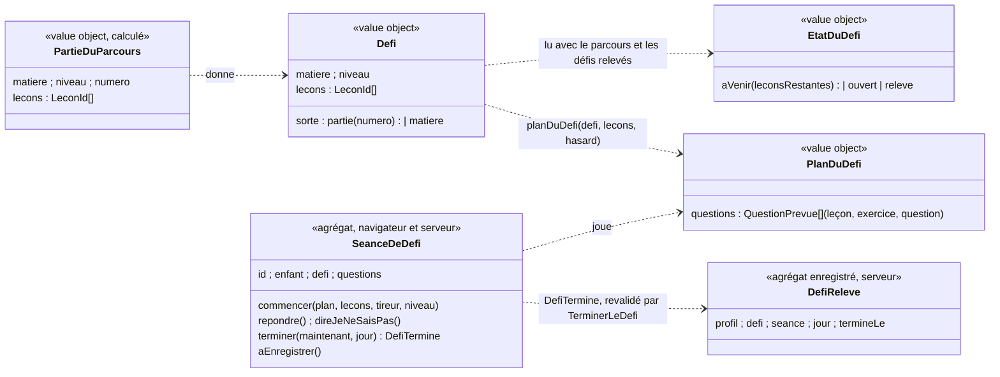

# Modèle du domaine : issue #100, Défi de fin de chapitre

État : **cadrage à valider**. Les questions #100.1 à #100.20 attendent le PO ; chacune a ses options et une recommandation (reco). Le glossaire et la context map **ne sont pas modifiés** : les termes et relations ci-dessous sont des **propositions** que l'on ajoutera après validation.

Réponse du PO du 2026-10-25 (commentaire de l'issue) : le défi arrive **à la fin d'un chapitre ou d'une matière**. Il y a donc deux sortes de défi : celui de la fin d'une partie du parcours, et celui de la fin d'une matière (après la **matière réussie**, #26).

## Contexte

**Apprentissage** pour le défi lui-même, **Motivation** pour sa mise en scène et sa récompense.
- Apprentissage : savoir quand un défi s'ouvre se lit dans le parcours (leçons réussies, #25, #27). Tirer les questions, les corriger, donner l'aide et la nouvelle chance, puis revalider côté serveur : c'est le travail de la séance de révision (#28) et du test de départ (#27). Le défi suit ce modèle et le joue dans le navigateur, hors ligne compris.
- Motivation : paroles du personnage guide, humeur, effets sonores, décor, annonce à la fin, récompense. Motivation **lit** les défis relevés, comme elle lit les meilleures étoiles pour la cabane (décision 32.20). Elle n'écrit rien. Elle ne crée ni étoile ni défi relevé.
- Catalogue : les leçons (`ordre`, `exercices`) sont lues telles quelles. Avec la reco de #100.1, le format des leçons ne change pas.
- Famille : le niveau du profil en cours (existant). Le contrat de données personnelles (#14) s'étend à la nouvelle donnée.

| Relation (proposition) | Mécanisme |
|---|---|
| Apprentissage → Motivation | Lecture seule des **défis relevés** du profil en cours, sous RLS, passés sous une forme propre (sorte, matière, classe, numéro de la partie). Même schéma que la cabane (#32) : pas d'abonnement à un événement |
| Apprentissage → Accompagnement | Fait `DefiTermine` publié ; le suivi ne l'affiche pas dans #100 (#100.18) |
| Famille → Apprentissage | Contrat de données personnelles (#14) : la nouvelle donnée est supprimée en cascade et ajoutée à l'export |

### Ce qui est réutilisé tel quel

- `parcoursDeLaMatiere` (place, état, prochaine leçon, `estReussie`), `matieresDuParcours` (#25, #26, #27).
- Pour poser une question seule : `questionDeRevision` (#28), qui sait le faire pour bulles, lecture, écoute, trous, conjugaison, classer, boîte, barres, calcul, addition et dictée. Le principe du plan du test de départ (`planDuTestDeDepart`, port `Hasard`, #27) sert à tirer les questions.
- Le chemin d'écriture de la séance de révision : Edge Function, JWT de l'appelant, revalidation, écriture `service_role`, idempotence par identifiant (décisions 0013, 0016).
- Les exercices **ne changent pas** (story 3 livrée en partie seulement, 98a) : aucune question nouvelle n'est écrite pour le défi.

## Mesures sur `app/bibliotheque.json` (2026-10-29)

Il y a 265 leçons et 26 couples matière et classe. Le français et les maths ont de 17 à 31 leçons par classe (10 couples). L'anglais, l'histoire, les sciences et l'EMC en ont de 2 à 5 (16 couples).

| Découpage (leçons consécutives, par matière et classe) | Parties | Tailles | Remarque |
|---|---|---|---|
| Par section du programme | 245 | 93 % d'une seule leçon, au plus 3 | un défi presque après chaque leçon |
| Par `competence` | 264 | 99 % d'une seule leçon | 246 compétences distinctes : inutilisable |
| Par domaine du programme | 118 | 45 % d'une seule leçon, au plus 10 | beaucoup de défis d'une seule leçon |
| Par domaine, les groupes de moins de 3 leçons rattachés au précédent | 53 | de 2 à 13 (maths CP : 10, 9, 6, 6 ; français CP : 5, 13, 3) | inégal |
| **Blocs de 5** (un dernier bloc de moins de 3 leçons est rattaché au précédent) | 57, dont 41 dans les 10 grands couples | 37 de 5 leçons, de 2 à 7 (maths CP : 5, 5, 5, 5, 5, 6) | régulier ; 16 couples n'ont qu'une partie |
| Blocs de 4 / blocs de 6 | 66 / 50 | surtout 4 / surtout 6 | même principe |

Questions qu'on peut poser seules (types de la révision) : il y en a au moins 8 par bloc de 5 ; la médiane est de 4 par leçon. Cinq leçons n'en ont aucune (deux chansons, deux poèmes, une leçon de sciences en `ordre`). Les types `ordre`, `memoriser` et `fluence` ne se posent pas seuls, et la fluence est chronométrée.

## Termes

| Terme | Statut | Remarque |
|---|---|---|
| Parcours, Place, Prochaine leçon, Leçon réussie, Leçon réussie au test de départ, Matière réussie, Séance, Séance de révision, Question, Aide, Nouvelle chance, Encouragement, Étoile, Total des étoiles, Personnage guide, Fin de la séance | existants | Réutilisés sans les redéfinir |
| **Partie du parcours** | nom **réservé** par le PO (99.24), définition proposée | Suite de leçons consécutives du parcours d'une matière, découpée par la règle de #100.1. **Le « chapitre » de l'issue est la partie du parcours** (#100.2) |
| **Défi** `(à valider)` | nouveau, Apprentissage | Séance sans leçon ni étape de leçon qui mélange des questions des leçons d'une partie du parcours (**défi de la partie**) ou de toute la matière de la classe (**défi de la matière**). Il ne donne ni étoile ni résultat de la leçon |
| **Défi ouvert** `(à valider)` | nouveau | Toutes les leçons de la partie, ou de la matière, sont réussies. Contraire : défi **à venir** (jamais « verrouillé » : #25 n'a plus de verrou, 99.4 n'a pas de cadenas) |
| **Défi relevé** `(à valider)` | nouveau | Défi terminé au moins une fois. Il ne se perd jamais |
| **Séance de défi** `(à valider)` | nouveau, Apprentissage | Le défi joué, de la première question à la fin. Comme la séance de révision, c'est une séance (« Séance » l'inclut, 28.16) |
| **Défi terminé** | fait (`DefiTermine`) | Toutes les questions du défi ont été trouvées, erreurs comprises |
| « Chapitre » | **interdit** | Synonyme interdit de Section du programme, de Leçon et d'Épisode : on dit **partie du parcours** |
| « Partie » seul | **interdit** | Synonyme interdit de **Séance** (« faire une partie ») : on dit toujours « partie du parcours » (#100.3) |
| « Épreuve », « examen », « contrôle », « boss » | **interdits** pour le défi | « Épreuve » est déjà interdit pour Question du test de départ ; les autres font penser à une note |
| « Défi du jour » | **interdit** | Écarté par #29, proposé interdit pour la Quête du jour (#101) |
| « Carte », « chemin », « étape » | **interdits** | Décision n°34, 99.2, 99.3. Le texte de l'issue (« étape de la carte ») se lit : « une place spéciale du dessin du parcours » |
| « Nouveau défi » | **conflit** | C'est déjà une annonce d'exercice dans la séance (`paroles-de-seance.ts`, legacy `app.js` l. 1885), citée aussi par la ligne « Durée d'affichage sans voix » du glossaire (#100.4) |

## Modèle

Fonctions pures d'Apprentissage (`@domain/apprentissage`, navigateur et serveur) :
- `partiesDuParcours(parcours)` → `PartieDuParcours[]` (règle de #100.1) ;
- `defisDeLaMatiere(parcours, defisReleves)` → les défis de la matière, chacun avec son `EtatDuDefi` ;
- `defiOuvertParLaSeance(avant, apres)` (nom de calcul) : le défi qu'une séance vient d'ouvrir, pour l'annonce de fin ;
- `planDuDefi(defi, lecons, hasard)` → `PlanDuDefi` (#100.6, #100.7).

Commande : `TerminerLeDefi` (cas d'usage serveur, Edge Function `terminer-le-defi`). Événement : `DefiTermine`.
Erreurs métier : `DefiAVenir` (le défi n'est pas encore ouvert), `QuestionHorsDuDefi`, `AucuneQuestionPourLeDefi`, `DefiDejaTermine`, `DefiNonFini`.

Motivation (`@domain/motivation`) : les paroles du défi (proposition, accueil, encouragement, fin), le défi relevé par la séance pour l'annonce, et la section « défis relevés » de « Mes médailles » si #100.12 A est retenue.

## Règles et invariants

1. **Découpage** (avec la reco de #100.1) : chaque leçon du parcours de la classe est dans une partie et une seule. Mises bout à bout, les parties redonnent le parcours, sans changer l'ordre ni les places. Une partie n'est jamais vide. Les parties sont recalculées et jamais enregistrées. Les leçons hors du parcours (classes d'avant, classe au-dessus, leçons personnelles) ne sont dans aucune partie.
2. **Ouverture** : le défi d'une partie s'ouvre quand toutes ses leçons sont réussies (une étoile ou plus, ou réussie au test de départ, d'après la définition de Leçon réussie). Le défi de la matière s'ouvre quand la **matière est réussie**. Avec 4 leçons sur 5 réussies, il est à venir.
3. **Le défi ne bloque rien** : la prochaine leçon, l'avancée dans le parcours (#99) et la leçon du jour (#29) l'ignorent. La partie suivante est jouable sans lui.
4. **Il ne modifie aucune note** : ni étoile, ni résultat de la leçon, ni total des étoiles, ni record de fluence, ni test de départ. La file de révision dépend de #100.10.
5. **Questions** : elles viennent seulement des leçons du défi, et seulement d'exercices qui se posent seuls, sans chrono (pas de fluence, d'`ordre` ni de `memoriser`). Elles sont mélangées et réparties entre les leçons (#100.6, #100.7). Une leçon sans question posable n'en donne pas. Un défi sans aucune question n'existe pas.
6. **Une erreur** suit les règles d'une séance : encouragement, aide (ou aide par défaut), nouvelle chance sans limite, « Je ne sais pas ». Pas de vie, pas de chrono, pas de « perdu ».
7. **Réussite** (#100.8 A) : un défi terminé est relevé, quel que soit le nombre d'erreurs.
8. **Rejouable** (#100.9 A) : on peut rejouer un défi relevé, avec un nouveau tirage. La récompense n'est donnée qu'une fois. Un défi relevé ne redevient jamais à venir (#100.15).
9. **Revalidation** : le serveur vérifie le rattachement (JWT), relit les leçons, les meilleures étoiles et le test de départ pour vérifier que le défi est ouvert, vérifie que le plan respecte la règle 5, puis rejoue les réponses. Un défi incohérent est refusé sans rien enregistrer. L'enregistrement est idempotent : un défi gardé sur l'appareil et renvoyé n'est compté qu'une fois.
10. **Motivation à part** : la récompense se recalcule à partir des défis relevés. Elle ne crée jamais d'étoile (#100.13).
11. **Contenu pour les enfants** : la mise en scène reste douce et sans danger. Il n'y a ni adversaire, ni combat, ni monstre, ni piège, ni compte à rebours, ni lieu effrayant, et l'on ne dit jamais « perdu » ni « raté ». Dessins par le skill `illustration`, section 0.

## Événements

- `DefiTermine` (Apprentissage) : identifiant, enfant, sorte, matière, classe, numéro de la partie, leçons du défi, jour, heure de fin, nombre de questions. La revalidation le transforme en **défi relevé** enregistré.
- Ni `SeanceTerminee`, ni `LeconReussie`, ni `LeconAcquise`. Selon #100.11, il ne compte pas comme jour de séance et n'ouvre pas d'épisode.

## Données persistées (proposition, verrou `base`)

Migration additive : table **`defis_termines`** (Apprentissage). Une ligne par défi terminé, avec l'identifiant de la séance de défi, le profil, la sorte (`partie` ou `matiere`), la matière, la classe, le numéro de la partie, les leçons du défi, le jour et l'heure de fin. Le défi relevé est lu comme « au moins une ligne ». On ne garde ni les réponses ni les erreurs (minimisation).
- La RLS permet la **lecture seule** au parent rattaché. `anon` et `authenticated` n'ont aucun droit d'écriture. Seule l'Edge Function `terminer-le-defi` écrit, avec `service_role`, après la vérification sous JWT et la revalidation (décision 0016).
- Suppression en cascade avec le profil et ajout à l'export (#14). Rien n'est envoyé à l'IA. La seule donnée d'enfant nouvelle est le fait d'avoir terminé un défi.
- Décision 0038 (réservée) : « le défi enregistré par le serveur seul ; parties du parcours calculées ». À écrire après validation.

## Effets sur les écrans (points de contact)

- **« Mon parcours » (#99, un seul dessin par matière)** : un repère du défi après la dernière leçon de chaque partie, et le défi de la matière au fanion. Il est à venir, ouvert ou relevé, sans cadenas. Le personnage guide se tient toujours sur la prochaine leçon et ne s'arrête jamais au défi (règle 3). La liste pour les lecteurs d'écran reçoit une ligne par défi (#100.16). Avec #100.1 D, il y aurait un dessin par partie, ce qui changerait 99.25 C.
- **Fin de la séance** (#97, #101) : quand la séance ouvre un défi, une annonce s'ajoute dans la zone des nouveautés, avec « Relever le défi » à côté de « Leçon suivante », « Accueil » et « Rejouer ». Elle ne lance jamais rien d'office (skill `gamification`, section 5). **Contact avec #101** : la zone des nouveautés reçoit aussi « Quête du jour accomplie ! ». Il faut fixer l'ordre des annonces (#100.17).
- **Fin du défi** : célébration de #97 (1,5 s au plus, boutons utilisables), annonce de la récompense, puis « Mon parcours » ou « Accueil ». Le bouton « Leçon suivante » n'est pas proposé.
- **Accueil de l'enfant** (#29, #101) : rien n'y change dans #100. La quête du jour ne propose pas le défi, et un défi terminé n'accomplit pas la quête (#100.11).

## Emplacement

- `supabase/functions/_shared/apprentissage/domain/` : `partie-du-parcours.ts`, `defis-de-la-matiere.ts`, `plan-du-defi.ts`, `seance-de-defi.ts`, `defi-termine-a-enregistrer.ts`, erreurs dans `erreurs.ts`, exports dans `index.ts` (chacun avec son `_test.ts`).
- `apprentissage/application/terminer-le-defi.ts` (ports existants `LeconsDuCatalogue`, rattachement, meilleures étoiles, test de départ ; port nouveau `DefisTermines`). `apprentissage/infrastructure/` : son adaptateur Supabase. `test_utils/` : son fake.
- `supabase/functions/terminer-le-defi/index.ts` (handler fin), `supabase/migrations/<horodatage>_defis_termines.sql`.
- `supabase/functions/_shared/motivation/domain/` : `paroles-du-defi.ts`, `defis-releves.ts` (récompense selon #100.12).
- Affichage, pour mémoire : `src/parcours/` (repères du défi), `src/defi/` (écran, mise en scène), fin de séance, garde sur l'appareil et renvoi (comme la séance de révision).

## Questions ouvertes

Les questions #100.1, #100.5, #100.9, #100.12 et #100.13 reprennent les questions 1 à 5 de l'issue.

**#100.1 Qu'est-ce qu'une partie du parcours (le « chapitre ») ?** (question 1 de l'issue)
- A. Des **blocs de 5 leçons** consécutives par matière et classe ; un dernier bloc de moins de 3 leçons est rattaché au précédent. On obtient 57 parties, presque toutes de 5 leçons. C'est calculé, sans changer le format.
- B. Par **domaine du programme**, en rattachant les groupes de moins de 3 leçons. On obtient 53 parties de 2 à 13 leçons : elles ont un sens, mais elles sont inégales.
- C. Par section ou par `competence` : 93 % à 99 % des parties n'auraient qu'une leçon. À écarter.
- D. Un **nouveau champ du format** (`partie`, posé par le contenu). Coût : `docs/format-lecons.md`, `scripts/lecons/*.py` pour environ 205 leçons des 10 grands couples, validation du build et tests pytest, lecture dans `catalogue/domain/` (`lireLecon`, `Lecon`), test de schéma, puis découpage écrit à la main par la session principale. Les parties ont alors du sens et une identité stable.
- **Reco : A** dans #100 (régulier, compréhensible : « toutes les 5 leçons, un défi »), et D plus tard si le PO veut des parties qui ont un titre.

**#100.2 Le « chapitre » de l'issue est-il la partie du parcours (nom réservé en 99.24) ?** Oui ou non. **Reco : oui.** « Chapitre » reste interdit.

**#100.3 « Partie » seul est interdit (synonyme de Séance). Que dit l'écran ?**
- A. « Défi 1 », « Défi 2 »… sur le dessin (comme « Leçon 4 »), et « Grand défi » pour le défi de la matière.
- B. « Défi de la partie 2 » et « Défi de la matière ».
- **Reco : A.** Dans le domaine, on dit défi de la partie et défi de la matière.

**#100.4 L'annonce d'exercice « Nouveau défi » (séance) entre en conflit avec le Défi. Que fait-on ?**
- A. On la remplace par une autre annonce (« Nouveau jeu », par exemple) dans `paroles-de-seance.ts`, et l'on met à jour la ligne du glossaire.
- B. On garde les deux.
- **Reco : A.**

**#100.5 Combien de questions ?** (question 2 de l'issue)
- A. **10 pour un défi de la partie, 12 pour un défi de la matière.**
- B. 10 pour les deux.
- C. Une par leçon.
- **Reco : A.** Exemple : une partie de 5 leçons donne 2 questions par leçon.

**#100.6 Comment répartir les questions ?**
- A. Les questions sont réparties à parts égales entre les leçons qui ont des questions posables (une leçon au plus une de plus qu'une autre). Quand il y a plus de leçons que de questions (défi de la matière), les leçons sont tirées au hasard, une question chacune.
- B. Les questions sont tirées au hasard dans toutes les leçons.
- **Reco : A.**

**#100.7 Les questions sont-elles mélangées entre les leçons ?** Oui ou non. **Reco : oui** (pratique de récupération entrelacée).

**#100.8 Quand le défi est-il relevé ?**
- A. **Quand il est terminé**, avec ou sans erreur.
- B. Seulement avec au plus 2 questions fausses ; sinon, « on réessaie quand tu veux ».
- **Reco : A.** Avec B, le défi deviendrait un examen.

**#100.9 Peut-on rejouer un défi relevé ?** (question 3 de l'issue) Oui ou non. **Reco : oui**, avec un nouveau tirage et sans nouvelle récompense.

**#100.10 Une question fausse pendant le défi entre-t-elle dans la file de révision ?**
- A. Non : le défi ne touche à rien d'autre.
- B. Oui, comme une question ratée de séance, avec sa leçon d'origine. Il faut alors écrire dans la même transaction que le défi.
- **Reco : A** dans #100 ; B pourra venir plus tard.

**#100.11 Un défi terminé compte-t-il comme une séance pour la série (#30), les épisodes (#33), l'objectif du jour (#29) et la quête du jour (#101) ?**
- A. Non : ces calculs ne changent pas.
- B. Oui : chacun lit aussi `defis_termines`.
- **Reco : A.**

**#100.12 Quelle récompense ?** (question 4 de l'issue)
- A. **Le défi relevé lui-même** : un repère sur le dessin du parcours, une célébration, une parole, et une section « Mes défis relevés » dans « Mes médailles ».
- B. Un badge spécial : il faut redéfinir Badge (un badge par compétence, #31).
- C. Un objet de la cabane : il faut redéfinir les paliers d'étoiles (#32).
- D. Un épisode : ils s'ouvrent par séance terminée, 20 au plus (#33).
- E. Une tenue du personnage guide : elles s'obtiennent par paliers 5, 12, 23, 37 (#102).
- **Reco : A.** B à E cassent une règle validée.

**#100.13 Le défi donne-t-il des étoiles qui comptent pour la cabane ?** (question 5 de l'issue) Oui ou non. **Reco : non.** Motivation ne crée pas d'étoile, et le total des étoiles ne change pas.

**#100.14 Une matière qui n'a qu'une partie (16 couples sur 26, de 2 à 5 leçons) a-t-elle seulement le défi de la matière ?** Oui ou non. **Reco : oui.** Sinon, il y aurait deux défis sur les mêmes leçons.

**#100.15 Si la bibliothèque change (une leçon ajoutée déplace les blocs), un défi relevé reste-t-il relevé ?**
- A. Oui, rien ne se perd.
- B. Non, s'il ne couvre plus exactement les leçons de la partie.
- **Reco : A.**

**#100.16 Comment montrer un défi à venir ?**
- A. Visible et discret, avec « Encore 2 leçons pour ouvrir le défi ».
- B. Invisible tant qu'il n'est pas ouvert.
- **Reco : A**, sans cadenas.

**#100.17 Dans quel ordre la zone des nouveautés montre-t-elle les annonces ?** Exemple d'ordre : objet de la cabane, tenue, badge, quête du jour accomplie (#101), défi ouvert, épisode. **Reco :** le défi ouvert en dernier, juste au-dessus du bouton « Relever le défi ». L'ordre se décide avec l'équipe de #101.

**#100.18 Le parent voit-il les défis relevés dans le suivi (#34) ?** Oui ou non. **Reco : non dans #100**, à prévoir dans une story d'Accompagnement.

**#100.19 Quelle mise en scène ?**
- A. Le paysage de l'univers (#96), les effets sonores existants (#97) et les paroles du personnage guide, sans musique nouvelle.
- B. Avec une musique propre au défi (fichier nouveau, licence, cache).
- **Reco : A.**

**#100.20 Termes du domaine :** Partie du parcours, Défi (de la partie, de la matière), Défi ouvert, Défi à venir, Défi relevé, Séance de défi, avec les synonymes interdits proposés plus haut. À valider en bloc ? **Reco : oui.**
