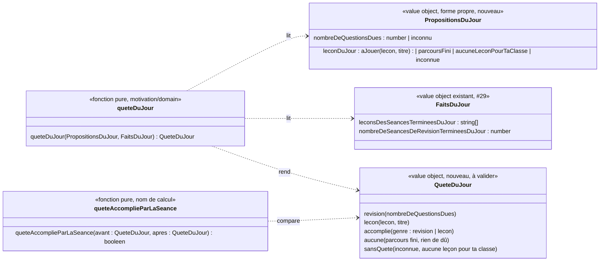

# Modèle du domaine : issue #101, Quête du jour

Contexte recommandé : **Motivation**. La quête du jour est une mécanique de jeu : une parole du personnage guide sur l'accueil de l'enfant, puis une fête quand elle est accomplie. Elle **ne choisit rien de nouveau à apprendre**. Elle désigne une des deux propositions qu'Apprentissage calcule déjà : la **séance de révision**, quand au moins une question est due, ou sinon la **leçon du jour** (#29). Le contexte est à confirmer par le PO (#101.13).

Proposition de cadrage (option B de #101.6) : **aucun agrégat, aucune commande, aucun événement enregistré, aucune migration, aucune Edge Function, aucune donnée d'enfant nouvelle**. Deux fonctions pures de plus dans `motivation/domain/`, importées par le front via `@domain/motivation`. Elles marchent hors ligne et utilisent seulement des données que l'accueil lit déjà : la leçon du jour, le nombre de questions dues et les faits du jour.

État : **cadrage à valider**. Les questions #101.1 à #101.15 attendent le PO. Chacune a des options et une recommandation. La plus importante est **#101.6** : la quête est-elle un concept nouveau, ou un autre nom pour ce qui existe ?

## Contexte

### Ce qui existe déjà sur l'accueil de l'enfant (#29, #30, #102)

| Élément de l'accueil | Ce qu'il fait | Contexte | Code |
|---|---|---|---|
| **Leçon du jour** (grande tuile) | Une prochaine leçon, choisie en alternant français et maths selon la dernière séance terminée, puis les autres matières (29.1). `parcoursFini` quand toutes les matières du parcours sont réussies. Calculée, jamais enregistrée | Apprentissage | `apprentissage/domain/lecon-du-jour.ts`, `src/accueil/LeconDuJourDeLAccueil.tsx` |
| **Tuiles du jour** | « À revoir » (s'il y a au moins une question due, avec leur nombre) et « Mon test de départ » (tant qu'il n'est pas fait), dans cet ordre. Les devoirs viendront au lot 6 | Apprentissage | `apprentissage/domain/tuiles-du-jour.ts` |
| **Objectif du jour** | « Joue 2 leçons aujourd'hui » : chaque leçon distincte qui a une séance terminée aujourd'hui, plus 1 s'il y a une séance de révision terminée. Ne limite rien. Calculé | Motivation | `motivation/domain/objectif-du-jour.ts`, `faits-du-jour.ts` |
| **Série** (pastille) | Jours de séance consécutifs jusqu'à aujourd'hui ou hier. Calculée | Motivation | `motivation/domain/serie.ts` |
| Salutation | « Bonjour `<prénom>` ! », lue à l'arrivée (avec la série si « Tout lire à voix haute ») | Motivation | `saluer`, `saluerAvecLaSerie` |

Récompenses qu'une séance terminée donne déjà, à ne pas casser : étoiles (Apprentissage), **objet de la cabane** (paliers du total des étoiles, #32), **tenue du personnage guide** (paliers des tenues, #102), **badge** (#31), **épisode** (un par séance terminée, séance de révision comprise, 20 au plus, #33). La série (#30) compte les jours de séance.

### Recouvrement avec la quête de l'issue

La story décrit la quête comme « une courte mission choisie parmi la prochaine leçon d'une matière et la séance de révision quand des questions sont dues ». Or :
- la **leçon du jour** est déjà « la prochaine leçon d'une matière », choisie par une règle validée (29.1) ;
- la **tuile du jour** « À revoir » est déjà « la séance de révision quand des questions sont dues » ;
- l'**objectif du jour** est déjà un encouragement quotidien, sans punition ;
- « mission du jour » est un **synonyme interdit** de Leçon du jour et d'Objectif du jour, et « défi du jour » a été écarté par #29.

Ce qui est **vraiment nouveau** dans l'issue :
1. **une seule** proposition, faite **par la voix du personnage guide**, qui choisit entre la révision et la leçon du jour (la révision passe d'abord) ;
2. un **état « accomplie »** dans la journée, avec une **fête** ;
3. un **refus** possible (« autre chose »).

Le reste existe déjà. Créer un concept qui choisit de nouveau une leçon ferait doublon avec la leçon du jour, et deux règles de choix pourraient diverger. La recommandation est donc de **réutiliser** la leçon du jour et le nombre de questions dues, sans réécrire leur règle (#101.1, #101.6).

### Communication entre contextes

| Source | Contexte | Ce qui est lu | Mécanisme |
|---|---|---|---|
| Leçon du jour | Apprentissage (#29) | `leconDuJour(entrees)` : `aJouer` (leçon, titre), `parcoursFini`, `aucuneLeconPourTaClasse`, `inconnue` | Lecture existante dans le navigateur (`@domain/apprentissage`), passée à Motivation **sous une forme propre** (comme la cabane, #32) |
| Nombre de questions dues | Apprentissage (#28) | `questionsDues(jour).length`, ou inconnu | Lecture existante (`useQuestionsDuesALAccueil`) |
| Faits du jour | Motivation (#29) | `FaitsDuJour` : leçons des séances terminées aujourd'hui, nombre de séances de révision terminées aujourd'hui | Lecture existante (`useObjectifDuJour`, `faitsDuJour`) |
| Prénom, univers, personnage guide | Famille, Motivation | `ProfilEnCours.prenom`, `Univers.personnageGuide` | Existant (#6, #11) |
| Jour de l'appareil | front | `Horloge` puis `jourDe` | Existant (#28) |

**Aucune relation nouvelle** dans la context map : on ajoute un usage de la lecture « Apprentissage → Motivation (objectif du jour) » de #29. Motivation ne modifie ni la leçon du jour, ni la file de révision, ni une étoile.

## Termes

| Terme | Statut | Remarque |
|---|---|---|
| Leçon du jour, Tuile du jour, Prochaine leçon, Séance de révision, Question due, Séance terminée, Jour, Jour de séance | au glossaire (validés) | Réutilisés tels quels. La quête **ne les redéfinit pas** |
| Objectif du jour, Série, Épisode, Objet de la cabane, Tenue du personnage guide, Personnage guide, Félicitation | au glossaire (Motivation) | Inchangés (#101.5, #101.3) |
| Accueil de l'enfant | au glossaire (Famille, validé) | L'écran où la quête est proposée |
| **Quête du jour** | **nouveau** `(à valider)`, Motivation | Selon #101.6 B : la proposition unique que le personnage guide fait à l'accueil, la séance de révision s'il y a au moins une question due, sinon la leçon du jour. Calculée, jamais enregistrée. Avec #101.6 A, ce serait un simple mot d'écran, hors du glossaire |
| **Quête accomplie** | **nouveau** `(à valider)`, Motivation | État de la quête du jour quand une séance du même genre a été terminée aujourd'hui (règle de #101.8 et #101.12). Calculé à partir des faits du jour |
| « Autre chose » (refus) | mot d'écran proposé | Bouton qui refuse la quête (#101.9). « Refuser la quête » n'est pas proposé comme terme du domaine : rien n'est enregistré |
| « quête accomplie par la séance » | nom de calcul | Comme « objet reçu par la séance » ou « tenue reçue par la séance » : pas un terme du glossaire |
| mission du jour, mission | **interdits** | « Mission du jour » est interdit pour Leçon du jour et Objectif du jour, « mission » pour Devoir. « Mission accomplie ! » reste une **expression** du personnage guide de l'univers « Pompiers » (`univers.ts`) : c'est du contenu, pas un terme. Elle peut sonner comme un écho de la quête accomplie, sans conflit de sens |
| défi du jour, défi | **interdits** pour la quête | « Défi du jour » a été écarté par #29 (limite, compétition). « Défi de fin de chapitre » appartient à #100 |
| quête manquée, quête ratée, quête perdue, quête expirée | **interdits** | Une quête non faite disparaît sans nom ni message (garde-fous éthiques). Le domaine n'a aucun état « manquée » |
| tâche, challenge, objectif (seul), aventure | **interdits** pour la quête | « Tâche » est interdit pour Devoir, « objectif » est réservé à l'objectif du jour et interdit pour Compétence |

**Conflit de sens possible** : « quête » rappelle l'**Histoire des Savanturiers**, où Noisette part chercher l'Étoile du savoir. Ce n'est pas un terme du domaine (#33), donc il n'y a pas de conflit au glossaire. Mais un enfant pourrait croire que la quête du jour fait avancer l'histoire, alors que l'épisode s'ouvre par toute séance terminée. Voir #101.14.

## Modèle

Avec la recommandation (#101.6 B, #101.8 A), il n'y a **pas d'agrégat** : rien n'est écrit, aucun invariant d'écriture n'est à protéger. On a un value object de lecture et deux fonctions pures, à côté de `objectif-du-jour.ts`.



### 1. Quête du jour (`queteDuJour`), selon les recommandations

On lit d'abord le **genre** de la quête du jour, puis on dit si elle est **accomplie** :

1. **Inconnue** : si la leçon du jour est `inconnue` ou si le nombre de questions dues n'est pas encore connu, il n'y a pas de quête (`sansQuete`). Aucun message. On attend les deux lectures pour ne pas proposer une leçon, puis la révision une seconde plus tard. Aujourd'hui l'accueil passe `0` tant que la file n'est pas connue : il faudra distinguer « inconnu » de « zéro ».
2. **Genre révision** : s'il y a au moins une question due, **ou** au moins une séance de révision terminée aujourd'hui. Les questions ratées aujourd'hui ne deviennent dues que demain (date de révision, #28). Les questions dues de la journée ne peuvent donc que diminuer, par la séance de révision. Ainsi le genre se retrouve sans rien enregistrer.
3. **Genre leçon** : sinon, si la leçon du jour est `aJouer`, la quête propose **cette leçon** (même règle de choix, 29.1).
4. **Aucune** : ni question due, ni séance de révision ni séance terminée aujourd'hui, et la leçon du jour est `parcoursFini`. Le personnage guide félicite, comme la grande tuile (« Bravo ! », critère de l'issue). `aucuneLeconPourTaClasse` donne `sansQuete`, sans félicitation (#101.10).
5. **Accomplie** (#101.12 a) : pour le genre révision, au moins une séance de révision terminée aujourd'hui ; pour le genre leçon, au moins une séance terminée aujourd'hui, sur n'importe quelle leçon.
   Une séance terminée aujourd'hui l'emporte sur `parcoursFini` : l'enfant qui réussit la dernière leçon de son parcours voit sa quête accomplie, pas « aucune ». Ce cas est à couvrir par un test.
6. **Le lendemain**, tout est recalculé à partir du nouveau jour : une quête non faite la veille n'existe plus, et rien n'en parle.

Exemple (règle recommandée) : Léa, CE1, a 3 questions dues. À l'accueil, Noisette propose la révision. Léa touche « Autre chose » et joue « Le son ou ». La quête reste celle de la révision, non accomplie, et ne lui est plus proposée pendant cette utilisation. Plus tard, Léa fait la séance de révision. À la fin, Noisette dit que la quête du jour est accomplie.

### 2. Quête accomplie par la séance (`queteAccomplieParLaSeance`)

À la fin d'une séance ou d'une séance de révision, le front calcule la quête du jour **avant** la séance (au lancement, comme les meilleures étoiles d'avant pour la cabane) et **après**. La fête est due si la quête n'était pas accomplie avant et l'est après. Elle se montre une seule fois, à la fin de la séance qui l'accomplit (#101.11). Sur l'accueil, la quête accomplie est ensuite montrée calmement, sans nouvelle fête.

### 3. Paroles (Motivation, contenu à valider avec les critères)

Phrases proposées, sans « mission », sans « défi », sans délai ni menace :
- révision : « Ta quête du jour : réviser `<n>` petites erreurs des jours passés. On y va ? » ;
- leçon : « Ta quête du jour : la leçon « `<titre>` ». On y va ? » ;
- boutons : « Oui, on y va ! » (comme la proposition du test de départ) et « Autre chose » (#101.9). Pas de « Plus tard », qui promettrait un rappel ;
- après « Autre chose » : « D'accord, choisis ce qui te fait envie ! » ;
- accomplie (fin de séance) : « Quête du jour accomplie ! Bravo `<prénom>` ! », humeur `applaudit` ;
- aucune (parcours fini, rien de dû) : la félicitation de la grande tuile, sans le mot « quête ».

Jamais : « Tu n'as pas fait ta quête », « Dépêche-toi », « Plus que… », « Hier, tu… », ni un compteur d'heures.

### Erreurs métier

Aucune. Une donnée absente donne `sansQuete`, sans message, comme sur l'accueil (#29).

### Si le PO retient une autre option

- **#101.6 A** (pas de concept) : rien dans `motivation/domain/` sauf les paroles. La grande tuile reste la leçon du jour. Le personnage guide la propose oralement, mais **ne peut pas** proposer la révision d'abord sans une règle nouvelle. Le premier critère de l'issue tombe.
- **#101.8 B** (gardée sur l'appareil) : la quête du jour est fixée à la première arrivée de la journée et gardée sur l'appareil, par profil et par jour, avec son état. On l'efface à la déconnexion du parent et on l'ajoute à `DonneesDeLAppareil` (Famille), comme la tenue portée (#102). Sur un autre appareil, la quête peut être différente.
- **#101.8 C** (enregistrée) : un agrégat `QueteDuJour` (profil, jour, genre, leçon proposée, état), avec les commandes `ProposerLaQueteDuJour`, `AccomplirLaQueteDuJour`, `RefuserLaQueteDuJour`, et les événements `QueteDuJourProposee`, `QueteDuJourAccomplie`, `QueteDuJourRefusee`. Invariants : une seule quête par profil et par jour ; une quête accomplie ne redevient jamais non accomplie ; une quête refusée n'est plus proposée ce jour-là. Il faut alors une **migration** avec table sous RLS (rattachement), une Edge Function d'écriture, une suppression en cascade et l'export (#14), donc **le verrou `base`**. Ce serait la **première donnée de Motivation enregistrée sur le serveur** : décision 0037 à écrire. Non recommandé.

## Invariants

Ce sont des règles du calcul, vérifiées par les tests des fonctions pures (pas des invariants d'agrégat) :

1. **Au plus une quête du jour** par profil, à un instant donné.
2. La quête **ne choisit jamais une leçon elle-même** : son genre leçon est toujours la leçon du jour d'Apprentissage, sans autre règle (29.1). Elle ne propose donc jamais une leçon réussie, une leçon des classes d'avant, une leçon d'une classe au-dessus, une leçon personnelle ni le test de départ (#101.10).
3. **La révision passe d'abord** : s'il y a au moins une question due, la quête propose la séance de révision (#101.1).
4. **Pas de quête sans données** : bibliothèque ou file de révision inconnue, pas de quête et aucun message.
5. **Rien de punitif** (skill `gamification`, section 5) : aucun état « manquée », aucun message sur une quête d'un jour passé, aucune notification, aucun compte à rebours, aucune heure limite. Le lendemain, tout se recalcule.
6. **Refuser ne coûte rien** : après « Autre chose », la quête n'est plus proposée pendant l'utilisation. Toutes les leçons et tuiles restent ouvertes. Rien n'est enregistré, rien n'est perdu (#101.9).
7. **Motivation ne crée aucune étoile** et ne modifie ni note, ni résultat de la leçon, ni file de révision, ni parcours.
8. **Récompenses existantes inchangées** : la quête accomplie ne donne ni objet de la cabane, ni tenue, ni épisode, ni badge, et ne compte pas dans le total des étoiles (#101.3). La série et l'objectif du jour gardent leur règle (#101.5).
9. **La fête se montre une seule fois**, à la fin de la séance qui accomplit la quête.
10. **Déterministe** : mêmes propositions et mêmes faits du jour donnent la même quête, sans hasard (le hasard ne sert qu'à varier une parole).
11. **Contenu pour les enfants** (`CLAUDE.md`, règle absolue) : paroles douces et inoffensives, sans pression ni peur. Un dessin éventuel (parchemin, boussole) passe par le skill `illustration`, section 0 : ni arme, ni piège, ni lieu effrayant.

## Événements

Recommandation : **aucun événement de domaine nouveau, aucune commande**. La quête du jour et son état sont des **lectures**. Les faits qui la font changer existent déjà : `SeanceTerminee` (#24), `SeanceDeRevisionTerminee` (#28). « Quête accomplie par la séance » est un nom de calcul, comme « objet reçu par la séance ».

Seule l'option #101.8 C créerait des commandes et des événements (voir « Si le PO retient une autre option »).

## Partage avec le front

`@domain/motivation` (`index.ts`) exporte en plus `queteDuJour`, `queteAccomplieParLaSeance` et les types `QueteDuJour` et `PropositionsDuJour`. Tout marche hors ligne, avec les données déjà connues de l'utilisation et les séances gardées sur l'appareil.

React affiche et ne décide rien. Il ne choisit pas entre la révision et la leçon, ne dit pas si la quête est accomplie, ne compose pas la phrase. Le refus « Autre chose » est un **état d'écran gardé en mémoire** le temps de l'utilisation (comme la prochaine leçon connue, #99), jamais enregistré.

Accessibilité (pour les critères) : la proposition est une parole du personnage guide, lue à voix haute et affichée dans sa bulle. Les deux boutons sont de vrais boutons de 44 px au moins, utilisables au clavier. La fête respecte `prefers-reduced-motion` et ne passe que par des effets sonores existants (#97 : pas de son nouveau sans choix du PO).

## Données d'enfants

Avec la recommandation : **rien de nouveau**. Rien n'est enregistré ni gardé sur l'appareil. Le refus reste en mémoire le temps de l'utilisation, et rien ne part à l'IA. Les lectures (leçon du jour, questions dues, faits du jour) sont déjà couvertes par la RLS, la suppression et l'export.

Avec #101.8 B, on garde sur l'appareil la quête du jour et son état, par profil (ajout à `DonneesDeLAppareil`, effacé à la déconnexion). Avec #101.8 C, on ajoute une donnée serveur sous RLS, avec suppression en cascade et export (#14), et il faut le verrou `base`.

## Emplacement

Avec la recommandation (domaine en TDD, `Deno.test`) :

```
supabase/functions/_shared/motivation/domain/
  quete-du-jour.ts             # QueteDuJour, PropositionsDuJour, queteDuJour, queteAccomplieParLaSeance
  quete-du-jour_test.ts
  paroles-de-la-quete.ts       # proposer, accepter, refuser, accomplie (selon #101.6 et les critères)
  paroles-de-la-quete_test.ts
  index.ts                     # exports
```

Rien dans `application/`, `infrastructure/`, `supabase/migrations/` ni `supabase/functions/<fonction>/`. `apprentissage/domain/lecon-du-jour.ts` et `tuiles-du-jour.ts` ne changent pas.

Affichage (pour mémoire, précisé par les critères) :
- `src/famille/AccueilDeLEnfant.tsx` : la proposition après la salutation, avec « Oui, on y va ! » et « Autre chose » ;
- `src/accueil/` : `useQueteDuJour` (réunit leçon du jour, questions dues et faits du jour) et `QueteDuJourDeLAccueil.tsx` ;
- fin de la séance et fin de la séance de révision : l'annonce « Quête du jour accomplie ! », dans la zone des nouveautés (#101.11).

Décision 0037 (réservée) : **pas nécessaire** avec la recommandation. À écrire seulement si le PO retient #101.8 C (première donnée de Motivation enregistrée sur le serveur) ou #101.6 C/D.

## Questions ouvertes

Les questions #101.1 à #101.5 reprennent les cinq questions de l'issue. Les suivantes viennent du recouvrement avec #29, #30, #32, #33 et #102.

**#101.1. Comment choisir la quête** (question n°1 de l'issue).
- (a) Révision d'abord s'il y a au moins une question due, sinon la **leçon du jour** telle quelle (alternance français et maths, 29.1).
- (b) La matière la moins jouée.
- (c) L'alternance de toutes les matières.

Exemple pour (a) : Tom a 2 questions dues. La quête propose « Je révise mes erreurs ». Le lendemain, il n'en a plus : la quête propose la leçon du jour, « Les nombres jusqu'à 100 ».

**Recommandation : (a).** Elle respecte les deux premiers critères de l'issue et la pratique espacée (`spaced-practice-scheduler`). Elle ne crée pas une seconde règle de choix des leçons, qui pourrait contredire la grande tuile. (b) et (c) demanderaient de changer la leçon du jour (29.1), règle validée.

**#101.2. Une seule quête par jour, ou une nouvelle dès que la première est faite ?** (question n°2 de l'issue)
- (a) Une seule par jour. Une fois accomplie, elle le reste jusqu'au lendemain ; la grande tuile et les tuiles du jour continuent de proposer la suite.
- (b) Une nouvelle dès que la précédente est faite.

**Recommandation : (a).** Le skill `gamification` interdit les « boucles sans fin conçues pour retenir ». Une quête qui revient sans cesse ressemble à une liste sans fin. L'enfant peut toujours continuer par la grande tuile, ou s'arrêter avec le sentiment d'avoir fini.

**#101.3. Quelle récompense ?** (question n°3 de l'issue)
- (a) Rien de plus que la fête : parole du personnage guide, humeur `applaudit`, effet sonore existant, confettis (sauf mouvements réduits).
- (b) Un objet de la cabane.
- (c) Un épisode.
- (d) Une récompense nouvelle (un tampon de quête, par exemple).

**Recommandation : (a).** La séance qui accomplit la quête donne déjà des étoiles, peut-être un objet de la cabane, une tenue ou un badge, et un épisode. (b) casserait la règle de la cabane (paliers du total des étoiles, #32), et (c) celle des épisodes (un par séance terminée, #33). (d) créerait une donnée à enregistrer et une récompense qui ne vient pas des étoiles : une « récompense qui dévalorise la note » (section 5). D'accord ?

**#101.4. Le parent voit-il les quêtes dans le suivi (Accompagnement) ?** (question n°4 de l'issue)
- (a) Non : le suivi montre déjà les séances jouées et les erreurs corrigées pour de bon.
- (b) Oui, par exemple « quête accomplie 4 jours cette semaine ».

**Recommandation : (a).** Avec (a) et #101.3 (a), la quête ne donne rien de durable, donc il n'y a rien à montrer. Montrer les jours sans quête accomplie ferait de la quête une pression via le parent : c'est le contraire de « une quête non faite disparaît sans message ». (b) demanderait de garder l'historique des quêtes (#101.8 C). À poser au PO, sans trancher.

**#101.5. La quête remplace-t-elle une partie de la série (#30), des épisodes (#33) ou de l'objectif du jour (#29) ?** (question n°5 de l'issue)
- (a) Elle s'ajoute sans rien remplacer : série, épisodes et objectif du jour gardent leur règle et leur place.
- (b) Elle remplace l'objectif du jour (« Joue 2 leçons aujourd'hui ») : un seul encouragement quotidien sur l'accueil.
- (c) Elle remplace la série.

**Recommandation : (a)**, sans compteur pour la quête : c'est une parole et un état, pas une barre. (b) est une vraie option si le PO trouve que deux encouragements quotidiens se gênent (« Objectif du jour » et « Quête du jour »). Elle retirerait un terme validé (29.3). (c) n'est pas recommandée : la série compte les jours de séance, la quête un choix proposé.

**#101.6. La quête du jour est-elle un concept nouveau ?** (capitale, recouvrement avec #29)
- (A) **Non.** « Quête du jour » est le nom d'écran de la leçon du jour. Le personnage guide la propose oralement, avec une fête à la fin. La révision reste une tuile à part. Conséquence : le premier critère de l'issue (« avec des questions dues, la quête propose Je révise mes erreurs ») tombe, sauf si l'on change la définition de la leçon du jour.
- (B) **Oui, mais calculée et sans règle de choix propre.** **Quête du jour** (Motivation) désigne une des propositions qui existent déjà, la révision d'abord, sinon la leçon du jour. Elle a un état « accomplie » calculé à partir des faits du jour. Rien n'est enregistré.
- (C) **Oui, et enregistrée.** Un agrégat `QueteDuJour` par profil et par jour, avec migration, RLS, Edge Function, export et suppression, et le verrou `base`.
- (D) **Elle remplace la leçon du jour** : la grande tuile devient la quête, révision comprise. On redéfinit un terme validé (29.17, 29.18) et le code de #29.

**Recommandation : (B).** C'est la seule option qui respecte les cinq critères de l'issue sans doublon : la règle de choix reste celle de #29. Elle ne redéfinit aucun terme validé, ne crée aucune donnée d'enfant et marche hors ligne.

**#101.7. Nom du terme.** « Quête du jour » n'est pas au glossaire, et « mission du jour » et « défi du jour » sont interdits.
- (a) **Quête du jour** et **Quête accomplie**, en Motivation, avec les synonymes interdits « mission du jour », « défi du jour », « tâche », « quête manquée ».
- (b) Un autre nom (« Proposition du personnage guide », « Idée du jour »).

**Recommandation : (a)**, le mot de l'issue et de l'épopée #95. Les deux lignes sont ajoutées au glossaire `(à valider)`.

**#101.8. Comment savoir, plus tard dans la journée, que la quête est accomplie ?**
- (A) Calculé à partir des faits du jour, que l'accueil lit déjà pour l'objectif du jour. Rien n'est enregistré, et c'est le même résultat sur tous les appareils dès que les séances sont lues.
- (B) Gardé sur l'appareil, par profil et par jour (comme la tenue portée, #102). Sur un autre appareil, la quête peut être différente.
- (C) Enregistré sur le serveur, avec migration, RLS, export, suppression et le verrou `base`.

**Recommandation : (A)**, possible parce que les questions dues d'une journée ne font que diminuer (voir Modèle, règle 2).

**#101.9. Que fait le refus ?** L'issue dit que l'enfant peut refuser.
- (a) Un bouton « Autre chose » à côté de « Oui, on y va ! ». Le personnage guide répond « D'accord, choisis ce qui te fait envie ! » et ne repropose pas la quête pendant l'utilisation (en mémoire, jamais enregistré). Elle revient à la prochaine ouverture de l'application, sans reproche. Rien n'est enregistré, rien n'est perdu.
- (b) Pas de bouton : toucher autre chose suffit.
- (c) Le refus vaut pour toute la journée (il faudrait alors le garder sur l'appareil ou sur le serveur).

**Recommandation : (a).** Le choix est explicite et respecte l'autonomie, sans rien garder. « Plus tard » n'est pas proposé, parce qu'il annoncerait un rappel.

**#101.10. Ce que la quête ne propose jamais.**
- (a) Ni le test de départ, ni une leçon personnelle, ni une leçon des classes d'avant ou d'une classe au-dessus. Rien non plus quand la classe n'a aucune leçon (« Aucune leçon pour ta classe »), sans félicitation dans ce cas. Les devoirs (lot 6) sont à revoir avec leur story.
- (b) Le test de départ, tant qu'il n'est pas fait, passe d'abord.

**Recommandation : (a).** Le test de départ a déjà sa proposition et sa tuile (#27). Ce n'est pas une séance (27.4), donc il ne pourrait pas accomplir la quête.

**#101.11. Où et quand la fête a-t-elle lieu ?**
- (a) À la fin de la séance (ou de la séance de révision) qui accomplit la quête, dans la zone des nouveautés, **après** les annonces existantes (badge, objet de la cabane, tenue, épisode). De retour sur l'accueil, la quête montre « Quête du jour accomplie » calmement, sans nouvelle fête.
- (b) Au retour sur l'accueil seulement.

**Recommandation : (a).** C'est le critère « après la séance de la quête, le personnage guide dit que la quête est accomplie ». La fête vient au moment de l'effort, et l'accueil reste calme.

**#101.12. Quelle séance accomplit la quête ?**
- (a) Toute séance du même genre terminée aujourd'hui : pour la révision, une séance de révision ; pour une leçon, une séance terminée sur **n'importe quelle** leçon (rejouée ou nouvelle). C'est calculable sans rien enregistrer (#101.8 A).
- (b) Une séance qui rend une leçon réussie aujourd'hui (une nouvelle leçon). Il faut une lecture de plus : les leçons qui avaient déjà une séance terminée avant aujourd'hui.
- (c) Exactement la leçon proposée. Il faut garder la proposition (#101.8 B ou C), parce que la leçon du jour change dès qu'elle est réussie.

**Recommandation : (a).** Elle est généreuse et jamais punitive, et l'enfant garde le choix de la leçon. Exemple : la quête propose « Le son ou », Léa préfère rejouer « Les nombres jusqu'à 20 » ; la quête est accomplie. D'accord, ou préférez-vous (b) ?

**#101.13. Dans quel contexte vit la quête ?**
- (a) Motivation : une parole, une fête, un état calculé, à côté de l'objectif du jour (29.3). Motivation lit la leçon du jour et le nombre de questions dues sous une forme propre.
- (b) Apprentissage : à côté de la leçon du jour, parce que « la révision d'abord » est une règle pédagogique.

**Recommandation : (a).** La règle pédagogique reste dans Apprentissage (leçon du jour, questions dues) ; Motivation désigne seulement l'une des deux. C'est le cas prévu par le skill `gamification` (section 4 : « Quête du jour », mécanique de Motivation).

**#101.14. Lien avec l'Histoire des Savanturiers.** Le mot « quête » rappelle la recherche de l'Étoile du savoir (#33).
- (a) Aucun lien : la quête du jour ne parle pas de l'histoire, et un épisode s'ouvre toujours par toute séance terminée.
- (b) La parole de la quête cite l'épisode à venir (« Ta quête du jour aidera Noisette à… »).

**Recommandation : (a).** (b) laisserait croire que seule la quête fait avancer l'histoire, ce qui est faux (#33), et lierait deux règles.

**#101.15. Où la quête apparaît-elle sur l'accueil ?**
- (a) Dans la bulle du personnage guide, juste après la salutation, avec ses deux boutons. La grande tuile et les tuiles du jour restent en dessous, inchangées (la tuile proposée par la quête peut être mise en valeur).
- (b) La quête prend la place de la grande tuile.

**Recommandation : (a).** Elle ne change pas l'écran validé par #29 et garde toutes les autres options visibles (autonomie, refus possible).
