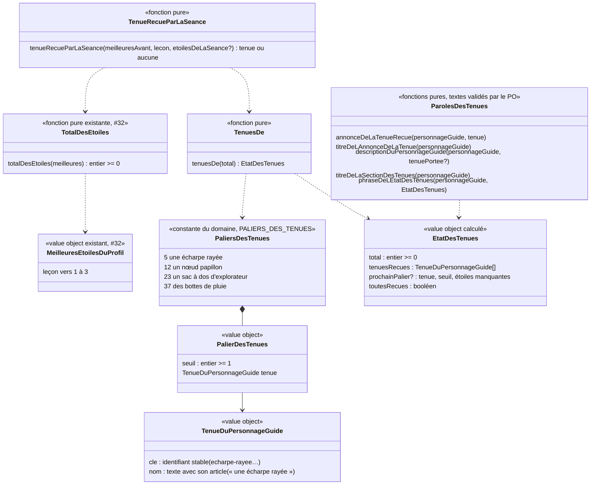

# Modèle du domaine : issue #102, le personnage guide évolue avec les étoiles

Contexte : **Motivation**. La story réagit au **total des étoiles** (#32), déjà calculé par Motivation à partir des meilleures étoiles lues dans Apprentissage. Elle ne modifie jamais une étoile, un résultat de la leçon ni le parcours.

État : **validé par le PO le 2026-10-29** (« #102 reco tout ») : toutes les recommandations des questions #102.1 à #102.27 sont retenues (section « Réponses du PO (2026-10-29) »). Les termes sont écrits dans `docs/domain/glossaire.md`, section Motivation.

## Contexte

### Pourquoi Motivation

- C'est une récompense par paliers d'étoiles, comme la cabane (#32). La context map dit : « Motivation décide seule des récompenses ; une récompense ne modifie jamais une note ».
- Le personnage guide, l'univers et leurs dessins appartiennent déjà à Motivation (`univers.ts`, `personnage-guide.ts`, `src/univers/`).
- La règle (paliers, tenues reçues, tenue reçue par la séance, choix et affichage de la tenue portée) est pure, dans `supabase/functions/_shared/motivation/domain/`. Le front l'importe par `@domain/motivation`, hors ligne compris.

### Sources lues, sans rien écrire

| Source | Contexte | Ce qui est lu | Mécanisme |
|---|---|---|---|
| Meilleures étoiles de chaque leçon du profil en cours | Apprentissage (#24) | leçon → 1 à 3 | Lecture existante de #32 (`lireLesMeilleuresEtoilesPourLaCabane`), sous RLS, réunie avec les étoiles gagnées pendant l'utilisation. Aucune lecture nouvelle |
| Étoiles de la séance qui vient de finir | Apprentissage (#24) | un nombre, ou rien (séance faite seulement d'une fluence) | Déjà passé à `objetRecuParLaSeance` à l'écran de fin |
| Profil en cours | Famille | identifiant, univers | Customer/Supplier existant (#6, #11) |
| Univers et personnage guide | Motivation | `universDe(cle)` | Interne |
| Tenue portée du profil en cours | Motivation (mémoire de l'appareil) | une clé de tenue, ou aucune | Adaptateur de l'appareil dans `src/`, comme `src/voix/memoire-du-son.ts` (#102.8 A) |

Non lus : le test de départ (aucune étoile, réponse 27.4), la bibliothèque (le total n'en a pas besoin, décision 32.15).

### Ce qui existe déjà et ne change pas

- **Cabane (#32)** : `PALIERS_DE_LA_CABANE`, `cabaneDe`, `objetRecuParLaSeance`, `totalDesEtoiles` gardent **exactement** leur comportement. #102 réutilise `totalDesEtoiles` et le calcul « total avant / total après la séance ». Si ce calcul est extrait de `objetRecuParLaSeance` pour être partagé, c'est un refactor sans changement de comportement : les tests de `cabane_test.ts` et `objet-recu-par-la-seance_test.ts` restent inchangés et verts.
- **Choix de modèle de #32 (décision 32.20)** : la cabane n'est pas enregistrée, elle se recalcule ; le total des étoiles ne baisse jamais. #102 suit le même choix pour les **tenues reçues** : rien n'est enregistré, rien ne se perd. Le seul état nouveau est le **choix de l'enfant** (la tenue portée), gardé sur l'appareil (#102.8 A).
- **Dessins** (#96) : un composant par personnage guide dans `src/univers/personnages/` (Noisette, Lumi, Coach Léo, Agent Max, Capitaine Sam, Lili), choisi par `PersonnageGuide.tsx` selon l'univers. Le personnage guide reste **décoratif** (`aria-hidden`) partout, sauf dans la section des tenues de « Mes médailles » (#102.14 A). L'issue cite `dessins.tsx` et `apparences.ts`, qui n'existent plus depuis #96.
- **Écran de fin** : zone « nouveautés » (`NouveautesDeFin` : objet de la cabane, épisode, badge, leçon acquise) ; effet sonore « decouverte » s'il y a un objet ou un épisode (`effetsSonoresDeLaFin`, #97).
- **Mes médailles** (#65) : sections dans un ordre fixe, `cabane`, `histoire`, `badges`, `recordsDeFluence` (`sections-de-l-ecran.ts`) ; #102 ajoute `tenues` juste après `cabane`.
- Les **gestes** (saute, se penche, respire, cligne) sont communs à tous les personnages guides ; aucune danse n'existe, et #102 n'en ajoute pas (danses confiées à #106, #102.7 A).

### Communication entre contextes

Aucune relation nouvelle : la lecture « Apprentissage → Motivation (meilleures étoiles, #32) » suffit, et la tenue portée reste sur l'appareil (#102.8 A), sans donnée nouvelle côté serveur. La relation « Famille → Motivation : contrat de données personnelles (#14) » n'est pas touchée dans #102 ; elle s'appliquera à la story suivante qui retrouvera la tenue portée sur tous les appareils.

## Termes

| Terme | Statut | Remarque |
|---|---|---|
| Personnage guide, Univers | au glossaire, validés | Inchangés. |
| Total des étoiles | au glossaire, validé (#32) | Réutilisé tel quel : même somme, mêmes exclusions. |
| Palier de la cabane, Objet de la cabane, Cabane | au glossaire (#32) | Inchangés. Les paliers des tenues sont **distincts** des paliers de la cabane. |
| Tenue du personnage guide | **nouveau, validé** (#102.6 A) | Ce que le personnage guide reçoit à un palier des tenues et qu'il peut porter. |
| Palier des tenues | **nouveau, validé** (#102.1 B) | 5, 12, 23, 37. |
| Tenue reçue | **nouveau, validé** | Se recalcule depuis le total des étoiles, ne se perd jamais. |
| Tenue portée | **nouveau, validé** (#102.8 A, #102.9 A) | Une seule tenue reçue, ou aucune ; gardée sur l'appareil, par profil. |
| Recevoir (une tenue) | **verbe validé** (#102.6, #102.11 A) | « Noisette a reçu une écharpe rayée ! ». Le sujet est le personnage guide du profil. Même verbe que la cabane (décision 32.1). |
| Tenue reçue par la séance | nom de calcul, pas un terme du glossaire | Comme « épisode ouvert par la séance » (décision 33.27). Au plus une par séance. |
| « Accessoire » | **interdit pour les tenues** | Réservé par #106 à l'objet propre à chaque personnage guide (la baguette de Lumi, le ballon de Coach Léo…). |
| « Évolution » | **interdit** | Évoque un niveau de jeu (« niveau » est réservé à la classe) ou un personnage qui change de forme. |
| « Débloquer » | **interdit** | Déjà interdit (#32, #33). On dit **recevoir**. |
| « Danse de victoire », « nouvelle danse » | **hors de #102** | Confiées à #106 (#102.7 A). |
| « Pour <personnage guide> » | mot d'interface validé | Titre de l'encart de l'écran de fin, sur le modèle de « Pour la cabane » (#102.18). |

## Modèle

### Partie calculée (pure, sans état) : les tenues reçues

Comme la cabane : **pas d'agrégat**, des value objects et des fonctions pures.

| Value object | Règles de validité |
|---|---|
| `TenueDuPersonnageGuide` | `cle` unique parmi les tenues (le dessin s'y accroche, jamais au nom affiché) ; `nom` non vide, avec son article, tel qu'il sera dit. Le nom est du **contenu** validé par le PO, pas un terme du domaine (comme les objets de la cabane). Aucune tenue ne se porte sur la tête ni dans les mains (#102.15 B). |
| `PalierDesTenues` | `seuil` entier ≥ 1. |
| `PALIERS_DES_TENUES` | **5, 12, 23, 37** (#102.1 B, #102.27) : une écharpe rayée, un nœud papillon, un sac à dos d'explorateur, des bottes de pluie. Seuils strictement croissants ; deux seuils consécutifs séparés d'**au moins 3** (une séance ajoute au plus 3 au total, donc elle fait recevoir au plus une tenue) ; clés uniques ; aucune clé commune avec un objet de la cabane. Constante vérifiée par les tests. Les mêmes tenues dans tous les univers (#102.2 A), dessinées pour chaque personnage guide. |
| `EtatDesTenues` | `tenuesRecues` = tenues des paliers dont le seuil est ≤ total, dans l'ordre des paliers ; `prochainPalier` = premier palier dont le seuil est > total, avec `etoilesManquantes` = seuil − total (≥ 1) ; `toutesRecues` ⇔ aucun prochain palier (total ≥ 37). Total négatif ou non entier : erreur `TotalDEtoilesInvalide` (existante). |

Le calcul « total après la séance » est celui de `objetRecuParLaSeance` : total avant − meilleur avant sur la leçon + max(meilleur avant, étoiles de la séance). Séance sans étoiles (fluence seule) : aucune tenue. Étoiles hors de 1 à 3 : `NombreDEtoilesInvalide` (existante).

Paroles validées (#102.18, #102.26, #102.25) :

| Parole | Texte |
|---|---|
| Titre de l'encart de l'écran de fin | « Pour <personnage guide> » |
| Annonce de la tenue reçue | « <personnage guide> a reçu <tenue> ! » (« Coach Léo a reçu une écharpe rayée ! ») |
| Description accessible, avec tenue | « <personnage guide>, avec <tenue> » |
| Description accessible, sans tenue | « <personnage guide> » seul |
| Titre de la section | « Les tenues de <personnage guide> » |
| Phrase de l'état, prochain palier | « Encore <n> étoiles et <personnage guide> recevra <tenue> ! » (« Encore 1 étoile… » au singulier) |
| Phrase de l'état, toutes reçues | « <personnage guide> a reçu toutes ses tenues ! » |

### Partie choisie par l'enfant : la tenue portée

C'est la seule chose nouvelle qui se garde, **sur l'appareil, par profil** (#102.8 A). Elle appartient au profil enfant, mais c'est un concept de Motivation : elle ne va **pas** dans l'agrégat `ProfilEnfant` de Famille.

| Élément | Nature | Contenu et règles |
|---|---|---|
| `TenuePortee` | value object | `profil` (référencé par identifiant) ; `tenue` : clé d'une tenue, ou **aucune** (le personnage guide tel qu'il est dessiné aujourd'hui). Par défaut : aucune. Une seule tenue à la fois (#102.9 A). |
| `PorterUneTenue` | commande (fonction pure `porterUneTenue(etatDesTenues, cle)`) | L'enfant choisit une tenue reçue, dans la section des tenues de « Mes médailles ». Elle remplace la tenue portée. Refusée si la tenue est inconnue (`TenueInconnue`) ou pas encore reçue (`TenueNonRecue`), au vu de l'état des tenues **lu au moment du choix**. Sans état des tenues (étoiles non lues), la section n'existe pas : aucun choix possible. La tenue reçue par la séance n'est pas mise d'office (#102.10 A). |
| `RetirerLaTenue` | commande (fonction pure) | Le personnage guide ne porte plus rien. Toujours possible. La tenue reste reçue. |
| `tenueAMontrer(tenuePortee, etatDesTenues?)` | fonction pure de lecture | Clé inconnue des `PALIERS_DES_TENUES` : aucune, sans erreur. Étoiles lues : la tenue portée si elle est reçue, sinon aucune. Étoiles **non lues** (hors ligne, lecture en échec) : la tenue portée, telle quelle (#102.24 B). Le choix n'est jamais effacé par cette lecture. |

Erreurs métier nommées : `TenueInconnue`, `TenueNonRecue` (nouvelles) ; `TotalDEtoilesInvalide`, `NombreDEtoilesInvalide` (existantes, #32).

### Mémoire de la tenue portée sur l'appareil (adaptateur, hors du domaine)

- Elle n'enregistre que ce que rend `porterUneTenue` ou `retirerLaTenue` : jamais une clé venue d'ailleurs.
- Une valeur illisible se lit comme « aucune ».
- Elle est effacée à la déconnexion du parent (ajout à `DonneesDeLAppareil`), et avec le profil quand il est supprimé depuis cet appareil.
- Elle n'est pas retrouvée sur un autre appareil et n'est pas dans l'export (#102.8 A, accepté par le PO).

### Affichage (dans `src/`, sans règle)

- `PersonnageGuide` reçoit la tenue à montrer (une clé ou rien) et la dessine par-dessus le dessin du personnage guide, sur tous les écrans de l'enfant où il apparaît : accueil, « Mon parcours », « Toutes les leçons », séance, fin de la séance, « Mes médailles ». Pas dans « Qui joue ? », écran du parent (#102.23).
- Les dessins des tenues suivent le skill `illustration` (section 0 d'abord), un placement par personnage guide, sans rien cacher de sa coiffe ni de son objet propre.
- Les gestes (saute, se penche) et `prefers-reduced-motion` restent ceux de #96 ; la tenue suit le personnage guide.
- L'encart de l'écran de fin et la section de « Mes médailles » montrent ce que rend le domaine.

## Invariants

1. **Rien ne se perd** : les tenues reçues se déduisent du total des étoiles, qui ne baisse jamais (meilleures étoiles, #24). Rejouer une leçon avec moins d'étoiles ne retire aucune tenue et ne change pas la tenue portée.
2. **Au plus une tenue reçue par séance** (écart d'au moins 3 entre deux paliers des tenues). Une même séance peut toutefois faire recevoir un objet de la cabane **et** une tenue (de 4 à 6 étoiles, par exemple) : deux encarts, la cabane d'abord (#102.13 A, #102.22).
3. **On ne porte qu'une tenue reçue** (revu pour #102.24 B). La garantie est donnée **au moment du choix**, pas au moment de l'affichage :
   - a. une tenue ne devient portée que par `porterUneTenue`, qui la refuse si elle n'est pas reçue au vu des étoiles lues à ce moment-là (sans étoiles lues, aucun choix n'est proposé) ;
   - b. la mémoire de l'appareil n'enregistre que ce résultat ;
   - c. comme le total des étoiles ne baisse jamais (invariant 1), une tenue reçue au moment du choix le reste ensuite : la tenue portée peut donc être **montrée sans relire les étoiles**, hors ligne compris ;
   - d. quand les étoiles sont lues, `tenueAMontrer` vérifie encore que la tenue portée est reçue, et sinon n'en montre aucune ;
   - e. une tenue portée inconnue des paliers des tenues (valeur illisible, tenue retirée de la liste par une story suivante) est ignorée : le personnage guide s'affiche sans tenue, sans message d'erreur.
4. **Une tenue portée au plus**, ou aucune (#102.9 A). Une tenue reçue n'est jamais mise d'office (#102.10 A).
5. **La cabane ne change pas** : mêmes paliers, mêmes objets, même annonce, même total, même phrase de fin.
6. **Motivation ne modifie aucune note** : ni étoile, ni résultat de la leçon, ni parcours.
7. **Le test de départ n'apporte rien** (il n'a aucune étoile, réponse 27.4).
8. **Rien d'aléatoire, rien à acheter** : l'ordre des tenues est fixe et connu à l'avance (pas de coffre, pas de tirage : skill `gamification` section 5, réponse 98.6).
9. **L'univers ne change pas les règles** : même total, mêmes paliers, mêmes tenues dans tous les univers ; la tenue portée suit le profil quand il change d'univers (#102.2 A, #102.3).
10. **Règle absolue de contenu** : chaque tenue, dans chaque univers, respecte `CLAUDE.md` (« Contenus pour les enfants ») : aucune arme ni objet qui y ressemble, rien d'effrayant, aucun costume ou coiffe qui caricature une origine, une religion, un sexe ou un handicap, aucune tenue réservée à un sexe ; dans le doute, on ne dessine pas et on demande au PO.

## Événements

Aucun événement de domaine n'est publié : les tenues reçues se recalculent comme la cabane (décision 32.20), et la tenue portée reste sur l'appareil. Motivation ne s'abonne pas à `SeanceTerminee`.

| Fait | Nature | Qui s'en sert |
|---|---|---|
| Tenue reçue par la séance | fait calculé à l'écran de fin (`tenueRecueParLaSeance`), non enregistré ; annoncé seulement si les étoiles d'avant la séance ont été lues (comme 32.13) | Zone « nouveautés » de l'écran de fin (`NouveautesDeFin.tenue`, à ajouter, après la cabane et avant l'épisode et le badge) ; effet sonore « decouverte » (`FaitsDeLaFin`, #97, étendu : une seule fois, même avec un objet ou un épisode, #102.16) |

Story suivante (hors de #102) : si la tenue portée est un jour retrouvée sur tous les appareils (ancienne option C de #102.8), un événement `TenueChoisie` (profil, tenue ou aucune, le) servira à la synchronisation et à l'export.

## Partage avec le front

Tout fonctionne dans le navigateur, hors ligne compris, par `@domain/motivation` : `PALIERS_DES_TENUES`, `tenuesDe`, `tenueRecueParLaSeance`, `tenueAMontrer`, `porterUneTenue` / `retirerLaTenue` (règle de choix), paroles des tenues, et l'extension de `effetsSonoresDeLaFin` et de `sectionsDeLEcran`. React ne fait que dessiner et animer ce que rend le domaine. La mémoire de la tenue portée est un adaptateur de `src/`.

## Données d'enfants

- **Tenues reçues** : aucune donnée nouvelle (recalculées depuis les meilleures étoiles, déjà couvertes par la cascade et l'export de #14).
- **Tenue portée** : une préférence de jeu (une clé de tenue, rien d'identifiant), **sur l'appareil seulement** (#102.8 A). Rien côté serveur : ni migration, ni RLS nouvelle, ni adaptateur d'export. Minimisation respectée ; effacée à la déconnexion du parent et avec le profil supprimé depuis l'appareil ; non exportée (elle n'est pas chez Savanturier).
- Rien n'est envoyé à l'IA, aucun service tiers. Rien dans l'Espace parent (#102.19).

## Emplacement

Sous `supabase/functions/_shared/motivation/domain/` :

| Fichier | Contenu |
|---|---|
| `tenues.ts` | `TenueDuPersonnageGuide`, `PalierDesTenues`, `PALIERS_DES_TENUES`, `EtatDesTenues`, `tenuesDe`, `tenueRecueParLaSeance` |
| `tenue-portee.ts` | `TenuePortee`, `porterUneTenue`, `retirerLaTenue`, `tenueAMontrer`, erreurs `TenueInconnue`, `TenueNonRecue` |
| `paroles-des-tenues.ts` | annonce, titre de l'encart, description accessible, titre et phrase de la section |
| `cabane.ts` | au plus l'extraction du calcul « total après la séance », sans changement de comportement |
| `effets-sonores.ts` | `FaitsDeLaFin.tenueRecue` (#102.16) |
| `sections-de-l-ecran.ts` | section `tenues`, juste après `cabane`, absente tant qu'aucune tenue n'est reçue (#102.4 A, #102.21 A) |
| `index.ts` | exports |
| `*_test.ts` correspondants | écrits par `test-writer` |

Côté front : un adaptateur de mémoire sur l'appareil dans `src/` (comme `src/voix/memoire-du-son.ts`), ajouté à `DonneesDeLAppareil`. Aucune migration, aucune Edge Function, aucun verrou `base`, aucune décision d'architecture nouvelle.

Hors du champ : `src/seance/exercices/` (#98) n'est pas touché.

## Réponses du PO (2026-10-29)

Réponse mot pour mot : « #102 reco tout » (annonce du responsable sur #64, 2026-10-29 00:02 UTC). Chaque question prend sa recommandation.

| Question | Réponse retenue |
|---|---|
| #102.1 Paliers des tenues | **B** : paliers décalés de ceux de la cabane, premier à 5 ; pour la tranche, 5, 12, 23, 37 (#102.27). Paliers suivants dans une story suivante. |
| #102.2 Tenues communes ou par univers | **A** : communes aux six personnages guides, dessinées pour chacun. |
| #102.3 Changement d'univers | **Oui** : les tenues reçues et la tenue portée suivent le profil. |
| #102.4 Place dans « Mes médailles » | **A** : section « Les tenues de <personnage guide> » juste après la cabane ; c'est là que l'enfant choisit. |
| #102.5 Textes fournis par le PO | **Oui** : les textes proposés sont validés (voir « Paroles validées »). |
| #102.6 Nom du concept | **A** : Tenue du personnage guide ; verbe **recevoir**. |
| #102.7 Danses | **A** : hors de #102, confiées à #106. |
| #102.8 Où garder la tenue portée | **A** : sur l'appareil, par profil ; non retrouvée sur un autre appareil, effacée à la déconnexion du parent (accepté). Pas de migration. Retrouver le choix partout : story suivante. |
| #102.9 Une tenue à la fois | **A** : une seule, ou aucune. |
| #102.10 Mise d'office | **A** : non, l'enfant la met lui-même. |
| #102.11 Qui reçoit | **A** : le personnage guide du profil. |
| #102.12 Phrase de fin | **A** : inchangée ; seul l'encart annonce la tenue. |
| #102.13 Cabane et tenue dans la même séance | **A** : deux encarts, cabane d'abord, un seul « decouverte ». |
| #102.14 Libellé accessible | **A** : seulement dans « Mes médailles » (section des tenues et boutons de choix) ; décoratif ailleurs. |
| #102.15 Tête et mains | **B** : aucune tenue sur la tête ni dans les mains. |
| #102.16 Effet sonore | **Oui** : « decouverte » existant, une seule fois. |
| #102.17 Découpage | **Oui** : la tranche minimale proposée. |
| #102.18 Noms et textes | **Oui**, réduits par #102.27 aux 4 tenues ci-dessous. |
| #102.19 Espace parent | **Non** : rien dans l'Espace parent. |
| #102.20 Étoiles déjà gagnées | **Oui** : sans annonce, les tenues apparaissent dans « Mes médailles ». |
| #102.21 Section avant la première tenue | **A** : la section n'apparaît qu'à partir de la première tenue reçue. |
| #102.22 Ordre des annonces | cabane, **tenue**, épisode, badge. |
| #102.23 « Qui joue ? » | **Non** : sans tenue. |
| #102.24 Tenue portée sans réseau | **B** : la tenue portée se montre aussi sans réseau, puisque le total des étoiles ne baisse jamais (invariant 3 revu). |
| #102.25 Libellé sans tenue | « <personnage guide> » seul. |
| #102.26 Toutes les tenues reçues | « Noisette a reçu toutes ses tenues ! » (« <personnage guide> a reçu toutes ses tenues ! »). |
| #102.27 Liste de la tranche | 4 tenues : 5 une écharpe rayée, 12 un nœud papillon, 23 un sac à dos d'explorateur, 37 des bottes de pluie. |

Effet sur les scénarios (pour `po-acceptance`) : avec #102.24 B, le scénario « Sans réseau, le personnage guide s'affiche sans tenue, sans message d'erreur » s'inverse : sans réseau, le personnage guide porte la tenue choisie, sans message d'erreur. L'annonce de fin de séance reste absente sans réseau au début de la séance.

## Story suivante (hors de #102)

- Tenue portée retrouvée sur tous les appareils : donnée de Motivation à part (profil, tenue, date) sous RLS, écrite par une Edge Function, supprimée en cascade et exportée (contrat de #14), événement `TenueChoisie`, migration additive (verrou `base`) et décision d'architecture. La colonne sur le profil enfant de Famille reste déconseillée (mélange des contextes).
- Paliers au-delà de 37, tenues sur la tête ou dans les mains (chapeau d'explorateur, couronne de fleurs, bonnet à pompon), tenues propres à un univers, bouton « La mettre » à l'écran de fin, section des tenues visible dès 0 étoile.

## Questions ouvertes

Aucune. Les questions #102.1 à #102.27 ont reçu leur réponse le 2026-10-29 (section « Réponses du PO »).
