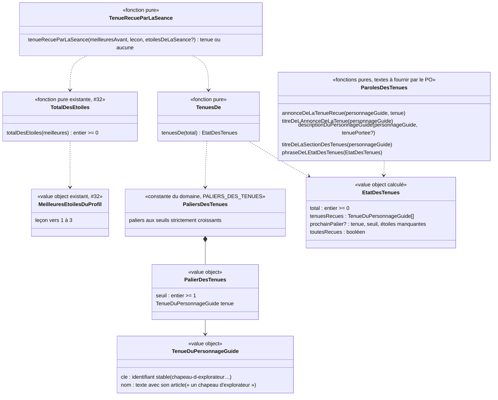

# Modèle du domaine : issue #102, le personnage guide évolue avec les étoiles

Contexte : **Motivation**. La story réagit au **total des étoiles** (#32), déjà calculé par Motivation à partir des meilleures étoiles lues dans Apprentissage. Elle ne modifie jamais une étoile, un résultat de la leçon ni le parcours.

État : **cadrage**. Rien n'est tranché. Les termes proposés sont `(à valider)` et **ne sont pas écrits** dans `docs/domain/glossaire.md` avant la réponse du PO (section « Glossaire : ajouts proposés »). Questions #102.1 à #102.20 en fin de document.

## Contexte

### Pourquoi Motivation

- C'est une récompense par paliers d'étoiles, comme la cabane (#32). La context map dit : « Motivation décide seule des récompenses ; une récompense ne modifie jamais une note ».
- Le personnage guide, l'univers et leurs dessins appartiennent déjà à Motivation (`univers.ts`, `personnage-guide.ts`, `src/univers/`).
- La règle (paliers, tenues reçues, tenue reçue par la séance) est pure, dans `supabase/functions/_shared/motivation/domain/`. Le front l'importe par `@domain/motivation`, hors ligne compris.

### Sources lues, sans rien écrire

| Source | Contexte | Ce qui est lu | Mécanisme |
|---|---|---|---|
| Meilleures étoiles de chaque leçon du profil en cours | Apprentissage (#24) | leçon → 1 à 3 | Lecture existante de #32 (`lireLesMeilleuresEtoilesPourLaCabane`), sous RLS, réunie avec les étoiles gagnées pendant l'utilisation. Aucune lecture nouvelle |
| Étoiles de la séance qui vient de finir | Apprentissage (#24) | un nombre, ou rien (séance faite seulement d'une fluence) | Déjà passé à `objetRecuParLaSeance` à l'écran de fin |
| Profil en cours | Famille | identifiant, univers | Customer/Supplier existant (#6, #11) |
| Univers et personnage guide | Motivation | `universDe(cle)` | Interne |

Non lus : le test de départ (aucune étoile, réponse 27.4), la bibliothèque (le total n'en a pas besoin, décision 32.15).

### Ce qui existe déjà et ne change pas

- **Cabane (#32)** : `PALIERS_DE_LA_CABANE`, `cabaneDe`, `objetRecuParLaSeance`, `totalDesEtoiles` gardent **exactement** leur comportement. #102 réutilise `totalDesEtoiles` et le calcul « total avant / total après la séance ». Si ce calcul est extrait de `objetRecuParLaSeance` pour être partagé, c'est un refactor sans changement de comportement : les tests de `cabane_test.ts` et `objet-recu-par-la-seance_test.ts` restent inchangés et verts.
- **Choix de modèle de #32 (décision 32.20)** : la cabane n'est pas enregistrée, elle se recalcule ; le total des étoiles ne baisse jamais. #102 suit le même choix pour les **tenues reçues** : rien n'est enregistré, rien ne se perd. Le seul état nouveau est le **choix de l'enfant** (la tenue portée), voir #102.8.
- **Dessins** (#96) : un composant par personnage guide dans `src/univers/personnages/` (Noisette, Lumi, Coach Léo, Agent Max, Capitaine Sam, Lili), choisi par `PersonnageGuide.tsx` selon l'univers. Le personnage guide est aujourd'hui **décoratif** (`aria-hidden`) sur tous les écrans. L'issue cite `dessins.tsx` et `apparences.ts`, qui n'existent plus depuis #96.
- **Écran de fin** : zone « nouveautés » (`NouveautesDeFin` : objet de la cabane, épisode, badge, leçon acquise) ; effet sonore « decouverte » s'il y a un objet ou un épisode (`effetsSonoresDeLaFin`, #97).
- **Mes médailles** (#65) : sections dans un ordre fixe, `cabane`, `histoire`, `badges`, `recordsDeFluence` (`sections-de-l-ecran.ts`).
- Les **gestes** (saute, se penche, respire, cligne) sont communs à tous les personnages guides ; aucune danse n'existe.

### Communication entre contextes

Aucune relation nouvelle si la tenue portée reste sur l'appareil (#102.8, option A) : la lecture « Apprentissage → Motivation (meilleures étoiles, #32) » suffit. Si elle est enregistrée côté serveur (options B ou C), la relation existante « Famille → Motivation : contrat de données personnelles (#14) » s'applique : Motivation fournit son adaptateur d'export et de suppression.

## Termes

| Terme | Statut | Remarque |
|---|---|---|
| Personnage guide, Univers | au glossaire, validés | Inchangés. |
| Total des étoiles | au glossaire, validé (#32) | Réutilisé tel quel : même somme, mêmes exclusions. |
| Palier de la cabane, Objet de la cabane, Cabane | au glossaire (#32) | Inchangés. Les paliers des tenues sont **distincts** des paliers de la cabane, même s'ils prennent les mêmes seuils (#102.1). |
| « Tenue » ou « évolution » du personnage guide | **absent du glossaire** | Signalé par l'issue. Nom à choisir par le PO (#102.6). Ce document emploie provisoirement **Tenue du personnage guide**, sans le figer. |
| « Accessoire » | **en conflit** | L'issue #106 appelle déjà « accessoire » l'objet propre à chaque personnage guide (la baguette de Lumi, le ballon de Coach Léo, la loupe d'Agent Max, le ruban de Lili…). Le réemployer pour ce qui se gagne mêlerait deux sens (#102.6). |
| « Évolution » | **en conflit** | Suggère que le personnage guide monte de **niveau** (« niveau » est réservé à la classe, et interdit au sens de jeu, skill `gamification` section 6) ou change de forme. Déconseillé (#102.6). |
| « Débloquer » | **en conflit** | « objet débloqué » et « épisode débloqué » sont des synonymes interdits (#32, #33). On dit **recevoir** : « Noisette a reçu un chapeau d'explorateur ! » (verbe de la cabane, décision 32.1). |
| « Danse de victoire », « nouvelle danse » | **recoupe #106** | « Célébration de l'univers » de #106 n'est pas encore au glossaire. Proposition : la danse sort de #102 (#102.7). |
| Palier des tenues | **nouveau (à valider)** | Seuil du total des étoiles qui fait recevoir une tenue. |
| Tenue reçue | **nouveau (à valider)** | Tenue dont le palier est atteint par le total des étoiles. Se recalcule, ne se perd jamais. |
| Tenue portée | **nouveau (à valider)** | La tenue que l'enfant a choisie, montrée sur tous les écrans ; ou aucune. |
| Tenue reçue par la séance | **nouveau (à valider)** | Tenue dont la séance qui vient de finir a fait atteindre le palier. Au plus une par séance. Nom de calcul, peut-être pas un terme du glossaire (comme « épisode ouvert par la séance », décision 33.27). |
| « Pour <nom du personnage guide> » | mot d'interface proposé | Titre de l'encart de l'écran de fin, sur le modèle de « Pour la cabane ». Texte à fournir par le PO (#102.18). |

## Modèle

### Partie calculée (pure, sans état) : les tenues reçues

Comme la cabane : **pas d'agrégat**, des value objects et des fonctions pures.

| Value object | Règles de validité |
|---|---|
| `TenueDuPersonnageGuide` | `cle` unique parmi les tenues (le dessin s'y accroche, jamais au nom affiché) ; `nom` non vide, avec son article, tel qu'il sera dit. Le nom est du **contenu** fourni ou validé par le PO, pas un terme du domaine (comme les objets de la cabane). |
| `PalierDesTenues` | `seuil` entier ≥ 1. |
| `PALIERS_DES_TENUES` | seuils strictement croissants ; deux seuils consécutifs séparés d'**au moins 3** (une séance ajoute au plus 3 au total, donc elle fait recevoir au plus une tenue) ; clés uniques ; aucune clé commune avec un objet de la cabane. Constante vérifiée par les tests. Seuils et nombre de tenues : #102.1 et #102.17. |
| `EtatDesTenues` | `tenuesRecues` = tenues des paliers dont le seuil est ≤ total, dans l'ordre des paliers ; `prochainPalier` = premier palier dont le seuil est > total, avec `etoilesManquantes` = seuil − total (≥ 1) ; `toutesRecues` ⇔ aucun prochain palier. Total négatif ou non entier : erreur `TotalDEtoilesInvalide` (existante). |

Le calcul « total après la séance » est celui de `objetRecuParLaSeance` : total avant − meilleur avant sur la leçon + max(meilleur avant, étoiles de la séance). Séance sans étoiles (fluence seule) : aucune tenue. Étoiles hors de 1 à 3 : `NombreDEtoilesInvalide` (existante).

### Partie choisie par l'enfant : la tenue portée

C'est la seule chose nouvelle qui se garde. Elle appartient au **profil enfant**, mais c'est un concept de Motivation : elle ne va **pas** dans l'agrégat `ProfilEnfant` de Famille (petit agrégat, frontières des contextes).

| Élément | Nature | Contenu et règles |
|---|---|---|
| `TenuePortee` | value object (ou petit agrégat d'identité « profil enfant », si elle est enregistrée côté serveur : #102.8) | `profil` (référencé par identifiant) ; `tenue` : clé d'une tenue, ou **aucune** (le personnage guide tel qu'il est dessiné aujourd'hui). Par défaut : aucune. |
| `PorterUneTenue` | commande | L'enfant choisit une tenue reçue. Refusée si la tenue est inconnue (`TenueInconnue`) ou pas encore reçue (`TenueNonRecue`), au vu de `tenuesDe(total)`. Une seule tenue à la fois (#102.9, à valider). |
| `RetirerLaTenue` | commande | Le personnage guide ne porte plus rien. Toujours possible. |
| `tenueAMontrer(tenuePortee, etatDesTenues)` | fonction pure de lecture | Rend la tenue portée si elle est reçue, sinon aucune. Tolérance voulue : si les meilleures étoiles ne sont pas encore lues (hors ligne, lecture en échec, autre appareil), le personnage guide s'affiche sans tenue au lieu d'échouer ; le choix n'est pas effacé. |

Erreurs métier nommées : `TenueInconnue`, `TenueNonRecue` (nouvelles) ; `TotalDEtoilesInvalide`, `NombreDEtoilesInvalide` (existantes, #32).

### Affichage (dans `src/`, sans règle)

- `PersonnageGuide` reçoit la tenue à montrer (une clé ou rien) et la dessine par-dessus le dessin du personnage guide, sur tous les écrans où il apparaît.
- Les dessins des tenues suivent le skill `illustration` (section 0 d'abord), un placement par personnage guide.
- Les gestes (saute, se penche) et `prefers-reduced-motion` restent ceux de #96 ; la tenue suit le personnage guide.
- L'encart de l'écran de fin et la section de « Mes médailles » montrent ce que rend le domaine.

## Invariants

1. **Rien ne se perd** : les tenues reçues se déduisent du total des étoiles, qui ne baisse jamais (meilleures étoiles, #24). Rejouer une leçon avec moins d'étoiles ne retire aucune tenue et ne change pas la tenue portée.
2. **Au plus une tenue reçue par séance** (écart d'au moins 3 entre deux paliers des tenues). Une même séance peut toutefois faire recevoir un objet de la cabane **et** une tenue (#102.13).
3. **On ne porte qu'une tenue reçue**. Une tenue portée qui n'apparaît pas encore dans les tenues reçues (étoiles non lues) n'est pas montrée, mais reste choisie.
4. **La cabane ne change pas** : mêmes paliers, mêmes objets, même annonce, même total.
5. **Motivation ne modifie aucune note** : ni étoile, ni résultat de la leçon, ni parcours.
6. **Le test de départ n'apporte rien** (il n'a aucune étoile, réponse 27.4).
7. **Rien d'aléatoire, rien à acheter** : l'ordre des tenues est fixe et connu à l'avance (pas de coffre, pas de tirage : skill `gamification` section 5, réponse 98.6).
8. **L'univers ne change pas les règles** : même total, mêmes paliers dans tous les univers (seul le dessin change, #102.2).
9. **Règle absolue de contenu** : chaque tenue, dans chaque univers, respecte `CLAUDE.md` (« Contenus pour les enfants ») : aucune arme ni objet qui y ressemble, rien d'effrayant, aucun costume ou coiffe qui caricature une origine, une religion, un sexe ou un handicap, aucune tenue réservée à un sexe ; dans le doute, on ne dessine pas et on demande au PO.

## Événements

Aucun événement de domaine n'est publié pour les tenues reçues : comme la cabane, elles se recalculent (décision 32.20). Motivation ne s'abonne pas à `SeanceTerminee`.

| Fait | Nature | Qui s'en sert |
|---|---|---|
| Tenue reçue par la séance | fait calculé à l'écran de fin (`tenueRecueParLaSeance`), non enregistré | Zone « nouveautés » de l'écran de fin (`NouveautesDeFin.tenue`, à ajouter) ; effet sonore « decouverte » (`FaitsDeLaFin`, #97, à étendre : #102.16) |
| `TenueChoisie` (profil, tenue ou aucune, le) | événement de domaine, **seulement** si la tenue portée est enregistrée côté serveur (#102.8, options B ou C) | Aucun abonné dans #102 ; utile à la synchronisation et à l'export |

## Partage avec le front

Tout fonctionne dans le navigateur, hors ligne compris, par `@domain/motivation` : `PALIERS_DES_TENUES`, `tenuesDe`, `tenueRecueParLaSeance`, `tenueAMontrer`, `porterUneTenue` / `retirerLaTenue` (règle de choix), paroles des tenues, et l'extension de `effetsSonoresDeLaFin` et de `sectionsDeLEcran`. React ne fait que dessiner et animer ce que rend le domaine.

## Données d'enfants

- **Tenues reçues** : aucune donnée nouvelle (recalculées depuis les meilleures étoiles, déjà couvertes par la cascade et l'export de #14).
- **Tenue portée** : **donnée nouvelle** liée au profil enfant (une préférence de jeu, rien d'identifiant). Elle doit respecter la section RGPD de `CLAUDE.md` : minimisation (une clé de tenue, rien d'autre), suppression avec le profil, présence dans l'export. Son emplacement est la question #102.8.
- Rien n'est envoyé à l'IA, aucun service tiers.

## Emplacement

Sous `supabase/functions/_shared/motivation/domain/` :

| Fichier | Contenu |
|---|---|
| `tenues.ts` (nom à aligner sur le terme retenu, #102.6) | `TenueDuPersonnageGuide`, `PalierDesTenues`, `PALIERS_DES_TENUES`, `EtatDesTenues`, `tenuesDe`, `tenueRecueParLaSeance` |
| `tenue-portee.ts` | `TenuePortee`, `porterUneTenue`, `retirerLaTenue`, `tenueAMontrer`, erreurs `TenueInconnue`, `TenueNonRecue` |
| `paroles-des-tenues.ts` | annonce, titre de l'encart, description accessible, titre et phrase de la section (textes du PO) |
| `cabane.ts` | au plus l'extraction du calcul « total après la séance », sans changement de comportement |
| `effets-sonores.ts` | `FaitsDeLaFin.tenueRecue` (#102.16) |
| `sections-de-l-ecran.ts` | section nouvelle des tenues (#102.4) |
| `index.ts` | exports |
| `*_test.ts` correspondants | écrits par `test-writer` |

Si la tenue portée est enregistrée côté serveur (#102.8 B ou C) : `motivation/application/porter-une-tenue.ts` et son port, `motivation/infrastructure/` (repository, adaptateur d'export et de suppression), une Edge Function `porter-une-tenue/index.ts`, une migration additive avec RLS (verrou `base`), et une décision (0036 réservée). Sinon (option A) : un adaptateur de mémoire sur l'appareil dans `src/`, comme `src/voix/memoire-du-son.ts`.

Hors du champ : `src/seance/exercices/` (#98) n'est pas touché.

## Glossaire : ajouts proposés (à valider, non écrits dans `docs/domain/glossaire.md`)

Lignes à ajouter dans la section **Motivation** après la réponse du PO à #102.6 (le mot « Tenue » est la recommandation, pas un acquis) :

| Terme | Définition | Contexte | Synonymes interdits |
|---|---|---|---|
| Tenue du personnage guide (à valider) | Ce que le personnage guide du profil reçoit quand le total des étoiles atteint un palier des tenues, et qu'il peut porter (« un chapeau d'explorateur »). Elle ne se perd jamais. Les noms des tenues sont du contenu, pas des termes du domaine (#102). | Motivation | évolution, accessoire (réservé à l'objet propre à chaque personnage guide, #106), skin, costume, déguisement, objet (réservé à la cabane), tenue débloquée, niveau |
| Palier des tenues (à valider) | Seuil du total des étoiles qui fait recevoir une tenue du personnage guide. Deux paliers sont espacés d'au moins 3 : une séance fait recevoir au plus une tenue. Distinct du palier de la cabane (#102). | Motivation | niveau, étape, seuil (seul) |
| Tenue reçue (à valider) | Tenue dont le palier est atteint par le total des étoiles du profil. Se recalcule, n'est pas enregistrée, ne se perd jamais (#102). | Motivation | tenue débloquée, tenue gagnée |
| Tenue portée (à valider) | Tenue reçue que l'enfant a choisie pour son personnage guide, montrée sur tous les écrans ; ou aucune (par défaut). Emplacement de ce choix : question #102.8 (#102). | Motivation | tenue équipée, skin actif, apparence |

Ajout proposé aux « Conflits à trancher » : « accessoire » (sens de #106 contre sens de #102), « évolution » (niveau), « débloquer » (déjà interdit), « danse de victoire » (#106).

## Questions ouvertes

Les questions #102.1 à #102.5 reprennent les questions 1 à 5 de l'issue. Chacune peut se trancher par une lettre ou par oui ou non.

**#102.1 Paliers des tenues** (question 1 de l'issue). A : les mêmes seuils que la cabane (3, 6, 10… 75) ; B : des seuils **décalés**, entre ceux de la cabane, pour qu'une récompense tombe plus souvent ; C : des seuils **après** la cabane (à partir de 80), pour les enfants dont la cabane est complète.
Reco : **B**, en commençant à 5 comme le propose l'issue (« avec 4 étoiles, aucun accessoire ; avec 5, le premier »), par exemple 5, 12, 23, 37, 52, 70 pour la tranche minimale, puis des seuils au-delà de 75 dans une story suivante. Avec A, chaque palier donnerait deux annonces d'un coup et aucune récompense de plus ; avec C, un enfant de CP attendrait des semaines. Les seuils exacts sont à fixer par le PO.

**#102.2 Tenues propres à chaque univers ou communes** (question 2 de l'issue). A : communes (la même liste pour les six personnages guides, chacune dessinée à la taille de chacun) ; B : propres à chaque univers (six listes, six jeux de dessins).
Reco : **A**. Moins de dessins à fournir et à relire contre la règle absolue, aucune tenue « pour filles » ou « pour garçons » (risque de stéréotype de sexe, plus fort avec des listes par univers Princesses ou Danse), et la question #102.3 se règle d'elle-même. Les dessins restent adaptés à chaque personnage guide (un écureuil ne porte pas un chapeau comme une fée).

**#102.3 Changement d'univers** (question 3 de l'issue). L'enfant qui change d'univers garde-t-il ses tenues ?
Reco : **oui**. Les tenues reçues se déduisent du total des étoiles du profil, pas de l'univers : rien ne se perd. Avec #102.2 A, le nouveau personnage guide porte la même tenue portée. Avec #102.2 B, il faudrait une tenue portée par univers, et les tenues de l'ancien univers resteraient reçues mais invisibles.

**#102.4 Place dans « Mes médailles »** (question 4 de l'issue). A : une nouvelle section, juste après la cabane (« cabane, tenues, histoire, badges, records ») ; B : une nouvelle section en fin d'écran ; C : un écran à part.
Reco : **A**. Les deux récompenses à paliers d'étoiles sont côte à côte, et « Mes médailles » est déjà fait de sections (#65). C'est aussi là que l'enfant choisit la tenue portée (seul endroit de choix dans la tranche minimale). Titre proposé : « Les tenues de <personnage guide> » (texte du PO).

**#102.5 Textes et noms d'objets fournis par le PO** (question 5 de l'issue). Reco : **oui**, comme pour la cabane. Les noms des tenues, le titre de l'encart, l'annonce, le libellé accessible et le titre de la section sont fournis ou validés par le PO. Liste candidate en #102.18, à titre de proposition.

**#102.6 Nom du concept.** A : **Tenue du personnage guide** (« Noisette a reçu une tenue » ; « Noisette porte un chapeau d'explorateur ») ; B : Accessoire du personnage guide ; C : Évolution du personnage guide ; D : un autre mot du PO.
Reco : **A**. « Accessoire » désigne déjà dans #106 l'objet propre à chaque personnage guide (baguette, ballon, loupe, ruban) ; « évolution » évoque un niveau de jeu (interdit) ou un personnage qui change, alors que c'est le même personnage habillé autrement. « Tenue » se dit d'un chapeau comme d'une écharpe à l'écran (« Choisis la tenue de Noisette »). Verbe : **recevoir**, jamais « débloquer ».

**#102.7 Les « nouvelles danses ».** Elles recoupent #106 (célébration propre à chaque univers, pas encore lancée). A : les danses **sortent** de #102 et vont à #106, qui décide quelles animations se gagnent ; B : #102 garde une danse débloquée par palier, #106 s'appuie dessus ; C : les danses sortent des deux stories.
Reco : **A**. Une danse est une animation par personnage guide, avec rythme, musique et variante en mouvements réduits : c'est exactement le travail de #106 (skill `motion-design`). #102 reste une story de dessins fixes, plus petite et livrable seule. Si le PO veut que des danses se gagnent avec les étoiles, #106 réutilise les paliers des tenues.

**#102.8 Où garder la tenue portée.**
- A : **préférence sur l'appareil**, par profil (comme le Muet, `memoire-du-son.ts`). Aucune migration ni Edge Function, pas de verrou `base`, marche hors ligne d'emblée. Conséquences : le choix n'est pas retrouvé sur un autre appareil (un enfant qui joue chez ses deux parents) ; il est effacé à la déconnexion du parent si on l'ajoute à `DonneesDeLAppareil` (sinon il reste sur l'appareil après la suppression du profil) ; il n'est pas dans l'export. Les tenues reçues, elles, ne se perdent jamais, partout.
- B : **colonne facultative** sur le profil enfant (Famille). Retrouvée partout, supprimée avec le profil, exportée avec lui. Mais elle met un concept de Motivation dans l'agrégat `ProfilEnfant` de Famille et passe par `modifier-profil-enfant` ; migration additive (verrou `base`).
- C : **donnée de Motivation à part** (profil, tenue, date), sous RLS (parent rattaché), écrite par une Edge Function, supprimée en cascade avec le profil, avec son adaptateur d'export (contrat de #14). Retrouvée partout, frontières propres. Coût le plus élevé : migration additive avec RLS (verrou `base`), Edge Function, choix fait hors ligne à envoyer à la reconnexion, décision 0036.
Reco : **A pour la tranche minimale**, C dans une story suivante si le PO veut retrouver le choix sur tous les appareils. B déconseillé (mélange des contextes). Le PO dit aussi si la perte du choix à la déconnexion est acceptable (A). À noter : les réglages du profil sont « jamais une préférence de l'appareil » (#12) ; la tenue portée n'est pas un réglage du parent mais un choix de jeu de l'enfant, d'où la proposition A.

**#102.9 Une tenue à la fois ?** A : une seule tenue portée à la fois (ou aucune) ; B : plusieurs à la fois (un chapeau et une écharpe).
Reco : **A**. Lisible à 360 px et en petit sur « Mon parcours », un seul choix simple pour un enfant de 6 ans, et un libellé accessible court. B multiplie les combinaisons à dessiner et à relire contre la règle absolue.

**#102.10 La tenue reçue est-elle mise d'office ?** A : non, l'enfant la met lui-même dans « Mes médailles » ; B : oui, elle remplace la tenue portée ; C : l'encart de l'écran de fin propose un bouton « La mettre ».
Reco : **A** pour la tranche minimale (autonomie : c'est l'enfant qui choisit ; l'issue dit « l'enfant choisit »), l'encart invite à aller voir « Mes médailles ». C peut venir ensuite.

**#102.11 Qui « reçoit » la tenue dans l'annonce ?** La cabane est toujours celle de Noisette (décision 32.1). Pour les tenues : A : le personnage guide du profil (« Coach Léo a reçu un chapeau d'explorateur ! ») ; B : toujours Noisette.
Reco : **A** : c'est lui qui porte la tenue sur tous les écrans de l'enfant.

**#102.12 Phrase de fin du personnage guide.** Pour la cabane, elle se termine par « Noisette a reçu `<objet>` pour sa cabane. » A : seulement l'encart (texte affiché et annoncé une fois) ; B : la phrase de fin dite par le personnage guide est aussi complétée.
Reco : **A**. La phrase de fin dit déjà les étoiles, l'objet de la cabane, le badge ou l'épisode : une phrase de plus allonge la fin pour un enfant qui lit peu. Si B, le PO fixe l'ordre des nouveautés dans la phrase.

**#102.13 Objet de la cabane et tenue dans la même séance.** Avec des paliers décalés (#102.1 B), une séance peut faire recevoir les deux (par exemple de 4 à 6 étoiles avec des paliers à 5 et 6). A : deux encarts, cabane d'abord ; B : seulement la tenue, l'objet se découvre dans « Mes médailles » ; C : on choisit des seuils qui l'empêchent quand c'est possible.
Reco : **A**, avec un seul effet sonore « decouverte » ; C est impossible au début (3 et 6 ne laissent pas d'écart de 3).

**#102.14 Libellé accessible du personnage guide.** Aujourd'hui il est décoratif partout (`aria-hidden`). L'issue demande « Noisette, avec un chapeau d'explorateur ». A : ce libellé seulement là où la tenue compte (section des tenues de « Mes médailles », encart de l'écran de fin, boutons de choix) ; B : sur tous les écrans.
Reco : **A**. Sur les écrans de séance, un personnage guide annoncé à chaque question gênerait le lecteur d'écran ; il reste décoratif.

**#102.15 Tenue et coiffe propre du personnage guide.** Certains personnages guides ont déjà une coiffe ou un objet en main (Capitaine Sam, Agent Max, Lumi et sa baguette…). A : la tenue s'ajoute sans rien cacher de leur objet propre, et un chapeau remplace la coiffe ; B : on ne propose que des tenues qui ne touchent pas la tête ni les mains (écharpe, sac à dos, nœud…).
Reco : **B pour la tranche minimale** : chaque personnage guide reste reconnaissable, les dessins sont plus simples. Le chapeau de l'exemple de l'issue arriverait alors dans une story suivante, ou en A si le PO y tient (« Noisette a reçu un chapeau d'explorateur ! » est l'exemple de l'issue).

**#102.16 Effet sonore.** Reco : réutiliser l'effet « decouverte » existant (#97) quand une tenue est reçue, une seule fois même avec un objet ou un épisode ; aucun son nouveau. Oui ou non ?

**#102.17 Découpage.** La story compte plus de 6 règles (paliers, tenue reçue par la séance, annonce, rien ne se perd, choix de la tenue portée, tenue montrée partout, libellé accessible, section de « Mes médailles », danses, univers, sons). Tranche minimale proposée :
1. 4 à 6 tenues **communes** (#102.2 A), paliers décalés (#102.1 B), sans chapeau si #102.15 B ;
2. tenue reçue par la séance annoncée dans un encart de l'écran de fin, effet « decouverte » ;
3. section des tenues dans « Mes médailles », où l'enfant met ou retire une tenue (une à la fois) ;
4. la tenue portée se voit sur tous les écrans du personnage guide ; libellé accessible là où elle compte ;
5. tenue portée gardée sur l'appareil (#102.8 A).
Hors tranche : danses (#106), paliers au-delà de 75, tenue portée retrouvée sur tous les appareils (#102.8 C), bouton « La mettre » à l'écran de fin, tenues propres à chaque univers. D'accord ?

**#102.18 Noms des tenues (proposition, à fournir ou valider par le PO).** Liste candidate, vérifiée contre la règle absolue (aucune arme, rien d'effrayant, aucun costume d'une origine, d'une religion ou d'un métier caricaturé, rien de réservé à un sexe) : « une écharpe rayée », « un sac à dos d'explorateur », « un nœud papillon », « une couronne de fleurs », « un bonnet à pompon », « des bottes de pluie », et, si #102.15 A, « un chapeau d'explorateur ». Écartés volontairement : tout ce qui ressemble à une arme ou à un masque, les coiffes traditionnelles d'un peuple, « médaille » et « coupe » (déjà pris par les badges et la cabane), tout coffre ou trésor (réponse 98.6). Textes candidats : encart « Pour <personnage guide> », annonce « <personnage guide> a reçu <tenue> ! », libellé « <personnage guide>, avec <tenue> », section « Les tenues de <personnage guide> », phrase « Encore 3 étoiles et <personnage guide> recevra <tenue> ! ». Le PO choisit, corrige ou remplace.

**#102.19 Le parent voit-il les tenues ?** Reco : **non** dans cette story, comme la cabane (32.24) : rien dans l'Espace parent. Oui ou non ?

**#102.20 Enfant qui a déjà des étoiles à la livraison.** Un profil à 40 étoiles reçoit d'un coup toutes les tenues dont le palier est atteint. Reco : **sans annonce** à l'écran de fin (seule une tenue reçue par la séance est annoncée, comme la cabane), elles apparaissent dans « Mes médailles ». Oui ou non ?
