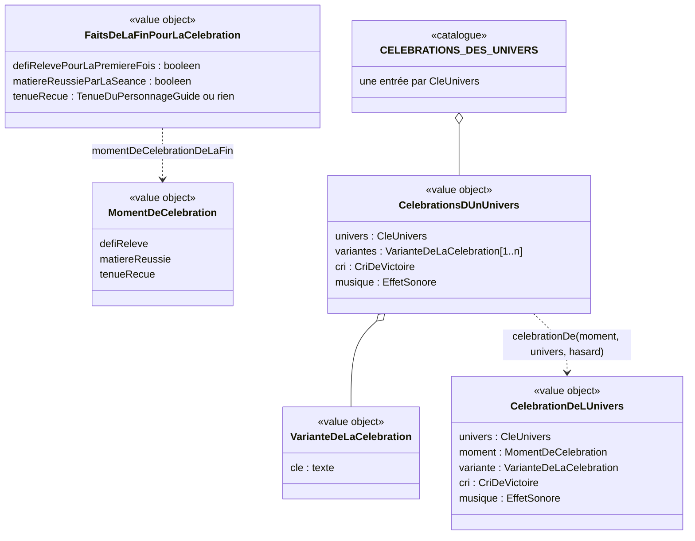

# Modèle du domaine : issue #106, une célébration propre à chaque univers

Contexte : **Motivation**. La story choisit **comment fêter** un fait déjà connu (défi relevé, matière réussie, tenue reçue) selon l'univers du profil. Elle ne crée ni étoile, ni défi relevé, ni tenue, et ne change aucun résultat. Apprentissage publie au plus une lecture pure de plus (« matière réussie par la séance », si 106.4 A est retenue). Aucun agrégat, aucun événement enregistré, aucune migration, aucune Edge Function, aucune donnée d'enfant nouvelle.

État : **cadrage seulement**. #106 dépend de #100 (PR #139, non mergée) et de #96 (mergée). Aucun code avant le merge de #100 et la validation du cadrage par le PO. Les questions 106.1 à 106.23 sont ouvertes.

## Contexte

### Pourquoi Motivation

- La context map dit : « Motivation décide seule des récompenses ; une récompense ne modifie jamais une note ». Une célébration est une mise en scène de récompense : même place que les annonces de la fin (#32, #33, #102) et les effets sonores de la fin (#97).
- L'univers, le personnage guide, ses dessins et ses tenues appartiennent déjà à Motivation (`univers.ts`, `personnage-guide.ts`, `tenues.ts`, `src/univers/`).
- #100 a déjà mis la mise en scène du défi dans Motivation (décision 0038 de sa branche) : `defiReleveParLaSeance(relevesAvant, defi)` rend l'annonce « Défi relevé ! » et l'effet sonore ; #106 s'y branche.

### Faits lus, sans rien écrire

| Fait | Contexte qui le décide | Déjà disponible ? |
|---|---|---|
| Défi relevé pour la première fois, ou rejoué | Apprentissage (#100), mis en scène par Motivation | Oui (`defiReleveParLaSeance`, branche de #100) |
| Tenue reçue par la séance (paliers 5, 12, 23, 37) | Motivation (#102) | Oui (`tenueRecueParLaSeance`) |
| Matière réussie par la séance | Apprentissage (#26) | **Non** : `matiereReussieDuNiveau(entrees, matiere)` existe, mais pas le passage « pas réussie avant la séance, réussie après ». À ajouter dans `@domain/apprentissage` si 106.4 A, sur le modèle de `defiOuvertParLaSeance` |
| Univers du profil en cours | Famille → Motivation (#6) | Oui (`universDe(cle)`, clé inconnue → `animaux`) |
| Tenue portée | Motivation, mémoire de l'appareil (#102) | Oui (`tenueAMontrer`) |

Le test de départ n'est pas lu (il n'est pas une séance, réponse 27.4). La séance de révision ne rend aucune leçon réussie : elle ne déclenche aucun moment.

### Ce qui existe et ne change pas

- **Célébration de la fin (#97)** : confettis, 1,5 s au plus, un toucher hors des boutons ne fait rien (97.17), boutons et clavier utilisables tout de suite (97.22, 97.23). Elle reste la célébration commune de toute fin qui n'a pas de moment de célébration, et de tout univers pas encore livré (106.18).
- **Fin du défi (#100)** : annonce « Défi relevé ! » la première fois, « grande victoire » la première fois, « séance terminée » quand il est rejoué (100.25), paroles de fin du défi, boutons « Mon parcours » et « Accueil ».
- **Personnage guide** : humeurs `content`, `reflechit`, `applaudit` et gestes communs (`saute`, `penche`) dans `src/univers/PersonnageGuide.tsx`. Ils ne changent pas.
- **Muet** : coupe seulement la voix ; les effets sonores restent (97.2, 97.20) ; seule la voix suspendue des écrans du parent les coupe (97.13).

### Communication entre contextes

Aucune relation nouvelle. La lecture « Apprentissage → Motivation (défis relevés, #100) » et la lecture des meilleures étoiles (#32, #102) suffisent. Si 106.4 A est retenue, Apprentissage publie une lecture pure de plus (`matiereReussieParLaSeance`), même schéma que `defiOuvertParLaSeance` (#100) et l'avancée dans le parcours (#99). Motivation importe le type `EffetSonore` de Voix (Published Language existant, #97) ; Voix ne connaît toujours pas les univers : les musiques y sont nommées d'après le son, pas d'après l'univers (106.12).

## Termes

| Terme | Statut | Remarque |
|---|---|---|
| Univers, Personnage guide, Agent Max, Défi, Défi relevé, Fin du défi, Partie du parcours, Matière réussie, Fin de la séance, Tenue du personnage guide, Palier des tenues, Tenue reçue, Tenue portée, Effet sonore, Muet, Humeur du personnage guide | existants | Réutilisés sans les redéfinir |
| **Célébration de l'univers** | **nouveau, à valider (106.1)** | Mise en scène propre à l'univers du profil, jouée par son personnage guide au moment de célébration. Alternatives proposées : « Fête de l'univers », « Victoire du personnage guide ». Synonymes à interdire : « animation de victoire », « cinématique », « cutscene » |
| **Variante de la célébration** | nouveau, à valider (106.1, 106.13) | Une des façons de célébrer d'un univers, tirée au hasard (Sports : glissade à genoux, avion, danse avec clin d'œil). Synonymes à interdire : « figure », « numéro », « skin » |
| **Moment de célébration** | nouveau, à valider (106.3 à 106.7) | Fait qui fait jouer la célébration de l'univers : défi relevé (première fois), matière réussie par la séance, tenue reçue. Synonymes à interdire : « déclencheur », « trigger », « fin de chapitre » |
| **Cri de victoire** | nouveau, à valider (106.14) | Mot affiché par la célébration, propre à l'univers (« BUT ! », « Bravo ! », « Hourra ! », « Magique ! », « Enquête résolue ! »). Distinct de l'**expression du personnage guide** (félicitation tirée au hasard pendant la séance), même si deux textes se ressemblent (« Enquête résolue ! ») |
| **Danse de victoire** | **à trancher (106.6)** | Confiée à #106 par #102.7. Si 106.6 A : ce n'est pas un terme de plus, c'est la célébration de l'univers jouée au moment « tenue reçue ». Si 106.6 B : nouveau terme (variante reçue à un palier des tenues) |
| « Célébration de la fin » (#97) | **conflit à lever (106.1)** | Les docs de #97 appellent « célébration » les confettis communs de la fin, sans entrée au glossaire. Proposition : **Célébration commune** pour celle de #97, **Célébration de l'univers** pour celle de #106 ; « célébration » seul est évité |
| « Chapitre », « Chapitre réussi ! » | **interdits** | Les maquettes affichent « Chapitre réussi ! » : à remplacer par l'annonce du moment (« Défi relevé ! », « Matière réussie ! »). Décisions 99.24 et #100 |
| « Agente Mila » | **interdit** | Le tableau de l'issue la cite encore : c'est **Agent Max** (96.5, 96.8) |
| « Accessoire » | pas un terme | Le ballon, la baguette, la loupe, le ruban, la lance sont des éléments du dessin (`src/`), pas du domaine. #102 a écarté « accessoire » pour les tenues : on ne l'emploie pas dans le domaine |
| « Coffre », « coupe », « podium » | interdits dans les célébrations | 98.6, skill `gamification` section 5 |
| Animation d'échec des maquettes (« Presque ! On réessaie ? ») | hors de #106 (106.20) | Ce serait un retour de réponse fausse (#97), pas une célébration. « échec » n'est pas un mot de l'enfant |

## Modèle

Pas d'agrégat : rien ne change d'état, rien n'est enregistré, aucun invariant ne lie deux faits dans une même transaction. Le modèle est fait de **value objects** et de **fonctions pures** (des lectures), comme la cabane (#32) et les tenues reçues (#102).



### Value objects et règles de validité

- **`MomentDeCelebration`** : `"defiReleve" | "matiereReussie" | "tenueRecue"` (liste à valider : 106.3, 106.4, 106.6, 106.8). Pas de « fin de séance » tant que 106.8 n'est pas oui.
- **`VarianteDeLaCelebration`** : une clé propre à l'univers. Par univers, d'après les maquettes validées (106.2) :

| Univers | Personnage guide | Action (toujours la même) | Variantes tirées au hasard | Cri de victoire (106.14) |
|---|---|---|---|---|
| Sports | Coach Léo | tir de dos, le ballon entre dans le but | `glissade`, `avion`, `danse` | « BUT ! » |
| Danse | Lili | entrée en scène, pirouette | `jete`, `ruban`, `sauts` | « Bravo ! » |
| Animaux | Noisette | attrape une noisette dorée | `jongle`, `mange`, `joues` | « Hourra ! » |
| Princesses et fées | Lumi | un sort fait éclore une fleur | `arc`, `envol`, `signes` | « Magique ! » |
| Police | Agent Max | retrouve un chiot perdu | `orchestre`, `trottinette`, `danse` | « Enquête résolue ! » |
| Pompiers | Capitaine Sam | **pas de maquette** (106.16) | à dessiner | à choisir (proposition : « Mission accomplie ! ») |

  Validité : au moins une variante par univers ; clés uniques dans un univers. Le type est exhaustif sur `CleUnivers` (un univers ajouté sans célébration ne compile pas), ou l'univers non livré renvoie « aucune célébration de l'univers » et la fin garde la célébration commune (106.18).
- **`CriDeVictoire`** : texte court, fixe par univers ; du contenu pour l'enfant, soumis à la règle absolue.
- **`musique`** : un `EffetSonore` de Voix, choisi par le PO à l'écoute (106.12). Tant qu'il n'est pas choisi : `grandeVictoire` (existant).
- **`CelebrationDeLUnivers`** : ce que le domaine rend au front. Il dit **ce qui** est fêté et **quelle variante** ; le front choisit **comment** la dessiner (skill `gamification`, section 3).

### Lectures (fonctions pures, `@domain/motivation`)

- `momentDeCelebrationDeLaFin(faits)` → `MomentDeCelebration` ou rien. Au plus un moment par fin. Ordre proposé quand deux faits arrivent ensemble (106.7) : `matiereReussie`, puis `tenueRecue`. `defiReleve` ne se combine avec rien : la séance de défi ne donne aucune étoile (100.13), donc ni tenue ni leçon réussie.
- `celebrationDe(moment, cleUnivers, hasard)` → `CelebrationDeLUnivers`. Univers par `universDe` (clé inconnue → `animaux`). Variante tirée par `tirerDans(variantes, hasard)` (port `Hasard` existant, `hasard.ts`) : uniforme, sans mémoire (106.13).
- Si 106.4 A, dans `@domain/apprentissage` : `matiereReussieParLaSeance(entreesAvant, entreesApres, matiere)` → booléen, vrai quand `matiereReussieDuNiveau` passe de faux à vrai. La règle de réussite reste dans Apprentissage.

### Commandes, événements, erreurs

- **Aucune commande** : rien ne change d'état.
- **Aucun événement de domaine nouveau, rien d'enregistré.** Les faits déclencheurs existent déjà (défi relevé, tenue reçue) ou sont recalculés (matière réussie).
- **Aucune erreur métier nouvelle.** `TirageHorsIntervalle` (existante) protège le tirage.

### Ce qui reste dans `src/` (affichage, aucune règle)

- Les dessins animés de chaque univers (`src/univers/celebrations/`), portés depuis les maquettes de `docs/maquettes/`, avec la tenue portée si 106.23 oui.
- L'image fixe en mouvements réduits (106.15), l'annonce `aria-live` unique, le dessin `aria-hidden`.
- Le fichier MP3 de chaque musique (`src/voix/`, `public/sons/`, licences, `docs/sons.md`).
- La durée, le comportement d'un toucher et des boutons (106.9, 106.10 ; aujourd'hui 97.17, 97.22, 97.23).
- Le moteur d'animation (106.22).

## Invariants

1. **L'univers ne change que la mise en scène.** Pour un même fait, tous les univers ont le même moment, la même annonce (« Défi relevé ! »), les mêmes étoiles, les mêmes boutons, la même suite du parcours. Les célébrations des six univers durent à peu près pareil (équité).
2. **Au plus une célébration par fin.** Une fin qui a un moment de célébration joue la célébration de l'univers à la place de la célébration commune de #97, jamais les deux (106.7, 106.12).
3. **Le hasard ne choisit que la variante.** Il ne décide jamais si l'enfant est fêté, ni de ce qu'il reçoit (skill `gamification`, section 5). Le tirage passe par le port `Hasard` ; rien n'est tiré par `Math.random()` dans un composant.
4. **Univers du moment.** La célébration est celle de l'univers du profil au moment où elle est jouée. Un enfant qui change d'univers voit celle du nouvel univers au moment suivant, rien n'est perdu (106.21).
5. **Défi relevé : une fois.** La célébration de l'univers est jouée au premier défi relevé seulement ; rejoué, la fin garde la célébration commune et « séance terminée » (100.25 ; à valider en 106.3).
6. **Elle ne retient jamais l'enfant.** Les boutons et le clavier sont utilisables dès la première image ; un bouton touché agit tout de suite et arrête la célébration et sa musique (97.22). Durée maximale et effet d'un toucher : 106.9 et 106.10.
7. **Mouvements réduits : rien ne bouge, l'information reste.** Image fixe de la même scène (la variante tirée), le cri de victoire et l'annonce du moment.
8. **Une seule annonce aux lecteurs d'écran**, celle du moment (« Défi relevé ! », « Matière réussie ! »). Le dessin et le cri de victoire ne sont pas annoncés (106.14).
9. **Son.** La musique est un effet sonore : jouée en Muet comme en Son, coupée par la voix suspendue (97.2, 97.13, à confirmer en 106.11). Elle passe avant la parole du personnage guide, jamais par-dessus.
10. **Règle absolue sur les contenus**, à toutes les tailles et sur l'image fixe : Police, une enquête qui aide (ni arme, ni menottes, ni arrestation, ni gyrophare) ; Pompiers, de l'eau et un arc-en-ciel (ni flamme, ni fumée, ni sirène, ni maison qui brûle) ; Sports, une fête joyeuse (ni adversaire moqué, ni coupe, ni podium, ni classement) ; Princesses et fées et Danse, tenues adaptées aux enfants, sans stéréotype ; tous : aucun coffre.
11. **Motivation à part.** Rien n'est enregistré ; aucune étoile, aucun défi relevé, aucune tenue n'est créé ou changé par la célébration.

## Événements

Aucun événement nouveau. #106 **lit** des faits existants au moment d'afficher la fin :

| Fait lu | Fin | Source |
|---|---|---|
| Défi relevé pour la première fois | Fin du défi | `defiReleveParLaSeance` (#100) : annonce présente |
| Matière réussie par la séance | Fin de la séance | `matiereReussieParLaSeance` (Apprentissage, à ajouter si 106.4 A) |
| Tenue reçue par la séance | Fin de la séance | `tenueRecueParLaSeance` (#102) |

## Emplacement

Aucune migration, aucune table, aucune Edge Function, aucun `application/` ni `infrastructure/` : le choix de la célébration est une lecture pure faite dans le navigateur, hors ligne compris, et rien n'est enregistré. Le serveur n'a rien à revalider (aucun résultat n'en dépend).

```
supabase/functions/_shared/motivation/domain/
  celebrations-des-univers.ts         # CELEBRATIONS_DES_UNIVERS, VarianteDeLaCelebration, CriDeVictoire, celebrationDe
  celebrations-des-univers_test.ts
  moment-de-celebration.ts            # MomentDeCelebration, momentDeCelebrationDeLaFin
  moment-de-celebration_test.ts
  index.ts                            # exports
supabase/functions/_shared/apprentissage/domain/       (si 106.4 A)
  matiere-reussie-par-la-seance.ts    # matiereReussieParLaSeance
  matiere-reussie-par-la-seance_test.ts
  index.ts
supabase/functions/_shared/voix/domain/effet-sonore.ts # musiques choisies par le PO (noms d'après le son, 106.12)
src/univers/celebrations/             # une scène animée par personnage guide, image fixe, moteur (106.22)
src/voix/                             # fichier MP3 de chaque musique
public/sons/                          # MP3 et licences Kenney ; docs/sons.md
```

**Décision 0039** (numéro suivant libre au moment de l'écrire ; 0038 est sur la branche de #100) : justifiée pour deux choix structurants, et seulement s'ils sont retenus :
- le **moteur d'animation** des célébrations (106.22) : les maquettes animent une « poupée articulée » en JavaScript image par image, alors que le skill `gamification` demande Motion pour toutes les animations ;
- un **écart à 97.23** si la célébration de l'univers dure plus de 1,5 s (106.9).

Si le PO garde 1,5 s et que l'équipe reste sur Motion, aucune décision n'est utile : la story suit #97 et #100.

**Données d'enfants** : aucune. La variante tirée n'est pas gardée (106.13 reco) ; l'univers est déjà dans le profil ; rien n'est envoyé au serveur ni à l'IA.

### Propositions pour le glossaire (non écrites, après validation)

| Terme | Définition | Contexte | Synonymes interdits |
|---|---|---|---|
| Célébration de l'univers (à valider) | Mise en scène propre à l'univers du profil, jouée par son personnage guide à un moment de célébration, à la place de la célébration commune. Elle ne change ni le fait fêté, ni les étoiles, ni la suite du parcours (#106). | Motivation | animation de victoire, cinématique, cutscene, célébration (seul) |
| Variante de la célébration (à valider) | Une des façons de célébrer d'un univers, tirée au hasard à chaque célébration (Coach Léo : glissade à genoux, avion, danse). Le hasard ne choisit que la variante (#106). | Motivation | figure, numéro, skin |
| Moment de célébration (à valider) | Fait qui fait jouer la célébration de l'univers : premier défi relevé, matière réussie par la séance, tenue reçue (liste à valider, #106). Au plus un par fin. | Motivation | déclencheur, trigger, fin de chapitre |
| Cri de victoire (à valider) | Mot affiché par la célébration de l'univers (« BUT ! », « Magique ! »). Il n'est pas lu à part ; l'annonce lue est celle du moment (#106). | Motivation | slogan, expression (pour ce sens) |
| Célébration commune (à valider) | Confettis et effet sonore de la fin, les mêmes dans tous les univers (#97). | Motivation | célébration (seul) |

Context map : aucune relation nouvelle. Si 106.4 A, une note « Apprentissage publie une lecture pure de plus, la matière réussie par la séance (#106) ».

## Découpage proposé (106.17)

| Livraison | Contenu | Dépend de |
|---|---|---|
| **106a** | Mécanisme : `MomentDeCelebration` (défi relevé seulement), catalogue, tirage de la variante, image fixe, annonce, boutons ; **Sports** (Coach Léo, maquette de référence) et sa musique ; les cinq autres univers gardent la célébration commune | #100 mergée |
| 106b à 106e | Un univers par livraison : Danse, Animaux, Princesses et fées, Police (port de la maquette, musique choisie, planche relue) | 106a |
| 106f | Pompiers : planche et maquette d'abord, validées par le PO, puis livraison | 106a, maquette validée |
| 106g | Moment « matière réussie » (si 106.4 A) | 106a |
| 106h | Danses de victoire aux paliers des tenues (106.6) | 106a |
| Hors #106 | Petites célébrations à chaque fin de séance (106.8) ; réaction animée à une réponse fausse (106.20) ; grand défi de la matière (#137) | — |

## Questions ouvertes

**106.1 Nom.** Appelle-t-on le concept **« Célébration de l'univers »**, et la célébration de #97 **« Célébration commune »** ? Alternatives : « Fête de l'univers », « Victoire du personnage guide ». *Reco : oui aux deux noms ; « célébration » seul est évité.*

**106.2 Référence.** Les cinq maquettes validées (action fixe, puis une variante sur trois tirée au hasard) remplacent-elles le tableau de l'issue (par exemple Police : chiot retrouvé plutôt qu'empreinte dorée ; Animaux : jonglage plutôt que montée dans l'arbre) ? *Reco : oui ; tu corriges l'issue (Agent Max, pas Agente Mila ; « Défi relevé ! » à la place de « Chapitre réussi ! »).*

**106.3 Défi rejoué.** La célébration de l'univers est-elle jouée seulement au **premier** défi relevé, et un défi rejoué garde-t-il la célébration commune et « séance terminée » (100.25) ? *Reco : oui (la récompense n'est donnée qu'une fois, 100.9 et 100.12).*

**106.4 Fin d'une matière.** A : la célébration est jouée dans #106 quand une séance rend la **matière réussie** (#26 : toutes les leçons de la classe réussies) ; B : on attend le **grand défi** de #137. *Reco : A, en livraison 106g ; #137 dira si le grand défi relevé a aussi sa célébration. Le test de départ, qui peut réussir des leçons, ne déclenche rien (27.4).*

**106.5 Matière plus grande ?** La fin d'une matière a-t-elle la **même** célébration que le défi d'une partie, avec seulement une autre annonce (« Matière réussie ! ») ? *Reco : oui (équité, pas de dessins en plus).*

**106.6 Danses de victoire (#102.7).** A : au palier des tenues (5, 12, 23, 37 étoiles), le personnage guide joue sa célébration de l'univers en portant la tenue reçue ; B : chaque palier ajoute une variante de plus à son répertoire (24 animations pour 6 univers). *Reco : A (rien à dessiner en plus ; la tenue est mise en valeur). B pourrait faire l'objet d'une story plus tard.*

**106.7 Deux moments à la même fin.** Si une séance rend la matière réussie **et** fait recevoir une tenue, y a-t-il une seule célébration (la matière), la tenue restant annoncée dans les nouveautés comme dans #102 ? *Reco : oui.*

**106.8 Fin de chaque séance.** Petites célébrations de l'univers à chaque fin de séance (Coach Léo qui jongle pendant que les étoiles apparaissent) : non dans #106 ? *Reco : non dans #106, story à part si tu la veux (la grande célébration doit rester rare pour garder sa valeur).*

**106.9 Durée.** L'issue dit « moins de 3 secondes », #97 dit « 1,5 s au plus » (97.23), et les maquettes durent plus longtemps (action, puis variante). A : 1,5 s, maquettes raccourcies ; B : jusqu'à 3 s, avec les boutons, le clavier et l'annonce disponibles dès la première image, écart à 97.23 noté dans la décision 0039. *Reco : B ; sinon les maquettes validées perdent leur action.*

**106.10 Toucher.** L'issue dit « un toucher passe la célébration », 97.17 dit « un toucher ne fait rien ». On suit 97.17 (seuls les boutons agissent, tout de suite) ? *Reco : oui, une seule règle dans toute l'application ; tu corriges l'issue.*

**106.11 Muet.** L'issue dit « En Muet, aucune musique », alors que d'après 97.2 le Muet coupe seulement la voix. On suit 97.2 (musique jouée en Muet, coupée seulement sur les écrans du parent) ? *Reco : oui ; tu corriges l'issue.*

**106.12 Musique.** La musique de l'univers **remplace** « grande victoire » au moment de célébration (un seul son), et la parole de fin du défi vient après elle ? Tu choisis les six musiques à l'écoute parmi les sons Kenney CC0 ; elles sont nommées d'après le son (Voix ne connaît pas les univers). *Reco : oui ; « grande victoire » en attendant ton choix. Une musique ne dure pas plus longtemps que la célébration.*

**106.13 Hasard.** La variante est tirée au hasard à chaque fois, et la même peut revenir deux fois de suite ? *Reco : oui (rien à garder) ; l'autre choix, « jamais deux fois de suite », oblige à garder la dernière variante sur l'appareil.*

**106.14 Cri de victoire.** Le cri (« BUT ! », « Bravo ! », « Hourra ! », « Magique ! », « Enquête résolue ! ») est affiché mais pas lu, et le lecteur d'écran n'annonce que le moment (« Défi relevé ! ») ? Pour Pompiers, « Mission accomplie ! » ? *Reco : oui aux deux.*

**106.15 Mouvements réduits.** L'image fixe est-elle l'état final de la variante tirée (comme dans les maquettes), avec le cri et l'annonce ? *Reco : oui.*

**106.16 Pompiers.** Capitaine Sam n'a pas de maquette. On dessine d'abord sa planche et sa maquette (eau, arc-en-ciel, cloche de la caserne ; jamais de flammes, de fumée ni de sirène), que tu valides avant la livraison ? *Reco : oui (106f).*

**106.17 Découpage.** Acceptes-tu le découpage 106a (mécanisme + Sports + défi relevé), puis un univers par livraison, puis la matière réussie et les danses de victoire ? *Reco : oui ; chaque livraison est une issue que tu crées.*

**106.18 Univers pas encore livrés.** Pendant les livraisons, un univers sans célébration garde la célébration commune de #97 ? *Reco : oui (rien n'est retiré, les règles sont les mêmes) ; l'autre choix est de ne publier qu'une fois les six univers livrés.*

**106.19 Noisette : « il » ou « elle » ?** Le README de la maquette dit « il », mais l'issue et `univers.ts` (voix féminine) disent « elle ». *Reco : « elle », comme aujourd'hui.*

**106.20 Réponse fausse animée.** L'animation « Presque ! On réessaie ? » des maquettes est-elle hors de #106 ? *Reco : oui, story à part liée à #97 (un retour de réponse fausse dure 150 à 400 ms et a déjà ses encouragements).*

**106.21 Changement d'univers.** Un enfant qui change d'univers voit la célébration du nouvel univers dès le moment suivant ? *Reco : oui (question 4 de l'issue).*

**106.22 Moteur d'animation (question pour l'équipe, avec ton accord).** On porte le moteur des maquettes (personnage articulé animé en JavaScript) dans un composant isolé de `src/univers/celebrations/`, plutôt que de tout réécrire avec Motion ? *Reco : oui, avec Motion pour l'entrée et la sortie de la scène ; ce choix est noté dans la décision 0039.*

**106.23 Tenue portée.** Le personnage guide garde-t-il sa tenue portée (#102) pendant la célébration ? *Reco : oui, comme sur tous les écrans de l'enfant ; c'est nécessaire si 106.6 A.*
