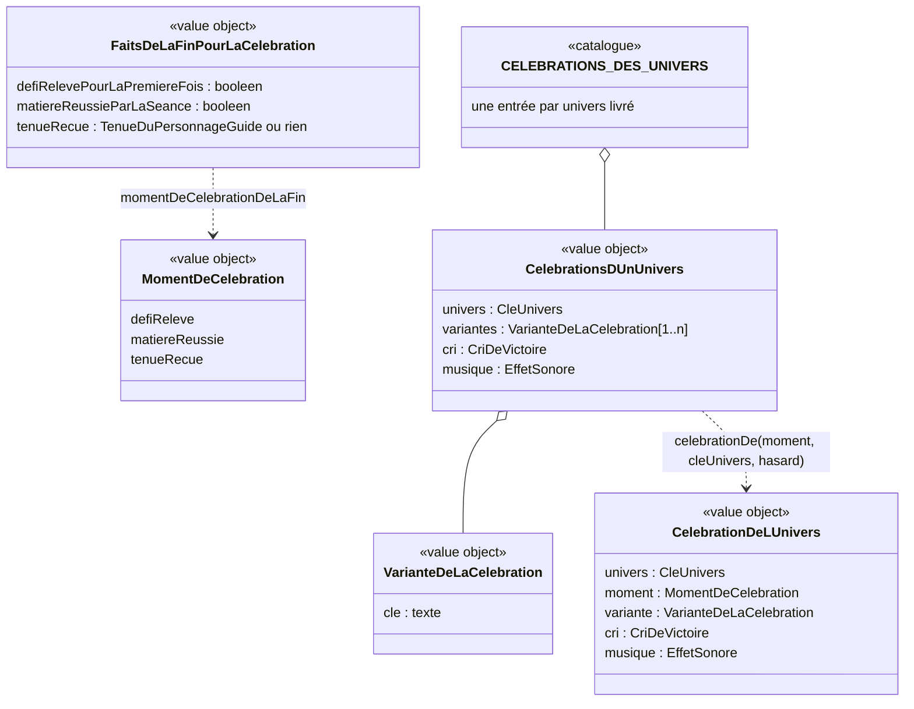

# Modèle du domaine : issue #106, une célébration propre à chaque univers

Contexte : **Motivation**. La story choisit **comment fêter** un fait déjà connu (défi relevé, matière réussie, tenue reçue) selon l'univers du profil. Elle ne crée ni étoile, ni défi relevé, ni tenue, et ne change aucun résultat. Apprentissage publie une lecture pure de plus, la « matière réussie par la séance » (106.4 A, livraison 106g). Aucun agrégat, aucun événement enregistré, aucune migration, aucune Edge Function, aucune donnée d'enfant nouvelle.

État : **cadrage validé par le PO le 2026-11-02** (« 106 reco tout », commentaire https://github.com/SBA-dev/github-move/issues/106#issuecomment-6588450629) : les recommandations des questions 106.1 à 106.27 sont retenues. #100 est mergée (`f8a4787`), #96 aussi. Le TDD commence par la livraison **106a** (mécanisme, défi relevé, Sports).

## Contexte

### Pourquoi Motivation

- La context map dit : « Motivation décide seule des récompenses ; une récompense ne modifie jamais une note ». Une célébration est une mise en scène de récompense : même place que les annonces de la fin (#32, #33, #102) et les effets sonores de la fin (#97).
- L'univers, le personnage guide, ses dessins et ses tenues appartiennent déjà à Motivation (`univers.ts`, `personnage-guide.ts`, `tenues.ts`, `src/univers/`).
- #100 a mis la mise en scène du défi dans Motivation (décision 0038, point 5) : `defiReleveParLaSeance(relevesAvant, defi)` (`motivation/domain/defis-releves.ts`) rend l'`IssueDuDefi` (`annonce` « Défi relevé ! » la première fois, `undefined` quand il est rejoué ; `effetSonore` `grandeVictoire` ou `seanceTerminee`). #106 s'y branche, dans `src/defis/FinDuDefi.tsx`.

### Faits lus, sans rien écrire

| Fait | Contexte qui le décide | Disponible |
|---|---|---|
| Défi relevé pour la première fois, ou rejoué | Apprentissage (#100), mis en scène par Motivation | Oui : `defiReleveParLaSeance(relevesAvant, defi)` → `IssueDuDefi` ; première fois ⇔ `annonce !== undefined` (c'est déjà la règle de `FinDuDefi.tsx` pour `dejaReleve`) |
| Tenue reçue par la séance (paliers 5, 12, 23, 37) | Motivation (#102) | Oui : `tenueRecueParLaSeance(meilleuresAvant, lecon, etoilesDeLaSeance)` → `TenueDuPersonnageGuide \| undefined` |
| Matière réussie par la séance | Apprentissage (#26) | **À ajouter en 106g** (106.4 A) : `matiereReussieDuNiveau(entrees: EntreesDuParcours, matiere)` existe dans `toutes-les-lecons.ts` (non exporté par `index.ts`), mais pas le passage « pas réussie avant la séance, réussie après ». Même schéma que `defiOuvertParLaSeance(avant, apres, matiere, niveau, defisReleves)` |
| Univers du profil en cours | Famille → Motivation (#6) | Oui : `universDe(cle)`, clé inconnue → `animaux` |
| Tenue portée | Motivation, mémoire de l'appareil (#102) | Oui : `tenueAMontrer` |

Le test de départ n'est pas lu (il n'est pas une séance, réponse 27.4). La séance de révision ne rend aucune leçon réussie : elle ne déclenche aucun moment.

### Ce qui existe et ne change pas

- **Célébration commune (#97)** : confettis (`src/celebration/Confettis.tsx`), 1,5 s au plus, un toucher hors des boutons ne fait rien (97.17), boutons et clavier utilisables tout de suite (97.22, 97.23). Elle reste la célébration de toute fin qui n'a pas de moment de célébration, d'un défi rejoué (106.3, 106.25) et de tout univers pas encore livré (106.18). La durée de 1,5 s ne change pas pour elle.
- **Fin du défi (#100)** : annonce « Défi relevé ! » et « grande victoire » la première fois, « séance terminée » quand il est rejoué (100.25), paroles de fin du défi (`parolesDeFinDeDefi`, humeur `applaudit`), boutons « Mon parcours » et « Accueil ».
- **Personnage guide** : humeurs `content`, `reflechit`, `applaudit` et gestes communs (`saute`, `penche`) dans `src/univers/PersonnageGuide.tsx`. Ils ne changent pas.
- **Muet** : coupe seulement la voix ; les effets sonores, donc la musique de la célébration, restent (97.2, 97.20, 106.11) ; seule la voix suspendue des écrans du parent les coupe (97.13).

### Communication entre contextes

Aucune relation nouvelle. La lecture « Apprentissage → Motivation (défis relevés, #100) » et la lecture des meilleures étoiles (#32, #102) suffisent. En 106g, Apprentissage publie une lecture pure de plus (`matiereReussieParLaSeance`), même schéma que `defiOuvertParLaSeance` (#100) et l'avancée dans le parcours (#99). Motivation importe le type `EffetSonore` de Voix (Published Language existant, #97) ; Voix ne connaît toujours pas les univers : les musiques y sont nommées d'après le son, pas d'après l'univers (106.12).

## Termes

| Terme | Statut | Remarque |
|---|---|---|
| Univers, Personnage guide, Agent Max, Défi, Défi relevé, Fin du défi, Partie du parcours, Matière réussie, Fin de la séance, Tenue du personnage guide, Palier des tenues, Tenue reçue, Tenue portée, Effet sonore, Muet, Humeur du personnage guide | existants | Réutilisés sans les redéfinir |
| **Célébration de l'univers** | **nouveau, validé (106.1)** | Mise en scène propre à l'univers du profil, jouée par son personnage guide au moment de célébration. Synonymes interdits : « animation de victoire », « cinématique », « cutscene », « célébration » seul |
| **Célébration commune** | **nouveau, validé (106.1)** | Les confettis et l'effet sonore de la fin de #97, les mêmes dans tous les univers. Lève le conflit : les docs de #97 disaient « célébration » seul |
| **Variante de la célébration** | nouveau, validé (106.1, 106.13) | Une des façons de célébrer d'un univers, tirée au hasard (Sports : glissade à genoux, avion, danse avec clin d'œil). Synonymes interdits : « figure », « numéro », « skin » |
| **Moment de célébration** | nouveau, validé (106.3 à 106.7) | Fait qui fait jouer la célébration de l'univers : premier défi relevé, matière réussie par la séance, tenue reçue. Synonymes interdits : « déclencheur », « trigger », « fin de chapitre » |
| **Cri de victoire** | nouveau, validé (106.14) | Mot affiché par la célébration, propre à l'univers (« BUT ! », « Bravo ! », « Hourra ! », « Magique ! », « Enquête résolue ! », « Mission accomplie ! »). Distinct de l'**expression du personnage guide** (félicitation tirée au hasard pendant la séance), même si deux textes se ressemblent. « Cri » seul reste interdit (synonyme interdit de l'expression du personnage guide) |
| **Danse de victoire** | **nouveau, validé (106.6 A)** | Confiée à #106 par #102.7. Ce n'est pas une animation de plus : c'est la célébration de l'univers jouée au moment « tenue reçue », le personnage guide portant la tenue reçue (106h). Une variante par palier (106.6 B) est écartée |
| « Chapitre », « Chapitre réussi ! » | **interdits** | Les maquettes affichent « Chapitre réussi ! » : remplacé par l'annonce du moment (« Défi relevé ! », « Matière réussie ! »). Décisions 99.24 et #100 |
| « Agente Mila » | **interdit** | Le tableau de l'issue la cite encore : c'est **Agent Max** (96.5, 96.8) |
| « Accessoire » | pas un terme | Le ballon, la baguette, la loupe, le ruban, la lance sont des éléments du dessin (`src/`), pas du domaine. #102 a écarté « accessoire » pour les tenues |
| « Coffre », « coupe », « podium » | interdits dans les célébrations | 98.6, skill `gamification` section 5 |
| Animation d'échec des maquettes (« Presque ! On réessaie ? ») | hors de #106 (106.20) | Ce serait un retour de réponse fausse (#97), story à part. « échec » n'est pas un mot de l'enfant |
| Noisette | existant | **« elle »** (106.19), comme `univers.ts` (voix féminine) et l'issue ; le README des maquettes, qui dit « il », est à corriger |

## Modèle

Pas d'agrégat : rien ne change d'état, rien n'est enregistré, aucun invariant ne lie deux faits dans une même transaction. Le modèle est fait de **value objects** et de **fonctions pures** (des lectures), comme la cabane (#32) et les tenues reçues (#102).



`FaitsDeLaFinPourLaCelebration` est un nom distinct de `FaitsDeLaFin` (`effets-sonores.ts`, #97), qui existe déjà avec un autre contenu (`fin`, `leconAcquise`, `tenueRecue : booleen`…) : les deux ne se fusionnent pas. La fin du défi n'entre pas dans `FaitsDeLaFin` (`fin` n'y vaut que `seance`, `seanceDeRevision` ou `testDeDepart`).

### Value objects et règles de validité

- **`MomentDeCelebration`** : `"defiReleve" | "matiereReussie" | "tenueRecue"` (106.3, 106.4 A, 106.6 A). Pas de « fin de séance » (106.8 non). En 106a, seul `defiReleve` est produit ; `matiereReussie` arrive en 106g, `tenueRecue` en 106h.
- **`VarianteDeLaCelebration`** : une clé propre à l'univers, d'après les maquettes validées (106.2). Les noms en clair des variantes (« le grand jeté »…) ne sont pas montrés à l'enfant ; ceux des univers 106b à 106e sont fixés à la livraison de chacun (106.26).

| Univers | Personnage guide | Action (toujours la même) | Variantes tirées au hasard | Cri de victoire (106.14) | Livraison |
|---|---|---|---|---|---|
| Sports | Coach Léo | tir de dos, le ballon entre dans le but ; confettis de la scène (106.24) | `glissade`, `avion`, `danse` | « BUT ! » | 106a |
| Danse | Lili | entrée en scène, pirouette | `jete`, `ruban`, `sauts` | « Bravo ! » | 106b |
| Animaux | Noisette (elle) | attrape une noisette dorée | `jongle`, `mange`, `joues` | « Hourra ! » | 106c |
| Princesses et fées | Lumi | un sort fait éclore une fleur | `arc`, `envol`, `signes` | « Magique ! » | 106d |
| Police | Agent Max | suit des traces de pattes à la loupe et retrouve un chiot perdu ; confettis du commissariat (106.24) | `orchestre`, `trottinette`, `danse` | « Enquête résolue ! » | 106e |
| Pompiers | Capitaine Sam | arrose le jardin de la caserne, les fleurs s'ouvrent ; pétales de la caserne (106.24) (maquette dessinée en 106f, validée : 106.42) | `cloche`, `arc`, `pluie` (106.41) | « Mission accomplie ! » | 106f |

  Validité : au moins une variante par univers livré ; clés uniques dans un univers. Un univers pas encore livré n'a pas d'entrée : `celebrationDe` rend « aucune célébration de l'univers » et la fin garde la célébration commune (106.18). Quand les six univers sont livrés, le catalogue peut devenir exhaustif sur `CleUnivers` (un univers ajouté sans célébration ne compile plus).
- **`CriDeVictoire`** : texte court, fixe par univers ; du contenu pour l'enfant, soumis à la règle absolue. Affiché, jamais lu à part (106.14).
- **`musique`** : un `EffetSonore` de Voix, choisi par le PO à l'écoute parmi les sons Kenney CC0 (106.12, 106.27). En attendant son choix : **`grandeVictoire`** (existant) pour tous les univers. Elle **remplace** l'effet sonore de l'`IssueDuDefi` (un seul son à la fin) et passe avant la parole de fin du défi.
- **`CelebrationDeLUnivers`** : ce que le domaine rend au front. Il dit **ce qui** est fêté et **quelle variante** ; le front choisit **comment** la dessiner (skill `gamification`, section 3).

### Lectures (fonctions pures, `@domain/motivation`)

- `momentDeCelebrationDeLaFin(faits: FaitsDeLaFinPourLaCelebration)` → `MomentDeCelebration | undefined`. Au plus un moment par fin. Quand deux faits arrivent ensemble : `matiereReussie` passe avant `tenueRecue`, la tenue restant annoncée dans les nouveautés comme dans #102 (106.7). `defiReleve` ne se combine avec rien : la séance de défi ne donne aucune étoile (100.13), donc ni tenue ni leçon réussie. À la fin du défi, `defiRelevePourLaPremiereFois` vient de l'`IssueDuDefi` (`annonce !== undefined`).
- `celebrationDe(moment, cleUnivers, hasard: Hasard)` → `CelebrationDeLUnivers | undefined` (`undefined` pour un univers pas encore livré). Univers par `universDe` (clé inconnue → `animaux`). Variante tirée uniformément, sans mémoire (106.13), avec le port `Hasard` (`motivation/domain/hasard.ts`, `tirage` qui lève `TirageHorsIntervalle`). Le tirage d'un élément dans une liste existe déjà : `tirerDans(textes: readonly string[], hasard)` dans `paroles.ts` (non exporté par `index.ts`). Il est typé pour des textes : le généraliser à une liste de n'importe quel type (refactor) plutôt que de convertir le résultat.
- 106g, dans `@domain/apprentissage` : `matiereReussieParLaSeance(avant: EntreesDuParcours, apres: EntreesDuParcours, matiere: Matiere)` → booléen, vrai quand `matiereReussieDuNiveau` passe de faux à vrai. La règle de réussite reste dans Apprentissage ; `index.ts` exporte la nouvelle lecture.

### Commandes, événements, erreurs

- **Aucune commande** : rien ne change d'état.
- **Aucun événement de domaine nouveau, rien d'enregistré.** Les faits déclencheurs existent déjà (défi relevé, tenue reçue) ou sont recalculés (matière réussie).
- **Aucune erreur métier nouvelle.** `TirageHorsIntervalle` (existante) protège le tirage.

### Ce qui reste dans `src/` (affichage, aucune règle)

- Les dessins animés de chaque univers (`src/univers/celebrations/`), portés depuis les maquettes de `docs/maquettes/`, avec la tenue portée (106.23).
- Le **moteur d'animation des maquettes** (personnage articulé animé en JavaScript), porté dans **un composant isolé** de `src/univers/celebrations/` ; **Motion** pour l'entrée et la sortie de la scène (106.22, décision 0039).
- L'image fixe en mouvements réduits (état final de la variante tirée, avec le cri de victoire et l'annonce, sans confettis : 106.15, 106.24), l'annonce `aria-live` unique, le dessin `aria-hidden`.
- Le fichier MP3 de chaque musique (`src/voix/`, `public/sons/`, licences, `docs/sons.md`), quand le PO les aura choisies.
- La durée (jusqu'à 3 s, 106.9) et le comportement d'un toucher (sans effet, 106.10) et des boutons (utilisables dès la première image).

## Invariants

1. **L'univers ne change que la mise en scène.** Pour un même fait, tous les univers ont le même moment, la même annonce (« Défi relevé ! »), les mêmes étoiles, les mêmes boutons, la même suite du parcours. Les célébrations des six univers durent à peu près pareil (équité). Une matière réussie a la même célébration qu'un défi relevé, seule l'annonce change (« Matière réussie ! », 106.5).
2. **Au plus une célébration par fin.** Une fin qui a un moment de célébration joue la célébration de l'univers à la place de la célébration commune de #97, jamais les deux (106.7, 106.12). Les confettis de la scène de Coach Léo font partie de sa célébration de l'univers (106.24).
3. **Le hasard ne choisit que la variante.** Il ne décide jamais si l'enfant est fêté, ni de ce qu'il reçoit (skill `gamification`, section 5). Le tirage passe par le port `Hasard` ; rien n'est tiré par `Math.random()` dans un composant. La même variante peut revenir deux fois de suite (106.13).
4. **Univers du moment.** La célébration est celle de l'univers du profil au moment où elle est jouée. Un enfant qui change d'univers voit celle du nouvel univers au moment suivant, rien n'est perdu (106.21).
5. **Défi relevé : une fois.** La célébration de l'univers est jouée au premier défi relevé seulement ; rejoué, la fin garde la célébration commune (confettis compris) et « séance terminée » (100.25, 106.3, 106.25).
6. **Elle ne retient jamais l'enfant.** Elle dure **jusqu'à 3 s** (106.9, écart à 97.23 accepté par le PO, décision 0039), à condition que les boutons et le clavier soient utilisables **dès la première image**. Un bouton touché agit tout de suite et arrête la célébration et sa musique (97.22). Un toucher hors des boutons ne fait rien : il ne passe pas la célébration (97.17, 106.10).
7. **Mouvements réduits : rien ne bouge, l'information reste.** Image fixe de la même scène (état final de la variante tirée), le cri de victoire et l'annonce du moment ; aucun confetti (106.15, 106.24).
8. **Une seule annonce aux lecteurs d'écran**, celle du moment (« Défi relevé ! », « Matière réussie ! »). Le dessin et le cri de victoire ne sont pas annoncés (106.14).
9. **Son.** La musique est un effet sonore : jouée en Muet comme en Son, coupée par la voix suspendue des écrans du parent (97.2, 97.13, 106.11). Elle remplace « grande victoire » (un seul son) et passe avant la parole du personnage guide, jamais par-dessus ; elle ne dure pas plus longtemps que la célébration (106.12). « Grande victoire » en attendant le choix du PO.
10. **Règle absolue sur les contenus**, à toutes les tailles et sur l'image fixe : Police, une enquête qui aide (ni arme, ni menottes, ni arrestation, ni gyrophare) ; Pompiers, de l'eau et un arc-en-ciel (ni flamme, ni fumée, ni sirène, ni maison qui brûle) ; Sports, une fête joyeuse (ni adversaire moqué, ni coupe, ni podium, ni classement) ; Princesses et fées et Danse, tenues adaptées aux enfants, sans stéréotype ; tous : aucun coffre.
11. **Motivation à part.** Rien n'est enregistré ; aucune étoile, aucun défi relevé, aucune tenue n'est créé ou changé par la célébration.

## Événements

Aucun événement nouveau. #106 **lit** des faits existants au moment d'afficher la fin :

| Fait lu | Fin | Source | Livraison |
|---|---|---|---|
| Défi relevé pour la première fois | Fin du défi (`src/defis/FinDuDefi.tsx`) | `defiReleveParLaSeance` (#100) : `IssueDuDefi.annonce` présente | 106a |
| Matière réussie par la séance | Fin de la séance | `matiereReussieParLaSeance` (Apprentissage, à ajouter) | 106g |
| Tenue reçue par la séance | Fin de la séance | `tenueRecueParLaSeance` (#102) | 106h |

## Emplacement

Aucune migration, aucune table, aucune Edge Function, aucun `application/` ni `infrastructure/` : le choix de la célébration est une lecture pure faite dans le navigateur, hors ligne compris, et rien n'est enregistré. Le serveur n'a rien à revalider (aucun résultat n'en dépend).

```
supabase/functions/_shared/motivation/domain/
  celebrations-des-univers.ts         # CELEBRATIONS_DES_UNIVERS, VarianteDeLaCelebration, CriDeVictoire, CelebrationDeLUnivers, celebrationDe
  celebrations-des-univers_test.ts
  moment-de-celebration.ts            # MomentDeCelebration, FaitsDeLaFinPourLaCelebration, momentDeCelebrationDeLaFin
  moment-de-celebration_test.ts
  paroles.ts                          # tirerDans généralisé (refactor)
  index.ts                            # exports
supabase/functions/_shared/apprentissage/domain/       (106g)
  matiere-reussie-par-la-seance.ts    # matiereReussieParLaSeance
  matiere-reussie-par-la-seance_test.ts
  index.ts
supabase/functions/_shared/voix/domain/effet-sonore.ts # musiques choisies par le PO (noms d'après le son, 106.12), plus tard
src/univers/celebrations/             # une scène animée par personnage guide, image fixe, moteur isolé (106.22)
src/defis/FinDuDefi.tsx               # branchement de la célébration de l'univers (106a)
src/voix/                             # fichier MP3 de chaque musique, plus tard
public/sons/                          # MP3 et licences Kenney ; docs/sons.md, plus tard
```

**Décision 0039** (`docs/decisions/0039-celebration-de-l-univers-jusqu-a-3-s-et-moteur-isole.md`) : durée jusqu'à 3 s (écart à 97.23, 106.9) et moteur d'animation des maquettes porté dans un composant isolé, Motion pour l'entrée et la sortie (106.22).

**Données d'enfants** : aucune. La variante tirée n'est pas gardée (106.13) ; l'univers est déjà dans le profil ; rien n'est envoyé au serveur ni à l'IA.

Glossaire : les termes célébration de l'univers, célébration commune, variante de la célébration, moment de célébration, cri de victoire et danse de victoire sont ajoutés en fin de la section Motivation de `docs/domain/glossaire.md`. Context map : une note « Apprentissage publie une lecture pure de plus, la matière réussie par la séance (#106, 106g) », sans relation nouvelle.

## Découpage validé (106.17)

| Livraison | Contenu | Dépend de |
|---|---|---|
| **106a** | Mécanisme : `MomentDeCelebration` (défi relevé seulement), catalogue, tirage de la variante, image fixe, annonce, boutons ; **Sports** (Coach Léo, maquette de référence), avec « grande victoire » en attendant sa musique ; les cinq autres univers gardent la célébration commune | #100 (mergée) |
| 106b à 106e | Un univers par livraison : Danse, Animaux, Princesses et fées, Police (port de la maquette, musique choisie, planche relue, noms des variantes fixés : 106.26) | 106a |
| 106f | Pompiers : planche et maquette d'abord, validées par le PO, puis livraison | 106a, maquette validée |
| 106g | Moment « matière réussie » (106.4 A, 106.5) | 106a |
| 106h | Danses de victoire aux paliers des tenues (106.6 A) | 106a |
| Hors #106 | Petites célébrations à chaque fin de séance (106.8 non) ; réaction animée à une réponse fausse (106.20) ; grand défi de la matière (#137, qui dira si le grand défi relevé a sa célébration) | — |

Chaque livraison est une issue que le PO crée.

## Livraison 106b : Danse

Lili, univers Danse, d'après la maquette validée `docs/maquettes/lili-danse.html` (README des maquettes, section Lili). Aucun agrégat, aucun événement, aucune donnée d'enfant de plus : 106b ajoute une entrée au catalogue et resserre les types partagés avec le front.

### Entrée du catalogue

| Univers | Variantes | Cri de victoire | Musique |
|---|---|---|---|
| `danse` | `jete`, `ruban`, `sauts` | « Bravo ! » | `grandeVictoire`, en attendant le choix du PO (106.27) |

L'action, toujours la même, est l'entrée en scène puis la pirouette complète. Elle n'est pas dans le domaine (affichage).

### Noms en clair des variantes (106.26)

| Clé | Ce que fait Lili (maquette) | Libellé des scénarios |
|---|---|---|
| `jete` | grand jeté, puis révérence | « le grand jeté » |
| `ruban` | le ruban dessine une étoile autour d'elle | « le ruban » |
| `sauts` | petits sauts, puis grand saut bras en couronne avec clin d'œil | « les petits sauts » |

« Les petits sauts » colle mieux à la maquette (bouton « C · Petits sauts ») que « les sauts » : la ligne Danse de `features/106-celebration-de-l-univers.feature` devient « le grand jeté, le ruban ou les petits sauts ». C'est une précision faite d'après la maquette, et 106.26 la couvre déjà. Ces libellés ne sont jamais montrés à l'enfant.

### Clés de variante publiées par le domaine (dette notée avant 106b)

Aujourd'hui, `VarianteDeLaCelebration` vaut `{ cle: string }`. Le front redéclare donc les clés de Sports (`VARIANTES_DE_SPORTS`, `estUneVarianteDeSports` dans `src/univers/celebrations/sports/poses.ts`), et une clé ajoutée au domaine sans son dessin passe la compilation. Forme retenue, la plus simple en TypeScript pur, dans `celebrations-des-univers.ts` :

- une seule constante, **`VARIANTES_DES_UNIVERS`**, `as const`, qui donne la liste des clés de chaque univers livré (`sports : ["glissade", "avion", "danse"]`, `danse : ["jete", "ruban", "sauts"]`). Elle est la seule source des clés ;
- **`UniversCelebre`** = les clés de `VARIANTES_DES_UNIVERS` (les univers livrés). C'est un sous-ensemble de `CleUnivers` ;
- **`VarianteDe<U>`** = une clé de variante de l'univers `U` (`VarianteDe<"danse">` = `"jete" | "ruban" | "sauts"`) ;
- **`CelebrationDeLUnivers`** devient une **union discriminée par `univers`** : pour chaque `U` de `UniversCelebre`, `{ univers: U ; moment ; variante: { cle: VarianteDe<U> } ; cri ; musique }`. La forme `variante.cle` reste, si bien que les tests et `data-variante` ne changent pas ;
- le catalogue (cri, musique) devient exhaustif sur `UniversCelebre` (il n'est plus un `Partial<Record<CleUnivers, …>>`). `celebrationDe` garde sa signature et rend toujours `undefined` pour un univers pas encore livré (106.18). Le test « univers pas encore livré » vaut pour un des quatre restants. Le typage passe sans `as` grâce à un type indexé par l'univers (cas des unions corrélées) ;
- `index.ts` exporte `VARIANTES_DES_UNIVERS`, `UniversCelebre` et `VarianteDe`.

Côté front, `switch (celebration.univers)` affine le type de la variante. `estUneVarianteDeSports` et `VARIANTES_DE_SPORTS` disparaissent, et les poses de chaque scène sont un `Record<VarianteDe<"…">, …>` : une variante ajoutée au domaine sans son dessin ne compile plus. Rien de métier ne passe dans `src/`.

### Pétales et fleurs (application de 106.24)

Les pétales et les fleurs lancés depuis la salle font partie de la célébration de l'univers de Lili, comme les confettis de Coach Léo (106.24, invariant 2). Ils ne s'ajoutent jamais aux confettis de la célébration commune. En mouvements réduits, aucun ne tombe : on voit l'image fixe de l'état final de la variante, avec le cri de victoire et l'annonce (invariant 7).

On applique aussi, sans question nouvelle :
- « Chapitre réussi ! » et la phrase sur « l'Opéra des Savanturiers » de la maquette sont remplacés par l'annonce du moment (« Défi relevé ! ») ;
- la maquette annonce « Bravo ! » avec le titre. Dans l'application, seul le moment est annoncé (invariant 8, 106.14) ;
- la scène de réponse fausse de la maquette reste hors de #106 (106.20) ;
- le personnage guide n'est pas montré deux fois pendant la célébration (106.28 « cacher »).

### Règle absolue de contenu pour Lili (invariant 10)

- Tenue adaptée aux enfants, à toutes les tailles et sur l'image fixe : justaucorps à manches, tutu court et bouffant, collant opaque, demi-pointes.
- Poses de danse classique seulement (pirouette, grand jeté, révérence, petits sauts, bras en couronne). Aucune pose suggestive.
- Public en silhouettes discrètes et neutres, sans caricature ni stéréotype d'une origine, d'un sexe ou d'un handicap. La salle ne se moque jamais.
- Rien d'effrayant dans le décor (rideaux, projecteurs, poussière lumineuse) et pas de coffre.
- Le front présente une **planche** (images clés des trois variantes et image fixe) que le PO valide avant le merge.

### Ce qui reste dans `src/`

- `src/univers/celebrations/danse/` : la scène de Lili (décor de théâtre, poses, ruban, pétales et fleurs), portée depuis la maquette avec le moteur isolé (106.22) et la tenue portée (106.23).
- Les identifiants SVG sont préfixés `danse-`, comme `sports-`.
- `SceneDeCelebration.tsx` choisit la scène par `switch (celebration.univers)`. Chaque scène est **chargée à la demande** (`React.lazy`) et ne montre rien tant qu'elle charge. Les morceaux chargés à la demande restent dans le précache de la PWA (#8), pour que la célébration marche hors ligne.

### Questions

Aucune question nouvelle.

## Livraison 106c : Animaux de la forêt

Noisette (« elle », 106.19), univers Animaux de la forêt, d'après la maquette validée `docs/maquettes/noisette-animaux.html` (README des maquettes, section Noisette). Aucun agrégat, aucun événement, aucune donnée d'enfant de plus : 106c ajoute l'entrée `animaux` aux structures posées par 106b (`VARIANTES_DES_UNIVERS`, donc `UniversCelebre`, `VarianteDe<"animaux">`, l'union `CelebrationDeLUnivers`, le catalogue des cris et des musiques et la table `CELEBRANTS`). Aucun type nouveau : la forme des clés de variante est celle de la sous-section « Clés de variante publiées par le domaine » de la livraison 106b.

### Entrée du catalogue

| Univers | Variantes | Cri de victoire | Musique |
|---|---|---|---|
| `animaux` | `jongle`, `mange`, `joues` | « Hourra ! » | `grandeVictoire`, en attendant le choix du PO (106.27) |

L'action, toujours la même, est la noisette dorée qui tombe de l'arbre et que Noisette attrape. Elle n'est pas dans le domaine (affichage).

### Noms en clair des variantes (106.26)

| Clé | Ce que fait Noisette (maquette) | Libellé des scénarios |
|---|---|---|
| `jongle` | elle jongle avec trois noisettes | « le jonglage » |
| `mange` | elle croque la noisette (petites miettes), puis se tapote le ventre | « la noisette croquée » |
| `joues` | elle remplit ses joues de noisettes, fière, avec un clin d'œil | « les joues pleines » |

« Les joues pleines » colle mieux à la maquette (bouton « C · Joues pleines ») que « les joues gonflées » : la ligne Animaux de la forêt de `features/106-celebration-de-l-univers.feature` devient « le jonglage, la noisette croquée ou les joues pleines ». C'est une précision faite d'après la maquette, et 106.26 la couvre déjà (comme « les petits sauts » en 106b). Ces libellés ne sont jamais montrés à l'enfant.

### Feuilles de la forêt (application de 106.24)

La maquette fait tomber des feuilles et de petites étoiles dorées (canvas « Feuilles et étoiles qui tombent »). Dans l'application, il ne tombe **aucune étoile à cinq branches** (106.35, appliquée dans 106c) : les petites étoiles de la maquette deviennent des étincelles à quatre branches ou de petites fleurs, qui tombent avec les feuilles. Dans les scénarios, on les appelle **« les feuilles de la forêt »**. Elles font partie de la célébration de l'univers de Noisette, comme les confettis de Coach Léo et les pétales de la salle de Lili (106.24, invariant 2). Elles ne s'ajoutent jamais aux confettis de la célébration commune. En mouvements réduits, aucune ne tombe : on voit l'image fixe de l'état final de la variante, avec le cri de victoire et l'annonce (invariant 7). Les fleurs posées dans l'herbe font partie du décor et ne tombent pas.

On applique aussi, sans question nouvelle :
- « Chapitre réussi ! » et la phrase « Tu as réussi toutes les leçons de la Forêt des Savanturiers » de la maquette sont remplacés par l'annonce du moment (« Défi relevé ! ») ;
- la maquette annonce « Hourra ! » avec le titre. Dans l'application, seul le moment est annoncé (invariant 8, 106.14) ;
- toucher la scène passe l'animation dans la maquette. Dans l'application, un toucher hors des boutons ne fait rien (invariant 6, 106.10) ;
- l'animation d'échec de la maquette (« toc ! », Noisette étourdie un instant) reste hors de #106 (106.20) ;
- le personnage guide n'est pas montré deux fois pendant la célébration (106.28 « cacher ») ;
- Noisette ne se retourne jamais : elle reste de face ou de trois-quarts face, comme dans la maquette.

### Règle absolue de contenu pour Noisette (invariant 10)

À toutes les tailles et sur l'image fixe :
- **La noisette croquée** n'a rien de dégoûtant ni de moqueur. Noisette mâche bouche fermée ou avec un petit sourire. On ne détaille pas l'intérieur de la bouche et il n'y a pas de bave. Les miettes sont petites et dorées, et disparaissent vite. Rien de gourmand à l'excès ni de « goinfre ». Pas de bruit grossier : l'éclat qui accompagne la croquée est un petit trait lumineux, sans texte ni son de mastication.
- **Les joues pleines** sont rondes et fières, jamais grotesques ni présentées comme ridicules. On ne se moque pas de Noisette, et elle ne se moque de personne.
- **Le jonglage et la chute de la noisette** : aucune noisette ne blesse ni ne cogne Noisette pendant la célébration.
- Aucun animal chassé, menacé ni blessé. Le décor de prairie, d'arbre et de ciel clair n'a rien d'effrayant (ni ombre menaçante, ni prédateur, ni orage). Pas de coffre.
- Le front présente une **planche** (images clés des trois variantes et image fixe, à 360, 160 et 80 px, sur fond clair et sur fond sombre) que le PO valide avant le merge (98.28).

### Ce qui reste dans `src/`

- `src/univers/celebrations/animaux/` : la scène de Noisette (décor de prairie et d'arbre, poses, queue en panache, noisettes, miettes, feuilles de la forêt), portée depuis la maquette avec le moteur isolé (106.22). On réutilise les morceaux partagés que 106b a mis dans `src/univers/celebrations/commun/`. Le dessin fixe de référence est `src/univers/personnages/Noisette.tsx`.
- **Tenue portée (106.31, renvoyée à 106h)** : la scène de Noisette montre Noisette dans sa **tenue de base**, comme les scènes de Sports et de Danse. Porter la tenue de #102 pendant la célébration (106.23) est renvoyé à la livraison 106h, pour tous les univers. La scène n'importe donc pas `src/univers/personnages/tenues.tsx`, et la planche ne montre aucune tenue.
- Les identifiants SVG sont préfixés `animaux-`, comme `sports-` et `danse-`.
- `SceneDeCelebration.tsx` ajoute le cas `animaux` à son `switch (celebration.univers)`. La scène est **chargée à la demande** et reste dans le précache de la PWA (#8).
- Documentation : le README des maquettes, section Noisette, passe de « il » à « elle » (106.19). Correction faite dans 106c.

### Tests

Le test « le premier défi relevé dans un univers pas encore livré garde la célébration commune » (`celebration-de-la-fin_test.ts`, 106b) prend `animaux` comme univers pas encore livré. En 106c, `animaux` est livré : le RED en prend un autre (`princesse`, par exemple). La boucle de `celebrations-des-univers_test.ts` sur les univers sans célébration perd aussi `animaux`.

### Questions

Tranchées le **2026-11-05** par le PO (« merge 106b OK, 106c reco tout, 106d reco tout », annonce du responsable sur l'issue de coordination #64 : https://github.com/SBA-dev/github-move/issues/64#issuecomment-6651992972) : la recommandation est retenue pour chacune.

| Question | Réponse |
|---|---|
| 106.31 Tenue portée pendant la célébration | Reco : renvoyée à 106h pour tous les univers. Noisette, comme Coach Léo et Lili, est dans sa tenue de base pendant la célébration |
| 106.32 Planche de Noisette | Reco : planche validée (images clés des trois variantes et image fixe, à 360, 160 et 80 px, fonds clair et sombre) |
| 106.33 Jonglage | Reco : le jonglage reste comme dans la maquette (trois noisettes) |
| 106.35 Étoiles à cinq branches (posée par 106d, réponse « oui ») | Appliquée dans 106c : aucune étoile à cinq branches dans la scène de Noisette ; étincelles à quatre branches ou petites fleurs à la place (sous-section « Feuilles de la forêt ») |

Aucune question ouverte pour 106c.

## Livraison 106d : Princesses et fées

Lumi, univers Princesses et fées, d'après la maquette validée `docs/maquettes/lumi-princesse.html` (README des maquettes, section Lumi, validée le 2026-10-27). Aucun agrégat, aucun événement, aucune donnée d'enfant de plus. La structure est posée par les livraisons 106b (Danse) et 106c (Animaux de la forêt) : `VARIANTES_DES_UNIVERS`, donc `UniversCelebre`, `VarianteDe<U>`, l'union discriminée `CelebrationDeLUnivers`, le catalogue des cris et des musiques, les scènes chargées à la demande et préchargées, les identifiants SVG préfixés et `src/univers/celebrations/commun/`. 106d y ajoute l'entrée `princesse` sans rien redéfinir. Aucun type nouveau : les clés de variante ont la forme décrite par 106b (« Clés de variante publiées par le domaine »).

### Entrée du catalogue

| Univers | Variantes | Cri de victoire | Musique |
|---|---|---|---|
| `princesse` | `arc`, `envol`, `signes` | « Magique ! » | `grandeVictoire`, en attendant le choix du PO (106.27) |

La clé de l'univers est `princesse` (au singulier, `CleUnivers` de `univers.ts`). L'action, toujours la même, est le sort lancé d'un geste de baguette, qui fait éclore une grande fleur. Elle n'est pas dans le domaine : c'est de l'affichage.

### Noms en clair des variantes (106.26)

| Clé | Ce que fait Lumi (maquette) | Libellé des scénarios |
|---|---|---|
| `arc` | la baguette trace un arc-en-ciel, qui se termine par une couronne au-dessus de Lumi | « l'arc-en-ciel » |
| `envol` | Lumi s'envole et fait une boucle dans le ciel, avec une traînée scintillante, puis redescend en douceur ; le cri de victoire n'apparaît qu'après la redescente | « l'envol » |
| `signes` | des chiffres et des lettres lumineux (1, 2, 3, A, B, C) dansent autour d'elle, puis se transforment d'un geste de baguette | « les chiffres et les lettres » |

« Les signes » est trop vague pour un PO qui lit un scénario : la maquette dit « C · Chiffres » sur son bouton, mais elle montre aussi des lettres, et Lumi est « la fée des nombres et des mots » (`univers.ts`). La ligne Princesses et fées de `features/106-celebration-de-l-univers.feature` devient donc « l'arc-en-ciel, l'envol ou les chiffres et les lettres ». La clé `signes` ne change pas. C'est une précision faite d'après la maquette, que 106.26 couvre déjà (comme « les petits sauts » en 106b et « les joues pleines » en 106c). Ces libellés ne sont jamais montrés à l'enfant.

### Étincelles du jardin (application de 106.24)

La maquette fait tomber des étincelles et des pétales (canvas « Étincelles et pétales qui tombent »). Dans les scénarios, on les appelle **« les étincelles du jardin »**. Elles font partie de la célébration de l'univers de Lumi, comme les confettis de Coach Léo, les pétales de la salle de Lili et les feuilles de la forêt de Noisette (106.24, invariant 2). Elles ne s'ajoutent jamais aux confettis de la célébration commune. En mouvements réduits, aucune ne tombe : on voit l'image fixe de l'état final de la variante, avec le cri de victoire et l'annonce (invariant 7).

La traînée scintillante de la baguette et celle de l'envol font partie de l'action et de la variante, pas des étincelles du jardin. Elles n'apparaissent pas non plus sur l'image fixe. Les lucioles, les fleurs de la prairie, les nuages et le château sont du décor : ils ne tombent pas, et les lucioles ne bougent pas en mouvements réduits (la maquette les arrête déjà).

On applique aussi, sans question nouvelle :
- « Chapitre réussi ! » et la phrase « Tu as réussi toutes les leçons du Royaume des Savanturiers » de la maquette sont remplacés par l'annonce du moment (« Défi relevé ! ») ;
- la maquette annonce « Magique ! » avec le titre. Dans l'application, seul le moment est annoncé (invariant 8, 106.14) ;
- toucher la scène passe l'animation dans la maquette. Dans l'application, un toucher hors des boutons ne fait rien (invariant 6, 106.10) ;
- l'animation d'échec de la maquette (« pschitt ! », bulles colorées, « Presque ! On réessaie ? ») reste hors de #106 (106.20) ;
- le personnage guide n'est pas montré deux fois pendant la célébration (106.28 « cacher ») ;
- Lumi ne se retourne jamais de dos (README des maquettes : « pas de retournement de dos »), même pendant la boucle de l'envol : elle reste de face ou de trois-quarts face.

### Règle absolue de contenu pour Lumi (invariant 10)

À toutes les tailles et sur l'image fixe :
- **Tenue de fée couvrante**, la même que le dessin fixe (`src/univers/personnages/Lumi.tsx`) : robe rose jusqu'aux genoux, manches bouffantes, col rond, jupe à plis, legging, ballerines plates. La jupe qui bouge ne se soulève jamais au-dessus des genoux, même pendant l'envol et la boucle. Rien de sexualisé : ni pose suggestive, ni maquillage, ni talons. Aucun stéréotype : Lumi agit (elle lance le sort, s'envole, fait danser les chiffres et les lettres) ; elle n'attend personne et n'est pas fêtée pour son apparence.
- **La baguette ne ressemble jamais à une arme** : un bâton court et arrondi, sans pointe acérée. Le geste qui lance le sort se lit comme un geste doux, ample et rond (un mouvement de poignet, la baguette vers le haut). Dans la maquette, il est précédé d'un « recul de la baguette » puis d'un « coup de baguette » : dans l'application, ce geste ne ressemble ni à une frappe, ni à une visée, ni à un tir. Le sort est une petite lumière qui monte en arc vers la fleur, sans traînée de projectile ni impact ; rien n'est touché ni bousculé.
- **L'envol** : Lumi flotte et vole en douceur, sans chute, sans vertige, et redescend en se posant légèrement. Rien ne la met en danger.
- **Décor** : le château rose et violet, aux fenêtres éclairées, reste petit et accueillant ; le ciel mauve clair et les nuages blancs n'ont rien d'effrayant (ni orage, ni nuit noire, ni ombre menaçante, ni personnage inquiétant). Les lucioles sont des points lumineux, sans insecte dessiné. Pas de coffre.
- **Étoiles (106.34 A)** : aucune étoile à cinq branches dans la scène de Lumi, à aucune taille ni sur l'image fixe. Au bout de la baguette, une petite fleur (comme la fleur qui éclot) ; le sort est une lumière avec une étincelle à quatre branches ; une couronne de fleurs au-dessus de l'arc-en-ciel ; les chiffres et les lettres se transforment en petites fleurs de leur couleur ; les étincelles du jardin ont quatre branches (avec les pétales). Aucun dessin ne reprend la forme ni la couleur de l'étoile gagnée à la fin d'une séance (invariant 11, 100.13).
- Le front présente une **planche** (images clés de l'action, des trois variantes et de l'image fixe, à 360, 160 et 80 px, sur fond clair et sur fond sombre) que le PO valide avant le merge (98.28). **Validée (106.36)** : `docs/stories/106/captures/106d-lumi-*.png`, commit `d45b217`.

### Écarts à la maquette, validés avec la planche (106.36)

- Le geste du sort est un **rond doux** du poignet, sans recul ni coup de baguette (application de la règle de la baguette ci-dessus).
- Lumi garde les **bras levés** en fin de sort.
- **Sourcils doux** sur tout le visage, à toutes les poses.
- En fin de « chiffres et lettres », les petites fleurs sont **rangées au-dessus de sa tête**.

### Ce qui reste dans `src/`

- `src/univers/celebrations/princesses/` : la scène de Lumi (décor de jardin féerique et château, Lumi qui flotte, ailes translucides qui battent, cheveux d'un seul tenant en cinq mèches, tiare, baguette, fleur qui éclot, arc-en-ciel, chiffres et lettres, traînées, étincelles du jardin), portée depuis la maquette avec le moteur isolé (106.22). On réutilise les morceaux partagés de `src/univers/celebrations/commun/` (106b, 106c). Le dessin fixe de référence est `src/univers/personnages/Lumi.tsx`.
- Les poses de la scène sont un `Record<VarianteDe<"princesse">, …>` (106b) : une variante ajoutée au domaine sans son dessin ne compile pas.
- Les identifiants SVG sont préfixés `princesse-` (au singulier) : `commun/dom.ts` construit le préfixe depuis la clé d'univers, comme `sports-`, `danse-` et `animaux-`. Le dossier de la scène garde son nom `princesses/`. Accepté par le PO avec la planche (106.36).
- `SceneDeCelebration.tsx` ajoute le cas `princesse` à son `switch (celebration.univers)` et à `prechargerLaSceneDe`. La scène est **chargée à la demande** et reste dans le précache de la PWA (#8).
- **Tenue portée (106.23)** : les tenues de #102 (`echarpe-rayee`, `noeud-papillon`, `sac-a-dos-d-explorateur`, `bottes-de-pluie`) sont dessinées dans le dessin fixe par `src/univers/personnages/tenues.tsx`, sur l'`Ancrage` de Lumi (`cou`, `dos`, `pieds`). **106.31 tranchée** (reco retenue, [annonce du 2026-11-05](https://github.com/SBA-dev/github-move/issues/106#issuecomment-6652002035)) : la tenue portée n'est dessinée dans aucune scène animée avant 106h, pour tous les univers. La scène de Lumi ne dessine donc pas la tenue ; elle est renvoyée à 106h. Point à noter pour 106h : le sac à dos se pose sur le dos, là où battent les ailes, et les bottes de pluie se portent sur un personnage qui flotte.

### Tests

En 106c, le test « le premier défi relevé dans un univers pas encore livré garde la célébration commune » (`celebration-de-la-fin_test.ts`) prend `princesse`. En 106d, `princesse` est livré : 106d le passe à `pompier` (la vraie clé est au singulier), livré le dernier (106f), pour ne pas changer ce test à chaque livraison. La boucle de `celebrations-des-univers_test.ts` sur les univers sans célébration perd aussi `princesse`.

### Correctif de l'étoile du ruban de Lili (application de 106.35)

106.35 étant oui, la règle de 106.34 A vaut aussi pour Lili et Noisette (équité entre univers, invariant 1). Le partage annoncé par le responsable : 106c retire elle-même les petites étoiles à cinq branches des feuilles de la forêt de Noisette ; le correctif de Lili revient à **106d**, une fois 106b mergée.

- Dans la scène de la danse (106b), l'étoile que trace le ruban (`danse-etoile-ruban`) n'est plus une étoile à cinq branches dorée et cernée. Elle devient une forme sans cinq branches, par exemple une étincelle à quatre branches ou une fleur, sans l'or ni le contour foncé de l'étoile gagnée.
- Le tracé du ruban garde son mouvement : seule la figure finale change. Les noms des variantes de Lili et leurs libellés ne changent pas ; aucun changement de domaine.
- L'image fixe de la variante concernée suit la même règle.
- Une capture **avant/après** (même variante, mêmes tailles que la planche de 106b) est montrée au PO dans la PR de 106d.

### Questions

Aucune question ouverte pour 106d. Toutes sont **tranchées le 2026-11-05** par le PO (« 106d reco tout », [annonce du responsable](https://github.com/SBA-dev/github-move/issues/106#issuecomment-6652002035)).

**106.34 Étoiles de la scène de Lumi.** *Tranchée (reco A retenue, 2026-11-05)* : aucune étoile à cinq branches dans la scène de Lumi (voir « Règle absolue de contenu pour Lumi »). Énoncé d'origine : la maquette dessine beaucoup d'étoiles à cinq branches, dorées, cernées d'un trait foncé (fonction `ETOILE`, or `#FFC93C`) : au bout de la baguette, dans le sort, en couronne au-dessus de l'arc-en-ciel, à la place des chiffres et des lettres qui « deviennent des étoiles », et une étincelle du jardin sur trois. Elles ont presque la même forme et la même couleur que l'**étoile** gagnée à la fin d'une séance (`EtoilesDessinees.tsx`, `EtoilesGagnees.tsx` : cinq branches, or `#ffd43b`, contour foncé). Or la fin du défi ne donne aucune étoile (100.13) et la célébration n'en crée aucune (invariant 11) : l'enfant pourrait croire qu'il en a gagné. Les petites étincelles à quatre branches de la maquette (robe, traînée de l'envol, éclats autour du cri) ne posent pas ce problème.
- **Reco A** : aucune étoile à cinq branches dans la scène de Lumi. Au bout de la baguette, une petite fleur (comme la fleur qui éclot) ; le sort est une lumière avec une étincelle à quatre branches ; une couronne de fleurs au-dessus de l'arc-en-ciel ; les chiffres et les lettres se transforment en petites fleurs de leur couleur ; les étincelles du jardin ont quatre branches.
- B : garder la maquette telle quelle (les étoiles font partie de l'univers des fées).
- C : garder des étoiles à cinq branches, mais jamais dorées ni cernées (blanches ou pastel, petites).

Précédent : en 106b, le ruban de Lili dessine une grande étoile dorée à cinq branches (`danse-etoile-ruban`), validée par le PO avec la planche (106.29), sans que la question ait été posée. En 106c, une partie des feuilles de la forêt sont de petites étoiles dorées à cinq branches (canvas de la maquette de Noisette). Les autres maquettes n'en ont pas.

**106.35 Même règle pour Lili et Noisette ?** *Tranchée (oui, 2026-11-05)* : même règle ; 106c retire ses petites étoiles dans sa propre livraison, 106d corrige l'étoile du ruban de Lili après le merge de 106b (voir « Correctif de l'étoile du ruban de Lili »). Énoncé d'origine : si 106.34 est A, applique-t-on la même règle à l'étoile du ruban de Lili et aux petites étoiles des feuilles de la forêt de Noisette (équité entre univers, invariant 1) ? Reco : oui, en petits correctifs une fois 106b et 106c mergées (l'étoile du ruban reste une figure tracée par le ruban, mais sans remplissage doré ; les étoiles de la forêt deviennent des étincelles à quatre branches). Autre choix : non, la règle ne vaut que pour Lumi.

**106.36 Planche de Lumi.** *Tranchée (validée, 2026-11-05)* : planche `docs/stories/106/captures/106d-lumi-*.png` (commit `d45b217`) validée, écarts à la maquette compris (voir « Écarts à la maquette ») ; préfixe des identifiants SVG `princesse-` accepté au lieu de `princesses-`.

**106.31 Tenue portée** (posée par 106c). *Tranchée (reco retenue, 2026-11-05)* : renvoyée à 106h pour tous les univers, Lumi comprise.

## Livraison 106e : Police

Agent Max (« il », le détective futé), univers Police, d'après la maquette validée `docs/maquettes/agent-max-police.html` (README des maquettes, section « agent-max-police.html : univers Police, Agent Max »). Aucun agrégat, aucun événement, aucune donnée d'enfant de plus : 106e ajoute l'entrée `police` aux structures posées par 106b (`VARIANTES_DES_UNIVERS`, donc `UniversCelebre`, `VarianteDe<"police">`, l'union `CelebrationDeLUnivers`, le catalogue des cris et des musiques et la table `CELEBRANTS`). Aucun type nouveau. La clé de l'univers est `police` (`univers.ts`).

### Entrée du catalogue

| Univers | Variantes | Cri de victoire | Musique |
|---|---|---|---|
| `police` | `orchestre`, `trottinette`, `danse` | « Enquête résolue ! » | `grandeVictoire` (106.27) |

L'action est toujours la même. Agent Max suit des traces de pattes à la loupe. Le buisson bouge, un chiot perdu en sort d'un bond et lui saute dans les bras. Câlin, puis Max le pose au sol, où le chiot reste assis à côté de lui pendant la variante. Cette action n'est pas dans le domaine (affichage).

La clé `danse` existe déjà chez Sports, et c'est aussi la clé de l'univers Danse. C'est permis : une clé de variante n'est unique que dans son univers. `VarianteDe<"police">` et `VarianteDe<"sports">` restent deux types distincts, puisque le `switch (celebration.univers)` les sépare. Le cri de victoire « Enquête résolue ! » est le même texte que la première expression d'Agent Max (`univers.ts`). Le terme « Cri de victoire » prévoit déjà ce cas : ce sont deux concepts distincts.

### Noms en clair des variantes (106.26)

| Clé | Ce que fait Agent Max (maquette) | Libellé des scénarios |
|---|---|---|
| `orchestre` | il enfile des gants blancs et fait le chef d'orchestre de la circulation. À trois coups de sifflet (« tuut ! »), trois petites voitures colorées passent en rythme, puis il fait une révérence et un clin d'œil | « le chef d'orchestre » |
| `trottinette` | il met un casque et fait un tour en trottinette : poussées du pied, glisse, « dring ! », signe de la main, retour, puis arrêt en douceur et clin d'œil | « le tour en trottinette » |
| `danse` | il pose la loupe au sol et fait la danse de la victoire : pas chassés, grand saut, casquette lancée et rattrapée sur la tête, clin d'œil | « la danse de la victoire » |

Ces libellés reprennent la maquette (boutons « A · Orchestre », « B · Trottinette », « C · Danse » et le README). La ligne Police de `features/106-celebration-de-l-univers.feature` devient donc « le chef d'orchestre, le tour en trottinette ou la danse de la victoire » (aujourd'hui : « l'orchestre, la trottinette ou la danse »). C'est une précision faite d'après la maquette, et 106.26 la couvre déjà (comme « les petits sauts » en 106b et « les joues pleines » en 106c). L'enfant ne voit jamais ces libellés. « La danse de la victoire » est le nom d'une variante d'Agent Max. Ce n'est pas la **danse de victoire** du glossaire (106.6 A, célébration jouée au palier des tenues, 106h). Dans les scénarios, on écrit toujours le libellé entier, avec l'article « la » et « de la », pour ne pas confondre les deux.

### Confettis du commissariat (application de 106.24)

La maquette lance des confettis : un canvas jette 70 petits rectangles bleus, jaunes, blancs, bleu clair et rouges, depuis les deux côtés de la place, au moment du cri de victoire. Ils retombent sur le trottoir. Dans les scénarios, on les appelle **« les confettis du commissariat »**. Ils font partie de la célébration de l'univers d'Agent Max, comme les confettis de Coach Léo, les pétales de la salle de Lili et les feuilles de la forêt de Noisette (106.24, invariant 2). Ils ne s'ajoutent jamais aux confettis de la célébration commune. En mouvements réduits, aucun ne tombe : on voit l'image fixe de l'état final de la variante, avec le cri de victoire et l'annonce (invariant 7).

Le reste ne tombe pas :
- les **étincelles** de la maquette sont déjà à quatre branches : trois autour de la tête quand Max attrape le chiot (groupe `#etoiles`, mal nommé dans la maquette), quatre autour des gants (`#etincelles`). Elles restent telles quelles ;
- les **rayons** autour du cri de victoire s'ouvrent une fois puis s'effacent. Ils ne tournent pas en boucle et ne clignotent pas (voir la règle absolue plus bas).

**Aucune étoile à cinq branches** (106.34 A, 106.35). La maquette en dessine trois. Toutes partent :
- l'étoile dorée de la **casquette** (`casquetteHTML`). Elle se retrouve aussi sur la casquette lancée de la variante `danse` et sur celle de l'animation d'échec, qui reste hors de #106. Elle devient l'**écusson sans étoile, bleu et blanc**, déjà validé pour la tête du train de Police (#130.1, `src/seance/exercices/petit-train/dessins/tete-police.svg`) et la boîte de Police (#131) ;
- l'**insigne étoile** de la chemise (`<g class="insigne">`). Il devient le même écusson, en petit ;
- l'étoile dorée du **plateau de la trottinette**, que le cadrage ne citait pas. Le plateau reste uni : l'écusson est déjà sur la casquette et sur la chemise.

On applique aussi, sans question nouvelle :
- « Chapitre réussi ! » et la phrase « Tu as réussi toutes les leçons du commissariat des Savanturiers » de la maquette sont remplacés par l'annonce du moment (« Défi relevé ! ») ;
- la maquette annonce « Enquête résolue ! » avec le titre. Dans l'application, seul le moment est annoncé (invariant 8, 106.14) ;
- toucher la scène passe l'animation dans la maquette. Dans l'application, un toucher hors des boutons ne fait rien (invariant 6, 106.10) ;
- l'animation d'échec de la maquette (le chiot prend la casquette, fait un petit tour et la rapporte, « oh ! », « Presque ! On réessaie ? ») reste hors de #106 (106.20) ;
- le personnage guide n'est pas montré deux fois pendant la célébration (106.28 « cacher ») ;
- Agent Max ne se montre jamais de dos. La maquette le garantit (`dessineTete` : « vue de face ou de trois-quarts, jamais de dos », 38° au plus), et le demi-tour de la trottinette passe d'un trois-quarts à l'autre en passant par la face ;
- « tuut ! » et « dring ! » sont des bulles écrites. Aucun son de sifflet, de sonnette ni de moteur n'est joué : la musique est le seul son (invariant 9). Les bulles font partie du dessin `aria-hidden` et ne sont jamais annoncées ;
- l'enseigne « COMMISSARIAT » sur le bâtiment fait partie du décor. Elle n'est ni annoncée ni lue.

### Règle absolue de contenu pour Agent Max (invariant 10)

Maquette relue ligne par ligne. À toutes les tailles et sur l'image fixe :
- **Un policier qui aide.** Ni arme, ni menottes, ni arrestation, ni fourgon, ni barreaux. Max porte une loupe, un carnet, des gants blancs (variante `orchestre`) et un sifflet. Rien d'autre à la ceinture que la loupe.
- **Ni gyrophare, ni sirène, ni lumière qui clignote.** Les deux lanternes de l'entrée du commissariat (boîtiers bleus, lumière jaune pâle) restent **éteintes ou fixes** : elles ne clignotent jamais et ne changent jamais de couleur. Les rayons du cri de victoire s'ouvrent une seule fois. Les phares (jaune pâle) et les feux arrière (rouges) des petites voitures sont fixes.
- **Les petites voitures** ont des couleurs civiles (rouge, jaune, vert, `COULEURS_VOITURES`). Aucune n'est une voiture de police : ni bandes, ni inscription, ni gyrophare. Elles passent en rythme sur la route, une par coup de sifflet, à vitesse égale. Rien n'évoque une poursuite (elles ne se suivent pas de près, Max ne court pas après), rien ne klaxonne, rien ne freine brusquement. Aucun personnage n'est sur le passage piéton quand elles passent.
- **Le sifflet** est un geste joyeux de chef d'orchestre de la circulation, comme une baguette. Ce n'est ni une alerte ni un ordre de s'arrêter adressé à quelqu'un. Max sourit ou se concentre (`joie`, `concentration`), jamais un visage sévère.
- **Le chiot perdu** n'est jamais triste, blessé, sale, mouillé ni apeuré, et il ne pleure pas. On ne le voit pas « perdu » : il est caché dans le buisson, le buisson bouge, et il en sort d'un bond, joyeux. Dans la maquette, il a la queue qui remue, la langue rose et un sourire, il saute dans les bras de Max puis reste assis, content. La surprise de Max quand le buisson bouge dure un instant (expression `surprise`, 0,15 s) et ne fait pas peur : elle mène tout de suite à la joie. Le mot « perdu » n'est ni affiché ni annoncé (le dessin est `aria-hidden`). Rien de triste dans la maquette : aucune réserve.
- **La trottinette** : Max met le casque **avant** de monter (casque à jugulaire). Il roule sur le trottoir, pas sur la route, à vitesse douce, et s'arrête en douceur, pied au sol. Il ne fait ni saut ni figure, et ne roule pas vers quelqu'un. Le signe de la main se fait presque à l'arrêt, comme dans la maquette. L'accélération du port ne doit pas en faire une course (voir 106.38).
- **La danse de la victoire** : la casquette lancée retombe sur la tête de Max sans heurter personne. La loupe posée au sol est ramassée hors champ ou reste posée. Rien de dangereux.
- **Décor de quartier accueillant** : place devant le commissariat, banc, buisson, arbres, passage piéton, soleil et nuages. Ni ombre menaçante, ni nuit, ni cellule. Aucun coffre, ni coupe, ni podium.
- **Aucune étoile à cinq branches** (106.34 A, 106.35 ; voir plus haut).
- Le front présente une **planche** que le PO valide avant le merge (98.28) : images clés des trois variantes et image fixe, à 360, 160 et 80 px, sur fond clair et sur fond sombre. Elle montre l'écusson à la place de chaque étoile.

### Ce qui reste dans `src/`

- `src/univers/celebrations/police/` contient la scène d'Agent Max : décor de la place et du commissariat, traces de pattes, buisson, chiot (de profil au sol, de face dans les bras), loupe, sifflet, gants, petites voitures, trottinette, casque, casquette lancée et confettis du commissariat. Elle est portée depuis la maquette avec le moteur isolé (106.22).
- La maquette reprend **tels quels le corps, les membres, les mains et le moteur de Coach Léo**. Seuls la tête, la tenue et les couleurs changent (README des maquettes). Le port réutilise donc les morceaux de `src/univers/celebrations/commun/` (`membres.ts`, `mains.ts`, `poses.ts`, `courbes.ts`, `visage.ts`, `expressions.ts`, `jeu-de-la-scene.ts`, `SceneAnimee.tsx`…) et le dessin du corps de Coach Léo (`src/univers/celebrations/sports/`). Ce qui sert aux deux est déplacé dans `commun/` (refactor), plutôt que d'être copié ou importé depuis `sports/`. Les gants blancs sont une couleur de plus des mains communes. Le dessin fixe de référence est `src/univers/personnages/AgentMax.tsx`.
- **Tenue portée (106.31, renvoyée à 106h)** : Agent Max est dans sa **tenue de base**. La scène n'importe pas `src/univers/personnages/tenues.tsx`, et la planche ne montre aucune tenue.
- Les identifiants SVG sont préfixés `police-`, comme `sports-`, `danse-` et `animaux-`.
- `SceneDeCelebration.tsx` ajoute le cas `police` à son `switch (celebration.univers)` et à la table des chargeurs. La scène est **chargée à la demande** et reste dans le précache de la PWA (#8), pour que la célébration marche hors ligne.
- **Durée** : la scène tient dans `DUREE_DE_LA_CELEBRATION_S` (3 s, décision 0039), comme les autres. Voir 106.38.

### Tests

- `celebrations-des-univers_test.ts` : la boucle sur les univers sans célébration (`["princesse", "police", "pompier"]`) perd `police`, et la boucle sur les univers livrés le gagne avec `["orchestre", "trottinette", "danse"]`.
- `celebration-de-la-fin_test.ts` : le test « le premier défi relevé dans un univers pas encore livré garde la célébration commune » prend aujourd'hui `princesse`, et ne doit jamais prendre `police`. Si 106d (Princesses et fées) est mergée avant 106e, ce test prend `pompier`, le dernier univers livré (106f). Prendre `pompier` dès maintenant évite le conflit entre les deux branches.

### Questions

Tranchées le **2026-11-05** par le PO (« merge 106d OK, 106e reco tout, 106.37 garder, 155.1 oui », annonce du responsable sur l'issue #106 : https://github.com/SBA-dev/github-move/issues/106#issuecomment-6654943666) : la recommandation est retenue pour chacune.

| Question | Réponse |
|---|---|
| 106.38 Durée de la scène d'Agent Max | Reco **A** : le port resserre la maquette à environ 5 s en gardant chaque temps fort, puis l'accélère comme les autres pour tenir en 3 s |
| 106.39 Étoile du dessin fixe d'Agent Max | Reco **A** : le correctif du dessin fixe est l'issue **#158**, hors de 106e ; 106e ne touche pas `AgentMax.tsx` |
| 106.40 Planche d'Agent Max | Reco : planche validée (`docs/stories/106/captures/106e-agent-max-*.png`, commit `0e93603`) |

Le texte des questions est gardé ci-dessous.

**106.38 Durée de la scène d'Agent Max.** *Tranchée (A retenue, 2026-11-05).* Dans la maquette, la scène dure 8,5 s (`danse`), 9,4 s (`orchestre`) et 10,2 s (`trottinette`), dont 4 s d'enquête avant la variante. Celles de Lili et de Noisette durent environ 5 s, et le port les accélère environ 1,7 fois pour tenir en 3 s. Pour Agent Max, il faudrait accélérer 2,8 à 3,4 fois. La trottinette ne serait plus « à vitesse douce » et les gestes deviendraient saccadés.
- A (reco) : le port **raccourcit le temps de la maquette** jusqu'à environ 5 s, puis accélère comme pour Lili et Noisette. On garde chaque temps fort, et on raccourcit la marche, les pauses et les allers-retours :
  - enquête : quelques traces, le buisson qui bouge, le saut dans les bras, le chiot posé ;
  - `orchestre` : les gants, trois « tuut ! » et trois voitures plus rapprochées, la révérence ;
  - `trottinette` : le casque, deux poussées, « dring ! », l'arrêt en douceur (le retour peut se réduire au demi-tour sur place) ;
  - `danse` : la loupe posée, deux pas chassés au lieu de quatre, le saut, la casquette lancée et rattrapée, le clin d'œil.

  Le PO juge sur la planche et sur une courte vidéo.
- B : accélérer toute la maquette 3 fois environ, sans rien couper.
- C : laisser la scène d'Agent Max durer plus de 3 s. Cette option est contraire à l'invariant 6 et à la décision 0039.

Reco : **A**.

**106.39 Étoile du dessin fixe d'Agent Max.** *Tranchée (A retenue, 2026-11-05 ; correctif : issue #158).* Le dessin fixe `src/univers/personnages/AgentMax.tsx` (#96, hors #106) porte deux étoiles dorées à cinq branches : une sur la chemise (`data-signe="etoile-doree"`), une sur la casquette (dans `casquette-de-police`). Pendant la célébration, Max porte l'écusson (106.34 A). Juste après, la fin du défi montre le dessin fixe, avec les étoiles. Le scénario validé de #96 dit « casquette de police à étoile dorée », et son step vérifie `etoile-doree`.
- A (reco) : la célébration suit 106.34. Le dessin fixe reçoit un **petit correctif à part**, hors de #106 : une issue créée par le PO, qui remplace les deux étoiles par le même écusson et met à jour la ligne Police du scénario de #96 et son step. Ainsi, Max ne change pas d'insigne d'un écran à l'autre.
- B : le dessin fixe reste tel quel. L'enfant voit l'écusson pendant la célébration, puis l'étoile une seconde après.

Reco : **A**. Dans les deux cas, 106e ne touche pas `AgentMax.tsx`.

Aucune question ouverte pour 106e.

## Livraison 106f : Pompiers

Capitaine Sam (« il », le pompier courageux, la Caserne des Savanturiers), univers Pompiers. **Il n'y avait pas de maquette** (106.16) : 106f la dessine d'abord, `docs/maquettes/capitaine-sam-pompiers.html`, avec sa planche (`docs/stories/106/captures/106f-capitaine-sam-*.png`). Le PO les a **validées le 2026-11-05** (106.16, 98.28, 106.42), avant tout câblage. Le dessin fixe `CapitaineSam.tsx` n'est pas touché par 106f : issue #161 (106.43 A). Aucun agrégat, aucun événement, aucune donnée d'enfant de plus : 106f ajoute l'entrée `pompier` aux structures posées par 106b et suivies par 106c, 106d et 106e (`VARIANTES_DES_UNIVERS`, donc `UniversCelebre`, `VarianteDe<"pompier">`, l'union `CelebrationDeLUnivers`, le catalogue des cris et des musiques, la table des chargeurs de scène). Aucun type nouveau. La clé de l'univers est `pompier` (au singulier, `univers.ts`).

**Nom.** Le nom du personnage guide est le même partout : « Capitaine Sam », « le pompier courageux » (`supabase/functions/_shared/motivation/domain/univers.ts`, dessin fixe `src/univers/personnages/CapitaineSam.tsx`, table de `src/univers/PersonnageGuide.tsx`). Le fichier `src/univers/apparences.ts` cité par le brief n'existe pas : les noms vivent dans `univers.ts`. Le glossaire ne nomme pas les personnages guides ; il cite déjà « mission accomplie » comme expression du personnage guide « Pompiers » (terme « Quête accomplie »). Le cri de victoire « Mission accomplie ! » est le même texte que la première expression de Capitaine Sam : ce sont deux concepts distincts, que le terme « Cri de victoire » prévoit déjà (comme « Enquête résolue ! » en 106e).

### Entrée du catalogue

| Univers | Variantes | Cri de victoire | Musique |
|---|---|---|---|
| `pompier` | `cloche`, `arc`, `pluie` | « Mission accomplie ! » | `grandeVictoire`, en attendant le choix du PO (106.27) |

L'action est toujours la même : dans la cour de la caserne, Capitaine Sam arrose le petit jardin avec sa lance, et les boutons de fleurs s'ouvrent un à un. Elle n'est pas dans le domaine (affichage). Elle remplace l'action provisoire « le jet de sa lance dessine un arc-en-ciel » du scénario `@hors-106a` (posée avant la maquette) : l'arc-en-ciel devient une variante.

La clé `arc` existe déjà chez Princesses et fées. C'est permis : une clé de variante n'est unique que dans son univers, et `VarianteDe<"pompier">` et `VarianteDe<"princesse">` restent deux types distincts.

### Noms en clair des variantes (106.26, question 106.41)

| Clé | Ce que fait Capitaine Sam (maquette) | Libellé des scénarios |
|---|---|---|
| `cloche` | il pose la lance et tire la corde de la cloche dorée de la caserne : elle se balance, des bulles « ding ! » et « dong ! » et des notes de musique, puis un saut de joie, bras en V, et un clin d'œil | « la cloche de la caserne » |
| `arc` | il lève la lance et balaie le ciel d'un grand arc d'eau : un arc-en-ciel apparaît au-dessus de la caserne ; il pose la lance, pouce levé, clin d'œil | « l'arc-en-ciel » |
| `pluie` | il dirige le jet tout droit vers le haut : l'eau retombe en petite pluie scintillante sur lui et sur les fleurs ; il rit, ouvre les bras, s'ébroue, pouce levé | « la pluie joyeuse » |

Les libellés reprennent les boutons de la maquette (« A · Cloche », « B · Arc-en-ciel », « C · Pluie »). L'enfant ne les voit jamais. « L'arc-en-ciel » est aussi le libellé d'une variante de Lumi : les scénarios ne les mélangent pas, chaque libellé est écrit dans la règle de son univers.

### Pétales de la caserne (application de 106.24)

Au moment du cri de victoire, la maquette fait tomber sur la cour des pétales de fleurs et des gouttelettes scintillantes. Dans les scénarios, on les appelle **« les pétales de la caserne »**. Ils font partie de la célébration de l'univers de Capitaine Sam, comme les confettis de Coach Léo, les pétales de la salle de Lili, les feuilles de la forêt de Noisette, les étincelles du jardin de Lumi et les confettis du commissariat d'Agent Max (106.24, invariant 2). Ils ne s'ajoutent jamais aux confettis de la célébration commune. En mouvements réduits, aucun ne tombe : on voit l'image fixe de l'état final de la variante, avec le cri de victoire et l'annonce (invariant 7).

Le jet d'eau de l'action, l'arc d'eau, l'arc-en-ciel et la pluie de la variante `pluie` font partie de l'action et des variantes, pas des pétales de la caserne. L'arc-en-ciel reste sur l'image fixe de la variante `arc` ; la pluie de la variante `pluie` n'y tombe pas (gouttes immobiles ou absentes). Les fleurs ouvertes, la caserne, l'arbre, le soleil et les nuages sont du décor : ils ne tombent pas, et les nuages ne bougent pas en mouvements réduits.

On applique aussi, sans question nouvelle :
- la maquette affiche « Défi relevé ! » en titre et l'annonce une seule fois ; dans l'application, seul le moment est annoncé (invariant 8, 106.14) ;
- toucher la scène passe l'animation dans la maquette. Dans l'application, un toucher hors des boutons ne fait rien (invariant 6, 106.10) ;
- la maquette n'a **pas d'animation d'échec** : la réaction à une réponse fausse reste hors de #106 (106.20) ;
- le personnage guide n'est pas montré deux fois pendant la célébration (106.28 « cacher ») ;
- Capitaine Sam ne se montre jamais de dos : de face ou de trois-quarts, 38° au plus (README des maquettes) ;
- « ding ! » et « dong ! » sont des bulles écrites. Aucun son de cloche n'est joué : la musique est le seul son (invariant 9). Les bulles font partie du dessin `aria-hidden` et ne sont jamais annoncées ;
- **durée** : la maquette dure environ 5 s, comme celles de Lili et de Noisette, et le port l'accélère environ 1,7 fois pour tenir en `DUREE_DE_LA_CELEBRATION_S` (3 s, décision 0039, règle de 106.38 A). Les gestes sont dessinés pour rester lisibles à cette vitesse.

### Règle absolue de contenu pour Capitaine Sam (invariant 10)

À toutes les tailles et sur l'image fixe :
- **Un pompier qui arrose et qui fête.** De l'eau, des fleurs, un arc-en-ciel, la cloche de la caserne. **Ni flamme, ni fumée, ni braise**, ni maison qui brûle, ni sauvetage, ni personne en détresse, ni danger. Ni hache, ni outil qui coupe. La lance est un tuyau souple et un embout argenté ; le jet est bleu clair et doux, il ne vise personne et ne bouscule rien.
- **Ni sirène, ni gyrophare, ni lumière qui clignote.** Pas de camion de pompiers en mouvement : la grande porte de la caserne reste fermée. Les rayons du cri de victoire s'ouvrent une seule fois, sans tourner ni clignoter.
- **La cloche** se lit comme une fête (bulles « ding ! » « dong ! », notes de musique, saut de joie), jamais comme une alerte : aucun personnage ne court, rien ne s'agite autour.
- **La pluie joyeuse** : quelques gouttes douces ; Capitaine Sam rit, il n'a ni froid ni peur, il n'est jamais trempé au point d'être malheureux. Pas d'orage, pas d'éclair, ciel clair.
- **Couleurs** : le rouge reste sur la veste et sur la caserne ; aucune forme orange ou rouge en pointe qui pourrait se lire comme une flamme, aucune forme grise en volutes qui pourrait se lire comme de la fumée, à aucune taille (80 px compris).
- **Aucune étoile à cinq branches** (106.34 A, 106.35) : le casque porte un **écusson sans étoile** (blason rouge à goutte d'eau blanche) ; les éclats sont des étincelles à quatre branches, des fleurs ou des gouttes. Aucun dessin ne reprend la forme ni la couleur de l'étoile gagnée à la fin d'une séance (invariant 11, 100.13).
- **Décor accueillant** : cour de la caserne en plein jour, bâtiment rouge et crème, porte fermée à hublots, cloche dorée sous une petite arche, jardin, arbre, soleil et nuages. **Aucun texte** sur le bâtiment. Aucun coffre, ni coupe, ni podium.
- La **planche** (images clés de l'action, des trois variantes et de l'image fixe, à 360, 160 et 80 px, sur fond clair et sur fond sombre) est validée par le PO **avant le câblage** (106.42).

### Ce qui reste dans `src/`

- `src/univers/celebrations/pompiers/` contient la scène de Capitaine Sam : décor de la cour et de la caserne, cloche, jardin et fleurs qui s'ouvrent, lance, tuyau et dévidoir, jet d'eau, arc-en-ciel, pluie, bulles et pétales de la caserne. Elle est portée depuis la maquette avec le moteur isolé (106.22).
- Comme celle d'Agent Max, la maquette reprend **tels quels le corps, les membres, les mains et le moteur de Coach Léo** ; seuls la tête, la tenue et les couleurs changent. Le port réutilise donc les morceaux de `src/univers/celebrations/commun/` posés par 106b à 106e (et ce que 106e y aura déplacé depuis `sports/`), sans rien copier depuis `sports/` ni `police/`. Ce qui servirait à deux scènes est déplacé dans `commun/` (refactor).
- Les poses de la scène sont un `Record<VarianteDe<"pompier">, …>` : une variante ajoutée au domaine sans son dessin ne compile pas.
- Les identifiants SVG sont préfixés `pompier-` (au singulier) : `commun/dom.ts` construit le préfixe depuis la clé d'univers. Le dossier de la scène s'appelle `pompiers/`, comme `princesses/`.
- `SceneDeCelebration.tsx` ajoute le cas `pompier` à son `switch (celebration.univers)` et à la table des chargeurs. La scène est **chargée à la demande** et reste dans le précache de la PWA (#8).
- **Tenue portée (106.31, renvoyée à 106h)** : Capitaine Sam est dans sa tenue de base ; la scène n'importe pas `tenues.tsx`, la planche ne montre aucune tenue.
- **Ordre de travail** : 106e (Police) modifie les mêmes fichiers (`celebrations-des-univers.ts`, ses tests, `SceneDeCelebration.tsx`, `commun/`, le `.feature`). 106f prépare le modèle, les scénarios, la maquette et la planche depuis `main`, puis **attend le merge de 106e et intègre `main` avant de câbler** le catalogue et la scène.

### Le catalogue devient exhaustif

Pompiers est le **dernier univers livré**. Une fois 106e mergée et l'entrée `pompier` ajoutée, chaque `CleUnivers` a sa célébration. Comme prévu par la section « Validité », le catalogue devient **exhaustif sur `CleUnivers`** : `VARIANTES_DES_UNIVERS` est typé pour couvrir toutes les clés (un univers ajouté à `univers.ts` sans célébration ne compile plus), et `UniversCelebre` se confond avec `CleUnivers`. Conséquences, faites au câblage :
- `celebrationDe` rend une célébration pour toute clé d'univers ; il ne rend plus « aucune célébration de l'univers ». Si sa signature garde `| undefined` (par exemple pour ne pas toucher `FinDuDefi.tsx`), c'est un refactor noté, pas une règle ;
- la célébration commune reste jouée là où il n'y a **aucun moment de célébration** (défi rejoué, 106.3, invariant 5) : ce cas ne dépend pas de l'univers et ne change pas ;
- invariant 2 et 106.18 restent vrais, mais 106.18 (« un univers sans célébration garde la célébration commune ») n'a plus de cas.

### Tests

- `celebrations-des-univers_test.ts` : la boucle sur les univers sans célébration perd son dernier élément (`pompier`) et disparaît ; la boucle sur les univers livrés gagne `pompier` avec `["cloche", "arc", "pluie"]` et le cri « Mission accomplie ! ». Un test vérifie que **chaque** `CleUnivers` de `UNIVERS` a une célébration (exhaustivité, en plus du typage).
- `celebration-de-la-fin_test.ts` : le test « le premier défi relevé dans un univers pas encore livré garde la célébration commune », passé à `pompier` par 106d, **n'a plus de cas** : il est remplacé par « le premier défi relevé dans l'univers Pompiers joue la célébration de Capitaine Sam » ; le test du défi rejoué (célébration commune) reste.
- `features/106-celebration-de-l-univers.feature` : la règle « Livraison 106f » (5 scénarios `@livraison-106f`) ; la ligne Pompiers sort du plan « pas encore livré » et du plan `@hors-106a`. À l'intégration de 106e, ces deux plans n'ont plus d'exemple : le plan « pas encore livré » est supprimé (106.18 n'a plus de cas) et le plan `@hors-106a` aussi.

### Questions

Aucune question ouverte pour 106f. Toutes sont **tranchées le 2026-11-05** par le PO (« 106f reco tout », [annonce du responsable](https://github.com/SBA-dev/github-move/issues/106#issuecomment-6656757030)).

**106.41 Noms des variantes de Capitaine Sam.** *Tranchée (reco retenue, 2026-11-05).* Clés `cloche`, `arc`, `pluie` ; libellés des scénarios « la cloche de la caserne », « l'arc-en-ciel », « la pluie joyeuse » (tableau plus haut). L'action : « il arrose le jardin de la caserne et les fleurs s'ouvrent ».
- **Reco** : les retenir.
- Autre choix : d'autres noms, ou une autre variante (par exemple un jet d'eau qui dessine un cœur, ou un défilé avec la lance en l'air).

**106.42 Maquette et planche de Capitaine Sam.** *Tranchée (validées, 2026-11-05 ; commit `ada9930`).* Maquette `docs/maquettes/capitaine-sam-pompiers.html` et planche `docs/stories/106/captures/106f-capitaine-sam-*.png` (moments, clair, sombre, têtes). Le PO les valide avant le câblage (106.16).
- **Reco** : les valider, ou demander des retouches (ce qui reste possible jusqu'au câblage).

**106.43 Dessin fixe de Capitaine Sam.** *Tranchée (A retenue, 2026-11-05 ; issue #161).* Capitaine Sam est le seul personnage guide qui « garde son dessin d'avant la refonte » (#96, `src/univers/PersonnageGuide.tsx`, `DESSINS_REDESSINES`) : un petit dessin simple, sans contour. Pendant la célébration, il apparaît dans le nouveau style (corps de Coach Léo, casque jaune à écusson, veste rouge à bandes). Juste après, la fin du défi montre le dessin fixe, dans l'ancien style. C'est le même écart que 106.39 pour l'étoile d'Agent Max, en plus grand.
- **Reco A** : une issue à part, hors de 106f, pour redessiner le dessin fixe `CapitaineSam.tsx` d'après la maquette validée (comme les cinq autres en #96) ; 106f ne touche pas au dessin fixe.
- B : 106f redessine aussi le dessin fixe (plus de travail, touche les scénarios et la planche de #96).
- C : laisser l'écart.

## Livraison 106h : danses de victoire et tenue portée

Deux choses, qui touchent les six scènes. D'abord la **danse de victoire** (106.6 A) : au palier des tenues (5, 12, 23, 37 étoiles), le personnage guide joue sa célébration de l'univers en portant la tenue reçue. Ensuite la **tenue portée dans toutes les scènes** (106.23), renvoyée à 106h par 106.31 : hors danse de victoire, le personnage guide joue sa célébration dans la tenue qu'il porte. Aucun agrégat, aucun événement, aucune commande, aucune erreur métier, aucune migration, aucune Edge Function, aucune donnée d'enfant de plus. Pas de variante par palier (106.6 B écartée) : la danse de victoire est la célébration de l'univers telle quelle (même action, même tirage de la variante, même cri de victoire, même durée), seule la tenue dessinée change.

Le modèle suppose **106g mergée** (`matiereReussieParLaSeance` dans les faits, `titreDeLaMatiereReussie`, `musiqueDeLaCelebration` dans `FaitsDeLaFin`, branchement dans `EcranDeFin.tsx`, personnage guide caché par `EcranDeSeance.tsx`). La tenue dans la scène de Capitaine Sam suppose aussi **106f mergée**. Si 106h est prête avant 106f, la branche qui merge en second dessine les tenues de Capitaine Sam. Cet ordre est à régler par le responsable des équipes : ce n'est pas une question pour le PO.

### Le fait : `tenueRecue`

- `FaitsDeLaFinPourLaCelebration` gagne **`tenueRecue: TenueDuPersonnageGuide | undefined`, obligatoire**. Le raisonnement est celui de 106g : un champ facultatif ajouterait un état « non dit » qu'aucune fin n'a, alors qu'avec un champ obligatoire chaque fin dit ce qu'elle sait. Le champ porte la tenue, pas un booléen, parce que la scène doit la dessiner (voir plus bas). Le diagramme de la section « Modèle » le prévoit déjà.
- **Fin du défi** (`FinDuDefi.tsx`) : `tenueRecue: undefined`. La séance de défi ne donne aucune étoile (100.13), donc aucune tenue.
- **Fin de la séance** (`EcranDeFin.tsx`) : le résultat de `tenueRecueParLaSeance(meilleuresAvant, lecon, etoilesDeLaSeance)` (#102), déjà lu par `useTenueRecueParLaSeance`. Si la lecture échoue, le crochet rend `undefined` : la fin n'a pas de danse de victoire, et elle garde la célébration de la matière si la matière est réussie, sinon la célébration commune.
- `celebrationDeLaFin` est appelée **une seule fois**, quand les deux faits sont connus (`matierePrete` **et** `tenuePrete`). La variante n'est donc tirée qu'une fois par fin (106g). La musique, l'effacement du personnage guide d'`EcranDeSeance` et l'attente des confettis suivent sans changement.
- **Révision et test de départ** : rien ne change, ils n'appellent pas `celebrationDeLaFin` (27.4).

### Le moment : 106.7

`momentDeCelebrationDeLaFin` rend, dans cet ordre :
1. `"matiereReussie"` si la séance rend la matière réussie ;
2. sinon `"tenueRecue"` si la séance fait recevoir une tenue ;
3. sinon `"defiReleve"` si le défi est relevé pour la première fois ;
4. sinon `undefined`.

L'ordre entre 1 et 2 est la règle 106.7 : une seule célébration, celle de la matière, et la tenue reste annoncée dans les nouveautés (#102). L'ordre entre 2 et 3 est sans effet, puisque les deux faits viennent de deux fins différentes (100.13). `celebrationDe(moment, cleUnivers, hasard)` ne change pas : `"tenueRecue"` fait déjà partie de `MomentDeCelebration`, et la célébration rendue porte ce moment.

Tests à prévoir (`moment-de-celebration_test.ts`) : une tenue reçue seule donne `tenueRecue` ; une matière réussie avec une tenue reçue donne `matiereReussie` (le test annoncé par 106g) ; aucun fait ne donne `undefined`. Dans `celebration-de-la-fin_test.ts` : une tenue reçue dans l'univers Sports donne une célébration `univers` au moment `tenueRecue`.

### Quelle tenue la scène dessine (règle du domaine)

Choisir la tenue que montre la scène est une règle métier : entre la danse de victoire (106.6 A) et la tenue portée (106.23), il faut trancher, et 106.47 le fait pour le cas « matière et tenue ». Cette règle va donc dans le domaine, pas dans React. C'est une lecture pure de plus dans `@domain/motivation` :

- `tenueDeLaCelebrationDeLUnivers(faits: FaitsDeLaFinPourLaCelebration, tenuePortee: TenuePortee)` → `TenueDuPersonnageGuide | undefined` ;
- elle rend la **tenue reçue par la séance** s'il y en a une. Au moment `tenueRecue`, c'est la danse de victoire. Au moment `matiereReussie` avec une tenue reçue, c'est la reco de 106.47 ; si le PO répond « non », elle rend la tenue reçue seulement au moment `tenueRecue` ;
- sinon, elle rend la **tenue portée montrée**, `tenueAMontrer(tenuePortee)` (#102, invariant 3 e de #102 : une clé inconnue ne montre aucune tenue, sans erreur). C'est le cas du défi relevé et de la matière réussie sans tenue reçue (106.23).

Le nom dit « célébration de l'univers » en entier (« célébration » seul est évité, 106.1). Côté front, la tenue portée est celle que donne `useTenueDuProfil()` (`TenueDuProfil.tsx`, déjà passée par `tenueAMontrer`). La lecture reste juste si on lui repasse cette clé : `tenueAMontrer` rend la même tenue.

**Rien n'est enregistré** (invariant 11, #102.10 A). Recevoir une tenue ne la fait jamais porter d'office : la tenue portée ne change pas. La scène montre la tenue reçue le temps de la fin, et son image finale reste à l'écran jusqu'au départ de l'écran de fin (106g). Sur les écrans suivants, le personnage guide a de nouveau sa tenue portée. C'est déjà ce que fait l'encart de #102, qui montre la tenue reçue sans la faire porter.

Tests à prévoir (`tenue-de-la-celebration_test.ts`) :
- une tenue reçue avec une autre tenue portée donne la tenue reçue ;
- une tenue reçue sans tenue portée donne la tenue reçue ;
- sans tenue reçue, on obtient la tenue portée ;
- sans tenue reçue ni portée, on n'obtient aucune tenue ;
- une tenue portée inconnue ne donne aucune tenue ;
- une matière réussie avec une tenue reçue donne la tenue reçue (selon 106.47).

### Annonce pour le lecteur d'écran (invariant 8)

- Au moment `tenueRecue`, l'annonce du moment **est l'annonce de #102**, « <personnage guide> a reçu <tenue> ! », dans la zone `role="status"` d'`AnnonceDeLaTenue` (avec son titre « Pour <personnage guide> »). Aucun texte nouveau, aucune seconde annonce. Le dessin de la scène et le cri de victoire restent `aria-hidden`. Proposé au PO : **106.48**.
- C'est cohérent avec 106g. La zone `role="status"` de « Matière réussie ! » ne parle qu'au moment `matiereReussie`, et les annonces des autres nouveautés gardent chacune leur zone. Au moment `tenueRecue`, la zone de la matière reste vide et seule la zone de la tenue parle. Quand la matière est réussie et qu'une tenue est reçue, on entend « Matière réussie ! » puis « Coach Léo a reçu une écharpe rayée ! » : ce sont deux nouveautés et non deux annonces de la célébration, comme le dit le second scénario 106h.
- **Le petit dessin de l'encart** : `AnnonceDeLaTenue` dessine le personnage guide portant la tenue reçue (`personnage-guide-de-l-annonce`, décoratif). Pendant la célébration de l'univers, le personnage guide n'apparaît qu'une fois, dans la scène (106.28 « cacher ») : ce petit dessin le montrerait une deuxième fois. Voir **106.50**.

### Son

Rien de nouveau dans le domaine : la règle de 106g s'applique telle quelle. Au moment `tenueRecue`, la célébration est `univers`, donc `musiqueDeLaCelebration` est présente. Pour l'instant, c'est « grande victoire » pour tous les univers (106.27). `effetsSonoresDeLaFin` la met à la place du premier son, puis joue « découverte », car `FaitsDeLaFin.tenueRecue` est vrai (106.46). La parole vient ensuite. Un seul son de fin, puis « découverte » : l'invariant 9 est respecté. Si les tests de 106g ne couvrent pas déjà le cas « musique et tenue reçue », on en ajoute un, qui ne demande aucun code.

### Mouvements réduits

Image fixe de l'état final de la variante tirée, avec le cri de victoire et l'annonce, sans confetti (invariant 7). Le personnage guide y porte **la même tenue que dans la scène animée** : la tenue reçue pendant une danse de victoire, sinon la tenue portée. L'information « tenue reçue » reste ainsi visible sans mouvement, et l'encart de #102 la donne aussi en texte.

### Tenue portée dans les six scènes (106.23) : ce qui reste dans `src/`

Aucune règle ici : React reçoit la tenue rendue par `tenueDeLaCelebrationDeLUnivers` et la dessine.

- `SceneDeCelebration` reçoit la tenue (prop `tenue`, une clé ou rien, comme `PersonnageGuide`) et la passe à chaque scène (`PropsDeScene` gagne `tenue`). La racine de la scène expose `data-tenue`, comme `PersonnageGuide`, pour les steps. `FinDuDefi.tsx` passe la tenue portée, et `EcranDeFin.tsx` le résultat de la lecture.
- **Une seule source pour le dessin des quatre tenues.** Les scènes dessinent en chaînes SVG animées par le moteur isolé (106.22), alors que `src/univers/personnages/tenues.tsx` dessine en React sur un `Ancrage` fixe (`cou`, `dos`, `pieds`). Il faut éviter de redessiner les tenues dans chaque scène : on extrait leurs tracés dans une source commune (par exemple `src/univers/celebrations/commun/tenues.ts`, utilisée par `tenues.tsx`), par refactor, avec un rendu identique du dessin fixe.
- **Les tenues suivent les articulations, dans toutes les poses et toutes les vues** :
  - l'écharpe rayée et le nœud papillon suivent le **cou** et l'inclinaison du torse ;
  - le sac à dos d'explorateur suit le **torse** : le sac derrière le corps, les bretelles devant ;
  - les bottes de pluie suivent chaque **pied** et **remplacent** la chaussure du personnage (vues de face, de profil et semelle) ;
  - aucune tenue ne se porte sur la tête ni dans les mains (glossaire, #102) : le ballon, la baguette, la loupe, le ruban et la lance ne changent pas, et les poses non plus.
- **Points de vigilance par personnage guide** :
  - **Coach Léo** : c'est le seul qui se montre **de dos** (retournement, `vue` 165 puis 135). Il faut donc une vue de dos pour chaque tenue : le sac à dos se voit en entier et les bretelles sont cachées ; le nœud papillon est caché par le corps ; on voit le tour de cou de l'écharpe. Les bottes remplacent les chaussures rouges, y compris pendant la glissade à genoux.
  - **Agent Max** : il a le même corps que Coach Léo, mais il n'est jamais de dos. Le nœud papillon et l'écharpe se posent sur le col de la chemise. Avec les gants blancs, la casquette lancée et la trottinette, rien ne change. Le casque se porte sur la tête : ce n'est pas une tenue.
  - **Capitaine Sam** (106f) : il a déjà des bottes noires de pompier (`pompier-jambe-*`). Les bottes de pluie les **remplacent** et ne se dessinent pas par-dessus. Le dessin fixe n'utilise plus `derriere` depuis #161 (son `Ancrage` n'a pas ce champ) : on vérifie sur la planche si le bas de la veste ou du pantalon doit passer devant la tige. Le sac à dos se pose sur la veste. Règle de 106f : aucune forme orange ou rouge en pointe qui se lise comme une flamme ; les franges rouges de l'écharpe sont donc vérifiées à 80 px.
  - **Lili** : les bottes remplacent les demi-pointes, y compris en grand jeté et sur la pointe des pieds. Le tutu et le collant ne changent pas. La queue de cheval animée passe devant ou derrière le sac à dos selon la vue. La tenue ne rend aucune pose suggestive.
  - **Noisette** : elle n'a pas de chaussures. Les bottes se posent sur les **pattes arrière** (`animaux-pied-*`), comme sur le dessin fixe (tige courte). La queue en panache reste derrière le sac à dos. Noisette ne se retourne jamais, on voit donc surtout les bretelles. Le jonglage et la noisette croquée ne touchent pas l'écharpe.
  - **Lumi** : le sac à dos se pose sur le dos, là où battent les ailes. On garde l'ordre du dessin fixe validé en #102 (`Lumi.tsx`, `elargissement` 2) : les ailes battent sans traverser le sac. Les bottes se portent sur un personnage qui flotte : elles pendent, suivent les jambes pendant l'envol et la boucle, et remplacent les ballerines. La robe reste jusqu'aux genoux.
- **Dette de 106f** (jambes et tête de Capitaine Sam proches de celles d'Agent Max, à mettre dans `commun/`) : **les jambes servent** à poser les bottes. Coach Léo, Agent Max et Capitaine Sam ont le même corps. Une fois la jambe et la chaussure mises en commun dans `commun/` (#161 a déjà factorisé la chaussure du dessin fixe), les bottes ne se posent qu'une fois pour les trois. On recommande ce refactor **avant** de dessiner les bottes, en gardant le rendu identique. La tête ne sert pas aux tenues, puisque rien ne se porte sur la tête : sa mise en commun reste une dette.
- **Règle absolue de contenu** (invariant 10), à toutes les tailles, en mouvement et sur l'image fixe. Les tenues ont été validées sur les dessins fixes en #102 ; en mouvement, il faut aussi que l'écharpe ne cache jamais le visage, qu'aucune tenue ne glisse ni ne se déchire, et qu'aucune n'ajoute de forme ou de symbole interdit. **Aucune étoile à cinq branches** (106.34 A, 106.35) : les quatre tenues n'en ont pas (le fermoir du sac et le nœud sont des rectangles arrondis), et il faut qu'elles n'en gagnent pas.

### Planche à présenter au PO avant le merge (98.28)

Skill `illustration`, section 0. Pour **chacun des six personnages guides, dans sa scène, avec chacune des quatre tenues** :
- l'image fixe (état final d'une variante) ;
- une image clé en mouvement, choisie dans la pose la plus difficile pour la tenue : Coach Léo de dos et en glissade (semelles), Lili en grand jeté, Noisette en train de jongler, Lumi pendant l'envol, Agent Max à trottinette, Capitaine Sam avec la lance levée ;
- à 360, 160 et 80 px, sur fond clair et sur fond sombre.

Elle est enregistrée sous `docs/stories/106/captures/106h-*.png`. Une ligne « sans tenue » sert de référence : elle doit être identique aux planches déjà validées.

### Scénarios

Les deux scénarios 106h (`@hors-106a @a-valider`, fin de `features/106-celebration-de-l-univers.feature`) restent valables. `po-acceptance` les passe en `@livraison-106h` et peut ajouter :
- au premier, « les lecteurs d'écran annoncent une seule fois « Coach Léo a reçu une écharpe rayée ! » » ;
- un scénario de mouvements réduits (image fixe avec la tenue reçue) ;
- un scénario de défi relevé avec une tenue portée (106.23) ;
- un scénario « après la fin, Coach Léo a de nouveau sa tenue portée ».

Les scénarios de #102 qui font recevoir une tenue dans un univers livré joueront désormais la danse de victoire. Leur step « annonce pour <personnage guide> » vérifie `personnage-guide-de-l-annonce` : il est à adapter selon 106.50.

### Emplacement

```
supabase/functions/_shared/motivation/domain/
  moment-de-celebration.ts / _test.ts     # tenueRecue dans les faits ; matiereReussie > tenueRecue > defiReleve
  tenue-de-la-celebration.ts / _test.ts   # tenueDeLaCelebrationDeLUnivers (nouveau)
  celebration-de-la-fin_test.ts           # tenue reçue → célébration univers au moment tenueRecue
  effets-sonores_test.ts                  # musique puis découverte pour une tenue reçue, si pas déjà couvert
  index.ts                                # export de tenueDeLaCelebrationDeLUnivers
src/defis/FinDuDefi.tsx                   # tenueRecue: undefined ; tenue portée passée à la scène
src/seance/fin-de-seance/EcranDeFin.tsx   # attend tenuePrete ; tenue passée aux faits et à la scène
src/seance/fin-de-seance/AnnonceDeLaTenue.tsx   # petit dessin selon 106.50
src/univers/celebrations/SceneDeCelebration.tsx # prop tenue, data-tenue
src/univers/celebrations/commun/          # tracés des tenues sur le corps articulé ; jambe et chaussure communes à Léo, Max et Sam
src/univers/celebrations/<univers>/       # les six scènes : groupes de la tenue accrochés aux articulations
src/univers/personnages/tenues.tsx        # utilise la source commune des tracés (refactor, rendu identique)
docs/stories/106/captures/106h-*.png      # planche
```

Aucune migration, aucune table, aucune Edge Function, aucun `application/` ni `infrastructure/`. La tenue portée reste sur l'appareil (#102.8 A) et n'est que lue. **Aucune donnée d'enfant nouvelle** : rien n'est enregistré, rien n'est envoyé au serveur ni à l'IA. Glossaire et context map : rien de nouveau, le terme « Danse de victoire » existe déjà et sa définition reste juste.

### Ce qui reste de #106 après 106h

Après 106h, chaque moment de célébration (défi relevé, matière réussie, tenue reçue) a sa célébration dans les six univers, avec la tenue. Il reste :
- **les six musiques** (106.12, 106.27) : le PO doit les choisir à l'écoute, et l'accès réseau à `kenney.nl` ou `opengameart.org` n'est toujours pas ouvert. D'ici là, « grande victoire » ;
- **les corrections du texte de l'issue** : Agent Max et non « Agente Mila », `univers.ts` et non `apparences.ts`, les maquettes au lieu du tableau, « Défi relevé ! » et « Matière réussie ! » au lieu de « fin de chapitre » (106.2) ; un toucher hors des boutons ne fait rien (106.10) ; la musique est jouée en Muet (106.11). Le PO peut les faire ou les noter dans le commentaire de fermeture ;
- **des dettes techniques sans effet pour l'enfant** : `FinDuDefi` choisit encore le son dans le composant (106g) ; la tête de Capitaine Sam et le moteur de marche sont encore à mettre dans `commun/` (106e, 106f) ;
- **les sujets déjà sortis de #106** : le correctif de l'étoile du dessin fixe d'Agent Max (#158), les petites célébrations de chaque séance (106.8), la réponse fausse animée (106.20), une variante par palier (106.6 B) et la célébration du grand défi (#137).

Voir **106.49**.

### Questions

**106.47 Matière réussie et tenue reçue à la même fin : quelle tenue dans la scène ?** 106.7 dit qu'on joue une seule célébration, celle de la matière. Exemple : Léa a 4 étoiles et réussit la dernière leçon de sciences du CE1 ; Coach Léo porte le nœud papillon et reçoit l'écharpe rayée.
- **Reco : oui, la scène de la matière montre la tenue reçue** (l'écharpe rayée), comme une danse de victoire. L'enfant voit sa nouvelle tenue en mouvement, la tenue portée ne change pas, et l'encart annonce la tenue juste après « Matière réussie ! ».
- Autre choix : la scène montre la tenue portée (le nœud papillon) ; la tenue reçue ne se voit que dans l'encart de #102.

**106.48 L'annonce du moment « tenue reçue » pour le lecteur d'écran.** Au moment `tenueRecue`, l'annonce aux lecteurs d'écran est-elle seulement l'annonce existante de #102 (« Coach Léo a reçu une écharpe rayée ! », zone `role="status"` de l'encart), sans titre nouveau propre au moment, et sans jamais lire le cri de victoire (« BUT ! ») ?
- **Reco : oui.** C'est cohérent avec la zone unique de 106g : la zone de « Matière réussie ! » reste vide à ce moment, et chaque nouveauté garde sa zone. On a ainsi une seule annonce par moment, sans texte nouveau (invariant 8, 106.14).
- Autre choix : un titre propre au moment (par exemple « Nouvelle tenue ! »), annoncé avant la phrase de #102. Il y aurait alors deux annonces pour le même fait.

**106.49 Fermeture de #106.** La PR de 106h ferme-t-elle #106 ? Le choix des six musiques (106.12, 106.27, accès réseau compris) deviendrait une issue à part, créée par le PO, et les corrections du texte de l'issue seraient notées dans le commentaire de fermeture.
- **Reco : oui.** Tout le reste du périmètre est livré, et les musiques ne dépendent que du choix du PO et de l'accès réseau.
- Autre choix : laisser #106 ouverte jusqu'au choix des musiques.

**106.50 Le petit dessin de l'encart de la tenue pendant la célébration de l'univers.** L'encart « Pour Coach Léo » de #102 dessine Coach Léo avec la tenue reçue. Pendant la célébration de l'univers, 106.28 (« cacher ») veut que le personnage guide n'apparaisse qu'une fois, dans la scène. Or presque toutes les fins qui donnent une tenue joueront désormais la célébration.
- **Reco : oui, on cache le petit dessin** de l'encart quand la fin joue la célébration de l'univers. Le titre « Pour Coach Léo » et la phrase « Coach Léo a reçu une écharpe rayée ! » restent, et la scène, qui garde son image finale, montre la tenue. Le step de #102 qui vérifie le petit dessin est adapté. Avec la célébration commune (lecture des étoiles en échec, univers sans célébration), rien ne change.
- Autre choix : garder le petit dessin, car l'encart est une carte de nouveauté et non le personnage guide qui parle. Dans ce cas, le personnage guide apparaît deux fois.

## Questions ouvertes

Aucune question ouverte pour 106a. Toutes les questions sont **tranchées le 2026-11-02** par le PO (« 106 reco tout ») : la recommandation est retenue pour chacune.

Reste une action du PO, qui ne bloque pas 106a : ajouter `opengameart.org` ou `kenney.nl` aux domaines autorisés de l'environnement (106.27), pour préparer l'écoute des musiques ; d'ici là, « grande victoire ».

### Questions tranchées

**106.1 Nom.** *Tranchée (reco retenue, 2026-11-02)* : **« Célébration de l'univers »** pour le concept, **« Célébration commune »** pour celle de #97 ; « célébration » seul est évité.

**106.2 Référence.** *Tranchée (reco retenue, 2026-11-02)* : les cinq maquettes validées (action fixe, puis une variante sur trois tirée au hasard) remplacent le tableau de l'issue (Police : chiot retrouvé ; Animaux : jonglage). L'issue est à corriger (Agent Max, pas Agente Mila ; « Défi relevé ! » à la place de « Chapitre réussi ! »).

**106.3 Défi rejoué.** *Tranchée (reco retenue, 2026-11-02)* : célébration de l'univers au **premier** défi relevé seulement ; un défi rejoué garde la célébration commune et « séance terminée » (100.25).

**106.4 Fin d'une matière.** *Tranchée (reco retenue, 2026-11-02)* : **A**, la célébration est jouée quand une séance rend la **matière réussie** (#26), en livraison 106g ; #137 dira si le grand défi relevé a aussi la sienne. Le test de départ ne déclenche rien (27.4).

**106.5 Matière plus grande ?** *Tranchée (reco retenue, 2026-11-02)* : oui, la **même** célébration que le défi d'une partie, avec seulement une autre annonce (« Matière réussie ! »).

**106.6 Danses de victoire (#102.7).** *Tranchée (reco retenue, 2026-11-02)* : **A**, au palier des tenues (5, 12, 23, 37 étoiles), le personnage guide joue sa célébration de l'univers en portant la tenue reçue (106h). B (une variante de plus par palier) pourra faire l'objet d'une story plus tard.

**106.7 Deux moments à la même fin.** *Tranchée (reco retenue, 2026-11-02)* : une seule célébration, celle de la matière ; la tenue reste annoncée dans les nouveautés comme dans #102.

**106.8 Fin de chaque séance.** *Tranchée (reco retenue, 2026-11-02)* : **non** dans #106 ; story à part si le PO la veut.

**106.9 Durée.** *Tranchée (reco retenue, 2026-11-02)* : **B**, jusqu'à **3 s**, avec les boutons, le clavier et l'annonce disponibles dès la première image ; écart à 97.23 noté dans la décision 0039.

**106.10 Toucher.** *Tranchée (reco retenue, 2026-11-02)* : on suit 97.17, un toucher hors des boutons **ne fait rien** ; seuls les boutons agissent, tout de suite. L'issue est à corriger.

**106.11 Muet.** *Tranchée (reco retenue, 2026-11-02)* : on suit 97.2, la musique est **jouée en Muet**, coupée seulement sur les écrans du parent. L'issue est à corriger.

**106.12 Musique.** *Tranchée (reco retenue, 2026-11-02)* : la musique de l'univers **remplace** « grande victoire » (un seul son), la parole de fin du défi vient après elle ; le PO choisit les six musiques à l'écoute (sons Kenney CC0), nommées d'après le son. **« Grande victoire » en attendant son choix.** Une musique ne dure pas plus longtemps que la célébration.

**106.13 Hasard.** *Tranchée (reco retenue, 2026-11-02)* : tirage à chaque fois, sans mémoire ; la même variante peut revenir deux fois de suite.

**106.14 Cri de victoire.** *Tranchée (reco retenue, 2026-11-02)* : affiché mais pas lu ; le lecteur d'écran n'annonce que le moment. Pompiers : « Mission accomplie ! ».

**106.15 Mouvements réduits.** *Tranchée (reco retenue, 2026-11-02)* : image fixe de l'état final de la variante tirée, avec le cri et l'annonce.

**106.16 Pompiers.** *Tranchée (reco retenue, 2026-11-02)* : planche puis maquette de Capitaine Sam (eau, arc-en-ciel, cloche de la caserne ; jamais de flammes, de fumée ni de sirène), validées par le PO avant la livraison 106f.

**106.17 Découpage.** *Tranchée (reco retenue, 2026-11-02)* : 106a (mécanisme, défi relevé, Sports), puis un univers par livraison (106b à 106f), puis la matière réussie (106g) et les danses de victoire (106h) ; chaque livraison est une issue créée par le PO.

**106.18 Univers pas encore livrés.** *Tranchée (reco retenue, 2026-11-02)* : un univers sans célébration garde la célébration commune de #97.

**106.19 Noisette.** *Tranchée (reco retenue, 2026-11-02)* : **« elle »**, comme aujourd'hui ; le README des maquettes est à corriger.

**106.20 Réponse fausse animée.** *Tranchée (reco retenue, 2026-11-02)* : l'animation « Presque ! On réessaie ? » sort de #106 (story à part liée à #97).

**106.21 Changement d'univers.** *Tranchée (reco retenue, 2026-11-02)* : la célébration du nouvel univers dès le moment suivant.

**106.22 Moteur d'animation.** *Tranchée (reco retenue, 2026-11-02)* : le moteur des maquettes est porté dans un composant isolé de `src/univers/celebrations/`, avec Motion pour l'entrée et la sortie de la scène ; décision 0039.

**106.23 Tenue portée.** *Tranchée (reco retenue, 2026-11-02)* : le personnage guide garde sa tenue portée (#102) pendant la célébration.

**106.24 à 106.27** (posées dans `docs/stories/106/acceptance.md` et sur l'issue). *Tranchées (reco retenue, 2026-11-02)* : les confettis de la scène de Coach Léo font partie de sa célébration, aucun confetti en mouvements réduits (106.24) ; un défi rejoué garde les confettis de la célébration commune (106.25) ; les noms des variantes des autres univers sont fixés à la livraison de chacun (106.26) ; accès réseau pour les musiques : oui, à faire par le PO dans l'environnement, 106a part avec « grande victoire » (106.27).
