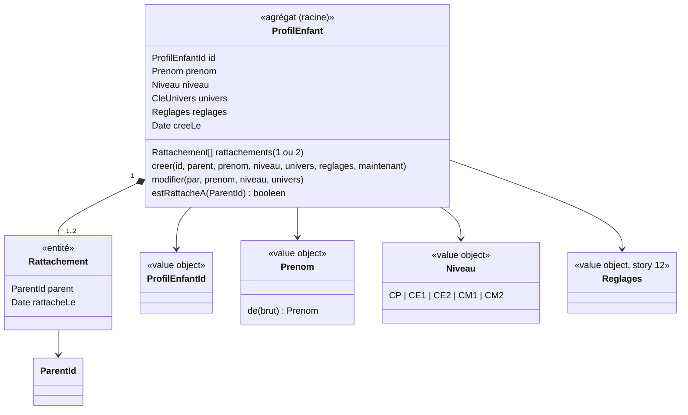

# Modèle du domaine : issue #11, Créer et modifier un profil enfant, et choisir qui joue

## Contexte

**Famille** (contexte existant). Le profil enfant est le cœur du contexte : Apprentissage y lit le niveau et les réglages, Motivation la clé de l'univers (story #6). Cette story pose l'agrégat `ProfilEnfant` et ses **rattachements** ; les stories #12 (réglages), #13 (invitation) et #14 (suppression, export) le complètent.

Relations :
- **Famille → Motivation** (existante, #6) : le profil garde la `CleUnivers` ; Motivation retrouve l'univers et son personnage guide. Famille **importe le type** `CleUnivers` de `@domain/motivation` (Published Language, comme Voix → Motivation pour `CaractereDeLaVoix`) pour refuser une clé inconnue à la création. Voir question technique T1.
- **Catalogue → Famille** : le `Niveau` (CP à CM2) est un terme du format des leçons. Famille le reprend tel quel (Conformist).
- **Famille → Apprentissage** (existante) : niveau et réglages du profil, lus par identifiant.
- **Supabase Auth → Famille** (existante, #5) : le `ParentId` du parent connecté.

### Comportement actuel (`app/`, `showHome` l. 433, `childForm` l. 474, `adultProfils` l. 2153)

- **Sans profil** : Noisette accueille (« Bonjour ! Pour commencer, crée le profil de l'enfant qui va jouer. Tu pourras en ajouter d'autres ensuite. ») avec le formulaire, **sans contrôle parental**.
- **Formulaire** : prénom (champ limité à 20 caractères, espaces autour retirés, puis coupé à 20) ; un prénom vide est ignoré **sans message** ; classe (CP par défaut, premier de la liste) ; univers (« Animaux de la forêt » par défaut) ; réglages repliés (#12) ; « C'est parti ! » ou « Enregistrer ».
- Un profil garde aussi sa **date de création** (`cree`), qui fixe l'ordre des cartes.
- **« Qui joue aujourd'hui ? »** : une carte par profil, dans l'ordre de création : personnage guide de son univers, prénom, « CE1 · Animaux de la forêt », puis « + Ajouter un enfant » (lui aussi **sans contrôle parental**). Toucher une carte : l'enfant arrive sur sa carte, le personnage guide dit « Bonjour Léa ! » (toujours, réglage « tout lire » ou non).
- Le profil choisi n'est **pas mémorisé** : à chaque ouverture, on repasse par « Qui joue ? ».
- Après une création : proposition du test de départ (lot 4).
- Onglet « Profils » de l'espace : un formulaire par profil, « Ajouter un enfant », « Refaire le test de départ » (lot 4), « Supprimer ce profil » (#14).
- Deux profils peuvent avoir le même prénom. Aucun nombre maximal de profils.
- Un univers inconnu s'affiche comme « Animaux de la forêt » (repli de #6).

## Termes

| Terme | Statut | Remarque |
|---|---|---|
| Profil enfant | au glossaire (confirmé) | Définition complétée : date de création, parents rattachés. |
| Parent | au glossaire (confirmé) | |
| Rattachement | au glossaire (à valider) | Confirmé par la décision n°5 ; reste `(à valider)` jusqu'à #13. Le parent qui crée le profil y est rattaché d'office. |
| Prénom | **nouveau** (à valider) | Prénom ou pseudo de l'enfant, 1 à 20 caractères. Le glossaire dit « prénom ou pseudo » : un seul terme dans le code, `Prenom`. |
| Niveau / Classe | au glossaire (confirmé) | **Niveau** dans le code ; l'interface dit « Classe » (le glossaire interdit « classe » dans le code seulement). |
| Univers | au glossaire (Motivation) | Le profil garde sa clé. |
| Qui joue ? | **nouveau** (à valider) | Écran où l'enfant touche son profil pour jouer. Terme d'interface ou du domaine : question ouverte n°9. |
| Profil en cours | **nouveau** (à valider) | Profil enfant qui joue en ce moment sur l'appareil. Le legacy dit `child`. |
| Élève, joueur, utilisateur | synonymes interdits | Déjà au glossaire. |

## Modèle



### Agrégat `ProfilEnfant`

- **Racine** : `ProfilEnfant`, identifié par `ProfilEnfantId` (fourni par un port `GenerateurId`, jamais tiré dans le domaine).
- **Contient** : prénom, niveau, clé de l'univers, réglages (#12), date de création, et ses **rattachements** (un ou deux `ParentId`).
- **Pourquoi les rattachements sont dans l'agrégat** : deux invariants l'exigent. Un profil n'existe jamais sans parent (il est créé avec son premier rattachement, dans la même transaction) ; il n'a jamais plus de deux parents (vérifié au rattachement du second, #13). Hors de l'agrégat, ces deux règles demanderaient de modifier deux agrégats à la fois. L'agrégat reste petit : au plus deux rattachements.
- Le `Parent` (story #5) reste un agrégat à part, référencé par `ParentId`. Il ne contient pas la liste de ses enfants : « les enfants d'un parent » est une **lecture** (read model `ProfilsDuParent`), pas un état du parent.
- Le profil ne connaît ni la progression (Apprentissage), ni les badges (Motivation), ni les devoirs (Accompagnement) : ces contextes le référencent par `ProfilEnfantId`.

### Value objects

| Value object | Règle de validité |
|---|---|
| `ProfilEnfantId` | Identifiant opaque, non vide. |
| `Prenom` | Espaces au début et à la fin retirés. Vide après cela → `PrenomObligatoire`. Plus de 20 caractères → coupé ou refusé (`PrenomTropLong`) : question ouverte n°3. Caractères permis (chiffres, émojis…) : question ouverte n°6. |
| `Niveau` | Exactement `CP`, `CE1`, `CE2`, `CM1` ou `CM2`. Sinon `NiveauInconnu`. Valeur par défaut du formulaire : `CP` (legacy). |
| `CleUnivers` | Type publié par Motivation (#6). Une clé hors des 6 univers est refusée à la création (`UniversInconnu`) ; défaut `animaux`. |
| `Reglages` | Story #12. À la création sans réglage choisi : valeurs par défaut de #12. |

### Commandes (cas d'usage)

| Commande | Effet | Erreurs métier | Où |
|---|---|---|---|
| `CreerProfilEnfant(parent, prenom, niveau, univers, reglages)` | Crée le profil et rattache d'office le parent qui le crée. | `PrenomObligatoire`, `PrenomTropLong` (selon n°3), `NiveauInconnu`, `UniversInconnu` | Edge Function `creer-profil-enfant` (voir « Partage avec le front ») |
| `ModifierProfilEnfant(parent, profil, prenom, niveau, univers)` | Change prénom, niveau ou univers. | mêmes erreurs, + `ParentNonRattache` | Edge Function `modifier-profil-enfant` |
| `ChoisirQuiJoue(profil)` | Le profil devient le **profil en cours** sur l'appareil ; le personnage guide de son univers dit « Bonjour <prénom> ! ». | (aucune) | navigateur (`domain/`) |
| Lecture `ProfilsDuParent(parent)` | Profils auxquels le parent est rattaché, dans l'ordre de création. | (aucune) | front, lecture sous RLS, gardée sur l'appareil pour le hors ligne |

### Erreurs métier

`PrenomObligatoire`, `PrenomTropLong` (si refusé), `NiveauInconnu`, `UniversInconnu`, `ParentNonRattache` (le parent n'est pas rattaché au profil visé : présentée comme un profil introuvable, sans dire s'il existe), `ProfilEnfantIntrouvable`.

## Invariants

1. Un profil enfant a **toujours un ou deux parents** rattachés. À sa création, le parent qui le crée y est rattaché d'office.
2. Un parent ne voit et ne modifie **que** les profils auxquels il est rattaché. Vérifié deux fois : dans le domaine (`estRattacheA`, erreur `ParentNonRattache`) et par la RLS (protection d'accès, qui ne remplace pas le domaine).
3. Un profil a un prénom non vide d'au plus 20 caractères, un niveau parmi les 5 et un univers parmi les 6.
4. RGPD : le profil ne contient que prénom (ou pseudo), niveau, univers, réglages et date de création. Jamais d'e-mail, de mot de passe ni de date de naissance.
5. « Qui joue ? » montre les profils du parent connecté dans l'ordre de création, sur tous ses appareils.
6. Choisir qui joue ne demande pas le contrôle parental ; créer et modifier un profil le demandent (sauf réponse contraire à la question ouverte n°4).

## Événements

| Événement | Données | Qui réagit |
|---|---|---|
| `ProfilEnfantCree` (à valider) | profil, parent, niveau, univers | Front : proposer le test de départ (lot 4). Aucun contexte serveur pour l'instant. |
| `NiveauDuProfilChange` (à valider) | profil, ancien niveau, nouveau niveau | Apprentissage (parcours, leçons des classes d'avant) au lot 4 : voir question ouverte n°5. |

## Partage avec le front

- Dans le navigateur (`@domain/famille`) : `Prenom`, `Niveau`, `ProfilEnfant` (règles de validité pour un retour immédiat dans le formulaire), `ChoisirQuiJoue` et l'interface de son port `ProfilEnCoursSurLAppareil` (déclarée dans `domain/`, décision 0007), comme `DonneesDeLAppareil` en #5.
- Par une Edge Function (`famille/application/`) : la **création**, parce que le profil et son premier rattachement s'écrivent ensemble, et que la RLS ne laisse voir un profil qu'à un parent déjà rattaché ; la **modification**, pour que la règle soit revalidée par le serveur (source de vérité). Les deux avec le JWT du parent. Alternative possible pour la modification : écriture directe sous RLS depuis le front, avec un port `ProfilsEnfants` déclaré dans `domain/` (précédent de #5). Voir question technique T2.
- La liste « Qui joue ? » est lue sous RLS et gardée sur l'appareil (IndexedDB), pour jouer hors ligne. Elle est effacée à la déconnexion (`DonneesDeLAppareil`, #5).

## Base de données attendue (description, pas de SQL)

| Table | Contenu | Policies RLS |
|---|---|---|
| `profils_enfants` | identifiant, prénom, niveau, clé de l'univers, réglages (#12), date de création | **lecture** et **modification** : seulement si un rattachement relie le profil au parent connecté (`auth.uid()`). **Création** : un parent connecté, dans la même transaction que son rattachement. **Suppression** : story #14. |
| `rattachements` | profil enfant, parent, date du rattachement ; un couple (profil, parent) unique | **lecture** : les rattachements du parent connecté (et ceux des profils auxquels il est rattaché, selon la question ouverte n°10 de #13). **Création** : le premier, à la création du profil ; le second, par l'acceptation d'une invitation (#13). **Suppression** : #13 / #14. |

Une fonction d'aide « le parent connecté est-il rattaché à ce profil ? » sert à toutes les tables des autres contextes qui portent un identifiant de profil enfant (progression, devoirs…), pour que chaque story suivante écrive la même policy.

## Données d'enfants

- Nouvelles données : **prénom ou pseudo**, **niveau**, clé de l'univers, date de création. Conformes à la section RGPD de `CLAUDE.md`.
- Hébergées dans l'UE (Supabase Francfort). À inclure dans l'export et la suppression (#14).
- Gardées sur l'appareil pour le hors ligne, effacées à la déconnexion.

## Emplacement

```
supabase/functions/_shared/famille/
  domain/
    profil-enfant-id.ts
    prenom.ts
    niveau.ts                        # ou importé du Catalogue s'il existe (question technique T1)
    profil-enfant.ts                 # agrégat, avec l'entité Rattachement
    rattachement.ts
    choisir-qui-joue.ts              # cas d'usage navigateur (décision 0008)
    profil-en-cours-sur-l-appareil.ts# interface du port (décision 0007)
    generateur-id.ts                 # interface du port, si le front en a besoin ; sinon dans application/
    erreurs.ts                       # + PrenomObligatoire, PrenomTropLong, NiveauInconnu, UniversInconnu, ParentNonRattache, ProfilEnfantIntrouvable
    index.ts
  application/
    ports/profils-enfants.ts         # repository (parId, duParent, enregistrer)
    creer-profil-enfant.ts
    modifier-profil-enfant.ts
  infrastructure/
    profils-enfants-supabase.ts      # mapper profils_enfants + rattachements → ProfilEnfant
  test_utils/
    profils-enfants-en-memoire.ts
    generateur-id-fixe.ts
supabase/functions/creer-profil-enfant/index.ts
supabase/functions/modifier-profil-enfant/index.ts
supabase/migrations/<date>_profils_enfants_et_rattachements.sql
src/famille/                         # « Qui joue ? », formulaire du profil, onglet Profils
```

## Questions ouvertes

1. (issue n°1) Y a-t-il un **nombre maximal de profils** par parent (oui : combien ?) ? Aujourd'hui : aucun.
2. (issue n°2) Deux profils du même parent peuvent-ils avoir le **même prénom** (oui, comme aujourd'hui) ?
3. (issue n°3) Prénom de plus de 20 caractères : **coupé** à 20 comme aujourd'hui (oui), ou **refusé** avec un message (non) ?
4. (issue n°4) Le **premier profil** se crée-t-il directement après la première connexion, sans contrôle parental, comme aujourd'hui (oui), ou depuis l'espace parent (non) ? Et « + Ajouter un enfant » dans « Qui joue ? » demande-t-il le contrôle parental (aujourd'hui : non) ?
5. (issue n°5) Changer la **classe** d'un enfant garde-t-il toute sa progression (étoiles, leçons réussies) (oui) ? Exemple : Léa passe du CE1 au CE2 ; ses leçons de CE1 deviennent des leçons des classes d'avant, avec leurs étoiles.
6. (nouvelle) Quels **caractères** sont permis dans un prénom ou pseudo : lettres, accents, trait d'union, apostrophe, espaces (oui) ; chiffres, émojis (oui / non) ?
7. (nouvelle) Un prénom vide est aujourd'hui ignoré **sans message**. Faut-il un message (« Écris le prénom de l'enfant. ») (oui / non) ?
8. (nouvelle) Le **profil en cours** est-il mémorisé sur l'appareil, pour qu'à la prochaine ouverture l'enfant arrive directement sur sa carte (oui), ou repasse-t-on toujours par « Qui joue ? », comme aujourd'hui (non) ?
9. (nouvelle) « **Qui joue ?** » : est-ce un terme du glossaire (oui) ou un simple titre d'écran (non) ? Le titre exact reste « Qui joue aujourd'hui ? » (oui / non) ?
10. (nouvelle) « Bonjour <prénom> ! » est-il dit **à chaque choix** d'un profil, même sans le réglage « tout lire à voix haute », comme aujourd'hui (oui) ?
11. (nouvelle) Faut-il pouvoir **créer ou modifier un profil hors ligne** (oui : il sera envoyé à la synchronisation, lot 7), ou ces actions demandent-elles le réseau (non) ? Choisir qui joue fonctionne hors ligne dans tous les cas.
12. (nouvelle) Le message « Les profils et la progression sont enregistrés dans ton compte… » de « Qui joue ? » : même question que la n°8 de la story #5, à trancher une seule fois.

### Questions techniques (pour l'implementer, pas pour le PO)

- T1. `CleUnivers` est importé de `@domain/motivation` (Famille dépend alors du type publié par Motivation, sens inverse de la relation « Famille → Motivation ») ou Famille garde la clé comme texte validé par une liste qu'elle reçoit ? Et `Niveau` : Famille le déclare, ou il viendra du Catalogue ? À consigner dans une décision (`docs/decisions/0009-…`).
- T2. Toutes les écritures de Famille passent-elles par des Edge Functions, ou la modification d'un profil se fait-elle sous RLS depuis le front ? Création atomique du profil et de son premier rattachement : par quel mécanisme (fonction Postgres appelée avec le JWT du parent, ou transaction dans l'Edge Function) ? À consigner dans la même décision.
