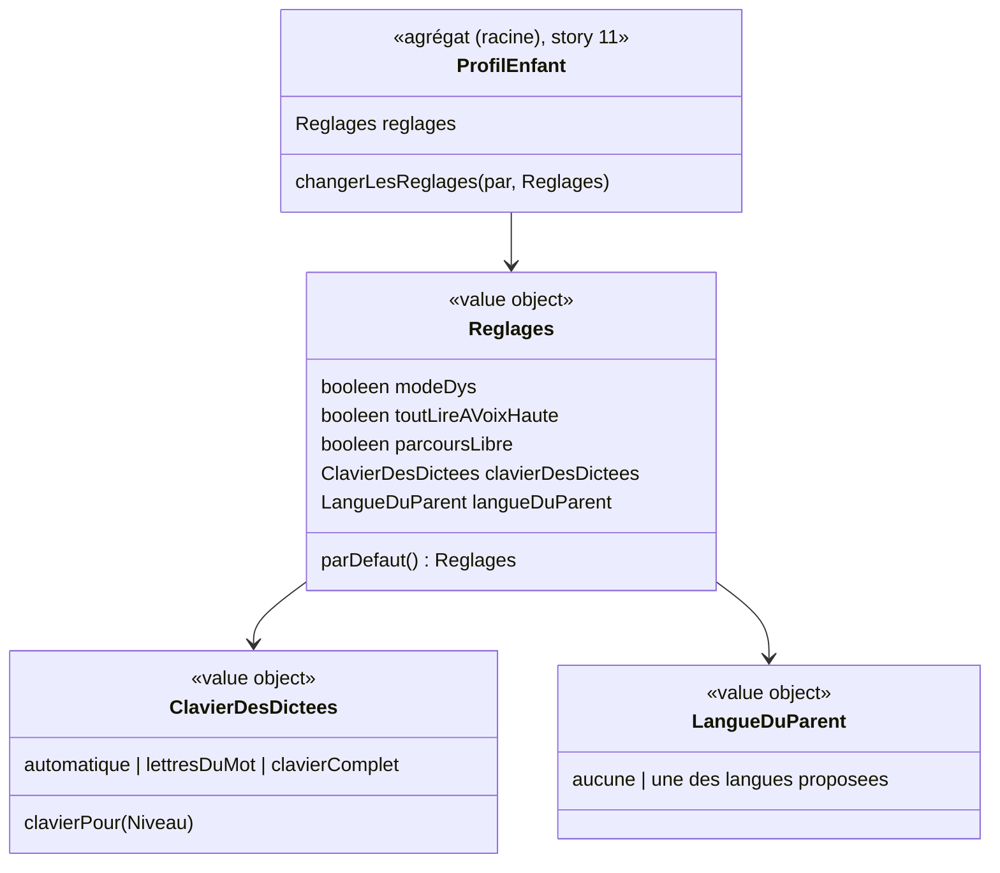

# Modèle du domaine : issue #12, Réglages d'un profil enfant

## Contexte

**Famille** (contexte existant). Les réglages appartiennent au profil enfant (agrégat `ProfilEnfant`, story #11) : ils sont réglés par un parent rattaché et **lus** par d'autres contextes, qui ne les modifient jamais.

| Réglage | Qui le lit | Quand l'effet arrive |
|---|---|---|
| Mode dys | le front partout où du texte s'affiche (et le découpage en syllabes, voir question ouverte n°1) | cette story |
| Tout lire à voix haute | Apprentissage et Motivation, qui demandent à Voix de lire plus de textes | cette story (là où l'écran existe) |
| Parcours libre | Apprentissage (verrous du parcours) | lot 4 |
| Clavier des dictées | Apprentissage (exercice `dictee`) | lot 3 |
| Langue du parent | Accompagnement (traduction des consignes par l'IA, depuis une Edge Function) | lot 6 |

Relations : **Famille → Apprentissage** (existante : niveau et réglages), **Famille → Accompagnement** (nouvelle : la langue du parent), Customer/Supplier, lecture par identifiant de profil. Voix ne connaît pas Famille : c'est l'appelant qui décide de lire davantage quand « tout lire à voix haute » est coché.

### Comportement actuel (`app/`, `childForm` l. 474, `prefs()` l. 863, `LANGUES` l. 473)

- Section repliée « Réglages pour l'adulte (parcours, lecture, clavier, temps d'écran, langue) » du formulaire du profil. Le mot « temps d'écran » n'est **pas repris** (décision 0005).
- Valeurs par défaut : tout décoché, clavier « Automatique », langue « Non ».
- **Mode dys** (`body.dys`) : espacement des lettres (0,08 em) et des mots (0,3 em), interligne 1,9, police de lecture (Andika, puis Trebuchet MS), et **syllabes en couleurs alternées** (`syllables()`, mots de plus de 3 lettres) sur les cartes, bulles, bulles de parole, vers, étiquettes et textes à trous.
- **Tout lire à voix haute** : sur l'accueil de l'enfant, « Bonjour Léa ! » suivi du texte de la série (« Tu as joué aujourd'hui ! »…) ; dans les bulles, les choix sont lus (« Est-ce a, b, ou c ? »), si le son est activé et qu'il y a au moins deux choix.
- **Parcours libre** : toutes les leçons de la classe sont ouvertes, l'ordre conseillé reste affiché.
- **Clavier des dictées** : `auto` (lettres du mot jusqu'au CE1, clavier complet ensuite), `lettres`, `complet`.
- **Traduire les consignes pour le parent** : « Non » ou une des 20 langues (anglais, arabe, espagnol, portugais, turc, roumain, polonais, italien, allemand, russe, ukrainien, chinois, vietnamien, tamoul, wolof, bambara, lingala, persan, albanais, serbe). Un bouton « Traduire (langue) » envoie **le texte de la consigne** à l'IA ; la traduction s'affiche sous la consigne.

## Termes

| Terme | Statut | Remarque |
|---|---|---|
| Réglages | au glossaire (à valider) | Confirmé par l'issue. La liste « clavier » devient « clavier des dictées ». |
| Mode dys | au glossaire (confirmé) | |
| Tout lire à voix haute | **nouveau** (à valider) | Réglage qui fait lire aussi les choix proposés et une salutation. Ne pas confondre avec **Lecture à voix haute** (Voix), qui lit toujours les consignes. |
| Parcours libre | au glossaire (confirmé, Apprentissage) | Réglage du profil, effet dans Apprentissage. |
| Clavier des dictées | **nouveau** (à valider) | Clavier proposé pendant une dictée : automatique, lettres du mot seulement, clavier complet. |
| Langue du parent | **nouveau** (à valider) | Langue dans laquelle les consignes sont traduites pour le parent, ou aucune. Le legacy dit `langueParent`. |
| Traduction des consignes | **nouveau** (à valider), Accompagnement | L'effet de la langue du parent (lot 6). |
| Paramètres, options | synonymes interdits | Déjà au glossaire. |
| Temps d'écran | **interdit** | Décision 0005 : le terme n'existe pas dans le domaine. |

## Modèle



Pas de nouvel agrégat : les réglages sont un **value object** du `ProfilEnfant`. Ils changent ensemble, sont toujours lus avec le profil, et n'ont pas d'identité propre.

### Value objects

| Value object | Règle de validité |
|---|---|
| `Reglages` | Les cinq champs sont toujours présents. `Reglages.parDefaut()` : mode dys non, tout lire non, parcours libre non, clavier automatique, langue du parent aucune. |
| `ClavierDesDictees` | `automatique`, `lettresDuMot` ou `clavierComplet` ; sinon `ClavierDesDicteesInconnu`. La règle `automatique` → lettres du mot jusqu'au CE1, clavier complet ensuite, appartient à Apprentissage (lot 3), qui la lira. |
| `LangueDuParent` | `aucune` ou une des langues de la liste (liste exacte : question ouverte n°3) ; sinon `LangueDuParentInconnue`. |

### Commandes

| Commande | Effet | Erreurs | Où |
|---|---|---|---|
| `ChangerLesReglages(parent, profil, reglages)` | Remplace les réglages du profil. Peut être faite en même temps que `ModifierProfilEnfant` (#11), puisque c'est le même formulaire. | `ParentNonRattache`, `ClavierDesDicteesInconnu`, `LangueDuParentInconnue` | même chemin que `ModifierProfilEnfant` (#11, question technique T2) |
| Lecture des réglages du profil en cours | Le front applique le mode dys et transmet « tout lire » aux écrans. | (aucune) | navigateur, depuis le profil gardé sur l'appareil (hors ligne) |

## Invariants

1. Un profil a toujours des réglages complets ; un profil créé sans réglage choisi reçoit `Reglages.parDefaut()`.
2. Seul un parent rattaché au profil change ses réglages (domaine et RLS). Les deux parents le peuvent-ils : question ouverte n°4.
3. Les autres contextes lisent les réglages, ils ne les modifient jamais.
4. Les réglages suivent le profil sur tous les appareils (enregistrés avec le profil) et s'appliquent hors ligne.
5. Le mode dys est respecté partout où du texte s'affiche (CLAUDE.md).
6. Aucun réglage ne limite la durée de jeu (décision 0005).
7. La langue du parent ne fait jamais envoyer à l'IA ce que produit l'enfant : seulement le texte de la consigne, depuis une Edge Function (lot 6 ; périmètre à confirmer, question ouverte n°2).

## Événements

`ReglagesChanges` (à valider) : profil, nouveaux réglages. Personne ne réagit côté serveur dans cette story : les autres contextes lisent les réglages au moment où ils en ont besoin.

## Partage avec le front

- `Reglages`, `ClavierDesDictees`, `LangueDuParent` sont exportés par `@domain/famille` : le formulaire et les écrans de l'enfant les lisent hors ligne.
- L'effet du mode dys (espacements, police) est du style, dans `src/`. Le **découpage en syllabes**, lui, est une règle de langue : s'il est gardé (question ouverte n°1), il va dans un `domain/` en TypeScript pur, testé par `Deno.test`, pas dans React (question technique T3).

## Base de données attendue

Pas de nouvelle table : les réglages sont des colonnes (ou un champ structuré) de `profils_enfants` (#11), sous les mêmes policies.

## Données d'enfants

- Le **mode dys** peut révéler une difficulté d'apprentissage (donnée sensible au sens courant, liée à la santé) : à signaler. Il sert à l'apprentissage, il reste dans l'export (#14) et part avec la suppression. Faut-il une mention particulière dans l'information donnée aux parents : question ouverte n°6.
- La **langue du parent** est une donnée du parent (elle peut révéler une origine), rangée dans le profil de l'enfant comme aujourd'hui. Voir question ouverte n°5.

## Emplacement

```
supabase/functions/_shared/famille/
  domain/
    reglages.ts                     # Reglages, parDefaut
    clavier-des-dictees.ts
    langue-du-parent.ts             # liste des langues proposées
    profil-enfant.ts                # + changerLesReglages
    erreurs.ts                      # + ClavierDesDicteesInconnu, LangueDuParentInconnue
  application/
    changer-les-reglages.ts         # ou fusionné avec modifier-profil-enfant.ts
src/famille/                        # section « Réglages » du formulaire du profil, classe dys sur le document
```

## Questions ouvertes

1. (issue n°1) Le mode dys garde-t-il les **syllabes en couleurs alternées** (oui) ? Et la police : **Andika** comme aujourd'hui (oui), ou une autre (OpenDyslexic…) ?
2. (issue n°2) La traduction des consignes envoie à l'IA **le texte de la consigne seulement**, jamais ce que produit l'enfant ni son prénom : est-ce bien le périmètre (oui) ?
3. (issue n°3) La **liste des 20 langues** est-elle gardée telle quelle (oui) ?
4. (issue n°4, fusionnée avec la n°1 de #13) Les **deux parents** rattachés peuvent-ils changer les réglages (oui) ? Voir #13.
5. (nouvelle) La **langue du parent** est propre au profil de l'enfant, comme aujourd'hui (oui), ou au parent (non : Paul lit en français, Marie en arabe, pour le même enfant) ? Rejoint la question n°1 de #5 (que garder sur le parent).
6. (nouvelle) Le mode dys doit-il être **expliqué** au parent comme une donnée gardée sur l'enfant (oui / non) ?
7. (nouvelle) Libellé de la section : « Réglages » (sans « pour l'adulte » ni « temps d'écran ») (oui) ?
8. (nouvelle) Effet observable de « **tout lire à voix haute** » dans cette story : les écrans qui l'utilisent (accueil de l'enfant, bulles) arrivent aux lots 3 et 4. Sur quel écran le vérifier : page de démonstration (oui), ou on livre le réglage seul et l'effet avec ces écrans (non) ?
9. (nouvelle) « Bonjour Léa ! » de « tout lire » (accueil de l'enfant, avec la série) et « Bonjour Léa ! » au choix du profil (#11, dit toujours) : deux salutations distinctes à garder (oui) ?

### Question technique

- T3. Où vit le découpage en syllabes (`syllables()` du legacy) s'il est gardé : `apprentissage/domain/`, ou un petit sous-domaine générique de lecture, comme Voix ? Il n'appartient pas à Famille.
