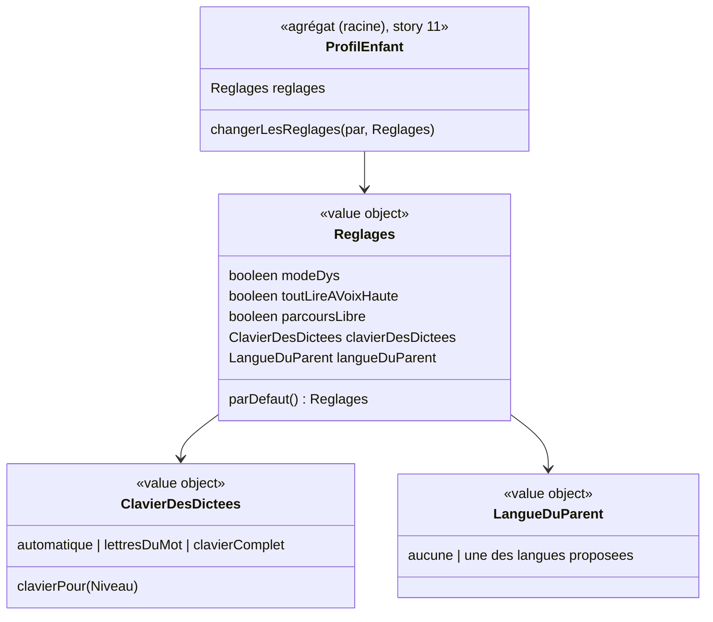

# Modèle du domaine : issue #12, Réglages d'un profil enfant

## Contexte

**Famille** (contexte existant). Les réglages appartiennent au profil enfant (agrégat `ProfilEnfant`, story #11) : ils sont réglés par un parent rattaché et **lus** par d'autres contextes, qui ne les modifient jamais.

| Réglage | Qui le lit | Quand l'effet arrive |
|---|---|---|
| Mode dys | le front sur les écrans de l'enfant, quand le profil en cours l'a choisi (police Andika, texte espacé, syllabes en couleurs alternées, décision n°8 du lot 2) | cette story |
| Tout lire à voix haute | Apprentissage et Motivation, qui demandent à Voix de lire plus de textes | cette story (là où l'écran existe) |
| Parcours libre | Apprentissage (verrous du parcours) | lot 4 |
| Clavier des dictées | Apprentissage (exercice `dictee`) | lot 3 |
| Langue du parent | Accompagnement (traduction des consignes par l'IA, depuis une Edge Function) | lot 6 |

Relations : **Famille → Apprentissage** (existante : niveau et réglages), **Famille → Accompagnement** (nouvelle : la langue du parent), Customer/Supplier, lecture par identifiant de profil. Voix ne connaît pas Famille : c'est l'appelant qui décide de lire davantage quand « tout lire à voix haute » est coché.

### Comportement actuel (`app/`, `childForm` l. 474, `prefs()` l. 863, `LANGUES` l. 473)

- Section repliée « Réglages pour l'adulte (parcours, lecture, clavier, temps d'écran, langue) » du formulaire du profil. Le mot « temps d'écran » n'est **pas repris** (décision 0005).
- Valeurs par défaut : tout décoché, clavier « Automatique », langue « Non ».
- **Mode dys** (`body.dys`) : espacement des lettres (0,08 em) et des mots (0,3 em), interligne 1,9, police de lecture (Andika, puis Trebuchet MS), et **syllabes en couleurs alternées** (`syllables()`, mots de plus de 3 lettres) sur les cartes, bulles, bulles de parole, vers, étiquettes et textes à trous.
- **Tout lire à voix haute** : sur l'accueil de l'enfant, « Bonjour Léa ! » suivi du texte de la série (« Tu as joué aujourd'hui ! »…) ; dans les bulles, les choix sont lus (« Est-ce a, b, ou c ? »), si le son est activé et qu'il y a au moins deux choix.
- **Parcours libre** : toutes les leçons de la classe sont ouvertes, l'ordre conseillé reste affiché.
- **Clavier des dictées** : `auto` (lettres du mot jusqu'au CE1, clavier complet ensuite), `lettres`, `complet`.
- **Traduire les consignes pour le parent** : « Non » ou une des 20 langues (anglais, arabe, espagnol, portugais, turc, roumain, polonais, italien, allemand, russe, ukrainien, chinois, vietnamien, tamoul, wolof, bambara, lingala, persan, albanais, serbe). Un bouton « Traduire (langue) » envoie **le texte de la consigne** à l'IA ; la traduction s'affiche sous la consigne.

## Termes

| Terme | Statut | Remarque |
|---|---|---|
| Réglages | au glossaire (confirmé) | Confirmé par l'issue et la décision n°8 du lot 2 (réglages du profil, jamais gardés sur l'appareil). La liste « clavier » devient « clavier des dictées ». |
| Mode dys | au glossaire (confirmé) | Définition précisée par la décision n°8 : police Andika, texte espacé, syllabes en couleurs alternées. |
| Tout lire à voix haute | **nouveau** (à valider) | Réglage qui fait lire aussi les choix proposés et une salutation. Ne pas confondre avec **Lecture à voix haute** (Voix), qui lit toujours les consignes. |
| Parcours libre | au glossaire (confirmé, Apprentissage) | Réglage du profil, effet dans Apprentissage. |
| Clavier des dictées | **nouveau** (à valider) | Clavier proposé pendant une dictée : automatique, lettres du mot seulement, clavier complet. |
| Langue du parent | **nouveau** (à valider) | Langue dans laquelle les consignes sont traduites pour le parent, ou aucune. Réglage de **chaque profil enfant** (décision n°8). Le legacy dit `langueParent`. |
| Traduction des consignes | **nouveau** (à valider), Accompagnement | L'effet de la langue du parent (lot 6). |
| Paramètres, options | synonymes interdits | Déjà au glossaire. |
| Temps d'écran | **interdit** | Décision 0005 : le terme n'existe pas dans le domaine. |

## Modèle



Pas de nouvel agrégat : les réglages sont un **value object** du `ProfilEnfant`. Ils changent ensemble, sont toujours lus avec le profil, et n'ont pas d'identité propre.

### Value objects

| Value object | Règle de validité |
|---|---|
| `Reglages` | Les cinq champs sont toujours présents. `Reglages.parDefaut()` : mode dys non, tout lire non, parcours libre non, clavier automatique, langue du parent aucune. |
| `ClavierDesDictees` | `automatique`, `lettresDuMot` ou `clavierComplet` ; sinon `ClavierDesDicteesInconnu`. La règle `automatique` → lettres du mot jusqu'au CE1, clavier complet ensuite, appartient à Apprentissage (lot 3), qui la lira. |
| `LangueDuParent` | `aucune` ou une des **20 langues** du legacy, gardées telles quelles (décision n°8) ; sinon `LangueDuParentInconnue`. |

### Commandes

| Commande | Effet | Erreurs | Où |
|---|---|---|---|
| `ChangerLesReglages(parent, profil, reglages)` | Remplace les réglages du profil. Peut être faite en même temps que `ModifierProfilEnfant` (#11), puisque c'est le même formulaire. Les deux parents rattachés le peuvent (décision n°1). | `ParentNonRattache`, `ClavierDesDicteesInconnu`, `LangueDuParentInconnue` | Edge Function, avec le JWT du parent, comme `ModifierProfilEnfant` (décision 0009, n°1) |
| Lecture des réglages du profil en cours | Le front applique le mode dys et transmet « tout lire » aux écrans. Un réglage changé sur un autre appareil s'applique au **prochain choix du profil** dans « Qui joue ? » (proposition appliquée). | (aucune) | navigateur, depuis la copie du profil gardée pour le hors ligne (#11) |

## Invariants

1. Un profil a toujours des réglages complets ; un profil créé sans réglage choisi reçoit `Reglages.parDefaut()`.
2. Seul un parent rattaché au profil change ses réglages (domaine et RLS). Les deux parents rattachés le peuvent (décision n°1).
3. Les autres contextes lisent les réglages, ils ne les modifient jamais.
4. Les réglages suivent le profil sur tous les appareils (enregistrés avec le profil) et s'appliquent hors ligne. Ils ne sont **jamais une préférence de l'appareil**, contrairement à Son/Muet et au choix de voix : rien du mode dys de Léa ne reste pour Tom sur la même tablette (décision n°8).
5. Le mode dys est respecté partout où du texte s'affiche sur les écrans de l'enfant, quand le profil en cours l'a choisi (CLAUDE.md ; proposition appliquée pour le périmètre).
6. Aucun réglage ne limite la durée de jeu (décision 0005).
7. La langue du parent ne fait jamais envoyer à l'IA ce que produit l'enfant ni son prénom : **seulement le texte de la consigne**, depuis une Edge Function (lot 6 ; décision n°8).

## Événements

`ReglagesChanges` (à valider) : profil, nouveaux réglages. Personne ne réagit côté serveur dans cette story : les autres contextes lisent les réglages au moment où ils en ont besoin.

## Partage avec le front

- `Reglages`, `ClavierDesDictees`, `LangueDuParent` sont exportés par `@domain/famille` : le formulaire et les écrans de l'enfant les lisent hors ligne.
- L'effet du mode dys (espacements, police Andika) est du style, dans `src/`. Le **découpage en syllabes**, gardé (décision n°8), est une règle de langue : il va dans un `domain/` en TypeScript pur, testé par `Deno.test`, pas dans React (emplacement : question technique T3).

## Base de données attendue

Pas de nouvelle table : les réglages sont des colonnes (ou un champ structuré) de `profils_enfants` (#11), sous les mêmes policies.

## Données d'enfants

- Le **mode dys** peut révéler une difficulté d'apprentissage (donnée sensible au sens courant, liée à la santé) : à signaler. Il sert à l'apprentissage, il reste dans l'export (#14) et part avec la suppression. Faut-il une mention particulière dans l'information donnée aux parents : question ouverte n°1.
- La **langue du parent** est une donnée du parent (elle peut révéler une origine), rangée dans le profil de l'enfant comme aujourd'hui (décision n°8). Elle part avec l'export et la suppression du profil (#14).

## Emplacement

```
supabase/functions/_shared/famille/
  domain/
    reglages.ts                     # Reglages, parDefaut
    clavier-des-dictees.ts
    langue-du-parent.ts             # liste des langues proposées
    profil-enfant.ts                # + changerLesReglages
    erreurs.ts                      # + ClavierDesDicteesInconnu, LangueDuParentInconnue
  application/
    changer-les-reglages.ts         # ou fusionné avec modifier-profil-enfant.ts
src/famille/                        # section « Réglages » du formulaire du profil, classe dys sur le document
```

## Décisions

Validation n°1 du lot 2 par le PO, le 2026-10-22 (`docs/stories/lot-2-decisions.md`). « Tranchée » = réponse explicite du PO ; « proposition appliquée » = question de détail qui suit la proposition déjà faite.

Numéros d'origine : « M » = ancienne liste du modèle, « A » = `docs/stories/12/acceptance.md`.

| Question | Réponse | Source |
|---|---|---|
| M1. Syllabes et police du mode dys | Comme aujourd'hui : police **Andika**, texte espacé, **syllabes en couleurs alternées**. | Tranchée, décision n°8 |
| M2. Ce qui part à l'IA | **Seul le texte de la consigne** est envoyé pour la traduction. | Tranchée, décision n°8 |
| M3. Liste des langues | Les **20 langues** sont gardées. | Tranchée, décision n°8 |
| M4. Les deux parents changent les réglages ? | **Oui**, mêmes droits. | Tranchée, décision n°1 |
| M5. Langue du parent : du profil ou du parent ? | Réglage de **chaque profil enfant**. | Tranchée, décision n°8 |
| M7. Libellé de la section | « **Réglages** », sans « pour l'adulte » ni « temps d'écran ». | Proposition appliquée (modèle) |
| M8 / A1. Où vérifier « tout lire à voix haute » | Sur la **page de démonstration**, avec trois choix proposés (« ami », « lune », « chat »). | Tranchée, décision n°8 |
| M9. Deux salutations « Bonjour Léa ! » | **Gardées** : celle du choix du profil (#11, toujours dite) et celle de « tout lire » (accueil de l'enfant, avec la série). | Proposition appliquée (modèle, scénario) |
| A2. Virgule avant « ou » | **Oui** : « Est-ce ami, ou lune ? », y compris avec deux choix. | Proposition appliquée (`acceptance.md`) |
| A3. Périmètre du mode dys | Sur les écrans de l'enfant, **quand le profil en cours l'a choisi**. | Proposition appliquée (`acceptance.md`, scénario « Le mode dys suit le profil en cours ») |
| A4. Réglage changé sur un autre appareil | S'applique **au prochain choix du profil** dans « Qui joue ? ». | Proposition appliquée (`acceptance.md`) |
| A7. Réglages mémorisés sur l'appareil ? | **Jamais** : ils suivent le profil, pas l'appareil (contrairement à Son/Muet et au choix de voix). | Tranchée, décision n°8 |

## Questions ouvertes

Aucune n'est bloquante pour la story.

1. (ancienne M6) Le mode dys doit-il être **expliqué** au parent comme une donnée gardée sur l'enfant, puisqu'il peut révéler une difficulté d'apprentissage (oui / non) ?
2. (ancienne A5) Après l'enregistrement des réglages, le parent voit-il une **confirmation** (« Réglages enregistrés ») (oui), ou le retour à la liste suffit-il, comme aujourd'hui (non) ?
3. (ancienne A6) **Police de lecture**, **texte espacé** et **syllabe** : termes du glossaire (oui), ou termes d'interface, comme « page de démonstration » (non) ?

### Question technique

- T3. Où vit le découpage en syllabes (`syllables()` du legacy), désormais gardé (décision n°8) : `apprentissage/domain/`, ou un petit sous-domaine générique de lecture, comme Voix ? Il n'appartient pas à Famille. La décision 0009 ne le traite pas : à consigner dans une nouvelle décision avant l'implémentation du mode dys.
