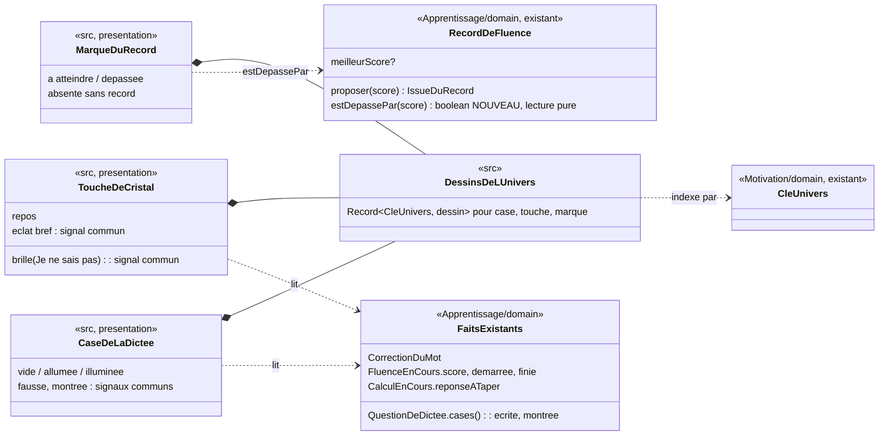

# Modèle du domaine : issue #128, claviers (dictée, calcul, fluence)

Tranche **98d** du découpage de #98 (épopée #95). Dépend de #97 et de #98 (mergées). Elle avance en parallèle de #126 (bulles de choix).

Sources lues :
- l'issue #128 et les commentaires [Responsable] 6478172313 et 6481220965 ;
- `docs/stories/98/domain-model.md` (invariants 1 à 20, « Habillage par univers », « Validation des dessins par le PO », pistes de 98d) et `docs/stories/98/acceptance.md` ;
- les réponses du PO 98.1 à 98.32 sur #98 ;
- le code : `record-de-fluence.ts` (+ test), `domain/index.ts`, `ClavierDeCristaux.tsx`, `ReponseAuCalcul.tsx`, `CasesDeLaDictee.tsx`, `ClavierDeLaDictee.tsx`, `ExerciceDeDictee.tsx`, `fluence/` (`ExerciceDeFluence.tsx`, `useFluence.ts`, `CompteurDuRecord.tsx`, `accueil-de-la-fluence.ts`, `lecture-du-record-supabase.ts`), `maisons/` (table `DESSINS_DES_MAISONS`), `univers/ContexteDeLUnivers.ts`, `transitions/mouvements-reduits.ts`.

## Contexte

### Apprentissage, pour une seule lecture pure

La seule règle nouvelle est celle de 98.10 : **pendant une fluence, le score dépasse-t-il le record ?** Elle appartient à **Apprentissage**, dans l'agrégat existant `RecordDeFluence` (`supabase/functions/_shared/apprentissage/domain/record-de-fluence.ts`). React ne compare jamais `score > record` lui-même : la règle « sans record, rien n'est dépassé » et la cohérence avec `proposer` (« égal au record : record inchangé ») vivent dans le domaine.

Le reste de la story est de la **présentation**, dans `src/` :
- l'état allumé des cases de la dictée et leur illumination une à une quand le mot est juste ;
- l'éclat bref d'une touche du clavier de cristaux ;
- la marque du record pendant la fluence et son changement de couleur ;
- le dessin de la case, de la touche et de la marque dans chacun des 6 univers (6e règle, 98.2).

Ces affichages lisent des faits existants et ne décident de rien : case écrite (`QuestionDeDictee.cases()`), case montrée, correction du mot (`CorrectionDuMot`), mot réussi (`reussie`), score de fluence (`FluenceEnCours.score`), record connu au départ (`lireLeRecordDeFluence`), clé d'univers (`CleUnivers`, Motivation, déjà fournie par `ContexteDeLUnivers`).

### Aucun contexte, aucune relation nouvelle

- **Motivation** : aucune parole, aucune humeur, aucun effet sonore nouveau. Le dépassement du record ne fait **aucun son** (98.10). La fête de la fin reste celle de #97 (R4 : compteur qui défile, « grande victoire »).
- **Catalogue pédagogique** : le format des leçons ne change pas.
- **Voix** : rien. Aucun texte lu ne change.
- **Famille** : rien.
- La clé d'univers est déjà lue par l'écran de séance (#96, #98). La **context map ne change pas**.

Il n'y a donc ni commande, ni événement de domaine, ni erreur métier, ni migration, ni Edge Function, ni donnée d'enfant nouvelle.

## Termes

| Terme | Statut |
|---|---|
| Exercice (`dictee`, `calcul`, `fluence`), Mot dicté, Caractère déjà écrit, Clavier de cristaux, Mode de réponse, Score de fluence, Record de fluence, Je ne sais pas, Erreur, Nouvelle chance, Univers, Personnage guide, Clavier des dictées | Existants, réutilisés tels quels |
| Nouveau record, premier record, record inchangé | Existants dans le code (`IssueDuRecord`) : issue de la fin de la fluence, après `proposer`. Pas au glossaire, et ce n'est pas le sens de la lecture ajoutée |
| **Record dépassé (à valider)** | **Nouveau** terme d'Apprentissage, ajouté en fin de section : pendant une fluence, le score de fluence est plus grand que le record de fluence connu au départ. Lecture seule, sans effet sur le record. À ne pas confondre avec **nouveau record**, qui n'existe qu'à la fin, après `proposer` |
| **Marque du record (à valider)** | **Nouveau**, ajouté en fin de section : le record de fluence montré pendant la fluence, comme une marque à atteindre. Proposé par le cadrage de #98 (98.10). Peut-être un simple mot d'interface, comme la « Pastille de record » de #65 |
| **Clavier de cristaux** | **Conflit possible** si la touche n'est plus dessinée en cristal dans un univers : le libellé lu « Clavier de cristaux » (`aria-label`) et les scénarios de #20, #21 et #23 deviendraient faux. Question **#128.1** |
| Case (de la dictée), touche, éclat, s'allumer, s'illuminer | **Mots d'interface** (comme « case » dans la décision n°30), hors glossaire |
| Dessin de l'univers, signal d'état, planche | Mots de cadrage de #98, hors glossaire, repris tels quels |
| Course, course contre soi-même, ligne d'arrivée, podium, feu d'artifice | **À ne pas employer** (98.7, 98.10). « course » est proposé comme synonyme interdit de **Record dépassé** et de **Marque du record** |
| Battre (un record) | Le code dit `recordBattu` pour la fin de la fluence (#97). Pour la lecture pendant la fluence, on dit « record dépassé », pour ne pas mélanger les deux moments |

**Terme manquant signalé** : « Je ne sais pas » est absent de la fluence (glossaire). Aucune touche ne « brille » donc jamais pendant une fluence. Rien à ajouter, c'est seulement une précision pour les scénarios.

## Modèle

### Agrégat `RecordDeFluence` (existant), une lecture de plus

Rien ne change dans l'état, l'identité (profil enfant, leçon, exercice), `proposer`, `retirerFaits`, ni dans le fait `NouveauRecordDeFluence`.

**Lecture pure proposée** :

```ts
/** Pendant une fluence : le score de fluence dépasse-t-il le record connu ? Ne modifie ni le record ni les faits. */
estDepassePar(score: number): boolean
```

Règle : `true` seulement si un meilleur score existe **et** si `score > meilleurScore`. Sans record, la réponse est toujours `false`, puisqu'il n'y a pas de marque. Le score 0 n'est jamais un record : un record vaut donc toujours au moins 1, et 0 ne le dépasse jamais.

Propriété de cohérence : pour un record reconstitué avec un meilleur score, `estDepassePar(s)` vaut `true` **si et seulement si** `proposer(s)` rendrait `"nouveauRecord"`. La marque change donc de couleur exactement quand la fin dira « Nouveau record ! ».

**Exemples pour le TDD** (record de Léa à « Calcul rapide » de `maths-cp-additions`, comme dans `record-de-fluence_test.ts`) :

| # | Record | Score | `estDepassePar` | Ce que l'exemple protège |
|---|---|---|---|---|
| 1 | aucun (`commencer`) | 5 | `false` | Sans record, aucune marque, donc rien à dépasser, même si la fin dira « premier record » |
| 2 | aucun | 0 | `false` | 0 n'est jamais un record |
| 3 | 7 | 3 | `false` | Score plus bas |
| 4 | 7 | 7 | `false` | Égal au record : record inchangé, comme `proposer` |
| 5 | 7 | 8 | `true` | Le premier calcul qui passe le record |
| 6 | 7 | 12 | `true` | Le record reste dépassé ensuite (la lecture ne « consomme » rien) |
| 7 | 7 | 8, puis lecture de `meilleurScore` et `retirerFaits()` | `meilleurScore` = 7, faits = `[]` | Lecture pure : ni l'état ni les faits ne changent |
| 8 | 7 | `estDepassePar(8)`, puis `proposer(8)` | `proposer` rend toujours `"nouveauRecord"` et émet `NouveauRecordDeFluence` (7 → 8) | La lecture ne perturbe pas la fin |
| 9 | 7 | 0, 5, 7, 8, 20 | même réponse que `proposer(s) === "nouveauRecord"` sur un record neuf de 7 | Propriété de cohérence |

Export : `RecordDeFluence` est déjà exporté par `domain/index.ts`. Aucun export de plus.

Usage côté front (indicatif) : `useFluence` garde déjà `record` (le meilleur score lu avant le départ). Le front reconstitue `RecordDeFluence` avec ce record, comme le fait déjà `finDeFluence`, et lit `estDepassePar(fluence.score)` à chaque rendu. Le front ne compare jamais lui-même.

### Ce qui vit dans `src/` (présentation, pas de modèle)



## Règles (R1 à R6)

### R1. Dictée : la case s'allume quand une lettre y est écrite ; le mot juste s'illumine case après case (98.7)

- Une case **s'allume** dès qu'une lettre y est écrite, au clavier de la dictée ou au clavier physique. Elle ne dit pas si la lettre est juste. Effacer une lettre éteint sa case.
- L'état allumé ne ressemble ni au signal « bonne réponse montrée », ni à une couleur de réussite ou d'erreur (invariants 4 et 15 de #98).
- Quand le **mot est juste**, toutes ses cases à écrire **s'illuminent l'une après l'autre**, de la première à la dernière. Les caractères déjà écrits (espace, apostrophe, tiret, point) ne s'illuminent pas : ce ne sont pas des cases. Pas de feu d'artifice, pas d'étincelles (celles-ci sont réservées au texte complet, #97 R2), pas de son de plus.
- Le rebond de la zone de réponse et le son « réponse juste » de #97 partent d'abord. L'illumination ne retarde jamais l'écran suivant, qui attend la parole (#79). Durée : question **#128.6**.
- Un mot faux reste corrigé **comme aujourd'hui**, au mot complet seulement : le début juste est gardé, et les lettres fausses sont montrées en rouge. Aucune case ne s'illumine.
- Une lettre montrée par le personnage guide (`montree`) garde son signal commun.
- Exemple (98.7) : « chat ». L'enfant tape « c », « h », « o » : trois cases allumées, aucune jugée. Il tape « t » : une erreur, « o » montré faux, comme aujourd'hui. Il écrit ensuite « chat » : les 4 cases s'illuminent l'une après l'autre.
- Lecteurs d'écran : les libellés restent « Case 2 : a », « Case 3, vide »… Ni « allumée » ni « illuminée » ne sont annoncés.

### R2. Clavier de cristaux : une touche touchée a un éclat bref (98.9)

- Toucher une touche de chiffre lui donne un **éclat bref** : une lumière courte, environ 200 ms, sans halo extérieur et sans pulsation.
- L'éclat ne ressemble pas au **halo qui dure** de « Je ne sais pas » (`data-brille` : halo jaune qui pulse). Ce halo garde un seul sens : la bonne réponse montrée.
- L'éclat est un **signal d'état commun** aux 6 univers, posé par-dessus le dessin de la touche (invariant 15).
- L'éclat ne produit aucune réponse : la saisie, les 4 chiffres au plus, « Effacer », « Valider », les erreurs et la nouvelle chance restent ceux d'aujourd'hui (invariants 1 et 2).
- Pour « Effacer », « Valider » et la frappe au clavier physique : questions **#128.4** et **#128.5**.
- Une touche désactivée (calcul réussi, fluence finie) n'a pas d'éclat.

### R3. Fluence : le record de fluence est une marque à atteindre (98.10)

- Pendant la fluence (après « C'est parti ! » et avant la fin du temps), si l'enfant a un **record de fluence** pour cet exercice, une **marque du record** se voit à côté du score, par exemple « Ton record : 12 » (reco de 98.10).
- **Sans record, aucune marque.** C'est aussi le cas quand le record n'a pas pu être lu : profil préparé, lecture impossible ou hors ligne (`lireLeRecordDeFluence` rend `undefined`). Voir **#128.8**.
- La marque montre le record **connu au départ**. Elle ne suit pas le score.
- Rien ne présente la fluence comme une **course** : ni le mot « course », ni ligne d'arrivée, ni drapeau à damier, ni podium, ni coupe, ni concurrent. Le chrono, la barre de temps et le score restent les mêmes (« A on garde le chrono »).
- La marque ne se pose pas sur la barre de temps : le temps n'est pas le record. Place : question **#128.3**.
- Lecteurs d'écran : le tableau de fluence est déjà caché aux lecteurs d'écran, et l'annonce par paliers de 15 s ne change pas (R5). Le record est déjà dit à l'accueil par le personnage guide (« Ton record est de 12. »).

### R4. Fluence : quand le score dépasse le record, la marque change de couleur (98.10)

- Dès que `RecordDeFluence.estDepassePar(score)` vaut `true`, la marque **change de couleur** et garde cette couleur jusqu'à la fin du temps.
- **Sans son, sans arrêt, sans célébration** : le chrono continue, le clavier reste actif, et le personnage guide ne dit rien.
- Un score **égal** au record ne change rien (exemple 4).
- La couleur « dépassée » ne ressemble ni au halo de « Je ne sais pas », ni au rouge d'erreur.
- La **fête reste celle de la fin** (#97 R4) : le compteur défile jusqu'au nouveau record et « grande victoire » se fait entendre. Le résultat de la fin vient toujours de `proposer`, jamais de la marque. Ce que devient la marque à la fin : question **#128.7**.

### R5. Avec mouvements réduits, rien ne bouge

- Le réglage est lu par `useMouvementsReduits()` (#102).
- Dictée : la case allumée change de couleur et de contour sans mouvement. Le mot juste s'illumine **d'un coup**, toutes les cases ensemble, sans cascade.
- Clavier : l'éclat devient un simple changement de couleur bref, sans agrandissement et sans fondu animé.
- Fluence : la marque est immobile. Son changement de couleur est immédiat.
- Le temps restant et le score restent annoncés comme aujourd'hui (paliers de 15 s, nombre de calculs réussis). Rien de nouveau n'est annoncé.

### R6. Dessin par univers : la case, la touche et la marque ont le dessin de l'univers (98.2)

- Dans chacun des 6 univers, la **case de la dictée**, la **touche du clavier de cristaux** et la **marque du record** ont le dessin de cet univers. Le choix se fait dans des tables `Record<CleUnivers, …>`, comme `DESSINS_DES_MAISONS`.
- Un profil sans univers, ou avec une clé inconnue, voit les dessins d'« Animaux de la forêt » (`universDe`, invariant 16).
- Changer d'univers ne change ni les gestes, ni les textes lus (« Clavier de cristaux », « Case 2 : a », « Nombre tapé »), ni les erreurs, ni les étoiles, ni le record (invariant 14).
- Les signaux d'état sont **communs** aux 6 univers, posés par-dessus le dessin : case fausse, lettre montrée, éclat, halo de « Je ne sais pas », touche désactivée (invariant 15).
- Le texte (lettre, chiffre, nombre du record) reste du **texte**, jamais dans le dessin, avec un contraste de 4,5:1 au moins sur le dessin et le mode dys appliqué (invariant 18). Aucune ligne ne passe derrière une lettre, comme le ferait une portée de musique.
- Mêmes zones de toucher (44 px au moins), même place, même tenue à 360 px dans les 6 univers (invariants 7 et 17).
- Une cible porte `data-univers` pour les scénarios, qui ne lisent jamais un tracé (#98).

### Invariants communs (rappel de #98)

1. Mêmes erreurs, même avancement, mêmes étoiles et même record qu'avant, pour les mêmes réponses. Le serveur revalide la séance sans changement.
2. Les retours de #97 passent d'abord : rebond, balancement, son, point qui vole, puis la fête de fin de la fluence.
3. 360 px, mode dys, lecteurs d'écran inchangés.
4. Le signal « bonne réponse montrée » ne sert à rien d'autre : rien ne lui ressemble, ni l'éclat, ni une case allumée, ni la marque dépassée.
5. Aucun coffre. La règle absolue des contenus pour les enfants s'applique, univers par univers (invariant 20).
6. Même habillage en séance, en séance de révision et au test de départ (98.13), partout où la dictée et le clavier de cristaux servent. Voir **#128.9**.

## Univers et dessins concernés

Les 6 univers existants (`CleUnivers`, `motivation/domain/univers.ts`) : `animaux` (Animaux de la forêt, Noisette), `princesse` (Princesses et fées, Lumi), `sports` (Sports, Coach Léo), `police` (Police, Agent Max), `pompier` (Pompiers), `danse` (Danse). Les noms d'objets sont choisis par le PO (skill `illustration`, 2.1) : les tableaux ci-dessous sont des **propositions**, à trancher dans **#128.1**, **#128.2** et **#128.3**.

### Case de la dictée (états dessinés : vide, allumée, illuminée)

| Univers | Proposition (reco) | Piste de #98 | Pourquoi l'écart |
|---|---|---|---|
| Animaux | Petite feuille arrondie, nervure seulement sur le bord | Feuille | Aucune nervure derrière la lettre |
| Princesses et fées | Petit cadre doré de miroir | Pierre précieuse | La touche est déjà un cristal : une case en pierre se confondrait avec la touche |
| Sports | Carré de pelouse bordé de blanc, rappel du stade validé en 98.28 | Case du tableau de l'entraîneur | Un tableau à cases peut se lire comme un tableau de scores (comparaison sociale, skill `gamification`, section 5) |
| Police | Page de carnet d'enquête, spirale en haut | Case de carnet | Inchangé, sans lignes derrière la lettre |
| Pompiers | Plaque de casier rouge clair à rivets | Case de casier | Le rouge reste distinct du rouge de la case fausse |
| Danse | Carreau de parquet de scène | Case de partition | Les lignes d'une portée gêneraient la lecture, surtout en mode dys |

### Touche du clavier de cristaux (un dessin au repos ; éclat, halo et désactivée sont des signaux communs)

Si **#128.1 = A** (reco) : un cristal dans les 6 univers, taillé et coloré à la manière de l'univers.

| Univers | Proposition (reco) | Attention |
|---|---|---|
| Animaux | Cristal vert mousse, une petite feuille gravée dans un coin | — |
| Princesses et fées | Cristal rose, taille en goutte | — |
| Sports | Cristal bleu, facettes droites | — |
| Police | Cristal bleu acier | Pas d'argent pâle : la touche ne doit pas sembler désactivée (opacité 0,45) |
| Pompiers | Cristal rouge corail | Distinct du rouge d'erreur |
| Danse | Cristal violet, reflet en ruban | — |

Partout, la couleur de la touche ne doit pas rappeler le jaune du halo de « Je ne sais pas ».

### Marque du record (états dessinés : à atteindre, dépassée)

| Univers | Proposition (reco) | Piste de #98 | Pourquoi l'écart |
|---|---|---|---|
| Animaux | Petit fanion de feuille planté sur une branche | Drapeau sur une branche | « Drapeau » peut évoquer l'arrivée : un fanion uni, jamais à damier |
| Princesses et fées | Lanterne de fée | Étoile magique | Une **étoile** se confondrait avec l'**Étoile**, la récompense, alors que le score de fluence « n'est pas une étoile » (glossaire) |
| Sports | Fanion triangulaire uni | Fanion | Ni damier, ni numéro, ni coupe |
| Police | Loupe de détective, comme Agent Max, « le détective futé » | Étoile d'insigne | Même raison que pour Princesses : pas d'étoile |
| Pompiers | Cloche dorée, la même que sur la maison validée, immobile | Cloche | Elle ne sonne jamais (« sans son ») |
| Danse | Ruban noué | Étoile de scène | Même raison : pas d'étoile |

L'état « dépassée » est la même forme, dans une autre couleur, choisie dans la palette de l'univers et validée sur la planche.

### Volume

| Ce qui est dessiné | Par univers | Total |
|---|---|---|
| Case : vide, allumée, illuminée | 3 | 18 |
| Touche au repos | 1 | 6 |
| Marque : à atteindre, dépassée | 2 | 12 |
| **Dessins d'univers** | **6** | **36** |
| Signaux communs nouveaux : éclat de la touche | — | 1 |
| Planches de validation (98.28) | — | 3 : `dictee-case.png`, `clavier-de-cristaux-touche.png`, `fluence-marque-du-record.png` (6 lignes × colonnes d'état, plus fausse, montrée et halo de « Je ne sais pas » pour montrer que les signaux communs sont les mêmes sur les 6 lignes) |
| Captures de l'écran réel (98.29) | — | Question **#128.10** |

## Ce qui ne change pas

- **Domaine** : seule la lecture `estDepassePar` s'ajoute. Rien d'autre ne bouge : `QuestionDeDictee` (la correction reste au mot complet), `MotAEcrire.corriger`, `CalculEnCours`, `FluenceEnCours`, `proposer`, `NouveauRecordDeFluence`, `IssueDuRecord`, les étoiles, l'avancement, la file de révision.
- **Motivation** : paroles de la fluence (accueil avec « Ton record est de… », fin), effets sonores, humeur, `effetSonoreDuRecord`.
- **#97** : `CompteurDuRecord`, le rebond de « Valider » et de la zone de réponse de la dictée, les sons, la fête de fin.
- **Textes et libellés** : « Clavier de cristaux » (si #128.1 = A), « Nombre tapé », « Effacer », « Valider », « Mot à écrire », « Case n : x », « Case n, vide », « lettre montrée par le personnage guide », « Temps écoulé », « Il reste plus de 30 secondes ».
- **Clavier de la dictée** (touches de lettres) : ni dessin d'univers ni éclat dans cette story. Voir **#128.11**.
- **Mode par choix du calcul** (CP) : il appartient à #126 (bulle de l'univers). Aucun changement dans `ChoixDeLaQuestion.tsx`, ni dans les fichiers de #126, #127 (addition posée) ou #131.
- **Données** : aucune donnée nouvelle, rien d'enregistré ni d'envoyé. Le record est déjà lu avant le départ.

## Événements

Aucun événement de domaine nouveau. `estDepassePar` est une lecture : elle n'émet **aucun fait**. `NouveauRecordDeFluence` reste émis par `proposer`, à la fin seulement.

## Partage avec le front

Tout fonctionne hors ligne. `RecordDeFluence` est déjà importé par le front (`@domain/apprentissage`, `useFluence`). Les dessins sont des SVG dans le code (décision 0027). Le record lui-même vient d'une lecture Supabase faite avant le départ : hors ligne, il n'y a pas de record connu, donc pas de marque (#128.8).

## Données d'enfants

Aucune donnée nouvelle. Le record de fluence et l'univers du profil sont déjà enregistrés et lus.

## Emplacement

Domaine (TDD) :
- `supabase/functions/_shared/apprentissage/domain/record-de-fluence.ts` : méthode `estDepassePar(score)` ;
- `supabase/functions/_shared/apprentissage/domain/record-de-fluence_test.ts` : exemples 1 à 9 ;
- `domain/index.ts` : rien, la classe est déjà exportée.

Front (indicatif, pour l'implementer) :
- `src/seance/exercices/CasesDeLaDictee.tsx` (états allumée et illuminée ; `reussie` vient de `ExerciceDeDictee`) et une table de dessins de case par univers ;
- `src/seance/exercices/ClavierDeCristaux.tsx` (éclat, dessin de la touche). L'univers y est lu par `useUnivers()` (`ContexteDeLUnivers`), **sans nouvelle prop** : `ReponseAuCalcul`, `SchemaDuProbleme`, `BoiteAJetons` et `ExerciceDAdditionPosee`, qui l'utilisent, ne changent pas ;
- `src/seance/exercices/fluence/` : `ExerciceDeFluence.tsx` (marque du record), un composant de marque et sa table de dessins par univers. Le record connu (`record` de `useFluence`) doit être passé jusqu'à `ExerciceDeFluence` : cela demande **une prop de plus** dans `src/seance/EcranDeSeance.tsx`, fichier commun à plusieurs tranches. Ce petit point de fusion est à signaler au responsable ;
- signaux communs (éclat) hors des tables de dessins ;
- planches : `docs/stories/128/planches/` ; captures : `docs/stories/128/captures/`.

## Questions ouvertes

**#128.1 (question prévue) Que devient le terme « Clavier de cristaux » si la touche n'est plus un cristal dans certains univers ?**
Le terme est au glossaire, dans le format des leçons (`calcul` : « avec le clavier de cristaux ») et dans les scénarios de #20, #21 et #23. Les lecteurs d'écran le lisent aussi : c'est le libellé du clavier.
- **A (reco) : la touche reste un cristal dans les 6 univers**, taillé et coloré à la manière de l'univers (cristal vert mousse pour Animaux, rose pour Princesses…). Le terme, le libellé lu, le format et les scénarios restent justes. C'est le choix déjà fait pour la maison (« elle se lit comme une maison », 98.25) et pour le petit train (98.26 A).
- B : la touche devient un autre objet par univers (gland, perle, ballon…), et le terme est renommé partout « Clavier de chiffres » : glossaire, format, `aria-label`, scénarios de #20, #21 et #23. Le travail grossit, et le format des leçons change (contrat avec le contenu).
- C : la touche devient un autre objet par univers, mais on garde « Clavier de cristaux » comme un nom. Un enfant de l'univers Sports entendrait « Clavier de cristaux » devant des ballons.

**#128.2 Quelle case de la dictée dessine-t-on dans chaque univers ?**
Reco : **A**, le tableau « Case de la dictée » ci-dessus : feuille, cadre doré de miroir, carré de pelouse, page de carnet d'enquête, plaque de casier, carreau de parquet. Il évite la pierre précieuse (on la confondrait avec la touche en cristal), le tableau de l'entraîneur (on le prendrait pour un tableau de scores) et la portée (des lignes derrière la lettre).
Options : B, les pistes de #98 telles quelles ; C, tu donnes l'objet d'un ou de plusieurs univers.

**#128.3 La marque du record : quel objet par univers, et où à l'écran ?**
Reco : **A**.
- Une petite marque posée à côté du score, avec le dessin de l'univers et « Ton record : 12 » en texte.
- Les objets du tableau « Marque du record » ci-dessus : fanion de feuille, lanterne de fée, fanion uni, loupe, cloche, ruban.
- Aucune étoile, pour ne pas confondre avec les étoiles gagnées : la fluence n'en donne pas.

Options :
- B : une jauge du score qui monte vers la marque. Elle ressemble à une ligne d'arrivée, donc à une course, ce que 98.10 écarte.
- C : les pistes de #98 (étoile magique, étoile d'insigne, étoile de scène).

**#128.4 « Effacer » et « Valider » ont-ils le dessin de l'univers et l'éclat ?**
Reco :
- **non pour le dessin** : ce sont des actions, pas des chiffres. Elles gardent leur aspect commun d'aujourd'hui, et « Valider » garde sa couleur ;
- **éclat sur « Effacer »** ;
- **pas d'éclat sur « Valider »** : il porte déjà le rebond ou le balancement de #97, qui passent d'abord.

Options : A, les 12 touches ont le dessin et l'éclat ; B, seules les 10 touches de chiffres ont l'éclat.

**#128.5 Un chiffre tapé au clavier physique fait-il aussi briller brièvement sa touche à l'écran ?**
Reco : **oui**, le même éclat, quel que soit le moyen de taper. Le retour est le même au clavier sur ordinateur et au doigt sur tablette.
Option : non, l'éclat seulement au toucher.

**#128.6 Dictée : combien de temps dure l'illumination du mot juste ?**
Exemple : « éléphant » a 8 cases.
Reco : elle commence avec le rebond de #97 et dure **400 ms au plus en tout, quelle que soit la longueur du mot** (le pas entre deux cases diminue pour les mots longs). Elle ne retarde jamais l'écran suivant.
Option : un pas fixe d'environ 80 ms par case : 640 ms pour « éléphant ». C'est plus lisible, mais plus long que la durée d'un retour fixée par l'invariant 5 de #98.

**#128.7 À la fin de la fluence, que devient la marque ?**
À la fin, #97 fait défiler le compteur « Record : 15 » quand le record est battu.
Reco : **la marque disparaît dès que le temps est écoulé**. La fin appartient à #97, et l'enfant ne voit jamais deux records à la fois (« Ton record : 12 » et « Record : 15 »).
Options : A, la marque reste avec sa couleur jusqu'à l'écran suivant, à côté du compteur ; B, elle reste seulement quand le record n'est pas battu, et le compteur la remplace sinon.

**#128.8 Hors ligne, ou quand le record ne peut pas être lu, l'enfant ne voit pas de marque. D'accord ?**
Aujourd'hui, `lireLeRecordDeFluence` rend « pas de record » quand il est hors ligne, quand la lecture échoue et pour un profil préparé.
Reco : **oui, aucune marque**, comme sans record. Rien de nouveau n'est gardé dans l'appareil.
Option : garder le dernier record lu dans l'appareil (IndexedDB) pour la fluence hors ligne. C'est une donnée de plus sur l'enfant, à minimiser et à exporter (RGPD) : cela relèverait d'une story à part.

**#128.9 Le clavier de cristaux a-t-il le dessin de l'univers partout où il sert ?**
Il sert aussi à la boîte à jetons, au schéma en barres et à l'étape calculer de l'addition, à partir du CE1, en séance, en séance de révision et au test de départ.
Reco : **oui, partout** : c'est le même composant (même logique que la bulle de choix, 98.4), et l'enfant reconnaît le même clavier. Aucun fichier de #127 ni de #131 ne change, puisque l'univers est lu dans le clavier. Leurs captures montreront peut-être déjà les nouvelles touches, si #128 est mergée avant : à signaler au responsable.
Option : seulement en `calcul` et en `fluence`. Il faudrait une prop de plus, passée par des fichiers de #127 et de #131, et deux claviers différents selon l'exercice.

**#128.10 Combien de captures de l'écran réel joindre à la PR (98.29) ?**
Une seule capture ne montre pas les trois cibles : la dictée est un écran à part, et le clavier du calcul est le même que celui de la fluence.
Reco : **12 captures**, 2 par univers, à 360 px en mouvements réduits :
- une fluence en cours, avec le clavier et la marque dépassée ;
- une dictée dont le mot juste est illuminé.

Options : A, 6 captures, la fluence seulement (la case de la dictée ne serait pas montrée) ; B, 18 captures, en ajoutant le calcul au clavier.

**#128.11 Le clavier de la dictée (touches de lettres) reçoit-il l'éclat bref, ou le dessin de l'univers ?**
L'issue ne parle que du clavier de cristaux, et la story a déjà 6 règles.
Reco : **non dans cette story**. Le clavier de la dictée reste comme aujourd'hui. Une petite story pourra le faire plus tard, si tu le souhaites.
Options : A, l'éclat seulement (signal commun, sans dessin) ; B, l'éclat et le dessin de l'univers (6 dessins de plus, une planche de plus).

**#128.12 Les termes « Record dépassé » et « Marque du record » entrent-ils au glossaire ?**
Reco :
- **Record dépassé** : un terme d'Apprentissage, puisque c'est le nom de la lecture du domaine ;
- **Marque du record** : un mot d'interface, comme « Pastille de record » de #65 ;
- « course » devient un synonyme interdit des deux.

Option : les deux deviennent des termes du domaine, ou aucun des deux.
