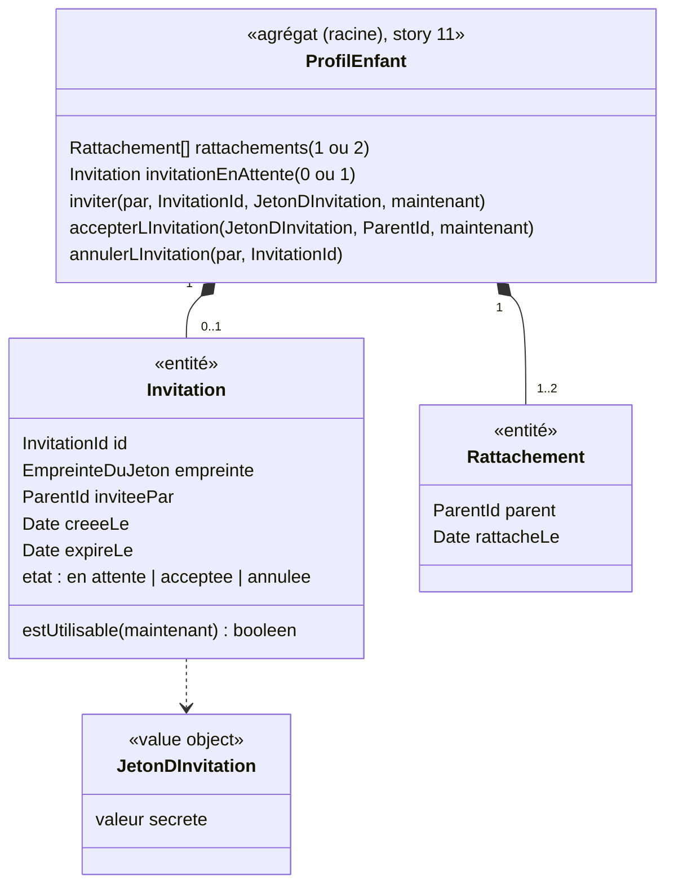

# Modèle du domaine : issue #13, Inviter un second parent à se rattacher à un profil enfant

## Contexte

**Famille** (contexte existant). Nouvelle fonctionnalité, absente de `app/` (un seul compte claude.ai voyait tout). Elle réalise la décision de démarrage n°5 et la décision n°8 du glossaire : un profil enfant a un ou deux parents ; le second se rattache par un lien d'invitation que le premier communique lui-même. **L'application n'envoie rien.**

Relations :
- **Supabase Auth → Famille** (existante, #5) : le parent invité se connecte par lien de connexion ou code de connexion. Son `ParentId` sert au rattachement.
- Aucun autre contexte n'est touché : un parent rattaché voit la progression, les devoirs et le suivi de l'enfant parce que les policies RLS de ces contextes passent toutes par le rattachement (#11).

## Termes

| Terme | Statut | Remarque |
|---|---|---|
| Invitation | au glossaire (confirmé) | Confirmée par la décision n°2 du lot 2 : faite pour **un** profil enfant, par un parent rattaché ; valable 7 jours, utilisable une seule fois, une seule en attente par profil. |
| Lien d'invitation | **nouveau** (à valider) | Lien qui porte le jeton d'invitation, communiqué par le parent lui-même (message, e-mail…). Jamais « lien » seul (conflit avec **Lien de connexion**). |
| Jeton d'invitation | **nouveau** (à valider) | Secret impossible à deviner, contenu dans le lien d'invitation, qui désigne l'invitation. Terme du code plus que de l'interface. |
| Parent invité | **nouveau** (à valider) | Parent qui ouvre un lien d'invitation. Il devient un parent rattaché quand il l'accepte. Ce n'est pas un rôle : c'est un Parent. |
| Rattachement | au glossaire (confirmé) | Créé ici pour le second parent. Les deux parents ont les mêmes droits (décision n°1). |
| Second parent | **nouveau** (à valider) ou simple expression | « Premier » et « second » ne disent que l'ordre d'arrivée, pas des droits différents (décision n°1 : mêmes droits). |
| Code, parrainage, partage | synonymes interdits | Déjà au glossaire (« code » seul, décision n°13). |

## Modèle



### Pourquoi l'invitation est dans l'agrégat `ProfilEnfant`

L'acceptation doit, **en une seule fois** : vérifier que l'invitation est encore utilisable, la marquer acceptée, et rattacher le parent **sans dépasser deux parents**. Si l'invitation était un agrégat séparé, accepter modifierait deux agrégats dans la même transaction, ou laisserait une invitation consommée sans rattachement en cas d'échec. L'invariant « au plus deux parents » exige donc que les invitations en attente vivent avec les rattachements. L'agrégat reste petit : deux rattachements au plus, et **au plus une invitation en attente** (décision n°2 : une nouvelle remplace l'ancienne). Les invitations acceptées, annulées ou expirées sont oubliées dès qu'elles ne servent plus (minimisation, proposition appliquée).

### Value objects et entités

| Élément | Règle |
|---|---|
| `JetonDInvitation` | Secret long, impossible à deviner, fourni par un port `GenerateurDeJeton` (jamais tiré dans le domaine). Montré **une seule fois** au parent qui invite, dans le lien d'invitation ; il ne peut pas le revoir, il en crée un nouveau (proposition appliquée). On ne garde que son **empreinte**, pour qu'une fuite de la base ne donne aucun lien utilisable (décision 0009, n°3). |
| `InvitationId` | Identifiant opaque (port `GenerateurId`). |
| `Invitation` | Utilisable si elle est **en attente** et que `maintenant < expireLe`, avec `expireLe = creeeLe + 7 jours`. **Usage unique** (décision n°2). Le lien vaut pour quiconque l'a en main : l'invitation n'est réservée à aucune adresse e-mail (décision n°2). |
| `LienDInvitation` | Adresse de l'application + jeton. Forme d'interface, construite par le front ; pas une règle du domaine. |

### Commandes (cas d'usage, toutes côté serveur)

| Commande | Règle | Erreurs métier |
|---|---|---|
| `InviterUnSecondParent(parent, profil)` | Le parent doit être rattaché. Le profil doit avoir **un seul** parent. Une invitation déjà en attente est **remplacée** (annulée) par la nouvelle (décision n°2). Rend le lien d'invitation (le jeton en clair, une seule fois). Se fait depuis la fiche du profil, dans l'espace parent (proposition appliquée). | `ParentNonRattache`, `DeuxParentsDejaRattaches` (présentée « Léa est déjà suivie par deux parents. ») |
| `AccepterLInvitation(jeton, parentConnecte)` | Après la confirmation « Accepter » du parent invité (décision n°2). L'invitation doit être utilisable. Le parent ne doit pas être déjà rattaché. Le profil doit avoir un seul parent. Rattache le parent ; l'invitation devient acceptée. Exécutée par la fonction Postgres d'acceptation (décision 0009, n°3). | `InvitationInvalide` (inconnue, expirée, acceptée ou annulée : **un seul message**, « Cette invitation ne marche plus : demande un nouveau lien d'invitation à l'autre parent. », proposition appliquée), `ParentDejaRattache` (« Tu suis déjà Léa. », proposition appliquée), `DeuxParentsDejaRattaches` |
| `AnnulerLInvitation(parent, invitation)` | Le parent qui invite (ou l'autre parent rattaché, mêmes droits) annule une invitation en attente (décision n°2). | `ParentNonRattache`, `InvitationInvalide` |

Refuser l'invitation (« Refuser », décision n°2) ne change rien sur le serveur : le parent invité n'est pas rattaché et l'invitation **reste en attente** jusqu'à son expiration ou son annulation (proposition appliquée, scénario « Marie refuse l'invitation… »).

`RetirerUnParent` n'existe pas dans ce lot : personne ne peut retirer l'autre parent (décision n°1).

Parcours du parent invité : il ouvre le lien d'invitation ; s'il n'est pas connecté, il passe par la connexion du parent (#5) ; **le jeton doit survivre à la connexion** (gardé sur l'appareil ou porté par l'adresse de retour du lien de connexion), puis le parent invité **confirme** (« Accepter » ou « Refuser », décision n°2). Avant la connexion, la page du lien d'invitation n'affiche **pas** le prénom de l'enfant (décision n°2) ; après la connexion, elle montre seulement le prénom de l'enfant (« Invitation à suivre Léa »), jamais l'adresse e-mail du parent qui invite (décision n°3). Si le lien s'ouvre dans le navigateur plutôt que dans l'application installée, il suffit de l'accepter là : le profil apparaît ensuite partout (proposition appliquée).

## Invariants

1. Un profil enfant a **un ou deux parents**, jamais trois. Une invitation ne peut être créée ni acceptée quand le profil a déjà deux parents.
2. Seul un parent rattaché peut inviter et annuler une invitation. Personne ne retire un parent dans ce lot (décision n°1).
3. Une invitation vaut pour **un seul** profil enfant. Accepter ne rattache qu'à ce profil : le parent invité ne voit **pas** les autres enfants du parent qui invite, et inversement (décision n°3). Pour suivre un deuxième enfant, il faut une deuxième invitation.
4. Une invitation expirée (au-delà de 7 jours), acceptée ou annulée ne rattache personne. Un profil a au plus une invitation en attente.
5. Un parent déjà rattaché ne peut pas accepter une invitation du même profil (pas de doublon de rattachement).
6. L'application n'envoie aucun message : le parent communique le lien lui-même.
7. Le jeton d'invitation est un secret : il n'apparaît dans aucun journal et n'est jamais relu après sa création.
8. Accepter une invitation passe toujours par le serveur : le parent invité n'a, avant cela, aucun accès au profil (RLS).
9. Aucun parent ne voit l'adresse e-mail de l'autre parent rattaché (décision n°3).
10. Le parent rattaché voit qu'une invitation est en attente et jusqu'à quand elle vaut (proposition appliquée).

## Événements

| Événement | Données | Qui réagit |
|---|---|---|
| `SecondParentInvite` (à valider) | profil, invitation, parent qui invite, expiration | personne (le front affiche le lien) |
| `ParentRattache` (à valider) | profil, parent, date | personne côté serveur pour l'instant ; le front du parent invité recharge « Qui joue ? ». Prévenir le premier parent : question ouverte n°2. |
| `InvitationAnnulee` (à valider) | profil, invitation (annulée par un parent, ou remplacée par une nouvelle) | personne |

## Partage avec le front

- Dans le navigateur : rien qui demande une règle hors ligne. Le front affiche le lien d'invitation, le copie ou le partage (partage natif de l'appareil), et garde le jeton pendant la connexion du parent invité.
- Par des Edge Functions (`famille/application/`) : **toutes** les commandes. L'acceptation en particulier : le parent invité ne voit ni le profil ni l'invitation sous RLS. Jamais de clé `service_role` dans le front.
- Acceptation (décision 0009, n°3) : une **fonction Postgres `security definer` à périmètre minimal**, appelée avec le JWT du parent invité, vérifie l'empreinte du jeton, la validité, la limite de deux parents, puis rattache et consomme l'invitation en une fois. Pas de `service_role`, ni dans le front ni dans l'Edge Function. La règle reste écrite dans le domaine (`accepterLInvitation`, testé par `Deno.test`) ; la fonction Postgres la reproduit et est couverte par des tests SQL et les scénarios E2E. Lecture de l'invitation avant l'acceptation : question technique T6.

## Base de données attendue (description)

| Table | Contenu | Policies RLS |
|---|---|---|
| `invitations` | identifiant, profil enfant, empreinte du jeton, parent qui invite, date de création, date d'expiration, état | **lecture**, **création**, **annulation** : seulement les parents rattachés au profil, par les Edge Functions (décision 0009, n°1). **Aucune** lecture pour un parent non rattaché : l'acceptation passe par la fonction Postgres d'acceptation (décision 0009, n°3). Au plus une invitation en attente par profil, aussi vérifiée en base. |
| `rattachements` (#11) | + le second rattachement | **création** du second rattachement : seulement par l'acceptation d'une invitation valide (jamais par une écriture directe du front). Unicité (profil, parent) et au plus deux lignes par profil, aussi vérifiées en base. |

## Données personnelles

- Nouvelle donnée : le **lien entre deux adultes** et un enfant (qui est l'autre parent). Pas de nouvelle donnée sur l'enfant.
- Aucun parent ne voit l'adresse e-mail de l'autre parent rattaché, et l'export ne la contient pas (décision n°3).
- Seule l'invitation en attente est gardée ; elle fait partie de l'export (son état et sa date, sans lien ni jeton) et de la suppression du profil (#14).

## Emplacement

```
supabase/functions/_shared/famille/
  domain/
    invitation.ts                    # entité Invitation
    invitation-id.ts
    jeton-d-invitation.ts            # value object (et son empreinte)
    profil-enfant.ts                 # + inviter, accepterLInvitation, annulerLInvitation
    erreurs.ts                       # + DeuxParentsDejaRattaches, ParentDejaRattache, InvitationInvalide
  application/
    ports/generateur-de-jeton.ts
    ports/horloge.ts
    inviter-un-second-parent.ts
    accepter-l-invitation.ts
    annuler-l-invitation.ts
  infrastructure/
    profils-enfants-supabase.ts      # + invitations
    generateur-de-jeton-crypto.ts
  test_utils/
    generateur-de-jeton-fixe.ts
    horloge-fixe.ts
supabase/functions/inviter-un-second-parent/index.ts
supabase/functions/accepter-l-invitation/index.ts
supabase/functions/annuler-l-invitation/index.ts
supabase/migrations/<date>_invitations.sql  # table, policies et fonction Postgres d'acceptation (décision 0009, n°3)
src/famille/                         # écran « Inviter l'autre parent », page d'arrivée du lien d'invitation
```

## Décisions

Validation n°1 du lot 2 par le PO, le 2026-10-22 (`docs/stories/lot-2-decisions.md`, décision 0009). « Tranchée » = réponse explicite du PO ; « proposition appliquée » = question de détail qui suit la proposition déjà faite.

Numéros d'origine : « M » = ancienne liste du modèle, « A » = `docs/stories/13/acceptance.md`, « T » = questions techniques.

| Question | Réponse | Source |
|---|---|---|
| M1. Droits des deux parents | **Mêmes droits** : modifier, régler, inviter, exporter, supprimer (après un avertissement). Personne ne retire l'autre parent dans ce lot. | Tranchée, décision n°1 |
| M2. Durée et usage unique | **7 jours**, **une seule fois**. | Tranchée, décision n°2 |
| M3. Un seul message pour une invitation qui ne marche plus | **Oui** : « Cette invitation ne marche plus : demande un nouveau lien d'invitation à l'autre parent. » | Proposition appliquée (modèle, `acceptance.md` A6) |
| M4 (en partie). Annuler, retirer l'autre parent | Le parent qui invite **peut annuler** l'invitation. **Personne** ne retire l'autre parent dans ce lot. | Tranchée, décisions n°1 et n°2 |
| M5. Une seule invitation en attente | **Oui** : une nouvelle remplace l'ancienne. | Tranchée, décision n°2 |
| M6. Confirmation du parent invité | **Oui** : « Accepter » ou « Refuser ». | Tranchée, décision n°2 |
| M7. Autres enfants invisibles | **Oui** : deux parents ne voient pas leurs autres enfants respectifs. | Tranchée, décision n°3 |
| M8. Trace des invitations passées | **Non** : oubliées dès qu'elles ne servent plus (minimisation). | Proposition appliquée (modèle) |
| M10. Voir l'adresse e-mail de l'autre parent | **Non**. | Tranchée, décision n°3 |
| M11. Une invitation par enfant | **Oui**. | Tranchée, décision n°3 |
| M12. Lien porteur | **Oui** : le lien vaut pour quiconque l'a en main. | Tranchée, décision n°2 |
| M13. Message « Tu suis déjà Léa. » | **Oui**. | Proposition appliquée (modèle, `acceptance.md` A6) |
| A1. Page du lien avant la connexion | Elle n'affiche **pas** le prénom de l'enfant. | Tranchée, décision n°2 |
| A2. Comment l'invitation désigne le parent qui invite | Seulement le prénom de l'enfant (« Invitation à suivre Léa »), sans adresse e-mail. | Tranchée, décision n°3 |
| A3. Invitation en attente dans l'espace parent | Paul voit qu'elle est en attente et jusqu'à quand elle vaut ; il ne peut pas revoir le lien, il en crée un nouveau. | Proposition appliquée (`acceptance.md`, scénario `@a-valider`) |
| A4. Refus | Le parent invité peut refuser ; l'invitation **reste en attente**. | Tranchée, décision n°2 (refus) ; proposition appliquée (scénario, invitation gardée) |
| A5. Où se crée l'invitation | Dans l'espace parent, depuis la fiche du profil enfant. | Proposition appliquée (`acceptance.md`) |
| A6. Messages exacts | « Léa est déjà suivie par deux parents. », « Tu suis déjà Léa. », message de M3. | Proposition appliquée (`acceptance.md`) |
| A7. Hors ligne | Créer ou accepter une invitation demande le réseau ; message « Il faut être connecté à Internet pour inviter l'autre parent. » | Proposition appliquée (`acceptance.md`) |
| A8. Lien ouvert hors de l'application installée | Il suffit de l'accepter dans le navigateur ; le profil apparaît ensuite partout. | Proposition appliquée (`acceptance.md`) |
| T4. Chemin de l'acceptation sous RLS | **Fonction Postgres `security definer`** à périmètre minimal, appelée avec le JWT du parent invité. Pas de `service_role`. | Tranchée, décision 0009, n°3 |

## Questions ouvertes

Aucune n'est bloquante pour la story.

1. (ancienne M4, suite) Un parent peut-il **se retirer lui-même** d'un profil qui a deux parents (oui / non) ? La décision n°1 exclut seulement le retrait de l'autre parent dans ce lot ; à traiter avec la story qui ajoutera le retrait, s'il y en a une.
2. (ancienne M9) Le premier parent est-il **prévenu**, dans l'espace parent, quand l'autre parent a accepté (oui / non) ? L'application n'envoie aucun e-mail.

### Question technique

- T6. Après la connexion, la page du lien d'invitation montre « Invitation à suivre Léa » avant l'acceptation, alors que la RLS ne montre rien au parent invité. Lecture par une seconde fonction Postgres `security definer` à périmètre minimal (empreinte du jeton → prénom de l'enfant et validité seulement), sur le modèle de la décision 0009, n°3 (oui) ? La décision 0009 ne couvre que l'acceptation : à consigner dans une nouvelle décision si la réponse est oui.
