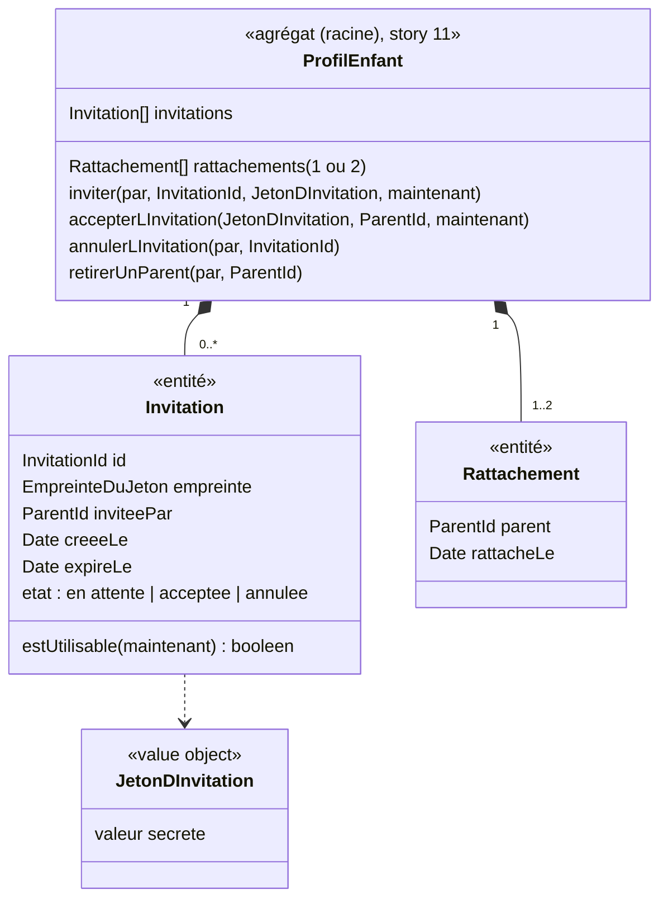

# Modèle du domaine : issue #13, Inviter un second parent à se rattacher à un profil enfant

## Contexte

**Famille** (contexte existant). Nouvelle fonctionnalité, absente de `app/` (un seul compte claude.ai voyait tout). Elle réalise la décision de démarrage n°5 et la décision n°8 du glossaire : un profil enfant a un ou deux parents ; le second se rattache par un lien d'invitation que le premier communique lui-même. **L'application n'envoie rien.**

Relations :
- **Supabase Auth → Famille** (existante, #5) : le parent invité se connecte par lien de connexion ou code de connexion. Son `ParentId` sert au rattachement.
- Aucun autre contexte n'est touché : un parent rattaché voit la progression, les devoirs et le suivi de l'enfant parce que les policies RLS de ces contextes passent toutes par le rattachement (#11).

## Termes

| Terme | Statut | Remarque |
|---|---|---|
| Invitation | au glossaire (à valider) | Précisée : faite pour **un** profil enfant, par un parent rattaché ; elle a une durée et un état. |
| Lien d'invitation | **nouveau** (à valider) | Lien qui porte le jeton d'invitation, communiqué par le parent lui-même (message, e-mail…). Jamais « lien » seul (conflit avec **Lien de connexion**). |
| Jeton d'invitation | **nouveau** (à valider) | Secret impossible à deviner, contenu dans le lien d'invitation, qui désigne l'invitation. Terme du code plus que de l'interface. |
| Parent invité | **nouveau** (à valider) | Parent qui ouvre un lien d'invitation. Il devient un parent rattaché quand il l'accepte. Ce n'est pas un rôle : c'est un Parent. |
| Rattachement | au glossaire (à valider) | Créé ici pour le second parent. |
| Second parent | **nouveau** (à valider) ou simple expression | « Premier » et « second » ne disent que l'ordre d'arrivée, pas des droits différents (sauf réponse à la question ouverte n°1). |
| Code, parrainage, partage | synonymes interdits | Déjà au glossaire (« code » seul, décision n°13). |

## Modèle



### Pourquoi l'invitation est dans l'agrégat `ProfilEnfant`

L'acceptation doit, **en une seule fois** : vérifier que l'invitation est encore utilisable, la marquer acceptée, et rattacher le parent **sans dépasser deux parents**. Si l'invitation était un agrégat séparé, accepter modifierait deux agrégats dans la même transaction, ou laisserait une invitation consommée sans rattachement en cas d'échec. L'invariant « au plus deux parents » exige donc que les invitations en attente vivent avec les rattachements. L'agrégat reste petit : deux rattachements au plus, et peu d'invitations (au plus une en attente si la question ouverte n°5 le confirme). Les invitations acceptées, annulées ou expirées peuvent être oubliées (question ouverte n°8).

### Value objects et entités

| Élément | Règle |
|---|---|
| `JetonDInvitation` | Secret long, impossible à deviner, fourni par un port `GenerateurDeJeton` (jamais tiré dans le domaine). Montré **une seule fois** au parent qui invite, dans le lien d'invitation. Proposition technique : on ne garde que son **empreinte**, pour qu'une fuite de la base ne donne aucun lien utilisable. |
| `InvitationId` | Identifiant opaque (port `GenerateurId`). |
| `Invitation` | Utilisable si elle est **en attente** et que `maintenant < expireLe`. Durée de validité : question ouverte n°2. Usage unique : question ouverte n°2. |
| `LienDInvitation` | Adresse de l'application + jeton. Forme d'interface, construite par le front ; pas une règle du domaine. |

### Commandes (cas d'usage, toutes côté serveur)

| Commande | Règle | Erreurs métier |
|---|---|---|
| `InviterUnSecondParent(parent, profil)` | Le parent doit être rattaché. Le profil doit avoir **un seul** parent. Rend le lien d'invitation (le jeton en clair, une seule fois). | `ParentNonRattache`, `DeuxParentsDejaRattaches`, `InvitationDejaEnAttente` (selon la question ouverte n°5) |
| `AccepterLInvitation(jeton, parentConnecte)` | L'invitation doit être utilisable. Le parent ne doit pas être déjà rattaché. Le profil doit avoir un seul parent. Rattache le parent ; l'invitation devient acceptée. | `InvitationInvalide` (inconnue, expirée, acceptée ou annulée : un ou plusieurs messages, question ouverte n°3), `ParentDejaRattache`, `DeuxParentsDejaRattaches` |
| `AnnulerLInvitation(parent, invitation)` | (si la question ouverte n°4 le demande) Un parent rattaché annule une invitation en attente. | `ParentNonRattache`, `InvitationInvalide` |
| `RetirerUnParent(parent, parentRetire)` | (si la question ouverte n°4 le demande) Ne laisse jamais le profil sans parent. | `ParentNonRattache`, `DernierParentDuProfil` |

Parcours du parent invité : il ouvre le lien d'invitation ; s'il n'est pas connecté, il passe par la connexion du parent (#5) ; **le jeton doit survivre à la connexion** (gardé sur l'appareil ou porté par l'adresse de retour du lien de connexion), puis l'invitation est acceptée. Confirmation explicite ou acceptation automatique : question ouverte n°6.

## Invariants

1. Un profil enfant a **un ou deux parents**, jamais trois. Une invitation ne peut être créée ni acceptée quand le profil a déjà deux parents.
2. Seul un parent rattaché peut inviter (et annuler, et retirer, selon la question ouverte n°4).
3. Une invitation vaut pour **un seul** profil enfant. Accepter ne rattache qu'à ce profil : le parent invité ne voit **pas** les autres enfants du parent qui invite, et inversement (proposition de la question n°3 du glossaire, à confirmer : question ouverte n°7).
4. Une invitation expirée, acceptée ou annulée ne rattache personne.
5. Un parent déjà rattaché ne peut pas accepter une invitation du même profil (pas de doublon de rattachement).
6. L'application n'envoie aucun message : le parent communique le lien lui-même.
7. Le jeton d'invitation est un secret : il n'apparaît dans aucun journal et n'est jamais relu après sa création.
8. Accepter une invitation passe toujours par le serveur : le parent invité n'a, avant cela, aucun accès au profil (RLS).

## Événements

| Événement | Données | Qui réagit |
|---|---|---|
| `SecondParentInvite` (à valider) | profil, invitation, parent qui invite, expiration | personne (le front affiche le lien) |
| `ParentRattache` (à valider) | profil, parent, date | personne côté serveur pour l'instant ; le front du parent invité recharge « Qui joue ? ». Plus tard : prévenir le premier parent (question ouverte n°9). |
| `InvitationAnnulee`, `ParentRetire` (à valider) | selon la question ouverte n°4 | personne |

## Partage avec le front

- Dans le navigateur : rien qui demande une règle hors ligne. Le front affiche le lien d'invitation, le copie ou le partage (partage natif de l'appareil), et garde le jeton pendant la connexion du parent invité.
- Par des Edge Functions (`famille/application/`) : **toutes** les commandes. L'acceptation en particulier : le parent invité ne voit ni le profil ni l'invitation sous RLS. Jamais de clé `service_role` dans le front.
- Point d'architecture à décider (question technique T4) : l'Edge Function d'acceptation a besoin de retrouver une invitation que l'appelant ne peut pas lire. Options : (a) une fonction Postgres dédiée, appelée avec le JWT de l'appelant, qui ne fait que vérifier le jeton et créer le rattachement ; (b) la clé `service_role` **côté serveur seulement**, dans cette seule Edge Function, avec le domaine qui vérifie tout. CLAUDE.md demande le JWT de l'appelant : l'option (a) le respecte. À consigner dans une décision.

## Base de données attendue (description)

| Table | Contenu | Policies RLS |
|---|---|---|
| `invitations` | identifiant, profil enfant, empreinte du jeton, parent qui invite, date de création, date d'expiration, état | **lecture**, **création**, **annulation** : seulement les parents rattachés au profil. **Aucune** lecture pour un parent non rattaché : l'acceptation passe par le chemin de la question technique T4. |
| `rattachements` (#11) | + le second rattachement | **création** du second rattachement : seulement par l'acceptation d'une invitation valide (jamais par une écriture directe du front). Unicité (profil, parent) et au plus deux lignes par profil, aussi vérifiées en base. |

## Données personnelles

- Nouvelle donnée : le **lien entre deux adultes** et un enfant (qui est l'autre parent). Pas de nouvelle donnée sur l'enfant.
- Le parent qui invite **voit-il l'adresse e-mail** de l'autre parent rattaché (et inversement) ? C'est une donnée personnelle d'un adulte montrée à un autre : question ouverte n°10.
- Les invitations font partie de l'export et de la suppression du profil (#14).

## Emplacement

```
supabase/functions/_shared/famille/
  domain/
    invitation.ts                    # entité Invitation
    invitation-id.ts
    jeton-d-invitation.ts            # value object (et son empreinte)
    profil-enfant.ts                 # + inviter, accepterLInvitation, annulerLInvitation, retirerUnParent
    erreurs.ts                       # + DeuxParentsDejaRattaches, ParentDejaRattache, InvitationInvalide, InvitationDejaEnAttente, DernierParentDuProfil
  application/
    ports/generateur-de-jeton.ts
    ports/horloge.ts
    inviter-un-second-parent.ts
    accepter-l-invitation.ts
    annuler-l-invitation.ts          # selon la question ouverte n°4
    retirer-un-parent.ts             # selon la question ouverte n°4
  infrastructure/
    profils-enfants-supabase.ts      # + invitations
    generateur-de-jeton-crypto.ts
  test_utils/
    generateur-de-jeton-fixe.ts
    horloge-fixe.ts
supabase/functions/inviter-un-second-parent/index.ts
supabase/functions/accepter-l-invitation/index.ts
supabase/migrations/<date>_invitations.sql
src/famille/                         # écran « Inviter l'autre parent », page d'arrivée du lien d'invitation
```

## Questions ouvertes

1. (glossaire n°1, issue n°1, #12 n°4) Les **deux parents ont-ils les mêmes droits** sur le profil : modifier le profil et ses réglages, inviter, supprimer le profil, retirer l'autre parent (oui à tout) ? Sinon, lesquels sont réservés au parent qui a créé le profil ?
2. (glossaire n°2, issue n°2) **Durée** d'une invitation (proposition à valider : 7 jours) et **usage unique** (oui) ?
3. (nouvelle) Un **seul message** pour une invitation inconnue, expirée, déjà utilisée ou annulée (« Cette invitation ne marche plus : demande un nouveau lien à l'autre parent. ») (oui), comme pour le lien de connexion ?
4. (issue n°4) Le parent peut-il **annuler** une invitation pas encore utilisée (oui / non) ? Peut-il **retirer l'autre parent** (oui / non) ? Un parent peut-il **se retirer lui-même** d'un profil qui a deux parents (oui / non) ?
5. (nouvelle) Une seule **invitation en attente** à la fois par profil (oui : en créer une nouvelle annule l'ancienne, ou est refusée ?) ?
6. (nouvelle) En ouvrant le lien, le parent invité doit-il **confirmer** (« Paul t'invite à suivre Léa. Accepter ? ») (oui), ou est-il rattaché dès sa connexion (non) ?
7. (glossaire n°3, issue n°3) Deux parents rattachés au même enfant ne voient **pas** leurs autres enfants respectifs (oui, proposition actuelle) ?
8. (nouvelle) Faut-il garder la **trace** des invitations acceptées, annulées ou expirées (oui : combien de temps ?), ou les oublier dès qu'elles ne servent plus (non, minimisation) ?
9. (nouvelle) Le premier parent est-il **prévenu** quand l'autre parent a accepté (dans l'espace parent, oui / non) ? L'application n'envoie aucun e-mail.
10. (nouvelle) Chaque parent voit-il **qui est l'autre parent** rattaché (son adresse e-mail) dans l'espace parent (oui / non) ?
11. (nouvelle) Une famille avec deux enfants : faut-il **une invitation par enfant** (oui, ce que donne la règle « un rattachement par enfant »), ou une seule invitation pour plusieurs enfants (non) ?
12. (nouvelle) Le lien est un **porteur** : toute personne qui l'a en main peut se rattacher (oui, c'est ce que dit l'issue), ou l'invitation est-elle réservée à une adresse e-mail saisie par le parent qui invite (non) ?
13. (nouvelle) Un parent qui ouvre l'invitation d'un **profil auquel il est déjà rattaché** voit-il un message (« Tu suis déjà Léa. ») (oui) ?

### Question technique

- T4. Chemin de l'acceptation sous RLS (fonction Postgres avec le JWT de l'appelant, ou `service_role` côté serveur seulement) : à décider et consigner dans `docs/decisions/`.
