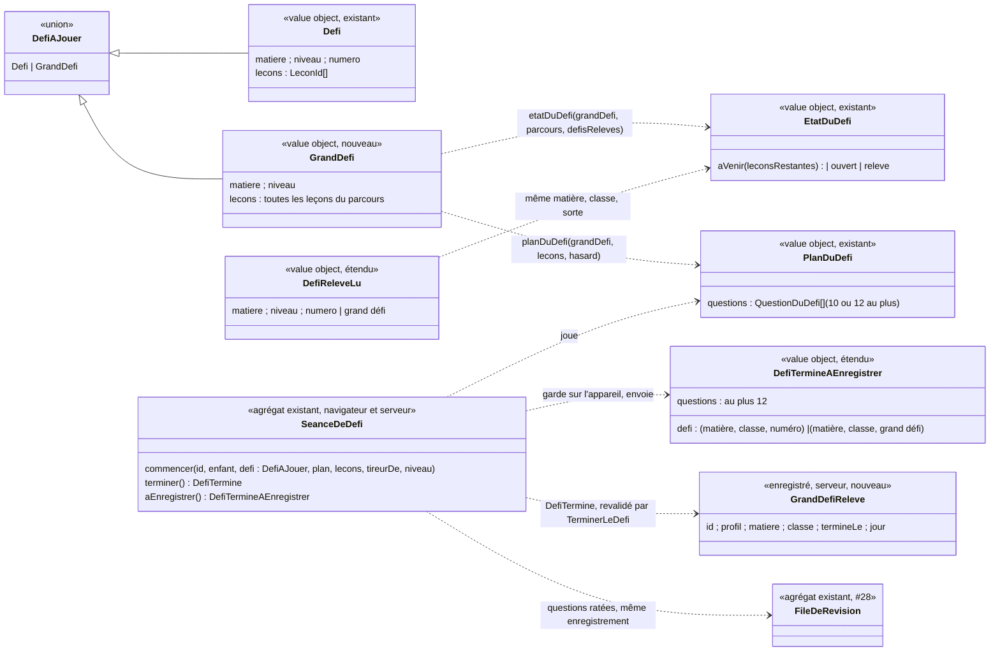

# Modèle du domaine : issue #137, Grand défi de la matière

État : **cadrage validé** (PO, 2026-11-04, 21:08 UTC, « 137 reco tout » : recommandations #137.1 à #137.7 retenues,
décision 0041 validée). Le grand défi prolonge le défi d'une partie du parcours (#100, mergée). Les décisions du PO
gardées pour #137 (réponse 2.a sur #100, commentaire 6507264741) n'ont pas été reposées : R6, 100.3, 100.5, 100.6,
100.7, 100.14, 100.20, 100.21, 100.22 et 100.23. Le reste suit #100 tel quel. Plus aucune question ouverte.

## Réponses du PO (2026-11-04)

| Question | Réponse retenue | Conséquence dans le modèle |
|---|---|---|
| #137.1 Nom de référence | **A** : **Grand défi** ; « défi de la matière » permis pour l'expliquer | `GrandDefi`, `grandDefiDeLaMatiere`, `NOMBRE_DE_QUESTIONS_DU_GRAND_DEFI` ; scénarios et écran disent « Grand défi » |
| #137.2 Séance qui ouvre deux défis | **A** : seulement l'annonce « Le grand défi des maths est ouvert ! » ; le défi de la partie est ouvert sur « Mon parcours », sans annonce | `defiOuvertParLaSeance` rend **un seul** défi, le grand défi en priorité |
| #137.3 Nom de la matière dans les textes | **Oui** : le tableau « du français / de français », « des maths / de maths », etc., rangé dans le **Catalogue**, à côté du nom court | `catalogue/domain/matiere.ts` : deux formes de la matière avec article |
| #137.4 Proposition du personnage guide | **Oui** : « Bravo Léa ! Tu as réussi toutes les leçons de maths. Le grand défi t'attend ! » | `paroles-du-defi.ts` |
| #137.5 Autres textes | **Textes proposés** (début, fin, rejoué) et **A** : annonce « Grand défi relevé ! » | `paroles-du-defi.ts` |
| #137.6 Place dans « Mes défis relevés » | **Oui** : après les défis de la même matière et de la même classe | `defis-releves.ts`, tri |
| #137.7 Boutons de la fin de la séance qui rend la matière réussie | **A** : « Relever le défi » s'ajoute aux boutons déjà proposés quand la matière est réussie, sans rien changer à ceux-ci | Affichage seulement (`src/`), aucune règle nouvelle |
| Décision 0041 | **Validée** | `docs/decisions/0041-grand-defi-enregistre-a-part.md` |

## Décisions déjà prises (rappel)

| Décision | Contenu | Conséquence dans le modèle |
|---|---|---|
| R6 de #100 | Le grand défi s'ouvre quand la **matière est réussie** (#26). Il est près du fanion du dessin du parcours (#99) et remplace le défi de la dernière partie. La séance qui rend la matière réussie l'annonce | `etatDuDefi` : ouvert quand toutes les leçons du parcours de la classe sont réussies, c'est-à-dire quand la matière est réussie |
| 100.3 | L'écran dit « Grand défi » | Nom affiché par Motivation |
| 100.5, 100.6 | **12 questions**, au moins une de chacune des leçons de la matière ; à parts égales entre les leçons ; quand il y a plus de leçons que de questions, une question par leçon tirée au hasard | Même répartition que le défi d'une partie (règle 5 de #100), avec 12 au lieu de 10 |
| 100.7 | Questions mélangées | Inchangé |
| 100.14 | Une matière d'une seule partie du parcours n'a **que** le grand défi, à venir tant que la matière n'est pas réussie | Toute matière qui a au moins une leçon dans la classe a un grand défi |
| 100.20 | Termes « Défi de la matière » et « grand défi » validés | Ajoutés au glossaire ; nom de référence **Grand défi** (#137.1 A) |
| 100.21 | Annonce « Le grand défi des maths est ouvert ! » ; parole « Bravo Léa ! Tu as réussi toutes les leçons de maths. Le grand défi t'attend ! » | Parole validée (#137.4) ; formes de la matière au Catalogue (#137.3) |
| 100.22 | Moins de questions posables que prévu : toutes, une fois chacune (exemple : 6 questions pour les sciences du CE1) | Inchangé |
| 100.23 | Le grand défi remplace le défi de la dernière partie | `defisDeLaMatiere` ne change pas (la dernière partie reste sans défi) ; le grand défi s'ajoute à côté |
| Suit #100 | Ni vie ni temps limité ; relevé dès qu'il est terminé, avec ou sans erreur ; rejouable avec un nouveau tirage, sans nouvelle récompense ; aucune étoile ; ne compte ni pour la série, ni pour les épisodes, ni pour l'objectif du jour, ni pour la quête du jour ; question manquée dans la file de révision (100.10) ; relevé pour toujours même si la bibliothèque change (100.15) ; à venir visible sans cadenas (100.16) ; ligne « Grand défi · Sciences · CE1 » dans « Mes défis relevés » ; lecteurs d'écran « Grand défi : à venir, encore 6 leçons pour ouvrir le défi » ; repère « Grand défi » à 360 px | Règles 6 à 13 de #100 reprises sans changement |

## Contexte

**Apprentissage** pour le grand défi lui-même, **Motivation** pour sa mise en scène et sa récompense : exactement le
partage de #100 (décision 0038). Aucun contexte nouveau, aucune relation nouvelle.

- Apprentissage : la matière réussie (#26) et les leçons du parcours de la classe (#25) se lisent déjà dans le parcours.
  Le grand défi est un **défi** de plus, dont les leçons sont toutes celles du parcours de la matière dans la classe, au
  lieu de celles d'une partie. Tirage, séance, revalidation, file de révision et enregistrement sont ceux du défi.
- Motivation : nom affiché (« Grand défi »), paroles, annonce de fin de séance, ligne de « Mes défis relevés ». Elle lit
  les grands défis relevés comme elle lit les défis relevés, sans rien écrire.
- Catalogue : `matiere`, `niveau`, `ordre`, `exercices` lus tels quels. Le format des leçons ne change pas. Les textes
  qui nomment la matière avec son article (« des maths », « de maths ») utilisent deux formes de la matière, ajoutées
  au Catalogue à côté du nom court (#137.3).
- Famille : contrat de données personnelles (#14) étendu à la nouvelle donnée.

| Relation (existante, #100) | Ce que #137 y ajoute |
|---|---|
| Apprentissage → Motivation, lecture seule des défis relevés | Les grands défis relevés sont lus avec les autres ; le type `DefiReleve` publié par `@domain/apprentissage` reçoit une seconde forme (matière, classe, sans numéro) |
| Apprentissage (séance de défi) → Apprentissage (file de révision), même enregistrement | Inchangé : `TerminerLeDefi` retient les questions ratées du grand défi comme celles d'un défi |
| Apprentissage → Accompagnement, fait `DefiTermine` | Le fait porte un grand défi ; toujours sans abonné (100.18) |
| Famille → Apprentissage, contrat de données personnelles | La nouvelle donnée (grand défi terminé) est supprimée en cascade et ajoutée à l'export |

### Ce qui est réutilisé tel quel

- `parcoursDeLaMatiere`, `partiesDuParcours`, `defisDeLaMatiere` (#25, #100), sans changement de règle.
- `etatDuDefi` : sa règle (relevé, sinon ouvert si toutes ses leçons sont réussies, sinon à venir avec le nombre de
  leçons qui manquent) donne directement R6 quand les leçons du défi sont toutes celles du parcours. Seule la
  comparaison « même défi » doit savoir distinguer les deux sortes.
- `questionsPosablesDuDefi`, `planDuDefi`, `estUnPlanPossible` : ils ne lisent que les leçons du défi. Seul le nombre de
  questions change (12 au lieu de 10). La répartition à parts égales donne déjà « une question par leçon tirée au
  hasard » quand il y a plus de 12 leçons qui ont des questions posables (maths du CP : 31 leçons → 12 leçons tirées,
  une question chacune).
- `SeanceDeDefi`, `QuestionsEnCours`, `rejouer-la-reponse.ts`, `FileDeRevision.retenir` : inchangés.
- `revaliderLeDefi` : même chemin ; seul le défi recalculé change (le grand défi de la matière au lieu du défi d'un
  numéro).
- Motivation : `defiReleveParLaSeance` (« grande victoire » la première fois, « séance terminée » ensuite), moment de
  célébration `defiReleve` (#106), section `defisReleves` de « Mes médailles ».

## Termes

| Terme | Statut | Remarque |
|---|---|---|
| Défi (d'une partie du parcours), Défi à venir, Défi ouvert, Défi relevé, Séance de défi, Fin du défi, Défi terminé, Partie du parcours, Matière réussie, Parcours, Place, File de révision, Question ratée, Leçon d'origine, Personnage guide | existants | Réutilisés sans les redéfinir |
| **Grand défi** (défi de la matière) | **validé** (100.20) ; nom de référence (#137.1 A) ; « défi de la matière » permis pour l'expliquer | Défi dont les leçons sont **toutes** les leçons du parcours d'une matière dans la classe du profil. Il s'ouvre quand la matière est réussie, pose 12 questions (ou toutes les questions posables s'il y en a moins), remplace le défi de la dernière partie. Un seul par matière et par classe |
| Défi à venir, Défi ouvert, Défi relevé, Séance de défi, Fin du défi (complément) | existants, précisés | Ils valent aussi pour le grand défi : à venir tant que la matière n'est pas réussie (« encore 6 leçons »), ouvert quand elle est réussie et jamais relevé, relevé une fois terminé |
| Matière réussie | existant `(à valider)` pour le nom (#26) | Le grand défi s'appuie sur la règle (validée) ; le nom n'est pas repris ici |
| « Défi final », « super défi », « défi de fin », « défi de la classe », « épreuve finale », « examen », « boss », « chapitre » | **interdits** pour le grand défi | Font penser à une note, à un adversaire ou au « chapitre » déjà interdit |
| « Fanion » | mot d'interface (#99, 99.31) | Le grand défi est « près du fanion » sur le dessin ; le fanion n'est pas un terme du domaine |

## Modèle

Le grand défi est identifié par **(matière, classe)** : il n'y en a qu'un par matière et par classe. Il n'a pas de
numéro : il ne dépend pas du découpage en parties, ce qui garde la règle 100.15 (un grand défi relevé reste relevé même
si l'ajout d'une leçon change le nombre de parties). `DefiAJouer` est le nom de travail de « un défi d'une partie ou le
grand défi » (nom de travail du code, pas un terme du glossaire). Le défi d'une partie garde sa forme et son identité (matière,
classe, numéro) : rien ne change pour les défis relevés déjà enregistrés.

### Fonctions pures d'Apprentissage (`@domain/apprentissage`, navigateur et serveur)

- `grandDefiDeLaMatiere(parcours, matiere, niveau)` → `GrandDefi` ou rien : les leçons du parcours de la classe, dans
  l'ordre des places. Rien quand la matière n'a aucune leçon dans la classe (elle n'est jamais réussie, 26.18).
  `defisDeLaMatiere` ne change pas.
- `etatDuDefi(defi, parcours, defisReleves)` : accepte un `GrandDefi`. Relevé si un défi relevé est le grand défi de la
  même matière et de la même classe ; sinon ouvert si la matière est réussie ; sinon à venir avec le nombre de leçons
  de la classe qui ne sont pas réussies.
- `defiOuvertParLaSeance(avant, apres, matiere, niveau, defisReleves)` : rend aussi le grand défi quand la séance rend
  la matière réussie et qu'il n'est pas déjà relevé. Une même séance peut ouvrir à la fois un défi d'une partie et le
  grand défi (la leçon rendue réussie est dans les deux) : elle ne rend alors **que le grand défi** (#137.2 A) ; le défi
  de la partie est ouvert sur « Mon parcours », sans annonce. Ce calcul est proche de `matiereReussieParLaSeance`, prévue par #106 (106g) et pas encore livrée :
  l'une doit s'appuyer sur l'autre, sans dupliquer la règle de réussite d'une matière.
- `planDuDefi(defi, lecons, hasard)` et `estUnPlanPossible(defi, lecons, cles)` : le nombre de questions vient de la
  sorte du défi, `NOMBRE_DE_QUESTIONS_DU_DEFI` (10) ou **`NOMBRE_DE_QUESTIONS_DU_GRAND_DEFI` (12)**.
- `revaliderLeDefi(envoi, entrees, defisReleves)` : pour un grand défi, le défi est recalculé par
  `grandDefiDeLaMatiere` avec la classe du profil ; `DefiInconnu` si la classe envoyée n'est pas celle du profil ou si
  la matière n'a pas de leçon dans la classe ; `DefiAVenir` si la matière n'est pas réussie.

### Agrégat `SeanceDeDefi`

Inchangé dans ses règles. Il reçoit un `DefiAJouer` ; `DefiTermine.defi` et `aEnregistrer().defi` portent la sorte du
défi. La boucle des questions, l'aide, la nouvelle chance et « Je ne sais pas » sont celles du défi.

### Commande, événement, erreurs

- Commande : **`TerminerLeDefi`**, la même que #100 (Edge Function `terminer-le-defi`), pour les deux sortes de défi.
- Événement : **`DefiTermine`**, le même ; son `defi` peut être un grand défi.
- Port `DefisTermines` : `releves(enfant)` rend aussi les grands défis relevés ; `enregistrer(fait, file)` enregistre un
  grand défi terminé avec la file de révision, d'un seul geste, avec les mêmes issues (`enregistree`,
  `dejaEnregistree`, `conflit`).
- Erreurs métier : celles de #100, sans erreur nouvelle (`DefiInconnu`, `DefiAVenir`, `QuestionHorsDuDefi`,
  `PlanDuDefiIncoherent`, `DefiIncoherent`, `AucuneQuestionPourLeDefi`, `DefiNonFini`, `DefiDejaTermine`).

### Motivation (`@domain/motivation`)

- `paroles-du-defi.ts` : nom « Grand défi » (100.3) ; annonce de fin de séance « Le grand défi des maths est
  ouvert ! » (100.21, forme de la matière du Catalogue, #137.3) ; proposition du personnage guide « Bravo Léa ! Tu as
  réussi toutes les leçons de maths. Le grand défi t'attend ! » (#137.4) ; début « Voici des questions de toutes tes
  leçons de maths. Prends ton temps, je suis avec toi ! » ; fin « Bravo Léa ! Tu as relevé le grand défi des maths ! »,
  rejoué « Bravo Léa ! Tu as encore relevé le grand défi des maths ! » ; annonce de la fin « Grand défi relevé ! »
  (#137.5 A).
- `defis-releves.ts` : `memeDefi` distingue le grand défi du défi d'un numéro ; `lignesDesDefisReleves` écrit
  « Grand défi · Sciences · CE1 », **après** les défis de la même matière et de la même classe (#137.6).
- `moment-de-celebration.ts` (#106) : un grand défi relevé pour la première fois est le moment `defiReleve`, comme un
  défi ; rejoué, ce n'est pas un moment de célébration.

## Invariants

1. **Un grand défi par matière et par classe**, pour toute matière qui a au moins une leçon dans la classe du profil.
   Ses leçons sont toutes les leçons du parcours de cette matière dans la classe, recalculées à chaque lecture, jamais
   enregistrées. Les leçons des classes d'avant, d'une classe au-dessus et les leçons personnelles n'en sont pas.
2. **La dernière partie du parcours n'a jamais de défi d'une partie** (100.23, déjà vrai dans #100). Exemples, en
   nombre de leçons de la classe :
   - 3, 5 ou 7 leçons (une seule partie) → **Grand défi** seul (100.14) ;
   - 13 leçons (parties 1-5, 6-10, 11-13) → **Défi 1**, **Défi 2**, **Grand défi** ;
   - maths du CP, 31 leçons (5, 5, 5, 5, 5, 6) → **Défi 1 à Défi 5**, **Grand défi**.
3. **Ouverture** : le grand défi est ouvert quand la matière est réussie (toutes les leçons de la classe réussies, à
   1 étoile ou plus, ou réussies au test de départ). Sinon il est à venir, visible, sans cadenas, avec le nombre de
   leçons qui manquent. Il ne dépend pas des défis des parties : un défi d'une partie non relevé n'empêche rien.
4. **Il ne bloque rien** : prochaine leçon, avancée dans le parcours, leçon du jour, leçons de la classe au-dessus
   (#26) l'ignorent. Le personnage guide se tient au fanion quand la matière est réussie (#99) et ne s'arrête jamais au
   grand défi.
5. **Questions** : règle 5 de #100, avec **12** au lieu de 10. Seulement des leçons de la matière dans la classe, des
   exercices qui se posent seuls, chaque question au plus une fois, une question partagée par deux leçons comptée une
   fois (première occurrence) ; parts égales entre les leçons qui ont des questions posables (au plus une de plus
   qu'une autre) ; plus de 12 telles leçons → 12 leçons tirées au hasard, une question chacune ; moins de 12 questions
   posables → toutes, une fois chacune (100.22 : 6 questions pour les sciences du CE1) ; ordre mélangé. Une matière sans
   aucune question posable : le grand défi n'est jamais joué (`AucuneQuestionPourLeDefi`), comme un défi de #100.
6. **Une erreur** : encouragement, aide, nouvelle chance sans limite, « Je ne sais pas ». Pas de vie, pas de chrono,
   pas de « perdu ».
7. **Relevé, rejoué** : terminé = relevé, quel que soit le nombre d'erreurs. Rejouable avec un nouveau tirage, sans
   nouvelle récompense. Relevé pour toujours, même si la bibliothèque change (une leçon ajoutée rend la matière non
   réussie : un grand défi déjà relevé reste relevé, un grand défi pas encore relevé redevient à venir). Quitté : rien
   n'est gardé.
8. **Aucune note modifiée** : ni étoile, ni résultat de la leçon, ni meilleures étoiles, ni total des étoiles, ni test
   de départ. Ne compte ni pour la série, ni pour les épisodes, ni pour l'objectif du jour, ni pour la quête du jour.
9. **Questions ratées** : règle 9 de #100 sans changement (file de révision, leçon d'origine = leçon d'où vient la
   question, calculées par le serveur).
10. **Revalidation** : règle 10 de #100. Pour un grand défi : classe = classe du profil (`DefiInconnu` sinon), matière
    avec au moins une leçon dans la classe (`DefiInconnu`), matière réussie ou grand défi déjà relevé (`DefiAVenir`),
    plan conforme à l'invariant 5 avec 12 questions (`PlanDuDefiIncoherent`).
11. **Enregistrement tout ou rien et idempotent**, par l'identifiant de la séance de défi, avec la file de révision.
12. **Contenu pour les enfants** : « grand » dit l'ampleur (toute la matière), jamais un adversaire. Ni combat, ni
    monstre, ni menace, ni compte à rebours, ni lieu effrayant ; on ne dit jamais « perdu » ni « raté ». Le repère près
    du fanion reste dans le style de #99 (skill `illustration`, section 0) et ne dessine pas de coffre ni de trésor
    (99.31, 98.6).

## Événements

- `DefiTermine` (Apprentissage), inchangé dans sa forme : `id`, `enfant`, `defi` (ici le grand défi : matière, classe,
  leçons de la matière), `nombreDeQuestions` (12 au plus), `questionsRatees`, `termineeLe`, `jour`.
- Ni `SeanceTerminee`, ni `LeconReussie`, ni `LeconAcquise`, ni `ErreursCorrigeesPourDeBon`.
- Un grand défi déjà enregistré (même identifiant) ne publie rien de nouveau.

## Données persistées

**La table `defis_termines` ne peut pas accueillir le grand défi sans migration.** Sa colonne `numero` est
`smallint not null check (numero >= 1)` :
- un numéro « sentinelle » 0 est refusé par la contrainte ; changer la contrainte n'est pas additif ;
- y écrire le numéro de la dernière partie confondrait le grand défi avec un défi d'une partie dès qu'une leçon ajoutée
  crée une partie de plus (contraire à 100.15) ;
- une colonne ajoutée (« sorte ») laisserait `numero` obligatoire pour un défi qui n'en a pas.

**Migration strictement additive** (décision 0041, validée) :
- table **`grands_defis_termines`** (Apprentissage) : `id` (identifiant de la séance de défi, clé), `profil`
  (cascade avec le profil), `matiere`, `classe` (le `Niveau`, décision 0038), `termine_le`, `jour`. Mêmes contraintes
  de matière et de classe que `defis_termines`. Le grand défi relevé se lit « au moins une ligne pour (profil, matière,
  classe) » ;
- fonction **`enregistrer_le_grand_defi_termine`**, sur le modèle de `enregistrer_le_defi_termine` : grand défi terminé
  et file de révision d'un seul geste, idempotente par identifiant, `security invoker`, exécutable par `service_role`
  seul ; rend `enregistree`, `dejaEnregistree` ou `conflit` ;
- RLS : lecture seule par le parent rattaché ; aucune écriture pour `anon` ni `authenticated`.
- Aucune table ni fonction existante n'est modifiée. Les défis relevés déjà enregistrés ne bougent pas.

**Donnée d'enfant nouvelle** : le seul fait d'avoir terminé le grand défi d'une matière (quelle matière, quelle classe,
quel jour). Même nature que le défi terminé de #100 : elle sert au repère et au rejeu, reste dans l'UE, est minimale
(ni questions, ni réponses, ni erreurs), supprimée en cascade avec le profil. **Contrat d'export (#14)** : ajouter
`grands_defis_termines` (toutes ses colonnes). Rien n'est envoyé à l'IA.

## Edge Function `terminer-le-defi`

Elle **doit changer**, sans nouvelle fonction :
- la lecture du corps (`corps-du-defi-termine.ts`) accepte un `defi` de grand défi (matière, classe et la marque du
  grand défi, sans numéro) en plus de la forme actuelle (matière, classe, numéro), qui reste acceptée telle quelle : un
  défi gardé sur l'appareil avant #137 se renvoie toujours ;
- elle accepte jusqu'à 12 questions, tirages et réponses (la limite actuelle est 10, `NOMBRE_DE_QUESTIONS_DU_DEFI`) ;
  la revalidation garde la limite propre à chaque sorte ;
- le handler, le cas d'usage `TerminerLeDefi` et leurs ports restent les mêmes ; l'adaptateur `DefisTerminesSupabase`
  lit les deux tables et écrit par la fonction qui correspond à la sorte du défi.
Le déploiement de la fonction suit celui de la migration.

## Effets sur les écrans (points de contact)

- **« Mon parcours »** : un repère « Grand défi » après la dernière leçon, près du fanion, à venir (pas un bouton,
  « Encore 6 leçons pour ouvrir le défi »), ouvert (« Relever le défi ») ou relevé (« Rejouer le défi », 100.29), sans
  cadenas. Liste des lecteurs d'écran : une ligne « Grand défi : … » après la dernière leçon. Tient à 360 px.
- **Fin de la séance** qui rend la matière réussie : annonce « Le grand défi des maths est ouvert ! » en dernier dans la
  zone des nouveautés, avec « Relever le défi » ; la célébration de la matière réussie (#106) se joue comme prévu.
  Rien n'est lancé d'office. « Relever le défi » s'ajoute aux boutons déjà proposés quand la matière est réussie, sans
  en retirer (#137.7 A). Deux défis ouverts par la même séance : seule l'annonce du grand défi (#137.2 A).
- **Séance de défi** : titre « Grand défi », avec le nom court de la matière ; paroles : #137.5 (section Motivation).
- **Fin du défi** : celle de #100 (célébration, « grande victoire » la première fois, « séance terminée » ensuite,
  « Mon parcours » et « Accueil », aucune étoile).
- **« Mes médailles »**, section « Mes défis relevés » : ligne « Grand défi · Sciences · CE1 ».
- **Hors ligne** : le grand défi se joue, se garde sur l'appareil et se renvoie comme un défi (`src/defis/`).
- **Scénarios de #100 à adapter** par `po-acceptance` : ceux qui disent que la dernière partie ou une matière d'une
  seule partie n'a « aucun repère » (1.4, 2e cas ; 1.5 ; ligne de 6.2) verront désormais le repère « Grand défi ».

## Partage avec le front

Tout ce qui précède dans `domain/` est pur et importé par le front via `@domain/apprentissage` et `@domain/motivation` :
`grandDefiDeLaMatiere`, `etatDuDefi`, `defiOuvertParLaSeance`, `planDuDefi`, `SeanceDeDefi`, paroles et lignes de
Motivation. L'enfant ouvre, joue et termine le grand défi hors ligne ; le serveur revalide à la synchronisation.

## Emplacement

- `supabase/functions/_shared/apprentissage/domain/` :
  - `defis-de-la-matiere.ts` : `GrandDefi`, `grandDefiDeLaMatiere`, la forme « grand défi » de `DefiReleve`, la
    comparaison du même défi, `etatDuDefi` et `defiOuvertParLaSeance` étendus ;
  - `plan-du-defi.ts` : `NOMBRE_DE_QUESTIONS_DU_GRAND_DEFI`, nombre de questions selon la sorte ;
  - `seance-de-defi.ts`, `defi-termine-a-enregistrer.ts`, `revalider-le-defi.ts` : la sorte du défi ;
  - `index.ts` : exports ; chacun avec son `_test.ts`.
- `apprentissage/infrastructure/` : `corps-du-defi-termine.ts` (forme du grand défi, 12 questions),
  `defis-termines-supabase.ts` (lecture des deux tables, écriture selon la sorte). `test_utils/` : fake de
  `DefisTermines` étendu.
- `supabase/migrations/<horodatage>_grands_defis_termines.sql` (additive).
- `supabase/functions/terminer-le-defi/index.ts` : inchangé si l'adaptateur porte le changement.
- `supabase/functions/_shared/motivation/domain/` : `paroles-du-defi.ts`, `defis-releves.ts`.
- `supabase/functions/_shared/catalogue/domain/matiere.ts` : formes de la matière pour « des maths » et « de maths »
  (#137.3).
- Affichage, pour mémoire : `src/parcours/` (repère près du fanion), `src/defis/` (écran, lecture des grands défis
  relevés, défis gardés sur l'appareil).

## Questions ouvertes

Aucune. Les questions #137.1 à #137.7 ont reçu leur réponse le 2026-11-04 (tableau « Réponses du PO » en tête).

## Comportements unitaires à tester (TDD, dans cet ordre)

Les fichiers suivent ceux de #100. `A` = `supabase/functions/_shared/apprentissage/`, `M` =
`supabase/functions/_shared/motivation/`, `C` = `supabase/functions/_shared/catalogue/`. Chaque export nouveau passe
par le `domain/index.ts` du contexte.

### 1. Apprentissage, domaine

| # | Comportement | Fichier visé | Fichier de test |
|---|---|---|---|
| 1 | `grandDefiDeLaMatiere` rend le grand défi de la matière et de la classe, avec **toutes** les leçons du parcours de la classe, dans l'ordre des places (13 leçons → 13 leçons) | `A/domain/defis-de-la-matiere.ts` | `A/domain/defis-de-la-matiere_test.ts` |
| 2 | Il ne prend ni les leçons des classes d'avant, ni celles d'une classe au-dessus, ni les leçons personnelles | idem | idem |
| 3 | Une matière d'une seule partie (3 leçons) a un grand défi ; une matière sans leçon dans la classe n'en a pas (rien) | idem | idem |
| 4 | `defisDeLaMatiere` ne change pas : 13 leçons → Défi 1 et Défi 2, la dernière partie reste sans défi | idem | idem (test existant, gardé vert) |
| 5 | `etatDuDefi` d'un grand défi : à venir avec le nombre de leçons de la classe non réussies (« encore 6 ») | `A/domain/defis-de-la-matiere.ts` | `A/domain/etat-du-defi_test.ts` |
| 6 | Ouvert quand la matière est réussie (leçons à 1 étoile ou plus, ou réussies au test de départ), même si un défi d'une partie n'est pas relevé | idem | idem |
| 7 | Relevé quand un défi relevé est le grand défi de la même matière et de la même classe ; un grand défi relevé d'une autre classe ou d'une autre matière ne compte pas | idem | idem |
| 8 | Un défi d'une partie relevé (même le numéro de la dernière partie) ne rend pas le grand défi relevé, et un grand défi relevé ne rend relevé aucun défi d'une partie | idem | idem |
| 9 | Relevé pour toujours : une leçon ajoutée à la matière (matière plus réussie) laisse relevé un grand défi déjà relevé, et rend à venir un grand défi pas encore relevé | idem | idem |
| 10 | `NOMBRE_DE_QUESTIONS_DU_GRAND_DEFI` vaut 12 ; `planDuDefi` d'un grand défi pose 12 questions, au moins une de chaque leçon quand il y en a 12 ou moins avec des questions posables, à parts égales (au plus une de plus qu'une autre) | `A/domain/plan-du-defi.ts` | `A/domain/plan-du-defi_test.ts` |
| 11 | Plus de 12 leçons avec des questions posables (31 leçons) : 12 leçons tirées au hasard, une question chacune | idem | idem |
| 12 | Moins de 12 questions posables : toutes, une fois chacune (6 questions) ; ordre mélangé | idem | idem |
| 13 | Le défi d'une partie garde 10 questions (test existant, gardé vert) | idem | idem |
| 14 | `estUnPlanPossible` d'un grand défi accepte un plan de 12 questions conforme, refuse 13 questions ou une question d'une autre matière | idem | idem |
| 15 | `defiOuvertParLaSeance` rend le grand défi quand la séance rend la matière réussie et qu'il n'est pas relevé | `A/domain/defis-de-la-matiere.ts` | `A/domain/defi-ouvert-par-la-seance_test.ts` |
| 16 | Rien quand le grand défi est déjà relevé, ou quand la matière était déjà réussie avant la séance | idem | idem |
| 17 | **Priorité au grand défi** (#137.2 A) : une séance qui ouvre à la fois le Défi 2 et le grand défi ne rend que le grand défi | idem | idem |
| 18 | Une séance qui ouvre un défi d'une partie sans rendre la matière réussie rend ce défi, comme dans #100 (test existant) | idem | idem |
| 19 | `SeanceDeDefi.commencer` accepte un grand défi ; `terminer()` rend un `DefiTermine` dont le `defi` est le grand défi, avec 12 questions au plus ; `aEnregistrer()` porte (matière, classe, grand défi) sans numéro | `A/domain/seance-de-defi.ts`, `A/domain/defi-termine-a-enregistrer.ts` | `A/domain/seance-de-defi_test.ts` |
| 20 | `revaliderLeDefi` d'un grand défi : recalcule le grand défi avec la classe du profil ; `DefiInconnu` si la classe envoyée n'est pas celle du profil, ou si la matière n'a aucune leçon dans la classe | `A/domain/revalider-le-defi.ts` | `A/domain/revalider-le-defi_test.ts` |
| 21 | `DefiAVenir` si la matière n'est pas réussie et que le grand défi n'est pas déjà relevé ; accepté s'il est déjà relevé (rejeu) | idem | idem |
| 22 | `PlanDuDefiIncoherent` si le plan n'a pas 12 questions alors que 12 sont posables, ou contient une question hors de la matière dans la classe ; questions ratées et leçons d'origine calculées comme dans #100 | idem | idem |

### 2. Catalogue, domaine

| # | Comportement | Fichier visé | Fichier de test |
|---|---|---|---|
| 23 | Forme de la matière avec article défini contracté, pour chaque matière : du français, des maths, des sciences, de l'histoire-géo, de l'anglais, du vivre ensemble (#137.3) | `C/domain/matiere.ts` | `C/domain/matiere_test.ts` |
| 24 | Forme de la matière avec « de » : de français, de maths, de sciences, d'histoire-géo, d'anglais, de vivre ensemble (#137.3) | idem | idem |

### 3. Motivation, domaine

| # | Comportement | Fichier visé | Fichier de test |
|---|---|---|---|
| 25 | Nom du grand défi : « Grand défi » (100.3) | `M/domain/paroles-du-defi.ts` | `M/domain/paroles-du-defi_test.ts` |
| 26 | Annonce de fin de séance : « Le grand défi des maths est ouvert ! » (forme du Catalogue) | idem | idem |
| 27 | Proposition du personnage guide : « Bravo Léa ! Tu as réussi toutes les leçons de maths. Le grand défi t'attend ! » (#137.4) | idem | idem |
| 28 | Parole du début : « Voici des questions de toutes tes leçons de maths. Prends ton temps, je suis avec toi ! » (#137.5) | idem | idem |
| 29 | Parole de fin : « Bravo Léa ! Tu as relevé le grand défi des maths ! » la première fois, « Bravo Léa ! Tu as encore relevé le grand défi des maths ! » rejoué (#137.5) | idem | idem |
| 30 | Annonce de la fin du défi, la première fois : « Grand défi relevé ! » ; le défi d'une partie garde « Défi relevé ! » (#137.5 A) | idem | idem |
| 31 | `defiReleveParLaSeance` d'un grand défi : « grande victoire » la première fois, « séance terminée » rejoué ; un défi d'une partie relevé de la même matière ne compte pas comme le grand défi | `M/domain/defis-releves.ts` | `M/domain/defis-releves_test.ts` |
| 32 | `lignesDesDefisReleves` écrit « Grand défi · Sciences · CE1 » | idem | idem |
| 33 | Ordre : par matière, classe, puis les défis par numéro, **le grand défi après** les défis de la même matière et de la même classe (#137.6) | idem | idem |
| 34 | Moment de célébration : un grand défi relevé la première fois est `defiReleve` ; rejoué, aucun moment | `M/domain/moment-de-celebration.ts` | `M/domain/moment-de-celebration_test.ts` |

### 4. Apprentissage, application et infrastructure

| # | Comportement | Fichier visé | Fichier de test |
|---|---|---|---|
| 35 | `lireLeDefiTermine` lit un `defi` de grand défi (matière, classe, marque du grand défi, sans numéro) | `A/infrastructure/corps-du-defi-termine.ts` | `A/infrastructure/corps-du-defi-termine_test.ts` |
| 36 | La forme d'avant #137 (matière, classe, numéro) reste lue telle quelle ; un corps avec à la fois un numéro et la marque du grand défi, ou ni l'un ni l'autre, est refusé | idem | idem |
| 37 | Jusqu'à 12 questions, tirages et réponses acceptés ; 13 refusés | idem | idem |
| 38 | `TerminerLeDefi` d'un grand défi ouvert : revalide, enregistre le grand défi terminé et les questions ratées dans la file de révision d'un seul geste, publie `DefiTermine` | `A/application/terminer-le-defi.ts`, fake `A/test_utils/defis-termines-en-memoire.ts` | `A/application/terminer-le-defi_test.ts` |
| 39 | Idempotent : un grand défi renvoyé avec le même identifiant rend `dejaEnregistree` et ne publie rien ; conflit de version de la file relu comme dans #100 | idem | idem |
| 40 | Grand défi à venir ou inconnu : refusé avec `DefiAVenir` ou `DefiInconnu`, rien n'est enregistré | idem | idem |
| 41 | `DefisTermines.releves(enfant)` rend aussi les grands défis relevés (fake d'abord) | `A/test_utils/defis-termines-en-memoire.ts` | `A/application/terminer-le-defi_test.ts` |
| 42 | `DefisTerminesSupabase` lit les deux tables (`defis_termines`, `grands_defis_termines`) et rend des `DefiReleve` des deux formes | `A/infrastructure/defis-termines-supabase.ts` | `A/infrastructure/defis-termines-supabase_test.ts` |
| 43 | Il écrit un grand défi terminé par `enregistrer_le_grand_defi_termine` et un défi d'une partie par `enregistrer_le_defi_termine`, et traduit `enregistree`, `dejaEnregistree`, `conflit` | idem | idem |

Hors tests unitaires Deno : la migration `grands_defis_termines` (vérifiée par les scénarios E2E et la review), la
lecture des grands défis relevés par le front (`src/defis/lecture-des-defis-releves-supabase.ts`) et l'affichage
(repère près du fanion, boutons de #137.7 A).
