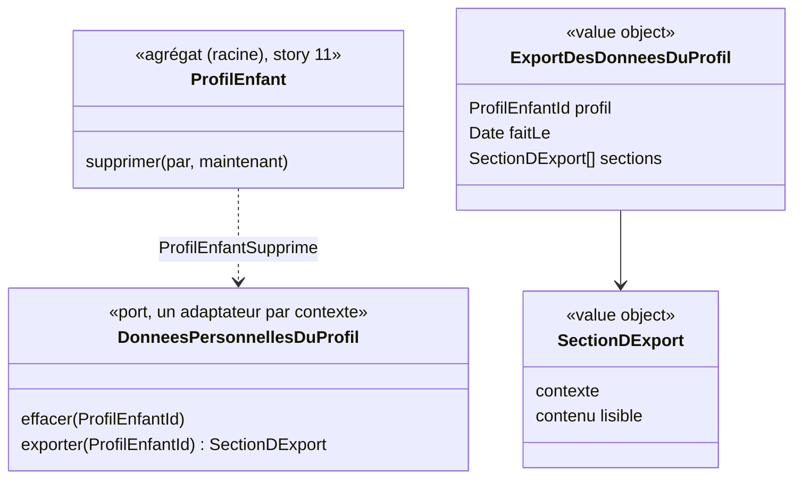

# Modèle du domaine : issue #14, Supprimer un profil enfant et toutes ses données, et les exporter

## Contexte

**Famille** (contexte existant), qui possède le profil enfant et les données personnelles (context map). C'est une story **transverse** : les données d'un enfant sont réparties entre plusieurs contextes, chacun propriétaire des siennes.

| Contexte | Données d'un profil (aujourd'hui ou plus tard) |
|---|---|
| Famille | profil, réglages, rattachements, invitations (#11 à #13) |
| Apprentissage | séances, réponses, étoiles, résultats du test de départ, révisions, records (lots 3 et 4) |
| Motivation | série, badges, cabane, épisodes ouverts (lot 5) |
| Accompagnement | devoirs, mots de la semaine, enregistrements de lecture (fichiers audio dans Storage), leçons personnelles s'il y en a par enfant (lot 6) |
| Appareil | profil gardé pour le hors ligne, résultats pas encore synchronisés |

Relation proposée : **Famille → tous les contextes**, par l'événement `ProfilEnfantSupprime` et par un **contrat de données personnelles** que chaque contexte remplit : « effacer tout ce qui concerne ce profil » et « exporter tout ce qui concerne ce profil ». Famille orchestre ; chaque contexte reste seul maître de ses données. Ajoutée à la context map.

### Comportement actuel (`app/`, `adultProfils` l. 2153)

- Onglet « Profils » : « Supprimer ce profil ». Premier toucher : le bouton devient « Confirmer : supprimer Léa et sa progression ». Second toucher : suppression du profil et de **tous les documents dont `enfant` est ce profil** (progression, révisions, jours joués, records, devoirs, mots de la semaine, fiches d'enregistrements).
- Les **fichiers audio** des enregistrements de lecture ne sont pas supprimés, seulement leurs fiches (écart avec la cible).
- Les leçons personnelles et les audios des poésies ne sont pas liés à un enfant : ils restent.
- Pas d'export. Pas de délai : suppression immédiate et définitive.

## Termes

| Terme | Statut | Remarque |
|---|---|---|
| Suppression du profil (à valider) | **nouveau** | Effacement définitif d'un profil enfant et de toutes les données qui le concernent, dans tous les contextes et sur les appareils. |
| Export des données du profil (à valider) | **nouveau** | Fichier téléchargeable par un parent rattaché, qui contient tout ce que l'application garde sur un profil enfant. |
| Confirmation de suppression (à valider) | **nouveau** ou terme d'interface | Second geste explicite du parent, sans lequel rien n'est supprimé. |
| Détacher (à valider) | **conflit possible** | Si un parent « supprime » un profil qui a deux parents, il n'est peut-être que **détaché** (question ouverte n°1) : ce serait alors `RetirerUnParent` (#13), pas une suppression. Deux mots distincts, jamais l'un pour l'autre. |
| Progression | **à signaler** | Mot de l'interface legacy (« sa progression »). Il n'est pas au glossaire ; il recouvre étoiles, leçons réussies, révisions. À définir dans Apprentissage (lot 4) ou à garder comme mot d'interface (question ouverte n°7). |

## Modèle



### Agrégat `ProfilEnfant` (story #11) : méthode `supprimer`

- Vérifie que le parent est rattaché (`ParentNonRattache` sinon) et qu'il a le droit de supprimer (question ouverte n°1 : seul, ou seulement s'il est l'unique parent).
- Émet `ProfilEnfantSupprime`. Le profil, ses réglages, rattachements et invitations disparaissent avec lui.

### Port `DonneesPersonnellesDuProfil` (`famille/application/ports/`)

- Une implémentation **par contexte** qui détient des données d'un enfant, écrite dans `infrastructure/` de ce contexte. Famille appelle chacune, sans connaître leurs tables.
- `effacer(profil)` : tout effacer, y compris les fichiers de Storage (enregistrements de lecture).
- `exporter(profil)` : rendre une section lisible.
- Règle pour les stories suivantes : **toute story qui ajoute une donnée d'enfant ajoute son implémentation** (ou complète l'existante). Le reviewer le vérifie.

### Commandes

| Commande | Effet | Erreurs | Où |
|---|---|---|---|
| `SupprimerProfilEnfant(parent, profil)` | Après confirmation dans l'interface : efface le profil et, dans la même requête, les données de chaque contexte. | `ParentNonRattache`, `ProfilEnfantIntrouvable`, `SuppressionReserveeAuSeulParent` (selon la question ouverte n°1) | Edge Function `supprimer-profil-enfant` |
| `ExporterLesDonneesDuProfil(parent, profil)` | Rassemble les sections de chaque contexte en un fichier. | `ParentNonRattache`, `ProfilEnfantIntrouvable` | Edge Function `exporter-donnees-profil-enfant` |
| `OublierLeProfilSurLAppareil(profil)` | Efface le profil et ses résultats en attente de l'appareil. | (aucune) | navigateur (`domain/`, port `DonneesDeLAppareil` de #5, étendu à un seul profil) |

## Invariants

1. Rien n'est supprimé sans une **confirmation** explicite du parent.
2. Seul un parent **rattaché** peut supprimer ou exporter un profil (domaine et RLS).
3. Après la suppression, **plus aucune donnée** du profil n'existe : ni en base, ni dans Storage, dans aucun contexte (sauf délai de récupération, question ouverte n°3). Les copies de sauvegarde de l'hébergeur suivent leur propre durée (question ouverte n°8).
4. Après la suppression, le profil disparaît de « Qui joue ? » sur **tous** les appareils, au plus tard à leur prochaine synchronisation. Des résultats faits hors ligne pour ce profil sont refusés à la synchronisation.
5. L'export contient **tout** ce que l'application garde sur le profil, dans un format lisible par un parent, et rien sur d'autres enfants. Ce qu'il dit des parents : question ouverte n°5.
6. Chaque contexte efface et exporte ses propres données ; Famille ne lit ni n'écrit les tables des autres contextes.
7. Supprimer un profil ne supprime pas le parent, ni les autres profils du parent.

## Événements

| Événement | Données | Qui réagit |
|---|---|---|
| `ProfilEnfantSupprime` (à valider) | profil, parent, date | chaque contexte qui détient des données du profil (par le port `DonneesPersonnellesDuProfil`, appelé dans la même requête pour que l'effacement soit complet quand le parent reçoit la réponse) ; le front de chaque appareil (oublier le profil) |
| `DonneesDuProfilExportees` (à valider) | profil, parent, date | personne ; utile seulement si l'on garde une trace des exports (question ouverte n°9) |

## Partage avec le front

- Dans le navigateur : la confirmation (interface), et `OublierLeProfilSurLAppareil` (effacer IndexedDB pour ce profil, port `DonneesDeLAppareil`).
- Par des Edge Functions, avec le JWT du parent : suppression et export. La suppression touche plusieurs contextes et Storage ; elle ne se fait jamais depuis le front, et jamais avec `service_role` dans le front.
- Mécanisme en base proposé : chaque table qui porte un identifiant de profil enfant le référence avec **suppression en cascade** ; les fichiers de Storage sont effacés explicitement par l'adaptateur d'Accompagnement. La cascade ne dispense pas du port : elle garantit qu'aucune ligne n'est oubliée, le port garantit les fichiers et l'export (question technique T5).

## Base de données attendue (description)

- `profils_enfants` : policy de **suppression** réservée aux parents rattachés (et à l'unique parent selon la question ouverte n°1).
- Toute table de profil, dans tous les contextes : référence au profil avec suppression en cascade, et policies de lecture fondées sur le rattachement (pour que l'export, fait avec le JWT du parent, voie tout).
- Storage : les fichiers d'un profil sont rangés sous un chemin qui contient son identifiant, avec des policies fondées sur le rattachement, pour pouvoir tout effacer et tout exporter.

## Données personnelles

Cette story est la **garantie RGPD** du projet (CLAUDE.md : « le parent peut exporter et supprimer toutes les données d'un profil »). Pas de nouvelle donnée ; au contraire, un inventaire à tenir à jour. L'export lui-même n'est pas gardé sur le serveur.

## Emplacement

```
supabase/functions/_shared/famille/
  domain/
    profil-enfant.ts                         # + supprimer
    export-des-donnees-du-profil.ts          # value objects ExportDesDonneesDuProfil, SectionDExport
    oublier-le-profil-sur-l-appareil.ts      # cas d'usage navigateur (décision 0008)
    donnees-de-l-appareil.ts                 # + oublier un seul profil
    erreurs.ts                               # + SuppressionReserveeAuSeulParent (selon n°1)
  application/
    ports/donnees-personnelles-du-profil.ts
    supprimer-profil-enfant.ts
    exporter-les-donnees-du-profil.ts
  infrastructure/
    donnees-personnelles-famille-supabase.ts # profil, réglages, rattachements, invitations
supabase/functions/_shared/<contexte>/infrastructure/donnees-personnelles-<contexte>-supabase.ts  # une par contexte, ajoutée par leurs stories
supabase/functions/supprimer-profil-enfant/index.ts
supabase/functions/exporter-donnees-profil-enfant/index.ts
src/famille/                                 # bouton et confirmation, téléchargement de l'export
```

## Questions ouvertes

1. (issue n°1, rejoint #13 n°1) Quand un profil a **deux parents**, l'un peut-il le **supprimer seul**, pour tout le monde (oui) ? Ou cela ne fait-il que le **détacher** de lui, le profil restant à l'autre parent (non) ? Exemple : Paul supprime Léa ; Marie la voit-elle encore ?
2. (issue n°2) **Format** de l'export : JSON lisible (oui), PDF (oui / non), les deux ?
3. (issue n°3) Suppression **immédiate et définitive**, comme aujourd'hui (oui), ou délai de récupération (non : combien de jours, par exemple 30) ?
4. (issue n°4) **Supprimer le parent** (son adresse e-mail et sa connexion) fait-il partie de cette story (oui / non) ? Si oui : que deviennent les profils dont il est l'unique parent (supprimés avec lui ?) et ceux qu'il partage (restent à l'autre parent ?).
5. (nouvelle) L'export d'un profil contient-il **l'adresse e-mail des parents** rattachés (oui / non) ? Celle de l'autre parent est une donnée d'un autre adulte.
6. (nouvelle) Le texte de confirmation reste-t-il « Confirmer : supprimer Léa et sa progression » (oui), avec un second toucher sur le même bouton ? Ou faut-il une confirmation plus forte (saisir le prénom, répondre de nouveau au contrôle parental) (non) ?
7. (nouvelle) « **Progression** » : mot d'interface seulement (oui), ou terme du glossaire à définir avec Apprentissage (non) ?
8. (nouvelle) Faut-il **dire au parent** que les copies de sauvegarde de l'hébergeur disparaissent dans un délai (par exemple 7 jours) (oui / non) ?
9. (nouvelle) Garde-t-on une **trace** qu'un profil a été supprimé ou exporté (date, parent), sans aucune donnée de l'enfant (oui / non) ?
10. (nouvelle) Faut-il pouvoir **exporter tous les profils** d'un parent en une fois (oui / non) ?
11. (nouvelle) Un appareil **hors ligne** garde des séances pas encore envoyées pour un profil supprimé ailleurs : on les jette sans message à la synchronisation (oui) ?

### Question technique

- T5. Effacement : suppression en cascade en base **et** port `DonneesPersonnellesDuProfil` par contexte (proposition), ou seulement l'un des deux ? Un test d'inventaire (toute table avec un identifiant de profil est couverte) peut garder la règle vivante. À consigner dans une décision.
