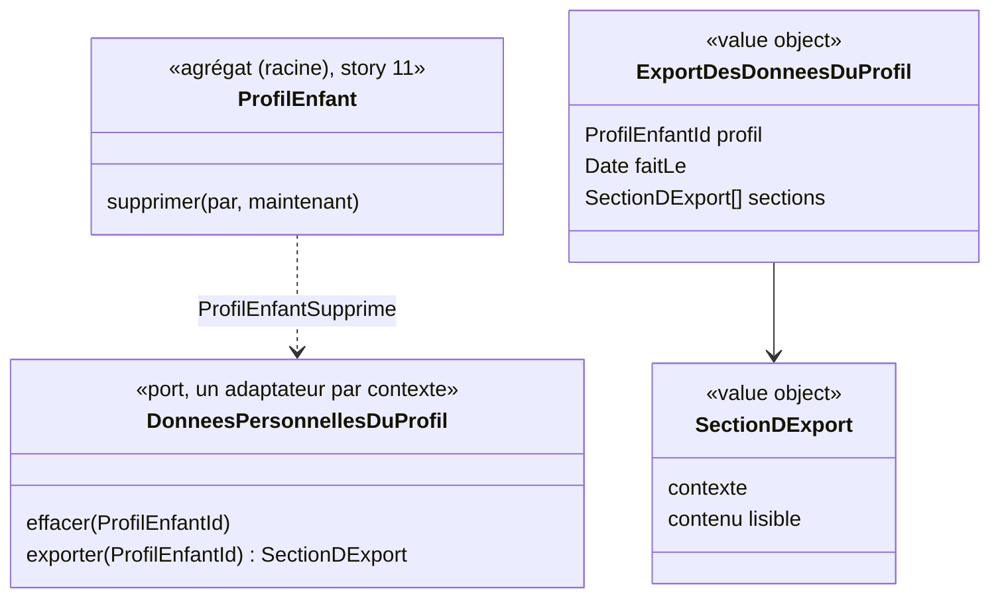

# Modèle du domaine : issue #14, Supprimer un profil enfant et toutes ses données, et les exporter

## Contexte

**Famille** (contexte existant), qui possède le profil enfant et les données personnelles (context map). C'est une story **transverse** : les données d'un enfant sont réparties entre plusieurs contextes, chacun propriétaire des siennes.

| Contexte | Données d'un profil (aujourd'hui ou plus tard) |
|---|---|
| Famille | profil, réglages, rattachements, invitations (#11 à #13) |
| Apprentissage | séances, réponses, étoiles, résultats du test de départ, révisions, records (lots 3 et 4) |
| Motivation | série, badges, cabane, épisodes ouverts (lot 5) |
| Accompagnement | devoirs, mots de la semaine, enregistrements de lecture (fichiers audio dans Storage), leçons personnelles s'il y en a par enfant (lot 6) |
| Appareil | profil gardé pour le hors ligne, résultats pas encore synchronisés |

Relation proposée : **Famille → tous les contextes**, par l'événement `ProfilEnfantSupprime` et par un **contrat de données personnelles** que chaque contexte remplit : « effacer tout ce qui concerne ce profil » et « exporter tout ce qui concerne ce profil ». Famille orchestre ; chaque contexte reste seul maître de ses données. Ajoutée à la context map, confirmée par la décision 0009, n°4.

### Comportement actuel (`app/`, `adultProfils` l. 2153)

- Onglet « Profils » : « Supprimer ce profil ». Premier toucher : le bouton devient « Confirmer : supprimer Léa et sa progression ». Second toucher : suppression du profil et de **tous les documents dont `enfant` est ce profil** (progression, révisions, jours joués, records, devoirs, mots de la semaine, fiches d'enregistrements).
- Les **fichiers audio** des enregistrements de lecture ne sont pas supprimés, seulement leurs fiches (écart avec la cible).
- Les leçons personnelles et les audios des poésies ne sont pas liés à un enfant : ils restent.
- Pas d'export. Pas de délai : suppression immédiate et définitive.

## Termes

| Terme | Statut | Remarque |
|---|---|---|
| Suppression du profil (à valider) | **nouveau** | Effacement définitif d'un profil enfant et de toutes les données qui le concernent, dans tous les contextes et sur les appareils. |
| Export des données du profil (à valider) | **nouveau** | Fichier téléchargeable par un parent rattaché, qui contient tout ce que l'application garde sur un profil enfant. |
| Confirmation de suppression (à valider) | **nouveau** ou terme d'interface | Second geste explicite du parent, sans lequel rien n'est supprimé. |
| Détacher | **synonyme interdit** | Supprimer un profil qui a deux parents le supprime **pour les deux** (décision n°1) : ce n'est jamais un détachement. Le retrait d'un parent n'existe pas dans ce lot. |
| Progression | **mot d'interface** | Mot de l'interface legacy (« sa progression »), hors glossaire (proposition appliquée). Il recouvre étoiles, leçons réussies, révisions. |
| Avertissement de suppression (à valider) | **nouveau** ou terme d'interface | Ce que voit le parent avant de confirmer : suppression définitive, l'autre parent ne verra plus l'enfant (s'il y en a un), proposition d'exporter d'abord (décisions n°1 et n°9). |

## Modèle



### Agrégat `ProfilEnfant` (story #11) : méthode `supprimer`

- Vérifie que le parent est rattaché (`ParentNonRattache` sinon). **Tout parent rattaché** peut supprimer le profil, même s'il y a un second parent : le profil disparaît pour les deux (décision n°1).
- Émet `ProfilEnfantSupprime`. Le profil, ses réglages, rattachements et invitation en attente disparaissent avec lui, **immédiatement et définitivement** (décision n°9).

### Port `DonneesPersonnellesDuProfil` (`famille/application/ports/`)

- Une implémentation **par contexte** qui détient des données d'un enfant, écrite dans `infrastructure/` de ce contexte. Famille appelle chacune, sans connaître leurs tables.
- `effacer(profil)` : tout effacer, y compris les fichiers de Storage (enregistrements de lecture).
- `exporter(profil)` : rendre une section lisible.
- Règle pour les stories suivantes : **toute story qui ajoute une donnée d'enfant ajoute son implémentation** (ou complète l'existante). Le reviewer le vérifie.

### Commandes

| Commande | Effet | Erreurs | Où |
|---|---|---|---|
| `SupprimerProfilEnfant(parent, profil)` | Après l'avertissement et la confirmation dans l'interface : efface le profil et, dans la même requête, les données de chaque contexte. | `ParentNonRattache`, `ProfilEnfantIntrouvable` | Edge Function `supprimer-profil-enfant` (décision 0009, n°1 et n°4) |
| `ExporterLesDonneesDuProfil(parent, profil)` | Rassemble les sections de chaque contexte en un **fichier JSON lisible**, nommé `savanturier-<prénom>-<date>` (par exemple `savanturier-lea-2026-10-22`, décision n°10). Proposé aussi dans l'avertissement, avant la confirmation (décision n°9). | `ParentNonRattache`, `ProfilEnfantIntrouvable` | Edge Function `exporter-donnees-profil-enfant` |
| `OublierLeProfilSurLAppareil(profil)` | Efface le profil et ses résultats en attente de l'appareil. | (aucune) | navigateur (`domain/`, port `DonneesDeLAppareil` de #5, étendu à un seul profil) |

## Invariants

1. Rien n'est supprimé sans un **avertissement** puis une **confirmation** explicite du parent. L'avertissement propose l'export et, s'il y a deux parents, dit que l'autre ne verra plus l'enfant (décisions n°1 et n°9). Le texte de confirmation reste « Confirmer : supprimer Léa et sa progression », par un second toucher (proposition appliquée).
2. Seul un parent **rattaché** peut supprimer ou exporter un profil (domaine et RLS). Les deux parents rattachés le peuvent (décision n°1).
3. Après la suppression, **plus aucune donnée** du profil n'existe : ni en base, ni dans Storage, dans aucun contexte. Pas de délai de récupération (décision n°9). Les copies de sauvegarde de l'hébergeur suivent leur propre durée (question ouverte n°2).
4. Après la suppression, le profil disparaît de « Qui joue ? » sur **tous** les appareils, au plus tard à leur prochaine synchronisation. Un enfant qui joue avec ce profil sur un autre appareil revient tout de suite à « Qui joue ? » (proposition appliquée). Des résultats faits hors ligne pour ce profil sont jetés sans message à la synchronisation (proposition appliquée, lot 7).
5. L'export contient **tout** ce que l'application garde sur le profil, dans un format lisible par un parent, et rien sur d'autres enfants. Il indique les parents rattachés, **sans l'adresse e-mail de l'autre parent** (décision n°3 ; pour celle du parent qui exporte : question ouverte n°1). L'invitation en attente y figure par son état et sa date, sans lien ni jeton d'invitation (proposition appliquée).
6. Chaque contexte efface et exporte ses propres données ; Famille ne lit ni n'écrit les tables des autres contextes.
7. Supprimer un profil ne supprime pas le parent, ni les autres profils du parent. Après la suppression de son dernier profil, le parent retrouve un espace parent vide (proposition appliquée). La suppression du compte du parent est une story à part (décision n°9).
8. Sans réseau, la suppression et l'export sont refusés avec un message ; rien n'est mis en attente (décision n°9, proposition appliquée pour l'export).

## Événements

| Événement | Données | Qui réagit |
|---|---|---|
| `ProfilEnfantSupprime` (à valider) | profil, parent, date | chaque contexte qui détient des données du profil (par le port `DonneesPersonnellesDuProfil`, appelé dans la même requête pour que l'effacement soit complet quand le parent reçoit la réponse) ; le front de chaque appareil (oublier le profil) |
| `DonneesDuProfilExportees` (à valider) | profil, parent, date | personne ; utile seulement si l'on garde une trace des exports (question ouverte n°3) |

## Partage avec le front

- Dans le navigateur : l'avertissement et la confirmation (interface), le refus sans réseau (message), le téléchargement du fichier, et `OublierLeProfilSurLAppareil` (effacer IndexedDB pour ce profil, port `DonneesDeLAppareil`).
- Par des Edge Functions, avec le JWT du parent : suppression et export. La suppression touche plusieurs contextes et Storage ; elle ne se fait jamais depuis le front, et jamais avec `service_role` dans le front.
- Mécanisme (décision 0009, n°4) : chaque table qui porte un identifiant de profil enfant le référence avec **suppression en cascade** ; ce qui n'est pas en base (Storage, caches) est effacé par le port `DonneesPersonnellesDuProfil` de chaque contexte. La cascade garantit qu'aucune ligne n'est oubliée, le port garantit les fichiers et l'export. Chaque story qui ajoute une donnée de l'enfant l'ajoute à la suppression et à l'export. Un test d'inventaire (toute table avec un identifiant de profil est couverte) peut garder la règle vivante.

## Base de données attendue (description)

- `profils_enfants` : policy de **suppression** réservée aux parents rattachés, quel que soit leur nombre (décision n°1).
- Toute table de profil, dans tous les contextes : référence au profil avec suppression en cascade, et policies de lecture fondées sur le rattachement (pour que l'export, fait avec le JWT du parent, voie tout).
- Storage : les fichiers d'un profil sont rangés sous un chemin qui contient son identifiant, avec des policies fondées sur le rattachement, pour pouvoir tout effacer et tout exporter.

## Données personnelles

Cette story est la **garantie RGPD** du projet (CLAUDE.md : « le parent peut exporter et supprimer toutes les données d'un profil »). Pas de nouvelle donnée ; au contraire, un inventaire à tenir à jour. L'export lui-même n'est pas gardé sur le serveur.

## Emplacement

```
supabase/functions/_shared/famille/
  domain/
    profil-enfant.ts                         # + supprimer
    export-des-donnees-du-profil.ts          # value objects ExportDesDonneesDuProfil, SectionDExport
    oublier-le-profil-sur-l-appareil.ts      # cas d'usage navigateur (décision 0008)
    donnees-de-l-appareil.ts                 # + oublier un seul profil
  application/
    ports/donnees-personnelles-du-profil.ts
    supprimer-profil-enfant.ts
    exporter-les-donnees-du-profil.ts
  infrastructure/
    donnees-personnelles-famille-supabase.ts # profil, réglages, rattachements, invitations
supabase/functions/_shared/<contexte>/infrastructure/donnees-personnelles-<contexte>-supabase.ts  # une par contexte, ajoutée par leurs stories
supabase/functions/supprimer-profil-enfant/index.ts
supabase/functions/exporter-donnees-profil-enfant/index.ts
src/famille/                                 # bouton et confirmation, téléchargement de l'export
```

## Décisions

Validation n°1 du lot 2 par le PO, le 2026-10-22 (`docs/stories/lot-2-decisions.md`, décision 0009). « Tranchée » = réponse explicite du PO ; « proposition appliquée » = question de détail qui suit la proposition déjà faite.

Numéros d'origine : « M » = ancienne liste du modèle, « A » = `docs/stories/14/acceptance.md`, « T » = questions techniques.

| Question | Réponse | Source |
|---|---|---|
| M1. Profil à deux parents | L'un des deux le **supprime pour les deux**, après un avertissement. Pas de détachement. | Tranchée, décision n°1 |
| M2 / A7. Format et nom de l'export | **Fichier JSON lisible**, nommé `savanturier-<prénom>-<date>` (par exemple `savanturier-lea-2026-10-22`). | Tranchée, décision n°10 (exemple : proposition appliquée) |
| M3. Délai de récupération | **Aucun** : suppression immédiate et définitive, après un avertissement. | Tranchée, décision n°9 |
| M4. Supprimer le compte du parent | **Hors de cette story** : renvoyé à une story à part. | Tranchée, décision n°9 |
| M5 (en partie). Adresse e-mail de l'autre parent dans l'export | **Non**. | Tranchée, décision n°3 |
| M6. Texte et force de la confirmation | « Confirmer : supprimer Léa et sa progression », second toucher sur le même bouton, après l'avertissement. | Proposition appliquée (modèle) |
| M7. « Progression » | Mot d'interface, hors glossaire. | Proposition appliquée (modèle) |
| M11. Résultats hors ligne d'un profil supprimé | Jetés sans message à la synchronisation (lot 7). | Proposition appliquée (modèle) |
| A1. Export proposé avant la confirmation | **Oui**. | Tranchée, décision n°9 |
| A2. Sans réseau | Suppression **refusée avec un message** ; même règle pour l'export. | Tranchée, décision n°9 (export : proposition appliquée) |
| A3. Après le dernier profil | Espace parent vide. | Proposition appliquée (scénario `@a-valider`) |
| A4. Invitation en attente dans l'export | Son état et sa date, sans lien ni jeton d'invitation. | Proposition appliquée (scénario `@a-valider`) |
| A5. Enfant qui joue ailleurs pendant la suppression | Retour immédiat à « Qui joue ? ». | Proposition appliquée (`acceptance.md`) |
| T5. Mécanisme d'effacement | Suppression en cascade en base **et** port `DonneesPersonnellesDuProfil` par contexte pour ce qui n'est pas en base. | Tranchée, décision 0009, n°4 |

## Questions ouvertes

Aucune n'est bloquante pour la story.

1. (ancienne M5, suite) L'export contient-il l'**adresse e-mail du parent qui exporte** (oui / non) ? Celle de l'autre parent n'y est jamais (décision n°3) ; sans adresse, l'export dit seulement « deux parents rattachés ».
2. (ancienne M8) Faut-il **dire au parent** que les copies de sauvegarde de l'hébergeur disparaissent dans un délai (par exemple 7 jours) (oui / non) ?
3. (ancienne M9) Garde-t-on une **trace** qu'un profil a été supprimé ou exporté (date, parent), sans aucune donnée de l'enfant (oui / non) ?
4. (ancienne M10) Faut-il pouvoir **exporter tous les profils** d'un parent en une fois (oui / non) ?
5. (ancienne A6) **Textes exacts** du message après la suppression, de l'avertissement à deux parents (par exemple : « Marie ne verra plus Léa. ») et du refus sans réseau ? Les scénarios ne décrivent que le sens.
6. (nouvelle) « **Avertissement de suppression** » : terme du glossaire (oui), ou simple écran d'interface (non) ?
