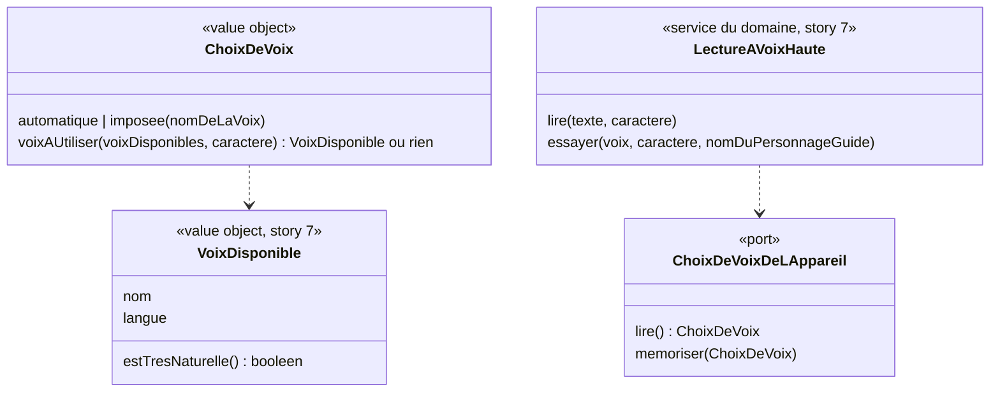

# Modèle du domaine : issue #15, Choisir la voix des personnages guides sur l'appareil

## Contexte

Sous-domaine générique **Voix** (décision 0007), qui complète la story #7. Le modèle de référence est la section « Hors périmètre : voix imposée, lot 2 » de `docs/stories/7/domain-model.md` ; il est repris ici et précisé à la lecture de `adultVoix` (l. 2253) et `voiceFor` (l. 221).

Le choix est **mémorisé sur l'appareil** (décision n°10 du lot 1) : ce n'est ni une donnée du profil enfant ni une donnée du parent. Il vaut pour tous les profils qui jouent sur l'appareil et ne change pas les autres appareils. Tout se passe **dans le navigateur**, hors ligne compris.

Relations :
- **Famille → Voix** : aucune dépendance de code. L'écran est dans l'espace parent (protégé par le contrôle parental, #10), mais Voix ne connaît ni Famille ni le contrôle parental.
- **Motivation → Voix** (existante) : le caractère de la voix du personnage guide reste appliqué à la voix imposée.
- **Synthèse vocale du navigateur → Voix** (existante, ACL) : port `VoixDeLAppareil`.

### Comportement actuel (`app/`)

- Onglet « Voix » de l'espace : titre « La voix des guides », texte d'explication (« … chaque guide lui donne son caractère … Tu peux aussi imposer une voix. »).
- Liste à choix unique : « Automatique (recommandé) » avec la mention « actuellement : <nom de la meilleure voix française> », puis chaque voix française de l'appareil, de la plus naturelle à la moins naturelle, avec « · très naturelle » (score ≥ 60) ou, pour la première si elle ne l'est pas, « · la meilleure ici ».
- Choisir une ligne enregistre aussitôt (pas de bouton « Enregistrer ») ; « Automatique » efface le choix. Clé de l'appareil `ecole-voix` = nom de la voix.
- Bouton « Écouter » sur chaque ligne : « Coucou ! Je suis <personnage guide>. On apprend en s'amusant ? Youpi ! ». Comme l'espace parent désélectionne le profil en cours, le personnage guide est **toujours Noisette** dans le legacy.
- Sans voix française : « Aucune voix française trouvée sur cet appareil : installe-en une (voir ci-dessous), puis recharge la page. » ; navigateur sans synthèse : « Ce navigateur ne sait pas lire à voix haute. »
- Conseils « Pour des voix plus naturelles » : iPad / iPhone, tablette Android, ordinateur (Edge, Chrome).
- Dans la lecture (`voiceFor`) : la voix imposée passe en premier **si elle existe encore sur l'appareil** ; sinon voix automatique. Le **caractère** du personnage guide (hauteur, rythme, −0,25 si personnage masculin et voix non reconnue comme masculine) s'applique aussi à la voix imposée.
- La voix imposée **ne sert pas aux langues étrangères** (anglais) : elles gardent `choisirVoixDeLangue`.
- Une seule voix imposée pour tous les personnages guides.

## Termes

| Terme | Statut | Remarque |
|---|---|---|
| Voix imposée | au glossaire (à valider) | Confirmée par l'issue ; « Arrive au lot 2 » devient vrai avec cette story. |
| Voix automatique | au glossaire (à valider) | |
| Choix de voix (à valider) | **nouveau** | Préférence de l'appareil : voix automatique ou une voix imposée. |
| Voix très naturelle (à valider) | **nouveau** | Voix française de score au moins 60 (mention de l'interface). |
| Essai de voix (à valider) | **nouveau** ou terme d'interface | Phrase lue pour écouter une voix avant de la choisir. Le bouton dit « Écouter ». |
| La voix des guides | **conflit** | Titre du legacy : « guide » seul est interdit (décision n°1). Proposition : « La voix des personnages guides ». |
| Voix préférée, voix forcée | synonymes interdits | Déjà au glossaire. |

## Modèle



Pas d'agrégat : rien n'est enregistré sur le serveur.

### Value objects et fonctions

| Élément | Règle |
|---|---|
| `ChoixDeVoix` | `automatique` (défaut, aussi quand rien n'est mémorisé) ou `imposee(nom)`. Un nom vide vaut `automatique`. |
| `choisirVoix(voix, caractere, choix)` | Si `choix` est une voix imposée **présente** parmi les voix de l'appareil, c'est elle ; sinon la voix automatique de #7. Égalité des noms : exacte, comme aujourd'hui (question ouverte n°6). |
| `estTresNaturelle(voix)` | Score de la voix (#7) d'au moins 60. |
| `voixProposees(voix)` | Les voix françaises, triées par score (`voixFrancaisesTriees`, #7). |
| Caractère | Le caractère du personnage guide (hauteur, rythme, voix plus grave) s'applique aussi à la voix imposée (`reglerPhrases`, #7). |
| Langue étrangère | `choisirVoixDeLangue` ignore le choix de voix (legacy). |
| `PhraseDEssai` | « Coucou ! Je suis <nom du personnage guide>. On apprend en s'amusant ? Youpi ! » (texte du legacy, décision n°3 du lot 1). Quel personnage guide : question ouverte n°2. |

### Port

`ChoixDeVoixDeLAppareil` : lire et mémoriser le choix de voix sur l'appareil. Interface déclarée dans `voix/domain/` (décision 0007), adaptateur `localStorage` dans `src/voix/`, à côté de Son/Muet. À la déconnexion (#5), le choix reste-t-il sur l'appareil : question ouverte n°5.

### Commandes (navigateur)

| Commande | Effet |
|---|---|
| `ImposerUneVoix(nom)` | Mémorise la voix imposée sur l'appareil ; les lectures suivantes l'utilisent. |
| `RevenirALaVoixAutomatique` | Efface le choix. |
| `EssayerUneVoix(nom ou automatique)` | Lit la phrase d'essai avec cette voix et le caractère du personnage guide, **sans** changer le choix mémorisé. Respecte le Muet ? (question ouverte n°7). |

Aucune erreur métier nouvelle : sans voix française, `voixProposees` est vide et l'interface affiche le message ; sans synthèse, `LectureImpossible` (#7).

## Invariants

1. La voix imposée, si elle existe encore sur l'appareil, passe avant la voix automatique ; sinon la voix automatique s'applique, sans message (sauf réponse contraire à la question ouverte n°4).
2. Seules les voix françaises de l'appareil sont proposées.
3. Le choix est mémorisé **sur l'appareil**, pour tous les profils qui y jouent ; il ne change pas les autres appareils et n'est jamais envoyé au serveur.
4. Le caractère du personnage guide s'applique toujours, voix imposée comprise (hauteur dans [0,5 ; 2], rythme au plus 1,4).
5. Le choix de voix n'est accessible que dans l'espace parent ; le bouton Son/Muet reste à la portée de l'enfant.
6. Écouter une voix ne change pas le choix mémorisé.

## Événements

Aucun.

## Partage avec le front

Tout est dans le navigateur : `ChoixDeVoix`, `choisirVoix` à trois paramètres, `estTresNaturelle`, l'interface `ChoixDeVoixDeLAppareil` et la phrase d'essai sont exportés par `@domain/voix`. `LectureAVoixHaute` (#7) lit le choix par ce port. L'onglet « Voix » de l'espace parent et les conseils d'installation sont de l'interface (`src/`).

## Données d'enfants

Aucune. Le choix de voix est une préférence de l'appareil.

## Emplacement

```
supabase/functions/_shared/voix/
  domain/
    choix-de-voix.ts                    # + ChoixDeVoix, choisirVoix(voix, caractere, choix)
    voix-disponible.ts                  # + estTresNaturelle
    choix-de-voix-de-l-appareil.ts      # interface du port (décision 0007)
    phrase-d-essai.ts                   # phrase « Coucou ! Je suis … »
    lecture-a-voix-haute.ts             # + lecture du choix, essai d'une voix
    index.ts
  test_utils/
    choix-de-voix-en-memoire.ts
src/voix/                               # adaptateur localStorage du choix, onglet « Voix » de l'espace parent
```

## Questions ouvertes

1. (#7 M13, issue n°1) Reprend-on **tels quels les conseils** d'installation de voix (iPad / iPhone, Android, ordinateur) (oui) ?
2. (#7 A8, issue n°2) **Personnage guide de la phrase d'essai** quand les profils de l'appareil ont des univers différents : toujours Noisette, comme aujourd'hui en pratique (oui) ? Sinon : celui du dernier profil en cours, ou un bouton par personnage guide ?
3. (issue n°3) Faut-il pouvoir **imposer une voix différente par personnage guide** (oui / non ; aujourd'hui : une seule voix pour tous) ?
4. (nouvelle) Quand la voix imposée **n'existe plus** sur l'appareil, le parent voit-il un message dans l'onglet « Voix » (« La voix choisie n'est plus sur cet appareil : on utilise la voix automatique. ») (oui / non) ?
5. (nouvelle) À la **déconnexion** du parent (#5), le choix de voix reste-t-il sur l'appareil, comme Son/Muet (oui), ou est-il effacé avec les données de la famille (non) ?
6. (nouvelle) La mention « actuellement : <voix> » de « Automatique » montre aujourd'hui la **meilleure voix**, pas celle que prendra le personnage guide (qui peut être une voix masculine pour Coach Léo). Montrer la voix réellement prise pour le personnage guide de l'essai (oui), ou garder la meilleure voix (non) ?
7. (nouvelle) Le bouton « Écouter » lit-il **même en mode Muet** (oui : c'est un essai du parent), ou rien n'est lu (non, comme aujourd'hui) ?
8. (nouvelle) Titre de l'onglet : « La voix des personnages guides » (oui), à la place de « La voix des guides » ?
9. (nouvelle) La voix imposée s'applique-t-elle aussi aux **leçons d'anglais** (oui / non ; aujourd'hui : non, l'anglais garde sa propre voix) ?
