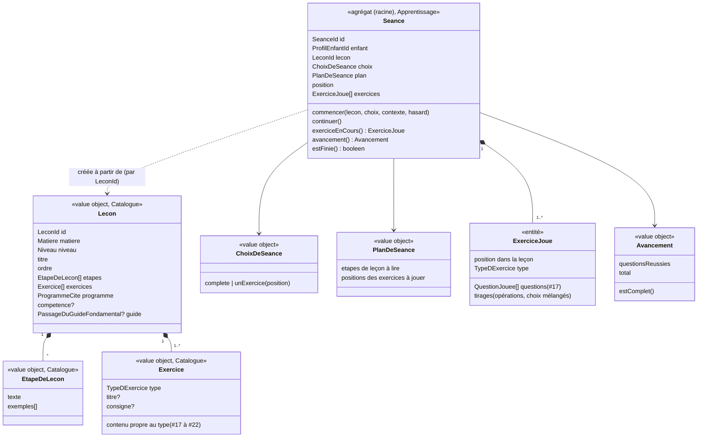

# Modèle du domaine : issue #16, Étapes lues puis exercices

## Contexte

Story **porteuse du lot 3** pour la **séance** : sa création, son déroulé (étapes de leçon, puis exercices), son avancement et son abandon. Les stories #17 à #22 ajoutent chacune la mécanique de leurs types d'exercices. La story #17 porte la **question** et la **réponse**, la story #23 l'**aide** et « Je ne sais pas », et la story #24 les **étoiles** et la **séance terminée**.

Contextes :
- **Catalogue pédagogique** (amont, lecture seule) : la **leçon** telle que publiée (`docs/format-lecons.md`), ses étapes de leçon et ses exercices. C'est le Catalogue qui lit le format JSON et le valide. Apprentissage ne voit jamais le JSON brut, et ne lit jamais les crochets d'un texte à trous ni les `null` d'un schéma en barres.
- **Apprentissage** (cœur de la story) : l'agrégat `Seance`.
- **Motivation** (#6) : le personnage guide et ses paroles (accueil de la leçon, fin des étapes, annonce de l'exercice suivant, félicitations, encouragements, humeur).
- **Voix** (#7) : lecture à voix haute par le port `LecteurAVoixHaute`, avec le mot prononcé surligné.
- **Famille** (#11, #12) : prénom, niveau et réglages du profil en cours (mode dys, tout lire à voix haute, clavier des dictées).

Relations :
- **Catalogue → Apprentissage** : *Published Language*. Le Catalogue publie le type `Lecon` (et ses exercices) dans `@domain/catalogue`. Apprentissage l'importe, comme Famille importe `Niveau` (décision 0009, n°5).
- **Motivation → Apprentissage** : *Customer/Supplier* (#6). Apprentissage annonce les faits (étapes finies, exercice suivant, réponse juste ou fausse). Motivation choisit la phrase et l'humeur.
- **Famille → Apprentissage** : *Customer/Supplier*. Niveau et réglages du profil en cours, lus par le front.

### Comportement actuel (`app/`, `showLesson` l. 1720, `playLesson` l. 1860, `stepsOf` l. 1062, `tracker` l. 993)

Décrit en détail dans l'issue. Points qui fixent le modèle :
- La séance est faite **dans le navigateur**, du début à la fin. Rien n'est enregistré avant l'écran de fin (#24).
- `only == null` : séance complète (étapes de leçon, puis tous les exercices dans l'ordre du JSON). `only = i` : séance d'un seul exercice, **sans** étapes de leçon.
- Les opérations tirées au hasard sont retirées à chaque nouvelle séance (`delete ex._ops`).
- Total de l'avancement : la somme des « étapes réussies » de chaque exercice (`stepsOf`). Les étapes de leçon ne comptent pas. Un type inconnu compte 1 mais n'est jamais joué : le récipient ne se remplit jamais.
- Annonce de l'exercice suivant : seulement si la séance a plus d'un exercice et si l'exercice a un `titre`.
- Abandon (« Retour ») : l'écran change, les promesses en attente ne se résolvent plus. Rien n'est enregistré.

### Ce qui est vérifié dans la bibliothèque (265 leçons)

- Toutes les leçons ont des étapes de leçon (`lecon` non vide). Le cas « leçon sans étapes » reste à couvrir pour les leçons personnelles (lot 6).
- 14 types utilisés, aucun type inconnu. Le test de contrat de la bibliothèque (`scripts/tests/test_bibliotheque.py`) refuse déjà un type inconnu.

## Termes

| Terme | Statut | Remarque |
|---|---|---|
| Leçon, Étape de leçon, Exercice, Question, Consigne | au glossaire (confirmés) | |
| Séance | au glossaire (validé) | Précisée : une séance est **complète** ou **d'un seul exercice**. |
| Séance complète | **nouveau** (validé) | Étapes de leçon, puis tous les exercices de la leçon, dans l'ordre. Interface : « Leçon et tous les jeux ». |
| Séance d'un exercice | **nouveau** (validé) | Un seul exercice choisi sur la page de la leçon, sans étapes de leçon. Interface : « Ou choisis un seul jeu ». |
| Avancement de la séance | **nouveau** (validé) | Nombre de questions réussies sur le nombre de questions de la séance. Interface : le **récipient** et les points (décision n°6). |
| Type d'exercice | déjà dans « Exercice » | Le Catalogue lui donne un **libellé** (« Bulles-réponses », « Ranger dans les maisons »…). Le libellé est un texte d'interface. |
| Page de la leçon | terme d'interface | Lecture (`PageDeLaLecon`) du Catalogue, hors glossaire. |
| Jeu | **conflit tranché** (décision n°3) | L'interface dit « jeu » pour **exercice** (« Leçon et tous les jeux », « Jeu suivant »). Mot d'interface seulement, jamais dans le code ni les scénarios. |
| Récipient de progression | terme d'interface (décision n°6) | |
| Guide (seul) | **conflit tranché** (décision n°4) | Le bloc adulte du legacy dit « Ce que conseille le guide ». Le glossaire interdit « guide » seul : la cible dit « Ce que conseille le guide fondamental ». |
| Partie | synonyme interdit | « Partie » est interdit pour **Séance** (glossaire). « Séance en cours » est le terme retenu par #8. |

## Modèle



### Catalogue pédagogique : la leçon publiée

- `Lecon` est un **value object en lecture seule**, pas un agrégat : personne ne la modifie dans l'application. Elle est construite par `lireLecon(brut)` à partir du format JSON (`docs/format-lecons.md`), qui valide chaque champ et chaque exercice (règles propres à chaque type dans #17 à #22).
- `lireLecon` est une **fonction pure du domaine du Catalogue** (`catalogue/domain/`), importée par le front via `@domain/catalogue` : le front lit la bibliothèque gardée sur l'appareil (#8) sans appel au serveur. Côté serveur, le même code sert derrière le port `LeconsDuCatalogue`. La skill DDD place d'ordinaire ce mapper dans `infrastructure/` : l'écart est acté par la décision 0012 (décision n°10).
- `TypeDExercice` : les 14 types du format, chacun avec son **libellé** (table `TYPES` du legacy). Un type inconnu lève `TypeDExerciceInconnu` à la lecture de l'exercice. L'exercice est alors écarté (ni affiché, ni joué, ni compté) et la leçon reste jouable avec ses autres exercices (décision n°1 ; décision 0012, n°3).
- `Matiere` : value object avec son libellé (« Français », « Mathématiques », « Histoire et géographie », « Vivre ensemble (EMC) »…). `Niveau` vient de #11.
- `PageDeLaLecon` (lecture) : titre, « `<niveau>` · `<matière>` », la liste des exercices (libellé du type et `titre`, sinon le libellé, sinon « Jeu »), et le bloc adulte (citation, source de la section, passage du guide fondamental et sa page). Le texte de la source de la section vient de `programmes-index.json`, lu par le Catalogue.

### Apprentissage : l'agrégat `Seance`

- **Racine** : `Seance`, identifiée par `SeanceId`. L'identifiant est fourni par le port `GenerateurId`, déclaré dans `apprentissage/domain/` (décision 0007), parce que la séance est créée dans le navigateur. Il sert aussi de clé d'idempotence à l'envoi de la séance terminée (#24).
- **Contient** : la leçon visée (`LeconId`, jamais l'objet), le profil enfant (`ProfilEnfantId`), le `ChoixDeSeance`, le `PlanDeSeance`, la position dans le plan, et un `ExerciceJoue` par exercice du plan, avec ses `QuestionJouee` (#17).
- **Pourquoi les exercices et les questions sont dans l'agrégat** : les étoiles se calculent sur **toutes** les erreurs de la séance (#24), l'avancement sur **toutes** les questions, et une séance n'est finie que quand toutes ses questions sont réussies. Ces trois invariants demandent une seule frontière de cohérence. L'agrégat reste petit : une leçon de la bibliothèque compte au plus quelques dizaines de questions, et la séance ne vit que le temps d'un jeu.
- **Contexte de la séance** (`ContexteDeSeance`, value object passé à `commencer`) : niveau du profil, réglages utiles (clavier des dictées, #19), historique de calcul pour l'adaptation de la difficulté (#20). Le domaine ne lit rien lui-même.
- `commencer` construit le plan et **tire tout ce qui est au hasard une seule fois** (ordre des choix, opérations générées, lettres intruses), avec le port `Hasard`. Une nouvelle séance tire de nouveaux calculs (« Rejouer », #24).

### Value objects

| Value object | Règle |
|---|---|
| `ChoixDeSeance` | `complete`, ou `unExercice(position)` avec une position qui existe dans la leçon, sinon `ExerciceIntrouvable`. |
| `PlanDeSeance` | Séance complète : les étapes de leçon (s'il y en a), puis les exercices dans l'ordre de la leçon. Séance d'un exercice : cet exercice seul, **sans** étapes de leçon. |
| `Avancement` | `questionsReussies` sur `total`. `total` = somme des questions des exercices joués (règle de chaque type dans #17 à #22). Les étapes de leçon ne comptent pas. `estComplet()` quand toutes les questions sont réussies. Il ne recule jamais. |
| `SeanceId` | Identifiant opaque, non vide. |

Nombre de questions par type (repris de `stepsOf`) :

| Type | Questions |
|---|---|
| `bulles`, `lecture` | une par question |
| `ecoute`, `boite`, `barres` | une par item |
| `classer` | une par étiquette |
| `ordre` | une par élément |
| `trous` | une par trou |
| `conjugaison` | une par personne |
| `dictee` | une par mot |
| `calcul` | une par opération (tirée ou fixe) |
| `fluence` | une seule pour tout l'exercice |
| `memoriser` | deux par vers (ordre, puis mot caché) |
| `addition` | à préciser par #20 (le legacy compte opérations × étapes, mais avance à chaque chiffre et à chaque colonne) |

### Commandes

| Commande | Effet | Erreurs métier | Où |
|---|---|---|---|
| `CommencerUneSeance(lecon, choix, contexte)` | Crée la séance, son plan et ses tirages. | `ExerciceIntrouvable`, `LeconSansExercice` | navigateur (`@domain/apprentissage`) |
| `Continuer` | Passe à l'étape de leçon suivante. Après la dernière : l'exercice suivant commence. | `PasDEtapeDeLeconEnCours` | navigateur |
| `Repondre`, `DireJeNeSaisPas` | Voir #17 et #23. | | navigateur |
| `AbandonnerLaSeance` | « Retour » pendant la séance : la séance est oubliée. Rien n'est enregistré (décision n°2). | (aucune) | navigateur |
| `TerminerLaSeance` | Voir #24. | | Edge Function |

### Ce que dit le personnage guide (Motivation)

Apprentissage dit **ce qui arrive** ; Motivation choisit **la phrase** et l'humeur (#6). Nouvelles paroles pour Motivation :

| Fait (Apprentissage) | Parole (Motivation, textes du legacy) |
|---|---|
| Page de la leçon ouverte | « Coucou `<prénom>` ! Je t'explique la leçon, et après, on joue. Tu peux aussi choisir directement un jeu. » (sans « en deux minutes », décision n°5) |
| Étapes de leçon finies | Au hasard, humeur « applaudit » : « À toi de jouer maintenant ! », « C'est parti, à toi ! », « Prêt ? On joue ! » |
| Exercice suivant (séance de plus d'un exercice, exercice avec un `titre`) | « `<Nouveau défi \| Jeu suivant \| Place au jeu>` : `<titre>` ! » |

Lecture d'une étape de leçon : le `texte`, puis les `exemples` joints par « . ». La règle est dans le domaine (`texteALireDeLEtape`), la lecture passe par le port `LecteurAVoixHaute` (Voix).

### Erreurs métier

`TypeDExerciceInconnu` (Catalogue), `LeconIntrouvable`, `ExerciceIntrouvable`, `LeconSansExercice`, `PasDEtapeDeLeconEnCours`, `SeanceDejaFinie`.

## Invariants

1. Une séance porte sur **une** leçon et **un** profil enfant, référencés par identifiant.
2. Une séance complète lit **toutes** les étapes de leçon, dans l'ordre, avant le premier exercice. Une séance d'un exercice n'en lit aucune.
3. Les exercices se jouent **dans l'ordre de la leçon**. On ne passe à l'exercice suivant que quand toutes les questions de l'exercice en cours sont réussies.
4. Tout ce qui est tiré au hasard l'est **une fois**, au début de la séance, par le port `Hasard`. Une nouvelle séance tire à nouveau.
5. L'avancement ne compte que les questions des exercices **joués**. Il est complet exactement quand la dernière question est réussie. Un exercice qui n'est pas joué ne compte jamais.
6. Une séance abandonnée ne produit **rien** : ni étoiles, ni séance terminée, ni jour de séance (décision n°2).
7. Apprentissage ne lit jamais le JSON brut d'une leçon : il reçoit une `Lecon` validée par le Catalogue.
8. Le domaine ne connaît ni l'écran ni le temps : les pauses (400 ms, 150 ms au plus avec `prefers-reduced-motion`) et l'attente de la fin d'une phrase relèvent du front.

## Événements

Aucun événement de domaine dans cette story. `SeanceTerminee` est porté par #24. L'abandon ne produit pas d'événement (décision n°2).

## Partage avec le front

Tout se passe dans le navigateur (décision 0003) :
- `@domain/catalogue` : `lireLecon`, `Lecon`, `TypeDExercice` et ses libellés, `PageDeLaLecon`.
- `@domain/apprentissage` : `Seance`, `ChoixDeSeance`, `PlanDeSeance`, `Avancement`, et les interfaces des ports `Hasard` et `GenerateurId` (décision 0007). Apprentissage déclare **sa propre** interface `Hasard`, de même forme que celle de Motivation, comme Voix (décision 0008, n°2).
- `@domain/motivation` : les nouvelles paroles.

La première beta est **en ligne seulement** (feuille de route) : la bibliothèque est déjà gardée sur l'appareil par #8, mais la reprise d'une séance en cours et la synchronisation viennent avec #44. Le modèle reste prêt pour le hors ligne : rien dans la séance ne demande le réseau avant `TerminerLaSeance`.

React affiche la séance et appelle ses méthodes. Il ne calcule ni le plan, ni l'avancement, ni la suite.

## Données d'enfants

Aucune donnée nouvelle n'est enregistrée par cette story. La séance en cours vit dans la mémoire du navigateur. Le prénom est lu dans Famille pour la phrase d'accueil, jamais envoyé ailleurs.

## Accessibilité (rappel de l'issue, sans règle métier)

Étapes et exemples lus à voix haute ; mode dys dans la bulle du personnage guide et dans les pastilles ; avancement annoncé aux lecteurs d'écran (décision n°7) ; cibles de 44 px ; écran tenu à 360 px.

## Emplacement

```
supabase/functions/_shared/catalogue/
  domain/
    niveau.ts                   # (#11) value object Niveau
    matiere.ts                  # Matiere et son libellé
    lecon.ts                    # Lecon, LeconId, EtapeDeLecon, ProgrammeCite, PassageDuGuideFondamental
    type-d-exercice.ts          # les 14 types et leurs libellés
    exercice.ts                 # union des exercices (contenu de chaque type : #17 à #22)
    lire-lecon.ts               # format JSON → Lecon, validation (Published Language)
    page-de-la-lecon.ts         # lecture pour la page de la leçon
    erreurs.ts                  # TypeDExerciceInconnu, LeconMalFormee, ExerciceMalForme
    index.ts                    # @domain/catalogue
  application/
    ports.ts                    # LeconsDuCatalogue (lecture d'une leçon par identifiant, côté serveur)
  infrastructure/
    bibliotheque.ts             # adaptateur serveur du port LeconsDuCatalogue
supabase/functions/_shared/apprentissage/
  domain/
    seance-id.ts
    choix-de-seance.ts
    plan-de-seance.ts
    seance.ts                   # agrégat Seance
    exercice-joue.ts            # entité ExerciceJoue
    avancement.ts
    contexte-de-seance.ts       # niveau, réglages, historique de calcul
    etape-de-lecon-lue.ts       # texteALireDeLEtape
    hasard.ts                   # interface du port Hasard (décision 0007)
    generateur-id.ts            # interface du port GenerateurId (décision 0007)
    erreurs.ts
    index.ts                    # @domain/apprentissage
  test_utils/
    hasard-fixe.ts
    generateur-id-fixe.ts
    lecons-de-test.ts           # leçons construites pour les tests
supabase/functions/_shared/motivation/domain/
  paroles-de-seance.ts          # accueil de la leçon, fin des étapes, annonce de l'exercice
src/seance/                     # page de la leçon, écran de séance, récipient, bulle du personnage guide
```

## Dépendances et ordre de livraison du lot 3

| Story | Porte | Dépend de |
|---|---|---|
| **#16** Étapes lues puis exercices | Leçon (Catalogue), séance, plan, avancement | #6, #7, #11 (`Niveau`, profil en cours), #12 (réglages) |
| **#17** Exercices à choix | Question, réponse, erreur, choix proposés | #16 |
| **#23** Aide et « Je ne sais pas » | Aide, « Je ne sais pas », nouvelle chance, compte des erreurs | #17 |
| **#24** Étoiles et écran de fin | Étoiles, séance terminée, résultat de la leçon, enregistrement | #16, #17, #23 |
| #18 Classer, ordre, trous | Étiquettes, groupes, texte à trous | #17, #23 |
| #19 Dictée, conjugaison | Mot dicté, clavier des dictées | #17, #23, #12 |
| #20 Calcul, fluence, addition posée | Opérations, générateur, clavier de cristaux, record, colonnes | #17, #23, #24 (historique pour l'adaptation, record) ; #18 (étiquettes pour poser) |
| #21 Boîte, barres | Boîte à jetons, schéma en barres | #20 (clavier de cristaux, mode de réponse) |
| #22 Mémoriser une poésie | Poésie, vers, mots cachés | #18 (ordre et trous) |

**Ordre conseillé** : #16 → #17 → #23 → #24 → #18 → #19 → #20 → #21 → #22.
Raison : #16, #17, #23 et #24 forment une première tranche jouable de bout en bout (une leçon de bulles, des étoiles enregistrées), qui retire la page de démonstration du lot 1. Les autres types s'ajoutent ensuite sans toucher au cœur.

## Décisions du PO

Validation n°1 du lot 3 par le PO, le 2026-10-23 : « OK pour tout » (`docs/stories/lot-3-decisions.md` ; décisions `docs/decisions/0012-lecture-des-lecons-dans-le-domaine-catalogue.md` et `docs/decisions/0013-ecritures-d-apprentissage-par-edge-function.md`). Chaque question reçoit pour réponse sa proposition. Le numéro unique du lot (`Q…`, voir `docs/stories/16/acceptance.md`) suit le numéro de la story.

1. (Q1) **Exercice de type inconnu** : le Catalogue l'**écarte** à la lecture (il n'est ni affiché, ni joué, ni compté), et la leçon reste jouable avec ses autres exercices ? Ou refuse-t-il toute la leçon ? **Décision** : l'écarter. Le pipeline et la vérification des leçons personnelles refusent déjà un type inconnu ; ce cas ne peut venir que d'une leçon plus récente que l'application.
2. (Q2) **Séance abandonnée** : on ne garde rien, comme aujourd'hui ? **Décision** : oui pour la beta (en ligne seulement). La reprise d'une « séance en cours » arrive avec le hors ligne (#44).
3. (Q3) **« Jeu »** : reste-t-il le mot d'interface pour **exercice** (« Leçon et tous les jeux », « Ou choisis un seul jeu : », « Jeu suivant »), avec « Nouveau défi » et « Place au jeu » ? **Décision** : oui, dans l'interface seulement. Le code et les scénarios disent « exercice ».
4. (Q4) **Bloc adulte** : « Ce que conseille le guide » devient « Ce que conseille le guide fondamental » ? **Décision** : oui (glossaire, décision n°1).
5. (Q5) **Phrase d'accueil** : retirer « en deux minutes » (« Je t'explique la leçon, et après, on joue. ») ? **Décision** : oui, la durée n'est pas tenue pour les longues leçons.
6. (Q6) **Récipient de progression** : terme d'interface ? **Décision** : oui. Le domaine dit **avancement de la séance**.
7. (Q7) **Avancement annoncé aux lecteurs d'écran** (« 3 sur 10 ») à chaque question réussie ? **Décision** : oui, en annonce polie, sans couper le personnage guide.
8. (Q8) **Exercice choisi seul** : le personnage guide n'annonce pas son titre (comme aujourd'hui) ? **Décision** : oui, le titre est déjà sur le bouton touché.
9. (Q9) **Paroles de séance dans Motivation** : l'accueil de la leçon, la fin des étapes et l'annonce de l'exercice sont-elles des paroles du personnage guide (Motivation), comme les félicitations ? **Décision** : oui.
10. (Q10) *(architecture)* **Lecture du format JSON dans `catalogue/domain/`** (fonction pure `lireLecon`, importée par le front), et non dans un mapper d'`infrastructure/` comme le dit la skill DDD ? **Décision** : oui, le front doit lire la bibliothèque hors ligne. Consigné dans la décision 0012 (lecture des leçons dans le domaine du Catalogue).

## Questions ouvertes

Aucune.
