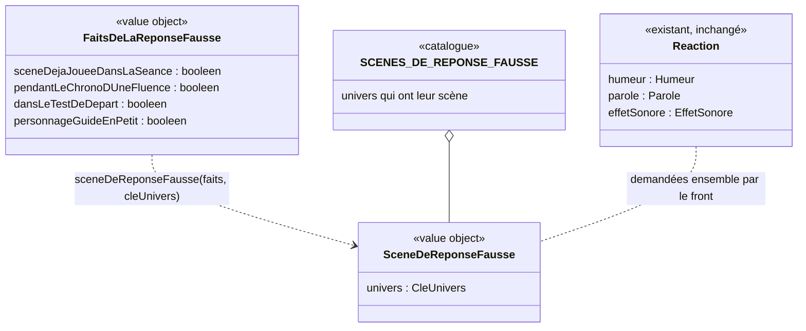

# Modèle du domaine : issue #163, une réponse fausse animée par le personnage guide

Contexte : **Motivation**. Après une réponse fausse, le personnage guide du profil joue une courte scène drôle et gentille, puis l'enfant retrouve sa **nouvelle chance**. La story choisit **si** la scène se joue et **laquelle** (celle du personnage guide de l'univers). Elle ne touche ni à l'erreur, ni aux étoiles, ni à la question posée. Aucun agrégat, aucun événement enregistré, aucune migration, aucune Edge Function, aucune donnée d'enfant nouvelle.

État : **cadrage tranché le 2026-11-05** (« 163 reco tout », annonce du responsable : https://github.com/SBA-dev/github-move/issues/64#issuecomment-6672057084). Les recommandations de 163.1 à 163.18 sont retenues (163.13 à 163.18 : `docs/stories/163/acceptance.md`). Décision 0042 (163.10). Le câblage des scènes attend le merge de **106h** (moteur commun `src/univers/celebrations/commun/` et tenue portée dans les scènes). Le domaine (163a, voir « Comportements unitaires du domaine ») et les planches peuvent commencer avant. Le même jour, 163.19 à 163.21 sont tranchées (« 163a reco tout », annonce du responsable : https://github.com/SBA-dev/github-move/issues/64#issuecomment-6672618059) : 163.19 A, 163.20 (planche de Coach Léo validée), 163.21 A ; aucune ne change le domaine.

## Contexte

### Pourquoi Motivation

- La context map le dit déjà : pendant une séance, Apprentissage dit seulement « réponse juste / fausse » ; Motivation donne l'encouragement et l'**humeur du personnage guide** (`reagirALaReponse`, #6, #97). La scène de réponse fausse est une humeur plus riche, à la même place.
- L'univers, le personnage guide, ses dessins, ses tenues et les scènes animées (#106) appartiennent déjà à Motivation.
- La règle d'or s'applique : Motivation réagit à un fait d'Apprentissage, sans jamais rien modifier.

### Faits lus, sans rien écrire

| Fait | Contexte qui le décide | Disponible |
|---|---|---|
| Réponse fausse | Apprentissage | Oui : `ResultatDeReponse` = `"fausse"`, rendu par `Seance.repondre` / `Seance.taper` (dictée : la lettre fausse, 163.15), `SeanceDeRevision.repondre` (révision, défi, grand défi) et `TestDeDepart.repondre` |
| « Je ne sais pas » | Apprentissage | Oui. Ce n'est **pas** une réponse fausse pour Motivation : `ReactionAJeNeSaisPas`, sans son d'erreur (97.11). Aucune scène, et elle ne consomme pas la scène de la séance |
| Pendant le chrono d'une fluence | Apprentissage | Oui. Pendant le chrono, aucun encouragement n'est dit, seul le son « réponse fausse » est joué (97.10, #20). Aucune scène (163.6) |
| Test de départ | Apprentissage | Oui : l'écran le sait. Ce n'est pas une séance (27.4). Aucune scène (163.6) |
| Scène déjà jouée dans la séance (163.1 B) | Motivation, mémoire de l'écran | **À ajouter**. C'est un état de l'écran de la séance, ni enregistré ni envoyé. Il repart de zéro à chaque séance, même le même jour, même pour une séance quittée puis recommencée (163.14 A). Un exercice joué seul (« Je joue seulement l'exercice », « Rejouer ») est une séance (163.17 A) |
| Personnage guide en petit (addition posée sur téléphone, 40 px) | Motivation, affichage de la séance | Oui : l'écran le sait. Aucune scène à cette taille (163.7) |
| Univers du profil en cours | Famille → Motivation (#6) | Oui : `universDe(cle)`. Une clé inconnue donne `animaux` |
| Tenue portée | Motivation, mémoire de l'appareil (#102) | Oui : `tenueAMontrer`, `useTenueDuProfil` (163.8) |

### Le retour d'une réponse fausse aujourd'hui (#97), écran par écran

Partout, le même schéma : `reagirALaReponse(false, …)` rend l'humeur `reflechit` (le personnage guide penche la tête, `PersonnageGuide.tsx`, geste `penche`), un **encouragement** tiré au hasard (`ENCOURAGEMENTS` de `paroles.ts` : « Oups, presque ! », « Hmm, pas tout à fait… », « Pas grave, on réessaie ! », « Ah, celle-là est piégeuse ! », « Presque ! Regarde bien. ») et l'effet sonore `reponseFausse` (son doux, 0,37 s). Le front y ajoute l'aide quand il y en a une, puis la même question reste posée. La réponse fausse se balance légèrement (±6 px). **Tout cela reste inchangé** (163.3 A, 163.13 A).

| Écran | Où le retour est construit | Où le personnage guide est dessiné |
|---|---|---|
| Séance d'une leçon : choix, bulles, texte à trous, conjugaison… | `src/seance/exercices/useQuestionsAChoix.ts` (`encourager`) | `src/seance/EcranDeSeance.tsx`, zone `guide-et-parole` (200 px sur tablette, 112 px sur téléphone, 40 px avec l'addition posée sur téléphone) |
| `ordre`, `classer` (étiquettes) | `useEtiquettesAPlacer.ts` : l'étiquette revient à sa place | idem |
| Dictée | `useDictee.ts` (`encourager`) : l'encouragement, l'aide, puis le mot redit ; les lettres fausses sont montrées un instant | idem |
| Calcul, boîte à jetons, schéma en barres, addition posée | `paroles-du-calcul.ts` (`encouragerApresUneErreurDeCalcul`), `addition/useAdditionPosee.ts` | idem |
| Fluence | `fluence/useFluence.ts` : le son seul pendant le chrono, sans encouragement | idem |
| Séance de révision, défi (#100), grand défi (#137) | `src/revision/paroles-de-la-revision.ts` (`encouragerLaReponse`). Le défi et le grand défi jouent leurs questions avec `DeroulementDeLaRevision` (`src/defis/EcranDeDefi.tsx`) | `src/test-de-depart/ParoleDuGuide.tsx` |
| Test de départ | `src/test-de-depart/useDeroulementDuTestDeDepart.ts` (`encouragerApresUneErreurDeCalcul`) | `ParoleDuGuide.tsx` (aucune scène, 163.6) |

Il y a donc **deux endroits** où le personnage guide est dessiné pendant une question (`EcranDeSeance` et `ParoleDuGuide`). La bulle (`BulleDuPersonnageGuide`, `aria-live="polite"`) est la seule annonce aux lecteurs d'écran.

### Communication entre contextes

Aucune relation nouvelle. La relation « Motivation → Apprentissage, Customer/Supplier (paroles et humeur du personnage guide, #6) » suffit. Motivation reçoit des faits sous une forme simple (booléens, clé d'univers), jamais un agrégat d'Apprentissage. Tout se passe dans le navigateur, hors ligne compris. Le serveur n'a rien à revalider : aucun résultat ne dépend de la scène.

## Termes

| Terme | Statut | Remarque |
|---|---|---|
| Réponse, Erreur, Nouvelle chance, Encouragement, Humeur du personnage guide, Aide, Personnage guide, Univers, Effet sonore, Muet, Tenue portée, Célébration de l'univers, Célébration commune, Séance, Séance de révision, Défi, Grand défi, Test de départ, Fluence | existants | Réutilisés sans les redéfinir |
| **Scène de réponse fausse** | **nouveau, validé (163.9, 2026-11-05)** | Courte mise en scène jouée par le personnage guide du profil après une réponse fausse. Elle s'ajoute à l'encouragement (163.3 A) et finit par un sourire et un pouce levé. Elle ne change ni l'erreur, ni les étoiles, ni la question posée. Glossaire, fin de la section Motivation. Synonymes interdits : « animation d'échec », « échec », « gag », « raté », « célébration » (pour ce sens) |
| « Animation d'échec », « Échec jamais punitif », bouton « Rater », `?anim=echec`, `construitEchec` | **interdits** dans l'application | Ce sont les mots des maquettes (`docs/maquettes/`). « échec » n'est pas un mot de l'enfant : il est interdit dans l'interface, le code du domaine, les scénarios et les noms de fichiers. Le glossaire le liste déjà comme synonyme interdit d'**Erreur** |
| « Presque ! On réessaie ? » | pas un terme | Titre des maquettes. Il n'est pas affiché (163.3 A) |
| « oh ! », « oups ! », « hop ! », « pschitt ! », « plouf ! » | pas des termes | Bulles écrites du dessin (`aria-hidden`), comme « tuut ! » et « ding ! » en #106. Elles ne sont ni lues ni annoncées. En mode dys, elles s'écrivent en Andika ; l'image fixe n'en montre aucune (163.16 A) |
| « Réaction » | pas un terme | `Reaction` est un nom du code (`reaction.ts`), pas un terme du glossaire. On ne l'emploie pas dans les scénarios pour désigner la scène |

## Modèle

Pas d'agrégat : rien ne change d'état, rien n'est enregistré, aucun invariant ne lie deux faits dans une transaction. Le modèle est fait de **value objects** et de **fonctions pures**, comme les célébrations de #106. Aucun hasard (163.1 B).



### Value objects et règles de validité

- **`FaitsDeLaReponseFausse`** : ce que le front sait au moment d'une réponse fausse (163.1 B, 163.6, 163.7) :
  - `sceneDejaJoueeDansLaSeance` : la scène a déjà été jouée dans **cette** séance (séance d'une leçon, exercice joué seul, séance de révision, défi, grand défi). Faux au début de chaque séance (163.14 A, 163.17 A) ;
  - `pendantLeChronoDUneFluence` : la réponse fausse est donnée pendant le chrono d'une fluence ;
  - `dansLeTestDeDepart` : la réponse fausse est donnée au test de départ ;
  - `personnageGuideEnPetit` : le personnage guide est montré en petit (addition posée sur téléphone).

  Tous les champs sont **obligatoires** : chaque écran dit ce qu'il sait, sans troisième état « non dit » (même choix que `FaitsDeLaFinPourLaCelebration`, 106g). La dictée n'a pas de fait à elle : la première lettre fausse de la séance est la première réponse fausse (163.15 A).
- **`SceneDeReponseFausse`** : `{ univers: CleUnivers }`. Chaque personnage guide a **une seule scène**, sans variante. Si le PO veut un jour plusieurs scènes, ce sera une union discriminée par univers, comme `CelebrationDeLUnivers` (106b). On ne la prépare pas.
- **`SCENES_DE_REPONSE_FAUSSE`** : la liste des univers dont la scène est livrée. Elle grandit livraison après livraison (163.11) : `sports` en 163a, puis `danse` (163b), `animaux` (163c), `princesse` (163d), `police` (163e), `pompier` (163f, 163.4 A). Un univers absent n'a pas de scène, et le personnage guide garde son humeur `reflechit`, comme aujourd'hui (même règle que 106.18). Quand les six univers sont livrés, la liste devient exhaustive sur `CleUnivers` (`satisfies Record<CleUnivers, …>`, comme `CLES_DE_VARIANTE`) : un univers ajouté sans sa scène ne compile plus.

### Lecture (fonctions pures, `@domain/motivation`)

- `sceneDeReponseFausse(faits: FaitsDeLaReponseFausse, cleUnivers: string | undefined)` → `SceneDeReponseFausse | undefined`.
  - `undefined` si la scène a déjà été jouée dans la séance, pendant le chrono d'une fluence, au test de départ, quand le personnage guide est en petit, ou quand l'univers n'a pas encore sa scène ;
  - sinon, la scène de l'univers du moment (`universDe`, clé inconnue ou absente → `animaux`).
- `sceneJoueeDansLaSeanceApres(dejaJouee: boolean, scene: SceneDeReponseFausse | undefined)` → `boolean` : la mémoire de la séance après une réponse fausse. Elle passe à vrai dès qu'une scène est rendue, et ne revient jamais à faux pendant la séance. Le front la garde dans l'état de l'écran ; il ne l'appelle pas après « Je ne sais pas » ni après une réponse juste, qui ne consomment donc pas la scène.
- `reagirALaReponse` **ne change pas** : l'encouragement, l'humeur `reflechit` et l'effet sonore restent ceux de #97 (163.3 A), y compris après la scène, jusqu'à la réponse suivante (163.13 A). Le front demande la scène **à côté** de la réaction, au même moment. On ne change pas la signature de `reagirALaReponse` : elle est appelée à 7 endroits, y compris pour les bonnes réponses.
- Une réponse fausse donnée pendant la scène (163.18 A) passe par les mêmes fonctions : `sceneDejaJoueeDansLaSeance` est vrai, donc pas de seconde scène ; elle reçoit le retour de #97.

### Commandes, événements, erreurs

- **Aucune commande** : rien ne change d'état.
- **Aucun événement de domaine**, rien n'est enregistré. La réponse fausse est déjà un fait d'Apprentissage, et l'erreur reste comptée par Apprentissage comme avant.
- **Aucune erreur métier nouvelle**, aucun hasard.

### Ce qui reste dans `src/` (affichage, aucune règle)

- **Les scènes**, une par personnage guide, portées depuis les maquettes et réduites à la réaction elle-même : la surprise, le rire, le pouce levé, en **1,5 s au plus** (163.2 A ; les scènes longues sont resserrées, puis accélérées). Elles réutilisent le moteur et les morceaux de `src/univers/celebrations/commun/` (corps, membres, mains, visage, expressions) et les dessins des personnages de chaque dossier de #106 (décision 0042). Ce qui doit servir aux deux est déplacé dans `commun/` (refactor), **après le merge de 106h**. On ne copie rien depuis `sports/`, `police/`… La durée, aujourd'hui fixée par `DUREE_DE_LA_CELEBRATION_S` dans `commun/jeu-de-la-scene.ts`, devient un paramètre de `jouerLaScene` ; la durée de 1,5 s au plus est une constante de l'affichage et un critère de review, comme les 3 s de la décision 0039.
- **La tenue portée** pendant la scène, avec les dessins de tenue de 106h (163.8).
- **Leur place** (163.7 A) : à la place du dessin du personnage guide, à sa taille, dans `EcranDeSeance` (zone `guide-et-parole`) et dans `ParoleDuGuide`. Décor réduit au minimum. Le dessin fixe revient à la fin de la scène, avec l'humeur `reflechit` (163.13 A). La scène ne couvre jamais la question.
- **Aucun titre** : ni « Presque ! On réessaie ? », ni le sous-titre des maquettes (163.3 A). Les bulles écrites du dessin restent, en Andika en mode dys (163.16 A).
- **L'arrêt** : toute nouvelle réponse (juste ou fausse, 163.18 A), la lettre suivante en dictée (163.15 A), « Je ne sais pas », « Réécouter », « Relire la consigne », « Retour » ou le passage à la question suivante arrête la scène tout de suite, et le dessin fixe revient.
- **L'image fixe** en mouvements réduits : le personnage guide souriant, le pouce levé (état final de la scène), sans mouvement et sans bulle écrite (163.16 A).
- Le dessin est `aria-hidden` ; la bulle reste la seule annonce.
- Le chargement à la demande et le précache de la PWA (#8), comme les scènes de #106 (`SceneDeCelebration.tsx`, `prechargerLaSceneDe`). Si une scène ne se charge pas, le dessin fixe et l'humeur `reflechit` restent : la nouvelle chance n'attend jamais la scène ; la scène compte quand même comme jouée pour la séance (163.19 A, tranchée).
- La taille des bulles écrites : elles sont cachées quand le dessin du personnage guide mesure moins de 100 px, par ex. 80 px dans la boîte à jetons (163.21 A, tranchée). C'est de l'affichage, pas une règle du domaine.
- Un seul crochet du front (par exemple `useSceneDeReponseFausse`) appelé par tous les chemins d'encouragement listés plus haut, qui tient `sceneDejaJoueeDansLaSeance` le temps de l'écran de la séance.

## Comportements unitaires du domaine (TDD de 163a)

Fichier `supabase/functions/_shared/motivation/domain/scene-de-reponse-fausse_test.ts`, dans cet ordre. Dans les exemples, « faits neutres » = les quatre booléens à faux.

**Value objects et catalogue**

1. `SCENES_DE_REPONSE_FAUSSE` contient `sports` (Coach Léo, 163a).
2. `SCENES_DE_REPONSE_FAUSSE` ne contient encore aucun autre univers (`danse`, `animaux`, `princesse`, `police`, `pompier` attendent 163b à 163f).
3. Une `SceneDeReponseFausse` ne porte que l'univers : `{ univers: "sports" }`.

**`sceneDeReponseFausse`**

4. Première réponse fausse de la séance, faits neutres, univers `sports` → `{ univers: "sports" }` (163.1 B).
5. Scène déjà jouée dans la séance, univers `sports` → `undefined` (163.1 B ; couvre aussi la réponse fausse donnée pendant la scène, 163.18 A).
6. Pendant le chrono d'une fluence, univers `sports` → `undefined` (163.6, 97.10).
7. Au test de départ, univers `sports` → `undefined` (163.6).
8. Personnage guide en petit (addition posée sur téléphone), univers `sports` → `undefined` (163.7).
9. Univers dont la scène n'est pas encore livrée (`danse`), faits neutres → `undefined` (le personnage guide garde `reflechit`).
10. Clé d'univers inconnue (`"inconnu"`) → même résultat que `animaux` (`universDe`) : `undefined` en 163a.
11. Clé d'univers absente (`undefined`) → même résultat que `animaux` : `undefined` en 163a.
Forme des tests 5 à 8 : un seul fait à vrai par test, univers `sports`, pour montrer que chaque cas d'exclusion suffit seul.

**`sceneJoueeDansLaSeanceApres`**

12. Pas encore jouée, une scène est rendue → vrai.
13. Pas encore jouée, aucune scène rendue (fluence, univers sans scène…) → faux : la première réponse fausse suivante pourra la jouer.
14. Déjà jouée, aucune scène rendue → vrai : elle ne revient jamais à faux pendant la séance.

**Exports et non-régression**

15. `sceneDeReponseFausse`, `sceneJoueeDansLaSeanceApres`, `SCENES_DE_REPONSE_FAUSSE` et les types `FaitsDeLaReponseFausse`, `SceneDeReponseFausse` sont exportés par `domain/index.ts` (`@domain/motivation`) ; le typecheck du front les importe.
16. Les tests existants de `reaction_test.ts` et `humeur_test.ts` restent verts sans changement : après une réponse fausse, l'humeur reste `reflechit` (163.13 A) et l'encouragement reste tiré dans `ENCOURAGEMENTS` (163.3 A).

Les livraisons 163b à 163f ajoutent chacune leur univers au catalogue et changent les tests 2 et 9 à 11 en conséquence (en 163c, la clé inconnue ou absente donne `{ univers: "animaux" }`). En 163f, le catalogue devient exhaustif sur `CleUnivers`.

## Invariants

1. **Jamais punitive.** La scène dit « ce n'est pas grave » : le personnage guide finit toujours souriant, le pouce levé. Personne ne se moque de l'enfant ni du personnage guide. Après la scène, la même question reste posée (nouvelle chance), sans limite d'essais.
2. **Moins attrayante que la bonne réponse** (skill `gamification`, section 5). L'enfant ne doit jamais avoir intérêt à se tromper pour voir la scène :
   - une seule fois par séance, à la première réponse fausse (163.1 B) ;
   - 1,5 s au plus, plus courte qu'une célébration de l'univers (163.2 A) ;
   - ni confettis, ni pétales, ni musique, ni cri de victoire, ni rayons, ni étincelles dorées, ni annonce, ni titre ;
   - la bonne réponse garde tout son retour (rebond, « réponse juste », personnage guide qui saute, félicitation), sans rien perdre.
3. **Elle ne retient jamais l'enfant.** La question, ses choix, le clavier (de la dictée, de cristaux, physique), « Je ne sais pas », « Réécouter » et « Retour » sont utilisables **dès la première image**. Une réponse donnée pendant la scène, juste ou fausse, est prise tout de suite et arrête la scène (163.18 A). Un toucher hors des boutons ne fait rien (97.17, 106.10).
4. **Une seule parole et un seul son.** L'encouragement (puis l'aide) est dit dans la bulle par la voix du personnage guide, après le son « réponse fausse » (163.3 A). La scène n'a aucun texte lu et aucun son à elle. Les bulles écrites (« oh ! », « oups ! », « hop ! », « pschitt ! », « plouf ! », voir le tableau « Règle absolue, scène par scène ») font partie du dessin.
5. **Une seule annonce aux lecteurs d'écran** : celle de la bulle, qui existe déjà. La scène est `aria-hidden`.
6. **Mouvements réduits : rien ne bouge, l'information reste.** On voit l'image fixe (personnage guide souriant, pouce levé, sans bulle écrite), et l'encouragement est affiché et dit comme aujourd'hui.
7. **Son et Muet inchangés.** Le Muet coupe la voix, pas le son « réponse fausse » (97.2). La voix suspendue (écrans du parent) coupe tout (97.13). La scène n'ajoute aucun son.
8. **Motivation à part.** La scène ne change ni l'erreur comptée, ni les étoiles, ni l'avancement, ni la question, ni le parcours, ni un record, ni la file de révision. Rien n'est enregistré, rien n'est envoyé au serveur (163.14 A).
9. **Univers du moment, équité.** La scène est celle du personnage guide de l'univers du profil au moment où elle est jouée. Les scènes des six univers durent à peu près pareil et se jouent dans les mêmes cas.
10. **Le personnage guide n'est montré qu'une fois** : la scène prend la place de son dessin, puis le dessin revient avec l'humeur `reflechit` (106.28 « cacher », 163.13 A).
11. **Règle absolue sur les contenus** (`CLAUDE.md`), à toutes les tailles et sur l'image fixe. Le personnage guide reste d'aplomb et souriant : il est surpris un instant, puis il rit. Seuls des objets doux bougent autour de lui (ballon, noisette, bulles, casquette, gouttes), sans le toucher. **Aucune étoile à cinq branches** (106.34 A, 106.35) : on dessine des fleurs, des bulles, des gouttes ou des étincelles à quatre branches pastel, jamais dorées et cernées comme l'étoile gagnée. Mêmes règles d'univers qu'en #106 (invariant 10) : Police, un policier qui aide, avec l'écusson (#158) ; Pompiers, de l'eau bleu clair et des fleurs ; aucun coffre.
12. **Planche validée avant le câblage** (163.12). Chaque scène est montrée au PO sur une planche (images clés et image fixe, aux tailles du personnage guide en séance : 200 et 112 px, fonds clair et sombre ; pas de 40 px, puisqu'il n'y a pas de scène à cette taille, 163.7). Le PO la valide avant tout câblage (98.28, comme 106.42) ; le merge attend aussi la planche validée.

## Règle absolue, scène par scène

Les maquettes ont été relues image par image (fonctions `ECHEC` et `construitEchec` de chaque fichier). Ce qui suit ne décrit que ce qu'on dessine. Choix retenus le 2026-11-05 (163.4 A, 163.5a à 163.5e : recos).

| Personnage guide | Maquette (temps de la maquette) | Ce qu'on garde | Ce qu'on dessine |
|---|---|---|---|
| Coach Léo (Sports) | tir de dos, le ballon tape le poteau, qui vibre un peu, « oh ! », il se retourne, sourit, pouce levé. 2,9 s, dont 2,0 s de réaction | le ballon sur le poteau, « oh ! », le sourire, le pouce | Léo est de face dès le début (pas de tir de dos ni de retournement) : il tape le ballon, qui rebondit doucement sur un petit poteau à côté de lui et revient rouler à ses pieds. Il rit, pouce levé. Léo est seul avec son ballon |
| Lili (Danse) | réception déséquilibrée avec de grands moulinets des bras (le corps penche jusqu'à 14°), elle se rattrape, sourit, pouce levé. 3,7 s, dont 2,2 s de réaction | le petit vacillement, le sourire, le pouce | Lili vacille à peine sur ses demi-pointes et fait un petit pas de côté pour se remettre d'aplomb. Ses deux pieds restent sous elle, le corps reste presque droit. Bulle « oups ! » (163.23). Elle rit, fait une petite révérence, pouce levé. Tenue et poses de 106b |
| Noisette (Animaux) | la noisette lui arrive sur la tête (« toc ! »), elle est étourdie un instant (trois étincelles dorées et une petite noisette tournent autour de sa tête), secoue la tête, rit, pouce levé. 3,8 s, dont 2,8 s de réaction | la noisette qui tombe de l'arbre, le rire, le pouce | La noisette tombe de l'arbre, Noisette tend les mains. La noisette rebondit dans l'herbe **à côté d'elle**, roule un peu ; Noisette la suit des yeux, « hop ! » (163.25), rit, la ramasse et lève le pouce (163.5c A). Noisette garde les yeux grands ouverts, d'un bout à l'autre, et rien ne tourne autour d'elle. Les étincelles dorées et cernées de la maquette ne sont pas dessinées |
| Lumi (Princesses et fées) | « pschitt ! », le sort donne des bulles colorées, elle rit, souffle dessus, pouce levé. 3,4 s, dont 2,6 s de réaction | toute la scène | Une petite fleur au bout de la baguette, comme en 106d (la maquette a une étoile). Les bulles sont rondes, pastel, transparentes, jamais dorées. Le geste du sort est le rond doux du poignet validé en 106d. Lumi flotte, sans chute |
| Agent Max (Police) | le chiot bondit jusqu'à la casquette, l'emporte, fait un petit tour en courant et la rapporte ; Max dit « oh ! », rit, la remet, pouce levé. 4,7 s, dont 4,4 s de réaction | le chiot joueur, la casquette rapportée, le rire, le pouce ; la bulle devient « oups ! » (163.29) | Max se penche pour caresser le chiot, sa casquette glisse dans l'herbe. Le chiot la prend délicatement, fait un petit tour joyeux en remuant la queue et la rapporte. Max dit « oups ! » (163.29), rit, la remet, pouce levé. Le chiot reste au sol, Max reste sur place et le regarde jouer. Casquette et chemise portent l'**écusson** sans étoile (106e, #158) |
| Capitaine Sam (Pompiers) | **pas de scène** | — | Dessinée d'abord dans `docs/maquettes/capitaine-sam-pompiers.html` avec sa planche, validées par le PO avant le câblage (163.4 A) : Sam arrose une fleur, le jet fait une petite fontaine trop courte qui retombe en gouttes bleu clair juste devant ses bottes. Bulle « plouf ! » (163.31 B). Il rit, ajuste sa lance, pouce levé. Que de l'eau bleu clair et des fleurs, couleurs et décor de 106f (porte de la caserne fermée) |

Pour toutes les scènes : le visage reste doux, la surprise dure un instant et mène tout de suite au rire. Les bulles validées par le PO sont « oh ! » (Coach Léo), « oups ! » (Lili, 163.23), « hop ! » (Noisette, 163.25), « pschitt ! » (Lumi, 163.27), « oups ! » (Agent Max, 163.29) et « plouf ! » (Capitaine Sam, 163.31 B). Elles sont écrites, jamais jouées en son.

## Événements

Aucun événement nouveau. #163 **lit** un fait existant :

| Fait lu | Écrans | Source |
|---|---|---|
| Réponse fausse (`ResultatDeReponse` = `"fausse"`) | séance d'une leçon (tous les types d'exercices qui encouragent après une réponse fausse, dictée comprise, exercice joué seul compris), séance de révision, défi, grand défi. Pas le test de départ, pas le chrono d'une fluence, pas avec l'addition posée sur téléphone (163.6, 163.7) | Apprentissage (`Seance`, `SeanceDeRevision`) |

## Emplacement

Aucune migration, aucune table, aucune Edge Function, aucun `application/` ni `infrastructure/` : la décision est une lecture pure faite dans le navigateur, hors ligne compris.

```
supabase/functions/_shared/motivation/domain/
  scene-de-reponse-fausse.ts          # FaitsDeLaReponseFausse, SceneDeReponseFausse, SCENES_DE_REPONSE_FAUSSE,
                                      # sceneDeReponseFausse, sceneJoueeDansLaSeanceApres
  scene-de-reponse-fausse_test.ts
  index.ts                            # exports
src/univers/reponse-fausse/           # dossier neuf, hors des fichiers de 106h
  SceneDeReponseFausse.tsx            # choix de la scène par univers, chargement à la demande, préchargement, image fixe
  sports/ danse/ animaux/ princesses/ police/ pompiers/   # une scène par personnage guide (préfixes SVG `reponse-fausse-<univers>-`)
src/univers/celebrations/commun/      # après le merge de 106h seulement : durée en paramètre de jouerLaScene, morceaux partagés
src/seance/                           # crochet commun, EcranDeSeance (place du personnage guide), chemins d'encouragement des exercices
src/test-de-depart/ParoleDuGuide.tsx  # place du personnage guide (révision, défi, grand défi)
src/revision/paroles-de-la-revision.ts   # demande de la scène
docs/maquettes/capitaine-sam-pompiers.html   # scène de Capitaine Sam (163.4 A, avant 163f)
docs/stories/163/captures/            # planches à valider par le PO
docs/decisions/0042-moteur-des-scenes-pour-la-scene-de-reponse-fausse.md   # 163.10
```

**Données d'enfants** : aucune. « Scène déjà jouée dans la séance » n'est pas gardée au-delà de l'écran de la séance (163.14 A). Rien n'est envoyé au serveur ni à l'IA.

Glossaire : « Scène de réponse fausse » validée (163.9), en fin de section Motivation. Context map : une note « aucune relation nouvelle » pour #163.

## Découpage (163.11, tranché)

| Livraison | Contenu | Dépend de |
|---|---|---|
| **163a** | Domaine (comportements 1 à 16), place du personnage guide, rythme une fois par séance, arrêt à la réponse, image fixe, annonce unique, durée en paramètre du moteur commun ; **Coach Léo** (scène de référence) ; les autres univers gardent l'humeur `reflechit` | domaine : rien ; câblage : merge de 106h, planche de Léo validée |
| 163b à 163e | Un personnage guide par livraison : Lili, Noisette, Lumi, Agent Max (planche validée avant le câblage de chacun) | 163a |
| 163f | Capitaine Sam : maquette et planche d'abord, validées par le PO, puis livraison | 163a |

Toutes les livraisons dans l'issue #163.

## Questions ouvertes

Questions 163.1 à 163.12 : **tranchées le 2026-11-05 (reco retenue, « 163 reco tout »)**, annonce du responsable : https://github.com/SBA-dev/github-move/issues/64#issuecomment-6672057084. Les énoncés d'origine sont gardés. Questions 163.13 à 163.18 : tranchées le même jour, même réponse (énoncés dans `docs/stories/163/acceptance.md`) : 163.13 A (humeur `reflechit` après la scène), 163.14 A (chaque séance repart de zéro, rien n'est enregistré), 163.15 A (dictée : première lettre fausse de la séance, la lettre suivante arrête la scène), 163.16 A (bulles écrites en Andika en mode dys, aucune sur l'image fixe), 163.17 A (exercice joué seul = une séance), 163.18 A (réponse fausse pendant la scène : prise tout de suite, arrête la scène, retour de #97 sans seconde scène).

Questions 163.19 à 163.21 (posées avec la planche de Coach Léo : https://github.com/SBA-dev/github-move/issues/163#issuecomment-6672196226) : **tranchées le 2026-11-05 (reco retenue, « 163a reco tout »)**, annonce du responsable : https://github.com/SBA-dev/github-move/issues/64#issuecomment-6672618059.

**163.19 Une scène qui ne se charge pas compte-t-elle comme jouée ?** *Tranchée le 2026-11-05 (reco A retenue, « 163a reco tout »)* : A, elle compte comme jouée pour la séance ; sans effet sur le domaine, un scénario de R2 l'illustre. Énoncé d'origine : Exemple : Léa joue hors ligne avant le précache, la scène de Coach Léo ne se charge pas à sa première réponse fausse ; elle se trompe de nouveau à la question suivante, et la scène est maintenant chargée.
- **Reco A (retenue)** : oui, elle compte comme jouée (le domaine l'a rendue) : pas de scène à la deuxième réponse fausse. Raison : une seule règle simple (une fois par séance), et l'enfant ne voit jamais la scène arriver en retard.
- B : non, la première réponse fausse où la scène se charge vraiment la joue.

**163.20 La planche de Coach Léo est-elle validée ?** *Tranchée le 2026-11-05 (reco A retenue, « 163a reco tout »)* : oui, telle quelle (`docs/maquettes/reponse-fausse-coach-leo.html`, `docs/stories/163/captures/163a-coach-leo-*.png`). Sans effet sur le domaine ni sur les scénarios ; le câblage de Coach Léo attend encore le merge de 106h.

**163.21 La bulle écrite « oh ! » aux petites tailles ?** *Tranchée le 2026-11-05 (reco A retenue, « 163a reco tout »)* : A, les bulles écrites sont cachées quand le dessin du personnage guide mesure moins de 100 px (80 px dans la boîte à jetons). Affichage, pas domaine : `sceneDeReponseFausse` ne change pas ; c'est `src/` qui décide d'après la taille du dessin. Énoncé d'origine : la bulle est illisible à 80 px et moins, et elle n'est jamais lue aux lecteurs d'écran.
- **Reco A (retenue)** : la cacher quand le dessin mesure moins de 100 px. Scénario : R7 (boîte à jetons).
- B : la garder partout.

Questions 163.22 à 163.31 (planches de 163b à 163f) : **tranchées le 2026-11-06 (planches validées le 06/11, reco retenue)**, voir `docs/stories/163/journal.md`. Aucune ne change le domaine ni les scénarios ; elles fixent la bulle écrite de chaque scène.

**163.22 La planche de Lili est-elle validée ?** *Tranchée le 2026-11-06 (« 163.b reco tout »)* : oui (`docs/maquettes/reponse-fausse-lili.html`, `docs/stories/163/captures/163b-lili-*.png`).

**163.23 La bulle écrite de Lili ?** *Tranchée le 2026-11-06 (« 163.b reco tout »)* : « oups ! ».

**163.24 La planche de Noisette est-elle validée ?** *Tranchée le 2026-11-06 (« 163c reco tout »)* : oui (`docs/maquettes/reponse-fausse-noisette.html`, `docs/stories/163/captures/163c-noisette-*.png`).

**163.25 La bulle écrite de Noisette ?** *Tranchée le 2026-11-06 (« 163c reco tout »)* : « hop ! ».

**163.26 La planche de Lumi est-elle validée ?** *Tranchée le 2026-11-06 (« 163.d reco tout »)* : oui (`docs/maquettes/reponse-fausse-lumi.html`, `docs/stories/163/captures/163d-lumi-*.png`).

**163.27 La bulle écrite de Lumi ?** *Tranchée le 2026-11-06 (« 163.d reco tout »)* : « pschitt ! ».

**163.28 La planche d'Agent Max est-elle validée ?** *Tranchée le 2026-11-06 (reco retenue)* : oui (`docs/maquettes/reponse-fausse-agent-max.html`, `docs/stories/163/captures/163e-agent-max-*.png`).

**163.29 La bulle écrite d'Agent Max ?** *Tranchée le 2026-11-06 (reco retenue)* : « oups ! » (la maquette disait « oh ! »).

**163.30 La planche de Capitaine Sam est-elle validée ?** *Tranchée le 2026-11-06 (reco retenue)* : oui (`docs/maquettes/reponse-fausse-capitaine-sam.html`, `docs/stories/163/captures/163f-capitaine-sam-*.png`).

**163.31 La bulle écrite de Capitaine Sam ?** *Tranchée le 2026-11-06 (B retenue, « Reco tout 164.31 plouf », lu 163.31)* : B, « plouf ! ».

**163.1 Quand jouer la scène ?** *Tranchée le 2026-11-05 (reco retenue, « 163 reco tout »)* : B, une fois par séance. Énoncé d'origine : le garde-fou de la section 5 du skill `gamification` dit que la scène ne doit jamais être plus attrayante que le retour d'une bonne réponse. Or une scène animée de 1 à 2 s est plus spectaculaire qu'un rebond et une félicitation. Si elle revient à chaque erreur, l'enfant peut se tromper exprès pour la voir. Exemple : Léa fait une séance de 8 questions et se trompe 5 fois.
- A : à la première réponse fausse de chaque exercice. Léa la voit jusqu'à 3 ou 4 fois.
- **Reco B** : **une fois par séance**, à la première réponse fausse de la séance (séance d'une leçon, séance de révision, défi, grand défi). Léa la voit 1 fois, puis l'encouragement de #97 seul. Raison : la scène dédramatise la première erreur. Une seule fois par séance, elle ne vaut pas la peine de se tromper (une erreur coûte aussi des étoiles), et elle reste une surprise.
- C : de temps en temps, tirée au hasard (par exemple une fois sur trois). À éviter : une récompense imprévisible après une erreur est justement ce qui pousse à recommencer (le skill interdit les récompenses « tirées »).
- D : à chaque réponse fausse. À éviter, pour la même raison.

**163.2 Combien de temps dure la scène ?** *Tranchée le 2026-11-05 (reco retenue, « 163 reco tout »)* : A, 1,5 s au plus. Énoncé d'origine : les scènes des maquettes durent de 2,9 s (Coach Léo) à 4,7 s (Agent Max), parce qu'elles commencent par l'action de la célébration (le tir, l'élan, le sort, l'enquête). La réaction seule dure de 2,0 s à 4,4 s. Pendant la scène, l'enfant peut déjà répondre (invariant 3).
- **Reco A** : **1,5 s au plus** (la limite de la célébration commune, 97.23), plus court que la célébration de l'univers (3 s, décision 0039). On ne garde que la réaction : la surprise, le rire, le pouce levé. Les scènes longues sont d'abord resserrées, puis accélérées (la méthode de 106.38 A pour Agent Max). Raison : après une erreur, l'enfant doit retrouver vite sa question, et une scène courte reste moins attrayante qu'une bonne réponse.
- B : jusqu'à 2 s.
- Dans les deux cas : boutons, choix et clavier utilisables dès la première image ; un toucher hors des boutons ne fait rien.

**163.3 La scène remplace-t-elle l'encouragement de #97, ou s'y ajoute-t-elle ? Quel texte, et qui le lit ?** *Tranchée le 2026-11-05 (reco retenue, « 163 reco tout »)* : A, elle s'y ajoute, sans titre. Énoncé d'origine :
- **Reco A** : elle **s'y ajoute**. Le son « réponse fausse », puis l'encouragement tiré au hasard (et l'aide), dits par le personnage guide dans sa bulle, pendant que la scène se joue. La scène n'affiche **aucun titre** : ni « Presque ! On réessaie ? », ni le sous-titre des maquettes (« Regarde bien la question et tente encore… »). Seules les bulles écrites du dessin restent (« oh ! », « pschitt ! »). Une seule annonce aux lecteurs d'écran : la bulle. Raison : l'aide est ce qui fait progresser, elle doit rester la seule chose à lire. Deux textes à la fois, c'est trop pour un enfant de CP.
- B : quand la scène se joue, l'encouragement est toujours « Presque ! On réessaie ? » (texte fixe, puis l'aide). Les autres fois, l'encouragement tiré au hasard.
- C : on ajoute « Presque ! On réessaie ? » à la liste des encouragements tirés au hasard. La scène n'a pas de texte.

**163.4 Une scène pour Capitaine Sam ?** *Tranchée le 2026-11-05 (reco retenue, « 163 reco tout »)* : A, oui, maquette et planche d'abord. Énoncé d'origine : sa maquette (106f) n'en a pas.
- **Reco A** : oui, dessinée dans `docs/maquettes/capitaine-sam-pompiers.html` avec sa planche, validées par le PO avant le câblage. Proposition : Sam arrose une fleur, le jet fait une petite fontaine trop courte qui retombe en gouttes bleu clair juste devant ses bottes. Il rit, ajuste sa lance, pouce levé. Que de l'eau bleu clair et des fleurs, avec les couleurs et le décor validés en 106f (porte de la caserne fermée). Raison : l'équité entre univers (#106, invariant 1).
- B : pas de scène pour Sam ; il garde l'humeur `reflechit`. L'univers Pompiers serait alors le seul sans scène.

**163.5 Règle absolue, scène par scène** (voir le tableau « Règle absolue, scène par scène »). *Tranchée le 2026-11-05 (reco retenue pour 163.5a à 163.5e, « 163 reco tout »).* Énoncé d'origine :
- **163.5a Coach Léo** : reco, Léo de face, le ballon rebondit doucement sur un petit poteau et revient à ses pieds, sans tir de dos ni retournement. Autre choix : garder le tir de dos et le retournement de la maquette (au prix d'une scène plus longue, voir 163.2).
- **163.5b Lili** : reco, un petit vacillement sur ses demi-pointes, un pas de côté, les deux pieds toujours sous elle, puis une petite révérence et le pouce. Autre choix : les moulinets de la maquette, avec une inclinaison plus faible.
- **163.5c Noisette** : **Reco A**, la noisette rebondit dans l'herbe à côté d'elle et roule ; Noisette la suit des yeux, rit, la ramasse, pouce levé. Noisette garde les yeux grands ouverts et rit ; seuls des fleurs ou des étincelles pastel à quatre branches peuvent l'entourer. Option B : elle la rattrape de justesse avec le bout de sa queue, l'air amusé. Raison : dans la scène proposée, la noisette ne touche jamais Noisette, et rien ne ressemble à l'étoile gagnée (les étincelles de la maquette sont dorées et cernées, 106.34).
- **163.5d Lumi** : reco, garder la scène, avec une petite fleur au bout de la baguette (106d) et des bulles pastel, jamais dorées.
- **163.5e Agent Max** : reco, la casquette glisse quand Max se penche vers le chiot ; le chiot la prend délicatement, fait un petit tour joyeux et la rapporte ; Max rit. Écusson sur la casquette et la chemise. Le chiot reste au sol, Max reste sur place. Autre choix : garder le bond du chiot de la maquette.

**163.6 Quels écrans jouent la scène ?** *Tranchée le 2026-11-05 (reco retenue, « 163 reco tout »)* : séance d'une leçon, révision, défi, grand défi ; pas la fluence chronométrée, pas « Je ne sais pas », pas le test de départ. Énoncé d'origine :
- **Reco** : la séance d'une leçon, avec tous les types d'exercices qui disent un encouragement après une réponse fausse (choix, bulles, texte à trous, `ordre`, `classer`, `conjugaison`, `memoriser`, dictée, calcul, boîte à jetons, schéma en barres, addition posée…), la séance de révision, le défi (#100) et le grand défi (#137). Mais **pas** :
  - pendant le chrono d'une fluence : aucun encouragement n'y est dit (97.10), et il ne faut pas distraire l'enfant d'un exercice chronométré ;
  - après « Je ne sais pas », qui n'est pas une réponse fausse (97.11) ;
  - au **test de départ**, qui n'est pas une séance (27.4). Il sert à situer l'enfant, les erreurs y sont attendues, et il est déjà conçu sobre.
- Autre choix : le test de départ aussi, une seule fois.

**163.7 Où se joue la scène ?** *Tranchée le 2026-11-05 (reco retenue, « 163 reco tout »)* : A, à la place du dessin du personnage guide ; pas de scène avec l'addition posée sur téléphone. Énoncé d'origine :
- **Reco A** : **à la place du dessin du personnage guide**, à sa taille, dans la séance (zone du personnage guide) comme dans la révision et les défis. Elle a un décor réduit au minimum : le poteau, l'arbre et l'herbe, les bulles, le chiot… Elle ne couvre jamais la question, et le dessin fixe revient à la fin. Avec l'addition posée sur téléphone (personnage guide de 40 px), pas de scène : l'humeur `reflechit` seule, car à cette taille la scène ne se lit pas. Raison : la question et l'aide restent visibles, et l'enfant peut répondre tout de suite.
- B : en grand, par-dessus l'écran, comme une célébration. À éviter : elle cacherait la question et l'aide.

**163.8 La tenue portée pendant la scène ?** *Tranchée le 2026-11-05 (reco retenue, « 163 reco tout »)* : oui, avec les dessins de tenue de 106h. Énoncé d'origine : pendant la séance, le personnage guide porte la tenue choisie par l'enfant (#102). 106h la fait porter dans les célébrations.
- **Reco** : oui, la scène montre la tenue portée, avec les dessins de tenue de 106h, sinon la tenue disparaîtrait le temps de la scène. Autre choix : la tenue de base pendant la scène.

**163.9 Le nom « scène de réponse fausse » vous convient-il ?** *Tranchée le 2026-11-05 (reco retenue, « 163 reco tout »)* : oui, terme validé au glossaire. Énoncé d'origine : il sera utilisé dans le glossaire, le code et les scénarios.
- **Reco** : oui. « échec » n'est pas un mot de l'enfant, et « célébration » est réservé aux fins. Autres noms possibles : « scène du presque », « réponse fausse animée » (le titre de l'issue).

**163.10 Une décision pour le moteur hors des célébrations ?** *Tranchée le 2026-11-05 (reco retenue, « 163 reco tout »)* : oui, décision 0042 (`docs/decisions/0042-moteur-des-scenes-pour-la-scene-de-reponse-fausse.md`). Énoncé d'origine : la décision 0039 dit que le moteur des maquettes, porté dans un composant isolé, « ne sert qu'aux célébrations de l'univers ». Elle dit aussi qu'une autre animation longue « fera l'objet d'une nouvelle décision ».
- **Reco** : oui, une nouvelle décision. Le moteur isolé de `src/univers/celebrations/commun/` sert aussi aux scènes de réponse fausse, avec leur propre durée (163.2) ; Motion reste pour l'entrée et la sortie. Autre choix : réanimer ces petites scènes avec Motion seul (plus de travail, risque de s'écarter des maquettes).

**163.11 Le découpage.** *Tranchée le 2026-11-05 (reco retenue, « 163 reco tout »)* : 163a, puis un personnage guide par livraison, Capitaine Sam en dernier, toutes dans l'issue #163. Énoncé d'origine :
- **Reco** : 163a (mécanisme et Coach Léo), puis un personnage guide par livraison (163b à 163f, Capitaine Sam en dernier, maquette d'abord). Toutes les livraisons dans l'issue #163, ou une issue par livraison si le PO le préfère (comme #106). Autre choix : 163a, puis les cinq autres ensemble.

**163.12 La planche avant le câblage, ou avant le merge ?** *Tranchée le 2026-11-05 (reco retenue, « 163 reco tout »)* : avant le câblage, et le merge l'attend aussi. Énoncé d'origine : l'issue dit « une planche par personnage guide validée par le PO avant le merge (98.28) ».
- **Reco** : **avant le câblage** de chaque scène, comme pour Capitaine Sam en 106f (106.42) : les retouches coûtent moins cher sur une planche que sur une scène câblée. Le merge attend aussi la planche validée.
