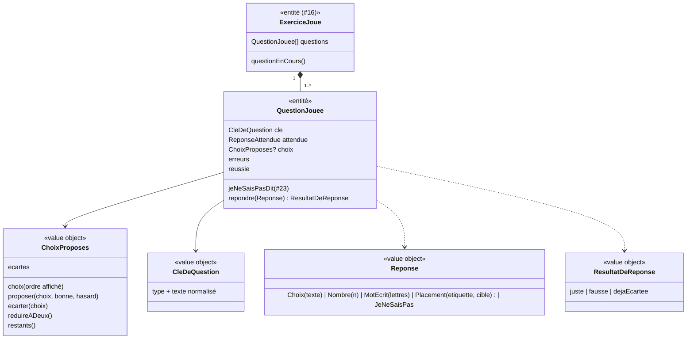

# Modèle du domaine : issue #17, Exercices à choix (bulles, lecture, écoute)

## Contexte

Story **porteuse de la question et de la réponse** pour tout le lot 3. Elle pose :
- la **question jouée** (`QuestionJouee`) : ses erreurs, sa réussite, sa nouvelle chance ;
- la **réponse** (`Reponse`) et sa correction (juste ou fausse) ;
- les **choix proposés** (`ChoixProposes`) : dédoublonnés, mélangés, écartés, réduits à deux.

La même mécanique de choix sert à `trous` et `conjugaison` (#18, #19), aux calculs du CP (#20, #21) et aux mots cachés (#22). « Je ne sais pas » et l'aide sont détaillés dans #23 ; ils s'appuient sur `QuestionJouee`.

Contextes :
- **Catalogue pédagogique** : les exercices `bulles`, `lecture`, `ecoute` tels que publiés, validés par `lireLecon` (#16).
- **Apprentissage** : la question jouée, la réponse, l'erreur, les choix proposés. Il dit seulement « juste » ou « fausse ».
- **Motivation** (#6) : félicitation, encouragement, humeur (`reagirALaReponse`, déjà livré). Humeur « applaudit » après chaque bonne réponse, « réfléchit » après une erreur.
- **Voix** (#7) : lecture de la question et du texte de lecture, mot surligné. L'écoute garde une **voix anglaise** (`choisirVoixDeLangue`, caractère fixe, décision n°11 du lot 2).
- **Famille** (#12) : réglage **tout lire à voix haute**.

### Comportement actuel (`app/`, `choose` l. 869, `RUNNERS.bulles` l. 1270, `lecture` l. 1432, `ecoute` l. 1623)

Résumé des règles (détail dans l'issue) :
- Choix dédoublonnés **comme textes exacts** (`new Set(values.map(String))`), puis mélangés. La bonne réponse est reconnue par égalité exacte de texte avec `reponse`.
- Bonne bulle : la question est réussie, les autres bulles ne réagissent plus.
- Mauvaise bulle : **une erreur**, la bulle est **écartée** (pâle, ne réagit plus). La toucher encore ne compte rien.
- À la **2e erreur** de la même question : on garde la bonne bulle et **la première** autre bulle non écartée dans l'ordre affiché ; les autres non écartées disparaissent. Les bulles écartées restent visibles, pâles.
- Tout lire à voix haute : si le son est actif et s'il y a au moins deux choix, 300 ms après l'affichage : « Est-ce `<a>`, `<b>`, ou `<c>` ? » (dans l'ordre affiché).
- Aide après erreur (bulles, lecture) : `aide` de la question, sinon « Essaie une autre bulle. ». Écoute : « Écoute encore. », puis `dire` est redit.
- Écoute : langue `ex.langue`, sinon `en-GB`. `question`, sinon « Écoute bien ! Que veut dire ce mot ? ». `dire` n'est **jamais écrit**. Bonne réponse : « « `<dire>` », c'est « `<reponse>` ». ».
- Lecture : introduction, texte lu (vitesse 0,92) avec le mot surligné, « J'ai écouté », puis les questions avec les règles des bulles.
- Chaque erreur note la question pour les révisions (clés `b:`, `l:`, `e:`, lot 4).

### Ce que montre la bibliothèque

- `bulles` (158 exercices) : `questions[].aide` utilisé. `lecture` (29) : jamais d'`aide`. `ecoute` (16) : ni `consigne` ni `aide` sur les items, bien que le code les lise.

## Termes

| Terme | Statut | Remarque |
|---|---|---|
| Question | au glossaire (confirmé) | « Un item à résoudre à l'intérieur d'un exercice. » C'est l'unité de la séance : avancement, erreurs, révisions. |
| Réponse | au glossaire (à valider) | Ce que l'enfant propose : un choix touché, un nombre validé, un mot écrit, une étiquette posée, ou « Je ne sais pas » (#23). |
| Erreur | au glossaire (à valider) | Inchangé. Le compte exact des erreurs d'une question est fixé par #23. |
| Choix | **nouveau** (à valider), terme du format (`choix`) | Réponses proposées à l'enfant pour une question. |
| Choix écarté | **nouveau** (à valider) | Choix faux déjà touché : il reste visible, pâle, et ne compte plus d'erreur. |
| Bulle, carte de la question | termes d'interface (question ouverte n°7) | Le domaine dit **choix** et **question**. |
| Texte de lecture | terme du format (`lecture.texte`) | Pas de nouveau terme : « le texte » de l'exercice de lecture. |
| Mot à écouter | **nouveau** (à valider) | Champ `dire` de l'écoute : mot ou phrase dit par une voix anglaise, jamais écrit. |
| Explication de la réponse | **nouveau** (à valider) | Phrase propre au type d'exercice, dite après la félicitation (écoute : « « cat », c'est « chat » »). Apprentissage la fournit, Motivation la félicitation. |

## Modèle



### Catalogue : les exercices à choix publiés

| Exercice | Contenu validé par `lireLecon` |
|---|---|
| `ExerciceBulles` | `questions: QuestionAChoix[]`, au moins une. |
| `ExerciceLecture` | `titre?`, `texte` non vide, `questions: QuestionAChoix[]`. |
| `ExerciceEcoute` | `langue` (défaut `en-GB`), `items: ItemDEcoute[]` : `dire` non vide, `question?`, `choix`, `reponse` (`aide?`, `consigne?` : question ouverte n°6). |
| `QuestionAChoix` | `question` non vide, `choix` (au moins 2 **après dédoublonnage**), `reponse` **présente dans les choix**, `aide?`. Sinon `ExerciceMalForme`. Le pipeline vérifie déjà que la réponse fait partie des choix. |

### Apprentissage : la question jouée

- `QuestionJouee` est une **entité de l'agrégat `Seance`** (#16), identifiée par sa position dans l'exercice. Elle n'existe pas hors d'une séance.
- `repondre(Choix(texte))` :
  - question déjà réussie → `QuestionDejaReussie` ;
  - choix écarté → `dejaEcartee`, **aucune erreur** ;
  - texte égal à la bonne réponse → `juste`, la question est **réussie** ;
  - sinon → `fausse` : **une erreur**, le choix est écarté ; à la 2e erreur, `reduireADeux()`. La question reste ouverte : c'est la **nouvelle chance** (#23).
- `CleDeQuestion` : identifie une question d'une séance à l'autre, pour les révisions (lot 4). Reprend les clés du legacy (`b:`, `l:`, `e:` + texte normalisé). La séance garde la liste des questions **qui ont eu au moins une erreur** ; le lot 4 décide ce qu'il en fait.

### Value objects

| Value object | Règle |
|---|---|
| `ChoixProposes` | Dédoublonnés par **texte exact** (accents et majuscules gardés, question ouverte n°8), puis mélangés par le port `Hasard`, une fois au début de la séance. `reduireADeux()` garde la bonne réponse et **la première autre non écartée** dans l'ordre affiché (question ouverte n°10). Les choix écartés restent dans la liste, marqués écartés (question ouverte n°5). |
| `Reponse` | Union des formes de réponse du lot. Ici : `Choix(texte)`. Les autres formes sont posées par #18 à #23. |
| `CleDeQuestion` | Préfixe du type et texte normalisé (accents retirés, minuscules, espaces réduits), comme `norm` du legacy. La normalisation ne sert **qu'à la clé**, jamais à la correction. |
| `LectureDesChoix` | « Est-ce `<a>`, `<b>`, ou `<c>` ? », dans l'ordre affiché, seulement s'il reste au moins deux choix. Lue seulement si le réglage **tout lire à voix haute** est actif ; le son et la voix sont l'affaire du front. |
| `ExplicationDeLaReponse` | Écoute : « « `<dire>` », c'est « `<reponse>` ». ». Bulles et lecture : aucune. |

### Déroulé propre à chaque type

| Type | Déroulé (faits annoncés par le domaine) |
|---|---|
| `bulles` | Pour chaque question : la question est lue, puis les choix apparaissent. Après une erreur : aide de la question ou « Essaie une autre bulle. ». |
| `lecture` | Le texte est lu (mot surligné), puis « J'ai écouté », puis les questions comme `bulles`. Texte gardé à l'écran : question ouverte n°2. |
| `ecoute` | `question` (ou la question par défaut) est lue, puis `dire` est prononcé par la voix anglaise. « Écouter » le redit. Après une erreur : « Écoute encore. », puis `dire` (question ouverte n°3). |

### Erreurs métier

`ExerciceMalForme` (Catalogue : réponse absente des choix, moins de deux choix), `QuestionDejaReussie`, `PasDeQuestionEnCours`, `ReponseDUnAutreType` (un nombre donné à une question à choix).

## Invariants

1. Une question réussie ne reçoit plus de réponse.
2. Une réponse fausse coûte **une erreur** et laisse une **nouvelle chance** : l'enfant ne passe à la suite qu'avec la bonne réponse (#23 pour « Je ne sais pas »).
3. Un choix écarté ne coûte jamais une seconde erreur.
4. Les choix proposés contiennent toujours la bonne réponse, sans doublon de texte exact, et au moins deux choix tant que la question n'est pas réussie (sauf après « Je ne sais pas », #23).
5. Après deux erreurs sur la même question, il reste **deux** choix possibles, dont la bonne réponse.
6. La correction compare le **texte exact** du choix et de la réponse attendue.
7. Le mot à écouter (`dire`) n'est **jamais écrit** à l'écran.
8. Apprentissage dit seulement « juste » ou « fausse » ; la félicitation, l'encouragement et l'humeur viennent de Motivation.

## Événements

Aucun événement de domaine publié : les réponses restent dans la séance. Les questions ratées voyagent avec `SeanceTerminee` (#24).

## Partage avec le front

Tout tourne dans le navigateur (`@domain/apprentissage`, `@domain/catalogue`) : choix proposés, correction, réduction à deux, lecture des choix, explication. Le front appelle `seance.repondre(...)`, puis `reagirALaReponse` de Motivation avec le résultat, puis le port `LecteurAVoixHaute`. Le front ne compare jamais lui-même une réponse.

## Données d'enfants

Aucune donnée nouvelle enregistrée. Les réponses restent dans la séance en cours (ce qui en est gardé : #24).

## Emplacement

```
supabase/functions/_shared/catalogue/domain/exercices/
  question-a-choix.ts           # QuestionAChoix et sa validation
  bulles.ts  lecture.ts  ecoute.ts
supabase/functions/_shared/apprentissage/domain/
  question-jouee.ts             # entité QuestionJouee
  reponse.ts                    # Reponse, ResultatDeReponse
  choix-proposes.ts             # dédoublonnage, mélange, écart, réduction à deux
  cle-de-question.ts
  lecture-des-choix.ts          # « Est-ce a, b, ou c ? »
  exercices/
    bulles.ts  lecture.ts  ecoute.ts   # déroulé et explications propres au type
src/seance/exercices/           # bulles, carte de la question, texte de lecture, bouton « Écouter »
```

## Questions ouvertes

1. **Bulles** : la félicitation est-elle lue jusqu'au bout avant la question suivante ? **Proposition** : oui (correction du défaut, au prix d'un peu de temps).
2. **Lecture** : le texte reste-t-il affiché pendant les questions ? **Proposition** : oui, au-dessus de la question, pour que l'enfant puisse le relire.
3. **Écoute** : faire entendre l'encouragement en entier, puis le mot ? **Proposition** : oui.
4. **Écoute sans son** (muet ou navigateur sans voix) : reprendre les messages de la dictée (« … j'ai besoin du son : active-le avec le bouton ci-dessous. », bouton « Activer le son ») ? **Proposition** : oui, mêmes textes en remplaçant « Pour la dictée » par « Pour écouter l'anglais ».
5. **Après deux erreurs** : les bulles écartées restent-elles visibles, pâles ? **Proposition** : oui, comme aujourd'hui (l'enfant voit ce qu'il a déjà essayé).
6. **`consigne` et `aide` des items d'écoute** : **Proposition** : ajouter `aide` (facultative) au format pour les items d'écoute et les questions de lecture ; retirer `consigne` du moteur (jamais utilisée, et `question` joue ce rôle).
7. **« Bulle », « carte de la question »** : termes d'interface, hors glossaire ? **Proposition** : oui.
8. **Choix « a » et « à »** : deux choix différents (dédoublonnage et correction par texte exact, accents et majuscules gardés) ? **Proposition** : oui, comme aujourd'hui pour les bulles ; c'est aussi la correction proposée pour les trous (#18).
9. **Lecture** : après une erreur, l'aide reste « Essaie une autre bulle. » (les questions de lecture n'ont pas d'aide) ? **Proposition** : oui, tant que le format n'a pas d'`aide` pour elles (question n°6).
10. **Réduction à deux** : la bulle gardée avec la bonne est la première non écartée dans l'ordre affiché (comme aujourd'hui) ? **Proposition** : oui ; elle est déterministe et testable.
