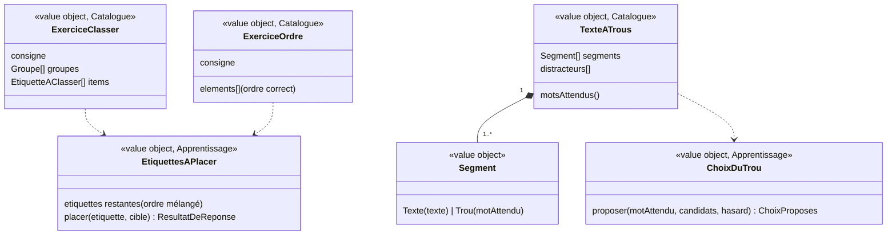

# Modèle du domaine : issue #18, Classer, ordre, trous

## Contexte

Trois types d'exercices, deux mécaniques :
- **étiquettes à placer** (`classer`, `ordre`) : nouvelle mécanique de réponse, réutilisée par l'addition posée (#20, étape poser) et l'ordre des vers (#22) ;
- **texte à trous** (`trous`) : la mécanique des choix de #17, avec des choix calculés ; réutilisée par les mots cachés (#22).

S'appuie sur la séance (#16), la question jouée et les choix proposés (#17), l'aide et « Je ne sais pas » (#23).

Contextes :
- **Catalogue pédagogique** : exercices `classer`, `ordre`, `trous` publiés. Le Catalogue **découpe le texte à trous** en segments et mots attendus : Apprentissage ne lit jamais les crochets.
- **Apprentissage** : placement des étiquettes, correction, choix de chaque trou.
- **Motivation** (#6) : paroles et humeur. Humeur « applaudit » après **chaque** bonne réponse, y compris en `classer` (écart voulu, décision M4 de #6).

### Comportement actuel (`app/`, `placeTags` l. 959, `RUNNERS.classer` l. 1281, `ordre` l. 1378, `trous` l. 1391, `norm` l. 16)

**Étiquettes à placer** : étiquettes mélangées dans un plateau ; une étiquette se pose sur une cible (glisser, ou toucher puis toucher la cible, ou clavier). Bonne cible : l'étiquette quitte le plateau. Mauvaise cible : elle revient au plateau, **une erreur** à chaque fois (pas de cible écartée, contrairement aux choix). L'enfant choisit **librement** l'étiquette à poser.

**Classer** : une cible par groupe (« maison »). Bonne si le `groupe` de l'item est l'`id` de la maison. Félicitation **une fois sur deux** (`Math.random() < .5`). Erreur : `aide` de l'item, sinon « « `<étiquette>` » n'habite pas dans la maison « `<maison>` ». Essaie une autre maison. ».

**Ordre** : une seule cible (la liste). Bonne si l'étiquette est **à la position attendue** (comparaison par **position**, pas par texte). Après chaque bonne étiquette sauf la dernière, au hasard : « Oui ! Et après ? », « Bien ! Et ensuite ? », « Super ! La suite ? ». Erreur sur la première : « Ce n'est pas le début. Lequel vient en premier ? » ; ensuite : « Pas encore celui-là. Lequel vient juste après ? ». Erreurs **non notées** pour les révisions. Pas de félicitation à la fin.

**Trous** : découpage de `texte` sur `[mot]`. Trous dans l'ordre. Choix : le mot attendu + 2 autres tirés de `distracteurs` ∪ autres mots attendus, **sans ceux qui s'écrivent pareil une fois accents et majuscules retirés** (`norm`) ; puis dédoublonnage par texte exact (`choose`). Erreur : « Relis la phrase en entier : quel mot va bien ? ». Bonne réponse : le mot s'écrit dans le trou ; félicitation sauf au dernier trou. Fin : « `<félicitation>` Le texte est complet ! ».

### Défauts vérifiés dans la bibliothèque

- `fr-ce1-a-ou-a` : `norm("à") == norm("a")`, donc chaque trou n'a **qu'un** choix.
- `ma-cm1-programmation` : « Avancer de 1 case » deux fois dans `ordre` ; la mauvaise des deux compte une erreur.
- Aucun item de `classer` n'a d'`aide` dans la bibliothèque.

## Termes

| Terme | Statut | Remarque |
|---|---|---|
| Étiquette | **nouveau** (validé) | Mot, nombre ou chiffre que l'enfant pose sur une cible : item de `classer`, élément d'`ordre`, chiffre de l'addition posée (#20), vers (#22). |
| Groupe | **nouveau** (validé), terme du format (`groupes`) | Catégorie d'un exercice `classer`, avec un `id` et un `nom`. L'interface dit « maison ». |
| Maison | **conflit tranché** (décision n°7) | Dit pour les groupes de `classer` **et** pour les colonnes de l'addition posée (#20). Mot d'interface seulement ; le domaine dit **Groupe** et **Colonne**. |
| Élément (d'ordre) | terme du format (`elements`) | Étiquette d'un exercice `ordre`, dans l'ordre correct. |
| Texte à trous | **nouveau** (validé) | Texte d'un exercice `trous`, découpé par le Catalogue en segments de texte et en trous. |
| Trou | **nouveau** (validé) | Place d'un mot attendu dans un texte à trous (`[mot]` dans le format). |
| Mot attendu | **nouveau** (validé) | Mot qui remplit un trou. |
| Distracteur | **nouveau** (validé), terme du format (`distracteurs`) | Mot faux proposé exprès parmi les choix (trous, conjugaison). |
| Plateau | terme d'interface | Zone des étiquettes à placer. |

## Modèle



### Catalogue : validation à la lecture

| Exercice | Règles de `lireLecon` |
|---|---|
| `ExerciceClasser` | Au moins 2 groupes, `id` uniques ; chaque item a un `texte` non vide et un `groupe` qui existe. `aide?` (facultative, ajoutée au format : décision n°6). Consigne par défaut : « Range chaque étiquette dans la bonne maison. » |
| `ExerciceOrdre` | Au moins 2 éléments non vides. Consigne par défaut : « Remets les étiquettes dans le bon ordre. » |
| `TexteATrous` | Découpage de `texte` : segments de texte et trous `[mot]`. Au moins un trou ; un trou vide (`[]`) ou des crochets mal fermés → `ExerciceMalForme`. Consigne par défaut : « Complète le texte : choisis le mot qui manque. » Chaque trou doit pouvoir proposer au moins 2 choix (décision n°9). |

### Apprentissage : questions et correction

| Type | Questions | Correction |
|---|---|---|
| `classer` | une par étiquette, réussies **dans l'ordre que choisit l'enfant** | `Placement(etiquette, groupe)` juste si le groupe de l'étiquette est le groupe visé. Faux : une erreur, l'étiquette revient (pas de groupe écarté ; décision n°8). |
| `ordre` | une par position | `Placement(etiquette)` juste si son **texte** est celui de l'élément attendu à la position suivante (décision n°1 : deux éléments au même texte sont interchangeables ; le legacy comparait la position d'origine). Faux : une erreur. |
| `trous` | une par trou, **dans l'ordre du texte** | Mécanique des choix (#17) : texte exact. Réduction à deux après deux erreurs, « Je ne sais pas » (#23). |

- `EtiquettesAPlacer` : les étiquettes sont mélangées une fois (port `Hasard`) au début de la séance. Une étiquette placée quitte le plateau. L'exercice est fini quand le plateau est vide.
- `ChoixDuTrou` : mot attendu + 2 candidats tirés parmi `distracteurs` ∪ autres mots attendus, **sans les candidats identiques au mot attendu**. Identique : **texte exact**, accents et majuscules gardés (décision n°2 ; le legacy comparait « sans accents ni majuscules »), pour que « a » et « à » soient deux choix. Puis dédoublonnage et mélange (#17).
- La consigne est lue, suivie de l'indication du geste : « Fais glisser chaque étiquette, ou touche-la puis touche une maison. » (classer), « Touche d'abord celle qui vient en premier. » (ordre).
- Clés de question (révisions, lot 4) : `k:` (classer), `t:` (trous, avec la phrase qui contient le trou), comme le legacy. Ordre : aucune dans le legacy ; la séance garde toutes les questions ratées, quel que soit le type, et le lot 4 décide lesquelles deviennent des révisions (décision n°4).

### Aides et explications (textes du legacy, #23)

| Type | Après une erreur | Après une bonne réponse |
|---|---|---|
| `classer` | `aide` de l'item, sinon « « `<étiquette>` » n'habite pas dans la maison « `<nom du groupe touché>` ». Essaie une autre maison. » | félicitation une fois sur deux (décision n°3) |
| `ordre` | 1re position : « Ce n'est pas le début. Lequel vient en premier ? » ; ensuite : « Pas encore celui-là. Lequel vient juste après ? » | « Oui ! Et après ? » / « Bien ! Et ensuite ? » / « Super ! La suite ? », sauf la dernière (décision n°5) |
| `trous` | « Relis la phrase en entier : quel mot va bien ? » | félicitation, sauf au dernier trou ; fin : « Le texte est complet ! » |

Les relances de l'ordre (« Oui ! Et après ? ») et la fin des trous sont des paroles de Motivation ; l'aide est d'Apprentissage.

### Erreurs métier

`ExerciceMalForme` (Catalogue), `EtiquetteDejaPlacee`, `GroupeInconnu`, `QuestionDejaReussie`.

## Invariants

1. Une étiquette placée au bon endroit n'est plus jamais déplacée ; une étiquette mal placée revient au plateau.
2. Chaque mauvais placement coûte une erreur.
3. `classer` : l'enfant pose les étiquettes dans l'ordre qu'il veut. `ordre` : seule l'étiquette suivante est acceptée. `trous` : les trous se remplissent dans l'ordre du texte.
4. `ordre` : deux éléments au même texte sont interchangeables (décision n°1).
5. Un trou propose toujours son mot attendu, et deux choix qui ne lui sont pas identiques quand c'est possible.
6. Apprentissage ne lit jamais la syntaxe `[mot]` : il reçoit des segments et des mots attendus du Catalogue.

## Événements

Aucun. Les questions ratées voyagent avec `SeanceTerminee` (#24).

## Partage avec le front

Tout tourne dans le navigateur : découpage du texte à trous (`@domain/catalogue`), placement, correction et choix des trous (`@domain/apprentissage`). Les trois gestes (glisser, toucher puis toucher, clavier) sont l'affaire du front : ils produisent tous la même réponse `Placement`. Le trou en cours est annoncé aux lecteurs d'écran (« mot manquant »).

## Données d'enfants

Aucune donnée nouvelle.

## Emplacement

```
supabase/functions/_shared/catalogue/domain/exercices/
  classer.ts  ordre.ts
  texte-a-trous.ts              # découpage en segments et mots attendus
supabase/functions/_shared/apprentissage/domain/
  etiquettes-a-placer.ts        # mécanique des étiquettes (aussi #20 poser, #22 ordre des vers)
  choix-du-trou.ts
  exercices/
    classer.ts  ordre.ts  trous.ts
src/seance/exercices/           # plateau, maisons, liste à remplir, texte à trous ; glisser, toucher, clavier
```

## Décisions du PO

Validation n°1 du lot 3 par le PO, le 2026-10-23 : « OK pour tout » (`docs/stories/lot-3-decisions.md` ; décisions `docs/decisions/0012-lecture-des-lecons-dans-le-domaine-catalogue.md` et `docs/decisions/0013-ecritures-d-apprentissage-par-edge-function.md`). Chaque question reçoit pour réponse sa proposition. Le numéro unique du lot (`Q…`, voir `docs/stories/16/acceptance.md`) suit le numéro de la story.

1. (Q21) **Ordre** : deux éléments au même texte sont-ils interchangeables ? **Décision** : oui, on compare le texte.
2. (Q22) **Trous** : un candidat n'est écarté que s'il est **identique** au mot attendu (accents et majuscules gardés), pour que « a » et « à » soient deux choix ? **Décision** : oui.
3. (Q23) **Classer** : félicitation à chaque bonne étiquette, ou une fois sur deux ? **Décision** : l'humeur « applaudit » à chaque fois (décision M4), la félicitation parlée une fois sur deux (tirée par le port `Hasard`), pour ne pas ralentir un exercice de 10 étiquettes.
4. (Q24) **Ordre** : ses erreurs sont-elles notées pour les révisions ? **Décision** : la séance garde **toutes** les questions ratées, quel que soit le type (ordre et addition posée compris) ; le lot 4 décide lesquelles deviennent des révisions.
5. (Q25) **Ordre** : une félicitation à la fin de l'exercice ? **Décision** : oui, une félicitation après la dernière étiquette, comme les autres types.
6. (Q26) **`aide` des items de `classer`** : à ajouter au format ? **Décision** : oui, facultative (même réponse que #23, question n°5).
7. (Q27) **Glossaire** : « étiquette », « trou », « distracteur » termes du domaine ; « maison » terme d'interface, le domaine disant **Groupe** (classer) et **Colonne** (addition posée) ? **Décision** : oui.
8. (Q28) **Classer** : reposer une étiquette dans la même mauvaise maison compte une nouvelle erreur (comme aujourd'hui) ? **Décision** : oui ; l'étiquette est revenue au plateau, c'est un nouvel essai.
9. (Q29) **Trous** : le Catalogue refuse-t-il un texte à trous qui ne peut pas proposer au moins deux choix par trou (un seul trou sans distracteur) ? **Décision** : oui (`ExerciceMalForme`), vérifié aussi par le test de la bibliothèque.

## Questions ouvertes

Aucune.
