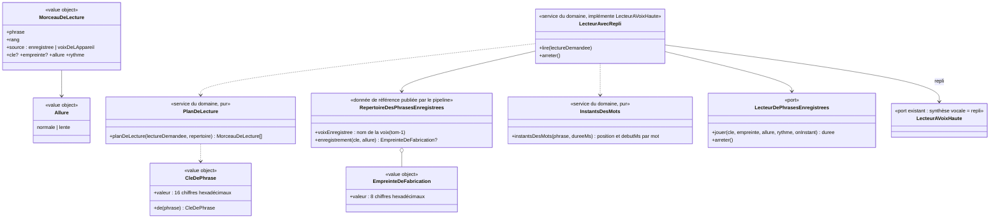

# Story #182 : la voix de l'application en MP3 pré-générés (Piper, voix « tom ») : modèle du domaine

> Cadrage du `domain-modeler`, 2026-11-10 ; **validé par le PO le 2026-11-11** (« Reco tout », annonce [Responsable] sur #193, 00:47 UTC) : toutes les recommandations sont retenues, voir la section 9 « Réponses du PO ». Le PO a ensuite répondu à **182.19** (« Modèle 1 et 32kbit et le reste reco », annonce [Responsable] sur #193, 2026-11-11) : **modèle 1** de « tom », débit **32 kbit/s** confirmé ; plus aucune question ouverte.
> Décisions du PO qu'on ne rouvre pas : outil **Piper**, voix **« tom »** (44,1 kHz, modèle sous AGPLv3, seuls les MP3 vont dans l'application, jamais le modèle), **repli sur la voix de l'appareil** pour une phrase sans MP3. Le dépôt de la voix (`git.bksp.space/Tjiho/French-tts-model-piper`) contient trois modèles « tom » et aucun ne s'appelle `fr_FR-tom-medium` : le PO a retenu à l'oreille le **modèle 1** (`model 1/tom1.onnx`), nommé `tom-1` dans le répertoire (182.19). Décision d'architecture : **0044** (`docs/decisions/0044-voix-en-mp3-pre-generes-piper.md`, acceptée le 2026-11-11).

## 1. Contexte

**Contexte retenu : le sous-domaine générique Voix** (`supabase/functions/_shared/voix/`), déjà responsable de « lecture à voix haute et effets sonores » (décisions 0007, 0008, #97). Justification :
- la story ne change **aucune règle d'Apprentissage, de Motivation, de Famille ni d'Accompagnement** : elle change *comment* une phrase déjà choisie est dite ;
- le port `LecteurAVoixHaute` a été prévu pour cet adaptateur (décision 0004, context map : « voix du navigateur aujourd'hui, MP3 plus tard ») ;
- Voix ne connaît ni les univers ni les leçons : la clé de phrase, le répertoire et le choix « MP3 ou voix de l'appareil » ne dépendent que du **texte de la phrase**.

**Contextes touchés en marge**
| Contexte | Ce qui change | Relation |
|---|---|---|
| Apprentissage | Publie une lecture pure de plus : **les textes dits pendant une leçon** (`textesDitsDansLaLecon(lecon)`), à partir des règles qu'il possède déjà (consigne affichée, énoncé, aide, « Combien font … ? », dictée, conjugaison, trous, félicitation de la dictée…). Sert au pipeline (liste des phrases à fabriquer) et au front (mise en cache des MP3 d'une leçon ouverte). Aucune règle de correction ne change. | Apprentissage → Voix : appel (existant) |
| Motivation | Publie la liste de ses **paroles fixes** (félicitations, encouragements, relances, invitations, annonces, épisodes…), sans prénom, pour qu'elles soient fabriquées. Le caractère de la voix d'un personnage guide n'a plus d'effet sur la hauteur d'un MP3 (question 182.3). | Motivation → Voix : Published Language (existant, étendu) |
| Pipeline de contenu (`scripts/`, Python) | Fabrique les MP3 avec Piper, applique la table de prononciation, écrit le répertoire. Ce n'est pas du code métier : il produit des données (CLAUDE.md). | Pipeline → Voix : **Published Language** nouveau (le répertoire et la clé de phrase) |
| Famille | Espace parent › Voix : le choix de voix de l'appareil ne vaut plus que pour le repli (question 182.9). | aucun changement de relation |

**Données d'enfants (RGPD)** : aucune donnée nouvelle. Le prénom n'est **jamais** fabriqué en MP3 ni envoyé à Piper ; les leçons personnelles (textes d'un parent pour un profil) ne passent **jamais** par le pipeline. Piper tourne sur la machine de génération : aucun texte ne quitte cette machine.

**Règle absolue (contenus pour les enfants)** : les MP3 disent des textes déjà soumis à la règle. La table de prononciation ne change **que la prononciation**, jamais le sens ; chaque entrée est relue par le PO (page d'écoute, question 182.5).

## 2. Termes

| Terme | Statut | Remarque |
|---|---|---|
| Lecture à voix haute, Voix automatique, Voix imposée, Choix de voix, Muet, Voix suspendue, Voix bloquée, Parole entendue, Message de voix bloquée, Fin de la voix bloquée, Effet sonore | existants | inchangés ; « Voix bloquée » garde son sens (le navigateur **refuse** de lire) |
| Synthèse vocale | existant (context map) | « MP3 pré-générés, ou voix du navigateur » : on précise les deux sources ci-dessous |
| **Voix enregistrée** | **nouveau, retenu** | La voix des MP3 fabriqués à l'avance par le pipeline (voix « tom » de Piper, modèle 1 du dépôt de l'auteur, nommée `tom-1` ; 182.19). S'oppose à **voix de l'appareil**. Synonymes interdits : voix Piper (dans l'interface), voix MP3, voix off |
| **Voix de l'appareil** | existant dans le code (`VoixDeLAppareil`), ajouté au glossaire, retenu | Voix de synthèse installée sur l'appareil, lue par le navigateur. Devient la voix du **repli** |
| **Phrase enregistrée** | **nouveau, retenu** | Phrase à lire (au sens du découpage de `texteALire`) dont un MP3 de la voix enregistrée existe. Synonymes interdits : son, audio, fichier (dans le domaine), piste |
| **Clé de phrase** | **nouveau, retenu** | Identifiant court calculé à partir du texte normalisé d'une phrase (section 3.1) ; le même calcul en TypeScript (domaine Voix) et en Python (pipeline). Synonymes interdits : hash, identifiant de son |
| **Répertoire des phrases enregistrées** | **nouveau, retenu** | Liste, publiée par le pipeline avec les MP3, des clés de phrase qui ont un MP3, avec l'empreinte de fabrication de chacun. Synonymes interdits : **catalogue** (conflit : c'est le nom du contexte Catalogue pédagogique), manifeste, index des sons |
| **Empreinte de fabrication** | **nouveau, retenu** | Courte empreinte de tout ce qui fait le MP3 d'une phrase (texte envoyé à la voix, modèle, réglages, allure, encodage). Elle change quand on regénère la phrase autrement ; le MP3 change alors d'adresse |
| **Table de prononciation** | **nouveau, retenu** | Liste testée de remplacements appliqués **par le pipeline seulement** au texte envoyé à la voix enregistrée (ex. « vas-y » → « va-zi »). Le texte affiché ne change jamais, ni le sens. Synonymes interdits : dictionnaire, lexique, correcteur |
| **Texte envoyé à la voix** | **nouveau, retenu** | Phrase après la table de prononciation, telle que Piper la reçoit. N'existe que dans le pipeline |
| **Repli sur la voix de l'appareil** | **nouveau, retenu** | Une phrase sans MP3 (ou dont le MP3 ne se lit pas) est dite par la voix de l'appareil, **pour cette phrase seulement**. Synonymes interdits : fallback, secours (dans le code) |
| **Voix indisponible** | **nouveau, retenu, distinct de Voix bloquée** | Une phrase française n'a ni MP3 lisible ni voix française sur l'appareil : rien ne peut la dire. Message juste (section 4.4), pas « bloquée par ce navigateur ». Synonymes interdits : voix bloquée (pour ce cas), voix cassée |
| **Allure** | **nouveau, retenu** | Vitesse de lecture d'une phrase : `normale` ou `lente` (lecture lente du mot dicté, `RYTHME_LENT` = 0,65). Synonymes interdits : vitesse (seule), débit (réservé à l'encodage) |
| **Surlignage approximatif** | **nouveau, retenu** | Avec un MP3, le mot prononcé est déduit de la durée du MP3 répartie entre les mots au prorata de leurs caractères. Précise **Lecture à voix haute** (« en surlignant le mot prononcé ») |
| **Paroles fixes** | **nouveau, retenu** | Phrases du personnage guide écrites dans le code du domaine, identiques pour tous (bravo, encouragements, invitations, annonces, épisodes), sans prénom ni nombre tiré au hasard |
| **Texte fabriqué à la volée** | **nouveau, retenu** | Texte construit pendant le jeu et inconnu à l'avance : calcul tiré au hasard, prénom, leçon personnelle, mots de la semaine, lecture des choix dans un ordre tiré au hasard. Il reste au repli (question 182.1) |
| **Page d'écoute** | **nouveau, retenu** | Page de contrôle pour le PO, par niveau, qui joue chaque phrase enregistrée à côté de son texte, pour repérer les mots mal prononcés. Outil de contenu, hors du parcours de l'enfant (question 182.5) |
| **Message de voix indisponible** | **nouveau, retenu** (182.16) | Message affiché quand la voix est indisponible ; même place et même cycle de vie que le **message de voix bloquée** (il disparaît après une parole entendue ou le passage en Muet). Un seul des deux messages à la fois : le plus récent remplace l'autre. Synonymes interdits : voix bloquée (pour ce cas), alerte son |
| **Texte enregistré de remplacement** | **nouveau, retenu** (mécanisme de 182.2 et 182.15) | Texte sans prénom (ex. « Bravo ! »), fourni avec une lecture qui contient le prénom, dit par la voix enregistrée **seulement** quand l'appareil n'a pas de voix française (section 3.4). Le texte affiché garde le prénom. Synonymes interdits : texte anonyme, version courte |

**Conflits signalés**
1. « **Catalogue** des voix enregistrées » (proposé dans le brief) : conflit avec le contexte **Catalogue pédagogique**. Proposition : **Répertoire des phrases enregistrées**.
2. « **Voix** » seule désigne la voix de synthèse (glossaire, décision n°14). Avec deux sources, on dit toujours **voix enregistrée** ou **voix de l'appareil** quand la source compte.
3. « **Voix bloquée** » est aujourd'hui affichée pour toute erreur de la synthèse (`lecteur-synthese-vocale.ts`), y compris l'absence de voix française. Proposition : garder « Voix bloquée » pour le refus du navigateur, ajouter **Voix indisponible**.
4. « **Lente** » : « lecture lente » existe (rythme 0,65). « Allure » nomme le paramètre ; « débit » est réservé au débit de l'encodage MP3 (kbit/s).

## 3. Modèle

Voix n'enregistre rien et n'a **pas d'agrégat** : aucune règle n'exige une frontière de cohérence transactionnelle. Le modèle est fait de **value objects**, d'une **donnée de référence** publiée par le pipeline (le répertoire), de **services du domaine** et de **ports**.

### 3.1 Clé de phrase : normalisation et algorithme (même calcul en TypeScript et en Python)

**Normalisation** (le texte de la clé), en partant du texte brut passé à `lire(...)` :
1. `textePrononce(brut)` **tel qu'il existe** : balises retirées, entités retirées, `+` → « plus », `=` → « égale », `___` → « ... », guillemets retirés selon les deux règles actuelles, espaces regroupés, bords coupés.
2. Découpage en phrases de `texteALire` : coupure sur les espaces qui suivent `.`, `!`, `?`, `…` ou `:`.
3. Pour chaque phrase : forme Unicode **NFC** ; apostrophe typographique `’` (U+2019) → `'` ; rien d'autre. **On garde la casse et la ponctuation** : « Bravo ! » et « Bravo. » ne se disent pas pareil.
4. Une phrase **sans lettre ni chiffre** (par ex. le « ! » isolé qui suit un titre terminé par « ? » dans « Nouveau jeu : Quel son entends-tu ? ! ») n'a pas de clé et ne se lit pas (règle nouvelle, retenue par le PO, 182.12).

**Clé** : **FNV-1a 64 bits** sur les octets UTF-8 du texte de la clé (base `0xcbf29ce484222325`, multiplicateur `0x100000001b3`, modulo 2^64), écrite en **16 chiffres hexadécimaux minuscules**. Pourquoi : quelques lignes, aucune dépendance, synchrone (contrairement à `crypto.subtle`, que le domaine pur n'utilise pas), même résultat en TypeScript (`BigInt`, cible ES2022) et en Python (entiers natifs). Collision : probabilité de l'ordre de 10⁻¹² pour 5 000 phrases ; le pipeline **échoue** si deux textes de clé différents donnent la même clé.

**Pièges Python ↔ TypeScript** (à couvrir par les cas partagés) :
- `\s` de JavaScript ≠ `\s` de Python (U+FEFF est un espace en JS, pas en Python ; U+001C à U+001F l'inverse) : le portage Python utilise une classe explicite égale à celle de JavaScript ;
- `\p{L}\p{N}` n'existe pas dans `re` : le portage Python teste `unicodedata.category(c)[0] in "LN"` ;
- les deux remplacements de guillemets et le regard en arrière du découpage doivent être recopiés à l'identique.

**Garantie d'égalité** : un **jeu de cas partagé**, `docs/voix/cas-des-cles-de-phrases.json` (contrat entre le pipeline et le domaine, comme `docs/format-lecons.md`) : `[{ "brut": …, "phrases": [{ "texte": …, "cle": … }] }]`. Il est lu par un test Deno (`voix/domain/cle-de-phrase_test.ts`, import JSON) **et** par un test pytest (`scripts/tests/test_cle_de_phrase.py`). Cas minimaux : guillemets devant et après ponctuation, `+` et `=`, `___`, balise et entité, `…` et `:`, apostrophes droite et typographique, accent en NFD, espaces insécables (U+00A0, U+202F), « ! » isolé, phrase de nombres (« 12 plus 5 »), phrase longue (177 caractères, la plus longue de la bibliothèque).

**Garde de couverture** (en plus) : un test Deno parcourt `app/bibliotheque.json`, demande à Apprentissage les textes dits de chaque leçon, et vérifie que **chaque phrase française a une clé dans le répertoire**, pour les niveaux déjà fabriqués (section 6). Il attrape aussi une phrase du domaine modifiée sans regénération.

### 3.2 Qui énumère les phrases à fabriquer

Les textes dits pendant une leçon sont **construits par des règles TypeScript d'Apprentissage** (consigne par défaut du type, « Combien font 12 moins 5 ? », « Écoute bien. *mot*. Écris : *mot*. », « *je* … ? », la phrase du trou, « c'est *réponse*. », « *mot* est bien écrit ! »…). Les recopier en Python les dédoublerait. **Retenu par le PO** (182.10) : une lecture pure `textesDitsDansLaLecon(lecon)` dans `@domain/apprentissage`, et un petit export Deno (`scripts/voix/exporter_les_phrases.ts`) qui écrit la liste `{ cle, phrase, niveau, lecons }` ; le pipeline Python la lit, **recalcule la clé** (double garde, cas partagés), applique la table de prononciation et fabrique les MP3. La même lecture sert au front pour mettre en cache les MP3 d'une leçon ouverte.

### 3.3 Table de prononciation

- Vit **dans le pipeline seulement** (`scripts/voix/table_de_prononciation.py`, ou un JSON à côté), jamais dans le domaine ni le front : le texte affiché, la clé et le surlignage partent du texte **non corrigé**.
- Une entrée : `motif` (mot ou groupe de mots, sur limites de mots, sensible à la casse) → `texte envoyé à la voix`, avec un **exemple testé** (pytest : phrase d'entrée → texte envoyé attendu). Exemples neutres : « vas-y » → « va-zi » ; « tu vas y arriver » → « tu va-z-y arriver » (si la liaison est mal faite) ; « CP » → « cé pé ».
- Le pipeline **échoue** sur une entrée qui ne s'applique à aucune phrase (table tenue propre) et signale chaque phrase touchée.
- Changer une entrée change le texte envoyé à la voix, donc l'**empreinte de fabrication** des seules phrases touchées : seules elles sont regénérées.

### 3.4 Lecture dans le navigateur

`LecteurAvecRepli` (service du domaine, testé avec des fakes, comme `LectureAVoixHaute` en décision 0008) implémente `LecteurAVoixHaute` : les écrans et `LectureAVoixHaute` ne changent pas.
- `planDeLecture` : pour chaque phrase de la lecture demandée, **phrase enregistrée** si la langue est française et que le répertoire a sa clé à l'allure demandée, sinon **repli sur la voix de l'appareil**. Le passage de l'une à l'autre se fait **phrase par phrase**, dans l'ordre.
- `LectureDemandee` gagne l'**allure** (`normale` | `lente`) : aujourd'hui seul le rythme 0,65 la porte, ce qui ne permet pas de choisir le MP3 lent.
- MP3 introuvable ou illisible (hors ligne et pas en cache, 404, décodage) : **repli** pour cette phrase, sans message.
- Repli impossible parce que l'appareil n'a **aucune voix française** : **`VoixIndisponible`** (erreur métier nouvelle). Le navigateur refuse de jouer (lecture automatique interdite, `NotAllowedError`) : **`VoixBloquee`** (existante, valable aussi pour un MP3).

**Phrase avec le prénom : mécanisme retenu (182.2, option B de 182.15)**
- `LectureDemandee` gagne une option **`texteEnregistreDeRemplacement`** (facultative) : le même texte sans le prénom (« Bravo ! » pour « Bravo Léa ! », « Coucou ! » pour « Coucou Léa ! »). L'appelant (Motivation, via le front) la fournit pour chaque parole qui contient le prénom ; ses phrases font partie des **paroles fixes** publiées par Motivation, donc elles ont un MP3.
- `planDeLecture` calcule d'abord le plan du **texte principal** (avec le prénom), phrase par phrase, comme d'habitude.
- **L'appareil a une voix française** : on garde ce plan ; la phrase avec le prénom, qui n'a pas de MP3, est dite **en entier** par la voix de l'appareil (repli), les autres phrases restent enregistrées. Le texte de remplacement n'est **pas** utilisé. Les scénarios livrés qui font dire le prénom (#24, #29, #100, #101) ne changent pas.
- **L'appareil n'a pas de voix française** et une phrase française du plan n'a pas de MP3 : si un texte enregistré de remplacement est fourni, on lit **le plan du texte de remplacement à sa place** (pour toute la lecture) ; s'il manque encore un MP3 à l'une de ses phrases, c'est `VoixIndisponible`. Sans texte de remplacement, c'est `VoixIndisponible`.
- Le texte affiché (bulle) et le surlignage du texte principal ne changent pas : avec le texte de remplacement, le surlignage suit les mots du texte de remplacement présents dans la bulle (approximation acceptée).

**Un seul signal de lecture empêchée (182.16)**
- Le service de lecture n'a qu'**un** rappel, `onLectureEmpechee(cause)`, avec `cause` = `voixBloquee` (le navigateur refuse de jouer, MP3 ou synthèse : `VoixBloquee`) ou `voixIndisponible` (phrase française sans MP3 lisible ni voix française, après l'essai du texte de remplacement : `VoixIndisponible`). Il remplace `onVoixBloquee`.
- Un seul rappel de fin, `onFinDeLectureEmpechee` : une parole entendue ou le passage en Muet (décisions 79.5, 79.10).
- Le front montre le **message de voix bloquée** ou le **message de voix indisponible** selon la cause ; un nouveau signal remplace le message affiché (un seul à la fois).
- Le MP3 introuvable ou illisible **avec** une voix française n'émet aucun signal (repli silencieux).
- Muet, voix suspendue, `arreter()` et `couperLaVoix()` coupent le MP3 en cours **tout de suite**, comme la synthèse ; la fin de lecture est la fin du dernier morceau.

### 3.5 Erreurs métier

| Erreur | Où | Quand |
|---|---|---|
| `VoixIndisponible` (nouvelle) | `voix/domain/erreurs.ts` | phrase française sans MP3 lisible, et aucune voix française sur l'appareil |
| `VoixBloquee` (existante) | idem | le navigateur refuse de jouer, MP3 ou synthèse |
| `LectureImpossible` (existante) | idem | pas de synthèse vocale et pas de MP3 pour la phrase |
| `CollisionDeCles` (pipeline) | `scripts/voix/` | deux textes de clé différents, même clé : la fabrication s'arrête |
| `RemplacementSansEffet` (pipeline) | `scripts/voix/` | une entrée de la table de prononciation ne touche aucune phrase |
| `BudgetDePoidsDepasse` (pipeline) | `scripts/voix/` | `public/voix/` dépasse le budget fixé (question 182.6) |

### 3.6 Commandes

Côté navigateur, aucune commande nouvelle : `lire`, `arreter`, `couperLaVoix`, `passerEnMuet`, `suspendre` restent celles de `LectureAVoixHaute`. Une action nouvelle du front : **`MettreEnCacheLesPhrasesDeLaLecon`** (à l'ouverture d'une leçon, voir 4.2).
Côté pipeline (données, pas domaine) : **`FabriquerLesPhrasesEnregistrees`** (par niveau ou par lot, reprenable), **`VerifierLaTableDePrononciation`**, **`ConstruireLaPageDEcoute`** (par niveau).

## 4. Chiffres et propositions

### 4.1 Mesures (script jetable, hors dépôt)

Méthode : portage Python de `textePrononce` et du découpage de `texteALire`, appliqué aux textes de `app/bibliotheque.json` que le front fait **effectivement dire** (repérés dans `src/` : étapes de leçon et leurs exemples, consignes, `indicationDuGeste`, annonce « … : *titre* ! », énoncés et aides des `bulles`/`lecture`, aides des étiquettes `classer`, phrases des trous, « *pronom* … ? » et son aide, textes des `lecture`, vers des `memoriser`, phrases de la dictée et leur félicitation, « c'est *réponse*. » de l'`ecoute`, « Combien font … ? » des `calcul` à opérations fixes, énoncés, aides et phrases des `barres`). Phrases dédoublonnées, débit de parole **14,5 caractères/s**, **0,35 s** de silence par fichier, environ 0,4 Ko d'en-tête par fichier. Le poids d'un MP3 dépend du **débit**, pas de la fréquence d'échantillonnage : 22,05 kHz ou 24 kHz (MPEG-2) pèsent pareil à débit égal.

| Ensemble | Phrases distinctes | Caractères | Durée | 24 kbit/s | 32 kbit/s | 48 kbit/s |
|---|---|---|---|---|---|---|
| Leçons de la bibliothèque (265) | **3 478** | 103 500 | 1 h 59 | 26,5 Mo | 34,6 Mo | 51,3 Mo |
| Paroles fixes des personnages guides et du domaine (estimation par relevé des chaînes du code) | ≈ 300 à 400 | ≈ 11 000 | ≈ 13 min | ≈ 2,9 Mo | ≈ 3,8 Mo | ≈ 5,6 Mo |
| **Total sans les choix** | **≈ 3 870** | **≈ 114 500** | **≈ 2 h 12** (2 h 34 avec les silences) | **≈ 29 Mo** | **≈ 39 Mo** | **≈ 57 Mo** |
| Choix lus un par un (si assemblage, question 182.1) | 1 568 | 15 500 | ≈ 18 min | ≈ 5,3 Mo | ≈ 7,1 Mo | ≈ 10,6 Mo |
| Mots dictés en allure lente (×1,55) | 47 | 393 | ≈ 45 s | 0,1 Mo | 0,2 Mo | 0,3 Mo |

L'issue annonçait « environ 4 700 textes, 126 000 caractères » : l'écart vient des **choix** (1 568), comptés par l'issue, qui ne sont jamais lus seuls (seulement dans « Est-ce *a*, *b*, ou *c* ? », voir plus bas).

**Par niveau** (phrases propres au niveau ; la somme dépasse le total à cause des phrases communes) :

| Niveau | Leçons | Phrases | Durée | 24 kbit/s | 32 kbit/s | 48 kbit/s |
|---|---|---|---|---|---|---|
| CP | 63 | 923 | 29 min | 6,6 Mo | 8,6 Mo | 12,7 Mo |
| CE1 | 49 | 674 | 21 min | 4,7 Mo | 6,2 Mo | 9,2 Mo |
| CE2 | 50 | 670 | 22 min | 5,0 Mo | 6,5 Mo | 9,7 Mo |
| CM1 | 53 | 675 | 24 min | 5,4 Mo | 7,1 Mo | 10,5 Mo |
| CM2 | 50 | 661 | 24 min | 5,3 Mo | 7,0 Mo | 10,3 Mo |

**Par leçon** : en moyenne **14 phrases, 400 caractères, ≈ 136 Ko à 32 kbit/s** (103 Ko à 24, 201 Ko à 48) ; médiane 10 phrases ; maximum `fr-ce1-present-premier-groupe`, **40 phrases, 820 caractères, ≈ 300 Ko à 32 kbit/s**.

**Textes fabriqués à la volée (restent au repli tant que la question 182.1 n'est pas tranchée)** :
- calculs tirés au hasard : 34 exercices `calcul` à générateur, 14 `fluence`, 2 `addition` générées ; jusqu'à **≈ 2 000** calculs possibles pour les seuls générateurs à bornes (dont 1 071 pour une fluence du CE1), beaucoup plus pour les additions générées ;
- lecture des choix avec « tout lire à voix haute » : **4 360** ordres possibles de « Est-ce *a*, *b*, ou *c* ? » (choix tirés dans un ordre au hasard) ;
- phrases avec le prénom : une dizaine de modèles (« Coucou *prénom* ! », « Trois étoiles, *prénom* ! »…) ; grâce au découpage, **seule la phrase qui contient le prénom** reste au repli, la suite (« Je t'explique la leçon, et après, on joue. ») est enregistrée ;
- leçons personnelles et mots de la semaine (textes d'un parent) : toutes leurs phrases ;
- mots à écouter en anglais (75) : voix anglaise de l'appareil, hors Piper (question 182.11) ;
- **finis mais construits** : 10 items `boite`, les phrases des colonnes de 10 additions à opérations fixes, « Tu gagnes *N* étoile(s) », « Épisode *n* : », l'essai de voix avec chacun des 6 personnages guides : ils peuvent être énumérés et fabriqués (recommandé, dans la livraison des paroles fixes).

### 4.2 Stockage et hors ligne

**Stockage (question 182.4)** — recommandation : **dans le dépôt et le build** (`public/voix/`), servis par alwaysdata avec le front.
- Poids : ≈ 39 Mo à 32 kbit/s (≈ 29 Mo à 24), soit 30 à 40 % du quota gratuit d'alwaysdata (≈ 100 Mo, décision 0025) ; à vérifier : l'arrondi par bloc du système de fichiers (≈ 3 900 petits fichiers de 10 Ko en moyenne) peut ajouter quelques Mo.
- Pour : même origine que l'application (le service worker actuel ne gère que la même origine), aucune dépendance au projet Supabase Free (qui se **met en pause** après une semaine sans activité : la voix disparaîtrait avec lui), aucun trafic compté (Supabase Free : 5 Go par mois), versionné et reproductible.
- Contre : le dépôt grossit de ≈ 39 Mo (puis de la taille des seules phrases regénérées) ; **`envoi_webdav.py` envoie aujourd'hui tout `dist/`** : avec ≈ 3 900 fichiers, il faut n'envoyer que les fichiers nouveaux ou changés (le nom contient l'empreinte, donc un nom déjà présent sur le serveur est à jour), à faire avant la première publication avec les MP3.
- Supabase Storage reste l'option si le quota d'alwaysdata devient trop juste (choix, assemblage, deuxième voix).

**Hors ligne** — recommandation, sans précache complet :
- **Cache à part**, `savanturier-voix`, **non versionné** : le cache actuel porte la version du build et est vidé à chaque publication (`supprimerLesAutresCaches`), ce qui effacerait les MP3 déjà gardés. Les adresses contiennent l'empreinte de fabrication, donc un MP3 en cache n'est jamais périmé ; à l'activation, le service worker retire du cache voix les adresses absentes du répertoire.
- **Au précache** (installation) : le répertoire (≈ 3 900 entrées, ≈ 120 Ko, ≈ 50 Ko compressé) et les **paroles fixes les plus fréquentes** (félicitations, encouragements, relances, invitations, annonces, consignes par défaut : ≈ 60 phrases, ≈ 0,5 Mo). Les autres paroles fixes (épisodes, cabane, médailles…) sont mises en cache à leur première lecture.
- **À l'ouverture d'une leçon** (page de la leçon) : `MettreEnCacheLesPhrasesDeLaLecon` (≈ 136 Ko en moyenne, 300 Ko au plus) : les MP3 sont téléchargés en arrière-plan ; une leçon ouverte une fois en ligne se rejoue hors ligne. Les MP3 lus sont aussi gardés au passage (cache puis réseau, avec la réponse 206 pour Safari, comme `sonDuCache`).
- Les leçons d'un parcours suivant (prochaine leçon proposée) peuvent être préchargées de la même façon (option, question 182.8).
- Limite connue : Safari peut effacer le cache d'un site non installé après 7 jours sans visite ; installée (PWA, #8), l'application garde son cache.

### 4.3 Surlignage approximatif

`instantsDesMots(phrase, dureeMs)` (pur, dans `voix/domain/`) : la durée du MP3 (connue au chargement des métadonnées) est répartie entre les mots de `motsPrononces(phrase)` **au prorata de leurs caractères**, avec un petit poids en plus après une virgule ou une ponctuation (pause) et un décalage de début pour le silence de tête du MP3 ; l'adaptateur appelle `onMot(phrase, position)` au bon instant (`timeupdate` ou image par image), ce qui alimente le `rangDesMots` existant. La durée peut aussi être écrite dans le répertoire par le pipeline (option, pour surligner dès le premier mot sans attendre les métadonnées).

### 4.4 Message juste quand rien ne peut lire

Proposition de texte (question 182.7), même place et même règle d'un seul message que le message de voix bloquée (décisions 79.5, 79.6) :
> « *Coach Léo* ne peut pas lire cette phrase sur cet appareil. Lis-la avec un adulte, ou touche « Réécouter » plus tard. »

Il ne dit plus « bloquée par ce navigateur ». Le message actuel (« La voix de … est bloquée par ce navigateur. Touche « Réécouter » pour réessayer, ou lis avec un adulte. ») reste pour un vrai refus du navigateur (`VoixBloquee`), où un toucher sur « Réécouter » débloque bien la lecture.

### 4.5 Lecture lente

Elle ne sert qu'au **mot dicté** (`useDictee`, révision). Recommandation (question 182.8) : **MP3 lents à part** pour les 47 mots dictés de la bibliothèque, fabriqués par Piper avec un `length_scale` ≈ 1,55 (= 1 / 0,65) : une vraie voix lente, sans artefact, pour ≈ 0,2 Mo. Pour une phrase enregistrée sans MP3 lent : `playbackRate` 0,65 avec `preservesPitch` (par défaut dans les navigateurs récents, `webkitPreservesPitch` sur les anciens Safari), qui garde la hauteur mais rend la voix un peu « étirée ». Les mots de la semaine (parent) restent au repli.

### 4.6 Caractère des personnages guides

Avec une seule voix enregistrée (voix d'homme) :
- **Hauteur** : un changement de hauteur d'un MP3 demande un traitement audio (Web Audio) qui dégrade la voix ; monter une voix d'homme à 1,45 (Noisette) donnerait une voix déformée. Recommandation : **ne pas appliquer la hauteur** ni la variation au hasard aux MP3 (elles restent pour le repli).
- **Rythme** : les rythmes vont de 1,0 à 1,08 ; `playbackRate` avec `preservesPitch` les rend sans défaut audible. Recommandation : **garder le rythme**.
- Le caractère d'un personnage guide passe alors par le dessin, l'humeur, ses expressions et ses paroles. Trois personnages guides ont une voix féminine (Noisette, Lumi, Lili) : question 182.3.

## 5. Invariants

1. **Même clé des deux côtés** : pour tout texte brut, le domaine Voix (TypeScript) et le pipeline (Python) donnent les mêmes phrases et les mêmes clés ; prouvé par le jeu de cas partagé, testé des deux côtés.
2. **Le texte affiché ne change jamais** : la table de prononciation ne touche que le texte envoyé à la voix, dans le pipeline ; la clé, le surlignage et la bulle partent du texte d'origine. Elle ne change **que la prononciation, jamais le sens** (relue par le PO).
3. **Repli phrase par phrase** : une phrase sans MP3 lisible est dite par la voix de l'appareil ; les autres phrases de la même lecture restent enregistrées ; l'ordre des phrases est gardé ; jamais deux voix en même temps.
4. **Langue étrangère** : une phrase dans une autre langue que le français est toujours dite par la voix de l'appareil de cette langue.
5. **Muet, voix suspendue et arrêt** coupent aussi le MP3 en cours, tout de suite ; aucune phrase enregistrée ne joue en Muet ni en voix suspendue (sauf l'essai de voix demandé par le parent, règle #73).
6. **Rien de personnel n'est enregistré** : aucun MP3 ne contient un prénom, ni un texte d'un parent (leçon personnelle, mots de la semaine) ; aucun texte d'enfant ne va à Piper.
7. **Fabriqué, jamais édité** : les MP3 et le répertoire de `public/voix/` sont produits par le pipeline et regénérés, jamais retouchés à la main ; chaque MP3 du répertoire existe, et chaque MP3 présent est dans le répertoire (vérifié au build).
8. **Une phrase regénérée change d'adresse** (empreinte de fabrication dans le nom) : un cache ne sert jamais un ancien MP3 pour un nouveau texte envoyé à la voix.
9. **Budget de poids** : `public/voix/` ne dépasse pas le budget fixé par le PO ; au-delà, le build échoue.
10. **Licence** : le modèle de voix n'est jamais dans le dépôt ni dans l'application ; l'auteur de la voix est crédité dans `public/voix/LICENCE-voix-tom.txt` et dans `docs/sons.md` (ou équivalent).
11. **Message juste** : « Voix bloquée » n'est montrée que si le navigateur refuse de lire ; s'il n'existe ni MP3 lisible ni voix française, c'est **Voix indisponible** (message de voix indisponible). Un seul des deux messages à la fois, le plus récent remplace l'autre (79.5, 182.16).
12. **Prénom** : avec une voix française sur l'appareil, une phrase avec le prénom est dite en entier par la voix de l'appareil ; le texte enregistré de remplacement (sans prénom) n'est dit que si l'appareil n'a pas de voix française (182.15 B).

## 6. Découpage proposé en livraisons

La génération complète (≈ 3 900 phrases, ≈ 2 h 30 d'audio avec les silences) se fait **par morceaux** : un run de session est limité dans le temps, et le PO écoute un niveau à la fois. La fabrication est **reprenable** : le nom de chaque MP3 contient sa clé et son empreinte de fabrication, donc un fichier déjà présent avec le bon nom est **sauté** ; un lot interrompu reprend où il s'est arrêté (`--niveau CP`, `--lot 200` phrases au plus par appel, ménage des fichiers orphelins seulement sur demande explicite, jamais pendant une fabrication partielle).

| Livraison | Contenu | Pourquoi dans cet ordre |
|---|---|---|
| **182a : socle et paroles fixes** | Clé de phrase (TS + Python + cas partagés), `textesDitsDansLaLecon` et export, répertoire, `LecteurAvecRepli` (plan de lecture, repli phrase par phrase, allure, rythme, Muet, voix suspendue, arrêt, fin), surlignage approximatif, `VoixIndisponible` et son message, cache voix du service worker (précache des paroles fréquentes, mise en cache à l'ouverture d'une leçon), pipeline Piper (table de prononciation testée, fabrication reprenable, budget, licence), envoi WebDAV des seuls fichiers nouveaux, décision 0044 ; **fabrication des paroles fixes** (≈ 400 phrases, ≈ 4 Mo) et des phrases finies construites | Tout le risque technique est ici, avec peu d'audio à écouter. Valeur tout de suite sur le Honor Magic : le personnage guide félicite, encourage, annonce et invite à voix haute ; les textes des leçons sont encore au repli (le message juste s'affiche au lieu de « bloquée ») |
| **182b : CP** | Fabrication des 923 phrases du CP (≈ 29 min, ≈ 8,6 Mo), page d'écoute du CP, entrées de la table de prononciation relevées par le PO, mots dictés en allure lente | Le CP lit le moins bien : c'est là que la voix compte le plus |
| **182c : CE1** | 674 phrases (≈ 6,2 Mo), page d'écoute, table | un niveau par run, une écoute par niveau |
| **182d : CE2** | 670 phrases (≈ 6,5 Mo) | idem |
| **182e : CM1 et CM2** | 675 + 661 phrases (≈ 14 Mo) ; possible en deux runs | les plus grands lisent seuls : la voix est moins urgente |
| **Suite (story à part)** | Assemblage de morceaux enregistrés : choix lus un par un, calculs tirés au hasard (nombres, « plus », « moins »…) | Seulement si le PO le demande (question 182.1) ; ≈ 7 Mo de plus pour les choix |

Chaque livraison de niveau élargit la garde de couverture (3.1) à ce niveau. Toutes dépendent de la réponse à l'escalade réseau (téléchargement du modèle « tom », commentaire de l'issue du 2026-11-10) ; 182a peut avancer jusqu'à la fabrication sans le modèle (fakes de Piper dans pytest).

## 7. Événements

Aucun **événement de domaine** : Voix n'enregistre rien et ne publie rien vers les autres contextes.
Signaux du service de lecture (rappels, pas des événements de domaine) : **un seul signal de lecture empêchée**, `onLectureEmpechee(cause)` avec `cause` = `voixBloquee` | `voixIndisponible`, et sa fin `onFinDeLectureEmpechee` (même cycle de vie que la voix bloquée, décisions 79.5 et 79.10 ; retenu par le PO, 182.16). Voir section 3.4.
Côté pipeline (journal de fabrication, pas domaine) : phrase fabriquée, phrase sautée (déjà présente), entrée de table appliquée.

## 8. Emplacement

Domaine (TypeScript pur, exposé par `voix/domain/index.ts`) :
- `supabase/functions/_shared/voix/domain/cle-de-phrase.ts` (+ `_test.ts`, qui lit `docs/voix/cas-des-cles-de-phrases.json`)
- `supabase/functions/_shared/voix/domain/repertoire-des-phrases-enregistrees.ts` (+ `_test.ts`)
- `supabase/functions/_shared/voix/domain/plan-de-lecture.ts` (+ `_test.ts`)
- `supabase/functions/_shared/voix/domain/instants-des-mots.ts` (+ `_test.ts`)
- `supabase/functions/_shared/voix/domain/lecteur-avec-repli.ts` (+ `_test.ts`)
- `supabase/functions/_shared/voix/domain/lecteur-de-phrases-enregistrees.ts` (port)
- `supabase/functions/_shared/voix/domain/allure.ts` ; `lecteur-a-voix-haute.ts` (ajout de l'allure à `LectureDemandee`) ; `erreurs.ts` (`VoixIndisponible`)
- `supabase/functions/_shared/voix/test_utils/` : faux lecteur de phrases enregistrées, faux répertoire
- `supabase/functions/_shared/apprentissage/domain/textes-dits-dans-la-lecon.ts` (+ `_test.ts`)
- `supabase/functions/_shared/motivation/domain/paroles-fixes.ts` (liste publiée des paroles fixes, + `_test.ts`)

Front (adaptateurs, ACL) :
- `src/voix/lecteur-de-phrases-enregistrees-du-navigateur.ts` (HTMLAudio, `playbackRate`, `preservesPitch`, `onInstant`)
- `src/voix/repertoire-des-phrases-enregistrees-du-navigateur.ts` (lecture de `/voix/repertoire.json`)
- `src/voix/useVoix.ts` (câblage de `LecteurAvecRepli`) ; `src/Application.tsx` (message de voix indisponible)
- `public/sw.js` (cache `savanturier-voix`, mise en cache d'une leçon)

Pipeline et données :
- `scripts/voix/exporter_les_phrases.ts` (export Deno, retenu par le PO, 182.10)
- `scripts/voix/cle_de_phrase.py`, `scripts/voix/table_de_prononciation.py`, `scripts/voix/fabriquer_les_phrases.py`, `scripts/voix/page_d_ecoute.py`
- `scripts/tests/test_cle_de_phrase.py`, `test_table_de_prononciation.py`, `test_fabrication_des_phrases.py` (Piper remplacé par un faux)
- `docs/voix/cas-des-cles-de-phrases.json` (contrat partagé)
- `public/voix/repertoire.json`, `public/voix/<cle>-<empreinte>.mp3`, `public/voix/<cle>-lente-<empreinte>.mp3`, `public/voix/LICENCE-voix-tom.txt`
- `docs/decisions/0044-voix-en-mp3-pre-generes-piper.md` ; `docs/sons.md` (licence) ; `docs/format-lecons.md` **inchangé** (le format des leçons ne change pas)

## 9. Réponses du PO

**2026-11-11, 00:47 UTC** (annonce [Responsable] sur l'issue #193) : « **Reco tout** ». Toutes les recommandations sont retenues ; les termes de la section 2 ne sont plus « à valider ». Les questions 182.15 à 182.18 ont été posées dans `docs/stories/182/criteres.md`.

| Question | Décision du PO |
|---|---|
| 182.1 Textes fabriqués à la volée | **A** : repli sur la voix de l'appareil dans cette story ; assemblage de morceaux enregistrés dans une story de suite. Conséquence acceptée : sans voix française, ces phrases ne sont pas dites (message de voix indisponible). |
| 182.2 Prénom | **Oui**, la voix enregistrée dit le texte sans prénom, le prénom reste affiché ; restreint par 182.15 B (mécanisme : section 3.4, « texte enregistré de remplacement »). |
| 182.3 Une seule voix (homme) | **A** : une seule voix pour les six personnages guides, on garde seulement leur rythme ; la hauteur ne vaut plus que pour le repli. Deuxième voix féminine : story de suite si l'écoute le justifie. |
| 182.4 Stockage | **A** : dans le dépôt et le build (`public/voix/`), servis par alwaysdata. |
| 182.5 Page d'écoute | **Oui**, fichier local par niveau, jamais publié, livré avec chaque niveau. |
| 182.6 Budget de poids | **45 Mo** ; le build échoue au-delà. |
| 182.7 Message de voix indisponible | **Ce texte** : « *Coach Léo* ne peut pas lire cette phrase sur cet appareil. Lis-la avec un adulte, ou touche « Réécouter » plus tard. » L'ancien message reste pour un vrai refus du navigateur. |
| 182.8 Débit et lecture lente | (a) **MP3 mono 32 kbit/s, 22,05 kHz**, confirmé après l'écoute comparative 24/32 kbit/s ; (b) **oui**, MP3 lents à part pour les mots dictés ; (c) **non**, pas de préchargement de la leçon suivante. |
| 182.9 Espace parent › Voix | **A** : d'abord « la voix de Savanturier » (sans choix), puis le choix de la voix de l'appareil pour les phrases sans voix enregistrée. |
| 182.10 Énumération des phrases | **Oui** : `textesDitsDansLaLecon` et les paroles fixes en TypeScript, export par un script Deno (`scripts/voix/exporter_les_phrases.ts`) ; le pipeline Python fabrique et recalcule la clé. Entorse à « le pipeline reste en Python », inscrite dans la décision 0044. |
| 182.11 Mots en anglais | **Oui** : voix anglaise de l'appareil, hors de cette story. |
| 182.12 Phrase sans lettre ni chiffre | **Oui** : elle n'est plus lue (ni MP3 ni repli). |
| 182.13 Phrases finies mais construites | **Oui** : fabriquées comme les paroles fixes dans 182a. |
| 182.14 Découpage | **Oui** : 182a (socle et paroles fixes), 182b (CP), 182c (CE1), 182d (CE2), 182e (CM1 et CM2) ; assemblage en story de suite. |
| 182.15 Scénarios qui font dire le prénom | **B** : le texte sans prénom ne vaut que pour la voix enregistrée, quand l'appareil n'a pas de voix française ; avec une voix française, la phrase avec le prénom reste dite en entier par la voix de l'appareil. Les scénarios livrés (#24, #29, #100, #101) ne changent pas. |
| 182.16 Message de voix indisponible | **Oui**, terme ajouté au glossaire ; un seul des deux messages (voix bloquée, voix indisponible) à la fois, le plus récent remplace l'autre ; un seul signal de lecture empêchée avec sa cause (section 3.4). |
| 182.17 Hors ligne | (a) **oui** : une leçon jamais ouverte, sans réseau, est dite par la voix de l'appareil sans message, ou par le message de voix indisponible sans voix française ; (b) **oui** : les phrases enregistrées gardées restent après une nouvelle version de l'application. |
| 182.18 Message de l'Espace parent › Voix (#15) | **Reformuler** « Aucune voix française trouvée sur cet appareil : installe-en une… » en un message qui dit que **la voix de Savanturier lit les leçons** et que **la voix de l'appareil sert seulement aux phrases fabriquées à la volée** (calculs, prénom…). Texte exact à écrire dans les critères (po-acceptance), avec 182.9 A. |

| 182.19 Quel modèle « tom » | **Modèle 1** (`model 1/tom1.onnx` du dépôt `git.bksp.space/Tjiho/French-tts-model-piper`, entraîné sur des phrases de journaux et de Baudelaire), choisi à l'oreille (2026-11-11). Dans le répertoire des phrases enregistrées, `voixEnregistree` vaut **`tom-1`** ; la licence (`public/voix/LICENCE-voix-tom.txt`) nomme ce modèle. |
| 182.20 Message de #15 « Ce navigateur ne sait pas lire à voix haute. » | **Oui**, reformulé comme 182.18 : « Ce navigateur n'a pas de voix : la voix de Savanturier lit les leçons ; les phrases fabriquées à la volée ne pourront pas être lues à voix haute. » (critères : `docs/stories/182/criteres.md`). |

Réponses du 2026-11-11 (« Modèle 1 et 32kbit et le reste reco », annonce [Responsable] sur #193) : 182.19 modèle 1, 182.8 (a) 32 kbit/s confirmé après l'écoute comparative, 182.20 oui.

### Questions ouvertes

Aucune.
