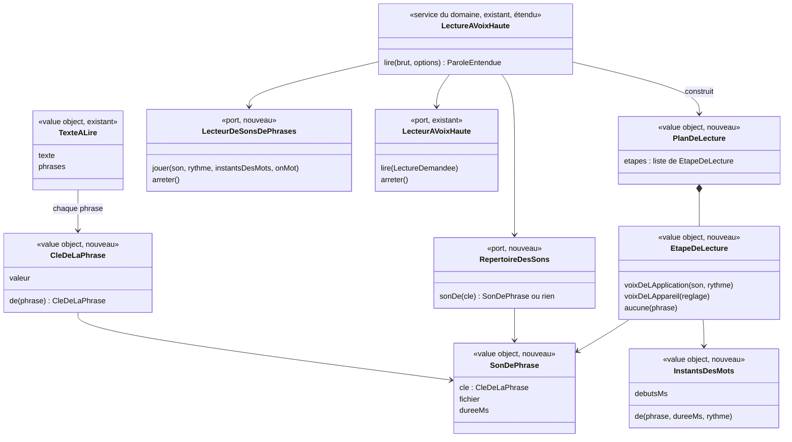

# Modèle du domaine : issue #182, la voix de l'application en MP3 pré-générés (Piper, voix « tom »)

> **Cadrage validé par le PO le 2026-11-07** (« Ok » en réponse à « reco tout ») : toutes les recommandations des
> questions 182.1 à 182.24 ci-dessous sont retenues, ainsi que celles de 182.25 à 182.28
> (`docs/stories/182/acceptance.md`). Le choix d'ensemble est consigné dans la décision
> [0043](../../decisions/0043-voix-de-l-application-en-sons-pre-fabriques.md).

## Contexte

**Sous-domaine générique Voix** (décisions 0007 et 0008), sans contexte nouveau. La story ne change aucune règle d'apprentissage, de récompense ni de famille. Elle change **d'où vient le son** d'une phrase lue à voix haute : un son fabriqué à l'avance par le pipeline de contenu, sinon la voix de l'appareil. Voix possède déjà le nettoyage et le découpage en phrases (`texteALire`), le service `LectureAVoixHaute` (une seule lecture à la fois, Muet, voix suspendue, voix bloquée) et le port `LecteurAVoixHaute`, prévu pour accueillir les MP3 « sans changer les écrans » (#7, décision 0004).

Ce qui arrive dans Voix :
- la **voix de l'application** (Piper `fr_FR-tom-medium`, choisie par le PO) à côté de la **voix de l'appareil** (synthèse vocale du navigateur) ;
- le **répertoire des sons**, publié avec l'application par le pipeline de contenu : pour chaque phrase connue à l'avance, son **son de phrase** ;
- une règle de choix **phrase par phrase** : son de phrase s'il existe, sinon repli sur la voix de l'appareil, sinon **voix absente** (nouveau cas, distinct de la voix bloquée).

### Relations

| Amont | Aval | Relation | Ce qui passe |
|---|---|---|---|
| Pipeline de contenu (`scripts/`) | Voix | **Published Language** (nouveau, #182) | Le répertoire des sons (`public/voix/repertoire.json`) et les sons de phrases (`public/voix/*.mp3`). Comme le format JSON des leçons, c'est un contrat : sa forme est documentée et testée des deux côtés. |
| Voix | Pipeline de contenu | **Règle publiée** (nouveau, #182, tranché par 182.10, décision 0043) | La clé de la phrase et le découpage en phrases sont définis **une seule fois**, dans `voix/domain/`. Le pipeline les obtient en exécutant un script Deno (`scripts/voix/inventaire-des-phrases.ts`) qui importe le domaine et écrit l'inventaire des phrases ; Python fabrique à partir de cet inventaire sans recalculer de clé. |
| Catalogue pédagogique | Voix (fabrication) | Lecture (#182) | L'inventaire des phrases lit les leçons par `lireLecon` (`@domain/catalogue`), ce qui inclut les consignes par défaut des types (#18). |
| Motivation | Voix (fabrication) | Lecture (#182) | L'inventaire lit les **paroles fixes** des personnages guides (félicitations, encouragements, relances, accueil…). Motivation les expose depuis son domaine (listes aujourd'hui non exportées) ; pour une parole qui contient le prénom, elle fournit aussi le **texte dit** sans le prénom (182.2). |
| Apprentissage | Voix (fabrication) | Lecture (#182, 182.21) | Les textes fixes des paroles écrites aujourd'hui dans `src/` (calcul, révision, test de départ) sont déplacés dans le domaine de leur contexte et lus par l'inventaire. |
| Apprentissage, Motivation, Accompagnement | Voix | Appel (inchangé, #7) | `LectureAVoixHaute.lire(texte, options)` depuis le front. Les écrans ne changent pas. |
| Synthèse vocale du navigateur | Voix | ACL (inchangé, #7, précisé) | L'adaptateur traduit désormais les erreurs du navigateur en **deux** erreurs métier : `VoixBloquee` (refus du navigateur) et `VoixAbsente` (pas de voix pour cette langue). |
| Lecture audio du navigateur | Voix | **ACL** (nouveau, #182) | Nouvel adaptateur du port `LecteurDeSonsDePhrases` (élément audio) ; un refus d'activation devient `VoixBloquee`, un fichier introuvable ou illisible devient `SonIllisible`. |
| Piper (outil de fabrication, hors application) | Pipeline de contenu | Conformist, hors ligne | Utilisé seulement sur la machine de fabrication. Le modèle de voix n'est jamais dans le dépôt ni dans le build (licence AGPLv3, tranché par 182.9). |

Il n'y a **aucun agrégat** : rien n'est enregistré côté serveur, aucune Edge Function, aucune migration. Tout se passe dans le navigateur (lecture) ou dans le pipeline (fabrication).

## Termes

| Terme | Statut | Remarque |
|---|---|---|
| Voix de l'application | **nouveau** (retenu le 2026-11-07) | La voix « tom » (Piper), fabriquée à l'avance et servie avec l'application. Même voix, même vitesse pour tous les personnages guides (182.3 A, 182.4 oui). Libellé de l'interface : « voix de l'application » (182.26). |
| Voix de l'appareil | **nouveau** (retenu le 2026-11-07) | Voix installée sur l'appareil, lue par la synthèse vocale du navigateur. Existe dans le code (port `VoixDeLAppareil`) mais pas au glossaire. |
| Son de phrase | **nouveau** (retenu le 2026-11-07) | Le fichier audio d'une phrase dite par la voix de l'application. |
| Clé de la phrase | **nouveau** (retenu le 2026-11-07) | Ce qui relie une phrase à lire à son son de phrase : la phrase normalisée elle-même (182.11). Définie dans `voix/domain/` seulement. |
| Répertoire des sons | **nouveau** (retenu le 2026-11-07) | Liste publiée avec l'application : clé de la phrase → son de phrase (fichier, durée), plus la liste des sons de chaque leçon. |
| Inventaire des phrases | **nouveau** (retenu le 2026-11-07) | Toutes les phrases connues à l'avance (bibliothèque, paroles fixes, variantes finies), découpées comme à la lecture. Ce que le pipeline doit fabriquer. |
| Table de prononciation | **nouveau** (retenu le 2026-11-07) | Corrections qui changent seulement ce que dit la voix de l'application, jamais le texte affiché, la clé ni le sens. Elle ne s'applique pas à la voix de l'appareil (182.13). |
| Prononciation corrigée | **nouveau** (retenu le 2026-11-07) | Texte envoyé à Piper après la table de prononciation. |
| Repli sur la voix de l'appareil | **nouveau** (retenu le 2026-11-07) | Une phrase sans son de phrase (ou dont le son est illisible) est lue par la voix de l'appareil. Décidé phrase par phrase. |
| Voix absente | **nouveau** (retenu le 2026-11-07) | Ni son de phrase, ni voix de l'appareil dans la langue demandée : la phrase n'est pas dite (182.15). Remplace, pour ce cas, le message trompeur de voix bloquée. |
| Message de voix absente | **nouveau** (retenu le 2026-11-07) | « <Nom du personnage guide> ne peut pas lire cette phrase sur cet appareil. Tu peux la lire avec un adulte. » Même durée de vie que le message de voix bloquée (182.16). C'est une information, pas un message d'erreur (182.25 A). |
| Plan de lecture | **nouveau** (retenu le 2026-11-07) | Pour chaque phrase d'une lecture, sa source : son de phrase, voix de l'appareil, ou rien. Calcul pur de Voix. |
| Instants des mots | **nouveau** (retenu le 2026-11-07) | Moment approximatif où chaque mot commence dans un son de phrase, pour le surlignage (182.18 A). |
| Texte dit | **nouveau** (retenu le 2026-11-07) | Pour une parole qui contient le prénom, la version sans le prénom que dit la voix de l'application (« Bravo ! » pour « Bravo Léa ! »). Fourni par Motivation ; Voix ne sait pas ce qu'est un prénom (182.2 A). La voix de l'appareil dit toujours le texte affiché, prénom compris (182.27 A). |
| Lecture à voix haute | au glossaire (à valider) | Inchangée pour les écrans. Le surlignage devient approximatif avec un son de phrase (182.18 A). |
| Voix bloquée | au glossaire (à valider) | **Sens resserré** : le navigateur refuse de jouer (activation manquante). Elle ne couvre plus l'absence de voix française. |
| Voix automatique | au glossaire (à valider) | **Sens étendu** (182.14 A) : voix de l'application, puis la meilleure voix française de l'appareil pour les phrases sans son de phrase. |
| Voix imposée, Choix de voix | au glossaire (à valider) | Une voix imposée par le parent passe avant la voix de l'application, pour toutes les phrases (182.14 A). |
| Muet, Voix suspendue | au glossaire | Inchangés ; s'appliquent aux sons de phrases comme à la voix de l'appareil. |
| Parole entendue | au glossaire (à valider) | **Précisée** (182.17 non) : une parole dont une phrase n'a pas pu être dite n'est pas entendue. |
| Effet sonore | au glossaire (à valider) | Inchangé. Un son de phrase **n'est pas** un effet sonore : il contient une parole. |
| **Enregistrement** | **conflit** | Réservé à l'**Enregistrement de lecture** (audio de l'enfant, Accompagnement, données d'enfant qui expirent après 30 jours). On ne dit donc jamais « enregistrement » pour un son de phrase : on dit **Son de phrase**. |
| **Texte prononcé** | **conflit** (code) | `textePrononce` existe déjà dans `texte-a-lire.ts` pour le texte **nettoyé** (balises retirées, `+` → « plus »), base de la clé. Ce n'est pas la sortie de la table de prononciation. On garde `textePrononce` pour le nettoyage et on dit **Prononciation corrigée** pour le texte envoyé à Piper. |
| MP3, audio, piste, TTS | à interdire | Synonymes interdits de « son de phrase » et de « voix de l'application » dans le domaine et les scénarios (« MP3 » reste un mot technique de l'adaptateur et du pipeline). |
| « Voix « tom » », Piper | hors domaine | Noms de l'outil et du modèle : documentation et décision d'architecture 0043, pas langage ubiquitaire. |

## Modèle



### Value objects et fonctions pures (`voix/domain/`)

| Élément | Règle |
|---|---|
| `CleDeLaPhrase.de(phrase)` | Calculée sur **une phrase de `texteALire`** (après nettoyage et découpage, avant toute table de prononciation). La clé **est la phrase normalisée elle-même** (182.11) : lisible, sans empreinte à calculer dans le front. Normalisation légère et stable : forme Unicode composée, apostrophes typographiques et droites confondues, espaces insécables et fines remplacées par une espace, espaces en trop retirées. La casse et la ponctuation sont **gardées** (elles changent l'intonation : « Bravo ! » ≠ « Bravo. »). Deux phrases de même clé ont le même son de phrase. |
| `SonDePhrase` | Clé, nom de fichier, durée en millisecondes (strictement positive). Le nom de fichier est une **empreinte de ce qui est dit** (prononciation corrigée, version de la voix, débit), calculée par le pipeline seul ; il est opaque pour le domaine et pour le front (182.11). |
| `InstantsDesMots.de(phrase, dureeMs, rythme)` | Répartit la durée sur les mots de la phrase au prorata de leurs syllabes (`syllabesDuMot`, déjà dans Voix), divisée par le rythme. Instants croissants, le premier à 0, tous avant la fin. Approximatif par nature, accepté par le PO (182.18 A). |
| `planDeLecture(phrasesReglees, langue, repertoire, voixDeLAppareil, voixImposee)` | Pour chaque phrase, dans l'ordre : si le parent a imposé une voix, **voix de l'appareil** (voix imposée) pour toutes les phrases (182.14 A) ; sinon **son de phrase** si la langue est le français et que le répertoire le connaît ; sinon **voix de l'appareil** si une voix française de l'appareil est disponible (jamais une voix étrangère pour une phrase en français, 182.15) ; sinon **aucune**. Une seule source par phrase. |
| `reglerPhrases` (existant) | Inchangé pour la voix de l'appareil. Pour un son de phrase, seul le rythme compte (lecture lente 0,65, son ralenti hauteur gardée, 182.23) ; la hauteur, le rythme du caractère et la variation au hasard ne s'appliquent pas (182.3 A). |

### Ports (interfaces dans `voix/domain/`, décision 0007)

- `RepertoireDesSons` (nouveau) : `sonDe(cle)`. Synchrone : l'adaptateur charge le répertoire une fois (réseau puis cache) ; tant qu'il n'est pas chargé, il ne connaît aucun son, et la lecture se replie sur la voix de l'appareil. Adaptateur : `src/voix/repertoire-des-sons-du-navigateur.ts`.
- `LecteurDeSonsDePhrases` (nouveau) : `jouer(son, rythme, instantsDesMots, onMot)`, `arreter()`. L'adaptateur joue le fichier à la vitesse demandée **sans changer la hauteur**, appelle `onMot` quand la position de lecture passe un instant, et traduit ses échecs : refus d'activation → `VoixBloquee` ; fichier introuvable (hors ligne, pas en cache), illisible ou trop long à démarrer → `SonIllisible`. Adaptateur : `src/voix/lecteur-de-sons-de-phrases-du-navigateur.ts`.
- `LecteurAVoixHaute` (existant) : reste le port de la **voix de l'appareil** ; son adaptateur (`lecteur-synthese-vocale.ts`) distingue désormais `VoixBloquee` (`not-allowed`) et `VoixAbsente` (`language-unavailable`, `voice-unavailable`, `synthesis-unavailable`). Il ne reçoit plus que les phrases du plan dont la source est la voix de l'appareil.
- `VoixDeLAppareil`, `ChoixDeVoixDeLAppareil`, `Hasard`, `LecteurDEffetsSonores` : inchangés.

Option écartée (décision 0043) : un adaptateur composite dans `src/` (« MP3 sinon synthèse ») derrière l'unique port `LecteurAVoixHaute`. Il cacherait le repli phrase par phrase, l'arrêt commun et la distinction voix bloquée / voix absente dans l'infrastructure, hors des tests du domaine. `LectureAVoixHaute` vit déjà dans le domaine pour orchestrer des ports (décision 0008) : il orchestre deux lecteurs de plus.

### Commandes, événements, erreurs

- **Commandes du navigateur** (inchangées) : `LireAVoixHaute`, `CouperLaVoix`, `PasserEnMuet`, `RemettreLeSon`, `Suspendre`, `Reprendre`, `EssayerUneVoix`. Nouvelle commande d'infrastructure, sans règle : `MettreEnReserveLesSonsDeLaLecon` (hors ligne, voir plus bas).
- **Commande du pipeline** : `FabriquerLesSons` (script) : inventaire (Deno) → table de prononciation → Piper → MP3 → répertoire.
- **Événements de domaine** : aucun. Rien n'est enregistré, aucun autre contexte ne réagit.
- **Erreurs métier** :
  - `VoixBloquee` (existante, sens resserré) : le navigateur refuse de jouer, faute d'activation par un toucher. Message de voix bloquée inchangé (#79).
  - `VoixAbsente` (nouvelle) : aucune voix pour cette phrase (pas de son de phrase, pas de voix française sur l'appareil). La phrase n'est pas dite et le message de voix absente apparaît (182.15, 182.16).
  - `SonIllisible` (nouvelle, interne) : un son de phrase n'a pas pu être joué. Jamais montrée : la phrase se replie sur la voix de l'appareil.
  - `LectureImpossible` (existante) : le navigateur ne sait pas lire à voix haute. Avec la voix de l'application, elle ne concerne plus que les phrases sans son de phrase et se traite comme une voix absente pour ces phrases (182.15).

### Ce que produit le pipeline de contenu (fabrication)

1. **Inventaire des phrases** (script Deno `scripts/voix/inventaire-des-phrases.ts`, 182.10 A, décision 0043) : toutes les phrases que l'application peut demander et qui sont connues à l'avance, découpées par `texteALire` et clés calculées par `CleDeLaPhrase` (même code que le front). Sources : leçons de la bibliothèque lues par `lireLecon` (consignes, étapes de leçon, questions, choix, mots dictés, vers…), paroles fixes des personnages guides (dont les textes dits sans prénom, 182.2), textes fixes des paroles déplacées de `src/` vers le domaine (182.21), phrases d'interface lues (accueil de l'écran, présentation au retour du son, essai de voix), **variantes finies** développées (nom de chaque personnage guide, nombre d'étoiles de 0 à 3, verbes d'une liste fermée, 182.22), dans la limite du plafond de poids. Sont exclus : les textes en langue étrangère (mot à écouter, 182.20), les phrases fabriquées à la volée (calculs, nombres tirés au hasard, leçons personnelles, 182.1 A) et tout prénom (182.2).
2. **Table de prononciation** (Python, testée par pytest) : remplacements appliqués au texte de la phrase avant Piper. Chaque entrée a un exemple et une prononciation attendue validée à l'écoute par le PO. Elle ne change que la prononciation, jamais le sens (règle absolue de `CLAUDE.md`), et ne s'applique qu'à la voix de l'application (182.13).
3. **Fabrication** par Piper, puis conversion en **MP3 mono, 22,05 kHz, 32 kbit/s** (182.6 ; environ 36 Mo pour 2 h 30). Fabrication **incrémentale** (182.12) : une phrase dont la prononciation corrigée, la voix et le débit n'ont pas changé garde son fichier (Piper ne rend pas deux fois exactement le même fichier) ; une entrée ajoutée à la table de prononciation ne refabrique que les phrases concernées. Le modèle de voix est téléchargé à la fabrication avec une empreinte vérifiée, jamais commité (182.9).
4. **Répertoire des sons** : clé (phrase normalisée) → fichier (empreinte), durée. Plus, par leçon, la liste des sons de ses phrases (pour la mise en réserve hors ligne).
5. **Écoute de contrôle** (182.8 A) : page HTML produite sur la machine de fabrication, par niveau, jamais publiée ; chaque phrase porte un bouton « mal prononcé » qui produit la liste à mettre dans la table de prononciation.
6. **Contrôles** (pytest) : aucun son manquant pour une phrase de l'inventaire, aucun fichier orphelin (une phrase modifiée a une nouvelle clé ; l'ancien fichier est supprimé, 182.12), **plafond de 40 Mo pour `public/voix/`** qui fait échouer le pipeline s'il est dépassé (182.7), aucun fichier édité à la main (empreintes cohérentes), licence présente (`public/voix/LICENCE-tom.txt`). Rapport de couverture : part des phrases lues par l'application qui ont un son de phrase.

## Invariants

1. **Une seule lecture à la fois**, quelle que soit la source : commencer une lecture arrête le son de phrase **et** la voix de l'appareil en cours ; changer d'écran coupe les deux. Jamais deux voix en même temps.
2. **Phrase par phrase, dans l'ordre** : chaque phrase a exactement une source dans le plan de lecture. Le repli se décide phrase par phrase ; une phrase repliée ne fait pas changer la source des suivantes.
3. **Muet** : aucun son de phrase n'est joué, comme aucune voix de l'appareil. Les effets sonores restent (97.2).
4. **Voix suspendue** (écrans du parent) : rien n'est lu, sauf l'essai de voix demandé par le parent.
5. **Lecture lente** : le son de phrase est joué au rythme lent (0,65) sans changer sa hauteur (182.23) ; la voix de l'appareil garde ses réglages actuels.
6. **Fin de lecture** : la lecture est finie quand la dernière étape du plan est finie (jouée, repliée ou sans voix) ou quand elle est arrêtée. `onFin` est toujours appelé une fois. La parole n'est **entendue** que si toutes ses phrases ont été dites (182.17) ; sinon le texte reste affiché selon les règles de #79.
7. **Surlignage** : le mot surligné reste dans la phrase en cours de lecture et avance dans l'ordre ; avec un son de phrase, il suit les instants des mots et est « à peu près celui qui est prononcé » (182.18 A, la règle de #7 est assouplie pour la voix de l'application).
8. **Langue** : un son de phrase n'est utilisé que pour le français. Le mot à écouter (anglais) garde la voix anglaise de l'appareil (182.20). Une phrase en français n'est jamais lue par une voix étrangère (182.15).
9. **Le son dit la phrase affichée** : la clé est calculée sur la phrase issue du texte affiché (ou du texte dit sans prénom, 182.2), par le même code au pipeline et au front. La table de prononciation ne change ni le texte affiché, ni la clé, ni le sens.
10. **Aucun contenu nouveau** : un son de phrase n'est fabriqué qu'à partir d'une phrase déjà présente dans la bibliothèque ou dans les paroles du domaine, donc déjà soumise à la règle absolue. La table de prononciation ne peut pas ajouter de mot.
11. **Jamais édité à la main** : les sons de phrases et le répertoire sont regénérés par le pipeline, comme `bibliotheque.json`.
12. **Aucune donnée d'enfant dans un son de phrase** : pas de prénom, rien de ce que produit l'enfant (182.2 A). La voix de l'application dit le texte dit sans le prénom ; le prénom reste affiché, non surligné. La voix de l'appareil, elle, dit le prénom comme aujourd'hui (182.27 A).
13. **Voix bloquée et voix absente ne se confondent pas** : un refus du navigateur donne le message de voix bloquée ; une absence de voix donne le message de voix absente, qui est une information et non un message d'erreur (182.25 A). L'enfant peut toujours jouer sans voix.
14. **Choix de voix** : une voix imposée par le parent lit toutes les phrases à la place de la voix de l'application ; la voix automatique lit avec la voix de l'application puis, pour les phrases sans son, avec la meilleure voix française de l'appareil (182.14 A).

## Événements

Aucun événement de domaine. La lecture à voix haute reste un service du navigateur sans état enregistré ; la fabrication est un pipeline de contenu. Les signaux existants (`onVoixBloquee`, `onFinDeLaVoixBloquee`) reçoivent leurs pendants pour la voix absente (`onVoixAbsente`, `onFinDeLaVoixAbsente`), qui sont des rappels vers l'affichage, pas des événements de domaine. Le message de voix absente suit la même durée de vie que celui de voix bloquée : un seul exemplaire, visible jusqu'à la prochaine parole entendue ou le passage en Muet, annoncé une fois aux lecteurs d'écran comme une information (182.16, 182.25 A).

## Partage avec le front

Tout ce qui décide de la lecture tourne dans le navigateur, hors ligne compris, et vient de `@domain/voix` : `CleDeLaPhrase`, `planDeLecture`, `InstantsDesMots`, `LectureAVoixHaute` étendu, les interfaces `RepertoireDesSons` et `LecteurDeSonsDePhrases`, les erreurs `VoixAbsente` et `SonIllisible`.

Reste dans `src/voix/` (adaptateurs, sans règle) : lecture du répertoire, lecture audio, traduction des erreurs du navigateur, déverrouillage audio. Le déverrouillage audio sur Android (un toucher n'est pas une activation pour `pointerdown`) est corrigé dans cette story (182.24). `laVoixNeLitPas` ne peut plus se fonder sur « synthèse vocale présente » : avec la voix de l'application, l'appareil lit sans synthèse. Le message affiché dans `Application.tsx` reçoit le cas de la voix absente.

Écran Voix de l'Espace parent (182.14 A, 182.26) : « Automatique (recommandé) » porte la mention « actuellement : voix de l'application » ; le message « Aucune voix française trouvée sur cet appareil… » ne s'affiche plus ; les voix françaises de l'appareil restent proposées comme voix imposées ; les conseils pour installer des voix plus naturelles restent, présentés comme facultatifs.

### Hors ligne (PWA, #8)

- Le **répertoire des sons** fait partie de la coquille (précaché, réseau puis cache), comme `bibliotheque.json`.
- Les **sons de phrases** ne sont **pas** précachés en entier (de l'ordre de 2 h 30 d'audio). Ils vont dans un **cache à part**, gardé d'une version à l'autre : leurs noms ne changent que si leur contenu change, alors que le cache actuel est supprimé à chaque version (`supprimerLesAutresCaches` de `public/sw.js`).
- Stratégie (182.19) : cache puis réseau pour chaque son ; au lancement d'une séance, **mise en réserve** de tous les sons de la leçon (liste fournie par le répertoire), pour que la leçon se joue jusqu'au bout sans réseau ; à la fin d'une séance, mise en réserve de la **prochaine leçon du parcours** ; paroles fixes communes (félicitations, encouragements) mises en réserve au premier lancement. **Budget de la réserve : 20 Mo**, en retirant les sons des leçons les plus anciennes.
- Sans réseau et sans son en réserve : `SonIllisible`, repli sur la voix de l'appareil, puis voix absente.
- La règle hors ligne reste dans cette story (182.28 non) ; ses scénarios sont `@pwa`.

## Données d'enfants

Aucune donnée nouvelle (182.2 A) : le prénom n'est jamais fabriqué ni stocké en son. Les sons de phrases ne contiennent que des textes de la bibliothèque et des paroles fixes. Rien de ce que produit l'enfant n'est lu, fabriqué ni envoyé ; Piper tourne en local, aucun texte ne quitte la machine de fabrication. La réserve des sons sur l'appareil n'est pas une donnée de l'enfant (mêmes fichiers pour tous). La voix de l'appareil continue de dire le prénom à la volée, sans rien stocker, comme aujourd'hui (182.27 A).

## Emplacement

```
supabase/functions/_shared/voix/domain/
  cle-de-la-phrase.ts            # CleDeLaPhrase.de(phrase) : phrase normalisée (nouveau)
  son-de-phrase.ts               # SonDePhrase (nouveau)
  repertoire-des-sons.ts         # interface du port RepertoireDesSons (nouveau)
  lecteur-de-sons-de-phrases.ts  # interface du port LecteurDeSonsDePhrases (nouveau)
  plan-de-lecture.ts             # planDeLecture, EtapeDeLecture (nouveau)
  instants-des-mots.ts           # InstantsDesMots (nouveau)
  erreurs.ts                     # + VoixAbsente, SonIllisible
  lecture-a-voix-haute.ts        # orchestre le plan : son de phrase, repli, voix absente (modifié)
  index.ts                       # exporte les nouveautés pour @domain/voix
supabase/functions/_shared/voix/test_utils/
  repertoire-des-sons-en-memoire.ts, lecteur-de-sons-de-phrases-en-memoire.ts
supabase/functions/_shared/motivation/domain/
  paroles fixes exposées pour l'inventaire, texte dit sans prénom (modifié)
supabase/functions/_shared/apprentissage/domain/
  textes fixes des paroles du calcul, de la révision et du test de départ, venus de src/ (182.21)
scripts/voix/                    # pipeline de contenu (fabrication)
  inventaire-des-phrases.ts      # script Deno : importe @domain/catalogue, @domain/motivation, @domain/apprentissage, @domain/voix (182.10, décision 0043)
  prononciation.py               # table de prononciation
  fabriquer_les_sons.py          # Piper → MP3 mono 22,05 kHz 32 kbit/s, incrémental, répertoire
  ecoute_de_controle.py          # page d'écoute pour le PO, jamais publiée (182.8)
scripts/tests/test_voix_*.py     # pytest : table, répertoire, plafond de 40 Mo, orphelins, licence
public/voix/                     # généré, jamais édité à la main, servi avec l'application (182.5 A)
  repertoire.json, <empreinte>.mp3, LICENCE-tom.txt
src/voix/
  repertoire-des-sons-du-navigateur.ts           # nouveau
  lecteur-de-sons-de-phrases-du-navigateur.ts    # nouveau (ACL lecture audio)
  lecteur-synthese-vocale.ts                     # VoixBloquee / VoixAbsente
  useVoix.ts, la-voix-ne-lit-pas.ts              # câblage, cas de la voix absente, déverrouillage Android (182.24)
public/sw.js                     # cache des sons à part, mise en réserve d'une leçon et de la suivante, réserve de 20 Mo
docs/decisions/0043-voix-de-l-application-en-sons-pre-fabriques.md   # décision d'architecture (écrite)
docs/sons.md (ou docs/voix.md)   # origine de la voix, licence, crédit
```

## Questions ouvertes

Aucune : toutes les questions ont été tranchées par le PO le 2026-11-07 (« reco tout »). Les questions et leurs réponses sont gardées ci-dessous pour mémoire.

**182.1 Textes fabriqués à la volée** (calculs tirés au hasard, nombres, leçons personnelles, verbe de « tu sais conjuguer » s'il n'est pas dans une liste finie).
A. Repli sur la voix de l'appareil pour ces phrases, et une story de suite pour l'assemblage de morceaux (nombres, « plus », « moins »…). B. Assemblage dès cette story.
**Tranchée le 2026-11-07 : reco, A.** Repli sur la voix de l'appareil, story de suite pour l'assemblage. Conséquence acceptée : sur un appareil sans voix française (Honor Magic), ces phrases ne sont pas dites (voix absente).

**182.2 Prénom de l'enfant** (« Bravo Léa ! », accueil, quête du jour, révision).
A. La voix dit la phrase sans le prénom (« Bravo ! ») ; le prénom reste affiché, non surligné. B. Repli sur la voix de l'appareil pour la phrase qui contient le prénom. C. Fabriquer un son par prénom (donnée d'enfant transformée et stockée : contraire à la minimisation).
**Tranchée le 2026-11-07 : reco, A.** Motivation fournit pour ces paroles un « texte dit » à côté du texte affiché ; Voix ne sait pas ce qu'est un prénom.

**182.3 Caractère des personnages guides** avec une seule voix.
A. Aucun caractère sur les sons de phrases : même voix, même vitesse pour tous ; seule la lecture lente change la vitesse. B. Appliquer le rythme du caractère (vitesse de lecture, hauteur gardée), pas la hauteur. C. Fabriquer une variante par personnage guide (poids multiplié par le nombre de personnages guides).
**Tranchée le 2026-11-07 : reco, A** pour cette story ; B à essayer à l'écoute dans une story de suite.

**182.4 Voix d'homme pour les personnages guides à voix féminine.** Le caractère de la voix dit « voix féminine » pour plusieurs personnages guides ; la voix « tom » est une voix d'homme. Accepte-t-on qu'ils parlent tous avec la voix « tom » ? (oui / non)
**Tranchée le 2026-11-07 : reco, oui** pour cette story ; une story de suite si une voix féminine convenable apparaît.

**182.5 Lieu de stockage des sons.**
A. Dans le dépôt et le build, servis par alwaysdata avec l'application. B. Supabase Storage (bucket public, sans donnée d'enfant). C. Dépôt avec Git LFS.
**Tranchée le 2026-11-07 : reco, A**, avec un plafond de poids vérifié par le pipeline (182.7). Limite à surveiller : environ 100 Mo pour tout le site sur l'offre gratuite d'alwaysdata (décision 0025).

**182.6 Débit et format des MP3.** Ordres de grandeur pour 2 h 30 : 24 kbit/s ≈ 27 Mo, 32 kbit/s ≈ 36 Mo, 48 kbit/s ≈ 54 Mo.
**Tranchée le 2026-11-07 : reco, MP3 mono, 22,05 kHz, 32 kbit/s** (≈ 36 Mo), à confirmer par le PO à l'écoute de trois phrases à 24, 32 et 48 kbit/s pendant la story.

**182.7 Budget de poids et croissance du dépôt.** Faut-il un plafond (par exemple 40 Mo pour `public/voix/`) qui fait échouer le pipeline s'il est dépassé ? (oui / non)
**Tranchée le 2026-11-07 : reco, oui**, plafond de **40 Mo** pour `public/voix/`. La fabrication incrémentale (182.12) évite qu'une regénération réécrive tous les fichiers.

**182.8 Écoute de contrôle par le PO.**
A. Une page HTML produite par le pipeline sur la machine de fabrication, par niveau, jamais publiée. B. Une page réservée aux tests dans l'application. C. Une page dans l'Espace parent.
**Tranchée le 2026-11-07 : reco, A.** Chaque phrase porte un bouton « mal prononcé » qui produit la liste à mettre dans la table de prononciation.

**182.9 Licence AGPLv3 de la voix « tom ».** Le PO accepte-t-il, pour la beta gratuite : seuls les sons produits sont livrés (jamais le modèle), l'auteur est crédité dans `public/voix/LICENCE-tom.txt` et dans la documentation, et un avis juridique est demandé avant toute publication commerciale ? (oui / non)
**Tranchée le 2026-11-07 : reco, oui.** Le modèle est téléchargé à la fabrication avec une empreinte vérifiée, et jamais commité.

**182.10 Où vit la règle de clé, et comment le pipeline Python la respecte.**
A. Le pipeline lance un script Deno (`scripts/voix/inventaire-des-phrases.ts`) qui importe le domaine et écrit l'inventaire ; Python fabrique sans recalculer de clé. B. La règle est réécrite en Python, avec des vecteurs de test partagés. C. Le front ne calcule rien et le répertoire liste les phrases telles quelles.
**Tranchée le 2026-11-07 : reco, A**, consignée dans la décision 0043 : la règle n'existe qu'une fois, seul Deno peut lire les paroles fixes écrites en TypeScript, le pipeline reste en Python pour la fabrication.

**182.11 Format de la clé et nom des fichiers.**
**Tranchée le 2026-11-07 : reco.** Dans le répertoire, la clé est la phrase normalisée elle-même. Le nom du fichier est une empreinte de ce qui est dit (prononciation corrigée, version de la voix, débit), calculée par le pipeline seul et opaque pour le front. Option écartée : une empreinte de la phrase calculée dans le domaine.

**182.12 Régénération quand un texte change.**
**Tranchée le 2026-11-07 : reco, oui.** Une phrase modifiée a une nouvelle clé, donc un nouveau son ; l'ancien fichier, orphelin, est supprimé par le pipeline ; une entrée ajoutée à la table de prononciation refabrique seulement les phrases concernées. Les tests du pipeline échouent s'il manque un son ou s'il reste un orphelin.

**182.13 Table de prononciation et voix de l'appareil.** La table doit-elle aussi corriger ce que dit la voix de l'appareil (repli) ? (oui / non)
**Tranchée le 2026-11-07 : reco, non.** Ses erreurs sont propres à Piper ; la table reste dans le pipeline.

**182.14 Voix de l'application et choix de voix de l'Espace parent (#15).**
A. « Voix automatique » veut dire désormais : voix de l'application, puis la meilleure voix de l'appareil pour les phrases sans son. Une voix imposée par le parent passe avant la voix de l'application, pour toutes les phrases. B. La voix de l'application passe toujours en premier ; le choix du parent ne vaut que pour le repli.
**Tranchée le 2026-11-07 : reco, A.** L'écran Voix présente la voix de l'application comme le choix automatique (libellé de 182.26) ; « Aucune voix française trouvée sur cet appareil » ne s'affiche plus comme un défaut.

**182.15 Phrase sans son de phrase, et aucune voix française sur l'appareil.** Se taire (voix absente), ou lire avec la voix par défaut du navigateur, souvent étrangère ? (question 2 restée ouverte de #7)
**Tranchée le 2026-11-07 : reco, se taire**, avec le message de voix absente.

**182.16 Message de voix absente : texte et durée de vie.**
**Tranchée le 2026-11-07 : reco.** Texte : « <Nom du personnage guide> ne peut pas lire cette phrase sur cet appareil. Tu peux la lire avec un adulte. » Durée de vie : la même que le message de voix bloquée (un seul exemplaire, visible jusqu'à la prochaine parole entendue ou le passage en Muet, annoncé une fois aux lecteurs d'écran, #79). La variante « une seule fois par ouverture de l'application » n'est pas retenue ; elle reviendra au PO si le message réapparaît trop souvent.

**182.17 Parole entendue quand une partie seulement est lue.** Une parole dont une phrase n'a pas pu être dite est-elle « entendue » ? (oui / non)
**Tranchée le 2026-11-07 : reco, non.** Le texte reste alors affiché selon les règles de #79 (durée d'affichage sans voix, bouton « Continuer »).

**182.18 Surlignage avec un son de phrase.**
A. Approximatif, calé sur la durée, au prorata des syllabes de chaque mot. B. Exact, avec les instants des mots fournis par Piper.
**Tranchée le 2026-11-07 : reco, A.** Le PO accepte que, pour la voix de l'application, le mot surligné soit « à peu près celui qui est prononcé ».

**182.19 Hors ligne : ce qu'on met en réserve.**
**Tranchée le 2026-11-07 : reco.** Le répertoire dans la coquille ; au lancement d'une séance, tous les sons de la leçon ; à la fin d'une séance, la prochaine leçon du parcours (oui) ; au premier lancement, les paroles fixes communes ; réserve de 20 Mo au plus, en retirant les sons des leçons les plus anciennes.

**182.20 Mot à écouter (anglais).** Il reste lu par la voix anglaise de l'appareil, sans son de phrase ? (oui / non)
**Tranchée le 2026-11-07 : reco, oui**, une voix anglaise fabriquée pourra faire une story de suite.

**182.21 Paroles écrites dans `src/`** (`src/seance/exercices/paroles-du-calcul.ts`, `src/revision/paroles-de-la-revision.ts`, `src/test-de-depart/paroles-du-test-de-depart.ts`). Déplace-t-on leurs textes fixes dans le domaine de leur contexte dans cette story ? (oui / non)
**Tranchée le 2026-11-07 : reco, oui** pour les textes fixes.

**182.22 Variantes finies.** Fabrique-t-on toutes les variantes d'une parole dont la partie variable vient d'une liste courte et connue (nom de chaque personnage guide, nombre d'étoiles de 0 à 3, verbes d'une liste fermée) ? (oui / non)
**Tranchée le 2026-11-07 : reco, oui**, tant que le plafond de 40 Mo (182.7) est respecté ; jamais pour le prénom ni pour les nombres tirés au hasard.

**182.23 Lecture lente d'un son de phrase.** La lecture lente (mot dicté lent, rythme 0,65) peut-elle se faire en ralentissant le son, hauteur gardée ? (oui / non, à l'écoute)
**Tranchée le 2026-11-07 : reco, oui** si l'écoute est convenable ; sinon fabriquer une variante lente pour les seuls mots dictés.

**182.24 Déverrouillage audio sur Android** (journal : `pointerdown` n'est pas une activation pour un toucher). Le corrige-t-on dans cette story ? (oui / non)
**Tranchée le 2026-11-07 : reco, oui.**

Questions 182.25 à 182.28 (`docs/stories/182/acceptance.md`), tranchées le même jour, reco : 182.25 A (le message de voix absente est une information, pas un message d'erreur ; les scénarios de #7 et #79 restent vrais) ; 182.26 libellé « voix de l'application » sur l'écran Voix ; 182.27 A (seule la voix de l'application omet le prénom) ; 182.28 non (la règle hors ligne reste dans la story).
