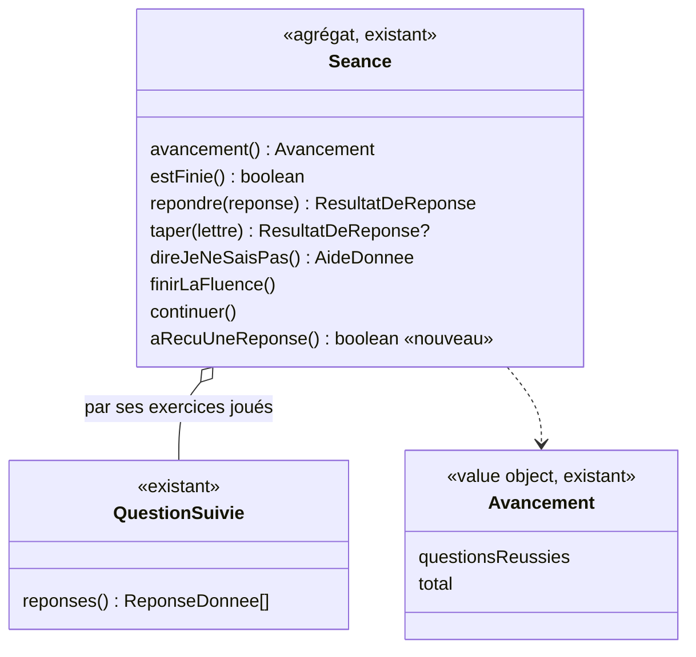

# Modèle du domaine : issue #183, écran de séance avec une barre du haut et une barre d'action en bas

Contexte : **Apprentissage**. La story est **surtout de la présentation** : l'écran de séance est réorganisé (barre du haut, barre d'action en bas, plus d'en-tête global, personnage guide montré seulement quand il réagit, un seul bouton « Réécouter »). Une seule règle relève du domaine : **le bouton Retour (et le geste retour) ouvre la feuille de pause seulement si la séance a déjà reçu une réponse**. Cette règle se lit dans l'agrégat `Seance` par une petite requête nouvelle, `aRecuUneReponse()`. Aucune commande, aucun événement, aucune migration, aucune Edge Function, aucune donnée d'enfant nouvelle.

État : **validé par le PO le 2026-11-07** : toutes les recommandations sont retenues (voir « Décisions du PO » en fin de document).

## Contexte

### Pourquoi Apprentissage

- La séance, ses réponses, son avancement et « Je ne sais pas » appartiennent à Apprentissage (`Seance`, `QuestionSuivie`, `ReponseDonnee`).
- Ce que la feuille de pause protège est un fait d'Apprentissage : une séance quittée avant d'être terminée n'est pas gardée (rien n'est enregistré, comme pour la séance de défi « quittée en cours »). La pause évite de perdre par un geste involontaire des réponses déjà données.
- Motivation n'est pas concernée : le personnage guide qui apparaît « quand il réagit » reprend les réactions existantes (`reagirALaReponse`, scène de réponse fausse de #163). Aucune règle de Motivation ne change.

### Ce qui relève du domaine, et ce qui n'en relève pas

| Élément de l'issue | Domaine ou présentation | Source |
|---|---|---|
| Retour ouvre la feuille de pause **à partir de la première réponse** ; avant, il ramène à la page de la leçon | **Domaine** : « la séance a-t-elle reçu une réponse ? » | `Seance.aRecuUneReponse()` (nouveau) |
| Le geste retour du téléphone ou du navigateur suit la même règle | Présentation (navigation), même lecture du domaine | `src/navigation.ts` lit `aRecuUneReponse()` |
| Compteur « 2 / 6 » et fine barre de progression | Présentation d'un fait existant | `Seance.avancement()` (`Avancement` : `questionsReussies`, `total`), inchangé |
| Nom de la leçon sans classe ni matière | Présentation | titre de la `Lecon` (Catalogue), inchangé |
| Plus d'en-tête global, plus de dock pendant la séance | Présentation | `src/Application.tsx` |
| Personnage guide montré seulement quand il réagit | Présentation | réactions existantes de Motivation, inchangées |
| Un seul bouton « Réécouter » (consigne pendant la question, parole du personnage guide après une réponse) | Présentation, mais touche au langage (voir « Termes ») | `useDeroulementDeSeance.ts` |
| Barre d'action (« Valider », « Continuer », « Je ne sais pas ») | Présentation | « Je ne sais pas » reste permis selon le domaine (`jeNeSaisPasPermis`, `jeNeSaisPasPropose`), inchangé |
| Échap ferme la feuille, aucun compte à rebours, aucun reproche | Présentation, accessibilité | — |

### Faits lus

| Fait | Disponible aujourd'hui |
|---|---|
| Avancement de la séance | Oui : `Seance.avancement()` |
| Séance finie (toutes les questions réussies) | Oui : `Seance.estFinie()` |
| La séance a reçu une réponse | **Non exposé**. L'état existe déjà dans l'agrégat : chaque `QuestionSuivie` garde ses `reponses()` (choix, nombre, mot écrit, placement, réponse de fluence, et `{ genre: "jeNeSaisPas" }`), mais la liste des questions est privée (`questions()`). Aucune méthode publique ne le dit. `avancement().questionsReussies > 0` ne suffit pas : une réponse fausse ou « Je ne sais pas » ne fait pas avancer. `erreurs() > 0` ne suffit pas non plus : une première réponse juste ne coûte aucune erreur |

### Communication entre contextes

Aucune relation nouvelle. Tout se passe dans le navigateur, hors ligne compris. Le serveur n'a rien à revalider : la feuille de pause ne change aucun résultat.

## Termes

| Terme | Statut | Remarque |
|---|---|---|
| Séance, Séance complète, Séance d'un exercice, Réponse, Je ne sais pas, Avancement de la séance, Étape de leçon, Fluence, Séance terminée, Fin de la séance, Personnage guide, Consigne affichée, Relire la consigne | existants | Réutilisés sans les redéfinir |
| **Séance qui a reçu une réponse** | **nouveau (validé)** | Séance dont au moins une question a reçu une réponse (juste, fausse ou choix écarté) ou « Je ne sais pas ». Définition exacte : décisions 183.1 à 183.4. Ajouté au glossaire. On évite « séance commencée » : une séance est commencée (`Seance.commencer`) dès l'ouverture de l'écran |
| **Pause de la séance** | **nouveau (validé), conflit tranché** | Moment où l'enfant, après la première réponse, demande à quitter la séance : la séance reste en l'état et l'enfant choisit de continuer ou de revenir à la page de la leçon. Rien n'est enregistré. **Conflit** : « pause » est aujourd'hui un synonyme interdit de **Durée d'affichage sans voix** (#79). Décision 183.7 : on garde le terme, « pause » seul reste interdit. Ajouté au glossaire et aux « Conflits à trancher » |
| Feuille de pause | mot d'interface | Le panneau « On fait une pause ? ». Hors glossaire (composant d'écran), comme « en-tête » (Décision n°16) |
| Barre du haut, barre de séance, barre d'action, pastille du compteur | mots d'interface | Hors glossaire |
| « Je continue la leçon », « Retour à la leçon », « On fait une pause ? » | textes d'écran | Pas des termes |
| **Réécouter** | **nouveau (validé), conflit tranché** | Employé partout (#16, #17, #79) mais jamais défini. La ligne **Relire la consigne** dit « distinct de « Réécouter » » : l'issue fond les deux en un seul bouton. Une ligne « Réécouter » le définit selon la décision 6 de l'issue. Décision 183.8 : un seul bouton ; la ligne « Relire la consigne » sera marquée remplacée par #183 à la clôture |
| « progression » | interdit | L'issue dit « barre de progression » : c'est un mot d'interface. Dans le code et les scénarios on dit **Avancement de la séance** (synonyme interdit : progression). Une ligne « complément (#183) » le rappelle au glossaire |
| « Retour » | texte d'écran | Nom accessible du bouton, inchangé |

## Modèle

Pas d'agrégat nouveau. L'agrégat **`Seance`** reçoit une **requête** (lecture seule) ; rien ne change d'état.



### Requête proposée

```ts
// supabase/functions/_shared/apprentissage/domain/seance.ts
aRecuUneReponse(): boolean
```

- **Vrai** dès qu'une question de la séance a reçu une réponse, selon les décisions 183.1 à 183.4 : un choix touché (juste, faux ou déjà écarté), un nombre validé, un mot écrit en entier en dictée, une étiquette posée (bonne ou mauvaise), un chiffre posé dans une addition posée, une réponse d'un exercice `memoriser`, une réponse pendant le chrono d'une fluence, ou « Je ne sais pas ».
- **Faux** au début de la séance, et tant que l'enfant n'a fait que lire les étapes de leçon (« Continuer »), écouter, relire ou réécouter.
- **Ne revient jamais à faux** pendant la séance.
- Elle se **déduit de l'état existant** (les `reponses()` de chaque question), sans nouveau champ, si les tests le permettent pour tous les types. Elle est donc juste aussi pour une séance reconstituée (`Seance.reconstituer`). Point à vérifier au TDD : les colonnes pas encore posées de l'étape calculer (`colonnePasEncorePosee`, `reponses: () => []`) et les questions de `memoriser`.
- Exportée par `@domain/apprentissage` avec la classe `Seance` (déjà exportée) : rien à ajouter à `index.ts`.

La règle de l'écran se lit alors sans calcul dans React : **Retour ouvre la feuille de pause si `seance.aRecuUneReponse()`**, sinon il ramène à la page de la leçon. Après la dernière bonne réponse, tant que la fin de la séance n'est pas affichée, la séance a reçu une réponse : la feuille s'ouvre (décision 183.5). La fin de la séance n'a pas de barre du haut de séance : elle garde ses propres boutons (présentation).

Le test de départ, la révision et les défis gardent leur présentation dans cette story (décision I1). La story suivante qui les traitera ajoutera la même requête, avec le même nom, à `SeanceDeRevision` et `SeanceDeDefi` (par `QuestionsEnCours`, qui garde déjà les questions et leurs réponses) et à `TestDeDepart`.

### Commandes, événements, erreurs

- **Aucune commande** : la pause ne change rien à la séance. « Je continue la leçon » ferme la feuille ; « Retour à la leçon » quitte l'écran comme aujourd'hui (la séance n'est pas terminée, donc rien n'est enregistré).
- **Aucun événement de domaine.** On n'enregistre ni la pause ni la séance quittée.
- **Aucune erreur métier nouvelle.**

### Ce qui reste dans `src/` (affichage, aucune règle)

Barre du haut (flèche Retour 44 px, nom de la leçon sur deux lignes au plus, son), fine barre et compteur « 2 / 6 » tirés de `avancement()` (le rôle `progressbar` et ses valeurs restent), feuille de pause (« Je continue la leçon » en choix principal, Échap la ferme, pas de compte à rebours, apparition sans glissement en mouvements réduits), barre d'action en bas, retrait de `EnTete` pendant la séance, personnage guide montré à la place de la bulle seulement quand il réagit, bouton « Réécouter » unique qui relit la consigne pendant une question et redit la parole du personnage guide après une réponse. Le geste retour (`popstate` dans `src/navigation.ts`) appelle la même lecture que le bouton.

## Invariants

1. **La règle de la pause vient du domaine.** React ne décide jamais, par exemple d'après le compteur ou l'état d'un exercice, si la séance a reçu une réponse : il lit `aRecuUneReponse()`.
2. **Une réponse donnée ne s'efface pas.** `aRecuUneReponse()` ne revient jamais à faux pendant la séance.
3. **La pause ne change rien.** Ni les erreurs, ni les étoiles, ni l'avancement, ni la question en cours, ni la file de révision. Fermer la feuille rend la séance exactement comme elle était.
4. **Jamais punitive** : aucun reproche, aucun compte à rebours, rien qui fasse peur de perdre (règle « retour d'erreur jamais punitif », `CLAUDE.md`).
5. **Pas de temps d'écran** : la pause n'est ni proposée par l'application, ni limitée dans le temps. Elle n'existe que parce que l'enfant a touché Retour.
6. **Même règle pour le bouton et pour le geste retour.**

## Événements

Aucun événement nouveau. #183 **lit** :

| Fait lu | Source |
|---|---|
| La séance a reçu une réponse | `Seance.aRecuUneReponse()` (nouveau) |
| Avancement de la séance | `Seance.avancement()` (existant) |

## Comportements unitaires du domaine (pour le TDD)

Fichier proposé : `supabase/functions/_shared/apprentissage/domain/seance-a-recu-une-reponse_test.ts`.

1. Une séance qui vient de commencer n'a reçu aucune réponse.
2. Une séance complète dont l'enfant a lu des étapes de leçon (`continuer`) sans répondre n'a reçu aucune réponse (selon 183.1).
3. Après une réponse juste à la première question : a reçu une réponse.
4. Après une réponse fausse : a reçu une réponse (l'avancement est toujours à 0).
5. Après « Je ne sais pas » seul : a reçu une réponse (selon 183.2).
6. Dictée : une lettre tapée, mot incomplet → pas encore (selon 183.3) ; le mot écrit en entier → a reçu une réponse.
7. `classer` / `ordre` : un mauvais placement → a reçu une réponse.
8. Addition posée : un chiffre posé → a reçu une réponse.
9. Fluence : chrono démarré sans réponse → pas encore ; une réponse pendant le chrono → a reçu une réponse (selon 183.4).
10. `memoriser` : une réponse → a reçu une réponse.
11. Après la dernière bonne réponse (séance finie) : a reçu une réponse.
12. Séance reconstituée avec des réponses : a reçu une réponse.

## Emplacement

Aucune migration, aucune table, aucune Edge Function, aucun `application/` ni `infrastructure/`.

```
supabase/functions/_shared/apprentissage/domain/
  seance.ts                                 # + aRecuUneReponse()
  seance-a-recu-une-reponse_test.ts         # comportements ci-dessus
src/Application.tsx                         # pas d'EnTete pendant la séance
src/navigation.ts                           # geste retour : même lecture que le bouton
src/seance/EcranDeSeance.tsx                # barre du haut, feuille de pause, barre d'action
src/seance/RecipientDeProgression.tsx       # fine barre et compteur (même avancement)
src/seance/BulleDuPersonnageGuide.tsx       # consigne pleine largeur, bouton Réécouter unique
src/seance/exercices/*                      # « Valider », « Je ne sais pas » remontés (tous les types, décision I3)
src/styles.css
```

**Données d'enfants** : aucune nouvelle. La pause n'est ni enregistrée ni envoyée. Rien n'est envoyé à l'IA.

Glossaire : ajouts « Séance qui a reçu une réponse », « Pause de la séance », « Réécouter », « Avancement de la séance, complément (#183) », et le conflit n°13 « pause ». Context map : rien à changer.

## Questions ouvertes

Aucune.

## Décisions du PO (2026-11-07)

Réponse du PO : « OK », toutes les recommandations sont retenues.

Questions de l'issue :

- **I1. Test de départ, révision et défis** : présentation seulement pour la séance d'une leçon (complète ou d'un exercice) ; le reste dans une story suivante. `aRecuUneReponse()` n'est donc ajoutée qu'à `Seance` ; `SeanceDeRevision`, `SeanceDeDefi` et `TestDeDepart` la recevront avec cette story suivante.
- **I2. Tablette en paysage** : à trancher plus tard, aucun scénario. Pas d'effet sur le domaine.
- **I3. Types d'exercices de la barre d'action** : tous les types dans cette story. Pas d'effet sur le domaine.

Questions du modèle, réponse A retenue :

- **183.1** Lire une étape de leçon (« Continuer ») n'est pas une réponse : Retour ramène directement à la page de la leçon.
- **183.2** « Je ne sais pas » est une réponse : la feuille de pause s'ouvre.
- **183.3** Dictée : seul le mot écrit en entier (la réponse corrigée) est une réponse, pas une lettre tapée.
- **183.4** Fluence : démarrer le chrono n'est pas une réponse ; la première réponse pendant le chrono l'est.
- **183.5** Après la dernière bonne réponse, avant la fin de la séance, Retour ouvre la feuille de pause (la séance n'est ni terminée ni enregistrée).
- **183.6** La feuille de pause n'arrête pas le chrono d'une fluence : aucune commande nouvelle.
- **183.7** On garde le mot : « Pause de la séance » est un terme du glossaire, « pause » seul reste interdit pour la durée d'affichage sans voix ; « On fait une pause ? » reste le texte d'écran.
- **183.8** « Relire la consigne » disparaît comme commande à part : un seul **Réécouter**, qui relit la consigne pendant une question et redit la parole du personnage guide après une réponse. La ligne « Relire la consigne » du glossaire est marquée remplacée par #183 à la clôture de la story.
- **183.9** Aucun avertissement sur les réponses non gardées : la feuille dit seulement « On fait une pause ? » et ses deux choix ; la séance quittée repart du début, comme aujourd'hui.

Questions ajoutées par les critères d'acceptance (`docs/stories/183/acceptance.md`), réponse A retenue : 183.10 (« Réécouter » relit la consigne puis la question, ou la question seule sans consigne), 183.11 (le compteur montre les questions réussies, `avancement()`), 183.12 (le geste retour ferme la feuille de pause ouverte, comme Échap), 183.13 (la parole du personnage guide reste écrite près de lui, puis la consigne revient), 183.14 (la voix s'arrête à l'ouverture de la feuille de pause), 183.15 (pas d'en-tête de l'application à la fin de la séance). Aucune ne change le domaine.
