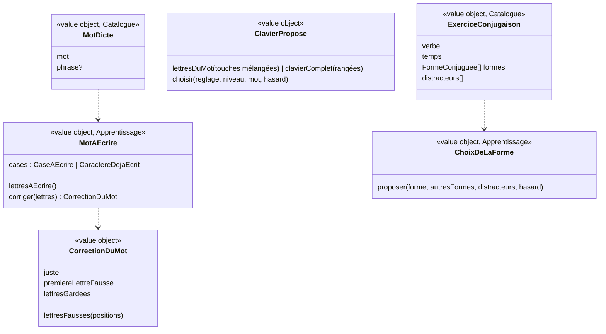

# Modèle du domaine : issue #19, Dictée, conjugaison

## Contexte

Deux types d'exercices :
- **dictée** : nouvelle mécanique de réponse (un mot écrit lettre par lettre, corrigé quand toutes les cases sont remplies), avec le **clavier des dictées** réglé par le parent ;
- **conjugaison** : la mécanique des choix de #17, avec des choix calculés.

S'appuie sur la séance (#16), la question jouée (#17), l'aide et « Je ne sais pas » (#23).

Contextes :
- **Catalogue pédagogique** : exercices `dictee` (`mots: [{mot, phrase?}]`) et `conjugaison` (`verbe, temps, formes, distracteurs?`).
- **Apprentissage** : cases du mot, clavier proposé, correction, lettres gardées ; formes proposées et correction de la conjugaison.
- **Famille** (#12) : réglage **clavier des dictées** (`ClavierDesDictees` : `automatique`, `lettresDuMot`, `clavierComplet`) et niveau du profil. La règle `automatique` appartient à Apprentissage (#12, modèle).
- **Voix** (#7) : le mot dicté n'existe qu'à l'oral. Son coupé ou navigateur sans voix : messages propres à la dictée.
- **Motivation** (#6) : félicitations, encouragements, humeur.

### Comportement actuel (`app/`, `RUNNERS.dictee` l. 1305, `RUNNERS.conjugaison` l. 1413, `AZERTY` l. 1268)

**Dictée**
- Le mot n'est **jamais écrit** avant d'être bien écrit (règle aussi de `docs/format-lecons.md`).
- Voix (vitesse 0,9) : « Écoute bien. `<mot>`. `<phrase>` Écris : `<mot>`. » ; « Écouter plus lentement » : vitesse 0,65 × 0,9.
- Une case par caractère. Espace, apostrophes (`'`, `’`), tiret et point sont **déjà écrits** et sautés.
- Clavier complet si réglage `complet`, ou `auto` et niveau CE2 ou plus. Sinon **lettres du mot** : les lettres à écrire (avec leurs répétitions), plus des **lettres intruses** tirées de « aeioulnrstcmpbdvé », absentes du mot, au nombre de `min(3, max(2, 8 − nombre de lettres))`, le tout mélangé ; chaque touche ne sert qu'une fois (elle revient avec « Effacer »).
- Clavier complet : « azertyuiop », « qsdfghjklm », « wxcvbnéèêà », « çùëïôâîû ».
- Chaque lettre remplit la case suivante ; « Effacer » retire la dernière.
- **Correction automatique** quand toutes les cases sont remplies : lettre à lettre, contre le mot **mis en minuscules**.
- Juste : « `<félicitation>` « `<mot>` » est bien écrit ! ». Faux : **une erreur**, lettres fausses en rouge, « `<encouragement>` Regarde les lettres en rouge et écoute encore. », le mot est redit ; 1,3 s plus tard, les lettres **à partir de la première fausse** sont retirées. Révision : clé `d:`.
- Son coupé : « Pour la dictée, j'ai besoin du son : active-le avec le bouton ci-dessous. » + « Activer le son ». Navigateur sans voix : « Ce navigateur ne sait pas lire à voix haute : fais cette dictée avec un adulte, qui te dira les mots. »

**Conjugaison**
- « `<verbe>` · `<temps>` » et un tableau des pronoms. « Conjuguons le verbe `<verbe>` au `<temps>`. Choisis la bonne forme pour chaque personne. »
- Pour chaque personne, dans l'ordre : « `<pronom>` … ? ». Choix : la forme + 2 autres tirées parmi (autres formes ∪ `distracteurs`), dédoublonnées, **différentes de la forme attendue** (texte exact).
- Erreur : « Avec « `<pronom>` », quelle forme va ? ». Bonne : la forme s'écrit, pas de félicitation. Fin : « `<félicitation>` Tu sais conjuguer `<verbe>` ! ». Révision : « Le verbe `<verbe>` au `<temps>` : `<pronom>` … » avec 2 autres formes (clé `c:`).

## Termes

| Terme | Statut | Remarque |
|---|---|---|
| Dictée | terme du format (type `dictee`) | Exercice. À distinguer de **Mots de la semaine** (devoir, lot 6) qui prépare une dictée. |
| Mot dicté | **nouveau** (validé) | Mot d'un exercice `dictee` (`mots[].mot`), seulement dit à voix haute, jamais montré avant d'être bien écrit. |
| Phrase d'exemple | **nouveau** (validé) | Phrase facultative qui situe le mot dicté (`mots[].phrase`). Elle peut contenir le mot (elle n'est jamais affichée). |
| Case | terme d'interface | Place d'un caractère du mot dicté. |
| Caractère déjà écrit | **nouveau** (validé) | Espace, apostrophe, tiret ou point d'un mot dicté, écrit d'avance. |
| Clavier des dictées | au glossaire (Famille) | Valeurs `automatique`, `lettresDuMot`, `clavierComplet`. |
| Lettres du mot, Clavier complet | valeurs du réglage | Question ouverte n°6. |
| Lettre intruse | terme d'interface (décision n°6) | Lettre absente du mot ajoutée aux lettres du mot. |
| Verbe, temps, pronom, forme | termes du format (`conjugaison`) | Le domaine dit **forme conjuguée** pour un couple (pronom, forme). |
| Personne | terme du programme | Une ligne du tableau (je, tu, il…). Une question par personne. |

## Modèle



### Catalogue : validation à la lecture

| Exercice | Règles de `lireLecon` |
|---|---|
| `ExerciceDictee` | Au moins un mot ; `mot` non vide, avec au moins une lettre à écrire ; `phrase?`. Le mot peut figurer dans les étapes et les exemples de la leçon, comme une dictée préparée en classe (décision n°11) ; il n'est jamais montré pendant l'exercice de dictée (invariant n°1). Aucun contrôle du pipeline ni du domaine sur ce point. |
| `ExerciceConjugaison` | `verbe`, `temps` non vides ; au moins 2 formes, pronoms non vides ; `distracteurs?`. Chaque personne doit pouvoir proposer au moins 2 choix. |

Correctif du contenu : la leçon `fr-ce2-passe-compose` donnait des formes en couples `["j'", "ai mangé"]` sous le pronom « je ». Le pipeline garde désormais les couples pronom/forme donnés (« j' » / « ai mangé ») et refuse au build une forme qui n'est pas un pronom et une forme en texte ; `app/bibliotheque.json` est regénéré. `lireLecon` refuse aussi ces formes (`ExerciceMalForme`).

### Apprentissage : la dictée

- `MotAEcrire.de(mot)` : une case par caractère ; espace, `'`, `’`, `-`, `.` sont des **caractères déjà écrits**.
- `ClavierPropose.choisir(reglage, niveau, mot, hasard)` :
  - `clavierComplet`, ou `automatique` et niveau CE2 ou plus → **clavier complet** (4 rangées AZERTY du legacy, plus « œ » : décision n°2) ;
  - sinon → **lettres du mot** : les lettres à écrire (avec répétitions) + `min(3, max(2, 8 − nombre de lettres))` intruses tirées de « aeioulnrstcmpbdvé » et absentes du mot, mélangées une fois par le port `Hasard`. Chaque touche ne sert qu'une fois.
- `corriger(lettres)` quand toutes les cases à écrire sont remplies (pas de « Valider », décision n°4) :
  - comparaison lettre à lettre, **sans tenir compte des majuscules** : les deux côtés en minuscules, et les touches montrent les lettres en minuscules (décision n°1 ; le legacy ne mettait en minuscules que le mot attendu) ;
  - juste → la question est réussie ;
  - faux → **une erreur** ; positions des lettres fausses ; lettres gardées = celles **avant la première fausse**.
- Réponse : `MotEcrit(lettres)`, ou « Je ne sais pas » : la lettre juste suivante s'écrit dans sa case, le mot n'est jamais montré en entier (#23, décision n°4 ; absent du legacy). S'il ne reste qu'**une** case à écrire, la lettre n'est pas écrite : la bonne touche du clavier brille et l'enfant la tape (décision n°8 ; la question ne se réussit qu'avec la réponse donnée par l'enfant, invariant n°2 de #23).
- Texte dit : « Écoute bien. `<mot>`. `<phrase>` Écris : `<mot>`. » (domaine), vitesse normale ou lente (front, Voix). Texte affiché : « Écoute bien et écris le mot que tu entends. » (sans le mot) : c'est la **consigne par défaut** de la dictée (décision n°9).
- Le **profil de séance** (`ProfilDeSeance { clavierDesDictees, niveau }`) sert **seulement au navigateur**, pour choisir le clavier proposé. Le serveur ne le lit pas (décision n°10, décision d'architecture 0018) : il accepte le tirage du clavier d'un mot sous l'une **ou** l'autre forme (lettres du mot + intruses, ou clavier complet), chacune validée strictement. Le type de clavier ne change ni la correction ni les étoiles, et une séance faite hors ligne n'est pas refusée si le parent change le réglage ou le niveau avant la synchronisation.
- Après une erreur : aide « Regarde les lettres en rouge et écoute encore. », puis le mot est redit. Clé de révision `d:`.
- Son coupé ou navigateur sans voix : messages du legacy, choisis par le front selon l'état de Voix (`Muet`, `LectureImpossible`). La dictée est le seul type qui **demande** le son.

### Apprentissage : la conjugaison

- Une question par personne, dans l'ordre du tableau. Mécanique des choix (#17), réduction à deux, « Je ne sais pas » (#23).
- `ChoixDeLaForme` : la forme attendue + 2 candidats tirés parmi (autres formes ∪ distracteurs), dédoublonnés, **différents de la forme attendue** (texte exact).
- Consigne par défaut : « Conjuguons le verbe `<verbe>` au `<temps>`. Choisis la bonne forme pour chaque personne. » (texte dit par le legacy, décision n°9).
- Aide : « Avec « `<pronom>` », quelle forme va ? ». Fin : « `<félicitation>` Tu sais conjuguer `<verbe>` ! ». Clé de révision `c:`.

### Erreurs métier

`ExerciceMalForme` (Catalogue), `MotIncomplet` (correction demandée avant la dernière case), `ToucheDejaUtilisee` (lettres du mot), `PasDeLettreAEffacer`.

## Invariants

1. Pendant l'exercice de dictée, le mot dicté n'est **jamais** montré à l'écran avant d'être bien écrit, ni envoyé ailleurs qu'à la voix. Les étapes et les exemples de la leçon peuvent le contenir (dictée préparée, décision n°11).
2. Les caractères déjà écrits ne se tapent pas et ne comptent jamais comme faux.
3. Le mot est corrigé exactement quand sa dernière case à écrire est remplie ; une correction fausse coûte **une** erreur, quelle que soit le nombre de lettres fausses.
4. Après une erreur, le début juste du mot est gardé.
5. Avec les lettres du mot, chaque touche sert une fois, et le mot peut toujours s'écrire avec les touches proposées.
6. Le clavier proposé dépend seulement du réglage et du niveau : `automatique` donne les lettres du mot jusqu'au CE1, le clavier complet à partir du CE2. Ce choix est fait dans le navigateur ; le serveur accepte l'une ou l'autre forme de clavier, chacune validée strictement (décision n°10).
7. Conjugaison : chaque personne propose sa forme et jusqu'à deux autres formes, toutes différentes.

## Événements

Aucun.

## Partage avec le front

Tout tourne dans le navigateur (`@domain/apprentissage`) : cases, clavier proposé, correction, lettres gardées, choix des formes. Le front lit le réglage `ClavierDesDictees` (Famille) et le niveau, appelle `ClavierPropose.choisir`, puis affiche. Le **profil de séance** (`ProfilDeSeance`) ne sert qu'à ce choix, dans le navigateur. Côté serveur, le cas d'usage ne le lit pas : il vérifie que le tirage du clavier de chaque mot est une forme valide (lettres du mot + intruses, ou clavier complet), sans dépendre du réglage ni du niveau (décision n°10, 0018). Les durées (rouge pendant 1,3 s, pause de 700 ms) sont l'affaire du front. À 360 px, les touches du clavier complet gardent au moins 44 px (règle d'interface, pas du domaine).

## Données d'enfants

Aucune donnée nouvelle. Les lettres tapées restent dans la séance ; seul le nombre d'erreurs du mot est gardé (#24).

## Emplacement

```
supabase/functions/_shared/catalogue/domain/exercices/
  dictee.ts  conjugaison.ts
supabase/functions/_shared/apprentissage/domain/
  mot-a-ecrire.ts               # cases, caractères déjà écrits, correction
  clavier-propose.ts            # règle automatique, lettres du mot, intruses, clavier complet
  choix-de-la-forme.ts
  exercices/
    dictee.ts  conjugaison.ts
src/seance/exercices/           # cases, touches, « Effacer », « Réécouter le mot », « Écouter plus lentement », tableau de conjugaison
```

## Décisions du PO

Validation n°1 du lot 3 par le PO, le 2026-10-23 : « OK pour tout » (`docs/stories/lot-3-decisions.md` ; décisions `docs/decisions/0012-lecture-des-lecons-dans-le-domaine-catalogue.md` et `docs/decisions/0013-ecritures-d-apprentissage-par-edge-function.md`). Chaque question reçoit pour réponse sa proposition. Le numéro unique du lot (`Q…`, voir `docs/stories/16/acceptance.md`) suit le numéro de la story.

1. (Q30) **Dictée : majuscules** : la correction ignore-t-elle les majuscules (comparer en minuscules des deux côtés, et la touche montre la lettre en minuscule) ? **Décision** : oui ; les mots de la semaine tapés par un parent (lot 6) peuvent avoir une majuscule.
2. (Q31) **Clavier complet** : ajouter « œ » ? D'autres lettres (« æ », « ü », « ÿ ») ? **Décision** : ajouter « œ » seulement (cœur, sœur, œuf, programme du CE1) ; les autres sont trop rares au primaire.
3. (Q32) **Dictée : aide ou « Je ne sais pas »** ? **Décision** : voir #23, question n°4 (la lettre juste suivante s'écrit, le mot n'est jamais montré en entier).
4. (Q33) **Correction automatique** ou bouton « Valider » ? **Décision** : automatique, comme aujourd'hui.
5. (Q34) **Conjugaison : félicitation après chaque personne** ? **Décision** : non, comme aujourd'hui (seulement à la fin) ; l'humeur « applaudit » à chaque bonne forme (décision M4 de #6).
6. (Q35) **« Clavier complet », « lettres du mot », « lettres intruses »** : termes d'interface ? **Décision** : « lettres du mot » et « clavier complet » sont les valeurs du réglage **Clavier des dictées** (déjà au glossaire) ; « lettre intruse » est un terme d'interface.
7. (Q36) **Phrase d'exemple** : peut-elle contenir le mot dicté (elle n'est jamais affichée, seulement dite) ? **Décision** : oui, comme aujourd'hui (« Le chat dort sur le lit. »).

Décisions du PO du 2026-10-24 :

8. **Dictée : « Je ne sais pas » quand il ne reste qu'une case à écrire** : la lettre n'est **pas** écrite (la question ne se réussit qu'avec la réponse donnée par l'enfant, #23 invariant n°2) ; la bonne touche du clavier brille et l'enfant la tape. Ailleurs, la lettre juste suivante s'écrit dans sa case (décision n°3 / Q32, renvoi Q66).
9. **Consignes par défaut** : dictée « Écoute bien et écris le mot que tu entends. » ; conjugaison « Conjuguons le verbe `<verbe>` au `<temps>`. Choisis la bonne forme pour chaque personne. » (reprise du texte dit par le legacy ; signalé au PO, sans objection).
10. **Revalidation de la dictée sans relire le profil** : le serveur accepte le tirage du clavier d'un mot sous l'une ou l'autre forme (lettres du mot + intruses, ou clavier complet), chacune validée strictement ; il ne lit plus le réglage « clavier des dictées » ni le niveau. Raisons : le type de clavier ne change ni la correction ni les étoiles (aucun gain de triche), et une séance faite hors ligne ne doit pas être refusée si le parent change le réglage ou le niveau avant la synchronisation. Le profil de séance sert seulement au navigateur pour choisir le clavier. Décision d'architecture `docs/decisions/0018-revalidation-de-la-dictee-sans-le-profil.md` (complète 0016).
11. **Dictée préparée** : les mots dictés peuvent apparaître dans les étapes et les exemples de la leçon, comme une dictée préparée en classe ; ils ne sont **jamais** montrés pendant l'exercice de dictée avant d'être bien écrits (invariant n°1 inchangé pour l'exercice). `docs/format-lecons.md` est amendé. Rien à changer dans le pipeline ni dans le domaine : aucun contrôle de cette interdiction n'existait.
12. **Début de la dictée sans la consigne lue** (2026-10-24, après le merge de la PR #67) : au début d'un exercice de dictée, le personnage guide **ne lit pas la consigne** à voix haute ; il dicte directement le mot (« Écoute bien. chat. Le chat dort sur le lit. Écris : chat. »). La consigne reste affichée et peut être lue à la demande (réécouter la question), comme tout texte de consigne. Avant cette décision, « Écoute bien et écris le mot que tu entends. » était lue avant le mot. → scénario « La dictée commence par le mot dicté, sans lire la consigne avant ».

## Questions ouvertes

Aucune.
