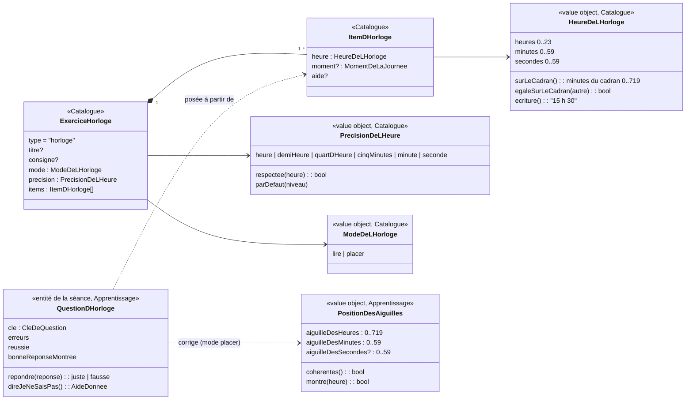

# Modèle du domaine : issue #190, exercice « horloge » (lire l'heure, placer les aiguilles)

État : **à valider par le PO** (questions #190.1 à #190.22).

## Contexte

Un **nouveau type d'exercice** du format de leçon, `horloge`, avec deux modes :
- **lire** : une horloge à aiguilles montre une heure ; l'enfant dit laquelle (par choix ou au clavier, #190.1) ;
- **placer** : l'heure est écrite et dite ; l'enfant tourne les aiguilles, puis valide.

Contextes touchés (aucun nouveau, aucune relation nouvelle : la context map ne change pas) :

| Contexte | Ce que #190 y ajoute | Relation utilisée |
|---|---|---|
| **Catalogue pédagogique** | Lecture et validation de l'exercice `horloge` (`lireHorloge`) ; value objects publiés `HeureDeLHorloge`, `PrecisionDeLHeure`, `ModeDeLHorloge` ; libellé et consigne par défaut du type | Published Language (format JSON) depuis le pipeline ; Published Language (`Lecon`) vers Apprentissage |
| **Apprentissage** | La question jouée (`QuestionDHorloge`), la correction (choix ou heure écrite en mode lire, position des aiguilles en mode placer), la cohérence des aiguilles, l'heure dite, les choix calculés, la clé de révision, la revalidation à la synchronisation | Importe `@domain/catalogue` ; la séance reste l'agrégat |
| **Motivation** | Rien : mêmes félicitations, mêmes étoiles calculées à partir des erreurs | Événements existants (séance terminée) |
| **Voix** | Rien de nouveau dans le modèle : la consigne et l'heure dite sont des phrases lues comme les autres | Inchangée |
| **Pipeline de contenu** (`scripts/`) | Validation du type `horloge` au build (`scripts/build_bibliotheque.py` + pytest), doc `docs/format-lecons.md` | Published Language |

Le programme est la source des règles (relation *Conformist*). Extraits de `app/programmes-index.json` :

| Niveau | Section | Ce que le programme demande | Précision de l'heure qui en découle |
|---|---|---|---|
| CP | `c2-mathematiques-cp-le-reperage-dans-le-temps` | « se limite aux heures entières » ; lire « trois heures, neuf heures, mais aussi midi » ; positionner les aiguilles (« uniquement des heures entières inférieures ou égales à douze ») ; associer une heure à un moment de la journée | heure |
| CE1 | `c2-mathematiques-ce1-le-reperage-dans-le-temps-et-les-durees` | heures entières supérieures à douze, demi-heure, quarts d'heure ; « 2 heures et quart » ou « 14 heures et 15 minutes », « 14 : 15 » sur une horloge digitale ; heures du matin et de l'après-midi | quart d'heure (donc aussi demi-heure et heure) |
| CE2 | `c2-mathematiques-ce2-le-reperage-dans-le-temps-et-les-durees` | « dix heures trente-cinq, sept heures moins le quart, quatre heures moins vingt, quinze heures quarante-deux » ; placer « six heures dix-huit minutes » ; durées entre deux instants affichés | minute (cinq minutes en étape intermédiaire ?, #190.9) |
| CM1 | `c3-mathematiques-cm1-le-reperage-dans-le-temps-et-les-durees` | lire ; placer « en heure et minute » ; durées entre deux instants affichés | minute |
| CM2 | `c3-mathematiques-cm2-le-reperage-dans-le-temps-et-les-durees` | lire ; placer « en heure, minute et seconde » | seconde |

Leçons existantes qui décrivent l'horloge en mots dans des bulles : `ma-cp-heures`, `ma-ce1-heure-demi`, `ma-ce1-quarts-heure-durees`, `ma-ce2-heure-durees` ; mêmes sections, surtout sur les durées : `ma-ce2-durees`, `ma-cm1-durees`, `ma-cm2-durees`. Elles disent déjà « petite aiguille » / « grande aiguille », « 2 heures et quart », « 14 : 15 », « 7 h 45 ».

Le legacy (`app/app.js`) n'a pas d'horloge (seul un épisode cite « placer les aiguilles sur trois heures et quart ») : aucune règle à reprendre.

## Termes

| Terme | Statut | Remarque |
|---|---|---|
| Exercice, Question, Consigne, Aide, Aide par défaut, Choix, Réponse, Erreur, Je ne sais pas, Bonne réponse montrée, Mode de réponse, Clavier de cristaux, Explication de la réponse, Clé de question, Révision, Niveau | Existants | Réutilisés tels quels |
| **Horloge à aiguilles** | **Nouveau** (à valider) | Mot du programme. Exercice `horloge`. |
| **Horloge** (seul) | **En conflit** | Le front a déjà un type technique `Horloge` (`src/seance/horloge.ts` : « l'heure qu'il est, et une minuterie »), utilisé par la fluence et la séance. Dans le domaine, on écrit `ExerciceHorloge`, `QuestionDHorloge`, jamais une classe `Horloge` seule (#190.20) |
| **Mode de l'horloge** (`lire`, `placer`) | **Nouveau** (à valider), **proche d'un terme existant** | « Mode » existe déjà dans **Mode de réponse** (choix ou clavier de cristaux). En mode lire, il y aura aussi un mode de réponse : deux « modes » sur la même question (#190.21) |
| **Heure de l'horloge** | **Nouveau** (à valider) | L'heure à lire ou à placer. « Heure » seul est déjà employé au sens du temps de l'appareil (ligne **Jour** : « sans heure ») |
| **Précision de l'heure** | **Nouveau** (à valider), **en conflit** sur le mot seul | « précision » seul est déjà employé au sens de « complément d'une ligne » (« Badge, précision », « Suivi, précision de #34 ») : toujours avec son complément |
| **Cadran** | **Nouveau** (à valider) | Mot du programme (« cadran à aiguilles ») : la face graduée de l'horloge |
| **Aiguille des heures**, **Aiguille des minutes**, **Aiguille des secondes** | **Nouveaux** (à valider) | « petite aiguille » et « grande aiguille » restent les mots d'interface (leçons existantes, programme) |
| **Position des aiguilles** | **Nouveau** (à valider) | La réponse en mode placer |
| **Aiguilles cohérentes** | **Nouveau** (à valider) | La règle de correction centrale de l'issue |
| **Heure dite** | **Nouveau** (à valider) | L'heure en mots, dite par le personnage guide (« trois heures et demie ») |
| **Affichage digital** | **Nouveau** (à valider) | Mot du programme (« 14 : 15 ») ; seulement si #190.5 = oui |
| **Moment de la journée** | **Nouveau** (à valider) | Mot du programme (CP : « associer une heure à un moment de la journée » ; CE1 : « heures du matin et de l'après-midi ») ; seulement si #190.8 = oui |
| Instant, durée écoulée | Mots du programme, **hors story** | Pour la comparaison de durées entre deux horloges (#190.16). « Durée » est déjà pris par d'autres lignes (« Durée d'affichage sans voix », « Durée maximale d'un enregistrement ») : toujours avec un complément |
| Aimantation | **Mot de cadrage**, pas encore un terme | Seulement si #190.2 = aimantée |

## Modèle

Aucun agrégat nouveau. La **Séance** (et la séance de révision) reste l'agrégat ; la question d'horloge est une entité de la séance, comme `QuestionDeBoite` ou `QuestionDeDictee`.



### Value objects

**`HeureDeLHorloge`** (Catalogue, publié par `@domain/catalogue`)
- `heures` entier de 0 à 23, `minutes` de 0 à 59, `secondes` de 0 à 59 (0 si la précision n'est pas la seconde).
- **Sur le cadran** : l'horloge à aiguilles ne montre que 12 heures. `surLeCadran()` = `(heures mod 12) × 60 + minutes` (plus `secondes / 60`). 3 h et 15 h ont la même position ; midi et minuit aussi (#190.17).
- `egaleSurLeCadran(autre)` : même position des aiguilles.
- `ecriture()` : « 3 h », « 15 h 30 », « 7 h 45 », « 6 h 18 min 20 s » (à confirmer pour les secondes, #190.10). C'est l'écriture des leçons existantes.
- Égalité par valeur (heures, minutes, secondes).

**`PrecisionDeLHeure`** (Catalogue)
- Valeurs : `heure`, `demiHeure`, `quartDHeure`, `cinqMinutes`, `minute`, `seconde` (pas en minutes : 60, 30, 15, 5, 1, et 1/60).
- `respectee(heure)` : les minutes sont un multiple du pas, les secondes valent 0 sauf à la précision `seconde`. « 3 h 30 » ne respecte pas la précision `heure`.
- `parDefaut(niveau)` : proposée CP `heure`, CE1 `quartDHeure`, CE2 `cinqMinutes` ou `minute`, CM1 `minute`, CM2 `seconde` (#190.9).
- C'est aussi le **pas** dont bougent les aiguilles si elles s'aimantent (#190.2).

**`ModeDeLHorloge`** (Catalogue) : `lire` ou `placer`, pour tout l'exercice (#190.13).

**`MomentDeLaJournee`** (Catalogue, seulement si #190.8 = oui) : `matin`, `apresMidi` (et `soir` ?). Lève l'ambiguïté 3 h / 15 h en mode lire.

**`PositionDesAiguilles`** (Apprentissage)
- `aiguilleDesMinutes` : position sur le cadran, en minutes (0 à 59, avec une fraction si l'aiguille des secondes avance l'aiguille des minutes, à décider avec #190.4).
- `aiguilleDesHeures` : position sur le cadran, en minutes sur 12 heures (0 à 719) : le 3 est à 180, la moitié entre le 3 et le 4 est à 210.
- `aiguilleDesSecondes` : seulement à la précision `seconde` (#190.4).
- Toute position est ramenée sur le cadran (modulo 60 ou 720) : un tour complet ne change rien.
- `coherentes()` : voir invariant 5.
- `montre(heure)` : l'aiguille des minutes est sur les minutes de l'heure, et l'aiguille des heures est à sa place pour ces minutes (aux tolérances de #190.7).

**`HeureDite`** (Apprentissage, calcul pur) : l'heure en mots pour la voix et la consigne par défaut. « trois heures », « midi », « deux heures et quart », « quatorze heures quinze », « sept heures moins le quart ». Les règles de formulation (« moins le quart » ou « quarante-cinq », « et demie », « midi », « 12 h ») sont à trancher (#190.10). Aucun nombre n'est dit en chiffres.

### Réponses (Apprentissage, `reponse.ts`)

| Mode | Mode de réponse | Réponse | Existante ? |
|---|---|---|---|
| lire | par choix | `ReponseParChoix` (texte du choix touché) | Oui |
| lire | écrite (si #190.1 = écrire) | **`HeureEcrite`** : heures, minutes (secondes au CM2) | **Nouvelle** |
| placer | aiguilles | **`AiguillesPlacees`** : une `PositionDesAiguilles` | **Nouvelle** |

Les deux nouvelles réponses font partie des réponses de la séance terminée : elles sont rejouées par `revaliderLaSeance` côté serveur, donc lues par le mapper `corps-de-la-seance-terminee.ts` (infrastructure), validées avant d'atteindre le domaine.

### Règles de correction (pures, partagées avec le front)

1. **Lire, par choix** : juste si le choix touché est celui de l'heure attendue. Les choix sont tous **différents sur le cadran** (invariant 7).
2. **Lire, heure écrite** : juste si l'heure écrite est **égale sur le cadran** à l'heure attendue (15 h 30 écrit « 3 h 30 » est juste, sauf si un moment de la journée est demandé, #190.8). Une heure écrite impossible (minutes ≥ 60) n'est pas une réponse : le clavier ne la laisse pas valider.
3. **Placer** : juste si
   - l'aiguille des minutes est exactement sur les minutes attendues (après aimantation si #190.2 = aimantée ; sinon dans une tolérance à trancher, #190.7) ;
   - **et** les aiguilles sont cohérentes (invariant 5) ;
   - **et**, au CM2, l'aiguille des secondes est sur les secondes attendues (#190.4).
4. Une réponse fausse coûte une **erreur**, comme partout ; l'aide de l'item (ou l'aide par défaut : « La petite aiguille montre les heures, la grande les minutes. ») est lue ; l'enfant a une nouvelle chance. Ce que l'horloge montre après l'erreur est à trancher (#190.6).
5. **Je ne sais pas** : une fois par question ; la bonne réponse est montrée (en mode placer : les aiguilles vont sur la bonne heure), puis l'enfant la donne lui-même (#190.18).
6. Étoiles, réussite, acquisition : inchangées (calculées à partir des erreurs de la séance).

### Choix proposés en mode lire (si #190.1 = choix)

Proposition (#190.11) : les choix sont **calculés par Apprentissage** à partir de l'heure attendue, comme ceux de la conjugaison, avec des distracteurs qui reprennent les erreurs typiques :
- **aiguilles inversées** : 3 h 00 lu « 12 h 15 » ;
- **heure d'à côté** : 3 h 45 lu « 4 h 45 » (la petite aiguille est presque sur le 4) ;
- **chiffre montré par la grande aiguille** : 3 h 20 lu « 3 h 04 » ou « 3 h 4 » ;
- **minutes voisines** au pas de la précision : 3 h 15 / 3 h 30.
Tous les distracteurs respectent la précision du niveau et sont différents sur le cadran de la bonne réponse et entre eux. Le nombre de choix suit la règle des autres exercices à choix (3, réduits à 2 après deux erreurs).

### Catalogue : validation à la lecture (`LeconMalFormee`)

- `mode` est `lire` ou `placer` ;
- au moins un item ; chaque `heure` est une heure valide (heures 0 à 23, minutes et secondes 0 à 59) ;
- chaque heure **respecte la précision** de l'exercice ;
- la précision n'est pas plus fine que celle du niveau de la leçon (pas de secondes au CE1) : proposition, #190.9 ;
- en mode `placer` au CP, l'heure est inférieure ou égale à 12 (texte du programme : « uniquement des heures entières inférieures ou égales à douze ») : proposition, #190.17 ;
- deux items d'un même exercice ne sont pas égaux sur le cadran (sinon la même question revient deux fois et ils auraient la même clé de révision) : proposition.

### Erreurs métier

- Catalogue : `LeconMalFormee` (existante), avec les raisons ci-dessus. Aucune erreur nouvelle.
- Apprentissage : `ReponseIncompatible` (existante) si une réponse du mauvais genre arrive (une position d'aiguilles en mode lire). Une erreur nouvelle **`PositionDesAiguillesInvalide`** si la position reçue n'est pas un nombre fini (protection de la revalidation ; la valeur est ramenée sur le cadran sinon).

### Forme JSON proposée (format de leçon)

```json
{
  "type": "horloge",
  "consigne": "Quelle heure est-il ?",
  "mode": "lire",
  "precision": "quart-d-heure",
  "items": [
    { "heure": "2:15" },
    { "heure": "14:30", "moment": "apres-midi", "aide": "La grande aiguille est sur le 6 : c'est la demie." },
    { "heure": "9:45" }
  ]
}
```

```json
{
  "type": "horloge",
  "mode": "placer",
  "items": [ { "heure": "3:00" }, { "heure": "12:00" } ]
}
```

| Champ | Rôle | Obligatoire |
|---|---|---|
| `mode` | `"lire"` ou `"placer"` | oui |
| `precision` | `"heure"`, `"demi-heure"`, `"quart-d-heure"`, `"cinq-minutes"`, `"minute"`, `"seconde"` ; absent : précision par défaut du niveau | non |
| `items[].heure` | `"H:MM"` ou `"H:MM:SS"`, sur 24 heures | oui |
| `items[].moment` | `"matin"`, `"apres-midi"` (si #190.8 = oui) | non |
| `items[].aide` | lue après une erreur ou « Je ne sais pas » | non |
| `consigne` | sinon consigne par défaut : lire « Quelle heure est-il ? » ; placer « Place les aiguilles sur `<heure dite>`. » | non |

Écriture `"H:MM"` plutôt que `"3 h 15"` : sans ambiguïté pour le build et pour l'IA des leçons personnelles ; l'écriture montrée à l'enfant est calculée (`ecriture()`). Un `generateur` d'heures est une question à part (#190.12).

### Clé de révision et autres lieux du domaine

- `TypeDeQuestion` reçoit `horloge`, avec un préfixe de clé propre (par exemple `w:`), et un texte de clé qui contient le mode et l'heure (« placer 15:30 »), pour que lire 3 h 30 et placer 3 h 30 soient deux questions différentes en révision.
- `question-de-revision.ts` sait reposer une question d'horloge (#190.15).
- `plan-du-test-de-depart.ts` : 0 question admissible tant que #190.14 n'est pas tranchée.
- Libellé du type (`type-d-exercice.ts`) : « L'horloge » (à confirmer).

## Invariants

1. **Une heure de l'horloge est valide** : heures 0 à 23, minutes et secondes 0 à 59 ; vérifié à la lecture de la leçon (Catalogue) et à la lecture d'une heure écrite (Apprentissage).
2. **Une heure respecte la précision de son exercice** (Catalogue).
3. **La précision ne dépasse pas le programme du niveau** (Catalogue, proposition #190.9).
4. **L'horloge montre 12 heures** : deux heures égales sur le cadran (3 h, 15 h) donnent la même position des aiguilles. La correction compare sur le cadran, sauf si un moment de la journée est demandé.
5. **Aiguilles cohérentes** : l'aiguille des heures est à la place que lui donnent les minutes, comme sur une vraie horloge : `aiguilleDesHeures = (heures mod 12) × 60 + aiguilleDesMinutes`. À 3 h, elle est sur le 3 ; à 3 h 30, à mi-chemin entre le 3 et le 4 ; à 3 h 45, aux trois quarts du chemin. Si les aiguilles sont liées (#190.3 = liées), l'invariant est garanti par construction : tourner l'aiguille des minutes fait avancer l'aiguille des heures (fonction pure du domaine, appelée par le front). Si elles sont séparées, la cohérence est vérifiée à la correction, avec la tolérance de #190.7.
6. **Une réponse fausse n'est jamais punitive** : une erreur, un encouragement, l'aide, une nouvelle chance ; jamais d'aiguilles qui « sautent » toutes seules sur la bonne heure après une simple erreur sans que ce soit décidé (#190.6).
7. **Les choix d'une question à lire sont tous différents sur le cadran**, et la bonne réponse en fait partie.
8. **Mêmes erreurs, mêmes étoiles, même revalidation** que les autres types : le serveur rejoue les réponses (choix, heure écrite, aiguilles placées) et retrouve le même résultat que le navigateur.
9. **Une seule vérité** : la correction, la cohérence, l'aimantation (si retenue), l'heure dite et les choix sont calculés dans `domain/` ; React ne décide de rien (il convertit seulement un geste ou une touche flèche en position).

## Événements

Aucun événement de domaine nouveau. Les faits existants suffisent : une question d'horloge compte dans les erreurs de la séance, `SeanceTerminee` (et le fait de la séance de révision) restent inchangés ; seules les réponses qu'ils transportent gagnent deux genres (`HeureEcrite`, `AiguillesPlacees`).

## Partage avec le front

Tout fonctionne hors ligne. Le front importe :
- de `@domain/catalogue` : `ExerciceHorloge`, `ItemDHorloge`, `HeureDeLHorloge` (écriture, position sur le cadran), `PrecisionDeLHeure` ;
- de `@domain/apprentissage` : `QuestionDHorloge`, `PositionDesAiguilles`, la position de l'aiguille des heures pour des minutes données (aiguilles liées), l'aimantation au pas de la précision (si retenue), l'heure dite, l'annonce de l'heure placée pour le lecteur d'écran (texte calculé par le domaine à partir de la position, sans juger la réponse).

Ce que React fait seul : dessiner le cadran, convertir un angle de doigt ou une flèche du clavier en minutes du cadran, les boutons « + » / « − », les mouvements (respect de `prefers-reduced-motion`).

## Données d'enfants

**Aucune donnée personnelle nouvelle.** Les réponses d'horloge (positions, heures écrites) sont des réponses de séance comme les autres, déjà couvertes par l'export et la suppression d'un profil. Rien n'est envoyé à l'IA. Aucune heure réelle de l'enfant (« à quelle heure te lèves-tu ? ») n'est demandée ni stockée : les exemples de moments de la journée restent génériques (se lever, aller à l'école, déjeuner).

## Emplacement

Catalogue (`supabase/functions/_shared/catalogue/domain/`) :
- `exercices/horloge.ts` (+ `_test.ts`) : `ExerciceHorloge`, `ItemDHorloge`, `lireHorloge` ;
- `heure-de-l-horloge.ts` (+ `_test.ts`) : `HeureDeLHorloge` ;
- `precision-de-l-heure.ts` (+ `_test.ts`) : `PrecisionDeLHeure` (dont la précision par défaut du niveau) ;
- `type-d-exercice.ts`, `exercice.ts`, consigne par défaut du type, `index.ts` (exports).

Apprentissage (`supabase/functions/_shared/apprentissage/domain/`) :
- `question-d-horloge.ts` (+ tests) : `QuestionDHorloge` (modes lire et placer) ;
- `position-des-aiguilles.ts` (+ tests) : `PositionDesAiguilles`, cohérence, aimantation ;
- `exercices/horloge.ts` (+ tests) : heure dite, aide par défaut, choix calculés, annonce de l'heure placée ;
- `reponse.ts` (`HeureEcrite`, `AiguillesPlacees`), `question-suivie.ts`, `cle-de-question.ts`, `cles-des-questions.ts`, `questions-de-l-exercice.ts`, `question-de-revision.ts`, `plan-du-test-de-depart.ts`, `revalider-la-seance.ts`, `erreurs.ts`, `index.ts` ;
- `infrastructure/corps-de-la-seance-terminee.ts` : lecture et validation des deux nouvelles réponses.

Hors domaine : `docs/format-lecons.md` (ligne `horloge`), `scripts/build_bibliotheque.py` et `scripts/tests/` (validation au build), `src/seance/exercices/horloge/` (cadran, aiguilles, gestes, clavier), `features/190-horloge.feature`. Contenu : exercices `horloge` dans les quatre leçons sur l'heure (#190.22).

## Questions ouvertes

Reprises de l'issue (1 à 5), puis complétées.

1. **Mode lire : choisir ou écrire ?** A : choisir parmi 3 propositions (2 après deux erreurs). B : écrire l'heure au clavier de cristaux (heures, puis minutes). C : choix au CP, écrit à partir du CE1, comme le **Mode de réponse** des calculs. Reco : **C**, cohérent avec le reste de l'application.
2. **Mode placer : aiguilles aimantées ou tour libre ?** Exemple : au CE1, Léa lâche la grande aiguille un peu après le 3 ; elle se pose d'elle-même sur le 3 (aimantée au quart d'heure), oui ou non ? Reco : **aimantée au pas de la précision de l'heure** (sinon la tolérance de #190.7 devient délicate au doigt sur tablette).
3. **L'aiguille des heures suit-elle l'aiguille des minutes ?** A : oui, comme une vraie horloge (l'enfant ne tourne que la grande aiguille, ou les deux, mais la petite avance quand la grande tourne). B : non, l'enfant place les deux séparément et la cohérence est corrigée. Reco : **B au CP et au CE1** (placer la petite aiguille entre le 3 et le 4 est ce qu'on apprend), à confirmer ; **A** si le PO préfère la simplicité.
4. **Aiguille des secondes au CM2 dès cette story ?** Oui / non (plus tard). Si oui : au CM2, toute heure a-t-elle des secondes, ou seulement certains items ?
5. **Afficher aussi l'affichage digital (« 14 : 15 ») à côté de l'horloge à partir du CE1 ?** Oui / non. Attention : en mode lire, il donnerait la réponse ; proposition : jamais pendant la question, seulement après la bonne réponse.
6. **Après une réponse fausse, que montre l'horloge ?** L'issue dit « l'horloge montre l'heure placée par l'enfant et la bonne heure ». Mais la règle du projet est « un encouragement, puis une nouvelle chance » : montrer la bonne heure dès la première erreur donne la réponse. Proposition : après une erreur, les aiguilles de l'enfant restent, l'aide est lue, nouvelle chance ; la bonne heure n'est montrée qu'après « Je ne sais pas » (comme partout) ou après la bonne réponse. D'accord ?
7. **Tolérance de l'aiguille des heures (si #190.3 = B).** Exemple : la cible est 3 h 30 ; Léa pose la grande aiguille sur le 6 et la petite **pile sur le 3**. Juste ou fausse ? Et si la petite est entre le 3 et le 4 mais plus près du 4 ? Proposition : juste si la petite aiguille est entre le 3 et le 4, du bon côté de la moitié (dans le premier quart à 3 h 15, au milieu à 3 h 30…), fausse si elle est pile sur un chiffre alors que les minutes ne sont pas « pile ».
8. **Moment de la journée** : en mode lire au CE1, peut-on demander « 15 h » en disant « C'est l'après-midi » (champ `moment`) ? Sans moment, les choix ne proposent jamais deux heures qui se ressemblent sur l'horloge (3 h et 15 h) et « 3 h » écrit pour 15 h est juste. D'accord ?
9. **Précision de l'heure par défaut et limites** : CP heure, CE1 quart d'heure, CE2 **cinq minutes ou minute ?**, CM1 minute, CM2 seconde. Une leçon peut-elle demander une précision plus fine que son niveau (des minutes au CE1) ? Proposition : non, le build échoue ; plus grossière, oui (des heures pile au CE2).
10. **Écriture et heure dite** : au CE2, pour 7 h 45, le choix affiché est « 7 h 45 » ; la voix dit « sept heures quarante-cinq » ou « huit heures moins le quart » ? Midi s'écrit « midi » ou « 12 h » ? En mode lire écrit, « huit heures moins le quart » et « 7 h 45 » sont la même réponse (le clavier n'écrit que des chiffres) : d'accord ?
11. **Distracteurs** : calculés par l'application (aiguilles inversées, heure d'à côté, chiffre montré par la grande aiguille, minutes voisines), ou écrits par l'auteur de la leçon dans le JSON ? Reco : calculés.
12. **Générateur d'heures** (tirage au hasard à la précision du niveau, comme le `generateur` du calcul) dès cette story, ou heures écrites seulement ?
13. **Mode par exercice ou par item ?** Un même exercice peut-il mélanger « lis l'heure » et « place les aiguilles » ? Reco : par exercice (une leçon peut avoir deux exercices `horloge`).
14. **Test de départ** : les questions d'horloge en mode lire y sont-elles posées (comme les bulles) ? Oui / non. Reco : non dans cette story.
15. **Révision** : une question d'horloge ratée revient-elle en séance de révision, dans le même mode ? Reco : oui.
16. **Durées entre deux instants affichés** (CE2, CM1, CM2 : « deux horloges, combien de minutes entre les deux ? ») : hors de cette story (story à part) ? Oui / non.
17. **Heures permises** : au CP, seulement de 1 h à 12 h (programme : « inférieures ou égales à douze ») ? « 0 h » et « minuit » sont-ils permis à partir du CE1 ?
18. **« Je ne sais pas » en mode placer** : les aiguilles vont toutes seules sur la bonne heure, puis l'enfant doit les replacer lui-même (elles reviennent où il les avait mises) ? Ou il valide l'horloge déjà réglée ? Reco : l'enfant les replace lui-même, comme il réécrit la bonne réponse ailleurs.
19. **Heure placée visible pendant qu'on tourne** : l'heure placée est annoncée au lecteur d'écran (issue). Faut-il aussi l'écrire à l'écran sous l'horloge pendant que l'enfant tourne ? Proposition : non (l'enfant comparerait des chiffres au lieu de lire l'horloge) ; seulement l'annonce au lecteur d'écran.
20. **Nom « Horloge » dans le code** : le front a déjà un type technique `Horloge` (heure de l'appareil, minuterie). Proposition : on le renomme (par exemple `SourceDuTemps`) dans cette story, et « horloge » ne désigne plus que l'horloge à aiguilles. D'accord ?
21. **« Mode » deux fois** : en mode lire, il y aura un « mode de l'horloge » (lire / placer) et un « mode de réponse » (choix / clavier). On garde « Mode de l'horloge », ou on dit **« Lire l'heure »** et **« Placer les aiguilles »** comme deux sortes d'exercice horloge, sans le mot « mode » ?
22. **Contenu** : les quatre leçons sur l'heure (`ma-cp-heures`, `ma-ce1-heure-demi`, `ma-ce1-quarts-heure-durees`, `ma-ce2-heure-durees`) reçoivent des exercices `horloge` dans la même PR ? Les leçons de la même section au CE2, au CM1 et au CM2 (`ma-ce2-durees`, `ma-cm1-durees`, `ma-cm2-durees`, surtout des durées) en reçoivent-elles aussi ?
