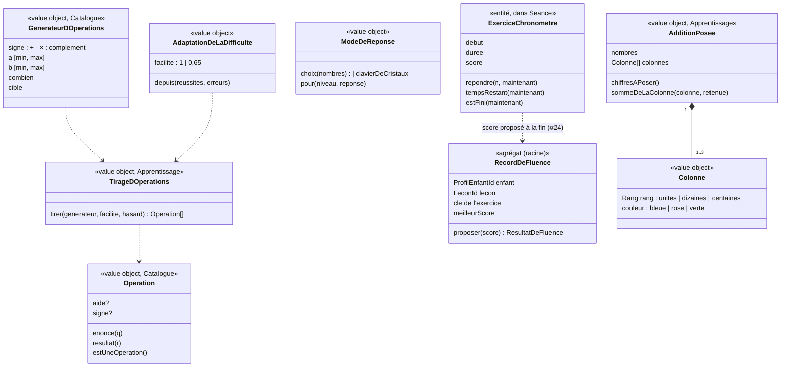

# Modèle du domaine : issue #20, Calcul, fluence, addition posée

## Contexte

Trois types d'exercices de nombres :
- **calcul** : opérations fixes ou tirées par un générateur, avec une difficulté qui s'adapte ; réponse par choix (CP) ou au **clavier de cristaux** (à partir du CE1) ;
- **fluence** : calcul rapide chronométré, avec un **record** personnel ;
- **addition posée** : poser les chiffres dans les colonnes (étiquettes, #18), puis calculer colonne par colonne avec la **retenue**.

Le **clavier de cristaux** et le **mode de réponse** (choix ou clavier) posés ici servent aussi à #21 (boîte, barres).

Contextes :
- **Catalogue pédagogique** : exercices `calcul`, `fluence`, `addition` ; `operations` et `generateur` (Published Language).
- **Apprentissage** : tirage des opérations (port `Hasard`), adaptation de la difficulté, correction, astuce, retenue oubliée, étapes de l'addition, record de fluence (nouvel agrégat), temps de la fluence (heure passée en paramètre).
- **Motivation** (#6) : félicitations, encouragements ; couleurs des colonnes identiques dans tous les univers (renvoi de #6, vérifiées ici).
- **Famille** (#14) : le record de fluence est une donnée de l'enfant (effacée et exportée avec le profil).

### Comportement actuel (`app/`, `keypad` l. 907, `calculOps` l. 1112, `genOp` l. 1100, `calcRate` l. 1095, `RUNNERS.calcul` l. 1501, `fluence` l. 1517, `addition` l. 1639, `additionOps` l. 1080, `Records` l. 1049)

**Clavier de cristaux** : touches 0 à 9, « Effacer », « Valider » ; 4 chiffres au plus ; « Valider » sans chiffre ne fait rien. Juste : suite. Faux : le nombre s'efface, **une erreur** par essai.

**Calcul**
- `operations` fixes (`{q, r, aide?}`), ou `generateur` (`op`, `a`, `b`, `combien` = 5, `cible` = 10). Sans les deux : 5 additions, `a` et `b` de 1 à 10.
- Tirage (`genOp`) : `a` et `b` tirés dans leurs intervalles (défaut [1, 10]). `-` : échangés si `b > a`. `×` : `a × b`. `:` : « `a×b` : `b` », réponse `a`. `complement` : « `a` + … = `cible` », réponse `cible − a`.
- **Adaptation** (`calcRate`) : sur **toutes** les leçons de l'enfant, réussites et erreurs des types `calcul` et `fluence` ; à partir de 6 réponses, si moins de 60 % sont justes, chaque intervalle `[min, max]` devient `[min, max(min, arrondi(min + (max − min) × 0,65))]`. Seulement pour `calcul`, pas pour la fluence.
- Est une opération : chiffre, signe (`+ − × :`), chiffre ; ou « … ». Carte : « `<q>` = ? », complément tel quel, sinon « `<q>` ? ». Phrase : « Combien font `<q>` ? » (− « moins », × « fois », : « divisé par », … « combien ») ou « `<q>` : combien ? ».
- Mode de réponse : au CP, 4 choix (`r`, `r+1`, `max(0, r−1)`, `r+2`), dédoublonnés ; à partir du CE1, clavier de cristaux.
- Aide : `aide` de l'opération, sinon l'**astuce** du premier signe trouvé dans `q`, et celle de `+` **s'il n'y en a pas** (« Moitié de 10 », « Carré de côté 5 » reçoivent l'astuce de l'addition : défaut relevé ici).
- Révision : clé `n:` + `q`.

**Fluence**
- `duree` (60 s par défaut), `generateur` sans adaptation (défaut : additions 1 à 10).
- Record par enfant, par leçon et par exercice (clé `<id de la leçon>:<titre, sinon op>`).
- Bonne réponse : score + 1. Faux : un son, le nombre s'efface, **aucune erreur**. Pas de « Je ne sais pas ».
- Fin : « `<n>` calcul(s) réussi(s) ! », puis nouveau record (s'il en existait un), premier record, ou « `<n>` calculs ! Ton record reste `<r>`. Tu y es presque ! ». Un score de 0 n'est jamais un record.
- Une fluence compte **une** question réussie et **jamais** d'erreur, donc ne baisse jamais les étoiles.

**Addition posée**
- `operations` (listes de nombres) ou `generateur` (`nombres`, `min`, `max`, `retenue`, `combien` ; défauts 2, 12 ou 10, 59 ou 99, 3). Avec `retenue` : les unités font au moins 10, en 200 tirages au plus (sinon le dernier tirage est gardé, **sans** retenue).
- Colonnes : centaines (verte), dizaines (rose), unités (bleue). Autant que de chiffres dans la somme, **3 au plus**.
- **Poser** (si `etapes` contient `poser`) : pour chaque nombre, ses chiffres sont des étiquettes (#18) à poser dans la bonne colonne. Erreur : « Le `<c>` est tout seul : c'est un chiffre des unités. Il va dans la maison bleue, tout à droite. » ou « Dans `<n>`, le `<c>` est le chiffre des `<rang>` : il va dans la maison `<couleur>`. » (avec un chiffre en double, le message vise le premier). Erreurs comptées, non notées pour les révisions.
- **Calculer**, des unités vers la gauche : somme des chiffres de la colonne + retenue. Choix au CP (`s`, `s+1`, `max(0, s−1)`, et `s−10` si `s ≥ 10`, sinon `s+2`), clavier ensuite. Erreur : « Tu as oublié la retenue, tout en haut de la maison ! » si la réponse vaut la somme sans la retenue, sinon « Compte doucement : `<expression>`. ». Somme ≥ 10 hors dernière colonne : le chiffre des unités s'écrit, la dizaine monte en retenue, « `<s>`, c'est `<d>` dizaine(s) et `<u>` unité(s) ! J'écris `<u>`, et `<d>` monte en retenue. ». La dernière colonne écrit la somme entière.
- Fin : « `<a + b>` = `<somme>`. `<félicitation>` ». Révision : la somme en calcul (clé `n:`).

### Ce que montre la bibliothèque

33 calculs, 14 fluences (45 ou 60 s), 6 additions (dont deux à l'étape calculer seule, jusqu'à 489 + 489). Aucune somme de 1 000 ou plus. Compléments : `a` dans [1, 9] pour 10, [5, 95] pour 100. Trois calculs qui ne sont pas des opérations : « Moitié de 10 », « Carré de côté 5 », « Rectangle de 5 sur 3 ».

## Termes

| Terme | Statut | Remarque |
|---|---|---|
| Opération | **nouveau** (validé), terme du format (`operations`) | Calcul à faire : un énoncé (`q`) et un résultat (`r`), avec une aide facultative. Peut aussi être une question de calcul qui n'a pas de signe (« Moitié de 10 »). |
| Générateur | **nouveau** (validé), terme du format (`generateur`) | Règle de tirage des opérations (signe, intervalles, nombre, cible). |
| Adaptation de la difficulté | **nouveau** (validé) | Réduction des intervalles d'un générateur quand l'enfant se trompe souvent en calcul. |
| Astuce de l'opération | **nouveau** (validé) | Aide par défaut d'un calcul, selon son signe. |
| Clavier de cristaux | **nouveau** (validé), nommé dans le format | Clavier de chiffres pour répondre à un calcul, à partir du CE1. |
| Mode de réponse | **nouveau** (validé) | Choix (au CP) ou clavier de cristaux, selon le niveau (et la réponse, #21). |
| Fluence | terme du format (type `fluence`) | L'interface dit « Calcul rapide ». |
| Record de fluence | **nouveau** (validé) | Meilleur score d'un enfant à un exercice de fluence. « Record » seul : seulement dans l'interface. |
| Score de fluence | **nouveau** (validé) | Nombre de calculs réussis pendant une fluence. « Score » reste interdit pour les étoiles. |
| Addition posée | terme du format (type `addition`) | |
| Colonne | **nouveau** (validé) | Colonne des unités, des dizaines ou des centaines d'une addition posée. L'interface dit « maison » (#18, décision n°7 ; #6, question n°5). |
| Rang | **nouveau** (validé), **conflit tranché** (décision n°7) | Unités, dizaines, centaines : ce que vaut un chiffre selon sa colonne (mot des programmes de maths). « Rang » reste interdit seulement pour la position d'une leçon (**Ordre**). |
| Retenue | **nouveau** (validé) | Dizaine d'une colonne reportée dans la colonne suivante. |
| Étape poser, étape calculer | termes du format (`etapes`) | **Conflit tranché** (glossaire, décision n°28) avec « Étape de leçon » : on dit toujours « étape poser » ou « étape calculer », jamais « étape » seule. |

## Modèle



### Catalogue : validation à la lecture

| Exercice | Règles de `lireLecon` |
|---|---|
| `ExerciceCalcul` | `operations` non vides (`q` non vide, `r` entier ≥ 0) **ou** `generateur` ; sans les deux : générateur par défaut (5 additions, 1 à 10). |
| `GenerateurDOperations` | Signe connu ; intervalles `[min, max]` d'entiers avec `min ≤ max` ; `combien ≥ 1`. `complement` : `a` au plus égal à la `cible` (décision n°10). `-` : résultat jamais négatif (échange). |
| `ExerciceFluence` | `duree` > 0 (60 par défaut) ; générateur (défaut : additions 1 à 10). |
| `ExerciceAddition` | `operations` (au moins 2 nombres entiers positifs chacune) ou `generateur` ; `etapes` parmi `poser`, `calculer` (les deux par défaut). Somme de moins de 1 000 (décision n°5). |

### Apprentissage : règles

**Tirage et adaptation** (au début de la séance, #16)
- `AdaptationDeLaDifficulte.depuis(reussites, erreurs)` : facilité 0,65 si `reussites + erreurs ≥ 6` et `reussites / total < 0,6`, sinon 1. Les compteurs viennent de l'**historique de calcul** de l'enfant (`ContexteDeSeance`, #16), lu par le front dans les séances terminées (#24, réussites et erreurs par type) : toutes les leçons de calcul, seuils gardés, mais seulement les **50 dernières réponses** (décision n°4).
- `TirageDOperations.tirer` : règles de `genOp` ci-dessus, avec la facilité appliquée aux intervalles. Les opérations tirées font partie des **tirages** de la séance ; le serveur vérifie qu'elles respectent le générateur (#24).

**Calcul**
- Une question par opération. Réponse `Nombre(n)`. Correction : `n` égal au résultat.
- `ModeDeReponse.pour(niveau)` : CP → choix `r`, `r+1`, `max(0, r−1)`, `r+2` (dédoublonnés, mélangés, #17) ; CE1 et plus → clavier de cristaux.
- Clavier de cristaux : la saisie (chiffres, « Effacer », 4 chiffres au plus, « Valider » sans chiffre ignoré) est l'affaire du front ; le domaine reçoit le nombre validé.
- Aide : `aide`, sinon l'astuce du signe ; pas d'astuce pour une question sans signe (décision n°9).
- Phrase lue : `phraseDuCalcul(operation)` (domaine) ; carte : `carteDuCalcul(operation, resultat?)`.

**Fluence** (`ExerciceChronometre`, entité de la séance)
- Commence à « C'est parti ! » (`demarrer(maintenant)`). Jusqu'à `debut + duree` : chaque bonne réponse ajoute 1 au score et tire une nouvelle opération ; une réponse fausse ne compte rien. Après la fin, plus aucune réponse.
- L'heure est **passée en paramètre** (front : port `Horloge`), jamais lue dans le domaine.
- Une seule question pour l'avancement. Erreurs : aucune, pas de pression dans un exercice chronométré ; ses réponses fausses comptent seulement dans l'adaptation de la difficulté, et une séance faite seulement d'une fluence ne donne pas d'étoiles (décision n°2, #24).
- `RecordDeFluence.proposer(score)` : nouveau record si `score > meilleurScore` (premier record si aucun) ; sinon le record reste. Un score de 0 n'est jamais un record.
- Phrases de fin pour 0 et 1 (décision n°3) : « 1 calcul réussi ! » au singulier ; pour 0 : « Pas encore de calcul réussi : on réessaie quand tu veux ! », sans parler de record.

**Addition posée** (`AdditionPosee`)
- Colonnes : autant que de chiffres de la somme (3 au plus), de droite à gauche unités (bleue), dizaines (rose), centaines (verte), **dans tous les univers**.
- **Étape poser** : une question par chiffre de chaque nombre. `Placement(chiffre, colonne)` juste si la colonne est vide pour ce nombre et si le chiffre est celui du nombre à ce rang. Avec un chiffre en double, l'aide vise **la colonne encore libre** de ce chiffre (correction du défaut).
- **Étape calculer** : une question par colonne, de droite à gauche. Somme `s` = chiffres de la colonne + retenue. Choix au CP (`s`, `s+1`, `max(0, s−1)`, `s−10` si `s ≥ 10` sinon `s+2`) ou clavier. **Retenue oubliée** reconnue si la retenue est non nulle et la réponse vaut `s − retenue`. Si `s ≥ 10` et ce n'est pas la dernière colonne : on écrit `s mod 10`, la retenue `⌊s / 10⌋` monte. La dernière colonne écrit `s`.
- Avancement : une question par chiffre posé et par colonne calculée (décision n°11), pour que l'avancement soit complet exactement à la fin.
- Phrase de la retenue : elle dit le rang de la colonne (« 10, c'est 1 centaine et 0 dizaine ! » dans la colonne des dizaines), au lieu de « dizaine(s) et unité(s) » partout dans le legacy (décision n°1).
- Générateur avec `retenue` : le tirage garantit toujours la retenue, sans repli silencieux (décision n°12).

### Ports

- `Hasard` (domaine, #16) : tirages.
- `Horloge` (front) : l'heure de la fluence, passée aux méthodes de `ExerciceChronometre`.
- Côté serveur (`apprentissage/application/`) : `RecordsDeFluence` (lire, enregistrer) ; `HistoriqueDeCalcul` (lecture des réussites et erreurs de calcul des séances terminées, pour le front aussi sous RLS).

### Agrégat `RecordDeFluence`

- **Racine** identifiée par (`ProfilEnfantId`, `LeconId`, clé de l'exercice : `titre`, sinon le signe, comme le legacy).
- **Pourquoi un agrégat** : « le record ne baisse jamais » porte sur toutes les séances, comme les meilleures étoiles (#24). Il est séparé de `ResultatDeLaLecon` : une leçon peut avoir plusieurs fluences.
- Mis à jour par la politique `GarderLeRecordDeFluence`, qui réagit à `SeanceTerminee` (#24), avec le score de chaque fluence de la séance. Le front l'affiche tout de suite (le domaine dit déjà « nouveau record »).

### Erreurs métier

`ExerciceMalForme` (Catalogue : intervalle vide, signe inconnu, complément négatif, somme trop grande), `TirageHorsDuGenerateur` (revalidation, #24), `FluenceFinie`, `FluenceNonCommencee`, `ColonneDejaRemplie`.

## Invariants

1. Une opération tirée respecte toujours son générateur (et l'adaptation) ; son résultat n'est jamais négatif.
2. Au CP, un calcul se répond par choix ; à partir du CE1, au clavier de cristaux.
3. Chaque réponse fausse à un calcul coûte une erreur (règle commune de #23).
4. Une fluence ne dure que sa durée : aucune réponse n'est prise après la fin. Le domaine ne lit jamais l'heure lui-même.
5. Le record de fluence ne baisse jamais ; un score de 0 n'est jamais un record.
6. Les colonnes ont toujours les mêmes couleurs (unités bleue, dizaines rose, centaines verte), quel que soit l'univers.
7. Une retenue monte toujours dans la colonne immédiatement à gauche ; la dernière colonne écrit toute sa somme.
8. L'avancement d'une addition posée est complet exactement quand la dernière colonne est calculée.

## Événements

| Événement | Données | Qui réagit |
|---|---|---|
| `NouveauRecordDeFluence` | profil enfant, leçon, exercice, ancien et nouveau record | personne au lot 3 ; Accompagnement (suivi) plus tard |

Le score de chaque fluence voyage avec `SeanceTerminee` (#24).

## Partage avec le front

Tout tourne dans le navigateur : tirage, adaptation (avec l'historique lu sous RLS), mode de réponse, correction, astuces, retenue oubliée, colonnes, temps restant, nouveau record. Le front gère seulement la saisie au clavier de cristaux, la barre de temps (avec `Horloge`) et les animations (la retenue qui vole). Temps restant et compteur annoncés aux lecteurs d'écran.

## Données d'enfants

- **Nouvelle donnée** : record de fluence (profil, leçon, exercice, meilleur score). Table sous RLS (rattachement), supprimée en cascade avec le profil, incluse dans l'export (#14).
- L'adaptation lit les séances terminées (#24) : pas de nouvelle donnée.

| Table | Contenu | Policies RLS |
|---|---|---|
| `records_de_fluence` | profil enfant, leçon, clé de l'exercice, meilleur score, date ; triplet unique | lecture : parent rattaché ; écriture : Edge Function (`terminer-la-seance`) seulement |

## Emplacement

```
supabase/functions/_shared/catalogue/domain/exercices/
  operation.ts  generateur-d-operations.ts
  calcul.ts  fluence.ts  addition.ts
supabase/functions/_shared/apprentissage/domain/
  tirage-d-operations.ts
  adaptation-de-la-difficulte.ts
  mode-de-reponse.ts            # choix au CP, clavier de cristaux ensuite (aussi #21)
  astuce-de-l-operation.ts
  exercice-chronometre.ts
  record-de-fluence.ts          # agrégat RecordDeFluence
  addition-posee.ts             # colonnes, rangs, couleurs, retenue
  exercices/
    calcul.ts  fluence.ts  addition.ts
supabase/functions/_shared/apprentissage/application/
  garder-le-record-de-fluence.ts
supabase/functions/_shared/apprentissage/infrastructure/
  supabase-records-de-fluence.ts
src/seance/exercices/           # clavier de cristaux, barre de temps, colonnes de l'addition posée
```

## Décisions du PO

Validation n°1 du lot 3 par le PO, le 2026-10-23 : « OK pour tout » (`docs/stories/lot-3-decisions.md` ; décisions `docs/decisions/0012-lecture-des-lecons-dans-le-domaine-catalogue.md` et `docs/decisions/0013-ecritures-d-apprentissage-par-edge-function.md`). Chaque question reçoit pour réponse sa proposition. Le numéro unique du lot (`Q…`, voir `docs/stories/16/acceptance.md`) suit le numéro de la story.

1. (Q37) **Phrase de la retenue** : dire le rang de la colonne (« 10, c'est 1 centaine et 0 dizaine ! » dans la colonne des dizaines) ? **Décision** : oui.
2. (Q38) **Fluence et étoiles** : les réponses fausses de la fluence restent-elles hors des erreurs ? **Décision** : oui, pas d'erreur dans un exercice chronométré (pas de pression), **mais** une séance faite seulement d'une fluence ne donne pas d'étoiles (#24, question n°1), et ses réponses fausses comptent dans l'adaptation de la difficulté.
3. (Q39) **Fluence : messages pour 0 et 1 calcul** ? **Décision** : accorder au singulier (« 1 calcul réussi ! ») ; pour 0 : « Pas encore de calcul réussi : on réessaie quand tu veux ! », sans parler de record.
4. (Q40) **Adaptation** : sur toutes les leçons (comme aujourd'hui) ou par leçon ? Seuils gardés (6 réponses, 60 %, 65 %) ? **Décision** : toutes les leçons de calcul, seuils gardés, mais sur les **50 dernières réponses** seulement, pour que les nombres regrandissent quand l'enfant progresse.
5. (Q41) **Addition de 4 chiffres ou plus** ? **Décision** : non au lot 3 ; le Catalogue refuse une somme de 1 000 ou plus (aucune dans la bibliothèque).
6. (Q42) **Addition, étape poser : noter les erreurs pour les révisions** ? **Décision** : la séance garde toutes les questions ratées ; le lot 4 décide (même réponse que #18, question n°4).
7. (Q43) **Glossaire** : « record », « clavier de cristaux », « retenue », « colonnes de calcul » ? **Décision** : **Record de fluence**, **Clavier de cristaux**, **Retenue**, **Colonne** et **Rang** au glossaire ; « maison » reste un mot d'interface ; « rang » n'est plus interdit que pour la position d'une leçon (**Ordre**).
8. (Q44) **Fluence en mode dys** : faut-il plus de temps ? **Décision** : non au lot 3 (pas de règle aujourd'hui) ; à demander à un orthophoniste avant d'inventer une règle.
9. (Q45) **Calcul sans signe** (« Moitié de 10 », « Carré de côté 5 ») : quelle aide par défaut ? **Décision** : aucune astuce (seulement l'encouragement), sauf si l'opération a une `aide`.
10. (Q46) **Complément** : le Catalogue refuse un générateur dont `a` peut dépasser la `cible` (résultat négatif) ? **Décision** : oui.
11. (Q47) **Avancement de l'addition posée** : une question par chiffre posé et par colonne calculée ? **Décision** : oui, le récipient est plein exactement à la fin.
12. (Q48) **Générateur d'addition avec `retenue`** : toujours une retenue (pas de repli silencieux après 200 tirages) ? **Décision** : oui.

## Questions ouvertes

Aucune.
