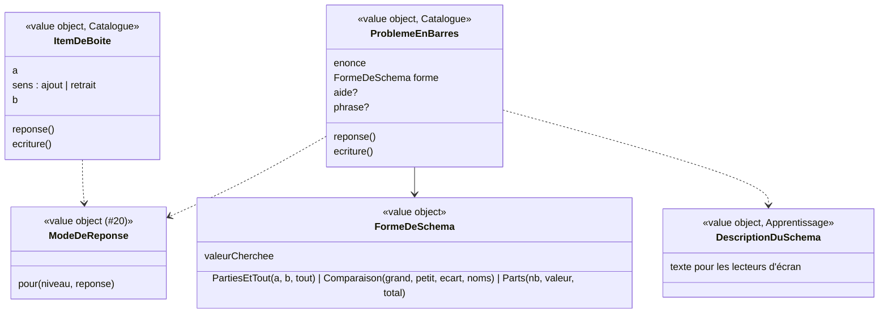

# Modèle du domaine : issue #21, Boîte, barres

## Contexte

Deux types d'exercices tirés du guide fondamental « Pour enseigner les nombres, le calcul et la résolution de problèmes au CP » :
- **boîte à jetons** : des jetons entrent (ou sortent) d'une boîte fermée ; l'enfant prévoit combien il y en a ;
- **schéma en barres** : un problème illustré par des barres, où « ? » montre la **valeur cherchée**.

Les deux utilisent le **mode de réponse** de #20 (choix au CP, clavier de cristaux sinon), la question jouée (#17), l'aide et « Je ne sais pas » (#23).

Contextes :
- **Catalogue pédagogique** : exercices `boite` et `barres` ; il valide les items (une seule valeur cherchée, retrait possible, division exacte).
- **Apprentissage** : réponse attendue, écriture du calcul, aide, mode de réponse, description du schéma.
- **Motivation** (#6) : félicitations, encouragements.

### Comportement actuel (`app/`, `RUNNERS.boite` l. 1546, `RUNNERS.barres` l. 1578)

**Boîte** (items `{a, op, b}`)
- « Je mets `<a>` jeton(s) dans la boîte. », puis « Et j'en mets encore `<b>`. » ou « Maintenant, j'en retire `<b>`. », puis « La boîte est fermée. Combien y a-t-il de jetons dedans ? Réfléchis dans ta tête, avec tes doigts, ou en dessinant. »
- Réponse `a + b` ou `a − b`. Mode : CP **et** réponse ≤ 20 → 4 choix (`r`, `r+1`, `max(0, r−1)`, `r+2`) ; sinon clavier de cristaux.
- Aide : retrait « Pars de `<a>` et recule de `<b>`. » ; ajout « Mets `<plus grand>` dans ta tête, et avance de `<plus petit>`. ».
- Juste : la boîte s'ouvre (jetons par rangées de 5), « On ouvre la boîte pour vérifier… `<r>` jeton(s) ! `<a> ± <b>` = `<r>`. `<félicitation>` ».
- Révision : un calcul simple (clé `n:`).

**Barres** (trois formes ; une valeur `null` = la valeur cherchée)

| Forme | Données | Réponse et écriture |
|---|---|---|
| Parties et tout | `parties: [a, b]`, `tout` | `tout` cherché : `a + b = r` ; `a` cherché : `tout − b = r` ; `b` cherché : `tout − a = r` |
| Comparaison | `grand`, `petit`, `ecart`, `noms` | `grand` cherché : `petit + ecart = r` ; `petit` : `grand − ecart = r` ; `ecart` : `grand − petit = r` |
| Parts | `nb`, `valeur`, `total` | `total` cherché : `nb × valeur = r` ; `valeur` : `total = nb × r` ; `nb` : `total = r × valeur` |

- Barres proportionnelles aux nombres ; « ? » à la place de la valeur cherchée ; parts avec `nb` cherché : 2 parts, « … », et « Combien de parts de `<valeur>` ? ».
- L'énoncé est lu, puis « Regarde le schéma : le point d'interrogation, c'est ce qu'on cherche. ».
- Mode : comme la boîte. Aide : `aide` de l'item, sinon « Regarde le schéma : cherches-tu le tout, ou une partie ? » (pour les trois formes). Juste : « ? » remplacé, « `<félicitation>` `<écriture>`. `<phrase>` » (`{r}` remplacé par la réponse).
- Révision : l'item reste un schéma en barres (clé `p:` + énoncé).

### Ce que montre la bibliothèque

2 exercices `boite` (aucun retrait plus grand que le contenu), 5 exercices `barres` : `aide` sur 8 items, `phrase` sur 1 item ; ces deux champs manquent à `docs/format-lecons.md`.

## Termes

| Terme | Statut | Remarque |
|---|---|---|
| Boîte à jetons | **nouveau** (validé), nommé dans le format | Exercice `boite`. |
| Jeton | **nouveau** (validé) | Objet compté qui entre ou sort de la boîte. |
| Schéma en barres | **nouveau** (validé), nommé dans le format | Exercice `barres` : problème représenté par des barres proportionnelles. |
| Énoncé | **conflit tranché** (décision n°6) | « énoncé » est un **synonyme interdit de Consigne** au glossaire, mais le format a `barres.items[].enonce`. **Énoncé du problème** = texte d'un problème en barres ; « énoncé » seul reste interdit pour la consigne. |
| Valeur cherchée | **nouveau** (validé) | La valeur `null` d'un schéma en barres, montrée par « ? ». |
| Parties et tout, comparaison, parts | **nouveaux** (validés), termes du guide fondamental | Les trois formes d'un schéma en barres. |
| Écriture du calcul | **nouveau** (validé) | Égalité montrée après la bonne réponse (`4 + 2 = 6`, `12 = 3 × 4`). |
| Phrase réponse | **nouveau** (validé) | Phrase facultative d'un item de barres (`phrase`), avec `{r}` remplacé par la réponse (« J'ai 6 pommes. »). |

## Modèle



### Catalogue : validation à la lecture

| Item | Règles de `lireLecon` |
|---|---|
| `ItemDeBoite` | `a`, `b` entiers ≥ 0 ; `op` `+` ou `-` (défaut `+`) ; retrait : `b ≤ a`, sinon `ExerciceMalForme`. |
| `ProblemeEnBarres` | `enonce` non vide ; forme reconnue ; **exactement une** valeur `null` ; nombres entiers ≥ 0 ; parties et tout, comparaison : la valeur cherchée calculée est positive ou nulle (`tout ≥` la partie connue, `grand ≥ petit`, `grand ≥ ecart`) ; parts : division **exacte** (`total` divisible par `nb` ou par `valeur`) ; `aide?`, `phrase?` (décision n°2). |

La **réponse** et l'**écriture du calcul** sont calculées par le Catalogue au moment de la lecture (règles du tableau) : elles font partie de l'item publié et valident ses nombres. Apprentissage ne lit jamais les `null`.

### Apprentissage : règles

- Une question par item. Réponse `Nombre(n)`. Correction : `n` égal à la réponse de l'item.
- `ModeDeReponse.pour(niveau, reponse)` (#20, complété) : CP **et** réponse ≤ 20 → choix `r`, `r+1`, `max(0, r−1)`, `r+2` ; sinon clavier de cristaux (décision n°3).
- Aide (#23) :
  - boîte : retrait « Pars de `<a>` et recule de `<b>`. » ; ajout « Mets `<plus grand>` dans ta tête, et avance de `<plus petit>`. » ;
  - barres : `aide` de l'item, sinon l'aide par défaut **de la forme** (décision n°1).
- Explication après la bonne réponse :
  - boîte : « On ouvre la boîte pour vérifier… `<r>` jeton(s) ! `<écriture>`. » ;
  - barres : « `<écriture>`. `<phrase réponse>` ».
- Déroulé de la boîte : les faits « `a` jetons entrent », « `b` jetons entrent / sortent », « la boîte est fermée », « la boîte s'ouvre » ; les animations (et leur durée réduite avec `prefers-reduced-motion`) sont l'affaire du front.
- `DescriptionDuSchema` : texte du schéma pour les lecteurs d'écran, par forme (décision n°7). La boîte est décrite par ses phrases, déjà lues.
- Clés de révision : `n:` (boîte, comme un calcul), `p:` (barres), comme le legacy (décision n°4 : au lot 4, la boîte sera rejouée en révision, à confirmer avec ce lot).

### Erreurs métier

`ExerciceMalForme` (Catalogue : retrait impossible, aucune ou plusieurs valeurs cherchées, division non exacte, forme inconnue).

## Invariants

1. Un item de boîte n'a jamais un résultat négatif : on ne retire pas plus de jetons qu'il n'y en a.
2. Un schéma en barres a **exactement une** valeur cherchée, et sa réponse est un entier positif ou nul (division exacte pour les parts).
3. La réponse attendue et l'écriture du calcul sont toujours cohérentes avec les nombres du schéma.
4. Au CP, une réponse de 20 au plus se donne par choix ; sinon au clavier de cristaux.
5. Le schéma a toujours une description en texte (lecteurs d'écran).

## Événements

Aucun.

## Partage avec le front

Tout tourne dans le navigateur : réponse, écriture, aide, mode de réponse, description du schéma (`@domain/catalogue` et `@domain/apprentissage`). Le front dessine la boîte, les jetons (rangées de 5) et les barres proportionnelles, et coupe les animations avec `prefers-reduced-motion`.

## Données d'enfants

Aucune donnée nouvelle.

## Emplacement

```
supabase/functions/_shared/catalogue/domain/exercices/
  boite.ts                      # ItemDeBoite, réponse, écriture
  barres.ts                     # ProblemeEnBarres, FormeDeSchema, réponse, écriture
supabase/functions/_shared/apprentissage/domain/
  mode-de-reponse.ts            # (#20) complété : seuil « CP et 20 au plus »
  description-du-schema.ts
  exercices/
    boite.ts  barres.ts          # déroulé, aides, explications
src/seance/exercices/           # boîte et jetons, schéma en barres
```

## Décisions du PO

Validation n°1 du lot 3 par le PO, le 2026-10-23 : « OK pour tout » (`docs/stories/lot-3-decisions.md` ; décisions `docs/decisions/0012-lecture-des-lecons-dans-le-domaine-catalogue.md` et `docs/decisions/0013-ecritures-d-apprentissage-par-edge-function.md`). Chaque question reçoit pour réponse sa proposition. Le numéro unique du lot (`Q…`, voir `docs/stories/16/acceptance.md`) suit le numéro de la story.

1. (Q49) **Aide par défaut d'une comparaison et de parts** : quels textes ? **Décision** : comparaison « Regarde le schéma : cherches-tu la grande barre, la petite, ou l'écart entre les deux ? » ; parts « Regarde le schéma : cherches-tu le total, la valeur d'une part, ou le nombre de parts ? » ; parties et tout : inchangée.
2. (Q50) **`aide` et `phrase` des items de barres** : à ajouter au format des leçons ? **Décision** : oui, toutes deux facultatives (la bibliothèque les utilise déjà).
3. (Q51) **Seuil « CP et 20 au plus »** pour les choix : gardé ? **Décision** : oui.
4. (Q52) **Boîte en révision** (lot 4) : rejouer la boîte, ou garder le calcul simple d'aujourd'hui ? **Décision** : rejouer la boîte, plus fidèle au guide fondamental ; à confirmer au lot 4.
5. (Q53) **Glossaire** : « boîte à jetons », « schéma en barres », « jeton » sont-ils des termes du domaine ? **Décision** : oui (ils sont nommés dans le format et dans le guide fondamental), avec « valeur cherchée ».
6. (Q54) **« Énoncé »** : on garde **Énoncé du problème** pour le texte d'un schéma en barres (champ `enonce`), et « énoncé » seul reste interdit pour la consigne ? **Décision** : oui.
7. (Q55) **Description du schéma pour les lecteurs d'écran** : textes « Le tout : ?. Une partie : 4. L'autre partie : 2. » ; « `<nom 1>` : ?. `<nom 2>` : 5. L'écart : 3. » ; « Le total : 12. 3 parts. Chaque part : ? ». **Décision** : oui.

## Questions ouvertes

Aucune.
