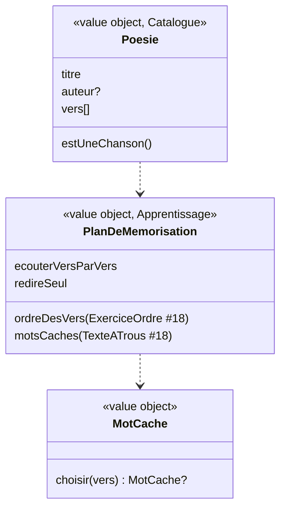

# Modèle du domaine : issue #22, Mémoriser une poésie

## Contexte

L'exercice `memoriser` enchaîne trois moments :
1. **écouter** la poésie vers par vers (voix de synthèse ; l'enregistrement audio arrive au lot 6) ;
2. **redire** seul (« Je suis prêt ») ;
3. **s'entraîner** : remettre les vers dans l'ordre (mécanique `ordre` de #18), puis retrouver les **mots cachés** (mécanique `trous` de #18).

Il ne crée pas de nouvelle mécanique de réponse : il **compose** celles de #18. Il dépend donc de #18 (et, par lui, de #16, #17 et #23).

Contextes :
- **Catalogue pédagogique** : exercice `memoriser` (`titre`, `auteur?`, `vers[]`).
- **Apprentissage** : plan de l'exercice, chanson ou poésie, choix du mot caché de chaque vers, questions et correction.
- **Voix** (#7) : lecture vers par vers (vitesse 0,85), mot surligné.
- **Motivation** (#6) : paroles et humeur.
- **Accompagnement** (lot 6) : audio des poésies ajouté par un parent, enregistrements de lecture. Hors de cette story.

### Comportement actuel (`app/`, `RUNNERS.memoriser` l. 1444)

- Carte « `<titre>` — `<auteur>` » et un vers par ligne.
- **Chanson** si « chanson » ou « comptine » figure dans l'auteur ou le titre (ou `genre: "air"` de l'audio, lot 6) : « chante » au lieu de « redis » / « récite ».
- Sans enregistrement : « Écoute bien, je te le dis vers par vers. Ensuite, tu le redis avec moi ! », puis chaque vers mis en avant et lu (0,85), 250 ms entre deux vers.
- Puis : « À toi ! `<Redis | Chante>` tout le texte, tranquillement. Tu peux t'enregistrer pour te réécouter. Quand c'est bon, on joue ! », bouton d'enregistrement (lot 6), bouton « Je suis prêt ».
- **Ordre des vers** : exercice `ordre` avec la consigne « Remets les vers dans l'ordre. » (+ « Touche d'abord celle qui vient en premier. »). Comparaison **par position** (#18).
- **Mots cachés** : dans chaque vers, le mot le plus long d'au moins 3 caractères (lettres, accents, apostrophes, tirets), sa première occurrence ; vers joints par « / » ; exercice `trous` sans distracteurs (« Des mots se sont envolés ! Retrouve-les. »). Un vers sans mot de 3 lettres n'a pas de trou et compte réussi.
- Avancement : 2 questions par vers.

### Défaut trouvé à la lecture du code (absent de l'issue)

L'issue dit que les erreurs de mots cachés sont notées pour les révisions. **Ce n'est pas le cas** : `RUNNERS.trous` appelle `questionsFrom(ex)` sur un exercice construit **sans `type`** ; `questionsFrom` ne renvoie rien, et `remember` n'est jamais appelé. Aucune erreur de `memoriser` n'est notée pour les révisions aujourd'hui (question ouverte n°5).

### Autres constats

- Le mot caché peut inclure l'article élidé : dans « Pour l'amour de Dieu. », le mot caché est « l'amour ».
- Deux vers qui cachent le même mot (refrain) : le mot n'est proposé qu'une fois parmi les choix des autres trous, et un poème de 1 ou 2 vers n'a qu'un ou deux choix.
- Bibliothèque : 8 poésies et chansons, de 4 à 8 vers, sans vers répétés.

## Termes

| Terme | Statut | Remarque |
|---|---|---|
| Vers | **nouveau**, terme du format (`vers`) | Ligne d'une poésie ou d'une chanson. |
| Poésie | **nouveau** (à valider) | Texte en vers à apprendre par cœur (`memoriser`). L'interface dit aussi « poème ». |
| Chanson | **nouveau** (à valider) | Poésie à chanter (chanson, comptine) : le personnage guide dit « chante » au lieu de « redis » ou « récite ». |
| Mot caché | **nouveau** (à valider) | Mot d'un vers remplacé par un trou pendant l'entraînement. |
| Apprendre par cœur | libellé du type (`TYPES`) | Interface. |
| Auteur | terme du format (`auteur`) | |

## Modèle



### Catalogue : validation à la lecture

`Poesie` : `titre` non vide, vers non vides (au moins un ; au moins deux : question ouverte n°4), `auteur?`. Détection de la chanson (`estUneChanson`) : « chanson » ou « comptine » dans le titre ou l'auteur, sans tenir compte des majuscules.

### Apprentissage : règles

- `PlanDeMemorisation.de(poesie)` construit, au début de la séance :
  - l'**ordre des vers** : un `ExerciceOrdre` (#18) dont les éléments sont les vers ;
  - les **mots cachés** : un `TexteATrous` (#18) dont chaque vers devient un segment, avec un trou à la place de son mot caché, vers joints par « / ».
- `MotCache.choisir(vers)` : le mot le plus long d'au moins 3 caractères (lettres, accents, apostrophes, tirets), le premier en cas d'égalité ; sa première occurrence. Aucun → pas de mot caché (question ouverte n°6).
- Questions : une par vers pour l'ordre, une par vers pour les mots cachés ; un vers sans mot caché est **réussi d'office**. Avancement : 2 par vers.
- Choix d'un mot caché : le mot + les autres mots cachés (pas de distracteurs), avec la règle de #18 (question ouverte n°4 pour les poésies courtes).
- Ordre des vers : comparaison par **texte** si #18 la retient (vers répétés interchangeables, question ouverte n°1).
- Paroles (Motivation, avec « redis / chante » selon `estUneChanson`) : introduction, « À toi ! … », consignes de l'ordre et des mots cachés (textes du legacy, question ouverte n°3).
- Les questions des deux entraînements suivent les règles communes d'erreur (#23) ; la séance garde leurs questions ratées comme les autres (question ouverte n°5).

### Erreurs métier

`ExerciceMalForme` (Catalogue : aucun vers, vers vide).

## Invariants

1. Les vers sont lus dans l'ordre, chacun mis en avant et lu avec le mot surligné, avant l'entraînement.
2. L'entraînement commence seulement quand l'enfant dit « Je suis prêt ».
3. Chaque vers compte deux questions ; un vers sans mot caché ne bloque jamais la fin.
4. Un vers a au plus un mot caché, toujours le même pour une poésie donnée (le choix ne dépend pas du hasard).
5. Une chanson dit « chante » partout où une poésie dit « redis » ou « récite ».

## Événements

Aucun.

## Partage avec le front

Tout tourne dans le navigateur : détection de la chanson, plan, mots cachés, correction (`@domain/catalogue`, `@domain/apprentissage`). Le front lit les vers par le port `LecteurAVoixHaute`, met en avant le vers lu, et gère les pauses (250 ms).

## Données d'enfants

Aucune donnée nouvelle. L'enregistrement de la voix de l'enfant (« Je récite et je m'enregistre ») est hors de cette story (lot 6, expiration à 30 jours).

## Emplacement

```
supabase/functions/_shared/catalogue/domain/exercices/
  poesie.ts                     # Poesie, estUneChanson
supabase/functions/_shared/apprentissage/domain/
  mot-cache.ts
  plan-de-memorisation.ts       # compose ExerciceOrdre et TexteATrous (#18)
  exercices/
    memoriser.ts
src/seance/exercices/           # carte de la poésie, vers mis en avant
```

## Questions ouvertes

1. **Vers répétés** : interchangeables à l'étape d'ordre ? **Proposition** : oui (même règle que #18, question n°1 : on compare le texte).
2. **Sans enregistrement** : ajouter les étapes « redire vers par vers » et « texte masqué » qui n'existent qu'avec l'audio ? **Proposition** : non au lot 3 (parité avec le legacy) ; à reprendre avec l'audio des poésies (lot 6).
3. **« Ensuite, tu le redis avec moi ! »** : corriger en « Ensuite, à toi de le redire ! » (« chanter » pour une chanson) ? **Proposition** : oui.
4. **Mots cachés d'une poésie courte** : compléter les choix avec d'autres mots de la poésie (non cachés) pour avoir toujours trois choix ? Et le Catalogue refuse-t-il une poésie de moins de deux vers (l'ordre des vers n'y vérifie rien) ? **Proposition** : oui pour les deux.
5. **Erreurs de mémorisation et révisions** : aujourd'hui **aucune** n'est notée (défaut trouvé ci-dessus). La séance les garde comme toutes les questions ratées, et le lot 4 décide ? **Proposition** : oui.
6. **Choix du mot caché** : garder « le plus long d'au moins 3 lettres », mais sans l'article élidé (« amour » plutôt que « l'amour ») ? **Proposition** : oui ; le format pourra plus tard marquer le mot caché.
7. **Glossaire** : « vers », « mot caché », « poésie », « chanson » sont-ils des termes du domaine ? **Proposition** : oui (à valider) ; « poème » est un mot d'interface pour **poésie**.
