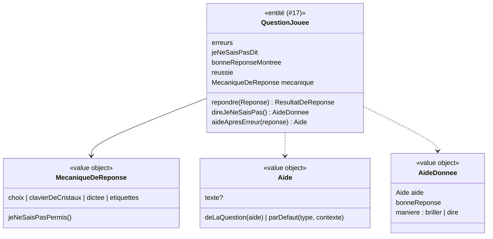

# Modèle du domaine : issue #23, Aide et « Je ne sais pas »

## Contexte

Story **porteuse des règles communes de l'erreur** : nouvelle chance, aide, « Je ne sais pas » et compte des erreurs d'une question. Elle complète l'entité `QuestionJouee` posée par #17. Les stories #18 à #22 donnent leurs textes d'aide propres ; elles ne changent pas ces règles.

Contextes :
- **Apprentissage** : la question jouée, la réponse « Je ne sais pas », le compte des erreurs, le choix de l'aide à dire.
- **Catalogue pédagogique** : le champ `aide` des questions et des items (`docs/format-lecons.md`).
- **Motivation** (#6) : l'encouragement (liste `OOPS`) et l'humeur « réfléchit ». La phrase « Pas de souci, on apprend ensemble ! » est une parole du personnage guide.

Principe de `CLAUDE.md` : un retour d'erreur n'est jamais punitif. Un encouragement, puis une nouvelle chance.

### Comportement actuel (`app/`, `choose` l. 869, `keypad` l. 907, `RUNNERS`)

- **Nouvelle chance illimitée** : l'enfant avance seulement avec la bonne réponse.
- Après une erreur : encouragement (Motivation), puis l'**aide** de la question, humeur « réfléchit ».
- **« Je ne sais pas »**, une fois par question (le bouton disparaît) :
  - **avec les choix** : les autres choix disparaissent, la bonne brille. « Pas de souci, on apprend ensemble ! `<aide>` La bonne réponse brille : touche-la. » L'enfant doit la toucher ;
  - **avec le clavier de cristaux** : « Pas de souci ! `<aide>` La réponse est `<r>`. Tape-la sur les cristaux. » L'enfant doit la taper ;
  - il **compte une erreur** et note la question pour les révisions, comme une réponse fausse.
- Présent avec les choix (bulles, lecture, écoute, trous, conjugaison ; au CP, calcul, boîte, barres, addition à l'étape calculer) et avec le clavier de cristaux (à partir du CE1 : calcul, boîte, barres, addition à l'étape calculer).
- **Absent** : dictée, classer, ordre, addition à l'étape poser, fluence, ordre des vers.

### Aide lue après une erreur (relevé complet du legacy)

| Type | Aide après erreur | Aide avec « Je ne sais pas » |
|---|---|---|
| `bulles` | `aide`, sinon « Essaie une autre bulle. » | `aide` (sinon rien) |
| `lecture` | « Essaie une autre bulle. » | rien |
| `ecoute` | « Écoute encore. » (puis le mot redit) | `aide` de l'item (hors format) |
| `trous` | « Relis la phrase en entier : quel mot va bien ? » | rien |
| `conjugaison` | « Avec « `<pronom>` », quelle forme va ? » | rien |
| `classer` | `aide` de l'item (hors format), sinon « « `<étiquette>` » n'habite pas dans la maison « `<maison>` ». Essaie une autre maison. » | (pas de « Je ne sais pas ») |
| `ordre` | « Ce n'est pas le début. Lequel vient en premier ? », puis « Pas encore celui-là. Lequel vient juste après ? » | (absent) |
| `dictee` | « Regarde les lettres en rouge et écoute encore. » | (absent) |
| `calcul` | `aide`, sinon l'astuce de l'opération (#20) | idem |
| `addition` (calculer) | retenue oubliée, sinon « Compte doucement : `<expression>`. » | « N'oublie pas la retenue, tout en haut. » ou « Additionne les chiffres de cette maison. » |
| `addition` (poser) | nom du rang et couleur de la colonne (#20) | (absent) |
| `boite` | « Pars de `<a>` et recule de `<b>`. » ou « Mets `<plus grand>` dans ta tête, et avance de `<plus petit>`. » | idem |
| `barres` | `aide` de l'item (hors format), sinon « Regarde le schéma : cherches-tu le tout, ou une partie ? » | idem |

## Termes

| Terme | Statut | Remarque |
|---|---|---|
| Réponse | au glossaire (validé) | « Je ne sais pas » en est une (déjà écrit). |
| Erreur | au glossaire (validé) | Compte exact par question (décisions n°1 à n°3) : une erreur par réponse fausse ; « Je ne sais pas » en coûte une seulement si la question n'en a pas encore coûté ; plus aucune après la bonne réponse montrée. |
| Aide | **nouveau** (validé), terme du format (`aide`) | Texte lu par le personnage guide après une erreur ou après « Je ne sais pas » : l'`aide` de la question si elle existe, sinon l'aide par défaut du type d'exercice. |
| Aide par défaut | **nouveau** (validé) | Aide propre à un type d'exercice, utilisée quand la question n'a pas d'`aide` (tableau ci-dessus). Ex. : l'astuce de l'opération en calcul. |
| Je ne sais pas | **nouveau** (validé) | Réponse permise, une fois par question : la bonne réponse est montrée, et l'enfant la donne lui-même. |
| Nouvelle chance | **nouveau** (validé) | Après une erreur, la même question reste posée, sans limite d'essais. |
| Bonne réponse montrée | **nouveau** (validé) | État d'une question après « Je ne sais pas » : la bonne réponse est montrée (le choix brille, ou le nombre est dit). Interface : « la bonne réponse brille ». |
| Encouragement | au glossaire (Motivation) | Inchangé. |

## Modèle



### Règles de `QuestionJouee` (complètent #17)

- `direJeNeSaisPas()` :
  - refusé seulement pour la fluence (`JeNeSaisPasIndisponible`) : « Je ne sais pas » est permis **partout ailleurs**, y compris dictée, classer, ordre et addition à l'étape poser (décision n°4 ; absent du legacy pour ces mécaniques) ;
  - refusé une seconde fois (`JeNeSaisPasDejaDit`) ;
  - refusé sur une question réussie (`QuestionDejaReussie`) ;
  - sinon : la question passe à **bonne réponse montrée**. Avec les choix, il ne reste que la bonne. Avec le clavier, la réponse est donnée à l'enfant. Classer et poser : la bonne maison brille. Ordre : l'étiquette suivante brille. Dictée : la lettre juste suivante s'écrit dans sa case, le mot n'est jamais montré en entier (décision n°4). La question reste ouverte : l'enfant donne lui-même la bonne réponse pour la réussir.
  - Compte : **une erreur** si la question n'en a pas encore coûté ; **rien de plus** si elle en a déjà coûté au moins une (décisions n°1 et n°2 ; le legacy en ajoutait toujours une).
- `repondre` après « Je ne sais pas » : plus aucune erreur n'est comptée sur une question dont la bonne réponse a été montrée, faute de frappe comprise (décision n°3 ; le legacy la comptait).
- `aideApresErreur(reponse)` : l'`aide` de la question si elle existe, sinon l'aide par défaut du type, qui peut dépendre de la réponse donnée (retenue oubliée, #20) ou de la cible touchée (maison de classer, #18). Une aide vide n'est pas lue.

### Value objects

| Value object | Règle |
|---|---|
| `Aide` | Texte non vide, ou aucune aide. `deLaQuestion` passe avant `parDefaut`. |
| `AideDonnee` | Ce que le front montre et fait dire après « Je ne sais pas » : l'aide (peut être vide), la bonne réponse et la manière (la faire briller, ou la dire). |
| `MecaniqueDeReponse` | `choix`, `clavierDeCristaux`, `dictee` et `etiquettes` permettent tous « Je ne sais pas » (décision n°4). La fluence n'a pas de questions au sens de cette règle (#20). |

### Paroles du personnage guide (Motivation)

| Fait | Parole (legacy) |
|---|---|
| Erreur | `<encouragement>` (`OOPS`, #6), puis l'aide (Apprentissage), humeur « réfléchit ». |
| « Je ne sais pas » avec les choix | « Pas de souci, on apprend ensemble ! `<aide>` La bonne réponse brille : touche-la. » |
| « Je ne sais pas » au clavier | « Pas de souci ! `<aide>` La réponse est `<r>`. Tape-la sur les cristaux. » |

Ces deux phrases entrent dans les paroles de Motivation ; l'aide et la bonne réponse viennent d'Apprentissage.

### Erreurs métier

`JeNeSaisPasIndisponible`, `JeNeSaisPasDejaDit`, `QuestionDejaReussie`.

## Invariants

1. Une erreur ne termine jamais une question : l'enfant a toujours une **nouvelle chance**, sans limite d'essais.
2. Une question ne se réussit qu'avec **la bonne réponse donnée par l'enfant**, même après « Je ne sais pas ».
3. « Je ne sais pas » se dit **au plus une fois** par question, et seulement là où la mécanique le permet.
4. Après « Je ne sais pas », la bonne réponse est montrée : avec les choix, il ne reste qu'elle ; au clavier, elle est dite.
5. L'aide de la question passe toujours avant l'aide par défaut. Une question sans aide ni aide par défaut ne lit rien après l'encouragement.
6. Le nombre d'erreurs d'une question ne diminue jamais. Sa règle exacte (décisions n°1 à n°3) est **la même pour tous les types**, et c'est elle que #24 utilise pour les étoiles.
7. Une question qui a coûté au moins une erreur (ou « Je ne sais pas ») est gardée par la séance comme **question ratée** (révisions, lot 4).

## Événements

Aucun. Les erreurs et « Je ne sais pas » restent dans la séance ; `SeanceTerminee` (#24) en porte le résumé.

## Partage avec le front

Tout tourne dans le navigateur (`@domain/apprentissage`) : compte des erreurs, « Je ne sais pas », choix de l'aide, bonne réponse montrée. React affiche le bouton « Je ne sais pas » seulement si `jeNeSaisPasPermis()` et s'il n'a pas déjà été dit. La bonne réponse montrée est aussi annoncée en texte aux lecteurs d'écran (pas seulement par la couleur ou l'animation).

## Données d'enfants

Aucune donnée nouvelle. « Je ne sais pas » est gardé dans le résumé de la séance (#24).

## Emplacement

```
supabase/functions/_shared/apprentissage/domain/
  question-jouee.ts             # (#17) complétée : direJeNeSaisPas, aideApresErreur, compte des erreurs
  aide.ts                       # Aide, AideDonnee, aide par défaut de chaque type (textes de #17 à #22)
  mecanique-de-reponse.ts
supabase/functions/_shared/motivation/domain/
  paroles.ts                    # (#6) complétées : « Pas de souci, on apprend ensemble ! … », « Pas de souci ! … »
src/seance/                     # bouton « Je ne sais pas » (pointillés, 44 px), bonne réponse qui brille
```

## Décisions du PO

Validation n°1 du lot 3 par le PO, le 2026-10-23 : « OK pour tout » (`docs/stories/lot-3-decisions.md` ; décisions `docs/decisions/0012-lecture-des-lecons-dans-le-domaine-catalogue.md` et `docs/decisions/0013-ecritures-d-apprentissage-par-edge-function.md`). Chaque question reçoit pour réponse sa proposition. Le numéro unique du lot (`Q…`, voir `docs/stories/16/acceptance.md`) suit le numéro de la story.

1. (Q63) **« Je ne sais pas » compte-t-il une erreur pour les étoiles ?** **Décision** : oui, une erreur, comme aujourd'hui ; les seuils des étoiles (#24) sont calibrés ainsi, et « permis » veut dire « sans reproche », pas « sans effet ».
2. (Q64) **Une question peut-elle coûter plusieurs erreurs ?** **Décision** : oui, une par réponse fausse (comme aujourd'hui), **mais** « Je ne sais pas » n'ajoute rien si la question a déjà coûté au moins une erreur (correction du défaut « troisième erreur après deux mauvaises bulles »).
3. (Q65) **Après « Je ne sais pas » au clavier, une faute de frappe compte-t-elle ?** **Décision** : non ; plus aucune erreur n'est comptée sur une question dont la bonne réponse a été montrée.
4. (Q66) **Une sortie pour l'enfant bloqué en dictée, classer, ordre et addition posée ?** **Décision** : oui, « Je ne sais pas » partout sur le même modèle (la bonne réponse est montrée, l'enfant la donne) : classer et poser, la bonne maison brille ; ordre, l'étiquette suivante brille ; dictée, la lettre juste suivante s'écrit dans sa case (le mot n'est jamais montré en entier).
5. (Q67) **`aide` sur les items de `classer`, `barres` et `ecoute`** : à ajouter au format des leçons (`docs/format-lecons.md`) ? **Décision** : oui, facultative ; la bibliothèque en utilise déjà 8 dans `barres`. Le pipeline, le format et le domaine changent dans la même story (règle du contrat).
6. (Q68) **Glossaire** : « Aide », « Je ne sais pas », « Nouvelle chance » sont-ils des termes du domaine ? **Décision** : oui, tous les trois, plus « Aide par défaut » et « Bonne réponse montrée ».

## Questions ouvertes

Aucune.
