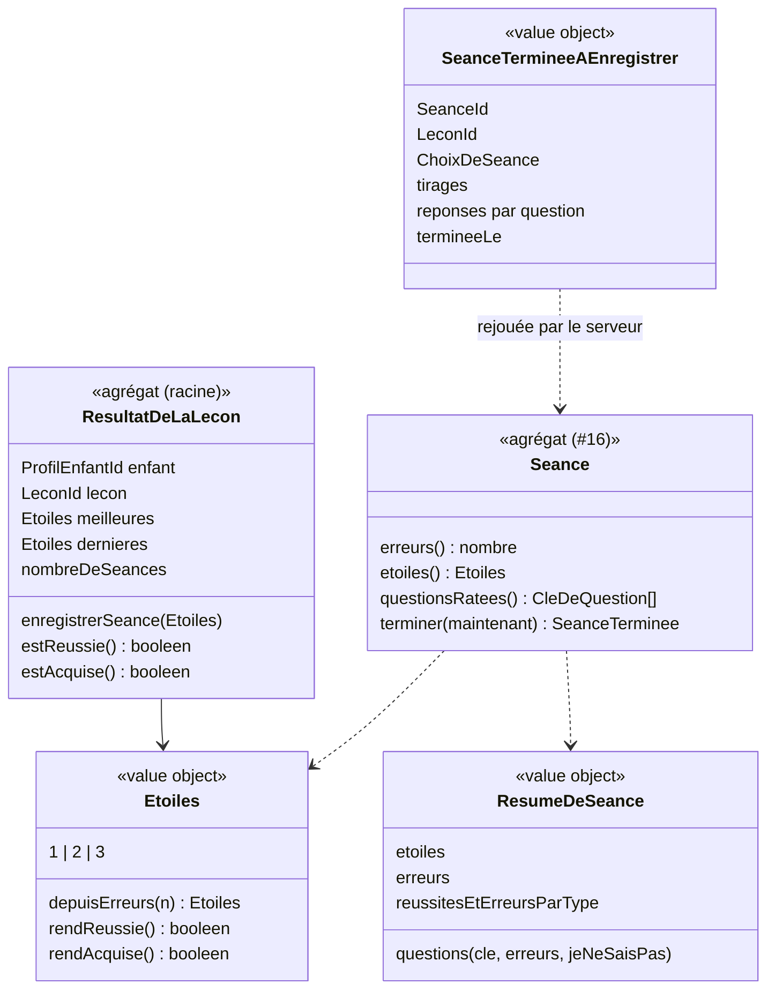

# Modèle du domaine : issue #24, Étoiles et écran de fin

## Contexte

Story **porteuse de la fin de séance** pour tout le lot 3 : calcul des étoiles, séance terminée, résultat de la leçon (meilleures étoiles, leçon réussie, leçon acquise), enregistrement en base et événements vers Motivation et Accompagnement. C'est la **première story d'Apprentissage qui écrit en base**.

Contextes :
- **Apprentissage** : `Seance` (#16) se termine ; nouvel agrégat `ResultatDeLaLecon` ; cas d'usage `TerminerLaSeance` (Edge Function).
- **Catalogue pédagogique** : la leçon, relue par le serveur pour revalider la séance ; `ordre` pour la leçon suivante (question ouverte n°5).
- **Motivation** : phrase de fin du personnage guide (expression du personnage guide pour 3 étoiles, #6). Au lot 5, Motivation écoute `SeanceTerminee` et `LeconAcquise` et remplit la zone « nouveautés » (épisode, cabane, badge). Elle ne modifie jamais une étoile.
- **Accompagnement** (lot 6) : écoute `SeanceTerminee` pour le suivi.
- **Famille** : prénom du profil en cours (phrase de fin), rattachement du parent (accès), contrat de données personnelles (#14).

### Comportement actuel (`app/`, `playLesson` l. 1894 à 1953)

- **Étoiles** : 3 sans erreur, 2 avec 1 à 3 erreurs, 1 au-delà. Erreurs comptées sur **toute** la séance. Une séance terminée gagne toujours au moins 1 étoile. Une séance d'un seul exercice donne aussi les étoiles de la leçon.
- **Enregistrement** (`progres_<enfant>_<leçon>`), hors séances spéciales : `etoiles` = meilleur nombre (les étoiles du test de départ ne comptent pas), `dernieresEtoiles`, `erreurs`, `essais` (+1), `parType` (réussites et erreurs par type), `maj`. Plus : erreurs notées pour les révisions, un jour de séance de plus (série, épisodes).
- Les sauvegardes partent en arrière-plan ; l'écran de fin s'affiche tout de suite. Un échec est ignoré ici.
- **Écran de fin** : trois étoiles (allumées selon le résultat) ; « `<expression du personnage guide>` Trois étoiles, `<prénom>` ! Tu es incroyable ! » ou « `<félicitation>` Tu gagnes `<n>` étoile(s), `<prénom>`. Tu rejoues pour aller chercher les autres ? » ; boutons « Leçon suivante › » (avec « Ensuite : `<titre>` »), « Accueil » (focus), « Rejouer » (même choix, nouveaux tirages).

## Termes

| Terme | Statut | Remarque |
|---|---|---|
| Étoile | au glossaire (confirmé) | Règle inchangée (question ouverte n°2). |
| Leçon réussie, Leçon acquise | au glossaire (confirmés) | Calculées par `ResultatDeLaLecon`. |
| Séance terminée | **nouveau** (à valider) | Séance dont toutes les questions sont réussies. Elle donne des étoiles et devient un fait enregistré (`SeanceTerminee`). |
| Résultat de la leçon | **nouveau** (à valider) | Pour un enfant et une leçon : le meilleur nombre d'étoiles, les dernières étoiles et le nombre de séances terminées. Dit si la leçon est réussie ou acquise. |
| Meilleures étoiles | **nouveau** (à valider) | Le plus grand nombre d'étoiles gagné sur une leçon. Il ne baisse jamais. Le glossaire disait « meilleur score » : « score » est un synonyme interdit d'Étoile. |
| Écran de fin | terme d'interface (question ouverte n°7) | Le domaine dit **séance terminée**. |
| Essai | **conflit** (question ouverte n°7) | Le champ legacy `essais` compte les séances terminées d'une leçon. « Essai » est un synonyme interdit de **Réponse**, et « essai de voix » existe déjà. Proposition : **nombre de séances**. |
| Progression | terme d'interface (glossaire, décision n°21) | Ne nomme donc pas l'agrégat : on dit **Résultat de la leçon**. |
| Jour de séance | **nouveau** (à valider), utilisé au lot 5 | Jour où l'enfant a terminé au moins une séance. Déduit des séances terminées ; pas de nouvelle donnée. |

## Modèle



### Calcul des étoiles (dans `Seance`)

- `erreurs()` : somme des erreurs de toutes les questions jouées, selon la règle unique de #23.
- `etoiles()` = `Etoiles.depuisErreurs(erreurs())` : 0 → 3, 1 à 3 → 2, 4 et plus → 1.
- `terminer(maintenant)` : refusé si une question n'est pas réussie (`SeanceNonFinie`) ou si la séance est déjà terminée (`SeanceDejaTerminee`). Produit `SeanceTerminee`.
- Une séance d'un exercice donne les étoiles de la leçon, comme une séance complète (question ouverte n°1 ; exception de la fluence seule : #20).

### Agrégat `ResultatDeLaLecon`

- **Racine** : `ResultatDeLaLecon`, identifié par le couple (`ProfilEnfantId`, `LeconId`).
- **Contient** : meilleures étoiles, dernières étoiles, nombre de séances terminées.
- **Pourquoi un agrégat à part** : son invariant (« les meilleures étoiles ne baissent jamais ») porte sur **toutes** les séances d'une leçon, pas sur une seule. La `Seance` ne connaît pas les séances précédentes.
- `enregistrerSeance(etoiles)` : dernières = etoiles ; meilleures = max(meilleures, etoiles) ; nombre de séances + 1. Émet `LeconReussie` la **première** fois que les meilleures étoiles atteignent 1, et `LeconAcquise` la **première** fois qu'elles atteignent 2.
- Les étoiles « venues du test de départ » (lot 4) ne sont pas dans ce lot. Le lot 4 dira si une leçon validée par le test de départ est un `ResultatDeLaLecon` à part ou un état « acquise par le test ».

### Revalidation par le serveur (décision 0003)

Le serveur reste la source de vérité. Le front envoie une `SeanceTermineeAEnregistrer` :
- identifiant de la séance (clé d'idempotence : un second envoi ne compte pas deux fois) ;
- leçon et choix de séance ;
- **tirages** (opérations générées, ordre des choix) ;
- pour chaque question, la **suite des réponses** données (et « Je ne sais pas ») ;
- date de fin.

Le cas d'usage relit la leçon dans le Catalogue (port `LeconsDuCatalogue`), **reconstitue la séance** avec les mêmes tirages, **rejoue les réponses** avec le même domaine, puis calcule les étoiles. Il refuse (`SeanceIncoherente`) : une leçon ou un exercice inconnus, un tirage hors de son générateur (#20), une question qui ne finit pas par la bonne réponse, une réponse donnée après la réussite. Il ne fait jamais confiance aux étoiles calculées par le front.

### Ce qui est enregistré (minimisation, question ouverte n°3)

Proposition : seulement le `ResumeDeSeance`. Les réponses données servent à la revalidation, puis ne sont **pas** gardées.

| Donnée | Pourquoi |
|---|---|
| séance : identifiant, profil, leçon, choix, date de fin, étoiles, nombre d'erreurs | écran de fin sur un autre appareil, série et épisodes (lot 5), suivi (lot 6) |
| par question : clé, nombre d'erreurs, « Je ne sais pas » | révisions (lot 4) |
| réussites et erreurs par type d'exercice | adaptation de la difficulté du calcul (#20), suivi |
| résultat de la leçon : meilleures étoiles, dernières, nombre de séances | parcours (lot 4), badges (lot 5) |

### Commandes et cas d'usage

| Commande | Effet | Erreurs métier | Où |
|---|---|---|---|
| `TerminerLaSeance(parent, seanceTermineeAEnregistrer)` | Vérifie le rattachement du parent au profil ; revalide et enregistre la séance terminée ; publie `SeanceTerminee`. | `ParentNonRattache`, `LeconIntrouvable`, `SeanceIncoherente`, `SeanceNonFinie` | Edge Function `terminer-la-seance`, JWT du parent |
| Politique `EnregistrerLesEtoilesDeLaLecon` | Réagit à `SeanceTerminee` : met à jour `ResultatDeLaLecon` (un agrégat par transaction). Publie `LeconReussie`, `LeconAcquise`. | | même requête, transaction séparée |
| `Rejouer` | Nouvelle séance (#16), même leçon et même choix, nouveaux tirages. | | navigateur |
| Lecture `ResultatsDeLEnfant(profil)` | Meilleures étoiles par leçon, sous RLS. | | front |

### Paroles de fin (Motivation)

| Fait | Parole (legacy) |
|---|---|
| 3 étoiles | « `<expression du personnage guide>` Trois étoiles, `<prénom>` ! Tu es incroyable ! » |
| 1 ou 2 étoiles | « `<félicitation>` Tu gagnes `<n>` étoile(s), `<prénom>`. Tu rejoues pour aller chercher les autres ? » |

Au lot 5, Motivation ajoute ses nouveautés (épisode, cabane, badge) à la suite de la phrase et dans la zone « nouveautés ».

### Ports (côté serveur, `apprentissage/application/`)

`SeancesTerminees` (enregistrer, idempotent), `ResultatsDesLecons` (lire, enregistrer), `LeconsDuCatalogue` (#16), `RattachementsDuParent` (Famille, lecture), `PublicateurDEvenements`.

### Erreurs métier

`SeanceNonFinie`, `SeanceDejaTerminee`, `SeanceIncoherente`, `ParentNonRattache` (présentée comme un profil introuvable), `LeconIntrouvable`.

## Invariants

1. Une séance ne se termine que quand **toutes** ses questions sont réussies ; une séance terminée ne change plus.
2. Étoiles d'une séance terminée : 3 sans erreur, 2 avec 1 à 3 erreurs, 1 au-delà. Toujours au moins 1.
3. Les **meilleures étoiles** d'une leçon ne baissent jamais ; les dernières étoiles, si.
4. Une leçon est **réussie** dès que ses meilleures étoiles valent au moins 1, **acquise** dès qu'elles valent au moins 2. `LeconReussie` et `LeconAcquise` ne sont publiés qu'une fois par enfant et par leçon.
5. Le serveur **recalcule** les étoiles en rejouant les réponses ; il n'accepte jamais des étoiles venues du front.
6. Une même séance envoyée deux fois n'est enregistrée qu'une fois.
7. Un parent n'enregistre et ne lit que les séances des enfants auxquels il est rattaché (domaine + RLS).
8. Motivation ne modifie jamais une étoile ; elle réagit aux événements.

## Événements

| Événement | Données | Qui réagit |
|---|---|---|
| `SeanceTerminee` (à valider) | séance, profil enfant, leçon, matière, niveau, choix de séance, étoiles, erreurs, questions ratées, réussites et erreurs par type, date de fin | Apprentissage (résultat de la leçon ; révisions au lot 4), Motivation (série, épisodes, cabane, lot 5), Accompagnement (suivi, lot 6) |
| `LeconReussie` (à valider) | profil enfant, leçon | Apprentissage (parcours et verrous, lot 4) |
| `LeconAcquise` (à valider) | profil enfant, leçon, compétence | Motivation (badge, lot 5), Accompagnement (carte des compétences, lot 6) |

## Partage avec le front

- Dans le navigateur (`@domain/apprentissage`) : `Etoiles`, `Seance.etoiles()`, `Seance.terminer()`, le résumé : l'écran de fin s'affiche **tout de suite**, sans attendre le serveur (comme aujourd'hui).
- Par une Edge Function : `TerminerLaSeance`. Écritures d'Apprentissage par Edge Function seulement, comme Famille (décision 0009) : question ouverte n°9.
- Envoi qui échoue (beta en ligne seulement) : question ouverte n°8.

## Base de données attendue (description, pas de SQL)

| Table | Contenu | Policies RLS |
|---|---|---|
| `seances_terminees` | identifiant (clé d'idempotence), profil enfant, leçon, choix, date de fin, étoiles, erreurs, réussites et erreurs par type | **lecture** : parent rattaché au profil (fonction d'aide de #11). **Écriture** : seulement par l'Edge Function, avec le JWT du parent rattaché. Pas de modification ni de suppression, sauf la cascade avec le profil. |
| `questions_des_seances` | séance, clé de question, nombre d'erreurs, « Je ne sais pas » | idem, par la séance |
| `resultats_des_lecons` | profil enfant, leçon, meilleures étoiles, dernières étoiles, nombre de séances ; couple (profil, leçon) unique | idem |

Toutes supprimées en **cascade** avec le profil, et incluses dans l'**export** (contrat de #14, décision 0009, n°4).

## Données d'enfants

Nouvelles données de l'enfant : séances terminées (leçon, date, étoiles, erreurs), erreurs par question, résultat par leçon. Elles servent à l'apprentissage et au suivi parental (minimisation). Aucune réponse brute gardée (proposition n°3), aucun texte produit par l'enfant, rien envoyé à l'IA. Hébergées dans l'UE (`eu-west-1`). À ajouter à la suppression et à l'export du profil (#14).

## Emplacement

```
supabase/functions/_shared/apprentissage/
  domain/
    etoiles.ts
    seance.ts                       # (#16) complétée : erreurs, etoiles, terminer, questionsRatees, resume
    resume-de-seance.ts
    seance-terminee-a-enregistrer.ts  # ce que le front envoie ; reconstitution et rejeu
    resultat-de-la-lecon.ts         # agrégat ResultatDeLaLecon
    evenements.ts                   # SeanceTerminee, LeconReussie, LeconAcquise
    erreurs.ts
  application/
    ports.ts                        # SeancesTerminees, ResultatsDesLecons, RattachementsDuParent, PublicateurDEvenements
    terminer-la-seance.ts
    enregistrer-les-etoiles-de-la-lecon.ts
  infrastructure/
    supabase-seances-terminees.ts
    supabase-resultats-des-lecons.ts
    donnees-personnelles-apprentissage.ts  # export du profil (#14)
  test_utils/
    seances-terminees-en-memoire.ts
    resultats-des-lecons-en-memoire.ts
supabase/functions/terminer-la-seance/index.ts
supabase/migrations/<horodatage>_apprentissage_seances.sql
supabase/functions/_shared/motivation/domain/paroles-de-seance.ts   # phrases de fin
src/seance/fin-de-seance/          # trois étoiles, « 2 étoiles sur 3 » en texte, boutons
```

## Questions ouvertes

1. **Une séance d'un seul exercice donne-t-elle les étoiles de la leçon ?** **Proposition** : oui, comme aujourd'hui, **sauf** une séance faite seulement d'une fluence, qui ne donne pas d'étoiles (elle garde le record) : sinon une fluence suffit pour une leçon acquise (lié à #20, question n°2).
2. **Seuils des étoiles** : gardés (0 / 1 à 3 / 4 et plus), ou proportionnels au nombre de questions ? **Proposition** : gardés pour la beta (règle du glossaire, comportement connu des familles) ; à revoir avec les données du suivi.
3. **Que garde-t-on d'une séance ?** **Proposition** : le résumé seulement (étoiles, erreurs, par question : clé, erreurs, « Je ne sais pas » ; réussites et erreurs par type). Les réponses données sont envoyées pour la revalidation, puis oubliées.
4. **Séance abandonnée** : rien n'est enregistré ? **Proposition** : oui (comme #16, question n°2).
5. **« Leçon suivante » au lot 3, sans parcours** : la leçon d'`ordre` suivant, même matière et même niveau, et pas de bouton après la dernière ? **Proposition** : oui ; le lot 4 la remplacera par la règle du parcours (leçon non faite et non verrouillée).
6. **Le nouveau badge est-il dit à voix haute ?** **Proposition** : oui, au lot 5 (« Nouveau badge : `<compétence>` ! »).
7. **« Écran de fin » et « essai »** : « écran de fin » terme d'interface ; « essai » reste interdit, le champ s'appelle **nombre de séances** ? **Proposition** : oui pour les deux.
8. **Envoi impossible** (réseau coupé pendant la beta) : l'écran de fin s'affiche quand même, la séance terminée est gardée sur l'appareil et renvoyée à la prochaine connexion, avec le message « Sauvegarde en ligne impossible : la progression est gardée sur cet appareil. » ? **Proposition** : oui ; c'est le premier pas du hors ligne (#44), sans reprise de séance en cours.
9. *(architecture)* **Écritures d'Apprentissage par Edge Function seulement** (le front lit sous RLS, n'écrit jamais directement), comme Famille (décision 0009) ? **Proposition** : oui, à consigner dans une décision (0011 ou 0012), avec la revalidation par rejeu des réponses.
10. **Séance incohérente refusée par le serveur** : l'enfant ne voit rien de plus (son écran de fin est déjà affiché), et rien n'est enregistré ? **Proposition** : oui ; l'erreur est seulement journalisée, sans donnée d'enfant dans les logs.
