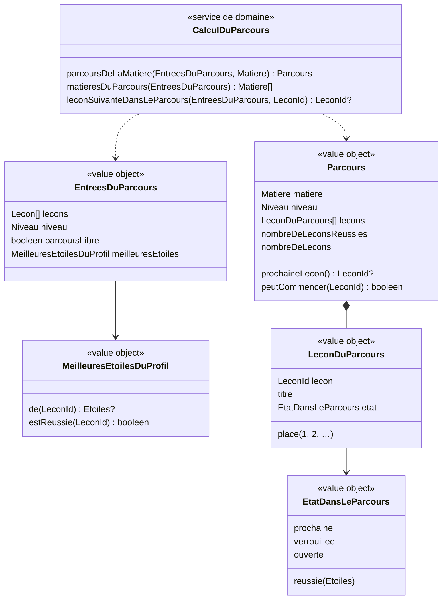

# Modèle du domaine : issue #25, Parcours par matière et verrous

## Contexte

Première story du lot 4 (Parcours). Contexte **Apprentissage** : le parcours, la leçon verrouillée et la prochaine leçon sont des règles du domaine `apprentissage/domain/`, en TypeScript pur, importées par le front via `@domain/apprentissage` (décision 0003). Elles tournent dans le navigateur.

Le parcours se **calcule** à partir de trois sources, sans rien écrire :

| Source | Contexte | Ce qui est lu | Mécanisme |
|---|---|---|---|
| Leçons de la bibliothèque | Catalogue pédagogique | `Lecon` : `id`, `matiere`, `niveau`, `ordre`, `titre` | Published Language `@domain/catalogue` (#16) ; le front charge déjà toute la bibliothèque (`chargerToutesLesLecons`) |
| Niveau et réglage parcours libre du profil en cours | Famille | `ProfilEnCours.niveau`, `ProfilEnCours.reglages.parcoursLibre` | Customer/Supplier existant (#11, #12) : le front passe ces valeurs au domaine |
| Meilleures étoiles de chaque leçon du profil | Apprentissage | `resultats_des_lecons` (#24) : `lecon`, `meilleures_etoiles` | Lecture du front sous RLS (voir « Progression en base ») |

Hors de cette story : leçons des classes d'avant et effets du parcours libre sur « Toutes les leçons » (#26), test de départ (#27), écran « Aujourd'hui » (#29), leçons personnelles (Accompagnement, lot 6), hors ligne complet (#44). Story voisine #20 : aucun de ses agrégats n'est touché (exercices calcul, fluence, addition posée, record de fluence, adaptation de la difficulté).

### Comportement actuel (`app/app.js`)

- `subjectPath(m)` (l. 545) : leçons de la matière dont le niveau est inférieur ou égal à celui de l'enfant (`levelRank`), leçons personnelles comprises (`allLessons`), triées par niveau puis `ordre`. Seules les leçons du niveau de l'enfant (`chained`) forment la suite verrouillée.
- Parcours de la suite, avec un drapeau `open` (vrai au départ) : une leçon est réussie si `etoiles > 0` ; la **prochaine** est la première leçon non réussie tant que `open` ; dès qu'une leçon du niveau n'est pas réussie, `open` devient faux ; une leçon est **verrouillée** si elle est du niveau, non réussie, `open` faux et pas de parcours libre. Une leçon réussie reste ouverte même après une non réussie.
- Avec le parcours libre, `open` passe quand même à faux : la prochaine leçon reste unique et marquée, les autres non réussies sont « À découvrir ».
- `nextAfter(l)` (l. 1956) : après une séance, la première leçon après `l` dans le parcours de sa matière non réussie et non verrouillée, sinon la première non verrouillée, sinon la prochaine leçon conseillée toutes matières confondues (`nextLesson`), si ce n'est pas `l`.

## Termes

| Terme | Statut | Remarque |
|---|---|---|
| Parcours | au glossaire | Suite ordonnée des leçons d'une matière pour le niveau de l'enfant. Le modèle s'y tient : les leçons des classes d'avant n'en font pas partie ici (#26). |
| Leçon verrouillée | au glossaire, **en conflit avec le legacy** | Le glossaire dit « parce que la précédente n'est pas réussie » ; le legacy verrouille toute leçon non réussie après la **première** non réussie. Question ouverte n°1. Le glossaire n'est pas reformulé ici. |
| Leçon réussie | au glossaire (confirmé) | Meilleures étoiles ≥ 1 (`ResultatDeLaLecon.estReussie()`, #24). |
| Parcours libre | au glossaire (confirmé) | Rien n'est verrouillé ; la prochaine leçon reste marquée. |
| Résultat de la leçon, Meilleures étoiles | au glossaire (#24) | Seule donnée de progression lue. |
| Ordre | au glossaire (confirmé) | Position dans le parcours. Dans la cible, `ordre` est obligatoire (`lireLecon`) : la règle legacy « absent compte pour 0 » disparaît. |
| Niveau, Matière | au glossaire (confirmés) | |
| Prochaine leçon | **nouveau** `(à valider)` | Première leçon non réussie du parcours, tant que la suite est ouverte (au plus une par matière). Interface : « À toi ! ». |
| Leçon ouverte | **nouveau** `(à valider)` | Leçon du parcours non réussie qui n'est ni la prochaine leçon ni verrouillée : elle n'existe qu'avec le parcours libre (ou selon la réponse à la question n°1). Interface : « À découvrir ». |
| Leçon suivante | **nouveau** `(à valider)` | Leçon proposée à la fin d'une séance (« Leçon suivante », « Ensuite : … »). Aujourd'hui règle du Catalogue (#24, Q73), remplacée par la règle du parcours (question n°9). |
| Matière du parcours | **nouveau** `(à valider)` | Matière qui a au moins une leçon pour l'enfant ; elle a un onglet dans « Mon parcours » (question n°8 sur le niveau pris en compte). |
| Étape (« Étape 1 ») | mot d'interface, **en conflit** | La décision n°28 du glossaire interdit « étape » seule. Question ouverte n°3. Le domaine dit **leçon du parcours** et sa **place** (1, 2, …). |
| Mon parcours, À toi !, Plus tard, À découvrir, Pour toi | mots d'interface | Hors glossaire. |
| Carte, chemin | synonymes interdits de Parcours | Le legacy dit `showMap`, `path` : rien de cela dans le code cible. |
| Espace adulte | synonyme interdit (décision n°17) | Le texte legacy « Un adulte peut en créer dans l'espace adulte » est à reprendre (question n°13). |

## Modèle

Le parcours **n'est pas un agrégat** : aucune commande ne le modifie, il ne protège aucun invariant d'écriture. C'est une **vue calculée** par un **service de domaine pur**, recalculée à chaque affichage à partir des leçons, du niveau, du réglage et des meilleures étoiles. La seule écriture qui le fait changer reste `TerminerLaSeance` (#24), qui met à jour l'agrégat `ResultatDeLaLecon`. Cela garde les agrégats petits et évite toute donnée dupliquée (« leçon débloquée » stockée) qui pourrait diverger de la bibliothèque.



### Entrées

- `lecons` : les leçons lisibles du Catalogue (toute la bibliothèque ; le service filtre lui-même par matière et niveau, pour que le filtre soit une règle du domaine). Plus tard, les leçons personnelles (question n°2).
- `niveau` : `Niveau` du Catalogue, lu depuis le profil en cours.
- `parcoursLibre` : réglage du profil en cours.
- `meilleuresEtoiles` : leçon → meilleures étoiles (1 à 3), pour le profil en cours. Une leçon absente n'a pas de séance terminée. Une entrée qui ne correspond à aucune leçon de la bibliothèque est ignorée (leçon retirée, leçon d'un autre niveau).

Le service ne connaît ni le profil, ni le parent, ni la base : il reçoit des valeurs.

### Sortie : `Parcours` d'une matière

1. Leçons de la matière **et du niveau de l'enfant**, triées par `ordre` croissant (égalité : question n°6).
2. État de chaque leçon, dans l'ordre, avec une suite « ouverte » au départ :
   - meilleures étoiles ≥ 1 → `reussie(etoiles)` (toujours, même après une leçon non réussie) ;
   - sinon, si la suite est ouverte → `prochaine`, puis la suite se ferme ;
   - sinon → `verrouillee`, ou `ouverte` avec le parcours libre.
   (Règle du legacy ; la variante « seulement si la précédente n'est pas réussie » est la question n°1.)
3. `nombreDeLeconsReussies` / `nombreDeLecons` : sur les leçons du niveau seulement (« 1 leçon réussie sur 12 », « 3 leçons réussies sur 12 » ; le texte et l'accord sont faits par l'interface). Parcours vide : « Pas encore de leçon de ta classe dans cette matière. ».
4. `prochaineLecon()` : au plus une par matière ; aucune si toutes sont réussies.
5. `peutCommencer(lecon)` : faux pour une leçon verrouillée. C'est la règle que le front consulte avant d'ouvrir la page de la leçon (toucher, clavier, et adresse directe : question n°10).

`matieresDuParcours` : matières, dans l'ordre du Catalogue (français, maths, sciences, histoire, anglais, EMC), qui ont au moins une leçon pour l'enfant (question n°8). Aucune matière : message d'interface (question n°13). La matière choisie par défaut (dernière ouverte, sinon français, sinon la première) est un état d'interface (question n°15).

`leconSuivanteDansLeParcours` : voir question n°9.

### Commandes et lectures

| Commande ou lecture | Effet | Erreurs métier | Où |
|---|---|---|---|
| Lecture `MeilleuresEtoilesDuProfil(profil)` | Toutes les meilleures étoiles du profil, en une lecture, sous RLS. | aucune (lecture impossible : parcours sans étoiles, voir question n°11) | front, client Supabase avec le JWT du parent |
| `parcoursDeLaMatiere`, `matieresDuParcours` | Calcul pur. | `NiveauInconnu` (Catalogue) si le niveau du profil est invalide | navigateur (et serveur si besoin) |
| `CommencerUneLecon` (existant, page de la leçon #16) | Refusé pour une leçon verrouillée, si la question n°10 le confirme. | `LeconVerrouillee` (à valider, question n°10) | navigateur |
| `TerminerLaSeance` (#24) | Inchangé : c'est lui qui fait avancer le parcours en mettant à jour `ResultatDeLaLecon`. | inchangées | Edge Function |

Aucune nouvelle commande d'écriture, donc aucune nouvelle Edge Function.

### Progression en base : `resultats_des_lecons` suffit

**Pas de nouvelle table ni de migration.** La table `resultats_des_lecons` (#24, migrations `20261023213000` et `20261024090000`) porte, par couple (profil, leçon) unique, `meilleures_etoiles` (1 à 3) : c'est exactement ce que le calcul lit (réussie = au moins une ligne, étoiles = `meilleures_etoiles`). La clé primaire `(profil, lecon)` sert aussi d'index pour lire tout un profil. La cascade avec le profil et l'export (contrat #14) sont déjà en place pour cette table.

Lecture par le front : compatible avec les décisions 0013 et 0016. Elles réservent les **écritures** à `terminer-la-seance` ; 0016, n°1 dit explicitement que `authenticated` « garde la lecture sous RLS (parent rattaché) » (policy `resultats_des_lecons_lecture_par_ses_parents`). Le front fait déjà cette lecture pour une leçon (`lecture-des-meilleures-etoiles-supabase.ts`) ; il faut seulement une lecture de toutes les leçons du profil (`select lecon, meilleures_etoiles where profil = …`). Aucune nouvelle décision d'architecture n'est nécessaire, sauf si la question n°11 conduit à garder les résultats sur l'appareil au-delà de ce que fait déjà #24 (à consigner alors).

Ce que le parcours **ne** stocke pas : ni « leçon débloquée », ni « prochaine leçon », ni « matière choisie » en base. Tout se recalcule.

## Invariants

Le parcours étant calculé, ce sont des **règles du calcul** (à couvrir par les tests du service), pas des invariants d'agrégat :

1. Le parcours d'une matière ne contient que les leçons de cette matière et du niveau de l'enfant, triées par `ordre`.
2. Une leçon est réussie dès que ses meilleures étoiles valent au moins 1 ; une leçon réussie n'est **jamais** verrouillée.
3. Il y a **au plus une** prochaine leçon par matière : la première leçon non réussie, tant que toutes les précédentes sont réussies.
4. Sans parcours libre, toute leçon non réussie après la première leçon non réussie est verrouillée (règle legacy, question n°1). Avec le parcours libre, aucune leçon n'est verrouillée et la prochaine leçon reste marquée.
5. Le compteur ne compte que les leçons du niveau de l'enfant.
6. Changer de niveau ne supprime aucune étoile (décision n°7 du lot 2) : le parcours du nouveau niveau se calcule avec les mêmes meilleures étoiles ; il commence donc à sa première leçon non réussie.
7. Un même ensemble d'entrées donne toujours le même parcours (calcul déterministe, identique dans le navigateur et sur le serveur).
8. Le parcours ne modifie jamais une étoile ; il ne fait que lire le résultat de la leçon.
9. Un parent ne lit que les résultats des enfants auxquels il est rattaché (RLS existante).

## Événements

Aucun nouvel événement. Le parcours se recalcule à la lecture : il **n'écoute pas** `LeconReussie` (que la context map prévoyait « pour le parcours et les verrous, lot 4 »). `LeconReussie` reste publié par `ResultatDeLaLecon` et pourra servir à Motivation ou Accompagnement. La context map reçoit une ligne qui le précise.

## Partage avec le front

- Dans `@domain/apprentissage` : `parcoursDeLaMatiere`, `matieresDuParcours`, `leconSuivanteDansLeParcours`, les types `Parcours`, `LeconDuParcours`, `EtatDansLeParcours`, `MeilleuresEtoilesDuProfil`. React affiche l'état renvoyé (cadenas, « À toi ! », étoiles) et ne calcule aucun verrou.
- Le front fournit : la bibliothèque (déjà chargée par `src/seance/bibliotheque.ts`), le profil en cours (niveau, réglages) et les meilleures étoiles lues sous RLS.
- Après une séance terminée : le parcours doit refléter la séance tout de suite, même si l'envoi est en cours ou a échoué (séance gardée sur l'appareil, décision 0013, n°3). Proposition : le front ajoute aux meilleures étoiles lues les étoiles des séances terminées gardées sur l'appareil, avec la même règle « meilleures étoiles » (`Etoiles.meilleureQue`, #24) ; question n°11.
- Accessibilité de l'état (texte lu par un lecteur d'écran : « 2 étoiles sur 3 », « verrouillée ») : libellé d'interface, question n°12. Le domaine fournit le nombre d'étoiles et l'état, pas la phrase.

## Données d'enfants

Aucune nouvelle donnée personnelle en base : le parcours lit les meilleures étoiles déjà enregistrées par #24 (minimisation respectée, cascade et export déjà en place). À surveiller seulement si la question n°11 conduit à garder les résultats du profil sur l'appareil : ils devraient alors être effacés à la déconnexion et à la suppression du profil (« sur les appareils », #14). Rien n'est envoyé à l'IA.

## Emplacement

```
supabase/functions/_shared/apprentissage/
  domain/
    parcours.ts                          # Parcours, LeconDuParcours, EtatDansLeParcours, parcoursDeLaMatiere, matieresDuParcours
    meilleures-etoiles-du-profil.ts      # value object leçon → meilleures étoiles
    lecon-suivante-dans-le-parcours.ts   # si la question n°9 la met dans cette story
    erreurs.ts                           # + LeconVerrouillee, seulement si la question n°10 le demande
    index.ts                             # exporte les nouveautés
supabase/functions/_shared/catalogue/domain/
    niveau.ts                            # (seulement si #26 ou la question n°8 l'exige) comparaison de niveaux
    lecon-suivante.ts                    # devient inutilisé si la question n°9 est oui : à retirer (refactor)
src/parcours/                            # écran « Mon parcours » : onglets, compteur, leçons du parcours
src/parcours/lecture-des-meilleures-etoiles-du-profil-supabase.ts   # lecture sous RLS, tout le profil
```

Pas de nouvelle migration, pas de nouvelle Edge Function, pas d'adaptateur côté serveur.

## Questions ouvertes

Reprises de l'issue :

1. **Règle du verrou.** Leçons 1 et 3 réussies, 2 non réussie : la 4 est-elle verrouillée ? Legacy : **oui** (toute leçon non réussie après la première non réussie est verrouillée ; seule la 2 est ouverte, c'est la prochaine leçon). Glossaire : **non** (« parce que la précédente n'est pas réussie » : la 4 serait ouverte). **Recommandation** : garder le legacy (un seul point d'entrée, l'ordre conseillé est suivi), et faire corriger par le PO la définition du glossaire en « … parce qu'une leçon avant elle n'est pas réussie », ainsi que la ligne `ordre` de `docs/format-lecons.md` (« une leçon s'ouvre quand la précédente est réussie », qui dit comme le glossaire). Oui ou non ?
2. **Leçons personnelles** (Accompagnement, lot 6) : entrent-elles dans le parcours verrouillé ? Legacy : oui, avec `ordre` = 1000 + …, donc en fin de parcours et verrouillées tant que tout n'est pas réussi (défaut relevé). **Recommandation** : hors de cette story (elles n'existent pas encore) ; au lot 6, toujours ouvertes, en tête du parcours de leur matière, avec l'étiquette « Pour toi », sans compter dans « réussies sur … ». À confirmer au lot 6 ?
3. **Libellé « Étape n ».** La décision n°28 du glossaire interdit « étape » seule. Legacy : « Étape 1 », « Étape 2 ». **Recommandation** : « Leçon 1 », « Leçon 2 » à l'écran (le domaine dit déjà « place » d'une leçon du parcours). D'accord ? Sinon, garder « Étape n » comme exception d'interface explicite.
4. **Descente de classe** (CE2 → CE1) : les leçons de CE2 réussies disparaissent du parcours mais restent en base et réapparaissent si l'enfant remonte. Legacy : identique. **Recommandation** : oui, voulu (décision n°7 du lot 2, rien n'est effacé). Oui ou non ?
5. **Leçon insérée au milieu** (nouvel `ordre`) : elle devient la prochaine leçon et verrouille les suivantes non réussies ; les suivantes déjà réussies restent ouvertes. Legacy : identique, sans signal. **Recommandation** : l'accepter sans signal pour la beta. Oui ou non ?

Ajoutées par le modèle :

6. **Deux leçons de même `ordre`** dans une matière et un niveau (aucune aujourd'hui dans la bibliothèque) : **recommandation** : le pipeline de contenu refuse le doublon (test pytest), et le domaine départage par identifiant pour rester déterministe. Oui ou non ?
7. **Parcours libre dans cette story ?** L'issue le décrit (« À découvrir », prochaine leçon marquée) mais le renvoie aussi à #26. **Recommandation** : le calcul prend déjà le réglage ici (une ligne de règle) et un scénario le vérifie ici ; #26 garde « Toutes les leçons » et les classes d'avant. Oui ou non ?
8. **Onglet d'une matière qui n'a que des leçons des classes d'avant** (ex. EMC n'existe qu'en CE2 : un enfant de CM1 a-t-il un onglet EMC ?). Legacy : oui (« jusqu'au niveau de l'enfant »), avec « Pas encore de leçon de ta classe dans cette matière. ». **Recommandation** : dans #25, un onglet seulement pour une matière qui a au moins une leçon **du niveau** de l'enfant ; #26 élargira aux classes d'avant. Oui ou non ?
9. **« Leçon suivante » à la fin d'une séance** : #24 a livré la règle du Catalogue (ordre suivant, même matière et même niveau, rien après la dernière ; Q73 : « le lot 4 la remplacera par la règle du parcours »). Le front l'utilise (`EcranDeFin.tsx` → `leconSuivante` de `@domain/catalogue`). **Recommandation** : la remplacer dans cette story par la règle legacy restreinte : la première leçon après celle de la séance, dans son parcours, non réussie et non verrouillée, sinon la première non verrouillée ; **pas** de repli sur une autre matière avant l'écran « Aujourd'hui » (#29), donc toujours pas de bouton après la dernière (le scénario de #24 reste vrai). Oui ou non ?
10. **Leçon verrouillée ouverte autrement que par le parcours** (adresse directe `/lecon/<id>`, « Leçon suivante », plus tard « Toutes les leçons ») : **recommandation** : le front ne l'ouvre pas depuis le parcours ni depuis une adresse directe (il montre le parcours) ; le serveur **n'en refuse pas** la séance (le verrou guide l'enfant, ce n'est pas une sécurité, et « Toutes les leçons » ouvre tout dans le legacy). Oui ou non ?
11. **Hors ligne** (critère « Hors ligne, le parcours s'affiche et se met à jour après une séance ») : **recommandation** : dans cette story, le parcours se met à jour tout de suite après une séance avec les étoiles calculées dans le navigateur et celles des séances gardées sur l'appareil ; garder une copie des résultats du profil sur l'appareil pour afficher le parcours sans réseau au lancement relève de #44 (avec une décision d'architecture à ce moment-là). Oui ou non ?
12. **Texte lu par un lecteur d'écran** pour chaque leçon du parcours. Legacy : « Les sons : ★★ » (défaut). **Recommandation** : « Les sons : réussie, 2 étoiles sur 3 », « Les sons : à toi ! », « Les sons : verrouillée, plus tard », « Les sons : à découvrir ». D'accord ?
13. **Aucune matière pour le niveau** : legacy « Aucune leçon pour ce niveau pour l'instant. Un adulte peut en créer dans l'espace adulte. » (synonyme interdit, et les leçons personnelles n'existent pas avant le lot 6). **Recommandation** : « Aucune leçon pour ta classe pour l'instant. ». D'accord ?
14. **Accès à « Mon parcours » dans la cible** : il n'y a pas encore de dock ; l'enfant arrive sur son accueil après « Qui joue ? ». **Recommandation** : un bouton « Mon parcours » sur l'accueil de l'enfant ; le retour ramène à l'accueil de l'enfant (pas à « Qui joue ? » comme le legacy). Oui ou non ?
15. **Matière choisie par défaut** : la dernière ouverte (legacy, mémorisée pour l'ouverture en cours seulement), sinon français, sinon la première disponible. **Recommandation** : même chose, sans rien mémoriser d'une ouverture de l'application à l'autre (comme le profil en cours). Oui ou non ?

Remarques pour les stories suivantes (pas des questions au PO) :
- #27 : une leçon « validée par le test de départ » (glossaire : acquise) doit entrer dans `MeilleuresEtoilesDuProfil` ou dans une entrée voisine pour compter comme réussie ; le service est prévu pour recevoir cette information sans changer ses règles.
- #26 : leçons des classes d'avant et comparaison de niveaux (`Niveau` du Catalogue, sans employer « rang », réservé à l'addition posée, décision n°25).
