# Modèle du domaine : issue #25, Parcours par matière

> Révisé après les réponses du PO (annonce du responsable). Réponse structurante : **#25.1 = b, aucun verrou**. Toutes les leçons du parcours sont ouvertes ; la prochaine leçon est seulement mise en avant. Puis le PO a suivi toutes les recommandations N1 à N11 (voir « Réponses du PO consignées ») ; le modèle ci-dessous est aligné sur le code livré.

## Contexte

Première story du lot 4 (Parcours). Contexte **Apprentissage** : le parcours et la prochaine leçon sont des règles du domaine `apprentissage/domain/`, en TypeScript pur, importées par le front via `@domain/apprentissage` (décision 0003). Elles tournent dans le navigateur.

Le parcours se **calcule** à partir de trois sources, sans rien écrire :

| Source | Contexte | Ce qui est lu | Mécanisme |
|---|---|---|---|
| Leçons de la bibliothèque | Catalogue pédagogique | `Lecon` : `id`, `matiere`, `niveau`, `ordre`, `titre` | Published Language `@domain/catalogue` (#16) ; le front charge déjà toute la bibliothèque (`chargerToutesLesLecons`) |
| Niveau du profil en cours | Famille | `ProfilEnCours.niveau` | Customer/Supplier existant (#11) : le front passe la valeur au domaine |
| Meilleures étoiles de chaque leçon du profil | Apprentissage | `resultats_des_lecons` (#24) : `lecon`, `meilleures_etoiles` | Lecture du front sous RLS (voir « Progression en base ») |

Le réglage **parcours libre** (#12) n'est **plus lu** : sans verrou, il n'a plus d'effet sur le parcours ; une story de Famille le retire (réponse N2).

Hors de cette story : leçons des classes d'avant et « Toutes les leçons » (#26), test de départ (#27), écran « Aujourd'hui » (#29), leçons personnelles (Accompagnement, lot 6 ; réponse #25.15), hors ligne complet (#44). Story voisine #20 : aucun de ses agrégats n'est touché.

### Comportement actuel (`app/app.js`), source des règles

- `subjectPath(m)` (l. 545) : leçons de la matière dont le niveau est inférieur ou égal à celui de l'enfant, triées par niveau puis `ordre`. Une leçon est réussie si `etoiles > 0` ; la **prochaine** est la première leçon non réussie de la classe ; les suivantes non réussies sont verrouillées, sauf en parcours libre (« À découvrir »). **La cible abandonne le verrou** (réponse #25.1) : elle garde l'affichage du parcours libre pour tous.
- `nextAfter(l)` (l. 1956) : après une séance, la première leçon après `l` non réussie et non verrouillée, sinon la première après `l` non verrouillée, sinon la prochaine leçon toutes matières confondues. Sans verrou, la règle devient : la première leçon après `l` non réussie, sinon la leçon juste après `l` (réponse N4), sinon rien (pas de repli sur une autre matière avant #29, réponse #25.2) ; rien non plus si `l` n'est pas dans le parcours de l'enfant (réponse N10).

## Réponses du PO consignées

Numéros de `docs/stories/25/acceptance.md`.

| n° | Question | Réponse |
|---|---|---|
| 25.1 | Règle du verrou | **b : aucun verrou.** Toutes les leçons du parcours sont ouvertes ; la prochaine leçon est seulement mise en avant. |
| 25.2 | Leçon suivante à la fin d'une séance | Recommandation retenue : la première leçon d'après non réussie, dans le parcours de la leçon jouée, sans repli sur une autre matière avant #29. La partie « non verrouillée » tombe. |
| 25.3 | Leçon verrouillée ouverte par une adresse directe | Sans objet (plus de verrou). |
| 25.4 | Onglet d'une matière sans leçon du niveau | Pas d'onglet. |
| 25.5 | Parcours libre dans cette story | Sans objet de fait : le parcours libre n'a plus d'effet (réponse N2). |
| 25.6 | Hors ligne | Le parcours se met à jour tout de suite après une séance ; l'affichage sans réseau dès le lancement relève de #44. |
| 25.7 | Lecteur d'écran | « <titre> : réussie, 2 étoiles sur 3 », « <titre> : à toi ! », « <titre> : à découvrir ». |
| 25.8 | Libellé de la place | « Leçon 1 », « Leçon 2 »… |
| 25.9 | Aucune leçon pour le niveau | « Aucune leçon pour ta classe pour l'instant. » |
| 25.10 | Accès | Bouton « Mon parcours » sur l'accueil de l'enfant ; le retour ramène à cet accueil. |
| 25.11 | Matière à l'ouverture | Dernière matière choisie pendant l'utilisation en cours, sinon le français, sinon la première. Rien n'est mémorisé d'une ouverture à l'autre. |
| 25.12 | Descente de classe (CE2 → CE1) | **a : les leçons de CE2 réussies restent visibles** pour l'enfant redescendu en CE1. Endroit : réponse N1. |
| 25.13 | Leçon ajoutée au milieu d'un parcours | Acceptée sans signal (elle devient la prochaine leçon si celles d'avant sont réussies ; rien n'est fermé). |
| 25.14 | Deux leçons de même `ordre` | Le pipeline refuse le doublon (test pytest) ; le domaine départage par identifiant. |
| 25.15 | Leçons personnelles | Hors story. |
| 25.16 | Parcours entièrement réussi | Seulement le compteur. |

Questions nées de ces réponses : le PO a suivi **toutes les recommandations** (annonce du responsable, 2026-10-24).

| n° | Question | Réponse |
|---|---|---|
| N1 | Où l'enfant redescendu en CE1 voit-il ses leçons de CE2 réussies ? | **(a)**, livré dans #25 : dans « Mon parcours », sous les leçons de la matière, un bloc à part « Déjà réussies en CE2 », chaque leçon avec son niveau, son titre et ses étoiles ; hors compteur, jamais « À toi ! » ; seules les leçons réussies. Lecteur d'écran : « <titre>, CE2 : réussie, 2 étoiles sur 3 ». #26 aligne sur lui son bloc « Revoir les classes d'avant ». |
| N2 | Réglage « parcours libre » | Retiré de l'interface et du glossaire par une petite story de Famille après #25, créée par le responsable ; la colonne reste en base jusqu'à une migration de nettoyage. #26 devient « Leçons des classes d'avant ». #25 n'y touche pas. |
| N3 | Termes et documents devenus faux | Corrigés par l'équipe #25 : `CLAUDE.md` (« réussie à 1 étoile (elle fait avancer le parcours) »), ligne `ordre` de `docs/format-lecons.md` (« position dans le parcours de la matière »), glossaire (Décision n°33 : « Leçon verrouillée » abandonné) et context map (note), par ajouts. Le responsable corrige la feuille de route, le graphe et l'issue #26. |
| N4 | Leçon suivante quand toutes les leçons d'après sont réussies | La leçon juste après la leçon jouée ; pas de retour en arrière avant #29. |
| N5 | Titre de la story et du fichier de scénarios | Issue et fonctionnalité renommées « Parcours par matière » (par le responsable) ; nom de la branche gardé. |
| N6 | Titre du scénario « leçon suivante » de #24 | Renommé « La leçon suivante est la première leçon d'après non réussie de la même matière et du même niveau », étapes inchangées. |
| N7 | Matière sans leçon du niveau, avec des leçons réussies d'une classe au-dessus | Pas d'onglet ; ces leçons se voient dans « Toutes les leçons » (#26) et le suivi du parent (lot 6). |
| N8 | Ordre conseillé sans verrou | Confirmé : leçons 1 et 3 réussies, la 2 est la prochaine leçon, la 4 est à découvrir. |
| N9 | Rejouer une leçon réussie d'une classe au-dessus | Oui : elle s'ouvre depuis le bloc, comme toute leçon réussie. |
| N10 | Leçon suivante après une leçon d'une classe au-dessus | Aucune (« Accueil » et « Rejouer ») : rien n'est proposé au-dessus du niveau de l'enfant. |
| N11 | Termes à valider | Validés : prochaine leçon, leçon à découvrir, leçon suivante, matière du parcours, place, leçon réussie d'une classe au-dessus (glossaire, Décision n°34). |

## Termes

| Terme | Statut | Remarque |
|---|---|---|
| Parcours | au glossaire | Suite ordonnée des leçons d'une matière pour le niveau de l'enfant. Les leçons de CE2 réussies d'un enfant redescendu en CE1 n'en font pas partie : elles sont montrées à part (réponse N1). |
| Leçon réussie | au glossaire (confirmé) | Meilleures étoiles ≥ 1 (`ResultatDeLaLecon.estReussie()`, #24). `CLAUDE.md` dit désormais « elle fait avancer le parcours » (réponse N3). |
| Leçon verrouillée | **abandonné** (réponse 25.1, glossaire Décision n°33) | Plus aucune leçon verrouillée dans le parcours. Ni le code ni l'interface ne l'emploient. |
| Parcours libre | au glossaire, **devenu sans effet** | Réglage de Famille (#12) qui « ouvre toutes les leçons » : elles le sont toutes. Retiré par une story de Famille (réponse N2). |
| Résultat de la leçon, Meilleures étoiles | au glossaire (#24) | Seule donnée de progression lue. |
| Ordre | au glossaire (confirmé) | Position dans le parcours ; obligatoire dans la cible (`lireLecon`). La ligne `ordre` de `docs/format-lecons.md` dit désormais « position dans le parcours de la matière » (réponse N3). |
| Niveau, Matière | au glossaire (confirmés) | |
| Prochaine leçon | **nouveau**, validé (N11) | Première leçon non réussie du parcours d'une matière ; au plus une ; mise en avant, sans rien fermer. Interface : « À toi ! ». |
| Leçon à découvrir | **nouveau**, validé (N11), remplace « Leçon ouverte » | Leçon du parcours non réussie qui n'est pas la prochaine leçon. Interface : « À découvrir ». « Leçon ouverte » est retiré : toutes les leçons sont ouvertes, le mot ne distingue plus rien. |
| Leçon suivante | **nouveau**, validé (N11), règle révisée | Leçon proposée à la fin d'une séance (« Leçon suivante », « Ensuite : … ») : la première leçon d'après non réussie dans le parcours de la leçon jouée, sinon la leçon juste après ; aucune hors du parcours de l'enfant (réponses #25.2, N4, N10). |
| Matière du parcours | **nouveau**, validé (N11) | Matière qui a au moins une leçon du niveau de l'enfant (réponses #25.4, N7). |
| Place | **nouveau**, validé (N11) | Numéro 1, 2, … d'une leçon dans son parcours, tiré de l'`ordre` ; interface « Leçon 1 » (réponse #25.8). Le mot « rang » reste interdit pour une leçon (décision n°25). |
| Leçon réussie d'une classe au-dessus | **nouveau**, validé (N11) | Leçon réussie d'un niveau supérieur à celui de l'enfant (enfant redescendu de classe) ; montrée à part, sous les leçons du parcours de sa matière, et ouvrable (réponses #25.12, N1, N9). |
| Mon parcours, À toi !, À découvrir, Déjà réussies en CE2 | mots d'interface | Hors glossaire. « Plus tard » (leçon verrouillée) disparaît. |
| Étape (« Étape 1 ») | mot d'interface **retiré** | Remplacé par « Leçon 1 » (réponse #25.8, décision n°28). |
| Carte, chemin | synonymes interdits de Parcours | Le legacy dit `showMap`, `path` : rien de cela dans le code cible. |

## Modèle

Le parcours **n'est pas un agrégat** : aucune commande ne le modifie, il ne protège aucun invariant d'écriture. C'est une **vue calculée** par des **fonctions pures du domaine**, recalculée à chaque affichage à partir des leçons, du niveau et des meilleures étoiles. La seule écriture qui le fait changer reste `TerminerLaSeance` (#24), qui met à jour l'agrégat `ResultatDeLaLecon`. Sans verrou, il n'y a plus rien à refuser : aucune erreur métier nouvelle.

```mermaid
classDiagram
  class CalculDuParcours {
    <<fonctions pures du domaine>>
    parcoursDeLaMatiere(EntreesDuParcours, Matiere) Parcours
    matieresDuParcours(EntreesDuParcours) Matiere[]
    leconSuivanteDansLeParcours(EntreesDuParcours, LeconId) LeconId?
    meilleuresEtoilesReunies(ReadonlyMap, ReadonlyMap) ReadonlyMap
  }
  class EntreesDuParcours {
    <<value object>>
    Lecon[] lecons
    Niveau niveau
    ReadonlyMap~LeconId, Etoiles~ meilleuresEtoiles
  }
  class Parcours {
    <<value object>>
    LeconDuParcours[] lecons
    LeconReussieDUneClasseAuDessus[] leconsReussiesDesClassesAuDessus
    LeconId? prochaineLecon
    nombreDeLeconsReussies
    nombreDeLecons
  }
  class LeconDuParcours {
    <<value object>>
    LeconId lecon
    titre
    place (1, 2, …)
    EtatDansLeParcours etat
  }
  class EtatDansLeParcours {
    <<value object>>
    reussie(Etoiles)
    prochaine
    aDecouvrir
  }
  class LeconReussieDUneClasseAuDessus {
    <<value object>>
    LeconId lecon
    Niveau niveau
    titre
    Etoiles etoiles
  }
  class Niveau {
    <<value object, Catalogue>>
    estAuDessusDe(Niveau) booleen
  }
  CalculDuParcours ..> EntreesDuParcours
  CalculDuParcours ..> Parcours
  Parcours *-- LeconDuParcours
  Parcours *-- LeconReussieDUneClasseAuDessus
  LeconDuParcours --> EtatDansLeParcours
  LeconReussieDUneClasseAuDessus --> Niveau
```



Les meilleures étoiles du profil ne sont **pas un value object à part** : c'est une `ReadonlyMap<LeconId, Etoiles>` (leçon → meilleures étoiles, 1 à 3). Une leçon absente n'est pas réussie.

### Entrées

- `lecons` : les leçons lisibles du Catalogue (toute la bibliothèque ; le calcul filtre lui-même par matière et niveau).
- `niveau` : `Niveau` du Catalogue, lu depuis le profil en cours.
- `meilleuresEtoiles` : leçon → meilleures étoiles, pour le profil en cours. Une entrée qui ne correspond à aucune leçon de la bibliothèque est ignorée (leçon retirée). Le front la construit avec `meilleuresEtoilesReunies` (voir « Partage avec le front »).

Le calcul ne connaît ni le profil, ni le parent, ni la base : il reçoit des valeurs.

### Sortie : `Parcours` d'une matière (`parcoursDeLaMatiere`)

1. `lecons` : leçons de la matière **et du niveau de l'enfant**, triées par `ordre` croissant, puis par identifiant à `ordre` égal (réponse #25.14).
2. `etat` de chaque leçon :
   - meilleures étoiles présentes → `reussie(etoiles)` ;
   - sinon, la **première** leçon non réussie → `prochaine` ;
   - sinon → `aDecouvrir`.
3. `place` : 1, 2, … dans l'ordre du parcours (« Leçon 1 »).
4. `nombreDeLeconsReussies` / `nombreDeLecons` : sur les leçons du niveau seulement ; le texte et l'accord sont faits par l'interface. Parcours entièrement réussi : pas de prochaine leçon, le compteur suffit (réponse #25.16).
5. `prochaineLecon` : au plus une par matière ; `undefined` si toutes sont réussies (ou s'il n'y a aucune leçon).
6. `leconsReussiesDesClassesAuDessus` : leçons de la matière dont le niveau est **au-dessus** de celui de l'enfant (`Niveau#estAuDessusDe`, Catalogue) **et réussies**, chacune `{ lecon, niveau, titre, etoiles }`, triées par niveau puis par `ordre` puis par identifiant. Elles ne comptent pas dans le compteur et ne sont jamais la prochaine leçon (réponses #25.12, N1). Les leçons d'une classe au-dessus non réussies ne sont pas montrées (« rien hors programme »).

`matieresDuParcours` : matières, dans l'ordre du Catalogue (`toutesLesMatieres` : français, maths, sciences, histoire, anglais, EMC), qui ont au moins une leçon **du niveau** de l'enfant (réponse #25.4). Une matière qui n'a que des leçons réussies d'une classe au-dessus n'a pas d'onglet (réponse N7). Aucune matière : « Aucune leçon pour ta classe pour l'instant. » (réponse #25.9). La matière choisie à l'ouverture est un état d'interface (réponse #25.11).

`leconSuivanteDansLeParcours(entrees, lecon)` : dans le parcours de la matière de la leçon jouée, au niveau de l'enfant :
- la première leçon placée après elle qui n'est pas réussie ;
- sinon la leçon juste après elle (réponse N4) ;
- sinon aucune (dernière leçon du parcours : pas de bouton, pas de repli sur une autre matière avant #29) ;
- aucune non plus si la leçon jouée n'est pas dans le parcours de l'enfant (leçon d'une classe au-dessus, d'un autre niveau, ou inconnue de la bibliothèque) (réponse N10).

Elle remplace `leconSuivante` du Catalogue (#24, Q73), retirée avec son test.

`meilleuresEtoilesReunies(a, b)` : réunit deux sources de meilleures étoiles leçon par leçon ; pour une leçon présente dans les deux, la meilleure l'emporte (`Etoiles.meilleureQue`, #24). Le front s'en sert pour réunir les étoiles lues sur le serveur et les **étoiles gagnées pendant l'utilisation** (séances terminées dans ce navigateur), et la page de la leçon lit la même source (réponse #25.6).

### Commandes et lectures

| Commande ou lecture | Effet | Erreurs métier | Où |
|---|---|---|---|
| Lecture des meilleures étoiles du profil | Toutes les meilleures étoiles du profil, en une lecture, sous RLS, réunies avec les étoiles gagnées pendant l'utilisation. Sans réseau : seulement ces dernières. | aucune (lecture impossible : parcours sans les étoiles du serveur) | front, client Supabase avec le JWT du parent |
| `parcoursDeLaMatiere`, `matieresDuParcours`, `leconSuivanteDansLeParcours`, `meilleuresEtoilesReunies` | Calcul pur. | `NiveauInconnu` (Catalogue) si le niveau du profil est invalide | navigateur (et serveur si besoin) |
| `CommencerUneLecon` (existant, page de la leçon #16) | **Inchangé** : toute leçon du parcours, et toute leçon réussie d'une classe au-dessus (réponse N9), peut être commencée. | aucune nouvelle | navigateur |
| `TerminerLaSeance` (#24) | Inchangé : c'est lui qui fait avancer le parcours en mettant à jour `ResultatDeLaLecon`. | inchangées | Edge Function |

Aucune nouvelle commande d'écriture, aucune nouvelle Edge Function, aucune erreur métier nouvelle (`LeconVerrouillee` est abandonnée).

### Progression en base : `resultats_des_lecons` suffit

**Pas de nouvelle table ni de migration.** La table `resultats_des_lecons` (#24) porte, par couple (profil, leçon) unique, `meilleures_etoiles` (1 à 3) : c'est exactement ce que le calcul lit. La cascade avec le profil et l'export (contrat #14) sont déjà en place.

Lecture par le front : compatible avec les décisions 0013 et 0016 (écritures réservées à `terminer-la-seance`, lecture sous RLS par un parent rattaché, policy `resultats_des_lecons_lecture_par_ses_parents`). Aucune nouvelle décision d'architecture (réponse #25.6 : la copie sur l'appareil relève de #44).

Ce que le parcours **ne** stocke pas : ni « prochaine leçon », ni « matière choisie » en base. Tout se recalcule.

## Invariants

Le parcours étant calculé, ce sont des **règles du calcul** (à couvrir par les tests du service), pas des invariants d'agrégat :

1. Le parcours d'une matière ne contient que les leçons de cette matière et du niveau de l'enfant, triées par `ordre`, puis par identifiant.
2. Une leçon est réussie dès que ses meilleures étoiles valent au moins 1.
3. **Aucune leçon du parcours n'est fermée** : chacune est réussie, prochaine ou à découvrir, et peut être commencée.
4. Il y a **au plus une** prochaine leçon par matière : la première leçon non réussie du parcours. Il n'y en a aucune quand toutes sont réussies.
5. Le compteur ne compte que les leçons du niveau de l'enfant.
6. Changer de niveau ne supprime aucune étoile (décision n°7 du lot 2) : le parcours du nouveau niveau se calcule avec les mêmes meilleures étoiles ; les leçons réussies d'une classe au-dessus restent visibles, à part (réponses #25.12, N1), sans compter ni devenir la prochaine leçon.
7. La leçon suivante d'une séance est toujours dans la même matière que la leçon jouée, au niveau de l'enfant, et placée après elle ; il n'y en a aucune si la leçon jouée n'est pas dans le parcours de l'enfant.
8. Réunir deux sources de meilleures étoiles ne fait jamais baisser une étoile : la meilleure l'emporte.
9. Un même ensemble d'entrées donne toujours le même parcours (calcul déterministe, identique dans le navigateur et sur le serveur).
10. Le parcours ne modifie jamais une étoile ; il ne fait que lire le résultat de la leçon.
11. Un parent ne lit que les résultats des enfants auxquels il est rattaché (RLS existante).

## Événements

Aucun nouvel événement. Le parcours se recalcule à la lecture : il **n'écoute pas** `LeconReussie`. `LeconReussie` reste publié par `ResultatDeLaLecon` et pourra servir à Motivation ou Accompagnement. La context map le précise (ligne #25, et note ajoutée en fin de section : plus de verrou, réponse N3).

## Partage avec le front

- Dans `@domain/apprentissage` (`index.ts`) : `parcoursDeLaMatiere`, `matieresDuParcours`, `leconSuivanteDansLeParcours`, `meilleuresEtoilesReunies`, et les types `EntreesDuParcours`, `Parcours`, `LeconDuParcours`, `EtatDansLeParcours`, `LeconReussieDUneClasseAuDessus`, `LeconId`. React affiche l'état renvoyé (« À toi ! », « À découvrir », étoiles, bloc « Déjà réussies en CE2 ») et ne calcule rien.
- Dans `@domain/catalogue` : `Niveau#estAuDessusDe` et `toutesLesMatieres`, utilisés par le calcul ; `leconSuivante` est retirée.
- `EcranDeFin.tsx` utilise `leconSuivanteDansLeParcours`, avec les meilleures étoiles du profil.
- Le front fournit : la bibliothèque (déjà chargée par `src/seance/bibliotheque.ts`), le niveau du profil en cours et les meilleures étoiles du profil (`src/seance/fin-de-seance/meilleures-etoiles-du-profil.ts`) : celles lues sous RLS, réunies par `meilleuresEtoilesReunies` avec les étoiles gagnées pendant l'utilisation (`etoiles-gagnees-pendant-l-utilisation.ts`, oubliées au changement d'enfant et à la déconnexion). Sans réseau, seules ces dernières : le parcours reflète tout de suite une séance terminée (réponse #25.6).
- Lecteur d'écran : « <titre> : réussie, 2 étoiles sur 3 », « <titre> : à toi ! », « <titre> : à découvrir » (réponse #25.7) ; « <titre>, CE2 : réussie, 2 étoiles sur 3 » pour une leçon réussie d'une classe au-dessus (réponse N1). Le domaine fournit l'état, le niveau et le nombre d'étoiles, pas la phrase.

## Données d'enfants

Aucune nouvelle donnée personnelle : le parcours lit les meilleures étoiles déjà enregistrées par #24 (cascade et export déjà en place). Les leçons réussies d'une classe au-dessus viennent des mêmes résultats. Rien n'est gardé sur l'appareil au-delà de ce que fait déjà #24 (copie des résultats : #44). Rien n'est envoyé à l'IA.

## Emplacement

```
supabase/functions/_shared/apprentissage/
  domain/
    parcours.ts                          # EntreesDuParcours, Parcours, LeconDuParcours, EtatDansLeParcours, LeconReussieDUneClasseAuDessus, LeconId, parcoursDeLaMatiere, matieresDuParcours
    lecon-suivante-dans-le-parcours.ts   # leconSuivanteDansLeParcours
    meilleures-etoiles-reunies.ts        # meilleuresEtoilesReunies
    index.ts                             # exporte les nouveautés
supabase/functions/_shared/catalogue/domain/
    niveau.ts                            # Niveau#estAuDessusDe ; #26 s'en servira pour « en dessous »
    matiere.ts                           # toutesLesMatieres (ordre du Catalogue)
    (lecon-suivante.ts retiré avec son test, remplacé par leconSuivanteDansLeParcours)
src/parcours/                            # écran « Mon parcours » : onglets, compteur, leçons du parcours, bloc des classes au-dessus
src/seance/fin-de-seance/meilleures-etoiles-du-profil.ts            # étoiles du serveur réunies avec celles gagnées pendant l'utilisation
src/seance/fin-de-seance/lecture-des-meilleures-etoiles-supabase.ts # lecture sous RLS, tout le profil
```

Pas de nouvelle migration, pas de nouvelle Edge Function, pas d'adaptateur côté serveur, pas de `LeconVerrouillee` dans `erreurs.ts`.

## Questions ouvertes

Aucune question ouverte : 25.1 à 25.16 et N1 à N11 sont tranchées (voir « Réponses du PO consignées »). Texte des questions N1 à N8, pour mémoire (N9 à N11 : `docs/stories/25/acceptance.md`) :

- **N1. Où l'enfant redescendu en CE1 voit-il ses leçons de CE2 réussies ?** Le PO a dit qu'elles restent visibles, sans dire où. #26 ne couvre que les leçons d'un niveau **inférieur** (bloc « Revoir les classes d'avant ») et demande en question n°2 si les leçons d'une classe au-dessus doivent rester accessibles. Choix : (a) dans « Mon parcours », sous les leçons de CE1, dans un bloc à part « Déjà réussies en CE2 (3 leçons) », chaque leçon avec son niveau (« CE2 »), son titre et ses étoiles, hors compteur, jamais « À toi ! » ; (b) mêlées aux leçons de CE1, à leur `ordre` ; (c) seulement dans le compteur ; (d) seulement dans « Toutes les leçons » (#26). **Recommandation** : (a), livré **dans #25** (seules les leçons réussies, rien d'autre de CE2), et #26 aligne la forme de son bloc « Revoir les classes d'avant » sur lui. Lecteur d'écran : « <titre>, CE2 : réussie, 2 étoiles sur 3 ». D'accord ?
- **N2. Que devient le réglage « parcours libre » (#12, Famille) ?** Sans verrou, il n'a plus aucun effet : la case est encore dans les réglages du profil (`parcours_libre`, formulaire, scénarios de `features/12-reglages.feature`). **Recommandation** : le retirer de l'interface et du glossaire dans une story de Famille dédiée (petite, après #25), la colonne restant en base jusqu'à une migration de nettoyage ; #26 est renommée « Leçons des classes d'avant » et perd sa partie parcours libre. Dans #25, on n'y touche pas et le parcours ne le lit pas. D'accord ? Si oui, qui crée la story : le responsable des équipes ?
- **N3. Termes existants devenus faux** (escalade, rien n'est modifié par #25) : « Leçon verrouillée » (glossaire), « Parcours libre » (glossaire), « Leçon des classes d'avant » (« proposée sans verrou »), la phrase de `CLAUDE.md` « Une leçon est réussie à 1 étoile (elle ouvre la suivante) », la ligne `ordre` de `docs/format-lecons.md` (« une leçon s'ouvre quand la précédente est réussie »), la context map (ligne Apprentissage « parcours et verrous », ligne Famille → Apprentissage « parcours libre », ligne `LeconReussie` « servira au parcours et aux verrous »), `docs/feuille-de-route.md` (« parcours par matière avec réglage parcours libre »). **Recommandation** : « Leçon verrouillée » passe en Décisions du glossaire comme « abandonné (#25.1) », « Parcours libre » suit la réponse à N2, `CLAUDE.md` dit « réussie à 1 étoile (elle fait avancer le parcours) », `ordre` dit « position dans le parcours de la matière ». Qui les corrige : l'équipe #25 dans cette story (doc seulement), ou le responsable ?
- **N4. Leçon suivante quand toutes les leçons d'après sont réussies.** Exemple : parcours de 4 leçons, Léa joue la 2, la 3 et la 4 sont réussies, la 1 ne l'est pas. Le legacy propose la 3 (la leçon juste après). **Recommandation** : proposer la 3 (rejouer pour gagner des étoiles), ne pas revenir en arrière vers la 1 (pas de retour au début avant #29). D'accord ?
- **N5. Titre de la story et du fichier de scénarios** : « Parcours par matière et verrous » (issue, branche, `features/25-parcours-par-matiere-et-verrous.feature`, `docs/graphe/stories.md`). **Recommandation** : renommer l'issue « Parcours par matière » et le fichier `features/25-parcours-par-matiere.feature` ; garder le nom de la branche (déjà poussée). D'accord ? **Décision (2026-10-24)** : oui, fichier renommé `features/25-parcours-par-matiere.feature` (voir `docs/stories/25/acceptance.md`, N5).
- **N6. Effet sur #24** : ses trois scénarios de la règle « leçon suivante » (`features/24-etoiles-et-fin-de-seance.feature`, l. 109-127) **restent vrais** avec la nouvelle règle : « La suite de test » (ordre 903) suit « Les sons de test » (901) sans autre leçon de français du CP entre elles, et Léa ne l'a pas réussie ; « Les animaux » est la dernière leçon d'anglais du CP (ordre 40), donc aucune leçon suivante. Le titre « La leçon suivante est la leçon d'ordre suivant de la même matière et du même niveau » devient inexact (la leçon d'après **non réussie**). **Recommandation** : renommer seulement ce scénario de #24 (« … est la première leçon d'après non réussie de la même matière et du même niveau ») et ajouter dans #25 un scénario où la leçon d'après est déjà réussie et sautée. La conséquence notée en 25.2 (adapter les données de #24) tombe. D'accord ?
- **N7. Matière sans leçon du niveau mais avec des leçons réussies d'une classe au-dessus** (ex. enfant redescendu en CE1 qui a réussi une leçon d'EMC de CE2 ; l'EMC n'a pas de leçon de CE1). La réponse 25.4 dit « pas d'onglet », la réponse 25.12 dit « reste visible ». **Recommandation** : pas d'onglet ; ces leçons ne se voient que dans le compteur de suivi du parent et dans « Toutes les leçons » (#26). Ou bien un onglet est-il ouvert pour elles ?
- **N8. « Prochaine leçon » sans verrou : faut-il encore un ordre conseillé ?** Exemple : leçons 1 et 3 réussies, 2 non réussie : la 2 est « À toi ! », la 4 « À découvrir ». **Recommandation** : oui, garder exactement cela (c'est le comportement du parcours libre du legacy). Juste pour confirmer, sans changement.

Remarques pour les stories suivantes (pas des questions au PO) :
- #27 : une leçon « validée par le test de départ » (glossaire : acquise) doit entrer dans les meilleures étoiles du profil (`meilleuresEtoiles`) ou dans une entrée voisine pour compter comme réussie ; le service est prévu pour la recevoir sans changer ses règles.
- #26 : leçons des classes d'avant et comparaison de niveaux (`Niveau#estAuDessusDe` du Catalogue, livré par #25, sans employer « rang », réservé à l'addition posée, décision n°25) ; son bloc « Revoir les classes d'avant » s'aligne sur le bloc des leçons réussies d'une classe au-dessus (réponse N1) ; sa piste « Sans le parcours libre, la même leçon est verrouillée » et sa question n°1 (« Toutes les leçons » contourne le verrou) sont devenues sans objet.
