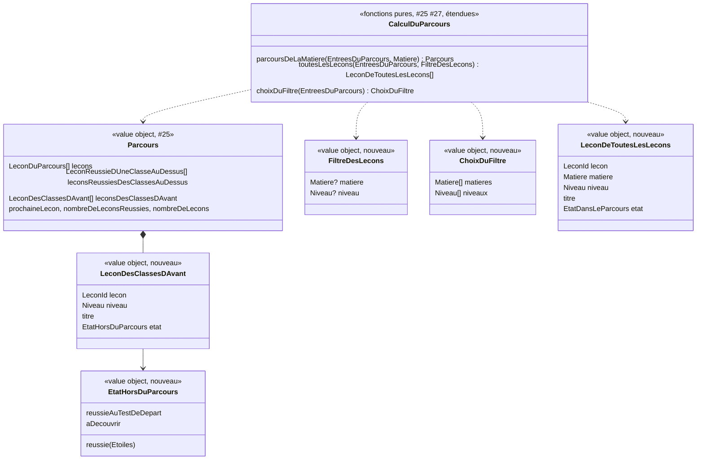

# Modèle du domaine : issue #26, Leçons des classes d'avant

> Cadrage seulement. Le code partira de la branche de #27 (`feature/27-test-de-depart`, PR #80), qui modifie déjà `apprentissage/domain/parcours.ts` (état « réussie au test de départ »). Rien n'est codé avant le merge de #27.

## Contexte

Contexte **Apprentissage**, qui lit le **Catalogue pédagogique**. Comme le parcours de #25, tout ce que cette story ajoute est une **vue calculée** par des fonctions pures de `apprentissage/domain/`, importées par le front via `@domain/apprentissage` (décision 0003). Elle marche donc hors ligne.

La story a été **redéfinie** par les réponses du PO sur #25 et #27 :

| Décision | Effet sur #26 |
|---|---|
| 25.1 b : aucun verrou | Tout ce qui parle de verrou tombe : la piste « Sans le parcours libre, la même leçon est verrouillée », le défaut « Toutes les leçons contourne le verrou », la question n°1 dans sa forme d'origine. |
| N2 : le parcours libre n'a plus d'effet | #26 ne lit plus Famille. Le réglage n'est ni lu, ni retiré ici (story Famille à venir). La piste « Le réglage change pendant que l'enfant joue » tombe. |
| N1 : bloc « Déjà réussies en CE2 » | Le bloc des leçons des classes d'avant prend la même forme : niveau, titre, état, hors compteur, jamais « À toi ! », lecteur d'écran « <titre>, <niveau> : … ». |
| N7, 25.4 : pas d'onglet sans leçon du niveau | Ces leçons se voient dans « Toutes les leçons » (#26). Le scénario de #25 « Une matière qui n'a que des leçons des classes d'avant n'a pas d'onglet » reste vrai (voir #26.7). |
| N9, N10 | Une leçon hors du parcours s'ouvre et n'a pas de leçon suivante. |
| 27.7, 27.15 | Une leçon réussie au test de départ est cochée sans étoile, lue « … : réussie au test de départ ». Les leçons du CP réussies au test de départ par un CE1 apparaissent parmi les leçons des classes d'avant. |

| Source | Contexte | Ce qui est lu | Mécanisme |
|---|---|---|---|
| Leçons de la bibliothèque | Catalogue pédagogique | `id`, `matiere`, `niveau`, `ordre`, `titre` | Published Language `@domain/catalogue` (existant) |
| Niveau du profil en cours | Famille | `ProfilEnCours.niveau` | Customer/Supplier existant (#11) |
| Meilleures étoiles, leçons réussies au test de départ | Apprentissage | `resultats_des_lecons` (#24), résultat du test de départ (#27) | Lectures existantes sous RLS, réunies avec ce qui a été joué pendant l'utilisation |

Comportement actuel (`app/app.js`), source des règles et non modèle :
- `subjectPath` (l. 545) : les leçons de niveau **strictement inférieur** sont `revision: !chained` ; jamais prochaine, jamais verrouillées.
- `showMap`, onglet `parcours` (l. 725, bloc l. 763) : un `<details>` replié « Revoir les classes d'avant (24 leçons) » après le parcours ; chaque leçon montre son niveau à la place de « Étape n », puis ses étoiles ou « Révision ».
- `showMap`, onglet `libre` (l. 773) : deux listes « Matière » et « Niveau », toutes les leçons de tous les niveaux, tri leçons personnelles, niveau, `ordre` ; carte `lessonCard` (l. 511) : « CE1 · Français », titre, 3 étoiles, « Réussie · rejouer » ou « À découvrir ».

Hors de cette story : leçons personnelles et « Pour toi » (Accompagnement, #39), écran « Aujourd'hui », tuiles de matière et leur compteur, dock (#29), affichage sans réseau dès le lancement (#44), retrait du réglage parcours libre (story Famille, N2).

## Termes

| Terme | Statut | Remarque |
|---|---|---|
| Leçon des classes d'avant | au glossaire `(à valider)`, **définition à revoir** | Aujourd'hui : « Leçon d'un niveau inférieur, proposée sans verrou pour réviser ». « Sans verrou » ne distingue plus rien (Décision n°33) et « réviser » empiète sur **Révision**. Définition proposée plus bas. |
| Révision | au glossaire `(à valider)`, **conflit** | Réservé à la séance qui reprend les questions ratées (#28). L'état « Révision » du legacy et le titre « **Revoir** les classes d'avant » emploient un synonyme interdit (« revoir »). Voir #26.3 et #26.4. |
| Leçon à découvrir | au glossaire (validé #25), **à étendre** | Définie pour une leçon **du parcours**. Proposée aussi pour une leçon des classes d'avant non réussie (#26.3). |
| Leçon réussie, Leçon réussie au test de départ | au glossaire (#24, #27) | Repris tels quels : au moins 1 étoile, ou réussie au test de départ. |
| Leçon réussie d'une classe au-dessus | au glossaire (validé #25) | Repris tel quel ; elle apparaît aussi dans « Toutes les leçons ». |
| Prochaine leçon, Leçon suivante, Matière du parcours, Place, Parcours | au glossaire (validés #25) | Inchangés. Une leçon des classes d'avant n'a pas de place (son niveau en tient lieu). |
| Parcours libre | au glossaire, sans effet (N2) | Ni lu ni employé par #26. |
| « Toutes les leçons » | **absent du glossaire** | Question n°5 de l'issue. Proposé comme mot d'interface (#26.12). |
| Accueil de l'enfant | au glossaire (#27, Famille) | Lieu du bouton d'accès (#26.2). |
| « Révision » (état), « Revoir les classes d'avant » | mots du legacy **à retirer** | Voir #26.3, #26.4. |
| mode libre, carte, choix libre | interdits | Le legacy dit `libre`, `showMap`. |

## Modèle

**Aucun nouvel agrégat** : aucune commande nouvelle, aucun invariant d'écriture. Deux vues calculées, recalculées à chaque affichage à partir des mêmes `EntreesDuParcours` que #25 et #27. La seule écriture qui les fait changer reste `TerminerLaSeance` (#24) et l'enregistrement du test de départ (#27). Aucune erreur métier nouvelle (`NiveauInconnu` du Catalogue si le niveau du profil est invalide, comme #25).



`EtatHorsDuParcours` est `EtatDansLeParcours` (#27) **sans** `prochaine` : une leçon des classes d'avant n'est jamais la prochaine leçon. Le refactor peut aussi donner cet état à `LeconReussieDUneClasseAuDessus` (aujourd'hui `etoiles?`), sans changer ce qu'elle affiche.

### 1. Bloc des leçons des classes d'avant (dans `parcoursDeLaMatiere`)

`leconsDesClassesDAvant` : leçons de la matière dont le niveau est **strictement inférieur** à celui de l'enfant (`entrees.niveau.estAuDessusDe(lecon.niveau)`, Catalogue, sans nouvelle méthode), **réussies ou non** :
- triées par niveau croissant, puis `ordre`, puis identifiant (`ordreDesNiveaux`, `parOrdrePuisIdentifiant`, existants) ;
- état : meilleures étoiles → `reussie(etoiles)` ; sinon réussie au test de départ → `reussieAuTestDeDepart` ; sinon `aDecouvrir` (#26.3) ;
- hors compteur (`nombreDeLeconsReussies` / `nombreDeLecons` inchangés, règle 4 de #25), jamais `prochaineLecon` ;
- vide au CP.

Le bloc n'existe que dans une **matière du parcours** (#26.7). L'interface montre le nombre de leçons du bloc (#26.6) ; le domaine le donne par la longueur de la liste.

### 2. « Toutes les leçons » (`toutesLesLecons`, `choixDuFiltre`)

Leçons montrées (recommandation #26.1) : pour toutes les matières,
- les leçons du niveau de l'enfant, avec leur état du parcours (`reussie`, `reussieAuTestDeDepart`, `prochaine`, `aDecouvrir`) ;
- les leçons des classes d'avant, avec leur état hors du parcours ;
- les leçons réussies d'une classe au-dessus (`reussie` ou `reussieAuTestDeDepart`) ;
- **jamais** une leçon d'une classe au-dessus non réussie.

Filtre : `matiere` et `niveau` facultatifs (« Toutes les matières », « Tous les niveaux »). `choixDuFiltre` donne les matières (ordre du Catalogue) et les niveaux (CP → CM2) qui ont au moins une leçon montrée. Tri : niveau croissant, matière (ordre du Catalogue), `ordre`, identifiant (#26.9). L'état d'une leçon est le même que dans « Mon parcours » (#26.10). Le filtre choisi est un état d'interface.

### Commandes et lectures

| Commande ou lecture | Effet | Où |
|---|---|---|
| Lecture des meilleures étoiles et du résultat du test de départ | Inchangée (#25, #27) | front, sous RLS |
| `parcoursDeLaMatiere` (étendu), `toutesLesLecons`, `choixDuFiltre` | Calcul pur | navigateur |
| `CommencerUneLecon` (#16) | Inchangé : toute leçon montrée peut être commencée | navigateur |
| `leconSuivanteDansLeParcours` (#25) | Inchangé : aucune leçon suivante après une leçon hors du parcours (#26.8) | navigateur |

**Pas de migration** : `resultats_des_lecons` et le résultat du test de départ suffisent. Pas de nouvelle Edge Function.

## Invariants

Règles du calcul (tests du service), pas invariants d'agrégat :

1. Une leçon des classes d'avant est d'un niveau **strictement inférieur** à celui de l'enfant et de la matière du parcours affiché.
2. Une leçon des classes d'avant n'est **jamais** la prochaine leçon, ne compte pas dans le compteur du parcours et n'a pas de leçon suivante.
3. Elle est réussie si elle a des meilleures étoiles ou si elle est réussie au test de départ ; les étoiles l'emportent pour l'affichage (27.7).
4. Changer de classe ne perd aucune étoile : les leçons de l'ancienne classe deviennent des leçons des classes d'avant (montée) ou des leçons réussies d'une classe au-dessus (descente), avec leurs étoiles (décision n°7 du lot 2).
5. « Toutes les leçons » ne montre jamais une leçon d'une classe au-dessus non réussie, et une leçon y a le même état que dans « Mon parcours ».
6. Chaque leçon montrée s'ouvre.
7. Même entrées, même résultat (déterministe, à égalité par identifiant).
8. Rien n'est écrit, aucune étoile n'est modifiée.

## Événements

Aucun nouvel événement. Les vues se recalculent à la lecture ; elles n'écoutent ni `LeconReussie` ni `TestDeDepartTermine`.

## Partage avec le front

- `@domain/apprentissage` exporte en plus : `toutesLesLecons`, `choixDuFiltre`, les types `LeconDesClassesDAvant`, `EtatHorsDuParcours`, `FiltreDesLecons`, `ChoixDuFiltre`, `LeconDeToutesLesLecons`. React affiche et ne trie ni ne filtre rien.
- Lecteur d'écran (texte fait par l'interface, comme #25) : « Les voyelles, CP : réussie, 2 étoiles sur 3 », « Les voyelles, CP : réussie au test de départ », « Les syllabes, CP : à découvrir » ; dans « Toutes les leçons », avec la matière (#26.10).
- Accessibilité : bloc repliable par un bouton à `aria-expanded` (#26.5) ; listes déroulantes étiquetées « Matière » et « Niveau » ; cibles de 44 px ; 360 px ; nombre de leçons annoncé au changement de filtre (#26.9).

## Données d'enfants

Aucune donnée personnelle nouvelle : seules les meilleures étoiles (#24) et le résultat du test de départ (#27), déjà couverts par la cascade et l'export. Rien n'est gardé sur l'appareil en plus, rien n'est envoyé à l'IA.

## Emplacement

```
supabase/functions/_shared/apprentissage/domain/
  parcours.ts                       # Parcours.leconsDesClassesDAvant, LeconDesClassesDAvant, EtatHorsDuParcours
  toutes-les-lecons.ts              # toutesLesLecons, choixDuFiltre, FiltreDesLecons, ChoixDuFiltre, LeconDeToutesLesLecons
  index.ts                          # exports
src/parcours/MonParcours.tsx, textes-du-parcours.ts    # bloc repliable, annonces
src/toutes-les-lecons/                                 # écran « Toutes les leçons » (filtres, liste)
src/navigation.ts                                      # écran « toutes-les-lecons » (ajout)
src/famille/AccueilDeLEnfant.tsx                       # bouton « Toutes les leçons » (fichier partagé : ajout seulement)
```

### Ajouts proposés au glossaire (faits plus tard, en fin de section)

- **Leçon des classes d'avant** (nouvelle définition, Décision) : « Leçon d'une matière du parcours dont le niveau est inférieur à celui de l'enfant. Elle est montrée à part, sous les leçons du parcours, avec son niveau ; elle s'ouvre, ne compte pas dans le parcours, n'est jamais la prochaine leçon et n'a pas de leçon suivante. » Synonymes interdits : ancienne leçon, leçon de révision.
- **Leçon à découvrir** (extension) : « … ou leçon des classes d'avant non réussie » (si #26.3 est retenue).
- Décision : « Toutes les leçons » et le titre du bloc sont des mots d'interface ; l'état « Révision » d'une leçon et « Revoir les classes d'avant » sont abandonnés (« revoir » reste réservé à la **Révision**).

Context map : pas de contexte ni de relation nouvelle. Note proposée : « #26 : leçons des classes d'avant et « Toutes les leçons », vues calculées d'Apprentissage sur le Catalogue ; le parcours libre de Famille n'est plus lu (N2). »

## Questions ouvertes

### Questions de l'issue

| n° | État | Par quoi |
|---|---|---|
| 1. « Toutes les leçons » et le verrou | **Tranchée en partie** : il n'y a plus de verrou à contourner (25.1 b). Reste le périmètre de la vue | → #26.1 |
| 2. Leçons d'une classe au-dessus | **Tranchée en partie** : les leçons **réussies** d'une classe au-dessus sont visibles et s'ouvrent (N1, N7, N9). Restent les leçons au-dessus **non réussies** | → #26.1 |
| 3. État « Révision » | Reste | → #26.3, #26.4 |
| 4. Deux compteurs | **Tranchée pour « Mon parcours »** : seulement le niveau de l'enfant (règle 4 de #25). Les tuiles de « Aujourd'hui » relèvent de #29 (sa question n°4) | → #26.6 pour le nombre du bloc |
| 5. « Toutes les leçons » au glossaire | Reste | → #26.12 |

### Questions de #26

- **#26.1 Quelles leçons dans « Toutes les leçons » ?** Le legacy montre toutes les leçons de tous les niveaux, CM2 compris pour un CP. **Recommandation** : les leçons du niveau de l'enfant, celles des classes d'avant et ses leçons réussies d'une classe au-dessus ; jamais une leçon d'une classe au-dessus non réussie. Raisons : « rien hors programme » (`CLAUDE.md`), même règle que le bloc « Déjà réussies en CE2 » de #25 et que N10 (« rien n'est proposé au-dessus du niveau »), et N7 qui envoie justement ces leçons réussies ici. D'accord ?
- **#26.2 Comment l'enfant ouvre-t-il « Toutes les leçons » ?** Avant #29 il n'y a pas de dock. **Recommandation** : un bouton « Toutes les leçons » sur l'accueil de l'enfant, juste après « Mon parcours » (ajout seulement dans `AccueilDeLEnfant.tsx`) ; le retour ramène à l'accueil, et le retour depuis une leçon ouverte ici ramène à « Toutes les leçons ». #29 pourra le déplacer dans le dock. D'accord ?
- **#26.3 Que lit l'enfant pour une leçon des classes d'avant non réussie ?** « Révision » est réservé à la séance de révision des erreurs. **Recommandation** : « À découvrir » (lu « Les syllabes, CP : à découvrir »), en étendant le terme **Leçon à découvrir** aux leçons des classes d'avant non réussies : un enfant arrivé en CE1 sans avoir joué au CP ne « revoit » rien, il découvre. « À revoir » est écarté (synonyme interdit de Révision, et tuile « À revoir » des révisions dans #29). D'accord ?
- **#26.4 Titre du bloc ?** « Revoir les classes d'avant » emploie « revoir », synonyme interdit de Révision. **Recommandation** : « Leçons des classes d'avant (24) » (« (1) » au singulier), lu « Leçons des classes d'avant, 24 leçons » : c'est exactement le terme du domaine et le titre de la story. D'accord, ou garder « Revoir les classes d'avant » comme simple mot d'interface ?
- **#26.5 Le bloc est-il replié ?** **Recommandation** : replié à l'ouverture de « Mon parcours » (comme le legacy : jusqu'à environ 100 leçons de maths sous le parcours d'un CM2), ouvert par un bouton au toucher et au clavier ; s'il est déplié, il le reste pendant l'utilisation en cours (comme la matière choisie, 25.11), rien n'est mémorisé d'une ouverture à l'autre. Le bloc « Déjà réussies en CE2 » de #25 reste déplié. D'accord ?
- **#26.6 Contenu, ordre et place du bloc ?** **Recommandation** : un seul bloc par matière, toutes les leçons des niveaux inférieurs (réussies ou non), niveau croissant puis `ordre` ; chaque leçon montre son niveau à la place de « Leçon n », son titre et son état (étoiles, « réussie au test de départ » ou « À découvrir ») ; le nombre entre parenthèses compte toutes les leçons du bloc ; le bloc vient après les leçons de la classe et après « Déjà réussies en CE2 », pour ne rien changer à #25. Exemple : CE1 en français → « Leçons des classes d'avant (21) », de « Les voyelles » à la dernière leçon de CP. D'accord ?
- **#26.7 Une matière sans leçon du niveau, mais avec des leçons des classes d'avant, a-t-elle un onglet ?** 25.4 et le scénario de #25 « Une matière qui n'a que des leçons des classes d'avant n'a pas d'onglet » disent non. Dans la vraie bibliothèque, l'EMC n'a que des leçons de CE2 : un CM1 ou un CM2 n'a pas d'onglet « Vivre ensemble ». **Recommandation** : garder « pas d'onglet » (le scénario de #25 reste vrai, la **Matière du parcours** ne change pas) ; ces leçons se voient dans « Toutes les leçons ». D'accord, ou faut-il ouvrir un onglet avec « Aucune leçon pour ta classe » et le seul bloc ?
- **#26.8 Leçon suivante après une leçon des classes d'avant ?** Le legacy proposait la leçon d'après du CP. **Recommandation** : aucune leçon suivante (« Accueil » et « Rejouer »), comme après une leçon d'une classe au-dessus (N10) : rien ne pousse l'enfant hors de sa classe, et `leconSuivanteDansLeParcours` le fait déjà sans changement. D'accord ?
- **#26.9 Filtres et tri de « Toutes les leçons » ?** **Recommandation** : deux listes « Matière » (« Toutes les matières » puis les matières qui ont au moins une leçon montrée) et « Niveau » (« Tous les niveaux » puis les niveaux qui en ont) ; au départ « Toutes » et « Tous » ; le choix reste pendant l'utilisation en cours ; tri par niveau croissant, puis matière (français, maths, sciences, histoire, anglais, EMC), puis `ordre` ; le nombre de leçons montrées (« 24 leçons ») est affiché et lu au changement de filtre. Une combinaison sans leçon dit « Aucune leçon pour ce choix. ». D'accord ?
- **#26.10 Une leçon de « Toutes les leçons » montre-t-elle « À toi ! » ?** Le legacy ne le montrait jamais (option `next` jamais passée). **Recommandation** : oui, une leçon a le même état partout : la prochaine leçon de chaque matière est « À toi ! », une leçon réussie montre ses étoiles ou « réussie au test de départ », les autres « À découvrir ». Chaque leçon montre « CE1 · Français », son titre et son état ; lecteur d'écran « Le son in, CE1, Français : à toi ! ». D'accord ?
- **#26.11 Un compteur de réussite dans « Toutes les leçons » ?** **Recommandation** : non. Le seul compteur de réussite reste celui de « Mon parcours » (règle 4 de #25) ; « Toutes les leçons » ne donne que le nombre de leçons montrées (#26.9). Les compteurs des tuiles de matière relèvent de #29. D'accord ?
- **#26.12 « Toutes les leçons » : terme du domaine ou d'interface ?** **Recommandation** : mot d'interface, comme « Mon parcours » ; rien n'est ajouté au glossaire sinon cette décision. Le domaine nomme sa fonction `toutesLesLecons`. D'accord ?

### Ce que #26 laisse aux autres stories (pas des questions au PO)

- **#29** : tuiles de matière et leur compteur (question n°4 de l'issue) ; prochaine leçon de « Aujourd'hui » et repli éventuel vers une leçon des classes d'avant (legacy `nextLesson`) ; dock, où « Toutes les leçons » pourra devenir un onglet.
- **#44** : « Toutes les leçons » et le bloc sans réseau dès le lancement (copie des résultats sur l'appareil).
- **#39** (Accompagnement) : leçons personnelles dans « Toutes les leçons », étiquette « Pour toi » et place dans le tri.
- **Story Famille (N2)** : retrait du réglage parcours libre.
