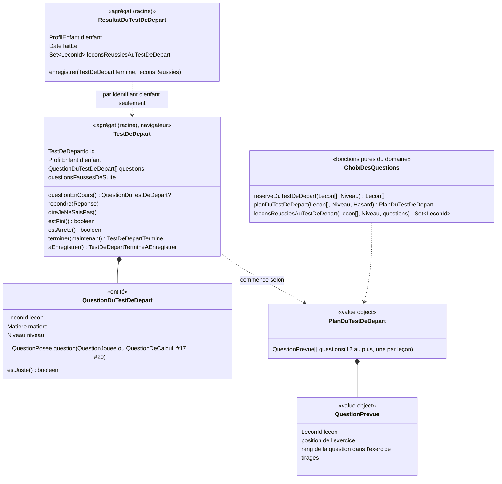

# Modèle du domaine : issue #27, Test de départ

## Contexte

Contexte **Apprentissage**. Le choix des questions, la règle d'arrêt et le résultat du test de départ sont des règles du domaine `apprentissage/domain/`, en TypeScript pur, importées par le front via `@domain/apprentissage` (décision 0003). Le test de départ se joue dans le navigateur, même sans réseau. Son résultat est revalidé par le serveur, comme une séance (décision 0013).

| Source ou destinataire | Contexte | Ce qui circule | Mécanisme |
|---|---|---|---|
| Leçons de la bibliothèque | Catalogue pédagogique | `Lecon` : `id`, `matiere`, `niveau`, `ordre`, `exercices` | Published Language `@domain/catalogue` (#16). Côté serveur, port `LeconsDuCatalogue`, qui doit pouvoir donner toutes les leçons (voir « Ports ») |
| Prénom et niveau du profil en cours | Famille | `ProfilEnCours.prenom`, `.niveau` | Customer/Supplier existant (#11). Le serveur relit le niveau du profil pour revalider |
| Meilleures étoiles du profil | Apprentissage (#24) | leçon → meilleures étoiles | Lecture existante sous RLS (#25). Elle sert à afficher le parcours et à compter les leçons « découvertes » par le test de départ |
| Parcours | Apprentissage (#25) | une nouvelle entrée : les leçons réussies au test de départ | Calcul pur existant, étendu |
| Paroles du personnage guide | Motivation (#6) | proposition, « C'est parti ! », phrase de fin | Customer/Supplier existant. Motivation fournit la phrase, Apprentissage fournit les faits (prénom, nombre de leçons) |
| Série, épisodes, cabane, objectif du jour | Motivation (lot 5, non livré) | `TestDeDepartTermine` | Événement. Motivation **ne réagit pas** au test de départ (issue). Rien n'est modélisé ici |
| Suivi, carte des compétences | Accompagnement (#34, non livré) | `TestDeDepartTermine` | Événement. #34 affichera une leçon « réussie au test de départ », jamais acquise (réponse 27.1) |
| Données personnelles | Famille (#14) | le résultat du test de départ | Contrat de données personnelles : suppression en cascade et export |

Le test de départ **n'est pas une séance** :
- il n'a pas de leçon propre ;
- il ne donne pas d'étoiles ;
- il ne publie pas `SeanceTerminee` ;
- il n'écrit rien dans les tables de séances. Donc rien n'arrive aux révisions (#28), à la série ou aux épisodes.

Il réutilise pourtant **la même correction** que la séance : `QuestionJouee` et `QuestionDeCalcul`, la nouvelle chance, « Je ne sais pas » et le compte des erreurs (#17, #20, #23). Le front ne réécrit aucune règle.

Hors de cette story :
- l'écran « Aujourd'hui » et sa tuile « Mon test de départ » (#29) ;
- série, épisodes, cabane et objectif du jour (Motivation, lot 5) ;
- badges (#31) ;
- suivi du parent (#34) ;
- révisions (#28) ;
- questions de boîte et de barres (#21, pas encore livrée ; voir 27.11) ;
- la copie sur l'appareil au lancement sans réseau (#44).

### Comportement actuel (`app/app.js`), source des règles

- `buildTest` (l. 1819) : réserve = leçons de la bibliothèque en `francais` et `maths`, de niveau ≤ niveau de l'enfant, triées par niveau puis `ordre` (les deux matières sont mêlées). Au plus 12 leçons prises à pas réguliers (pas = max(1, n / 12), indice `floor(i)`). Pour chaque leçon, une question tirée au hasard parmi celles de ses exercices, transformées par `questionsFrom` (l. 1127) :
  - conjugaison, classer et texte à trous deviennent des bulles ;
  - addition et boîte deviennent du calcul.
  Restent seulement `bulles`, `calcul`, `ecoute` et `barres`. Une leçon sans question utilisable est sautée.
- `playLesson`, partie `special === 'test'` (l. 1870 à 1905) :
  - une question est juste si elle n'a coûté aucune erreur ;
  - arrêt après 3 questions fausses de suite ;
  - pour chaque question juste, la leçon reçoit `{ etoiles: 1, test: true }`, sauf si elle a déjà une progression ;
  - `testFait = true` est enregistré même après un arrêt ;
  - pas de `Days.addSession`. `Review.add` ignore le test de départ (l. 1018).
- Après le test de départ, une séance « remplace » la progression qu'il a donnée : `max(étoiles, prev.test ? 0 : …)`, l. 1913. Le total d'étoiles et les badges ignorent `p.test` (l. 1761, 1790). Le suivi affiche « acquise au test » (l. 2074) et la carte des compétences la compte comme acquise (l. 2093).
- `offerTest` (l. 1832) : le texte de la proposition, puis « Oui, on y va ! » ou « Plus tard ». La proposition s'ouvre après la création d'un profil (l. 446, 462), depuis la tuile de « Aujourd'hui » (l. 589) et depuis « Refaire le test de départ » dans l'espace parent (l. 2160).

### Ce que change la décision « aucun verrou » de #25

Dans le legacy, une leçon réussie au test de départ **ouvrait** la suite. Il n'y a plus de verrou :
- la prochaine leçon est la **première leçon non réussie** du parcours ;
- une leçon réussie plus loin **ne la déplace pas** (règle 2 de #25, réponse N8).

La règle du legacy (« seule la leçon de la question juste est réussie ») ne change donc presque jamais la prochaine leçon. Le test de départ ne ferait pas « commencer au bon endroit ». La question 2 de l'issue devient la question centrale (27.2).

## Termes

| Terme | Statut | Remarque |
|---|---|---|
| Test de départ | au glossaire, **validé et précisé** (27.13) | La définition dit maintenant « s'arrête après 3 questions fausses de suite » : une même question peut coûter plusieurs erreurs (#23). |
| Proposition du test de départ | **nouveau**, validé | Écran où le personnage guide propose le test de départ : « Oui, on y va ! » ou « Plus tard ». |
| Question du test de départ | **nouveau**, validé | Une question tirée d'un exercice d'une leçon de la réserve, posée seule. Elle est rattachée à cette leçon. |
| Réserve du test de départ | **nouveau**, validé | Leçons qui peuvent fournir une question : bibliothèque, `francais` et `maths`, niveau ≤ celui de l'enfant. |
| Question juste, question fausse (au test de départ) | **nouveau**, validé | Juste : réussie sans aucune erreur, donc sans réponse fausse ni « Je ne sais pas ». Sinon fausse. L'enfant donne quand même la bonne réponse avant de passer à la suite (nouvelle chance). Ne pas confondre avec **Réponse** juste ou fausse. |
| Arrêt du test de départ | **nouveau**, validé | Fin anticipée après 3 questions fausses de suite. Une question juste remet le compte à zéro. |
| Leçon réussie au test de départ | **nouveau**, validé ; conflit avec « Leçon acquise » **levé** (27.1) | Leçon que le test de départ compte comme réussie, sans étoile (règle de 27.2). Elle n'est jamais acquise : la ligne « Leçon acquise » du glossaire ne cite plus le test de départ. Une leçon sans question possible placée avant une question juste l'est aussi (27.23). |
| Résultat du test de départ | **nouveau**, validé | Pour un enfant : la date du dernier test de départ fini et les leçons réussies au test de départ. Son existence dit que le test de départ est **fait**. |
| Test de départ fait | **nouveau**, validé | Le profil a fini au moins un test de départ, par toutes ses questions ou par un arrêt. Quitter en cours ne compte pas. Le legacy dit `testFait`. |
| Leçon réussie, Prochaine leçon, Leçon suivante, Parcours | au glossaire (validés, #25) | La leçon réussie s'étend : au moins 1 étoile **ou** réussie au test de départ (27.1, 27.7) ; la ligne du glossaire le dit. Les définitions de la prochaine leçon et de la leçon suivante disent « non réussie » et restent donc vraies. |
| Séance | au glossaire | Le test de départ **n'en est pas une** : pas d'étoiles, pas de `SeanceTerminee`. |
| Révision | au glossaire (à valider) | Les questions du test de départ n'y vont jamais. |
| Accueil de l'enfant | **nouveau**, validé (Famille, 27.22) | Écran de l'enfant après le choix de son profil dans « Qui joue ? ». Il mène à « Mon parcours » et, tant que le test de départ n'est pas fait, à « Mon test de départ ». #29 dira s'il devient « Aujourd'hui ». |
| Objectif du jour | **absent du glossaire** | L'issue parle de l'objectif du jour « Joue 2 leçons aujourd'hui ». C'est un terme de Motivation (#29, #30), à signaler à ces stories. Il n'est pas ajouté ici. |
| « Mon test de départ », « Fin du test de départ », « Pour savoir où commencer », « Voir mon parcours » | mots d'interface (27.22) | Hors glossaire. |
| test (seul), évaluation, examen, interrogation | **interdits** | Conflit n°2 du glossaire. La proposition dit justement « Ce n'est pas une interrogation ». |

## Modèle

Deux agrégats, petits et séparés :
1. **`TestDeDepart`** : le jeu en cours. Il vit dans le navigateur et le serveur le rejoue, comme `Seance`.
2. **`ResultatDuTestDeDepart`** : ce qui reste, un par profil enfant.

Ils ne sont pas réunis dans un même agrégat, parce qu'aucun invariant ne les lie. Un test en cours n'écrit rien : quitter en cours n'enregistre rien.

`ResultatDeLaLecon` (#24) **n'est pas modifié** : le test de départ ne touche aucune étoile. La règle « une progression existante n'est jamais modifiée » est donc vraie par construction. Le parcours réunit les deux sources.



### Choix des questions (`planDuTestDeDepart`, fonction pure, `Hasard`)

1. **Réserve** : leçons de la bibliothèque (jamais de leçon personnelle), `matiere` ∈ {`francais`, `maths`}, `niveau` ≤ niveau de l'enfant.
2. **Tri** : niveau croissant, puis `ordre`. À égalité, l'ordre des matières du Catalogue (`toutesLesMatieres` : français avant maths), puis l'identifiant. Le calcul est ainsi déterministe et le serveur retrouve le même ordre. Le legacy laissait l'ordre de la bibliothèque à égalité.
3. **Leçons retenues** : au plus **12**, à pas réguliers. Pas = max(1, n / 12). On prend l'indice `floor(i)` pour i = 0, pas, 2 × pas…
4. **Une question par leçon**, tirée au hasard (port `Hasard`) parmi les **questions admissibles** des exercices de la leçon. Les tirages propres à la question (choix mélangés, opération générée) sont gardés pour la revalidation, comme pour la séance (`Tireur`, #16).
5. Une leçon **sans question admissible est sautée**, sans être remplacée. Le test de départ peut donc avoir moins de 12 questions. Il peut aussi n'en avoir aucune (27.5).

**Questions admissibles** (proposition de 27.11, forme reprise du legacy) :

| Exercice de la leçon | Question du test de départ |
|---|---|
| `bulles` | une question, telle quelle |
| `ecoute` | un item, tel quel |
| `calcul` (liste ou générateur) | une opération (tirée si générateur) ; mode de réponse selon #20 |
| `conjugaison` | une forme, en question à choix : « Le verbe `<verbe>` au `<temps>` : `<pronom>` … » (la forme et deux autres formes du tableau) |
| `trous` | un trou, en question à choix : la phrase qui le contient, le mot attendu et deux candidats |
| `classer` | une étiquette, en question à choix : « « `<étiquette>` » va dans quelle maison ? », les groupes comme choix |
| `addition` | une addition tirée, posée **en ligne** comme un calcul |
| `dictee`, `lecture`, `ordre`, `memoriser`, `fluence` | **exclues** (27.6) |
| `boite`, `barres` | **exclues tant que #21 n'est pas livrée** (27.11) |

### Agrégat `TestDeDepart`

- **Racine** : `TestDeDepart`, identifié par `TestDeDepartId`. L'identifiant vient du port `GenerateurId` existant et sert de clé d'idempotence à l'envoi.
- **Commencer** : à partir d'un `PlanDuTestDeDepart` (dans le navigateur) ou des tirages reçus (sur le serveur).
- **Déroulé** :
  - les questions sont posées une à une, dans l'ordre du plan, sans étape de leçon ;
  - la correction est celle de la question jouée : nouvelle chance, aide, « Je ne sais pas » toujours permis ;
  - une question n'est passée qu'avec la bonne réponse.
- **Fin** : le test est **fini** quand toutes les questions du plan sont réussies, ou quand l'**arrêt** se produit.
- `terminer(maintenant)` produit le fait `TestDeDepartTermine` : identifiant, enfant, date, pour chaque question posée sa leçon et `juste`, et `arrete`.
- `aEnregistrer()` produit l'envoi `TestDeDepartTermineAEnregistrer` : identifiant, enfant, questions prévues (leçon, exercice, rang), tirages, réponses de chaque question, date de fin.
- **Quitter en cours** : rien n'est produit et rien n'est envoyé. Le test de départ reste à faire.

### Agrégat `ResultatDuTestDeDepart`

- **Racine** : identifiée par le `ProfilEnfantId`. Un seul par profil.
- **Contient** : `faitLe` (date du dernier test de départ fini) et l'ensemble des **leçons réussies au test de départ**.
- `enregistrer(fait, leconsReussies)` :
  - ajoute les leçons réussies à l'ensemble (réunion, 27.9) ;
  - met `faitLe` à jour, même si l'ensemble reçu est vide (arrêt dès les trois premières questions).
- Ensemble enregistré, et non recalculé à la lecture : une leçon ajoutée plus tard à la bibliothèque n'est pas réussie d'office (cohérent avec 25.13).
- **Pourquoi un agrégat à part de `ResultatDeLaLecon`** :
  - son invariant (« une leçon réussie au test de départ le reste ») porte sur le profil, pas sur une leçon ;
  - il ne doit jamais modifier une étoile ;
  - un enregistrement touche jusqu'à plusieurs dizaines de leçons (27.2), qui ne doivent pas entrer en concurrence avec les séances terminées.

### Leçons réussies au test de départ (`leconsReussiesAuTestDeDepart`, fonction pure)

Règle retenue (réponse 27.2, option b), isolée dans une fonction pure : le navigateur l'utilise pour la phrase de fin, le serveur pour enregistrer le résultat.

- Pour chaque matière, toutes les leçons de la réserve placées **avant ou à** une question juste sont réussies au test de départ, **sauf** les leçons dont la question était fausse.
- Cela comprend les leçons de la réserve qui n'ont pas été posées : leçons non retenues par le pas régulier, et leçons **sans question admissible** (ex. « La dictée des sons », que des dictées), dès qu'une question juste de la même matière vient après elles (réponse 27.23).
- Les leçons des classes d'avant comptent aussi (elles sont placées avant).

### Parcours (#25, étendu)

- `EntreesDuParcours` reçoit une entrée de plus : `leconsReussiesAuTestDeDepart: ReadonlySet<LeconId>`. Elle est vide sans test de départ.
- `EtatDansLeParcours` reçoit un état de plus : `reussieAuTestDeDepart`, sans étoiles (27.7). Si la leçon a aussi des meilleures étoiles, l'état `reussie(etoiles)` l'emporte.
- **Leçon réussie** dans le calcul : meilleures étoiles ≥ 1 **ou** réussie au test de départ. La prochaine leçon, le compteur (27.8) et `leconSuivanteDansLeParcours` suivent cette définition.
- `LeconReussieDUneClasseAuDessus` : les étoiles deviennent facultatives, pour une leçon réussie au test de départ d'un enfant redescendu de classe (27.15).

### Rejouer une leçon réussie au test de départ

C'est une séance ordinaire (#24). `ResultatDeLaLecon.enregistrerSeance` s'applique sans changement. Dès qu'une séance est terminée, le parcours affiche ses étoiles, même s'il n'y en a qu'une. La règle du legacy `max(étoiles, 0)` est donc respectée sans rien remplacer : rien n'est plus bas qu'1 étoile. `LeconReussie` est émis à cette première séance, comme pour toute leçon (#24). Motivation ne voit ainsi que des étoiles gagnées en séance.

### Commandes et lectures

| Commande ou lecture | Effet | Erreurs métier | Où |
|---|---|---|---|
| Lecture `TestDeDepartFait(profil)` | Dit si le profil a un résultat du test de départ, sous RLS. Sans réseau et sans réponse connue : on considère que le test n'est pas fait, sans erreur. | aucune | front, JWT du parent |
| `ProposerLeTestDeDepart` | Affiche la proposition dans trois cas : après la création d'un profil (premier profil ou ajout : l'espace parent se ferme, le profil créé devient le **profil en cours**, puis son personnage guide propose le test de départ ; 27.16, 27.19) ; depuis l'accueil de l'enfant tant que le test n'est pas fait (27.10) ; depuis « Refaire le test de départ » dans l'espace parent. « Plus tard » et le retour mènent à l'accueil de l'enfant. Seulement si la bibliothèque est chargée et que le plan n'est pas vide (27.5). | aucune | navigateur |
| `CommencerLeTestDeDepart(enfant, niveau, lecons)` | Construit le plan (`Hasard`) et commence `TestDeDepart`. | `ReserveVide` si aucune question admissible | navigateur |
| `Repondre`, `DireJeNeSaisPas` | Correction de la question en cours ; met à jour le compte des questions fausses de suite. | `TestDeDepartDejaFini` ; les erreurs existantes de la question jouée (`ChoixInconnu`, `JeNeSaisPasDejaDit`…) | navigateur |
| `TerminerLeTestDeDepart(parent, envoi)` | Vérifie le rattachement. Relit les leçons et le niveau du profil, **rejoue** les réponses, vérifie la règle d'arrêt, calcule les leçons réussies au test de départ, puis enregistre `ResultatDuTestDeDepart`. Publie `TestDeDepartTermine`. Idempotent : le même envoi deux fois ne change rien. | `ParentNonRattache`, `TestDeDepartIncoherent`, `TestDeDepartNonFini` | Edge Function `terminer-le-test-de-depart`, JWT du parent |
| Lecture des leçons réussies au test de départ du profil | Réunie avec les meilleures étoiles pour le parcours. | aucune | front, sous RLS |

**Revalidation** (`revaliderLeTestDeDepart`, domaine pur, reprend le principe de `revaliderLaSeance`). Le serveur refuse l'envoi entier (`TestDeDepartIncoherent`) dans les cas suivants :
- une question dont la leçon n'est pas dans la réserve (au niveau du profil **lu par le serveur**), ou dont l'exercice n'est pas admissible ;
- deux questions de la même leçon, ou plus de 12 questions ;
- des questions qui ne sont pas dans l'ordre du tri ;
- un tirage invalide ;
- une question qui ne finit pas par la bonne réponse ;
- une question posée après un arrêt ;
- un test qui s'arrête avant la fin sans 3 questions fausses de suite.

Le pas régulier n'est pas revérifié : voir 27.12. Le serveur ne fait jamais confiance au compte « juste ou fausse » envoyé par le front : il le recalcule.

**Ce qui est enregistré** (minimisation) : seulement `ResultatDuTestDeDepart` (date, leçons réussies au test de départ). Les questions, les réponses et les erreurs du test de départ ne sont **pas** gardées : elles ne servent à rien d'autre. Rien n'est écrit dans les tables de séances, donc rien n'arrive aux révisions.

### Ports

| Port | Couche | Existe ? | Usage |
|---|---|---|---|
| `Hasard` (`entre0et1()`) | `apprentissage/domain/hasard.ts` | **oui** (#16) ; adaptateur navigateur `src/hasard-navigateur.ts` | choix de la question de chaque leçon, choix mélangés |
| `GenerateurId` | `apprentissage/domain/generateur-id.ts` | oui | `TestDeDepartId` |
| `Tireur` (`tireurAuHasard`, `tireurSelonLesTirages`) | domaine | oui | tirages gardés puis relus par le serveur |
| `RattachementsDuParent` | `application/ports/` | oui | `TerminerLeTestDeDepart` |
| `LeconsDuCatalogue` | `application/ports/` | oui, **à étendre** | aujourd'hui `parId` seulement ; il faut aussi toutes les leçons, pour la réserve |
| `NiveauDuProfil` | `application/ports/` | **nouveau** | le serveur relit le niveau du profil (Famille, Customer/Supplier) |
| `ResultatsDesTestsDeDepart` | `application/ports/` | **nouveau** | `de(enfant)`, `enregistrer(resultat)` |

## Invariants

1. Les questions du test de départ viennent seulement de leçons de la bibliothèque, en français et en maths, de niveau ≤ celui de l'enfant.
2. Le test de départ pose **au plus 12 questions**, **au plus une par leçon**, dans l'ordre niveau, `ordre`, matière, identifiant (du plus facile au plus difficile).
3. Seules les questions admissibles sont posées : jamais de dictée, lecture, ordre, poésie, fluence (ni boîte et barres avant #21).
4. Une question est **juste** si et seulement si elle est réussie sans aucune erreur. Une réponse fausse ou « Je ne sais pas » la rend fausse.
5. L'enfant ne passe à la question suivante qu'avec la bonne réponse (nouvelle chance, #23).
6. **Après 3 questions fausses de suite, le test de départ s'arrête.** Aucune question n'est posée ensuite. Une question juste remet le compte à zéro.
7. Un test de départ arrêté est **fait**, comme un test allé jusqu'au bout. Un test quitté en cours n'est ni fait ni enregistré.
8. Le test de départ **ne modifie jamais une étoile** et ne crée aucun résultat de la leçon. Une leçon déjà jouée garde ses meilleures étoiles.
9. Une leçon réussie au test de départ le reste. Refaire le test de départ n'en retire aucune (27.9).
10. Les questions du test de départ ne vont **jamais** dans les révisions. Le test de départ n'est pas une séance : ni `SeanceTerminee`, ni jour de séance.
11. Le serveur recalcule les questions justes et les leçons réussies au test de départ. Il n'accepte qu'un test de départ cohérent. Un même envoi n'est compté qu'une fois.
12. Un parent ne lit et n'enregistre le test de départ que des enfants auxquels il est rattaché (domaine et RLS).

## Événements

| Événement | Émis par | Données | Écouté par |
|---|---|---|---|
| `TestDeDepartArrete` (fait interne) | `TestDeDepart`, à la 3e question fausse de suite | — | le front, pour passer à la fin (comme `EtapesDeLeconFinies`) |
| `TestDeDepartTermine` | `TerminerLeTestDeDepart`, après enregistrement | enfant, test, date, nombre de questions posées, nombre de questions justes, `arrete`, leçons réussies au test de départ | Motivation : **aucune réaction** (ni série, ni épisode, ni cabane, ni objectif du jour : 27.4). Accompagnement (#34) : suivi. Rien n'est consommé dans cette story. |

Événements **non** émis : `SeanceTerminee`, `LeconReussie`, `LeconAcquise`. Le parcours n'écoute aucun événement : il se recalcule à la lecture (#25).

## Partage avec le front

À exporter par `@domain/apprentissage` (`index.ts`) :
- `planDuTestDeDepart`, `reserveDuTestDeDepart`, `leconsReussiesAuTestDeDepart` ;
- `TestDeDepart`, `TestDeDepartId`, et les types `TestDeDepartTermine`, `TestDeDepartTermineAEnregistrer`, `QuestionDuTestDeDepart` ;
- les nouvelles erreurs ;
- l'entrée et l'état ajoutés au parcours.

Ce qui tourne **hors ligne** dans le navigateur :
- le choix des questions ;
- tout le déroulé (correction, règle d'arrêt) ;
- la phrase de fin (nombre de leçons « que tu connais déjà ») ;
- la mise à jour immédiate du parcours.

Le test fini est gardé sur l'appareil et renvoyé au retour du réseau, comme une séance (#24). React affiche la question en cours avec les composants existants (bulles, écoute, calcul), sans calculer.

Côté serveur seulement : `revaliderLeTestDeDepart` et `TerminerLeTestDeDepart`.

## Données d'enfants

**Nouvelle donnée personnelle** : le résultat du test de départ d'un profil, c'est-à-dire la date du dernier test fini et la liste des leçons réussies au test de départ. Elle sert directement l'apprentissage (point de départ du parcours) : conforme à la minimisation. Les réponses données et les erreurs ne sont pas gardées.

À respecter :
- RLS fondée sur le rattachement ;
- suppression en cascade avec le profil ;
- inclusion dans l'export (contrat #14). #14 n'est pas encore livrée : la donnée s'ajoute à la liste de ce que l'export devra contenir.

Rien n'est envoyé à l'IA. Aucune donnée sur l'appareil au-delà de l'envoi en attente, comme pour une séance.

## Emplacement

```
supabase/functions/_shared/apprentissage/
  domain/
    reserve-du-test-de-depart.ts              # reserveDuTestDeDepart (filtre et tri)
    plan-du-test-de-depart.ts                 # PlanDuTestDeDepart, QuestionPrevue, planDuTestDeDepart (pas régulier, Hasard)
    question-du-test-de-depart.ts             # questions admissibles d'un exercice, forme à choix (conjugaison, trous, classer), addition en ligne
    test-de-depart.ts                         # agrégat TestDeDepart, TestDeDepartTermine, règle d'arrêt
    test-de-depart-id.ts                      # TestDeDepartId
    test-de-depart-termine-a-enregistrer.ts   # envoi au serveur
    revalider-le-test-de-depart.ts            # rejoue un envoi (serveur)
    lecons-reussies-au-test-de-depart.ts      # règle de 27.2
    resultat-du-test-de-depart.ts             # agrégat ResultatDuTestDeDepart
    parcours.ts                               # modifié : entrée leconsReussiesAuTestDeDepart, état reussieAuTestDeDepart
    lecon-suivante-dans-le-parcours.ts        # modifié : « réussie » compte le test de départ
    erreurs.ts                                # ReserveVide, TestDeDepartDejaFini, TestDeDepartNonFini, TestDeDepartIncoherent
    index.ts                                  # exports
  application/
    terminer-le-test-de-depart.ts             # cas d'usage
    ports/resultats-des-tests-de-depart.ts    # nouveau port
    ports/niveau-du-profil.ts                 # nouveau port
    ports/lecons-du-catalogue.ts              # étendu : toutes les leçons
  infrastructure/
    resultats-des-tests-de-depart-supabase.ts
    niveau-du-profil-supabase.ts
  test_utils/
    resultats-des-tests-de-depart-en-memoire.ts
    lecons-du-test-de-depart.ts               # bibliothèque de test (CP, CE1, français et maths)
supabase/functions/terminer-le-test-de-depart/index.ts
supabase/migrations/<horodatage>_resultats_des_tests_de_depart.sql   # RLS par rattachement, cascade avec le profil, écriture par la seule Edge Function (décisions 0013, 0016)
src/test-de-depart/                           # proposition, déroulé, écran de fin
src/famille/                                  # bouton sur l'accueil de l'enfant (27.10), « Refaire le test de départ » dans l'espace parent, fermeture de l'espace parent et proposition après la création d'un profil (27.19)
src/parcours/                                 # lecture des leçons réussies au test de départ, nouvel état
```

`ResultatDeLaLecon` et la table `resultats_des_lecons` (#24) ne changent pas. Elles exigent au moins une séance et 1 à 3 étoiles, ce que le test de départ n'a pas : c'est une raison de plus pour un agrégat à part.

## Décisions

Le PO a suivi **toutes les recommandations** des questions 27.1 à 27.23 (réponse « 27# reco OK », 2026-10-24). Les questions 27.17 à 27.23 sont dans `docs/stories/27/acceptance.md`. Ce qu'elles changent au modèle :
- **27.1, 27.13** : une leçon validée par le test de départ est **réussie**, sans étoile, jamais acquise ; l'arrêt porte sur 3 questions fausses de suite. Glossaire corrigé.
- **27.2, 27.23** : règle (b) de `leconsReussiesAuTestDeDepart`, leçons sans question admissible comprises.
- **27.16, 27.19** : après la création d'un profil, l'espace parent se ferme, le profil créé devient le profil en cours, puis la proposition s'affiche.
- **27.10, 27.22** : **Accueil de l'enfant** entre au glossaire (Famille) ; il porte « Mon test de départ » tant que le test n'est pas fait.
- **27.14, 27.17** : la phrase de fin compte les leçons nouvellement réussies ; au singulier « Tu connais déjà 1 leçon : je l'ai cochée. ».
- **27.18, 27.20, 27.21** : affichage seulement (message hors ligne de la séance, avancement de la séance, « Voir mon parcours » ouvre « Mon parcours ») ; aucun changement du modèle.
- Les termes ajoutés pour #27 sont validés (glossaire, Décision n°35). Reste hors de #27 : « Objectif du jour » (Motivation, #29 ou #30).

## Questions ouvertes

Toutes tranchées (voir « Décisions »). Numérotation gardée.

Les questions 27.1 à 27.6 reprennent celles de l'issue, dans l'ordre. Les suivantes viennent de la décision « aucun verrou » de #25 et du passage à la cible.

**27.1. Réussie ou acquise ?** Le glossaire dit qu'une leçon validée par le test de départ est **acquise** (compétence et badge). Le legacy lui donne 1 étoile, comme une leçon **réussie**, sans badge, mais le suivi du parent l'affiche « acquise au test ».
- **Recommandation** : **réussie**, sans étoile et sans badge.
  - Elle fait avancer le parcours.
  - Elle ne compte ni pour la cabane, ni pour les badges, ni pour la compétence acquise.
  - Le suivi (#34) l'affichera « réussie au test de départ ».
- Conséquence : la ligne « Leçon acquise » du glossaire perd « ou validée par le test de départ » (correction faite, Décision n°35 du glossaire).
- **Tranchée** (PO, 2026-10-24) : recommandation retenue.

**27.2. Quelles leçons le test de départ rend-il réussies ?** Sans verrou, une leçon réussie au milieu du parcours ne déplace pas la prochaine leçon (règle 2 de #25, réponse N8). Avec la seule leçon de la question juste, le test de départ ne fait donc presque jamais « commencer au bon endroit ».

Exemple : Léa, en CE1. Ses questions de français portent, dans l'ordre du parcours, sur les leçons F2, F6, F10 et F14. F2 juste, F6 fausse, F10 juste, F14 fausse.
- **(a)** Legacy : seules F2 et F10 sont réussies. La prochaine leçon reste F1.
- **(b)** Toutes les leçons de français avant F10 et jusqu'à F10 sont réussies, **sauf F6** (question fausse). F1 à F5 et F7 à F10 sont réussies. La prochaine leçon devient F6 : la première chose que Léa ne sait pas.
- **(c)** Toutes les leçons jusqu'à la dernière question juste, F6 comprise. La prochaine leçon devient F11.
- **(d)** On ne coche aucune leçon de plus que (a), mais on retient une « leçon de départ » par matière. La prochaine leçon devient F11, les leçons d'avant restent « à découvrir ». Il faut alors changer la définition validée de la prochaine leçon.

Dans tous les cas, la règle s'applique matière par matière et compte aussi les leçons du CP d'un enfant de CE1 : elles sont placées avant celles du CE1 et s'afficheront dans les classes d'avant (#26).
- **Recommandation** : **(b)**. Elle fait commencer l'enfant à sa première lacune, sans le faire refaire ce qu'il sait déjà. Elle ne coche jamais une leçon dont la question était fausse.
- **Tranchée** (PO, 2026-10-24) : recommandation retenue.

**27.3. Changement de classe.** Un enfant qui passe du CE1 au CE2 a déjà un test de départ fait. Faut-il le lui proposer de nouveau ?
- **Recommandation** : **non**, pas de proposition automatique. Les étoiles et les leçons réussies au test de départ sont gardées (décision n°7 du lot 2). Le parent peut toujours utiliser « Refaire le test de départ ».
- **Tranchée** (PO, 2026-10-24) : recommandation retenue.

**27.4. Objectif du jour.** Le test de départ compte-t-il dans l'objectif du jour (« Joue 2 leçons aujourd'hui »), ou pour la série, les épisodes ou la cabane ?
- **Recommandation** : **non, pour rien de tout cela**. Le test de départ n'est pas une séance : il ne publie pas `SeanceTerminee` et Motivation ignore `TestDeDepartTermine`. Le défaut du legacy (la date de la progression qui compte dans l'objectif du jour) disparaît. Rien n'est modélisé côté Motivation dans cette story.
- **Tranchée** (PO, 2026-10-24) : recommandation retenue.

**27.5. Bibliothèque non chargée, ou aucune question.** Que faire si la bibliothèque n'est pas chargée (premier lancement sans réseau), ou si la réserve ne donne aucune question (ex. une classe sans leçon de français ni de maths) ?
- **Recommandation** :
  - la proposition **n'est pas affichée**, sans message d'erreur ;
  - après la création du profil, on va directement à l'accueil de l'enfant ;
  - la proposition revient (bouton de l'accueil, 27.10) dès que la bibliothèque est chargée et qu'il y a au moins une question ;
  - le test n'est pas marqué fait.
- **Tranchée** (PO, 2026-10-24) : recommandation retenue.

**27.6. Dictée et lecture exclues.** Les questions de dictée et de lecture sont exclues, ce qui pèse surtout au CP. Est-ce voulu ?
- **Recommandation** : **oui, garder l'exclusion**, ainsi que pour ordre, poésie et fluence.
  - Une dictée demande le clavier et un mot complet.
  - Une lecture demande de lire tout un texte.
  - Ces questions sont longues pour un test de départ, et leur échec tient souvent à l'outil plus qu'à la leçon.
  - Une leçon de CP qui n'a que ces exercices est sautée.
- **Tranchée** (PO, 2026-10-24) : recommandation retenue.

**27.7. Affichage d'une leçon réussie au test de départ dans « Mon parcours ».** Le domaine peut soit lui donner un état propre, soit la montrer comme « réussie, 1 étoile ».
- **Recommandation** : un **état propre**, coché **sans étoile**.
  - Lecteur d'écran : « `<titre>` : réussie au test de départ ».
  - Dès qu'une séance est terminée, les étoiles gagnées la remplacent, même s'il n'y en a qu'une (aucune étoile n'est donnée sans séance).
- **Tranchée** (PO, 2026-10-24) : recommandation retenue, texte compris.

**27.8. Compteur et leçon suivante.** Les leçons réussies au test de départ comptent-elles dans le compteur « n leçons réussies sur N » ? Sont-elles sautées par « Leçon suivante » en fin de séance, comme une leçon réussie ?
- **Recommandation** : **oui aux deux**, puisqu'elles sont réussies (27.1).
- **Tranchée** (PO, 2026-10-24) : recommandation retenue.

**27.9. Refaire le test de départ.**
- (a) Un nouveau test de départ pose-t-il des questions sur des leçons déjà réussies (en séance ou au test) ?
- (b) Une leçon réussie au premier test, dont la question est fausse au second, cesse-t-elle d'être réussie ?
- (c) Après « Refaire le test de départ », si l'enfant répond « Plus tard », le bouton du test de départ revient-il sur son accueil ?
- **Recommandation** :
  - (a) oui, le choix des questions ne regarde pas les résultats ;
  - (b) non, une leçon réussie le reste, et les deux tests s'ajoutent ;
  - (c) non, le test de départ reste fait, et le parent peut le reproposer.
- **Tranchée** (PO, 2026-10-24) : recommandation retenue.

**27.10. Où trouver la proposition avant l'écran « Aujourd'hui » (#29) ?** La tuile « Mon test de départ » n'existe pas encore, et « Plus tard » menait à « Aujourd'hui ».
- **Recommandation** :
  - un bouton « Mon test de départ » sur l'accueil de l'enfant, à côté de « Mon parcours », tant que le test de départ n'est pas fait ;
  - « Plus tard » et le retour mènent à cet accueil ;
  - #29 remplacera ce bouton par la tuile.
- **Tranchée** (PO, 2026-10-24) : recommandation retenue.

**27.11. Forme des questions, boîte et barres.**
- (a) Conjugaison, texte à trous et classer deviennent une **question à choix** (une forme, une phrase, une étiquette), et l'addition un **calcul en ligne**, comme dans le legacy. On ne garde pas le tableau, le texte entier ou le glissement des étiquettes.
- (b) Les questions de **boîte** et de **barres** sont exclues tant que #21 n'est pas livrée. #21 (ou une petite story après elle) les ajoutera.
- **Recommandation** : oui pour (a) et (b).
- **Tranchée** (PO, 2026-10-24) : recommandation retenue.

**27.12. Revalidation après un test hors ligne.** Entre la fin du test et l'envoi, la bibliothèque peut changer, ou le niveau du profil peut être modifié par l'autre parent.
- **Recommandation** :
  - le serveur vérifie que chaque question vient d'une leçon admissible au niveau **actuel** du profil, et que l'ordre, le maximum de 12, la règle d'arrêt et les réponses sont respectés ;
  - il ne revérifie **pas** le pas régulier (trop sensible au moindre ajout de leçon) ;
  - une leçon retirée de la bibliothèque entre-temps est ignorée (non cochée), sans refuser tout le test ;
  - une question au-dessus du niveau actuel fait refuser le test (`TestDeDepartIncoherent`), qui reste alors à faire.
- **Tranchée** (PO, 2026-10-24) : recommandation retenue.

**27.13. Définition du glossaire.** « Test de départ » dit « Il s'arrête après 3 erreurs de suite ». La règle porte sur **3 questions fausses de suite** (une question peut coûter plusieurs erreurs).
- **Recommandation** : préciser la ligne (« … après 3 questions fausses de suite ») et valider le terme (correction faite, Décision n°35 du glossaire).
- **Tranchée** (PO, 2026-10-24) : recommandation retenue.

**27.14. Phrase de fin.** « Tu connais déjà 3 leçons : je les ai cochées. » Avec la règle (b) de 27.2, le nombre peut dépasser 12.
- **Recommandation** : compter les leçons **nouvellement** réussies grâce à ce test, c'est-à-dire celles qui n'étaient réussies ni en séance ni par un test précédent. Sans aucune, dire la phrase « Maintenant, je sais par où commencer ».
- Sans son d'étoiles (défaut du legacy corrigé), un seul bouton « Voir mon parcours ».
- **Tranchée** (PO, 2026-10-24) : recommandation retenue.

**27.15. Enfant redescendu de classe.** Une leçon de CE2 réussie au test de départ, chez un enfant redescendu en CE1, va-t-elle dans le bloc « Déjà réussies en CE2 » (#25, N1) ?
- **Recommandation** : **oui**, sans étoile. Lecteur d'écran : « `<titre>`, CE2 : réussie au test de départ ».
- **Tranchée** (PO, 2026-10-24) : recommandation retenue.

**27.16. Lien avec la création du profil.** Faut-il proposer le test de départ juste après la création du **premier** profil, et aussi après « + Ajouter un enfant » ?
- **Recommandation** : **oui dans les deux cas**, comme le legacy. Le profil créé devient le profil en cours, puis la proposition s'affiche.
- **Tranchée** (PO, 2026-10-24) : recommandation retenue.

Remarques pour les autres stories (pas des questions au PO) :
- #28 (révisions) : les questions du test de départ ne sont jamais enregistrées comme questions de séance. Les révisions n'ont rien à filtrer.
- #29 : la tuile « Mon test de départ » lit `TestDeDepartFait` et remplace le bouton de l'accueil (27.10).
- #30, #31, #32, #33 (Motivation) : ignorer `TestDeDepartTermine`. Les leçons réussies au test de départ n'ont pas d'étoile, donc rien à exclure du total.
- #34 (suivi) : afficher « réussie au test de départ » et ne pas compter ces leçons comme acquises (réponse 27.1).
- #14 (export) : ajouter le résultat du test de départ à l'export.
- Story de Famille qui retire le parcours libre (N2) : sans effet ici.
