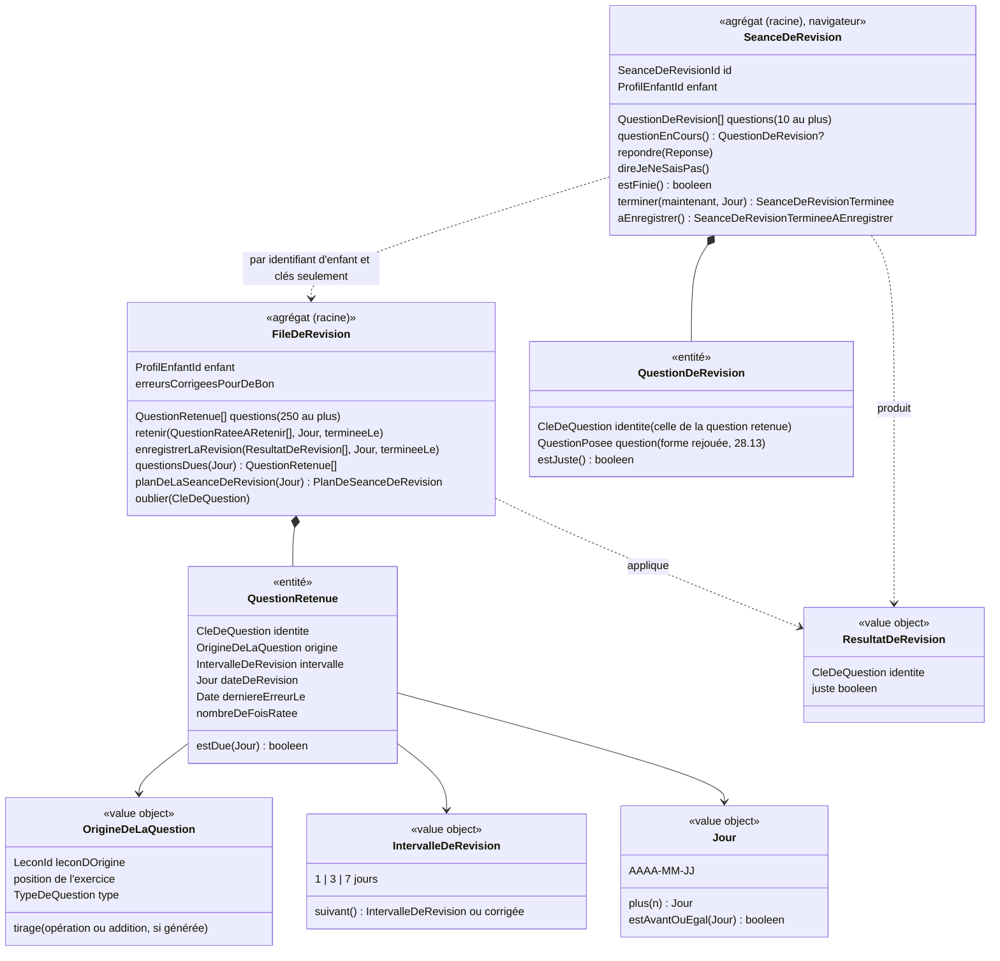

# Modèle du domaine : issue #28, Révisions des erreurs

## Contexte

Contexte **Apprentissage**. Retenir une question ratée, calculer sa date de révision, choisir les questions dues et appliquer le résultat d'une séance de révision sont des règles du domaine `apprentissage/domain/`, en TypeScript pur, importées par le front via `@domain/apprentissage` (décision 0003). La séance de révision se joue dans le navigateur, même sans réseau ; elle est revalidée par le serveur, comme une séance (décisions 0013, 0016).

| Source ou destinataire | Contexte | Ce qui circule | Mécanisme |
|---|---|---|---|
| Séance terminée (#24) | Apprentissage | les questions ratées de la séance, avec leur origine (leçon, exercice, tirage) | Fait `SeanceTerminee`, déjà revalidé par le serveur ; la file de révision est mise à jour dans le même enregistrement (voir 28.11) |
| Leçons de la bibliothèque | Catalogue pédagogique | `Lecon` (titre, exercices) | Published Language `@domain/catalogue`. Le front relit la leçon d'origine pour rejouer une question ; le serveur la relit par le port `LeconsDuCatalogue` pour revalider |
| Prénom et niveau du profil en cours | Famille | `ProfilEnCours.prenom`, `.niveau` | Customer/Supplier existant (mode de réponse d'un calcul, #20 ; phrase de fin) |
| Paroles du personnage guide | Motivation (#6) | phrase d'accueil de la séance de révision, félicitation, encouragement, phrase de fin | Customer/Supplier existant. Apprentissage fournit les faits (nombre de questions, questions justes), Motivation la phrase |
| Série, épisodes (lot 5, non livrés) | Motivation | `SeanceDeRevisionTerminee` | Événement publié ici, consommé par #30 et #33. Le comptage n'est pas modélisé ici |
| Suivi, conseil au parent (lot 6, non livrés) | Accompagnement | file de révision (nombre de fois ratée, erreurs corrigées pour de bon) | Lecture sous RLS, plus tard (#34, #35). Données retenues dès maintenant : voir 28.20 |
| Données personnelles | Famille (#14) | file de révision, séances de révision terminées | Contrat de données personnelles : cascade et export |

Ce que la story **ne fait pas** :
- l'écran « Aujourd'hui » et sa tuile « À revoir » (#29) : un bouton provisoire sur l'accueil de l'enfant (28.8) ;
- le comptage de la séance de révision dans la série et les épisodes (#30, #33) : seul l'événement est publié ;
- le compteur « erreurs corrigées pour de bon » et le conseil dans le suivi du parent (#34, #35) ;
- la fusion de deux files modifiées sur deux appareils hors ligne (lot 7, #44) : signalée seulement (28.12) ;
- la copie de la file sur l'appareil au lancement sans réseau (#44) ;
- les mots de la semaine (#37) : leurs séances terminées passeront par la même règle ;
- les vues `parcours.ts` et `toutes-les-lecons.ts` (#26 en parallèle) : non touchées. Une séance de révision ne change pas le parcours.

### Comportement actuel (`app/app.js`), source des règles

- `Review.add` (l. 1017), appelé par `remember` : chaque question ratée (réponse fausse ou « Je ne sais pas ») est gardée sous une clé (`b:`, `l:`, `c:`… + texte normalisé), avec une copie de l'exercice réduit à cette question, `box: 0`, `due` = demain à minuit (heure de l'appareil), `fails + 1`, le titre de la leçon **en cours** et `vu` (date de l'erreur). Rien pendant le test de départ. Au-delà de 250, les questions dont `vu` est le plus ancien sont oubliées.
- `Review.result` (l. 1025) : juste → `box + 1` ; à `box` 3, la question sort et `acquis + 1`, sinon `due` = dans 3 jours (box 1) ou 7 jours (box 2). Fausse → `box` 0, demain.
- `playReview` (l. 1813) : les questions dues triées par `due` croissant, 10 au plus. Sans question due, retour à « Aujourd'hui ».
- `playLesson`, partie `special === 'revision'` (l. 1869, 1897) : phrase d'accueil du personnage guide ; à la fin, `Review.result(clé, juste)` pour chaque question, juste = réussie sans erreur. Les erreurs pendant la révision appellent aussi `remember`, avec la clé de la question **rejouée** et le titre « Je révise mes erreurs » : d'où les deux défauts de l'issue.
- `questionsFrom` (l. 1127) : conjugaison, classer, texte à trous → bulles ; addition, boîte → calcul ; dictée, lecture, écoute, barres gardent leur type. `ordre` et `memoriser` ne donnent rien : ils ne sont jamais retenus.

### Ce que le code cible donne déjà

- `CleDeQuestion` (`domain/cle-de-question.ts`) : préfixe du type + texte normalisé, comme le legacy. La séance garde, pour chaque question ratée, sa clé, son nombre d'erreurs et « Je ne sais pas » (`QuestionRatee`, `SeanceTerminee.questionsRatees`), et le serveur les enregistre dans `questions_des_seances` (#24).
- Les clés ne sont **pas stables** entre la forme jouée en séance et une forme rejouée seule : en séance, `classer` donne `k:<étiquette><groupes>` mais la question à choix du test de départ `k:<étiquette>` ; une addition posée donne une clé par chiffre (`h:`) et par colonne (`u:`), le calcul en ligne `n:<a> + <b>`. Le modèle n'identifie donc **jamais** une question retenue par la clé de la question rejouée (invariant 3).
- `questionDuTestDeDepart` (#27) sait déjà poser seule une question tirée d'un exercice (bulles, écoute, calcul, conjugaison, texte à trous, classer, addition). La question de révision en reprend le principe et l'étend (lecture, dictée, boîte, barres).
- Pas de port `Horloge` dans le domaine : seulement `src/seance/horloge.ts` (`maintenant()`, `battre`) côté front, et des `Date` passées en paramètre (`terminer(maintenant)`). Le domaine reste ainsi : il reçoit le **jour** (voir `Jour`).

## Termes

| Terme | Statut | Remarque |
|---|---|---|
| Révision | au glossaire, **précisé** (réponse 28.7) | Désigne le mécanisme seulement (questions ratées qui reviennent à 1, 3 puis 7 jours). Le modèle distingue la **séance de révision** (la séance) et la **file de révision** (ce qui est retenu). Précision ajoutée au glossaire par une note, la ligne existante n'est pas réécrite |
| Séance de révision | **validé** | Séance sans leçon ni étape de leçon, qui pose les questions dues, 10 au plus. Interface : « Je révise mes erreurs ». Conflit avec « Séance » levé : « Séance » inclut la séance de révision (réponse 28.16) |
| File de révision | **validé** | Pour un profil enfant, toutes ses questions retenues, et le nombre d'erreurs corrigées pour de bon |
| Question ratée | **validé**, déjà dans le code (`QuestionRatee`, #24) | Question d'une séance qui a coûté au moins une erreur (réponse fausse ou « Je ne sais pas »). Le glossaire interdit « question ratée » comme synonyme de « question fausse (au test de départ) » : pas de conflit, le test de départ n'en produit jamais |
| Question retenue | **validé** | Question ratée gardée dans la file de révision, avec son origine, son intervalle de révision, sa date de révision et son nombre de fois ratée. Le legacy dit « retenir » (`remember`) |
| Leçon d'origine | **validé** | Leçon de la séance où la question a été ratée. Elle ne change jamais, même si la question est ratée de nouveau pendant une séance de révision (défaut 1 corrigé) |
| Intervalle de révision | **validé**, remplace « boîte » | 1, 3 ou 7 jours : écart entre le jour du dernier passage et la date de révision. **« Boîte » est interdit** : c'est déjà la boîte à jetons, et un synonyme interdit de Groupe (28.7) |
| Date de révision | **validé** | Jour à partir duquel une question retenue est due. C'est un jour, pas une heure : « demain » commence à minuit, heure de l'appareil |
| Question due | **validé** | Question retenue dont la date de révision est aujourd'hui ou avant |
| Question juste, question fausse (en révision) | **validé**, même règle qu'au test de départ | Juste : réussie sans aucune erreur. Fausse : au moins une réponse fausse ou « Je ne sais pas » ; l'enfant donne quand même la bonne réponse avant de continuer |
| Erreur corrigée pour de bon | **validé** | Question retenue juste en séance de révision à l'intervalle de 7 jours : elle sort de la file. Le legacy dit `acquis` : à ne pas confondre avec **Leçon acquise** |
| Nombre de fois ratée | **validé** | Combien de fois une question retenue a été ratée (séances et séances de révision). Sert au conseil du parent (lot 6). « Échec » est un synonyme interdit d'Erreur : le legacy `fails` ne donne pas son nom |
| Jour | **validé**, partagé avec #30 | Jour du calendrier de l'appareil (date sans heure). Sert à la date de révision ici, au jour de séance et à la série au lot 5 |
| Question oubliée | **validé** (limite de 250 gardée, réponse 28.3) | Question retirée de la file sans être corrigée : limite atteinte, ou leçon retirée de la bibliothèque (28.15). Elle ne compte pas comme corrigée |
| Erreur | au glossaire (validé) | « Je ne sais pas » coûte une erreur : une question avec « Je ne sais pas » est donc toujours ratée (28.4) |
| Étoile | au glossaire (validé) | « Récompense d'une séance… ». La séance de révision n'en donne pas (réponse 28.2) |
| Jour de séance | au glossaire (validé), **précisé** (réponse 28.16) | Jour où l'enfant a terminé au moins une séance ou une séance de révision (note ajoutée au glossaire) |
| « À revoir », « Je révise mes erreurs », « Révision » (sous-titre), « petite erreur des jours passés » | mots d'interface | Hors glossaire. « Revoir » et « rattrapage » restent interdits dans le domaine |

## Modèle

Deux agrégats, petits et séparés, comme `TestDeDepart` et `ResultatDuTestDeDepart` (#27) :
1. **`FileDeRevision`** : ce qui reste, une par profil enfant.
2. **`SeanceDeRevision`** : le jeu en cours. Elle vit dans le navigateur et le serveur la rejoue.

Aucun invariant ne lie une séance de révision en cours à la file : quitter en cours n'écrit rien. La séance de révision ne connaît que les **identifiants** des questions retenues qu'elle pose.



### Value object `Jour`

- Un jour du calendrier, sans heure ni fuseau (`AAAA-MM-JJ`). `plus(n)`, comparaison.
- Il est calculé **une seule fois**, sur l'appareil, au moment de la fin : `jourDe(maintenant, decalageDeLAppareil)` (fonction pure ; l'heure vient de l'`Horloge` du front, le décalage de l'appareil en minutes). Il est envoyé avec la séance. Le serveur ne devine jamais le fuseau (28.9).
- Le serveur vérifie seulement qu'il est cohérent avec la date de fin (écart d'au plus 14 heures avec le jour UTC).

### Agrégat `FileDeRevision`

- **Racine** : identifiée par le `ProfilEnfantId`. Une seule par profil. Elle existe vide tant qu'aucune question n'est ratée.
- **Contient** : les questions retenues (entités, identifiées dans la file par leur `CleDeQuestion` d'origine), et le compteur `erreursCorrigeesPourDeBon`.
- **Pourquoi un agrégat par profil, et pas un par question** : la limite de 250 et l'oubli des plus anciennes portent sur toute la file. La limite est gardée (réponse 28.3) : `FileDeRevision` reste un agrégat par profil.
- **Pourquoi à part de `ResultatDeLaLecon`** : la file ne touche aucune étoile ; une même question peut venir de plusieurs séances ; une séance de révision touche plusieurs leçons d'origine.

`retenir(questionsRatees, jour, termineeLe)`, appelé pour chaque séance terminée (pas pour le test de départ, qui n'est pas une séance) :
- seules les questions ratées d'un type retenu (28.13) sont prises ;
- question absente : elle entre avec l'intervalle 1, la date de révision `jour + 1`, nombre de fois ratée 1 ;
- question déjà retenue : intervalle 1, date de révision `jour + 1`, nombre de fois ratée + 1, **origine inchangée** (28.18) ;
- `derniereErreurLe` = `termineeLe` ;
- au-delà de 250 questions, les questions dont la dernière erreur est la plus ancienne sont oubliées (réponse 28.3).

`enregistrerLaRevision(resultats, jour, termineeLe)`, appelé pour chaque séance de révision terminée :
- question juste : l'intervalle passe à 3, puis à 7 ; la date de révision devient `jour + intervalle`. Juste à l'intervalle 7 : la question sort de la file et `erreursCorrigeesPourDeBon + 1` ;
- question fausse : intervalle 1, date de révision `jour + 1`, nombre de fois ratée + 1, `derniereErreurLe` = `termineeLe`. L'origine ne change pas, et aucune autre question n'est retenue (défauts 1 et 2 corrigés) ;
- un résultat pour une question absente de la file (corrigée ou oubliée entre-temps) est ignoré ;
- un résultat plus ancien que la dernière erreur de la question est ignoré : la question a été ratée de nouveau après (28.12).

`questionsDues(jour)` : les questions dont la date de révision est `≤ jour`.

`planDeLaSeanceDeRevision(jour)` : les questions dues, triées par date de révision, puis par dernière erreur, puis par clé (ordre déterministe, 28.19), **10 au plus**. Erreur `AucuneQuestionDue` si la liste est vide.

### Value object `OrigineDeLaQuestion`

Ce qu'il faut pour **rejouer** la question, sans recopier son contenu (le contenu reste dans la bibliothèque) :
- la leçon d'origine (identifiant) ;
- la position de l'exercice dans la leçon ;
- le type de la question ;
- le **tirage** propre à la question quand elle est générée : l'opération tirée d'un calcul à générateur, les nombres d'une addition tirée (28.14). Rien pour une question écrite dans la leçon.

La question est retrouvée dans l'exercice **par sa clé** (on recalcule la clé de chaque question de l'exercice), pas par un rang : une leçon retouchée par le pipeline de contenu ne décale rien. Pour une question générée, le tirage la redonne. Une question introuvable est oubliée (28.15).

La séance la calcule elle-même pour chaque question ratée (`QuestionRateeARetenir` = `QuestionRatee` + origine), dans le navigateur comme sur le serveur qui la rejoue : le serveur ne fait jamais confiance à une origine envoyée par le front.

**Identité d'une question retenue** : la `CleDeQuestion` de la question ratée en séance, sauf pour l'addition posée. Une addition ratée (à l'étape poser ou calculer) donne **une seule** question retenue, de clé `n:<a> + <b>` (comme le legacy et le test de départ), et non une par chiffre ou par colonne (28.13).

### Agrégat `SeanceDeRevision`

- **Racine** : identifiée par `SeanceDeRevisionId` (port `GenerateurId` existant), clé d'idempotence de l'envoi.
- **Commencer** : à partir du plan (`planDeLaSeanceDeRevision`), des leçons d'origine (Catalogue) et d'un `Tireur` (choix mélangés), dans le navigateur ; à partir des tirages reçus, sur le serveur.
- **Déroulé** : comme le test de départ, sans règle d'arrêt :
  - pas d'étape de leçon ; les questions sont posées une à une, dans l'ordre du plan ;
  - la correction est celle de la question jouée : nouvelle chance, aide, « Je ne sais pas » ;
  - une question n'est passée qu'avec la bonne réponse.
- `terminer(maintenant, jour)` produit `SeanceDeRevisionTerminee` : identifiant, enfant, date, jour, et pour chaque question son identité et `juste`. Refusé si une question n'est pas réussie (`SeanceDeRevisionNonFinie`) ou si c'est déjà fait (`SeanceDeRevisionDejaTerminee`).
- `aEnregistrer()` produit l'envoi `SeanceDeRevisionTermineeAEnregistrer` : identifiant, enfant, identités des questions dans l'ordre, tirages, réponses de chaque question, date de fin, jour.
- **Quitter en cours** : rien n'est produit ni envoyé ; la file ne change pas.
- **Étoiles** : aucune (réponse 28.2). `ResultatDeLaLecon` n'est jamais touché.

### Question de révision (`questionDeRevision`, fonction pure)

`questionDeRevision(lecon, origine, identite, tireur, niveau)` pose seule la question retenue, dans la forme de 28.13. Elle généralise `questionDuTestDeDepart` (#27) sans en changer le comportement. La `QuestionDeRevision` garde l'identité de la question retenue, quelle que soit la clé de la forme rejouée.

### Revalidation par le serveur (`revaliderLaSeanceDeRevision`, domaine pur)

Le serveur relit la file du profil et les leçons d'origine, reconstitue la séance avec les mêmes tirages et **rejoue les réponses**. Il recalcule `juste` pour chaque question. Il refuse l'envoi entier (`SeanceDeRevisionIncoherente`) dans les cas suivants :
- plus de 10 questions, ou deux fois la même ;
- un tirage invalide ;
- une question qui ne finit pas par la bonne réponse, ou une réponse après la réussite ;
- un jour incohérent avec la date de fin.

Il **ne refuse pas** l'envoi, mais ignore la question, quand elle n'est plus dans la file (corrigée sur un autre appareil, oubliée), ou n'était pas due au jour envoyé, ou que sa leçon d'origine a disparu. Il ne revérifie pas l'ordre du plan (la file a pu changer depuis l'autre appareil, comme le pas régulier en 27.12). Voir 28.12.

### Commandes et lectures

| Commande ou lecture | Effet | Erreurs métier | Où |
|---|---|---|---|
| `TerminerLaSeance` (#24, **étendu**) | Après la revalidation, retient les questions ratées dans la file de révision du profil, dans le **même** enregistrement que la séance (28.11). Une séance déjà enregistrée ne retient rien de plus. | existantes | Edge Function `terminer-la-seance` |
| Lecture `FileDeRevisionDuProfil(profil)` | Questions retenues du profil, sous RLS. Le front calcule les questions dues avec `questionsDues(jour)`. Sans réseau et sans file connue : aucune question due, sans erreur (28.21). | aucune | front, JWT du parent |
| `ProposerLaSeanceDeRevision` | Bouton sur l'accueil de l'enfant, seulement s'il y a au moins une question due (28.8). | aucune | navigateur |
| `CommencerLaSeanceDeRevision(enfant, file, lecons, jour)` | Construit le plan et commence `SeanceDeRevision`. | `AucuneQuestionDue` (retour à l'accueil de l'enfant) | navigateur |
| `Repondre`, `DireJeNeSaisPas` | Correction de la question en cours. | `SeanceDeRevisionDejaFinie` ; erreurs existantes de la question jouée | navigateur |
| `TerminerLaSeanceDeRevision(parent, envoi)` | Vérifie le rattachement, revalide, applique les résultats à la file, enregistre la séance de révision terminée (idempotent par identifiant). Publie `SeanceDeRevisionTerminee` et, s'il y en a, `ErreursCorrigeesPourDeBon`. | `ParentNonRattache`, `SeanceDeRevisionIncoherente`, `SeanceDeRevisionNonFinie` | Edge Function `terminer-la-seance-de-revision`, JWT du parent pour le contrôle, `service_role` pour l'écriture (0016) |

Après une séance (ordinaire ou de révision) terminée, le front applique la même règle du domaine à sa copie de la file (`retenir` ou `enregistrerLaRevision`), sans attendre le serveur : le bouton disparaît dès que plus rien n'est dû, comme les meilleures étoiles « gagnées pendant l'utilisation » (#24).

### Ports

| Port | Couche | Existe ? | Usage |
|---|---|---|---|
| `Horloge` (`maintenant()`) | front `src/seance/horloge.ts` | oui (#20) | heure de fin ; le jour est calculé par la fonction pure `jourDe`. Aucun port dans le domaine : il reçoit `maintenant` et `Jour` en paramètres |
| `Hasard`, `Tireur`, `GenerateurId` | domaine | oui | choix mélangés, tirages relus par le serveur, `SeanceDeRevisionId` |
| `RattachementsDuParent` | `application/ports/` | oui | les deux Edge Functions |
| `LeconsDuCatalogue` | `application/ports/` | oui (`parId`) | leçons d'origine des questions rejouées |
| `SeancesTerminees` | `application/ports/` | oui, **à étendre** | enregistrer la séance, le résultat de la leçon et la file d'un seul geste (28.11) |
| `FilesDeRevision` | `application/ports/` | **nouveau** | `de(enfant)`, `enregistrer(file, versionLue)` (écriture optimiste, comme `ResultatsDesLecons`) |
| `SeancesDeRevisionTerminees` | `application/ports/` | **nouveau** | enregistrer la séance de révision terminée et la file d'un seul geste, idempotent |

### Erreurs métier

`AucuneQuestionDue`, `SeanceDeRevisionDejaFinie`, `SeanceDeRevisionNonFinie`, `SeanceDeRevisionDejaTerminee`, `SeanceDeRevisionIncoherente`, `ParentNonRattache` (existante).

## Invariants

1. Seules les questions ratées d'une **séance terminée** entrent dans la file. Le test de départ n'y met jamais rien (décision 27.4) ; une séance abandonnée non plus.
2. Une question ratée aujourd'hui n'est **pas due aujourd'hui** : sa date de révision est le lendemain du jour de l'erreur.
3. Une question n'est retenue **qu'une fois** par profil. Le résultat d'une séance de révision s'applique à la question retenue par son identité d'origine, jamais par la clé de la forme rejouée.
4. La **leçon d'origine** d'une question retenue ne change jamais.
5. L'intervalle de révision vaut 1, 3 ou 7 jours. Juste en révision : 1 → 3 → 7 → corrigée pour de bon. Fausse en révision, ou ratée de nouveau en séance : retour à 1 jour.
6. Une question juste en révision est une question réussie **sans aucune erreur** ; une réponse fausse ou « Je ne sais pas » la rend fausse.
7. Une séance de révision pose **au plus 10** questions, toutes dues, les plus anciennes d'abord, chacune une seule fois.
8. Le compteur d'erreurs corrigées pour de bon ne baisse jamais. Une question oubliée ne le fait pas monter.
9. La file a **au plus 250** questions (réponse 28.3).
10. Une séance de révision ne modifie **aucune étoile** ni aucun résultat de la leçon, et ne change pas le parcours.
11. Le serveur recalcule les questions ratées, leur origine, et les questions justes d'une séance de révision. Il n'accepte qu'un envoi cohérent ; un même envoi n'est compté qu'une fois.
12. Un parent ne lit et ne modifie la file de révision que des enfants auxquels il est rattaché (domaine et RLS).

## Événements

| Événement | Émis par | Données | Écouté par |
|---|---|---|---|
| `SeanceTerminee` (#24) | `Seance` | **étendu** : chaque question ratée porte son origine (`QuestionRateeARetenir`) | Apprentissage : la file de révision (même enregistrement, 28.11) |
| `QuestionsRetenues` (fait interne) | `FileDeRevision.retenir` | enfant, clés, dates de révision | aucun consommateur pour l'instant (utile aux tests) |
| `SeanceDeRevisionTerminee` | `TerminerLaSeanceDeRevision`, après enregistrement | séance de révision, enfant, date de fin, jour, nombre de questions, nombre de questions justes | Motivation : série, épisodes (#30, #33, lot 5 : rien n'est consommé ici). Accompagnement : suivi (#34) |
| `ErreursCorrigeesPourDeBon` | `FileDeRevision.enregistrerLaRevision` | enfant, nombre, leçons d'origine | Accompagnement (#34, #35 : compteur du suivi). Rien n'est consommé ici |

Événements **non** émis par une séance de révision : `SeanceTerminee` (qui porte une leçon et des étoiles, et met à jour le résultat de la leçon), `LeconReussie`, `LeconAcquise`. Voir 28.16.

## Partage avec le front

À exporter par `@domain/apprentissage` (`index.ts`) :
- `FileDeRevision`, `Jour`, `jourDe`, `IntervalleDeRevision`, et les types `QuestionRetenue`, `OrigineDeLaQuestion`, `QuestionRateeARetenir`, `ResultatDeRevision` ;
- `SeanceDeRevision`, `SeanceDeRevisionId`, `questionDeRevision`, et les types `SeanceDeRevisionTerminee`, `SeanceDeRevisionTermineeAEnregistrer`, `PlanDeSeanceDeRevision` ;
- les nouvelles erreurs.

Ce qui tourne **hors ligne** dans le navigateur :
- le calcul des questions dues et du plan (sur la copie de la file lue au dernier passage en ligne) ;
- tout le déroulé de la séance de révision (correction, nouvelle chance, « Je ne sais pas ») ;
- la mise à jour immédiate de la copie de la file après une séance ou une séance de révision.

La séance de révision terminée est gardée sur l'appareil si l'envoi échoue, puis renvoyée au retour du réseau, comme une séance (#24) et un test de départ (#27). React affiche la question en cours avec les composants existants des exercices, sans calculer.

Côté serveur seulement : `revaliderLaSeanceDeRevision`, `TerminerLaSeanceDeRevision`, l'extension de `TerminerLaSeance`.

## Base de données attendue (description, pas de SQL)

La file **ne se déduit pas** de `questions_des_seances` (#24), et a donc ses propres tables (28.10) :
- la clé seule ne permet pas de rejouer une question générée ni une addition (une clé par chiffre ou par colonne) ;
- les résultats des séances de révision n'y sont pas, et une séance de révision n'a pas de leçon (`seances_terminees.lecon` est obligatoire) ;
- recalculer intervalles et dates en relisant toute l'histoire à chaque ouverture serait coûteux, et impossible hors ligne.

`questions_des_seances` reste l'histoire des séances, inchangée.

| Table | Contenu | Policies RLS |
|---|---|---|
| `files_de_revision` | profil (unique), erreurs corrigées pour de bon (≥ 0), version (écriture optimiste) | **lecture** : parent rattaché (`private.est_rattache_au_profil`). **Écriture** : `service_role` seulement, depuis les Edge Functions (décision 0016) |
| `questions_retenues` | profil, clé (couple unique), leçon d'origine, position de l'exercice, type, tirage (facultatif), intervalle (1, 3 ou 7), date de révision (jour), dernière erreur (date), nombre de fois ratée (≥ 1) | idem |
| `seances_de_revision_terminees` | identifiant (clé d'idempotence), profil, date de fin, jour, nombre de questions (1 à 10), nombre de questions justes | idem. Sert à l'idempotence, à la série et aux épisodes (lot 5) et au suivi. Aucune réponse gardée |

Toutes supprimées en **cascade** avec le profil et incluses dans l'**export** (contrat de #14, décision 0009, n°4).

## Données d'enfants

**Nouvelles données personnelles** : les questions que l'enfant a ratées (clé, leçon d'origine, dates), leur nombre de fois ratée, le nombre d'erreurs corrigées pour de bon, et les séances de révision terminées (date, nombre de questions, questions justes). Elles servent directement l'apprentissage (révisions) et le suivi parental déclaré (lot 6) : conforme à la minimisation (réponse 28.20).

À respecter :
- RLS fondée sur le rattachement ; écriture par le serveur seul ;
- suppression en cascade avec le profil ; inclusion dans l'export (#14 : à ajouter à la liste) ;
- au plus 250 questions par profil (28.3) ;
- aucune réponse brute gardée (décision n°3 du lot 3) ; rien envoyé à l'IA.

Sur l'appareil : la copie de la file du profil en cours et l'envoi en attente, effacés à la déconnexion comme les séances gardées. Fusion entre deux appareils : lot 7, hors périmètre.

## Emplacement

```
supabase/functions/_shared/apprentissage/
  domain/
    jour.ts                                       # Jour, jourDe(maintenant, decalage)
    intervalle-de-revision.ts                     # 1, 3, 7
    origine-de-la-question.ts                     # OrigineDeLaQuestion, identité (addition = une question)
    question-retenue.ts                           # entité
    file-de-revision.ts                           # agrégat FileDeRevision (retenir, enregistrerLaRevision, questionsDues, plan)
    question-de-revision.ts                       # questionDeRevision (généralise questionDuTestDeDepart)
    seance-de-revision.ts                         # agrégat SeanceDeRevision, SeanceDeRevisionTerminee
    seance-de-revision-id.ts
    seance-de-revision-terminee-a-enregistrer.ts  # envoi au serveur
    revalider-la-seance-de-revision.ts            # rejeu (serveur)
    seance.ts                                     # modifié : questions ratées avec leur origine
    erreurs.ts                                    # nouvelles erreurs
    index.ts                                      # exports
  application/
    terminer-la-seance.ts                         # modifié : retient les questions ratées
    terminer-la-seance-de-revision.ts             # nouveau cas d'usage
    ports/files-de-revision.ts                    # nouveau
    ports/seances-de-revision-terminees.ts        # nouveau
    ports/seances-terminees.ts                    # étendu
  infrastructure/
    files-de-revision-supabase.ts
    seances-de-revision-terminees-supabase.ts
    corps-de-la-seance-de-revision-terminee.ts    # validation de l'entrée de l'Edge Function
  test_utils/
    files-de-revision-en-memoire.ts
    seances-de-revision-terminees-en-memoire.ts
supabase/functions/terminer-la-seance-de-revision/index.ts
supabase/migrations/<horodatage>_files_de_revision.sql   # RLS par rattachement, cascade, écriture service_role (0016)
src/revision/                                     # bouton, déroulé, fin de la séance de révision, envoi gardé sur l'appareil
src/famille/AccueilDeLEnfant.tsx                  # bouton « Je révise mes erreurs » (28.8)
src/navigation.ts                                 # écran « revision »
supabase/functions/_shared/motivation/domain/     # paroles de la séance de révision (accueil, fin)
```

## Questions ouvertes

**Toutes tranchées.** Le PO a retenu toutes les recommandations 28.1 à 28.28 (réponse « #28 reco OK », 2026-10-25, annonce https://github.com/SBA-dev/github-move/issues/64#issuecomment-6396299951). Les questions 28.1 à 28.21 sont ci-dessous, les questions 28.22 à 28.28 dans `acceptance.md`. Il ne reste aucune question ouverte sur le modèle.

Les questions 28.1 à 28.7 reprennent celles de l'issue, dans l'ordre. Les suivantes viennent du passage à la cible.

**28.1. Corriger les deux défauts du legacy ?** (titre de la leçon d'origine perdu quand la question est ratée pendant une révision ; question retenue deux fois sous deux clés.) **Tranchée : recommandation retenue** (PO, 2026-10-25).
- **Recommandation (retenue)** : **oui**, comme écarts voulus. Ils disparaissent par construction : la leçon d'origine ne change jamais (invariant 4), et le résultat d'une révision s'applique par l'identité d'origine (invariant 3).

**28.2. Les étoiles de la séance de révision.** Le legacy les montre (« Tu gagnes 2 étoiles, Léa. ») mais elles ne comptent nulle part. **Tranchée : recommandation retenue** (PO, 2026-10-25).
- (a) les garder à l'écran de fin seulement ; (b) les retirer ; (c) les compter (cabane).
- **Recommandation (retenue)** : **(b)**. Une étoile est la récompense d'une leçon ; une étoile qui ne compte nulle part trompe l'enfant, et (c) donnerait des étoiles sans leçon. L'écran de fin montre une phrase du personnage guide qui dit les erreurs effacées, sans étoile ni nombre de fautes, par exemple : « Bravo Léa ! 3 erreurs s'effacent un peu plus. » (texte à valider). Un seul bouton « Accueil ».

**28.3. Garder la limite de 250 questions retenues, et l'oubli des plus anciennes ?** **Tranchée : recommandation retenue** (PO, 2026-10-25).
- **Recommandation (retenue)** : **oui**, oublier celles dont la dernière erreur est la plus ancienne. C'est la minimisation (la file ne grossit pas sans fin) et un enfant n'en révise que 10 par séance. Conséquence : la file est un agrégat par profil. Si non, l'agrégat se réduit à la question retenue.

**28.4. « Je ne sais pas » compte-t-il comme une erreur à retenir ?** **Tranchée : recommandation retenue** (PO, 2026-10-25).
- **Recommandation (retenue)** : **oui**, comme aujourd'hui. C'est cohérent avec le glossaire (« Je ne sais pas » coûte une erreur) et avec #23. En séance de révision, « Je ne sais pas » rend la question fausse : retour à 1 jour.

**28.5. Leçons des classes d'avant, leçons personnelles, leçons d'une classe au-dessus.** Une erreur y est-elle retenue comme les autres ? **Tranchée : recommandation retenue** (PO, 2026-10-25).
- **Recommandation (retenue)** : **oui** : toute séance terminée, quelle que soit sa leçon. Les leçons personnelles (lot 6) suivront la même règle sans changement.

**28.6. Après un changement de classe, les questions retenues restent-elles dans la file ?** **Tranchée : recommandation retenue** (PO, 2026-10-25).
- **Recommandation (retenue)** : **oui** (décision n°7 du lot 2 : changer de classe garde la progression). Une question de CE1 reste à réviser en CE2.

**28.7. Termes.** « Révision » et « Erreur » sont dans le glossaire ; « boîte » et « date de révision » manquent. **Tranchée : recommandation retenue** (PO, 2026-10-25).
- **Recommandation (retenue)** :
  - **« Boîte » n'entre pas** au domaine : il désigne déjà la boîte à jetons et il est interdit pour Groupe. On dit **Intervalle de révision** (1, 3 ou 7 jours) ;
  - ajouter **File de révision**, **Question ratée**, **Question retenue**, **Leçon d'origine**, **Date de révision**, **Question due**, **Séance de révision**, **Question juste / fausse (en révision)**, **Erreur corrigée pour de bon**, **Nombre de fois ratée**, **Jour**, **Question oubliée** (lignes ajoutées en « à valider ») ;
  - la ligne « Révision » du glossaire ne désigne plus la séance : la remplacer par « Mécanisme qui fait revenir les questions ratées à intervalles de plus en plus longs (1, 3 puis 7 jours) » ;
  - « Erreur » ne change pas.

**28.8. Accès à la séance de révision avant l'écran « Aujourd'hui » (#29).** **Tranchée : recommandation retenue** (PO, 2026-10-25).
- **Recommandation (retenue)** : un bouton **« Je révise mes erreurs »** sur l'accueil de l'enfant, affiché seulement s'il y a au moins une question due, avec en dessous « 3 petites erreurs des jours passés » (« 1 petite erreur des jours passés » au singulier ; on compte les questions dues, même au-delà de 10). Le retour et « Accueil » mènent à l'accueil de l'enfant. #29 remplacera ce bouton par la tuile « À revoir », comme pour le test de départ (27.10).

**28.9. Fuseau horaire : qu'est-ce que « demain » sur le serveur ?** Le legacy compte les jours à minuit, heure de l'appareil. Le serveur ne connaît que l'heure UTC de fin. **Tranchée : recommandation retenue** (PO, 2026-10-25).
- (a) L'appareil envoie son **jour** (date locale de la fin) avec la séance ; le serveur vérifie qu'il est cohérent avec l'heure de fin, à 14 heures près. (b) Fuseau fixe `Europe/Paris` pour tous. (c) Jour UTC.
- **Recommandation (retenue)** : **(a)**. Il reste fidèle à l'heure de l'appareil, marche pour les familles des outre-mer et de l'étranger, et sert aussi au jour de séance et à la série (#30). (c) rendrait une erreur de 23 h 30 « due » le matin même.

**28.10. La file : table propre, ou déduite des questions des séances (`questions_des_seances`) ?** **Tranchée : recommandation retenue** (PO, 2026-10-25).
- **Recommandation (retenue)** : **table propre** (voir « Base de données attendue »). La clé seule ne permet pas de rejouer une question générée ni une addition, et les résultats des révisions n'existent pas ailleurs. `questions_des_seances` reste l'histoire, sans changement.

**28.11. Quand la file est-elle mise à jour après une séance ordinaire ?** Séparément après la séance, au risque de perdre les questions ratées si cette écriture échoue (la séance renvoyée est « déjà enregistrée ») ; ou dans le **même enregistrement** que la séance et le résultat de la leçon. **Tranchée : recommandation retenue** (PO, 2026-10-25).
- **Recommandation (retenue)** : **le même enregistrement, tout ou rien**, comme la séance et le résultat de la leçon (#24). Une séance renvoyée deux fois ne retient rien de plus. L'écriture reste optimiste (version de la file) en cas de deux envois proches.

**28.12. Revalidation d'une séance de révision faite hors ligne.** Entre la fin et l'envoi, la file a pu changer (autre appareil, autre séance), et une leçon d'origine a pu disparaître. **Tranchée : recommandation retenue** (PO, 2026-10-25).
- **Recommandation (retenue)** :
  - refuser l'envoi entier seulement s'il est incohérent en lui-même (plus de 10 questions, doublon, tirage ou réponses invalides, jour incohérent) ;
  - ignorer une question qui n'est plus dans la file, n'était pas due au jour envoyé ou dont la leçon a disparu ; appliquer les autres ;
  - ignorer un résultat plus ancien que la dernière erreur de la question ;
  - ne pas revérifier l'ordre « plus anciennes d'abord ».
  - La fusion de deux files modifiées sur deux appareils hors ligne reste pour le lot 7.

**28.13. Quelles questions retient-on, et sous quelle forme sont-elles rejouées ?** **Tranchée : recommandation retenue** (PO, 2026-10-25).

| Question ratée en séance | Retenue ? | Rejouée en séance de révision |
|---|---|---|
| `bulles`, `ecoute` | oui | telle quelle |
| `lecture` | oui | la question, avec son texte (comme le legacy) |
| `calcul` (liste ou générateur) | oui | le même calcul ; mode de réponse selon #20 |
| `conjugaison` | oui | question à choix : « Le verbe `<verbe>` au `<temps>` : `<pronom>` … » (forme du test de départ) |
| `trous` | oui | question à choix : la phrase qui contient le trou (forme du test de départ) |
| `classer` | oui | question à choix : « « `<étiquette>` » va dans quelle maison ? » (forme du test de départ) |
| `addition` (étape poser ou calculer) | oui, **une seule question par addition** | calcul en ligne `<a> + <b>` (forme du legacy et du test de départ) |
| `boite` | oui | **la boîte à jetons rejouée** (décision Q52 de #21, « à confirmer au lot 4 ») plutôt que le calcul simple du legacy |
| `barres` | oui | le schéma en barres, tel quel |
| `dictee` | oui | le mot dicté, avec le clavier des dictées du profil |
| `ordre`, `memoriser`, `fluence` | **non** | — (une place de liste ou un mot caché n'a pas de sens seul ; une fluence ne coûte pas d'erreur). Comme le legacy |

- **Recommandation (retenue)** : **oui à ce tableau**, boîte rejouée en boîte comprise.

**28.14. Une question générée (calcul à générateur, addition tirée) : que retient-on ?** **Tranchée : recommandation retenue** (PO, 2026-10-25).
- **Recommandation (retenue)** : son **tirage** (l'opération, les nombres de l'addition), dans son origine : sans lui, on ne peut pas la reposer. C'est du contenu, pas une donnée sur l'enfant. On ne retient jamais le texte entier d'une question écrite dans la bibliothèque : on la retrouve par sa clé.

**28.15. Une question dont la leçon a été retirée de la bibliothèque, ou dont le texte a changé.** **Tranchée : recommandation retenue** (PO, 2026-10-25).
- **Recommandation (retenue)** : elle est **oubliée sans bruit** à la prochaine séance de révision (ni posée, ni comptée comme corrigée), et la séance prend la suivante. L'enfant ne voit aucun message.

**28.16. La séance de révision est-elle une « séance » ?** Le glossaire dit « Séance : une leçon jouée par un enfant », et « Jour de séance : jour où l'enfant a terminé au moins une séance ». La séance de révision n'a pas de leçon ; l'issue la fait compter pour la série. **Tranchée : recommandation retenue** (PO, 2026-10-25).
- **Recommandation (retenue)** :
  - garder le terme **Séance de révision** et préciser « Séance » : « une leçon jouée par un enfant, ou une séance de révision » ;
  - publier un événement à part, **`SeanceDeRevisionTerminee`**, et non `SeanceTerminee`, qui porte une leçon et des étoiles et met à jour le résultat de la leçon ;
  - préciser « Jour de séance » : jour où l'enfant a terminé au moins une séance ou une séance de révision. #30 lira les deux.

**28.17. Une question retenue réussie sans erreur dans une séance ordinaire (en rejouant la leçon) avance-t-elle dans la file ?** **Tranchée : recommandation retenue** (PO, 2026-10-25).
- **Recommandation (retenue)** : **non**, comme le legacy : seule la séance de révision fait avancer une question. La règle reste simple et l'enfant revoit la question à la date prévue.

**28.18. Une question déjà retenue, ratée de nouveau dans une séance ordinaire.** **Tranchée : recommandation retenue** (PO, 2026-10-25).
- **Recommandation (retenue)** : comme le legacy : retour à 1 jour, due le lendemain, nombre de fois ratée + 1. Sa leçon d'origine reste la première (invariant 4), même si elle vient d'une autre leçon qui contient la même question.

**28.19. Ordre des questions dues à égalité de date de révision** (souvent : toutes les erreurs de la veille). **Tranchée : recommandation retenue** (PO, 2026-10-25).
- **Recommandation (retenue)** : date de révision, puis dernière erreur la plus ancienne, puis clé. L'ordre est le même sur l'appareil et sur le serveur.

**28.20. Suivi du parent (lot 6) : retenir dès maintenant le nombre de fois ratée et le nombre d'erreurs corrigées pour de bon ?** Ils ne sont pas affichés avant #34 et #35. **Tranchée : recommandation retenue** (PO, 2026-10-25).
- **Recommandation (retenue)** : **oui**, deux nombres seulement : le nombre de fois ratée par question (une erreur en séance de révision compte aussi) et le compteur par profil. Ils servent au conseil « Certaines erreurs reviennent souvent » et au compteur du suivi, finalités déclarées ; le compteur ne pourrait pas être reconstitué plus tard. Les titres des leçons se lisent dans le Catalogue par la leçon d'origine : rien de plus à garder.

**28.21. Sans réseau, avant #44.** **Tranchée : recommandation retenue** (PO, 2026-10-25).
- **Recommandation (retenue)** : comme le test de départ (27.5) :
  - sans file connue sur l'appareil, pas de bouton, sans message ;
  - une séance de révision finie hors ligne est gardée sur l'appareil et renvoyée au retour du réseau ;
  - une seule fois grâce à son identifiant.

Remarques pour les autres stories (pas des questions au PO) :
- #29 : la tuile « À revoir » lit `questionsDues(jour)` et remplace le bouton de l'accueil (28.8).
- #30, #33 : écouter `SeanceDeRevisionTerminee` en plus de `SeanceTerminee`, et compter les jours avec le même `Jour` (28.9, 28.16).
- #34, #35 : lire `files_de_revision` et `questions_retenues` (compteur, nombre de fois ratée ≥ 3, leçons d'origine).
- #37 (mots de la semaine) : leurs séances terminées retiennent les mots ratés par la même règle.
- #14 : ajouter les trois nouvelles tables à l'export.
- #44 : copie de la file sur l'appareil, et fusion de deux files (lot 7).
