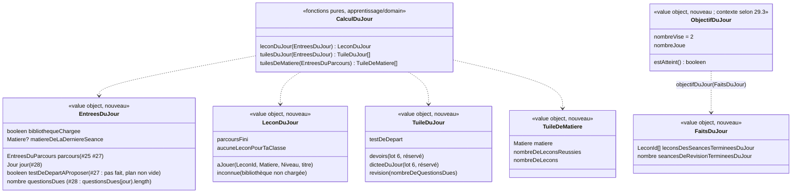

# Modèle du domaine : issue #29, Écran « Aujourd'hui »

> Cadrage anticipé (décision 0020, point 6). Rien n'est codé avant le merge de #26 et #28, dont ce modèle reprend les décisions (branches `feature/26-lecons-des-classes-d-avant` et `feature/28-revisions-des-erreurs`).
> Les questions 29.1 à 29.18 attendent le PO. Chacune a une recommandation.

## Contexte

Contexte principal : **Apprentissage**. Il choisit la leçon du jour, décide quelles tuiles du jour sont dues et calcule les compteurs des tuiles de matière. Il lit le **Catalogue pédagogique** (leçons, ordre des matières) et **Famille** (profil en cours : prénom, niveau). L'écran laisse une place à **Motivation** (pastille de série #30 ; objectif du jour, voir 29.3) et à **Accompagnement** (devoirs, dictée du jour, lot 6).

Comme le parcours (#25, #26), tout ce que l'écran montre est une **lecture calculée** par des fonctions pures, importées par le front via `@domain/apprentissage` (et `@domain/motivation` pour l'objectif du jour). Elle marche hors ligne (décision 0003). **Rien n'est écrit en base** : pas d'agrégat nouveau, pas de commande nouvelle, pas de migration, pas d'Edge Function. Les seules écritures qui changent l'écran existent déjà :
- `TerminerLaSeance` (#24), étendu par #28 pour la file de révision ;
- `TerminerLeTestDeDepart` (#27) ;
- `TerminerLaSeanceDeRevision` (#28).

| Source | Contexte | Ce qui est lu | Mécanisme |
|---|---|---|---|
| Leçons de la bibliothèque | Catalogue pédagogique | `Lecon` (`id`, `matiere`, `niveau`, `ordre`, `titre`), `toutesLesMatieres` (ordre français, maths, sciences, histoire, anglais, EMC) | Published Language `@domain/catalogue` (existant) |
| Prénom et niveau du profil en cours | Famille | `ProfilEnCours.prenom`, `.niveau` | Customer/Supplier existant (#11) |
| Meilleures étoiles, leçons réussies au test de départ | Apprentissage (#24, #27) | `EntreesDuParcours` | Lectures existantes sous RLS, réunies avec ce qui a été joué pendant l'utilisation (#25) |
| Test de départ fait | Apprentissage (#27) | `TestDeDepartFait(profil)`, plan non vide | Lecture existante sous RLS (27.5) |
| File de révision | Apprentissage (#28) | `questionsDues(jour)` | Lecture existante sous RLS (28.21, 28.22) |
| Séances terminées du jour, dernière séance terminée | Apprentissage (#24, #28) | leçon et date de fin de chaque séance terminée ; jour des séances de révision terminées | Lecture sous RLS des tables existantes (`seances_terminees`, `seances_de_revision_terminees`), plus les séances gardées sur l'appareil et pas encore envoyées. Aucune écriture |
| Jour de l'appareil | front | `Horloge.maintenant()` (`src/seance/horloge.ts`, existant), puis `jourDe(maintenant, decalage)` (#28) | Le domaine reçoit un `Jour` (#28) ; il ne lit jamais l'heure |
| Série | Motivation (#30) | texte de la pastille | Place réservée sous « Bonjour `<prénom>` ! ». Rien n'est modélisé ici |
| Devoirs, mots de la semaine | Accompagnement (lot 6) | devoirs du jour | Customer/Supplier déjà prévu (Accompagnement → Apprentissage). Deux genres de tuile du jour sont réservés, sans code dans cette story |

### Comportement actuel (`app/app.js`), source des règles et non modèle

- `showMap('accueil')` (l. 654) :
  - dock de quatre boutons « Accueil », « Mon parcours », « Toutes les leçons », « Mes trophées », avec `aria-current="page"` ;
  - date du jour `toLocaleDateString('fr-FR')` avec une majuscule ;
  - « Bonjour `<prénom>` ! » et la pastille de série ;
  - avec « Tout lire », lecture de « Bonjour `<prénom>` ! `<pastille>` ».
- `todayTiles` (l. 565) : devoirs, dictée du jour, « À revoir » (`Review.due()`), « Mon test de départ » (`!child.testFait && LIB.length`), dans cet ordre.
- `nextLesson` (l. 558) :
  - premier passage : la prochaine leçon (`next`) de la première matière qui en a une, dans l'ordre de `SUBJECTS` ;
  - second passage (repli) : la première leçon `!done && !locked` du même ordre. Comme `subjectPath` contient les niveaux inférieurs, c'est en pratique une leçon des classes d'avant.
- Objectif du jour (l. 702) : nombre de progressions dont `maj` tombe aujourd'hui (date de l'appareil), sur 2. Le test de départ y entre par `maj` (défaut). La séance de révision n'y entre pas (elle n'écrit pas de progression).
- Tuiles de matière (l. 720) : une par matière dont `subjectPath` n'est pas vide, c'est-à-dire avec au moins une leçon jusqu'au niveau de l'enfant. Le compteur compte les leçons de niveau ≤ (classes d'avant comprises). Le toucher ouvre `showMap('parcours', m)`.
- `nextAfter` (l. 1956) : en fin de séance, sans leçon d'après dans la matière, le legacy propose `nextLesson()`, donc une autre matière.

### Accueil actuel de la cible (`src/famille/AccueilDeLEnfant.tsx`)

Sur l'accueil de l'enfant, le personnage guide salue l'enfant, puis viennent des accès provisoires, chacun annoncé comme remplacé par #29 :
- « Mon parcours » (25.10) ;
- « Mes médailles » (#65) ;
- « Mon test de départ » (27.10) ;
- « Changer d'enfant » ;
- à venir : « Toutes les leçons » (26.2) et « Je révise mes erreurs » avec « `<n>` petites erreurs des jours passés » (28.8).

Le sort de ces accès est réglé par 29.7.

## Termes

| Terme | Statut | Remarque |
|---|---|---|
| Aujourd'hui | **conflit** de statut (question n°5 de l'issue → 29.5) | Le glossaire l'emploie dans « Devoir » (« mis en avant dans « Aujourd'hui » »). Le legacy ne l'affiche nulle part : le dock dit « Accueil », le titre dit « Bonjour `<prénom>` ! ». Proposition : mot de cadrage, et l'écran est l'**Accueil de l'enfant** (terme validé, #27). |
| Accueil de l'enfant | au glossaire (validé, Famille, 27.22) | Il devient l'écran décrit ici (29.5). L'écran est composé de plusieurs contextes ; le terme reste en Famille (choix du profil, « Changer d'enfant »). |
| Leçon du jour | **nouveau** `(à valider)` | Leçon de la grande tuile : une prochaine leçon, choisie parmi celles des matières du parcours selon la règle de 29.1. Aucune quand toutes les matières du parcours sont réussies. Ce n'est pas un nouvel état d'une leçon : dans « Mon parcours », elle reste « À toi ! ». |
| Tuile du jour | **nouveau** `(à valider)`, peut-être un mot d'interface (29.17) | Ce que l'accueil propose de faire aujourd'hui, en plus de la leçon du jour, seulement quand c'est dû. Genres : devoirs et dictée du jour (lot 6, réservés), révision (« À revoir »), test de départ (« Mon test de départ »). |
| Objectif du jour | **nouveau** `(à valider)` ; contexte à trancher (29.3) | Encouragement : jouer 2 leçons dans la journée (jour de l'appareil). Il ne limite rien et ne modifie aucune note. Signalé manquant par #27 (glossaire, « Questions ouvertes », lot 4). |
| Prochaine leçon, Matière du parcours, Leçon à découvrir, Leçon suivante | au glossaire (validés, #25) | Repris tels quels. La **Leçon suivante** change si 29.8 est retenue (repli vers la leçon du jour en fin de séance). |
| Matière réussie | au glossaire de #26 `(à valider)` | « Matière dont l'enfant a réussi toutes les leçons de sa classe. » Sert ici à la fin de parcours (« Tu as fini ton parcours ») : toutes les matières du parcours sont réussies. |
| Leçon des classes d'avant | au glossaire (#26, Décision n°36) | Jamais la prochaine leçon (26.13). Elle n'est donc jamais la leçon du jour si 29.9 est retenue. |
| Question due, Séance de révision, Jour | au glossaire de #28 (validés) | La tuile « À revoir » compte les questions dues au **Jour** de l'appareil (28.8, 28.9). |
| Test de départ fait, Proposition du test de départ | au glossaire (validés, #27) | La tuile « Mon test de départ » ouvre la proposition. |
| Séance terminée, Jour de séance | au glossaire | L'objectif du jour compte les séances terminées du jour (et, si 29.2 b est retenue, les séances de révision terminées). |
| Série | au glossaire `(à valider)`, Motivation | #30. Place réservée. |
| Devoir, Mots de la semaine | au glossaire, Accompagnement | Lot 6. Place réservée. |
| « Mes trophées » | **interdit** | L'écran des récompenses de l'enfant s'appelle « Mes médailles » (65.1). Le dock dit donc « Mes médailles ». |
| « À revoir », « Mon test de départ », « Commencer », « Tu as fini ton parcours », « Bravo ! », « Joue 2 leçons aujourd'hui », « Objectif atteint, bravo ! », « Accueil » (dock), tuile, dock, grande tuile | mots d'interface | Hors glossaire. |
| tableau de bord, home, dashboard, mission du jour, défi du jour | interdits | « Tableau de bord » et « home » le sont déjà pour Accueil de l'enfant. « Mission » l'est pour Devoir. « Défi » pousserait à une limite ou à une compétition (décision 0005). |

## Modèle

**Aucun agrégat nouveau.** Il n'y a ni commande ni invariant d'écriture : tout est recalculé à chaque affichage de l'accueil, à partir d'entrées déjà lues ailleurs. Il n'y a pas non plus d'erreur métier nouvelle. Une bibliothèque absente ou un niveau invalide se traitent comme dans #25, #27 et #28 : on n'affiche pas l'élément, sans message d'erreur.



### 1. Leçon du jour (`leconDuJour`)

1. **Bibliothèque non chargée** : `inconnue`. La grande tuile n'est pas montrée. Surtout, elle ne dit **jamais** « Tu as fini ton parcours » par erreur (29.11).
2. **Aucune matière du parcours** (classe sans leçon) : `aucuneLeconPourTaClasse`. Texte proposé : « Aucune leçon pour ta classe pour l'instant. », comme « Mon parcours » (#25) (29.12).
3. Sinon, on prend les **prochaines leçons** des matières du parcours (`parcoursDeLaMatiere(…).prochaineLecon`, #25), au plus une par matière, et on en choisit une selon la règle d'ordre des matières (29.1). Recommandation :
   - on alterne **français et maths** : si la matière de la dernière séance terminée est le français, on prend les maths ; dans tous les autres cas, on prend le français. Une matière qui n'a plus de prochaine leçon laisse la place à l'autre ;
   - quand le français et les maths sont des matières réussies, on prend les autres matières du parcours dans l'ordre du Catalogue (sciences, histoire, anglais, EMC) ;
   - la séance de révision et le test de départ n'ont pas de matière : on ne les regarde pas pour « la dernière séance terminée ».
4. **Toutes les matières du parcours sont réussies** : `parcoursFini` (« Bravo ! », « Tu as fini ton parcours », « Rejoue tes leçons préférées pour gagner toutes les étoiles. »). Pas de repli vers une leçon des classes d'avant ni vers la classe au-dessus (29.9, en accord avec 26.13).
5. La leçon du jour n'est **jamais réussie**, par construction : la branche « Déjà N étoiles sur 3 » / « Continuer » du legacy n'existe pas (code mort, 29.10).
6. La grande tuile montre « `<Matière>` · `<niveau>` » (libellé court de l'interface : « Français · CE1 »), le titre, « `<Personnage guide>` t'attend pour une nouvelle leçon. » (phrase de Motivation, #6) et « Commencer », qui ouvre la page de la leçon (#16).

### 2. Tuiles du jour (`tuilesDuJour`)

Elles viennent dans un **ordre fixe**, chacune seulement si elle est due (29.6) :
1. `devoirs` : lot 6, réservé ;
2. `dicteeDuJour` : lot 6, réservé ;
3. `revision(n)` : seulement si au moins une question est due au jour de l'appareil (`questionsDues(jour)`, #28). `n` compte **toutes** les questions dues, même au-delà de 10. Texte : « `<n>` petites erreurs des jours passés », au singulier « 1 petite erreur des jours passés » (28.8). Le toucher commence la séance de révision (#28) ;
4. `testDeDepart` : seulement si le test de départ n'est pas fait, que la bibliothèque est chargée et que le plan n'est pas vide (27.5, 27.9 c). Texte : « Quelques questions pour commencer au bon endroit ». Le toucher ouvre la proposition du test de départ (#27).

Ces tuiles remplacent les boutons « Je révise mes erreurs » (28.8) et « Mon test de départ » (27.10) : voir 29.7. Les retours qui menaient à l'accueil de l'enfant (« Plus tard », fin de la séance de révision, fin du test de départ) y mènent toujours.

### 3. Tuiles de matière (`tuilesDeMatiere`)

Recommandation (question n°4 de l'issue, 29.4) :
- une tuile par **matière du parcours**, dans l'ordre du Catalogue : la même liste que les onglets de « Mon parcours » (#25, 25.4, N7) ;
- son compteur est **celui de « Mon parcours »** : leçons réussies de la classe de l'enfant sur leçons de sa classe (`nombreDeLeconsReussies` / `nombreDeLecons`, règle 4 de #25). Les leçons des classes d'avant et celles d'une classe au-dessus n'y entrent pas. Le défaut des deux compteurs disparaît ;
- texte : « 4 leçons réussies sur 30 », au singulier « 1 leçon réussie sur 30 », et « 0 leçon réussie sur 30 » ;
- libellé court de l'interface (« Maths », « Vivre ensemble »), déjà dans `src/parcours/textes-du-parcours.ts` ;
- le toucher ouvre « Mon parcours » sur cette matière. Elle devient la matière choisie (25.11).

### 4. Objectif du jour (`objectifDuJour`)

Recommandation (29.2, 29.3) :
- **objectif : 2**, fixe, sans réglage. Texte : « Joue 2 leçons aujourd'hui », « `<n>` sur 2 », puis « Objectif atteint, bravo ! » ;
- **ce qui compte** : chaque leçon distincte qui a une séance terminée au jour de l'appareil, séance complète ou séance d'un exercice. Une leçon rejouée deux fois compte une fois ; leçon des classes d'avant, d'une classe au-dessus ou leçon personnelle comprises. S'y ajoute **1** si au moins une séance de révision est terminée ce jour-là (29.2 b) ;
- **ce qui ne compte pas** : le test de départ (déjà tranché par 27.4 : il n'est pas une séance) ; une séance quittée avant la fin ;
- les mots de la semaine (lot 6) compteront comme la séance de révision : à confirmer par le lot 6 ;
- le compte s'arrête à l'affichage de 2 sur 2 (« Objectif atteint, bravo ! »), mais rien ne s'arrête : la leçon du jour et les tuiles restent proposées (décision 0005) ;
- la barre est décorative. Le texte « 1 sur 2 » porte l'information (accessibilité).

**Calculé, pas enregistré** : `FaitsDuJour` vient des séances terminées lues sous RLS. Le jour d'une séance ordinaire est `jourDe(termineLe, decalage de l'appareil)`, et celui d'une séance de révision le `jour` envoyé (#28). S'y ajoutent les séances gardées sur l'appareil et pas encore envoyées. Rien n'est écrit. Une séance faite le même jour sur un autre appareil compte dès qu'elle est lue.

### 5. Jour et date

- **Jour** : le jour du calendrier de l'appareil (réponse 28.9, reprise telle quelle). Il sert à la tuile « À revoir », à l'objectif du jour et à la date affichée. Le domaine reçoit un `Jour`. L'heure vient de l'`Horloge` du front.
- **Date affichée** : « Vendredi 23 octobre ». C'est de la présentation : l'interface la met en forme à partir de `maintenant`, en français, avec une majuscule. Ce n'est pas une règle du domaine.
- L'accueil se recalcule à chaque affichage et quand l'appareil revient au premier plan. Il n'y a pas de minuterie à minuit (29.13).

### Ports

| Port | Couche | Existe ? | Usage |
|---|---|---|---|
| `Horloge` (`maintenant()`) | front `src/seance/horloge.ts` | **oui** (#20) | jour de l'appareil (avec `jourDe`, #28) et date affichée. Comme dans #28, il n'y a pas de port dans le domaine : les fonctions reçoivent un `Jour` |
| Lecture des séances terminées (leçon, date de fin ; jour des séances de révision) | front, sous RLS | **nouvelle lecture**, tables existantes | `FaitsDuJour` ; matière de la dernière séance terminée (29.1) |
| Lectures du parcours, du test de départ, de la file de révision | front, sous RLS | oui (#25, #27, #28) | `EntreesDuJour` |

Aucun port serveur. Aucune Edge Function.

## Invariants

Ce sont des règles du calcul, vérifiées par les tests des fonctions pures, et non des invariants d'agrégat.

1. La leçon du jour est toujours la **prochaine leçon** d'une **matière du parcours**. Elle n'est donc jamais réussie, jamais une leçon des classes d'avant, jamais d'une classe au-dessus (26.13, N1). Ce point vaut si 29.9 est retenue.
2. Il y a une leçon du jour si et seulement si au moins une matière du parcours a encore une prochaine leçon.
3. « Tu as fini ton parcours » n'apparaît que si la bibliothèque est chargée, que l'enfant a au moins une matière du parcours et que toutes ses matières du parcours sont réussies.
4. Le choix de la leçon du jour est **déterministe** : mêmes entrées, même leçon (29.1).
5. La tuile « À revoir » n'apparaît que s'il y a au moins une question due au jour de l'appareil. Son nombre est celui de toutes les questions dues.
6. La tuile « Mon test de départ » n'apparaît que tant que le test de départ n'est pas fait et qu'il a au moins une question à poser.
7. Les tuiles du jour gardent toujours le même ordre : devoirs, dictée du jour, À revoir, test de départ.
8. Le compteur d'une tuile de matière est égal à celui du parcours de cette matière.
9. L'objectif du jour compte chaque leçon une seule fois par jour. Il ne compte jamais le test de départ. Il ne limite rien et ne modifie aucune étoile.
10. Rien n'est écrit : l'accueil ne modifie aucune étoile, aucun résultat, aucune file de révision.
11. Un parent ne lit que les données des enfants auxquels il est rattaché (RLS existante).

## Événements

Aucun événement nouveau. L'accueil se recalcule à la lecture : il n'écoute ni `SeanceTerminee`, ni `SeanceDeRevisionTerminee`, ni `TestDeDepartTermine`. Après une séance, le front applique déjà les règles du domaine à ses copies (meilleures étoiles, file de révision, test de départ fait : #24, #27, #28). L'accueil reflète donc tout de suite ce qui vient d'être joué.

## Partage avec le front

`@domain/apprentissage` (`index.ts`) exporte en plus :
- `leconDuJour`, `tuilesDuJour`, `tuilesDeMatiere` ;
- les types `EntreesDuJour`, `LeconDuJour`, `TuileDuJour`, `TuileDeMatiere`.

Selon 29.3, `objectifDuJour`, `ObjectifDuJour` et `FaitsDuJour` sont exportés par `@domain/motivation` (recommandation) ou par `@domain/apprentissage`.

React affiche et ne décide rien : il ne choisit pas la matière, ne compte pas les questions dues, ne filtre pas les tuiles et ne compte pas l'objectif.

Ce qui marche hors ligne :
- tout le calcul ;
- avec les données déjà connues de l'utilisation en cours (#24, #27, #28) et les séances gardées sur l'appareil.

Sans données connues, avant #44 :
- la grande tuile, les tuiles de matière, « À revoir » et « Mon test de départ » ne sont pas montrées, sans message d'erreur (27.5, 28.21, 26.16) ;
- l'objectif du jour ne compte que les séances connues de l'appareil (29.11).

Accessibilité (pour les critères) :
- le dock est un `nav` étiqueté, avec le bouton actif marqué `aria-current="page"`. Il s'utilise au clavier ;
- les cibles mesurent 44 px au moins, et l'écran tient à 360 px sans défilement horizontal ;
- la date est lue en toutes lettres ;
- les compteurs sont du texte (« 4 leçons réussies sur 30 », « 1 sur 2 »). La barre de l'objectif est cachée aux lecteurs d'écran ou porte la même valeur en texte ;
- les animations sont réduites sous `prefers-reduced-motion` ;
- avec « Tout lire à voix haute », la salutation est lue **une seule fois** (défaut corrigé, 29.10). La pastille de série s'y ajoutera avec #30.

## Données d'enfants

Aucune donnée personnelle nouvelle. L'accueil lit :
- les meilleures étoiles (#24) ;
- les séances terminées et leurs dates (#24) ;
- le résultat du test de départ (#27) ;
- la file de révision et les séances de révision terminées (#28).

Ces données sont déjà couvertes par la cascade et l'export. Rien n'est gardé de plus sur l'appareil et rien n'est envoyé à l'IA.

## Emplacement

```
supabase/functions/_shared/apprentissage/domain/
  lecon-du-jour.ts            # leconDuJour, LeconDuJour, EntreesDuJour (règle 29.1, fin de parcours 29.9)
  tuiles-du-jour.ts           # tuilesDuJour, TuileDuJour (ordre fixe, genres lot 6 réservés)
  tuiles-de-matiere.ts        # tuilesDeMatiere, TuileDeMatiere (compteur du parcours)
  lecon-suivante-dans-le-parcours.ts   # modifié seulement si 29.8 est retenue (repli vers la leçon du jour)
  index.ts                    # exports
supabase/functions/_shared/motivation/domain/   # si 29.3 retient Motivation
  objectif-du-jour.ts         # objectifDuJour, ObjectifDuJour, FaitsDuJour
  index.ts                    # exports
src/famille/AccueilDeLEnfant.tsx    # devient l'écran décrit ici (en-tête, tuiles du jour, grande tuile, objectif, tuiles de matière)
src/accueil/ (ou src/aujourd-hui/)  # composants de l'écran, lecture des séances terminées du jour
src/navigation.ts, src/Application.tsx   # dock (Accueil, Mon parcours, Toutes les leçons, Mes médailles)
```

Pas de migration : les tables `seances_terminees` (#24) et `seances_de_revision_terminees` (#28) se lisent déjà sous RLS.

## Hors périmètre

- Pastille de série et sa lecture à voix haute : #30. La place est réservée sous le titre.
- Tuiles « Mes devoirs » et « Dictée du jour », leur coche « jouée depuis le devoir » : lot 6 (Accompagnement). Les genres sont réservés.
- Contenu de « Mes médailles » (#65, #31 à #33) : seul son accès passe dans le dock.
- Leçons personnelles dans la leçon du jour : Accompagnement (#39), à revoir avec lui.
- Accueil sans réseau dès le lancement : #44.
- Retrait du réglage parcours libre : story Famille (N2 de #25).

## Questions ouvertes

Tranché par le PO le 2026-10-25 : toutes les recommandations sont retenues (« OK #29 #30 reco partout »). Décisions détaillées dans la section « Décisions » de `docs/stories/29/acceptance.md`.

Les questions 29.1 à 29.6 reprennent les 6 questions de l'issue. Les suivantes viennent des stories #25 à #28 et des accès provisoires.

**29.1. Ordre des matières pour la leçon du jour** (question n°1 de l'issue). Le legacy prend toujours le français en premier : tant qu'il reste une leçon de français, la grande tuile ne propose jamais les maths.

Options :
- (a) garder le legacy ;
- (b) alterner français et maths selon la matière de la dernière séance terminée, puis, quand les deux sont réussis, les autres matières dans l'ordre du Catalogue ;
- (c) tourner sur toutes les matières du parcours ;
- (d) prendre la matière jouée il y a le plus longtemps.

Exemple pour (b) : Léa, CE1, termine « Le son ou » (français). La leçon du jour devient « Les nombres jusqu'à 100 » (maths). Après une séance de maths, elle redevient la prochaine leçon de français.

**Recommandation : (b).**
- Le français et les maths sont les fondamentaux (Guides fondamentaux).
- La règle est déterministe et marche hors ligne avec une seule lecture, la dernière séance terminée.
- Les autres matières restent à un toucher, par leurs tuiles de matière.

D'accord, ou préférez-vous (c) ou (d) ?

**29.2. Objectif du jour : quoi compter** (question n°2 de l'issue). Le test de départ n'y compte pas, c'est déjà tranché (27.4).
- (a) Garder « 2 leçons » ? **Recommandation : oui**, fixe, sans réglage du parent.
- (b) La séance de révision compte-t-elle ? **Recommandation : oui, pour 1**, si au moins une séance de révision est terminée dans la journée. Plusieurs séances de révision le même jour comptent toujours pour 1.
- (c) Une leçon rejouée compte une fois, une séance d'un exercice compte, une leçon des classes d'avant compte ? **Recommandation : oui aux trois.**
- Les mots de la semaine (lot 6) compteront comme la séance de révision. Le lot 6 le confirmera.

D'accord ?

**29.3. L'objectif du jour est-il d'Apprentissage ou de Motivation ?** (question n°3 de l'issue) Il ne modifie aucune note.

**Recommandation : Motivation**, mais livré par #29 dans `motivation/domain/`, en lisant les séances terminées d'Apprentissage :
- c'est un encouragement, comme la série ;
- 27.4 le traite déjà comme une réaction de Motivation (« Motivation ignore `TestDeDepartTermine` : ni série, ni objectif du jour ») ;
- Apprentissage reste sans récompense.

La relation est la même que pour les records de fluence (#65) : lecture seule, sans écriture. D'accord ?

**29.4. Compteur des tuiles de matière** (question n°4 de l'issue). Faut-il compter les leçons des classes d'avant ?

**Recommandation : non.** On garde le compteur de « Mon parcours », qui ne compte que la classe de l'enfant. Il y a une tuile par matière du parcours, avec la même liste et le même ordre que les onglets.

Exemple : Léa, CE1, 2 leçons de français du CE1 réussies sur 4. La tuile dit « 2 leçons réussies sur 4 », comme « Mon parcours ».

D'accord ?

**29.5. « Aujourd'hui » : terme du domaine ou titre ?** (question n°5 de l'issue) Le legacy n'affiche « Aujourd'hui » nulle part. Seul le glossaire l'emploie, dans « Devoir ».

**Recommandation : ce n'est pas un terme.**
- L'écran est l'**Accueil de l'enfant** (terme validé, 27.22), et le bouton du dock dit « Accueil ».
- La ligne « Devoir » se lira « mis en avant sur l'accueil de l'enfant ». Une note est ajoutée au glossaire, la ligne n'est pas réécrite.

Cela répond aussi à 27.22 : **oui, l'accueil de l'enfant devient l'écran décrit ici.** D'accord ?

**29.6. Ordre des tuiles du jour** (question n°6 de l'issue).

**Recommandation : garder l'ordre** devoirs, dictée du jour, À revoir, test de départ :
- ce que le parent a demandé vient d'abord ;
- un nouveau profil n'a de toute façon aucune question due.

D'accord ?

**29.7. Que deviennent les accès provisoires de l'accueil ?**

**Recommandation :**
- (a) un **dock de quatre boutons**, « Accueil », « Mon parcours », « Toutes les leçons », « Mes médailles » (et non « Mes trophées », 65.1). Il se montre sur ces quatre écrans, avec le bouton actif marqué. Les boutons « Mon parcours », « Toutes les leçons » et « Mes médailles » quittent le corps de l'accueil ;
- (b) « Je révise mes erreurs » (28.8) devient la tuile « À revoir », avec le même texte « `<n>` petites erreurs des jours passés » ;
- (c) « Mon test de départ » (27.10) devient la tuile du même nom ;
- (d) « Changer d'enfant » reste sur l'accueil, comme le retour du legacy vers « Qui joue ? ». Le dock n'en a pas ;
- (e) le retour de « Mon parcours », « Toutes les leçons » et « Mes médailles » mène toujours à l'accueil.

D'accord pour (a) à (e) ?

**29.8. Leçon suivante en fin de séance quand la matière n'en a plus.** Aujourd'hui, il n'y a pas de leçon suivante dans trois cas : après la dernière leçon du parcours, après une leçon des classes d'avant (26.8) et après une leçon d'une classe au-dessus (N10). N10 renvoyait à #29 le « retour vers le parcours de CE1 ». Le legacy propose alors `nextLesson()`.

**Recommandation : oui.** Dans ces trois cas, la fin de séance propose la **leçon du jour** (« Ensuite : `<titre>` »), si elle existe et n'est pas la leçon jouée.

Exemple : Léa finit la dernière leçon de français du CE1. Elle se voit proposer « Les nombres jusqu'à 100 » (maths).

Cela ramène l'enfant dans sa classe sans jamais l'en faire sortir. La ligne « Leçon suivante » du glossaire serait complétée par une note. D'accord ?

**29.9. Repli de la leçon du jour vers les classes d'avant.** Le legacy, quand tout le parcours de la classe est réussi, propose une leçon des classes d'avant non réussie. 26.13 dit qu'une leçon des classes d'avant n'est jamais la prochaine leçon.

**Recommandation : pas de repli.** Quand toutes les matières du parcours sont réussies, la grande tuile dit « Bravo ! », « Tu as fini ton parcours », « Rejoue tes leçons préférées pour gagner toutes les étoiles. ».
- C'est cohérent avec 26.8, 26.13 et N10.
- La classe au-dessus s'ouvre déjà dans « Toutes les leçons » (26.1).

Faut-il ajouter un bouton « Toutes les leçons » dans cette tuile ? Recommandation : non, le dock y mène déjà. D'accord ?

**29.10. Défauts du legacy listés dans l'issue : les corriger ?**

**Recommandation : oui pour tous**, comme écarts voulus :
- (a) français toujours en premier : voir 29.1 ;
- (b) branche « Déjà N étoiles sur 3 » / « Continuer » : supprimée (code mort, la leçon du jour n'est jamais réussie) ;
- (c) test de départ compté dans l'objectif : corrigé (27.4) ;
- (d) révisions non comptées : voir 29.2 b ;
- (e) deux compteurs différents : voir 29.4 ;
- (f) « Bonjour `<prénom>` ! » dit deux fois : la salutation est dite **une seule fois** à l'arrivée. Avec « Tout lire », elle sera suivie du texte de la pastille (#30).

D'accord ?

**29.11. Bibliothèque non chargée, ou rien de connu sans réseau.**

**Recommandation :**
- ni grande tuile, ni tuiles de matière, ni tuile « Mon test de départ », sans message d'erreur. C'est surtout ce qui empêche un faux « Tu as fini ton parcours » ;
- « À revoir » seulement si la file de révision est connue (28.21) ;
- l'objectif du jour reste montré, avec les seules séances connues de l'appareil.

D'accord ?

**29.12. Classe sans aucune leçon** (CM2 sans leçon dans la bibliothèque, par exemple).

**Recommandation :**
- la grande tuile dit « Aucune leçon pour ta classe pour l'instant. », comme « Mon parcours » (#25), et non « Tu as fini ton parcours » ;
- aucune tuile de matière ;
- l'objectif du jour reste montré (les leçons des classes d'avant comptent, 29.2 c).

D'accord ?

**29.13. Fuseau et changement de jour.**

**Recommandation :**
- reprendre 28.9 : le jour est celui de l'appareil, pour la date affichée, « À revoir » et l'objectif du jour ;
- l'accueil se recalcule à chaque affichage et au retour de l'appareil au premier plan ;
- un accueil resté ouvert à minuit ne change pas tout seul (pas de minuterie).

D'accord ?

**29.14. Date en tête de l'écran.**

**Recommandation : la garder**, en toutes lettres et avec une majuscule (« Vendredi 23 octobre »), lue par les lecteurs d'écran. La mise en forme est faite par l'interface, en français, quelle que soit la langue de l'appareil. D'accord ?

**29.15. Objectif atteint : une fête ?**

**Recommandation : seulement le texte** « Objectif atteint, bravo ! », sans son ni animation de récompense.
- Les récompenses sont celles de Motivation, au lot 5.
- Il n'y a ni blocage ni invitation à arrêter (décision 0005).

D'accord ?

**29.16. Nom de la matière sur la grande tuile.** Le legacy dit « Français · CE1 » avec le nom long de la matière (« Mathématiques · CE1 », « Vivre ensemble (EMC) · CE2 »).

**Recommandation : le libellé court**, celui des onglets (« Maths · CE1 », « Vivre ensemble · CE2 »), qui tient mieux à 360 px. D'accord, ou garder le nom long ?

**29.17. « Tuile du jour » : terme du domaine ou d'interface ?**

**Recommandation : terme du domaine**, `(à valider)`. Il nomme ce qui est dû aujourd'hui (révision, test de départ, puis devoirs et dictée du jour) et la règle d'ordre. « Tuile » seule et « grande tuile » restent des mots d'interface. On peut aussi préférer un mot d'interface, comme « Section de l'écran » (#65). D'accord ?

**29.18. « Leçon du jour » : nouveau terme ?** C'est une prochaine leçon choisie parmi celles des matières du parcours.

**Recommandation : oui, `(à valider)`.** Il évite de dire « la prochaine leçon » au singulier, alors qu'il y en a une par matière (#25). Il n'est pas affiché : la grande tuile n'a pas de titre. D'accord ?

### Remarques pour les autres stories (pas des questions au PO)

- **#30** : la pastille se place sous « Bonjour `<prénom>` ! ». Avec « Tout lire », son texte suit la salutation dans **une seule** lecture (29.10 f). Le `Jour` est celui de 28.9.
- **#26, #28** : leurs boutons provisoires de l'accueil disparaissent avec #29 (29.7). Leurs scénarios qui passent par ces boutons seront adaptés dans les steps (accès par le dock ou la tuile).
- **Lot 6** : remplir les genres `devoirs` et `dicteeDuJour` de `tuilesDuJour`. Les mots de la semaine compteront pour l'objectif du jour comme la séance de révision (29.2).
- **#39** : décider si une leçon personnelle peut être la leçon du jour.
- **#44** : copie sur l'appareil au lancement sans réseau (29.11).
- **Jour d'une séance ordinaire, à aligner avec #30** : `seances_terminees` n'a pas de colonne de jour ; ce modèle déduit le jour par `jourDe(termineLe, decalage de l'appareil)`, ce qui peut décaler une séance d'un jour après un changement d'heure ou de fuseau. La question 30.6 propose que la séance terminée garde le jour envoyé par l'appareil, comme la séance de révision (28.9). L'objectif du jour et la série doivent lire **le même jour** : la réponse à 30.6 s'applique aussi ici.

## Écarts de l'implémentation (2026-10-25)

- `EntreesDuJour` ne porte que `parcours` (`undefined` = bibliothèque non chargée) et `matiereDeLaDerniereSeance`.
- Les tuiles du jour ont leurs propres entrées, `EntreesDesTuilesDuJour` :
  - `nombreDeQuestionsDues` (`undefined` = file inconnue) ;
  - `testDeDepartAProposer`, calculé par la règle existante de #27 (`useTestDeDepartAFaire` / `planDuTestDeDepart`).
- La leçon suivante de fin de séance est `leconSuivanteEnFinDeSeance` (Apprentissage) : quand la matière n'a plus de leçon suivante dans le parcours, c'est la leçon du jour, si elle existe et n'est pas la leçon jouée (29.8, 29.24) ; sinon la fin de séance propose « Toutes les leçons » (29.25, 29.26).
- Une leçon absente de la bibliothèque (leçon personnelle, #39) jouée en dernier fait proposer le français (règle « dans tous les autres cas »). À revoir avec #39.
- L'objectif du jour est calculé par deux fonctions pures de Motivation :
  - `faitsDuJour({ aujourdhui, seancesTerminees, seancesDeRevisionTerminees })` garde les séances du `Jour` de l'appareil. Le jour d'une séance ordinaire est `jourDe(termineLe, décalage de l'appareil)`, en attendant la colonne de jour de 30.6 ; celui d'une séance de révision est le `jour` gardé par #28 ;
  - puis `objectifDuJour(faits)`.
  Motivation importe le value object `Jour` publié par Apprentissage (Published Language, déjà noté pour #30 dans la context map).
- Les sources (serveur sous RLS, séances gardées sur l'appareil, mémoire de l'utilisation) ne sont pas dédoublonnées par identifiant de séance. C'est sans effet sur le compte actuel (leçons distinctes, révision comptée pour 1), mais à reprendre si le lot 6 compte autrement (mots de la semaine).
