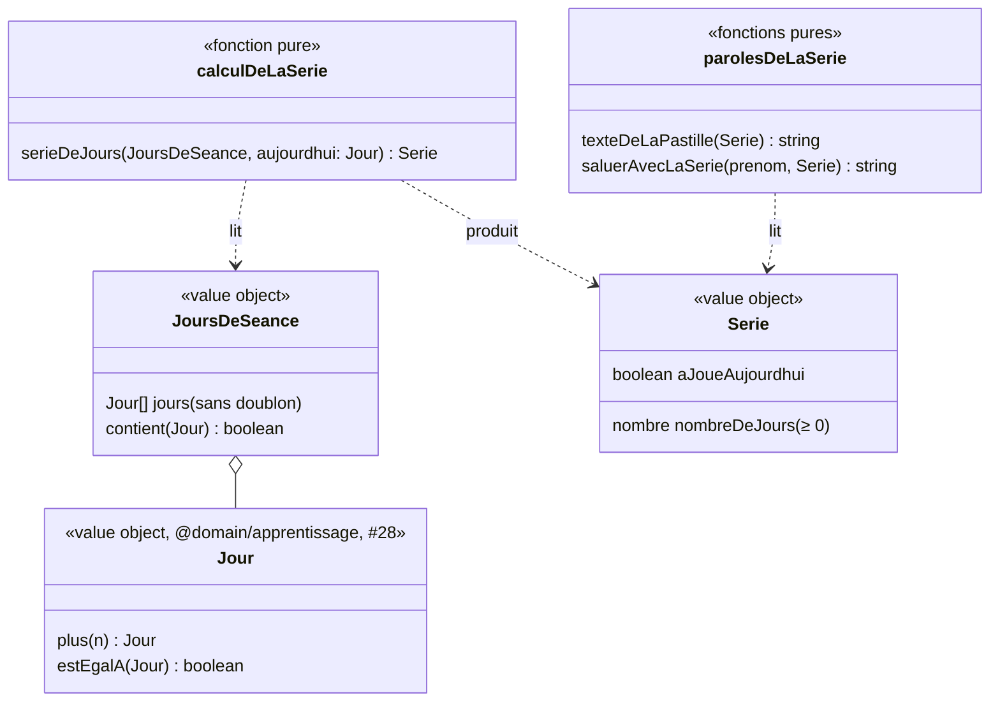

# Modèle du domaine : issue #30, Série (jours d'affilée avec au moins une séance)

> Cadrage anticipé (décision 0020, point 6). Rien n'est codé avant le merge de #28 (jour de l'appareil, séance de révision) et de #29 (accueil de l'enfant, place de la pastille), dont ce modèle reprend les décisions.
> Les questions 30.1 à 30.12 attendent le PO. Chacune a une recommandation.

## Contexte

Contexte **Motivation**. La série est un encouragement : elle réagit aux séances terminées annoncées par Apprentissage, ne lit pas les étoiles et ne modifie jamais une note (context map, décision « Motivation est un contexte à part »). Le calcul de la série et le texte de la pastille sont des fonctions pures de `motivation/domain/`, importées par le front via `@domain/motivation` (décision 0003) : la pastille marche hors ligne.

Comme le parcours (#25), les records de calcul rapide (#65) et l'accueil de l'enfant (#29), la série est une **lecture calculée** : elle n'est pas enregistrée. Motivation n'écrit rien en base.

| Source | Contexte | Ce qui est lu | Mécanisme |
|---|---|---|---|
| Séances terminées du profil | Apprentissage (#24) | le **jour** de chaque séance terminée | Lecture du front sous RLS (`seances_terminees`), comme #29. Le jour de la séance est celui de l'appareil à la fin (28.9) : voir 30.6 |
| Séances de révision terminées du profil | Apprentissage (#28) | le `jour` de chaque séance de révision terminée | Lecture du front sous RLS (`seances_de_revision_terminees`, créée par #28). 28.16 : le jour de séance compte les deux |
| Séances gardées sur l'appareil | Apprentissage (#24, #28) | le jour de chaque envoi en attente | Mémoire du front (`useRenvoiDesSeancesGardees`). Une séance finie hors ligne compte tout de suite |
| Jour de l'appareil | front | `Horloge.maintenant()` puis `jourDe(maintenant, decalage)` (#28) | Le domaine reçoit un `Jour` ; il ne lit jamais l'heure |
| Prénom, réglage **Tout lire à voix haute** | Famille | `ProfilEnCours.prenom`, réglage | Customer/Supplier existant (#11, #12) |
| Place de la pastille | Apprentissage (#29) | sous « Bonjour `<prénom>` ! » sur l'accueil de l'enfant | #29 réserve la place (29.10 f : une seule lecture « Bonjour `<prénom>` ! `<pastille>` ») |
| Données personnelles | Famille (#14) | aucune donnée nouvelle si 30.5 et 30.6 sont retenues | Les tables lues sont déjà en cascade et dans l'export (Apprentissage) |

Pourquoi pas un journal propre à Motivation (table `jours_<profil>` du legacy) : le **Jour de séance** est déjà au glossaire, dans Apprentissage, « déduit des séances terminées ; pas de nouvelle donnée » (#24). Le recopier dans Motivation créerait une seconde vérité, une écriture de plus dans les Edge Functions d'Apprentissage (décision 0016) et une donnée d'enfant de plus. Voir 30.5.

Ce que la story **ne fait pas** (hors périmètre) :
- épisodes (#33), qui comptent aussi les jours de séance : ils réutiliseront la même lecture ;
- badges (#31), cabane (#32), zone « nouveautés » de l'écran de fin ;
- objectif du jour (#29, 29.3) ;
- suivi et rapport de la semaine (#34, #35) : jours joués sur 7, nombre de séances, **minutes jouées** ;
- copie des données sur l'appareil au lancement sans réseau (#44) ;
- mots de la semaine et leçons personnelles (lot 6) : ils compteront dès qu'ils publieront une séance terminée (30.4).

### Comportement actuel (`app/app.js`), source des règles et non modèle

- `Days` (l. 1035) : document `jours_<profil>` = `{ dates: { "AAAA-MM-JJ": { min, sessions } }, sessions }`.
- `Days.addSession()` (l. 1918) : à l'écran de fin de chaque séance, sauf le test de départ (`l.special !== 'test'`). Compte donc la révision, une leçon rejouée, un seul jeu, une fluence seule. Une séance quittée avant l'écran de fin ne compte pas. Les étoiles ne comptent pas.
- `Days.addSeconds(15)` (l. 1798) : minutes jouées, pour le bilan du parent seulement.
- `Days.streak()` (l. 1040) : si aujourd'hui n'a pas de séance, on part d'hier ; puis on compte les jours consécutifs avec au moins une séance. Dates de l'appareil (`ymd`, heure locale).
- Pastille (l. 677), sous « Bonjour `<prénom>` ! » : ≥ 2 « `<n>` jours d'affilée, bravo ! » ; 1 « Tu as joué aujourd'hui ! » ; 0 « Une petite leçon pour bien commencer ? ». Avec « Tout lire » : « Bonjour `<prénom>` ! `<pastille>` ».
- Rien ne se passe quand la série casse.
- **Défaut** : joué hier seulement → série 1 → « Tu as joué aujourd'hui ! », faux (30.1).

## Termes

| Terme | Statut | Remarque |
|---|---|---|
| Série | au glossaire `(à valider)`, Motivation | Définition conforme au legacy (« jusqu'à aujourd'hui ou hier »). À valider par 30.2. On garde l'interdiction de « streak » et « flamme » (la flamme est l'icône, pas le concept) |
| Jour de séance | au glossaire (validé), Apprentissage ; **précisé par 28.16** | Jour où l'enfant a terminé au moins une séance ou une séance de révision. Le test de départ n'en donne pas (27.4). Reste dans Apprentissage (30.5) |
| Jour | glossaire de #28 (validé, Apprentissage) | Jour du calendrier de l'appareil. Motivation l'importe de `@domain/apprentissage` (Published Language, comme `Niveau` du Catalogue pour Famille) |
| Séance terminée, Séance de révision | au glossaire (#24, #28) | Les deux donnent un jour de séance |
| Test de départ | au glossaire (validé) | N'est pas une séance : ne compte pas (27.4) |
| Accueil de l'enfant | au glossaire (validé, #27) ; #29 en fait l'écran « Aujourd'hui » (29.5) | La pastille s'y affiche |
| Pastille de série | **nouveau** `(à valider)`, peut-être un mot d'interface (30.12) | Petit libellé avec une flamme, sous « Bonjour `<prénom>` ! », qui dit la série à l'enfant |
| Série jusqu'à hier | **nouveau** `(à valider)`, peut-être un simple état (30.12) | Série dont le dernier jour de séance est hier : l'enfant n'a pas encore joué aujourd'hui. Elle n'est pas cassée (30.2) |
| Minutes jouées | **absent**, hors périmètre | Ne servent qu'au rapport de la semaine (décision 0005 : information, jamais limite). #34 ou #35 dira comment les mesurer. Rien n'est gardé ici |
| streak, flamme, jours joués, connexion, record de jours, objectif | **interdits** | « Jour joué » et « connexion » le sont déjà pour Jour de séance. « Objectif » est réservé à l'objectif du jour (#29). Aucun « record de série » : la série ne se compare pas |

## Modèle

Pas d'agrégat : Motivation ne protège aucune écriture. La série est une **valeur calculée** à partir de faits d'Apprentissage, référencés par leur seul jour.



### Value object `JoursDeSeance`

- L'ensemble des jours où le profil a au moins une séance terminée ou une séance de révision terminée, sans doublon : deux séances le même jour donnent un seul jour.
- Construit par le front à partir de trois sources (voir « Contexte ») : séances terminées lues, séances de révision terminées lues, séances gardées sur l'appareil. L'union est faite dans le domaine (`JoursDeSeance.reunir(...)`), pas dans React.
- Il ne porte ni leçon, ni étoiles, ni durée : Motivation n'en a pas besoin.

### Calcul de la série (`serieDeJours`, fonction pure)

`serieDeJours(jours, aujourdhui)` :
1. si `aujourdhui` est un jour de séance, on part d'aujourd'hui (`aJoueAujourdhui = true`) ;
2. sinon, on part d'hier (`aJoueAujourdhui = false`) ;
3. on compte les jours consécutifs de séance en remontant ; le premier jour sans séance arrête le compte.

Exemples (aujourd'hui = J) :

| Jours de séance | Série | Joué aujourd'hui |
|---|---|---|
| aucun | 0 | non |
| J | 1 | oui |
| J, J-1, J-2 | 3 | oui |
| J-1, J-2 | 2 | non (série jusqu'à hier) |
| J-1 | 1 | non (série jusqu'à hier, défaut du legacy, 30.1) |
| J-2 | 0 | non (série cassée, sans message) |
| J, J-2, J-3 | 1 | oui |
| un jour après J (horloge de l'appareil reculée) | ignoré | voir 30.8 |

### Texte de la pastille (`texteDeLaPastille`, Motivation)

| Série | Texte (legacy, sauf 30.1) |
|---|---|
| 0 | « Une petite leçon pour bien commencer ? » |
| 1, joué aujourd'hui | « Tu as joué aujourd'hui ! » |
| 1, jusqu'à hier | texte nouveau, à fournir (30.1) |
| ≥ 2, joué aujourd'hui | « `<n>` jours d'affilée, bravo ! » |
| ≥ 2, jusqu'à hier | « `<n>` jours d'affilée, bravo ! » (legacy) ou texte nouveau (30.1) |

`saluerAvecLaSerie(prenom, serie)` = « Bonjour `<prénom>` ! `<texte de la pastille>` », lu **une seule fois** à l'arrivée avec « Tout lire » (29.10 f). Elle réutilise `saluer` (#6).

### Commandes et lectures

| Commande ou lecture | Effet | Erreurs métier | Où |
|---|---|---|---|
| Lecture `JoursDeSeanceDuProfil(profil)` | Jours des séances terminées et des séances de révision terminées du profil en cours, sous RLS. Aucune écriture | aucune ; jours inconnus (sans réseau, lecture en échec) : pas de pastille (30.9) | front, JWT du parent |
| `AfficherLaPastilleDeSerie` | Calcule `serieDeJours(jours ∪ séances gardées, jourDe(maintenant))` puis le texte, à chaque affichage de l'accueil de l'enfant (retour de séance compris) | aucune | navigateur |

Aucune commande nouvelle côté serveur. Les seules écritures qui changent la série existent déjà : `TerminerLaSeance` (#24), `TerminerLaSeanceDeRevision` (#28). Si 30.6 est retenue, `TerminerLaSeance` garde aussi le jour envoyé (extension, pas une commande nouvelle).

### Ports

| Port | Couche | Existe ? | Usage |
|---|---|---|---|
| `Horloge` (`maintenant()`) | front `src/seance/horloge.ts` | oui (#20) | jour d'aujourd'hui, via `jourDe` (#28). Aucun port dans le domaine |
| Lecture des séances terminées | front | nouvelle lecture (comme #29 : à partager) | jours de séance |
| Séances gardées sur l'appareil | front | oui (#24, #28) | jours des envois en attente |

## Invariants

1. La série vaut **0 ou plus**. Avec 0, l'enfant n'a pas joué aujourd'hui.
2. La série compte des **jours**, pas des séances : deux séances le même jour comptent pour un seul jour.
3. Un jour de séance vient seulement d'une **séance terminée** ou d'une **séance de révision terminée** (28.16). Ni le test de départ (27.4), ni une séance quittée avant la fin.
4. La série part d'aujourd'hui si l'enfant a joué aujourd'hui, sinon d'hier ; un jour sans séance avant ce point l'arrête (30.2).
5. Le jour d'une séance est le **jour de l'appareil à la fin de la séance**, fixé une fois et jamais recalculé (28.9, 30.6, 30.7).
6. La série **ne lit pas les étoiles** et ne modifie ni étoile, ni résultat de la leçon, ni séance.
7. La série n'impose rien : ni objectif, ni durée, ni message quand elle casse, ni perte (décision 0005, encouragement jamais punitif).
8. Le même calcul tourne dans le navigateur et, s'il le faut un jour, sur le serveur : le front ne réécrit aucune règle.
9. Un parent ne lit les jours de séance que des enfants auxquels il est rattaché (RLS existante).

## Événements

| Événement | Émis par | Données utiles ici | Réaction de Motivation |
|---|---|---|---|
| `SeanceTerminee` (#24) | `TerminerLaSeance` | profil, date de fin, **jour** (30.6) | Aucune écriture : la série se recalcule à la lecture. Sur l'appareil, la séance qui vient de finir compte tout de suite |
| `SeanceDeRevisionTerminee` (#28) | `TerminerLaSeanceDeRevision` | profil, date de fin, jour | Idem (28.16) |
| `TestDeDepartTermine` (#27) | `TerminerLeTestDeDepart` | — | **Aucune** (27.4) |

Aucun événement nouveau. Pas de `SerieCassee` ni de `SerieAllongee` : rien n'y réagit (issue : « rien ne se passe quand la série casse »). Les épisodes (#33) liront les jours de séance de la même façon.

## Partage avec le front

À exporter par `@domain/motivation` (`index.ts`) :
- `JoursDeSeance`, `Serie`, `serieDeJours` ;
- `texteDeLaPastille`, `saluerAvecLaSerie`.

`Jour` et `jourDe` restent exportés par `@domain/apprentissage` (#28) ; Motivation les importe (Published Language, à ajouter à la context map).

Ce qui tourne **hors ligne** :
- le calcul de la série et le texte ;
- la prise en compte immédiate d'une séance ou d'une séance de révision terminée sans réseau (gardée sur l'appareil) : au retour à l'accueil, « Tu as joué aujourd'hui ! » s'affiche sans attendre l'envoi ;
- l'envoi renvoyé plus tard garde son jour d'appareil ; il n'est compté qu'une fois (identifiant de séance, #24).

React affiche la pastille et la flamme, sans calculer.

## Données d'enfants

**Aucune donnée personnelle nouvelle** si 30.5 et 30.6 sont retenues :
- la série n'est pas enregistrée ;
- les jours sont ceux des séances terminées et des séances de révision terminées, déjà gardées par Apprentissage, sous RLS, supprimées en cascade avec le profil et incluses dans l'export (#14) ;
- 30.6 ajoute seulement le **jour** (date sans heure) à une séance terminée qui a déjà sa date de fin : minimisation respectée, rien de plus précis que ce qui est déjà gardé.

Les **minutes jouées** du legacy ne sont pas reprises ici : elles ne servent qu'au rapport de la semaine (lot 6, décision 0005). Rien n'est envoyé à l'IA.

Si le PO préfère une table propre à Motivation (30.5 b) : RLS fondée sur le rattachement, écriture par le serveur seul (décision 0016), cascade avec le profil et section dans l'export (contrat #14).

## Accessibilité

- Le texte de la pastille est du vrai texte (lu par un lecteur d'écran) ; la flamme est décorative (masquée aux lecteurs d'écran).
- Avec « Tout lire à voix haute », une seule lecture : « Bonjour `<prénom>` ! `<pastille>` » (29.10 f). Mode Muet respecté (#7).
- La flamme ne s'anime pas avec `prefers-reduced-motion` ; sans mouvements réduits, une animation douce reste permise.
- À 360 px, le texte passe à la ligne sans être coupé ni provoquer de défilement horizontal (« 365 jours d'affilée, bravo ! » compris).
- Mode dys : police et espacement du profil.
- La pastille ne se touche pas (pas une cible tactile) ; si elle devenait un bouton plus tard, 44 px.

## Emplacement

```
supabase/functions/_shared/motivation/
  domain/
    jours-de-seance.ts            # JoursDeSeance (union, sans doublon)
    serie.ts                      # Serie, serieDeJours
    paroles-de-la-serie.ts        # texteDeLaPastille, saluerAvecLaSerie
    index.ts                      # exports
  (pas d'application/ ni d'infrastructure/ : aucune écriture, lecture faite par le front)
supabase/functions/_shared/apprentissage/       # seulement si 30.6 est retenue et pas déjà fait par #28
  domain/seance-terminee-a-enregistrer.ts       # + jour
  infrastructure/corps-de-la-seance-terminee.ts # lit et vérifie le jour (cohérence à 14 h près, 28.9)
  infrastructure/seances-terminees-supabase.ts  # écrit le jour
supabase/migrations/<horodatage>_jour_des_seances_terminees.sql   # si 30.6 : jour de la séance ; RLS et écriture inchangées (0016)
src/famille/AccueilDeLEnfant.tsx (ou l'écran de #29)            # pastille, lecture « Tout lire »
src/motivation/ ou src/seance/                                  # lecture des jours de séance, partagée avec #29
```

## Questions ouvertes

Les questions 30.1 à 30.5 reprennent celles de l'issue (1 à 5). Les suivantes viennent des cas limites. Déjà tranché, et repris sans question : le test de départ ne compte pas (27.4) ; le jour est celui de l'appareil, envoyé avec la séance et vérifié à 14 heures près (28.9) ; la séance de révision donne un jour de séance (28.16).

**30.1. Joué hier, pas encore aujourd'hui** (question 1 de l'issue). Le legacy dit « Tu as joué aujourd'hui ! », ce qui est faux.
- **Recommandation** : corriger, avec deux cas :
  - série 1 jusqu'à hier : « Tu as joué hier. Une petite leçon aujourd'hui ? » ;
  - série 2 ou plus jusqu'à hier : garder « `<n>` jours d'affilée, bravo ! » (c'est vrai, et positif).
- Aucun mot comme « attention », « tu vas perdre » ou « dépêche-toi » (décision 0005, jamais punitif).

D'accord, ou un autre texte ?

**30.2. Règle « jusqu'à aujourd'hui ou hier »** (question 5 de l'issue). Exemple : Léa a joué lundi et mardi ; mercredi matin, avant de jouer, sa série vaut 2 ; jeudi, sans avoir joué mercredi, elle vaut 0.
- **Recommandation** : **oui**, on garde la règle du legacy et on retire « (à valider) » de **Série**.

**30.3. Séance faite hors ligne, envoyée plus tard** (question 2 de l'issue ; le fuseau est déjà tranché par 28.9). Léa finit une séance lundi à 18 h sans réseau ; elle est envoyée mardi. Compte-t-elle pour lundi ?
- **Recommandation** : **oui**, elle garde le jour de l'appareil à la fin, quel que soit le délai d'envoi. Le serveur vérifie seulement la cohérence avec la date de fin (28.9). Une même séance renvoyée deux fois ne compte qu'une fois.

**30.4. Ce qui compte pour la série** (question 3 de l'issue). Une séance terminée compte-t-elle dans chacun de ces cas ?
- séance complète ; séance d'un exercice (« Ou choisis un seul jeu »), fluence seule comprise ; leçon rejouée ; leçon des classes d'avant ; leçon d'une classe au-dessus ; quelles que soient les étoiles ;
- mots de la semaine et leçons personnelles (lot 6), quand ils publieront une séance terminée.
- **Recommandation** : **oui à tout**, comme le legacy. La séance de révision compte déjà (28.16) ; le test de départ non (27.4).

**30.5. Qui possède les jours de séance ?** (question 4 de l'issue)
- (a) **Apprentissage**, sans nouveau journal : les jours se lisent dans les séances terminées et les séances de révision terminées. Motivation calcule la série à la lecture ; Accompagnement lira les mêmes faits pour le suivi (lot 6).
- (b) Motivation, avec sa propre table (profil, jour), écrite par les Edge Functions d'Apprentissage à chaque séance.
- (c) Accompagnement, avec un journal par jour (séances, minutes), comme le legacy.
- **Recommandation** : **(a)**. Une seule vérité, aucune donnée d'enfant de plus, aucune écriture nouvelle, même schéma que #25, #29 et #65. L'issue proposait une table : elle n'est pas nécessaire. Les minutes jouées seront traitées par le rapport de la semaine (#34, #35), qui dira s'il faut les mesurer.

**30.6. Garder le jour de la séance terminée.** 28.9 dit que l'appareil envoie son jour et que ce jour sert à la série. La séance de révision le garde (#28). La séance terminée ne garde aujourd'hui que sa date de fin (heure universelle). La recalculer avec le fuseau actuel de l'appareil peut la déplacer d'un jour (séance entre minuit et une heure, puis passage à l'heure d'hiver ; séance faite sur l'appareil d'un parent dans un autre fuseau).
- **Recommandation** : **oui**, la séance terminée garde son jour, envoyé par l'appareil et vérifié comme en 28.9. Pour les séances déjà enregistrées sans jour, on prend le jour de leur date de fin à l'heure de Paris (une seule fois, à la mise à jour).
- À coordonner avec #29, qui calcule le jour d'une séance ordinaire avec le fuseau actuel de l'appareil (`docs/stories/29/domain-model.md`, « Calculé, pas enregistré ») : les deux stories doivent lire le même jour.

**30.7. Séance finie après minuit.** Léa commence une séance lundi à 23 h 50 et la finit mardi à 0 h 05. Elle compte pour mardi ?
- **Recommandation** : **oui**, le jour de la fin (conséquence de 28.9, comme le legacy). Lundi ne compte que si une autre séance y a été finie.

**30.8. Horloge de l'appareil fausse, voyage, changement d'heure.**
- Un jour de séance après aujourd'hui (horloge reculée, autre fuseau) est ignoré dans le calcul, sans erreur.
- Le changement d'heure ne change rien : chaque jour du calendrier compte pour un, qu'il ait 23 ou 25 heures.
- Un voyage peut faire gagner ou perdre un jour de série ; aucune correction.
- **Recommandation** : **d'accord pour ces trois règles**, sans message à l'enfant.

**30.9. Sans réseau, jours de séance inconnus** (lecture impossible, avant #44). Afficher « Une petite leçon pour bien commencer ? » serait faux pour un enfant qui a une série.
- **Recommandation** : **pas de pastille**, sans message, comme le bouton du test de départ (27.5) et celui des révisions (28.21). Si les jours ont été lus plus tôt dans l'utilisation, la pastille reste, avec les séances gardées sur l'appareil en plus.

**30.10. Série cassée.** Léa avait 5 jours d'affilée, puis n'a pas joué pendant deux jours. Sa pastille dit « Une petite leçon pour bien commencer ? », comme pour un nouveau profil ?
- **Recommandation** : **oui**, aucun rappel de la série perdue (ni « record », ni « tu avais 5 jours »), jamais punitif.

**30.11. Où et quand la pastille s'affiche.**
- **Recommandation** : seulement sur l'accueil de l'enfant, sous « Bonjour `<prénom>` ! » (place réservée par #29), recalculée à chaque arrivée sur l'accueil (retour de séance compris). Pas sur l'écran de fin ni dans « Mes médailles » (les nouveautés de l'écran de fin viendront avec #31 à #33). Si l'application reste ouverte après minuit, la pastille change au prochain affichage de l'accueil.

**30.12. Termes.** « Pastille de série » et « Série jusqu'à hier » : termes du domaine ou mots d'interface ?
- **Recommandation** : **« Pastille de série »** reste un mot d'interface (comme « récipient ») ; **« Série jusqu'à hier »** est un état de la série (`aJoueAujourdhui = false`), pas un terme. Les deux lignes ajoutées au glossaire `(à valider)` seront alors retirées ou notées « interface ».
