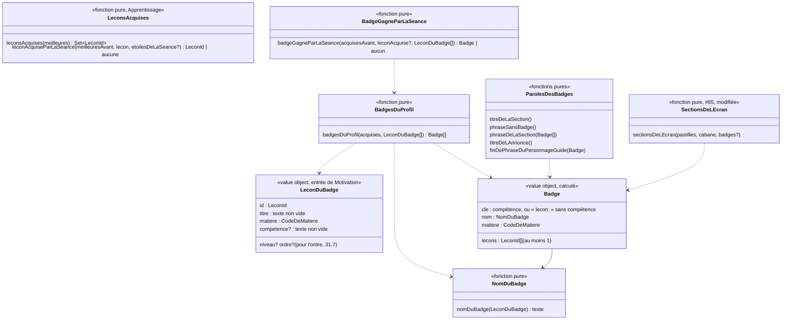

# Modèle du domaine : issue #31, Badges et compétences, un badge par leçon acquise

> Cadrage anticipé (décision 0020, point 6), avant que les dépendances (#27 livrée, #39 en cours, #65 livrée, #32 en PR) soient toutes mergées. Aucune question n'est tranchée : les recommandations sont des propositions de l'équipe. Tout texte d'interface qui ne vient ni du legacy (`app/app.js`) ni d'une décision passée est signalé « à valider ».

## Contexte

Bounded context de la story : **Motivation**, avec une lecture seule dans **Apprentissage** (meilleures étoiles de chaque leçon du profil), dans le **Catalogue pédagogique** (`competence`, `titre`, `matiere` d'une leçon de la bibliothèque) et dans **Accompagnement** (titre et matière d'une leçon personnelle, #39).

Pourquoi Motivation :
- le badge est une récompense : la context map dit « Motivation décide seule des récompenses (série, badges, cabane, épisodes) ; une récompense ne modifie jamais une note » ;
- il ne fait que **constater** qu'une leçon est acquise. La règle « acquise = au moins 2 meilleures étoiles » et les meilleures étoiles qui ne baissent jamais restent à Apprentissage (`ResultatDeLaLecon`, #24) ;
- il s'affiche à deux endroits que Motivation compose déjà : la section `badges` de l'écran « Mes médailles » (#65, réservée en 3e position) et la zone « nouveautés » de l'écran de fin (ouverte par #32).

**Choix de modèle proposé (question 31.3) : le badge n'est pas enregistré, il se recalcule.** Un badge existe dès que la leçon est acquise ; or les meilleures étoiles ne baissent jamais (#24, invariant 3). Donc une leçon acquise le reste, donc le badge ne se perd jamais, sans rien stocker. C'est exactement la forme de la cabane (décision 32.20), du parcours (#25) et de l'écran des médailles (#65) : une **vue calculée** par des fonctions pures de `@domain/motivation`, à partir de ce que le front lit déjà sous RLS. Motivation **ne s'abonne pas** à `LeconAcquise` ; aucune table, aucune migration.

### Sources lues, sans rien écrire

| Source | Contexte | Ce qui est lu | Mécanisme |
|---|---|---|---|
| Meilleures étoiles de chaque leçon du profil en cours | Apprentissage (#24) | `resultats_des_lecons` : `lecon`, `meilleures_etoiles` (1 à 3), pour un seul `profil` | Lecture du front sous RLS, **la même que la cabane** : `lireLesMeilleuresEtoilesPourLaCabane` et `lireLesMeilleuresEtoilesAvantLaSeance` (`src/seance/fin-de-seance/meilleures-etoiles-pour-la-cabane.ts`, #32, branche `feature/32-cabane`), à renommer pour servir aux deux (remarque n°2) |
| Étoiles de la séance qui vient de finir | Apprentissage (#24) | `SeanceTerminee.etoiles` (absent pour une séance faite seulement d'une fluence, Q69) | Valeur déjà présente sur l'écran de fin, comme pour la cabane |
| Leçons de la bibliothèque | Catalogue pédagogique | `Lecon` : `id`, `titre`, `matiere`, `niveau`, `ordre`, `competence?` | Published Language `@domain/catalogue` ; le front charge déjà toute la bibliothèque (`chargerToutesLesLecons`, #65) |
| Leçons personnelles de la famille | Accompagnement (#39, non livré) | `id`, `titre`, `matiere` (jamais de `competence`) | Lecture du front sous RLS (table par famille annoncée par #39). Forme et stockage pas encore modélisés par #39 (questions 31.5 et 31.22) |
| Profil en cours | Famille | identifiant, univers, réglage **Tout lire à voix haute** | Customer/Supplier existant (#11, #12), comme #65 et #32 |

Non lus, volontairement :
- **Résultat du test de départ** (#27, `resultats_des_tests_de_depart`, table à part) : une leçon réussie au test de départ n'a **aucune** étoile et ne donne **ni badge ni compétence acquise** (réponses 27.1 et 27.2, déjà au glossaire). Rien à exclure : le badge ne lit que `resultats_des_lecons`. Si l'enfant rejoue ensuite la leçon avec 2 étoiles, elle devient acquise et donne son badge, comme dans le legacy.
- **Séances terminées** (`seances_terminees`) : elles donneraient une date au badge (« gagné le… »), que le legacy n'affiche pas (question 31.3).

### Comportement du legacy (`app/app.js`), source des règles

- `badgesOf()` (l. 1790) : un badge par **progression** du profil hors test de départ (`!p.test`) avec `etoiles >= 2` (meilleures étoiles). Nom : `lessonById(p.lecon)?.competence`, sinon `` `Je sais : ${p.titre}` `` (titre **copié dans la progression** au moment de la séance). Matière : `p.matiere` (copiée aussi). Ordre : celui des progressions dans le stockage (ordre d'enregistrement, aucune règle).
- `showTrophees` (l. 639) : section « Mes badges », **toujours** affichée ; sans badge : « Gagne au moins 2 étoiles dans une leçon pour recevoir son badge. » ; une pastille par badge : icône de la matière (`icoHTML`, français si la matière est inconnue) et nom. Rien n'est lu à voix haute, pastille inerte.
- Écran de fin (l. 1895, 1946) : `before.badges` = nombre de badges **avant** l'enregistrement ; si le nombre a augmenté **et** que le badge de la leçon jouée existe, encart « Nouveau badge » avec son nom. Le badge **n'est pas** ajouté à la phrase du personnage guide (contrairement à l'épisode et à la cabane). Ordre des encarts : épisode, cabane, badge. Rien au test de départ.
- Après le test de départ, une séance remplace la progression « test » (`max(stars, prev?.test ? 0 : …)`, l. 1913) : 2 étoiles donnent donc le badge.
- Carte des compétences du parent (`skillMap`, l. 2093) : **par section du programme**, « acquis » si une leçon de la section a 2 étoiles **ou** a été validée au test de départ. Autre règle, autre découpage (question 31.17).

### Ce que montre la cible (vérifié)

- `resultats_des_lecons (profil, lecon, meilleures_etoiles, dernieres_etoiles, nombre_de_seances)` : **ni titre, ni matière** (contrairement à la progression du legacy). Le nom et la matière d'un badge ne peuvent venir que de la leçon elle-même : bibliothèque ou leçon personnelle. Une leçon introuvable n'a donc pas de nom (questions 31.5 et 31.13).
- `ResultatDeLaLecon.enregistrerSeance` publie déjà `LeconAcquise { enfant, lecon, competence? }` côté serveur (`apprentissage/domain/resultat-de-la-lecon.ts`), une seule fois par leçon. Aucun contexte ne s'y abonne ; le cas d'usage le rend sans le transporter. Le modèle recalculé n'en a pas besoin (il reste disponible pour #34 si Accompagnement veut un jour un fait daté).
- Écran de fin : comme pour la cabane, une lecture faite pendant l'écran de fin **inclut déjà** la séance. Le « badge gagné par la séance » se calcule donc avec les meilleures étoiles **d'avant** la séance, lues au lancement (`lireLesMeilleuresEtoilesAvantLaSeance`, 5 s au plus, #32), complétées par les étoiles de la séance.
- `@domain/catalogue` : `Lecon.competence?: string` (`catalogue/domain/lecon.ts`, l. 27), texte facultatif validé par `lireLecon`.

### Chiffres de la bibliothèque (`app/bibliotheque.json`, vérifiés)

- **265 leçons** ; **12 sans `competence`**, toutes de la bibliothèque (aucune n'a `special`) :
  - français CP : `fr-cp-dictee-animaux` (« Dictée : les animaux »), `fr-cp-etre-avoir`, `fr-cp-masculin-feminin`, `fr-cp-chanson-clair-de-lune` (« Chanson : Au clair de la lune »), `fr-cp-poesie-cigale` (« Poésie : La Cigale et la Fourmi ») ;
  - français CE1 : `fr-ce1-dictee-groupe-nominal` (« Dictée : les accords du groupe nominal »), `fr-ce1-present-premier-groupe` ; CM1 : `fr-cm1-trois-groupes` ;
  - maths : `ma-cp-addition-posee`, `ma-ce1-addition-trois-chiffres` ;
  - EMC CE2 : `emc-ce2-metier-pompier` (« Découvrir un métier : pompier »), `emc-ce2-metier-police`.
- **7 compétences partagées**, et non « 7 compétences partagées par 2 leçons » comme le dit l'issue : **6 par 2 leçons et 1 par 3 leçons** (« Je calcule des durées » : `ma-ce2-durees`, `ma-cm1-durees`, `ma-cm2-durees`). Les 6 autres : « J'écris des mots invariables sans erreur » (CE1, CE2), « J'écris des mots difficiles sans erreur » (CM1, CM2), « Je découvre un roman d'aventure » (CM1, CM2), « Je récite un poème de Victor Hugo » (deux leçons de CM2), « Je lis et j'écris les grands nombres » (CM1, CM2), « Je résous des problèmes de proportionnalité » (CM1, CM2). Toutes dans une même matière.
- Les 253 compétences commencent toutes par « Je » ou « J' ». La plus longue fait 65 caractères (« Je résous des problèmes où l'on cherche le début ou le changement »).
- Le nom de repli « Je sais : `<titre>` » donne, pour 5 des 12 leçons sans compétence, un double deux-points : « Je sais : Dictée : les animaux » (question 31.20). Les leçons personnelles locales de #39 ont toutes un titre de cette forme (« Dictée : … », « Les verbes : … », « Poésie : … », « Lecture : … »).

## Termes

| Terme | Statut | Remarque |
|---|---|---|
| Badge | au glossaire, `(à valider)` | Définition à préciser (ajout proposé) : badge **par leçon acquise** ou **par compétence** (question 31.2). « Trophée » reste interdit ; « médaille » ne l'est plus (65.1) mais n'est pas un terme du domaine : c'est le nom de l'écran (remarque ci-dessous). |
| Leçon acquise | au glossaire (Apprentissage, validé) | Au moins 2 meilleures étoiles ; jamais par le test de départ (27.1). Le badge en dépend, sans en redéfinir la règle. |
| Compétence | au glossaire (Catalogue, validé) | « C'est le nom de son badge. » Facultative (`competence`), jamais présente pour une leçon personnelle. |
| Nom du badge | **nouveau**, `(à valider)` | La compétence de la leçon, sinon « Je sais : `<titre de la leçon>` » (legacy). Questions 31.2 et 31.20. |
| Badge gagné par la séance | **nouveau**, `(à valider)` | Le badge que la séance vient de faire gagner : la leçon jouée n'était pas acquise avant la séance et l'est après. Interface : encart « Nouveau badge ». Probablement un mot d'interface, comme « objet reçu par la séance » (#32). |
| « Nouveau badge » | mot d'interface (legacy) | Titre de l'encart de l'écran de fin ; aussi le début de la phrase dite décidée par Q74 de #24. |
| « Mes badges » | mot d'interface (legacy) | Titre de la section `badges` de « Mes médailles ». |
| Pastille de badge | mot d'interface | Icône de la matière et nom du badge ; type du domaine `Badge`, pas une ligne du glossaire (comme « Pastille de record », « Pastille de la cabane »). |
| « Gagner » un badge | verbe gardé | « Gagner » est réservé aux étoiles, badges et records (#32) ; la phrase du legacy dit « recevoir son badge » (question 31.10). |
| « Médaille » | **conflit léger** | Depuis 65.1, l'écran s'appelle « Mes médailles » et « médaille » n'est plus interdit pour Badge. Proposition (question 31.21) : « médaille » reste un mot d'interface, nom de l'écran seulement ; on ne dit jamais « médaille » pour un badge. |
| Carte des compétences | au glossaire, `(à valider)` (Accompagnement) | **Conflit de sens** : la définition dit « état de chaque **compétence** » ; le legacy la calcule **par section du programme**, avec une autre règle (test de départ compris). Question 31.17, à porter par #34. |
| `LeconAcquise` | événement existant (#24) | Publié par Apprentissage, **pas consommé** par #31 si le modèle recalculé est retenu (31.3). |

## Modèle

Pas d'agrégat : aucune commande d'écriture, aucun état gardé, aucun invariant d'écriture. Des **value objects** et des **fonctions pures** dans `motivation/domain/`, plus une petite fonction pure dans `apprentissage/domain/` pour ne pas recopier la règle « acquise » (remarque n°1).

Le diagramme suit la recommandation de la question 31.2 (un badge **par compétence**) ; avec l'autre réponse, `Badge.lecons` contient toujours une seule leçon et `cle` est l'identifiant de la leçon.



Le front relie les deux contextes : il lit les meilleures étoiles, demande à `@domain/apprentissage` quelles leçons sont acquises (et laquelle vient de l'être), puis passe ces identifiants à `@domain/motivation`. Motivation ne connaît ni les étoiles ni leur seuil ; Apprentissage ne connaît pas les badges.

### Value objects

| Value object | Règles de validité |
|---|---|
| `LeconDuBadge` | forme propre à Motivation, construite par le front à partir d'une `Lecon` du Catalogue ou d'une leçon personnelle ; `titre` non vide ; `matiere` parmi les six codes du Catalogue ; `competence` absente ou non vide après retrait des espaces (une compétence vide se traite comme absente). |
| `Badge` | `nom` non vide ; `lecons` non vide, sans doublon ; deux badges du même profil n'ont jamais la même `cle` ; `matiere` = celle de la première leçon acquise de la compétence (toutes les compétences partagées sont d'une seule matière, vérifié). |
| Ensemble des leçons acquises | identifiants de leçon ; peut contenir des leçons absentes des leçons connues (leçon retirée, leçon personnelle supprimée : 31.5, 31.13). |

### Fonctions pures

1. Apprentissage, `leconsAcquises(meilleures)` : les leçons dont les meilleures étoiles sont au moins 2 (même seuil que `ResultatDeLaLecon.estAcquise`, à partager, pas à recopier).
2. Apprentissage, `leconAcquiseParLaSeance(meilleuresAvant, lecon, etoilesDeLaSeance)` : la leçon jouée si elle n'était pas acquise avant (meilleures avant < 2 ou absentes) et que la séance lui donne au moins 2 étoiles ; aucune sinon, et aucune si `etoilesDeLaSeance` est absent (fluence seule, Q69). C'est la règle de `LeconAcquise`, calculée dans le navigateur, sans événement.
3. Motivation, `nomDuBadge(lecon)` : la compétence si elle existe, sinon « Je sais : `<titre>` » (legacy ; 31.20).
4. Motivation, `badgesDuProfil(acquises, lecons)` : un badge par compétence des leçons acquises connues, et un badge par leçon acquise sans compétence (31.2) ; une leçon acquise introuvable dans `lecons` ne donne pas de badge (31.5, 31.13) ; ordre : 31.7. Aucune leçon acquise : liste vide.
5. Motivation, `badgeGagneParLaSeance(acquisesAvant, leconAcquise, lecons)` : aucun si `leconAcquise` est absente ; sinon le badge de cette leçon s'il **n'existait pas** dans `badgesDuProfil(acquisesAvant, lecons)` (avec 31.2 b : une leçon acquise dont la compétence était déjà un badge ne donne pas « Nouveau badge »). Au plus un badge par séance.
6. Motivation, paroles (`paroles-des-badges.ts`) :
   - `titreDeLaSection()` : « Mes badges » (legacy) ;
   - `phraseSansBadge()` : « Gagne au moins 2 étoiles dans une leçon pour recevoir son badge. » (legacy, 31.10) ;
   - `phraseDeLaSection(badges)` : ce que lit « tout lire » ou le bouton « Écouter » (31.9 : texte à valider) ;
   - `titreDeLAnnonce()` : « Nouveau badge » (legacy) ;
   - `finDePhraseDuPersonnageGuide(badge)` : « Nouveau badge : `<nom>` ! » (décision Q74 de #24 ; 31.4) ;
   - composition avec la phrase de fin : à faire **une fois** pour la cabane, l'épisode (#33) et le badge, dans l'ordre du legacy (épisode, cabane, badge) ; remarque n°3.
7. Motivation, `sectionsDeLEcran({ pastilles, cabane, badges })` (#65, modifiée) : la section `badges` est disponible dès que `badges` est défini, même vide (31.10) ; elle reste entre l'histoire et les records. `parolesDuGuideALOuverture` : « Regarde tout ce que tu as gagné ! » dès qu'il y a aussi au moins un badge (31.11).

### Erreurs métier

Aucune nouvelle. `NombreDEtoilesInvalide` (#32) reste celle d'une meilleure étoile hors de 1 à 3, levée par la lecture des étoiles, pas par les badges.

### Commandes et lectures

| Commande ou lecture | Effet | Erreurs métier | Où |
|---|---|---|---|
| Lecture des meilleures étoiles du profil en cours | Celle de la cabane (#32) : serveur sous RLS, réunie avec les étoiles gagnées pendant l'utilisation ; `undefined` en cas d'échec ; avant la séance, 5 s au plus | aucune | front, JWT du parent |
| Lecture des leçons personnelles de la famille | Celle de #39 (titre, matière) | à définir par #39 | front, JWT du parent |
| `leconsAcquises`, `leconAcquiseParLaSeance` | Calcul pur (Apprentissage) | aucune | navigateur |
| `badgesDuProfil`, `badgeGagneParLaSeance`, paroles des badges, sections | Calcul pur (Motivation) | aucune | navigateur |

Aucune commande d'écriture, aucun événement nouveau.

### Migration et Edge Function

- **Pas de migration** si 31.3 est retenue : `resultats_des_lecons` contient tout ce qui décide du badge ; la policy de lecture par un parent rattaché, la cascade avec le profil et l'inclusion dans l'export existent (#24). Le verrou `base` n'est pas nécessaire.
- **Pas d'Edge Function.** Lecture directe sous RLS (décisions 0013 et 0016). `terminer-la-seance` et `ResultatDeLaLecon` ne changent pas.
- Si le PO veut un badge **daté** ou qui survit à la suppression de sa leçon (31.3, 31.5, 31.13) : agrégat `BadgesDeLEnfant` enregistré, table avec RLS par rattachement, cascade, export (#14), et réaction à `LeconAcquise` côté serveur (pas seulement dans le navigateur). Story nettement plus grosse, avec le verrou `base`.

## Invariants

L'état étant calculé, ce sont des **règles du calcul**, à couvrir par les tests des fonctions pures :

1. Un badge n'existe que pour une leçon **acquise** (au moins 2 meilleures étoiles) ; une leçon réussie à 1 étoile n'en donne pas.
2. Une leçon réussie au test de départ ne donne pas de badge (27.1) ; rejouée ensuite avec 2 étoiles, elle en donne un.
3. Une séance faite seulement d'une fluence ne donne pas de badge (pas d'étoiles, Q69).
4. **Un badge ne se perd jamais** tant que sa leçon est connue : les meilleures étoiles ne baissent pas, même en rejouant avec 1 étoile, ni en changeant d'univers ou de niveau.
5. Le nom du badge est la compétence de la leçon, sinon « Je sais : `<titre>` » ; il n'est jamais vide.
6. Deux badges d'un même profil n'ont jamais la même clé (31.2).
7. « Nouveau badge » n'apparaît qu'à la séance qui rend la leçon acquise, et seulement si les étoiles d'avant la séance ont été lues ; rejouer une leçon déjà acquise ne l'affiche jamais. Une séance fait gagner au plus un badge.
8. Motivation ne lit jamais les dernières étoiles, ne modifie aucune étoile et n'écrit rien.
9. Les badges ne montrent que les leçons du profil en cours (même entre deux enfants d'un même parent).
10. Les badges ne dépendent ni du temps passé, ni de la date (pas de temps d'écran).
11. Les mêmes leçons acquises et les mêmes leçons connues donnent toujours les mêmes badges, dans le même ordre (calcul déterministe).

## Événements

Aucun nouvel événement, aucun abonnement. `LeconAcquise` (#24) reste publié par Apprentissage côté serveur et n'est pas consommé : le badge se recalcule à la lecture, et la règle « devient acquise » est appelée dans le navigateur par une fonction pure d'Apprentissage (`leconAcquiseParLaSeance`). `TestDeDepartTermine` est ignoré (27.4). La context map garde la ligne « `SeanceTerminee` et `LeconAcquise` … font avancer … les badges » ; une note #31 la nuance (ajout seulement).

## Relations avec les autres contextes

| Amont | Aval | Relation | Mécanisme |
|---|---|---|---|
| Apprentissage | Motivation (badges) | Lecture seule, calcul dans le domaine (proposition 31.3) | Le front lit les meilleures étoiles du profil en cours sous RLS (lecture de #32), obtient de `@domain/apprentissage` les leçons acquises (et celle que la séance vient de rendre acquise), et passe ces identifiants à `@domain/motivation`. Pas d'import de `ResultatDeLaLecon` dans Motivation |
| Catalogue pédagogique | Motivation (badges) | Published Language (`Lecon`) | `competence`, `titre`, `matiere`, `niveau`, `ordre`, traduits par le front en `LeconDuBadge` |
| Accompagnement (#39) | Motivation (badges) | Lecture seule | Titre et matière d'une leçon personnelle, traduits en `LeconDuBadge` sans compétence. Forme exacte à caler avec #39 |
| Famille | Motivation | Customer/Supplier existant | Univers (personnage guide qui parle) et réglage Tout lire du profil en cours |
| Famille | Motivation | Contrat de données personnelles (#14) | Rien de nouveau si 31.3 est retenue |

## Partage avec le front

- Dans `@domain/motivation` (`index.ts`, ajouts seulement) : types `LeconDuBadge`, `Badge`, fonctions `nomDuBadge`, `badgesDuProfil`, `badgeGagneParLaSeance`, paroles des badges ; signatures de `sectionsDeLEcran`, `parolesDuGuideALOuverture`, `parolesALOuverture` étendues avec `badges`.
- Dans `@domain/apprentissage` (ajouts seulement) : `leconsAcquises`, `leconAcquiseParLaSeance`.
- React affiche : section « Mes badges » (liste de pastilles, icône de la matière, nom), encart « Nouveau badge ». Aucun seuil, aucun nom composé, aucun tri ni dédoublonnage dans un composant.
- Hors ligne : le calcul est pur ; ce qui manque sans réseau, ce sont les meilleures étoiles du serveur et les leçons personnelles (31.14 ; copie sur l'appareil : #44).
- Accessibilité (front) : section en `h2` sous « Mes médailles », pastilles en liste, icône de la matière décorative ou nommée (31.8), nom qui passe à la ligne à 360 px (65 caractères au plus pour une compétence, davantage pour « Je sais : `<titre>` »), encart de fin annoncé (`role="status"`), apparition courte supprimée avec `prefers-reduced-motion` (31.16), mode dys, cibles de 44 px si la pastille devient un bouton (31.9).

## Données d'enfants

Aucune nouvelle donnée personnelle si 31.3 est retenue : rien n'est enregistré (ni badge, ni date). Les badges se déduisent des meilleures étoiles déjà enregistrées par #24, déjà couvertes par la cascade avec le profil (l'export relève de #14, sorti de la beta). Rien n'est gardé sur l'appareil au-delà de ce que fait déjà #24, rien n'est envoyé à l'IA. Si le PO choisit un badge enregistré et daté (31.3), c'est une nouvelle donnée d'enfant : table avec RLS par rattachement, cascade, export (#14), et elle doit être justifiée par l'apprentissage ou le suivi parental (minimisation).

## Emplacement

```
supabase/functions/_shared/apprentissage/domain/
  lecons-acquises.ts                      # leconsAcquises, leconAcquiseParLaSeance (seuil partagé avec ResultatDeLaLecon)
  index.ts                                # ajouts seulement
supabase/functions/_shared/motivation/domain/
  badges.ts                               # LeconDuBadge, Badge, nomDuBadge, badgesDuProfil, badgeGagneParLaSeance
  paroles-des-badges.ts                   # titreDeLaSection, phraseSansBadge, phraseDeLaSection, titreDeLAnnonce,
                                          # finDePhraseDuPersonnageGuide
  sections-de-l-ecran.ts                  # (#65, #32, modifié) sectionsDeLEcran({ pastilles, cabane, badges })
  paroles-de-l-ecran-des-medailles.ts     # (#65, #32, modifié) phrase d'ouverture, lecture de la section des badges
  paroles-de-la-cabane.ts                 # (#32, modifié si la composition de la phrase de fin est mise en commun, remarque n°3)
  index.ts                                # ajouts seulement
  *_test.ts
src/medailles/
  SectionDesBadges.tsx, useBadges.ts      # lecture des étoiles (#32) et des leçons personnelles (#39), appel du domaine
src/seance/fin-de-seance/
  useBadgeGagneParLaSeance.ts             # à partir des étoiles d'avant la séance (#32)
  EcranDeFin.tsx                          # encart « Nouveau badge » (zone « nouveautés »)
  meilleures-etoiles-pour-la-cabane.ts    # (#32) renommé pour servir aux badges (remarque n°2)
```

Pas de migration, pas d'Edge Function, rien de modifié dans `ResultatDeLaLecon` ni dans `terminer-la-seance`.

## Hors de cette story

- Carte des compétences et suivi du parent (#34) : la règle de la carte est à trancher là (question 31.17).
- Badges dans l'Espace parent (question 31.19).
- Records de calcul rapide (livrés par #65) et nom de l'écran « Mes médailles » (65.1).
- Copie des meilleures étoiles et des leçons personnelles sur l'appareil (#44).

## Remarques (pas des questions au PO)

1. **Seuil « acquise » à un seul endroit.** Motivation pourrait tester « meilleures étoiles ≥ 2 » elle-même (forme `MeilleuresEtoilesDuProfil` de #32), mais elle recopierait une règle d'Apprentissage (glossaire : **Leçon acquise**, Apprentissage). Proposition : deux fonctions pures dans `@domain/apprentissage` qui réutilisent le seuil de `ResultatDeLaLecon`, et Motivation ne reçoit que des identifiants de leçons acquises. Choix d'architecture, à confirmer par l'implémenteur et la review.
2. **Dépendance réelle à #32.** La lecture des meilleures étoiles d'avant la séance (5 s au plus), la signature de `sectionsDeLEcran` et la zone « nouveautés » sont dans la PR #88 (#32), non mergée. Le graphe (`docs/graphe/stories.md`) ne cite pas #32 dans les dépendances de #31 : à ajouter par le responsable. Les noms `…PourLaCabane` sont à généraliser (« meilleures étoiles du profil ») sans changer leur règle.
3. **Composition de la phrase de fin.** #32 livre `phraseDeFinAvecLaCabane(phraseDeFin, objet?)` ; #33 (épisodes, en cadrage en parallèle) et #31 ajoutent chacun une fin de phrase. Plutôt que d'enchaîner trois fonctions, une seule composition « phrase de fin + nouveautés » dans l'ordre du legacy (épisode, cabane, badge), à caler entre #31 et #33.
4. **Révisions (#28)** : une séance de révision ne doit pas changer les meilleures étoiles d'une leçon (comme pour la cabane) ; si c'est le cas, une révision ne donne pas de badge.
5. **Compétence modifiée dans `scripts/lecons/`** : le badge recalculé prend le nouveau nom ; il n'y a rien à migrer.
6. **Leçon personnelle jouée par plusieurs enfants** : chaque enfant a ses propres meilleures étoiles, donc ses propres badges ; rien de partagé dans la famille.

## Questions ouvertes

Les questions 31.1 à 31.6 reprennent celles de l'issue, dans l'ordre. Les suivantes viennent du modèle et des stories livrées.

**31.1. Leçon validée par le test de départ : pas de badge ?** Le glossaire a changé depuis l'issue : une leçon validée par le test de départ est **réussie**, jamais acquise, et « ne donne ni étoile, ni badge, ni compétence acquise » (réponses 27.1 et 27.2). **Recommandation** : question déjà tranchée ; on garde le comportement du legacy (pas de badge ; un badge si l'enfant la rejoue avec 2 étoiles). Confirmation seulement : d'accord ?

**31.2. Deux leçons avec la même compétence : deux badges au même nom, ou un seul ?** Vérifié : 7 compétences partagées, 6 par 2 leçons et « Je calcule des durées » par 3 leçons (CE2, CM1, CM2). **Recommandation** : **un seul badge par compétence** (le glossaire dit « récompense liée à une compétence », et deux pastilles identiques ressemblent à un doublon). Le badge apparaît à la première leçon acquise de la compétence ; la seconde n'affiche pas « Nouveau badge ». Une leçon sans compétence garde son propre badge. Exemple : « Je calcule des durées » acquise en CE2 puis en CM1 → un badge, annoncé une fois. D'accord, ou préfères-tu un badge par leçon (comme le legacy) ?

**31.3. Badge enregistré (fait gagné, daté) ou recalculé à partir des meilleures étoiles ?** **Recommandation** : **recalculé**, comme la cabane (32.20), sans table, sans migration, sans abonnement à `LeconAcquise`. Le badge ne se perd jamais puisque les meilleures étoiles ne baissent pas. Conséquence : pas de date de gain (le legacy n'en montre pas), et un badge disparaît si sa leçon n'existe plus (31.5, 31.13). D'accord ?

**31.4. Le nouveau badge est-il annoncé par le personnage guide à l'écran de fin ?** Le legacy ne le dit pas ; mais la décision Q74 de #24 a répondu « oui, au lot 5 (« Nouveau badge : `<compétence>` ! ») ». **Recommandation** : oui, comme Q74 et comme la cabane (32.12) : encart « Nouveau badge » avec le nom, et fin de la phrase du personnage guide « Nouveau badge : `<nom>` ! », après celle de la cabane (ordre du legacy : épisode, cabane, badge). L'encart lui-même n'est pas dit par la voix, même avec « tout lire » (comme 32.23). D'accord ?

**31.5. Une leçon personnelle supprimée garde-t-elle son badge ?** Le legacy le garde parce que la progression copie le titre ; la cible ne copie pas le titre (`resultats_des_lecons` n'a que l'identifiant de la leçon), et #39 n'a pas encore tranché ce que deviennent les progrès d'une leçon supprimée (question n°7 de #39). **Recommandation** : **non**, le badge disparaît avec la leçon personnelle (il n'a plus de nom à montrer et la leçon n'existe plus pour l'enfant) ; « un badge ne se perd jamais » se lit « tant que sa leçon existe ». Garder le badge demanderait d'enregistrer le titre (31.3 enregistré, ou #39 qui garde une trace de la leçon supprimée). D'accord ?

**31.6. Nom de l'écran et records de calcul rapide.** Tranché : l'écran s'appelle « Mes médailles » (65.1), et la section « Mes records de calcul rapide » est livrée par #65. **Recommandation** : rien à faire dans #31, qui remplit seulement la section `badges` réservée par #65. Confirmation seulement : d'accord ?

**31.7. Ordre des badges dans « Mes badges ».** Le legacy suit l'ordre d'enregistrement (aucune règle). Sans date (31.3), l'ordre « du plus récent » n'est pas possible. **Recommandation** : l'ordre du catalogue : matière (français, maths, sciences, histoire, anglais, EMC, l'ordre des onglets du parcours), puis niveau, puis `ordre` de la leçon ; les leçons personnelles à la fin, par titre. Exemple : « Je découpe un mot en syllabes » (français CP) avant « Je prévois combien il y a de jetons dans la boîte » (maths CP). Ou bien un regroupement par matière avec un sous-titre par matière ?

**31.8. Icône de la matière sur la pastille.** Le legacy montre l'icône colorée de la matière (« Aa », « 1+2 », dessins), et le français si la matière est inconnue. **Recommandation** : garder l'icône du legacy (même dessin, même couleur), décorative pour le lecteur d'écran, qui lit seulement le nom du badge. La matière est toujours connue dans la cible (Catalogue et #39 la valident), donc pas de repli. D'accord ?

**31.9. Que lit-on de « Mes badges », et comment ?** Le legacy ne lit rien ; l'issue dit « le nom du badge peut être lu à voix haute » ; pour la cabane, « tout lire » ou le bouton « Écouter » lisent le titre puis une phrase, pas les pastilles (32.10). Un enfant peut avoir des dizaines de badges. **Recommandation** : avec « tout lire », à l'ouverture, le titre « Mes badges » puis une phrase de compte (texte **à valider** : « Tu as 4 badges. », ou la phrase sans badge) ; sans « tout lire », un bouton « Écouter » sur la section lit la même chose ; et **toucher une pastille lit le nom du badge** (pastille-bouton de 44 px). D'accord, et avec quel texte ?

**31.10. Section sans badge.** **Recommandation** : la section est **toujours** affichée quand les étoiles ont pu être lues (comme le legacy et la cabane, 32.8), avec la phrase du legacy « Gagne au moins 2 étoiles dans une leçon pour recevoir son badge. ». D'accord ? (Remarque : « recevoir » est le verbe réservé aux objets de la cabane depuis #32 ; garder la phrase telle quelle, ou dire « pour gagner son badge » ?)

**31.11. Phrase du personnage guide à l'ouverture de « Mes médailles ».** Aujourd'hui : « Regarde tout ce que tu as gagné ! » dès qu'il y a un objet de la cabane ou un record, sinon « Gagne des étoiles pour remplir la cabane ! » (32.9). **Recommandation** : un badge compte aussi pour « Regarde tout ce que tu as gagné ! ». En pratique, un badge vient toujours avec au moins 2 étoiles, donc rarement sans objet (premier palier à 3) : un seul cas change (une leçon à 2 étoiles et rien d'autre). D'accord ?

**31.12. Encart « Nouveau badge » à côté de celui de la cabane.** **Recommandation** : dans la zone « nouveautés », après l'encart « Pour la cabane » (ordre du legacy : épisode, cabane, badge), titre « Nouveau badge » et nom du badge en dessous, sans l'icône de la matière (comme le legacy). Les deux encarts peuvent apparaître ensemble. D'accord ?

**31.13. Leçon de la bibliothèque retirée** (résultat qui pointe vers une leçon qui n'existe plus). La cabane compte encore ses étoiles (32.15), mais la cible n'a ni son titre ni sa compétence. **Recommandation** : pas de badge pour cette leçon (comme 31.5) ; cas rare, lié au contenu. D'accord ?

**31.14. Sans réseau, lecture impossible, profil préparé.** **Recommandation** : mêmes règles que la cabane : sans les étoiles du serveur, ni section « Mes badges », ni encart « Nouveau badge », sans message d'erreur (32.13) ; pour un profil préparé, les badges des étoiles gagnées sur l'appareil (32.22) ; les étoiles de la séance en cours d'envoi comptent tout de suite (32.19). Sans la lecture des leçons personnelles, leurs badges n'apparaissent pas, les autres oui. D'accord ?

**31.15. Une pastille ouvre-t-elle la leçon ?** **Recommandation** : non (comme 32.16 et 65.13) ; elle lit seulement le nom (31.9). D'accord ?

**31.16. Apparition du badge animée ?** **Recommandation** : comme la cabane (32.17) : animation courte de l'encart sur l'écran de fin seulement, supprimée avec les mouvements réduits ; rien d'animé dans « Mes médailles ». D'accord ?

**31.17. Carte des compétences du parent (#34) : quelle règle ?** Le legacy dit « acquis » pour une **section du programme** dont une leçon a 2 étoiles **ou** a été validée au test de départ ; or 27.1 dit qu'une leçon réussie au test de départ n'est jamais acquise, et le glossaire définit la carte « par compétence ». **Recommandation** : à trancher dans #34, pas dans #31 ; avis de l'équipe : la carte suit la règle du badge (2 étoiles, sans le test de départ) et dit « réussie au test de départ » à part, et la définition du glossaire précise si la carte est par compétence ou par section du programme. D'accord pour la renvoyer à #34 ?

**31.18. Badges des leçons d'un autre niveau** (classes d'avant, classe au-dessus, enfant changé de classe). **Recommandation** : tous les badges du profil, quel que soit son niveau actuel (comme la cabane, 32.4, et les records, 65.10). D'accord ?

**31.19. Badges dans l'Espace parent ?** **Recommandation** : non dans #31 (comme la cabane, 32.24) ; le parent voit les compétences dans le suivi (#34). D'accord ?

**31.20. Nom de repli « Je sais : `<titre>` ».** Il donne « Je sais : Dictée : les animaux » (double deux-points) pour 5 des 12 leçons de la bibliothèque sans compétence, et pour toutes les leçons personnelles locales (« Je sais : Dictée : chaton, maison, poisson… »). **Recommandation** : garder le repli du legacy (il faut un nom pour les leçons personnelles), et **ajouter une compétence aux 12 leçons de la bibliothèque** (travail de contenu dans `scripts/lecons/`, par la session principale, hors story), pour que le repli ne serve qu'aux leçons personnelles. D'accord ? Faut-il aussi un autre repli pour une leçon personnelle (texte **à valider**, par exemple « Ma leçon : `<titre>` ») ?

**31.21. « Médaille » dans le domaine.** Depuis 65.1, « médaille » n'est plus interdit pour Badge. **Recommandation** : « médaille » reste le nom de l'écran (« Mes médailles »), jamais le nom d'un badge ni d'un objet ; le code et les scénarios disent toujours « badge ». D'accord ?

**31.22. Leçons personnelles : d'où vient le titre ?** #39 enregistrera les leçons « par famille », avec une lecture sous RLS. **Recommandation** : #31 lit le titre et la matière de chaque leçon personnelle visible du profil en cours, par la lecture que #39 fournit au parcours (« Pour toi »), sans nouvelle table. Si #39 n'est pas livrée quand #31 commence son code, #31 se livre sans les leçons personnelles et les ajoute dès #39 (scénarios tagués `@depend-de-39`). D'accord ?
