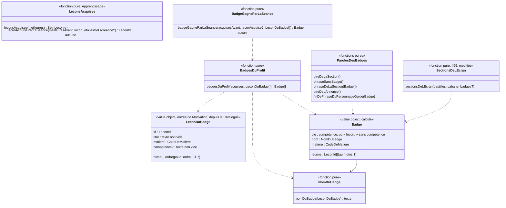

# Modèle du domaine : issue #31, Badges et compétences, un badge par leçon acquise

> **Modèle validé par le PO le 2026-10-25** ([réponse du PO](https://github.com/SBA-dev/github-move/issues/31#issuecomment-6400998108)) : toutes les recommandations sont retenues, avec un changement : **les leçons personnelles ne donnent pas de badge** (réponse « A » sur la contradiction avec 39.12) ; 31.5, 31.7 (partie leçons personnelles) et 31.22 sont sans objet. Ordre des nouveautés commun avec #33 (33.13) : **cabane, épisode, badge**. Voir « Décisions ».
>
> Cadrage anticipé (décision 0020, point 6), avant que les dépendances (#27 livrée, #65 livrée, #32 en PR) soient toutes mergées.

## Contexte

Bounded context de la story : **Motivation**, avec une lecture seule dans **Apprentissage** (meilleures étoiles de chaque leçon du profil) et dans le **Catalogue pédagogique** (`competence`, `titre`, `matiere` d'une leçon de la bibliothèque). Une leçon personnelle (Accompagnement, #39) ne donne pas de badge : Motivation ne lit rien d'Accompagnement (décision du PO, 39.12).

Pourquoi Motivation :
- le badge est une récompense : la context map dit « Motivation décide seule des récompenses (série, badges, cabane, épisodes) ; une récompense ne modifie jamais une note » ;
- il ne fait que **constater** qu'une leçon est acquise. La règle « acquise = au moins 2 meilleures étoiles » et les meilleures étoiles qui ne baissent jamais restent à Apprentissage (`ResultatDeLaLecon`, #24) ;
- il s'affiche à deux endroits que Motivation compose déjà : la section `badges` de l'écran « Mes médailles » (#65, réservée en 3e position) et la zone « nouveautés » de l'écran de fin (ouverte par #32).

**Choix de modèle (décision 31.3) : le badge n'est pas enregistré, il se recalcule.** Un badge existe dès que la leçon est acquise ; or les meilleures étoiles ne baissent jamais (#24, invariant 3). Donc une leçon acquise le reste, donc le badge ne se perd jamais, sans rien stocker. C'est exactement la forme de la cabane (décision 32.20), du parcours (#25) et de l'écran des médailles (#65) : une **vue calculée** par des fonctions pures de `@domain/motivation`, à partir de ce que le front lit déjà sous RLS. Motivation **ne s'abonne pas** à `LeconAcquise` ; aucune table, aucune migration.

### Sources lues, sans rien écrire

| Source | Contexte | Ce qui est lu | Mécanisme |
|---|---|---|---|
| Meilleures étoiles de chaque leçon du profil en cours | Apprentissage (#24) | `resultats_des_lecons` : `lecon`, `meilleures_etoiles` (1 à 3), pour un seul `profil` | Lecture du front sous RLS, **la même que la cabane** : `lireLesMeilleuresEtoilesPourLaCabane` et `lireLesMeilleuresEtoilesAvantLaSeance` (`src/seance/fin-de-seance/meilleures-etoiles-pour-la-cabane.ts`, #32, branche `feature/32-cabane`), à renommer pour servir aux deux (remarque n°2) |
| Étoiles de la séance qui vient de finir | Apprentissage (#24) | `SeanceTerminee.etoiles` (absent pour une séance faite seulement d'une fluence, Q69) | Valeur déjà présente sur l'écran de fin, comme pour la cabane |
| Leçons de la bibliothèque | Catalogue pédagogique | `Lecon` : `id`, `titre`, `matiere`, `niveau`, `ordre`, `competence?` | Published Language `@domain/catalogue` ; le front charge déjà toute la bibliothèque (`chargerToutesLesLecons`, #65) |
| Profil en cours | Famille | identifiant, univers, réglage **Tout lire à voix haute** | Customer/Supplier existant (#11, #12), comme #65 et #32 |

Non lus, volontairement :
- **Résultat du test de départ** (#27, `resultats_des_tests_de_depart`, table à part) : une leçon réussie au test de départ n'a **aucune** étoile et ne donne **ni badge ni compétence acquise** (réponses 27.1 et 27.2, déjà au glossaire). Rien à exclure : le badge ne lit que `resultats_des_lecons`. Si l'enfant rejoue ensuite la leçon avec 2 étoiles, elle devient acquise et donne son badge, comme dans le legacy.
- **Séances terminées** (`seances_terminees`) : elles donneraient une date au badge (« gagné le… »), que le legacy n'affiche pas (décision 31.3).
- **Leçons personnelles** (Accompagnement, #39) : elles ne donnent pas de badge (décision du PO, 39.12). Un résultat qui pointe vers une leçon personnelle n'a pas de `LeconDuBadge` du Catalogue : il est ignoré, comme une leçon retirée (31.13).

### Comportement du legacy (`app/app.js`), source des règles

- `badgesOf()` (l. 1790) : un badge par **progression** du profil hors test de départ (`!p.test`) avec `etoiles >= 2` (meilleures étoiles). Nom : `lessonById(p.lecon)?.competence`, sinon `` `Je sais : ${p.titre}` `` (titre **copié dans la progression** au moment de la séance). Matière : `p.matiere` (copiée aussi). Ordre : celui des progressions dans le stockage (ordre d'enregistrement, aucune règle).
- `showTrophees` (l. 639) : section « Mes badges », **toujours** affichée ; sans badge : « Gagne au moins 2 étoiles dans une leçon pour recevoir son badge. » ; une pastille par badge : icône de la matière (`icoHTML`, français si la matière est inconnue) et nom. Rien n'est lu à voix haute, pastille inerte.
- Écran de fin (l. 1895, 1946) : `before.badges` = nombre de badges **avant** l'enregistrement ; si le nombre a augmenté **et** que le badge de la leçon jouée existe, encart « Nouveau badge » avec son nom. Le badge **n'est pas** ajouté à la phrase du personnage guide (contrairement à l'épisode et à la cabane). Ordre des encarts : épisode, cabane, badge (la cible retient cabane, épisode, badge : 33.13). Rien au test de départ.
- Après le test de départ, une séance remplace la progression « test » (`max(stars, prev?.test ? 0 : …)`, l. 1913) : 2 étoiles donnent donc le badge.
- Carte des compétences du parent (`skillMap`, l. 2093) : **par section du programme**, « acquis » si une leçon de la section a 2 étoiles **ou** a été validée au test de départ. Autre règle, autre découpage (question 31.17).

### Ce que montre la cible (vérifié)

- `resultats_des_lecons (profil, lecon, meilleures_etoiles, dernieres_etoiles, nombre_de_seances)` : **ni titre, ni matière** (contrairement à la progression du legacy). Le nom et la matière d'un badge ne peuvent venir que de la leçon de la bibliothèque. Une leçon introuvable dans la bibliothèque (leçon retirée, leçon personnelle) ne donne donc pas de badge (décision 31.13, décision du PO sur les leçons personnelles).
- `ResultatDeLaLecon.enregistrerSeance` publie déjà `LeconAcquise { enfant, lecon, competence? }` côté serveur (`apprentissage/domain/resultat-de-la-lecon.ts`), une seule fois par leçon. Aucun contexte ne s'y abonne ; le cas d'usage le rend sans le transporter. Le modèle recalculé n'en a pas besoin (il reste disponible pour #34 si Accompagnement veut un jour un fait daté).
- Écran de fin : comme pour la cabane, une lecture faite pendant l'écran de fin **inclut déjà** la séance. Le « badge gagné par la séance » se calcule donc avec les meilleures étoiles **d'avant** la séance, lues au lancement (`lireLesMeilleuresEtoilesAvantLaSeance`, 5 s au plus, #32), complétées par les étoiles de la séance.
- `@domain/catalogue` : `Lecon.competence?: string` (`catalogue/domain/lecon.ts`, l. 27), texte facultatif validé par `lireLecon`.

### Chiffres de la bibliothèque (`app/bibliotheque.json`, vérifiés)

- **265 leçons** ; **12 sans `competence`** (aucune n'a `special`) :
  - français CP : `fr-cp-dictee-animaux` (« Dictée : les animaux »), `fr-cp-etre-avoir`, `fr-cp-masculin-feminin`, `fr-cp-chanson-clair-de-lune` (« Chanson : Au clair de la lune »), `fr-cp-poesie-cigale` (« Poésie : La Cigale et la Fourmi ») ;
  - français CE1 : `fr-ce1-dictee-groupe-nominal` (« Dictée : les accords du groupe nominal »), `fr-ce1-present-premier-groupe` ; CM1 : `fr-cm1-trois-groupes` ;
  - maths : `ma-cp-addition-posee`, `ma-ce1-addition-trois-chiffres` ;
  - EMC CE2 : `emc-ce2-metier-pompier` (« Découvrir un métier : pompier »), `emc-ce2-metier-police`.
- **7 compétences partagées**, et non « 7 compétences partagées par 2 leçons » comme le dit l'issue : **6 par 2 leçons et 1 par 3 leçons** (« Je calcule des durées » : `ma-ce2-durees`, `ma-cm1-durees`, `ma-cm2-durees`). Les 6 autres : « J'écris des mots invariables sans erreur » (CE1, CE2), « J'écris des mots difficiles sans erreur » (CM1, CM2), « Je découvre un roman d'aventure » (CM1, CM2), « Je récite un poème de Victor Hugo » (deux leçons de CM2), « Je lis et j'écris les grands nombres » (CM1, CM2), « Je résous des problèmes de proportionnalité » (CM1, CM2). Toutes dans une même matière.
- Les 253 compétences commencent toutes par « Je » ou « J' ». La plus longue fait 65 caractères (« Je résous des problèmes où l'on cherche le début ou le changement »).
- Le nom de repli « Je sais : `<titre>` » donne, pour 5 des 12 leçons sans compétence, un double deux-points : « Je sais : Dictée : les animaux ». Décision 31.20 : on garde le repli et on ajoute une compétence aux 12 leçons (contenu, hors story).

## Termes

| Terme | Statut | Remarque |
|---|---|---|
| Badge | au glossaire (ligne d'origine `(à valider)`, précision #31 validée) | Un badge **par compétence** des leçons de la bibliothèque acquises (décision 31.2) ; jamais pour une leçon personnelle. « Trophée » reste interdit ; « médaille » est le nom de l'écran, jamais celui d'un badge (décision 31.21). |
| Leçon acquise | au glossaire (Apprentissage, validé) | Au moins 2 meilleures étoiles ; jamais par le test de départ (27.1). Le badge en dépend, sans en redéfinir la règle. |
| Compétence | au glossaire (Catalogue, validé) | « C'est le nom de son badge. » Facultative (`competence`). |
| Nom du badge | **nouveau**, validé | La compétence de la leçon, sinon « Je sais : `<titre de la leçon>` » (legacy). Décisions 31.2 et 31.20. |
| Badge gagné par la séance | **nouveau**, validé | Le badge que la séance vient de faire gagner : la leçon jouée n'était pas acquise avant la séance et l'est après. Interface : encart « Nouveau badge ». |
| « Nouveau badge » | mot d'interface (legacy) | Titre de l'encart de l'écran de fin ; aussi le début de la phrase dite décidée par Q74 de #24. |
| « Mes badges » | mot d'interface (legacy) | Titre de la section `badges` de « Mes médailles ». |
| Pastille de badge | mot d'interface | Icône de la matière et nom du badge ; type du domaine `Badge`, pas une ligne du glossaire (comme « Pastille de record », « Pastille de la cabane »). |
| « Gagner » un badge | verbe gardé | « Gagner » est réservé aux étoiles, badges et records (#32) ; la phrase sans badge dit « pour gagner son badge » (décision 31.10), pas « recevoir » comme le legacy. |
| « Médaille » | conflit léger, tranché | « Médaille » reste un mot d'interface, nom de l'écran seulement ; on ne dit jamais « médaille » pour un badge (décision 31.21). |
| Carte des compétences | au glossaire, `(à valider)` (Accompagnement) | **Conflit de sens** : la définition dit « état de chaque **compétence** » ; le legacy la calcule **par section du programme**, avec une autre règle (test de départ compris). Renvoyé à #34 (décision 31.17). |
| Leçon personnelle | au glossaire (Accompagnement) | Ne donne **pas** de badge (décision du PO, 39.12). |
| `LeconAcquise` | événement existant (#24) | Publié par Apprentissage, **pas consommé** par #31 (décision 31.3). |

## Modèle

Pas d'agrégat : aucune commande d'écriture, aucun état gardé, aucun invariant d'écriture. Des **value objects** et des **fonctions pures** dans `motivation/domain/`, plus une petite fonction pure dans `apprentissage/domain/` pour ne pas recopier la règle « acquise » (remarque n°1).

Le diagramme suit la décision 31.2 (un badge **par compétence**).



Le front relie les deux contextes : il lit les meilleures étoiles, demande à `@domain/apprentissage` quelles leçons sont acquises (et laquelle vient de l'être), puis passe ces identifiants à `@domain/motivation`. Motivation ne connaît ni les étoiles ni leur seuil ; Apprentissage ne connaît pas les badges.

### Value objects

| Value object | Règles de validité |
|---|---|
| `LeconDuBadge` | forme propre à Motivation, construite par le front à partir d'une `Lecon` du Catalogue (jamais d'une leçon personnelle) ; `titre` non vide ; `matiere` parmi les six codes du Catalogue ; `competence` absente ou non vide après retrait des espaces (une compétence vide se traite comme absente). |
| `Badge` | `nom` non vide ; `lecons` non vide, sans doublon ; deux badges du même profil n'ont jamais la même `cle` ; `matiere` = celle de la première leçon acquise de la compétence (toutes les compétences partagées sont d'une seule matière, vérifié). |
| Ensemble des leçons acquises | identifiants de leçon ; peut contenir des leçons absentes des leçons du Catalogue (leçon retirée, 31.13 ; leçon personnelle) : elles ne donnent pas de badge. |

### Fonctions pures

1. Apprentissage, `leconsAcquises(meilleures)` : les leçons dont les meilleures étoiles sont au moins 2 (même seuil que `ResultatDeLaLecon.estAcquise`, à partager, pas à recopier).
2. Apprentissage, `leconAcquiseParLaSeance(meilleuresAvant, lecon, etoilesDeLaSeance)` : la leçon jouée si elle n'était pas acquise avant (meilleures avant < 2 ou absentes) et que la séance lui donne au moins 2 étoiles ; aucune sinon, et aucune si `etoilesDeLaSeance` est absent (fluence seule, Q69). C'est la règle de `LeconAcquise`, calculée dans le navigateur, sans événement.
3. Motivation, `nomDuBadge(lecon)` : la compétence si elle existe, sinon « Je sais : `<titre>` » (legacy ; 31.20).
4. Motivation, `badgesDuProfil(acquises, lecons)` : un badge par compétence des leçons acquises connues, et un badge par leçon acquise sans compétence (31.2) ; une leçon acquise introuvable dans `lecons` (leçon retirée, leçon personnelle) ne donne pas de badge (31.13) ; ordre : 31.7 (matière dans l'ordre des onglets, puis niveau, puis `ordre`). Aucune leçon acquise : liste vide.
5. Motivation, `badgeGagneParLaSeance(acquisesAvant, leconAcquise, lecons)` : aucun si `leconAcquise` est absente ; sinon le badge de cette leçon s'il **n'existait pas** dans `badgesDuProfil(acquisesAvant, lecons)` (31.2 : une leçon acquise dont la compétence était déjà un badge ne donne pas « Nouveau badge » ; une leçon personnelle n'en donne jamais). Au plus un badge par séance.
6. Motivation, paroles (`paroles-des-badges.ts`) :
   - `titreDeLaSection()` : « Mes badges » (legacy) ;
   - `phraseSansBadge()` : « Gagne au moins 2 étoiles dans une leçon pour gagner son badge. » (31.10 : « gagner » au lieu du « recevoir » du legacy) ;
   - `phraseDeLaSection(badges)` : ce que lit « tout lire » ou le bouton « Écouter » : « Tu as N badge(s). » (31.9) ;
   - libellé de la liste pour le lecteur d'écran : « Mes badges, avec N badge(s) » (31.24) ;
   - `titreDeLAnnonce()` : « Nouveau badge » (legacy) ;
   - `finDePhraseDuPersonnageGuide(badge)` : « Nouveau badge : `<nom>` ! », le nom tel qu'il s'affiche, même « Je sais : … » (décision Q74 de #24 ; 31.4, 31.25) ;
   - composition avec la phrase de fin : faite **une fois** pour la cabane, l'épisode (#33) et le badge, dans l'ordre **cabane, épisode, badge** (33.13), le même que dans « Mes médailles » ; remarque n°3.
7. Motivation, `sectionsDeLEcran({ pastilles, cabane, badges })` (#65, modifiée) : la section `badges` est disponible dès que `badges` est défini, même vide (31.10) ; elle reste entre l'histoire et les records. `parolesDuGuideALOuverture` : « Regarde tout ce que tu as gagné ! » dès qu'il y a aussi au moins un badge (31.11).

### Erreurs métier

Aucune nouvelle. `NombreDEtoilesInvalide` (#32) reste celle d'une meilleure étoile hors de 1 à 3, levée par la lecture des étoiles, pas par les badges.

### Commandes et lectures

| Commande ou lecture | Effet | Erreurs métier | Où |
|---|---|---|---|
| Lecture des meilleures étoiles du profil en cours | Celle de la cabane (#32) : serveur sous RLS, réunie avec les étoiles gagnées pendant l'utilisation ; `undefined` en cas d'échec ; avant la séance, 5 s au plus | aucune | front, JWT du parent |
| `leconsAcquises`, `leconAcquiseParLaSeance` | Calcul pur (Apprentissage) | aucune | navigateur |
| `badgesDuProfil`, `badgeGagneParLaSeance`, paroles des badges, sections | Calcul pur (Motivation) | aucune | navigateur |

Aucune commande d'écriture, aucun événement nouveau.

### Migration et Edge Function

- **Pas de migration** (décision 31.3) : `resultats_des_lecons` contient tout ce qui décide du badge ; la policy de lecture par un parent rattaché, la cascade avec le profil et l'inclusion dans l'export existent (#24). Le verrou `base` n'est pas nécessaire.
- **Pas d'Edge Function.** Lecture directe sous RLS (décisions 0013 et 0016). `terminer-la-seance` et `ResultatDeLaLecon` ne changent pas.
- Un badge **daté** ou qui survit au retrait de sa leçon n'est pas retenu (31.3, 31.13) : il demanderait un agrégat `BadgesDeLEnfant` enregistré, une table avec RLS, cascade et export, et une réaction serveur à `LeconAcquise`.

## Invariants

L'état étant calculé, ce sont des **règles du calcul**, à couvrir par les tests des fonctions pures :

1. Un badge n'existe que pour une leçon **acquise** (au moins 2 meilleures étoiles) ; une leçon réussie à 1 étoile n'en donne pas.
2. Une leçon réussie au test de départ ne donne pas de badge (27.1) ; rejouée ensuite avec 2 étoiles, elle en donne un.
3. Une séance faite seulement d'une fluence ne donne pas de badge (pas d'étoiles, Q69).
4. **Un badge ne se perd jamais** tant que sa leçon est dans la bibliothèque : les meilleures étoiles ne baissent pas, même en rejouant avec 1 étoile, ni en changeant d'univers ou de niveau.
5. Le nom du badge est la compétence de la leçon, sinon « Je sais : `<titre>` » ; il n'est jamais vide.
6. Deux badges d'un même profil n'ont jamais la même clé (31.2).
7. « Nouveau badge » n'apparaît qu'à la séance qui rend la leçon acquise, et seulement si les étoiles d'avant la séance ont été lues ; rejouer une leçon déjà acquise ne l'affiche jamais. Une séance fait gagner au plus un badge.
8. Motivation ne lit jamais les dernières étoiles, ne modifie aucune étoile et n'écrit rien.
9. Les badges ne montrent que les leçons du profil en cours (même entre deux enfants d'un même parent).
10. Les badges ne dépendent ni du temps passé, ni de la date (pas de temps d'écran).
11. Les mêmes leçons acquises et les mêmes leçons connues donnent toujours les mêmes badges, dans le même ordre (calcul déterministe).
12. Une leçon personnelle ne donne jamais de badge, ni dans « Mes badges », ni à l'écran de fin (décision du PO, 39.12).

## Événements

Aucun nouvel événement, aucun abonnement. `LeconAcquise` (#24) reste publié par Apprentissage côté serveur et n'est pas consommé : le badge se recalcule à la lecture, et la règle « devient acquise » est appelée dans le navigateur par une fonction pure d'Apprentissage (`leconAcquiseParLaSeance`). `TestDeDepartTermine` est ignoré (27.4). La context map garde la ligne « `SeanceTerminee` et `LeconAcquise` … font avancer … les badges » ; une note #31 la nuance (ajout seulement).

## Relations avec les autres contextes

| Amont | Aval | Relation | Mécanisme |
|---|---|---|---|
| Apprentissage | Motivation (badges) | Lecture seule, calcul dans le domaine (décision 31.3) | Le front lit les meilleures étoiles du profil en cours sous RLS (lecture de #32), obtient de `@domain/apprentissage` les leçons acquises (et celle que la séance vient de rendre acquise), et passe ces identifiants à `@domain/motivation`. Pas d'import de `ResultatDeLaLecon` dans Motivation |
| Catalogue pédagogique | Motivation (badges) | Published Language (`Lecon`) | `competence`, `titre`, `matiere`, `niveau`, `ordre`, traduits par le front en `LeconDuBadge` |
| Famille | Motivation | Customer/Supplier existant | Univers (personnage guide qui parle) et réglage Tout lire du profil en cours |
| Famille | Motivation | Contrat de données personnelles (#14) | Rien de nouveau (décision 31.3) |

## Partage avec le front

- Dans `@domain/motivation` (`index.ts`, ajouts seulement) : types `LeconDuBadge`, `Badge`, fonctions `nomDuBadge`, `badgesDuProfil`, `badgeGagneParLaSeance`, paroles des badges ; signatures de `sectionsDeLEcran`, `parolesDuGuideALOuverture`, `parolesALOuverture` étendues avec `badges`.
- Dans `@domain/apprentissage` (ajouts seulement) : `leconsAcquises`, `leconAcquiseParLaSeance`.
- React affiche : section « Mes badges » (liste de pastilles, icône de la matière, nom), encart « Nouveau badge ». Aucun seuil, aucun nom composé, aucun tri ni dédoublonnage dans un composant.
- Hors ligne : le calcul est pur ; ce qui manque sans réseau, ce sont les meilleures étoiles du serveur (31.14 ; copie sur l'appareil : #44).
- Accessibilité (front) : section en `h2` sous « Mes médailles », pastilles en liste, icône de la matière décorative ou nommée (31.8), nom qui passe à la ligne à 360 px (65 caractères au plus pour une compétence, davantage pour « Je sais : `<titre>` »), encart de fin annoncé (`role="status"`), apparition courte supprimée avec `prefers-reduced-motion` (31.16), mode dys, pastille-bouton de 44 px qui lit le nom (31.9, 31.15).

## Données d'enfants

Aucune nouvelle donnée personnelle (décision 31.3) : rien n'est enregistré (ni badge, ni date). Les badges se déduisent des meilleures étoiles déjà enregistrées par #24, déjà couvertes par la cascade avec le profil (l'export relève de #14, sorti de la beta). Rien n'est gardé sur l'appareil au-delà de ce que fait déjà #24, rien n'est envoyé à l'IA.

## Emplacement

```
supabase/functions/_shared/apprentissage/domain/
  lecons-acquises.ts                      # leconsAcquises, leconAcquiseParLaSeance (seuil partagé avec ResultatDeLaLecon)
  index.ts                                # ajouts seulement
supabase/functions/_shared/motivation/domain/
  badges.ts                               # LeconDuBadge, Badge, nomDuBadge, badgesDuProfil, badgeGagneParLaSeance
  paroles-des-badges.ts                   # titreDeLaSection, phraseSansBadge, phraseDeLaSection, titreDeLAnnonce,
                                          # finDePhraseDuPersonnageGuide
  sections-de-l-ecran.ts                  # (#65, #32, modifié) sectionsDeLEcran({ pastilles, cabane, badges })
  paroles-de-l-ecran-des-medailles.ts     # (#65, #32, modifié) phrase d'ouverture, lecture de la section des badges
  paroles-de-la-cabane.ts                 # (#32, modifié si la composition de la phrase de fin est mise en commun, remarque n°3)
  index.ts                                # ajouts seulement
  *_test.ts
src/medailles/
  SectionDesBadges.tsx, useBadges.ts      # lecture des étoiles (#32) et des leçons du Catalogue, appel du domaine
src/seance/fin-de-seance/
  useBadgeGagneParLaSeance.ts             # à partir des étoiles d'avant la séance (#32)
  EcranDeFin.tsx                          # encart « Nouveau badge » (zone « nouveautés »)
  meilleures-etoiles-pour-la-cabane.ts    # (#32) renommé pour servir aux badges (remarque n°2)
```

Pas de migration, pas d'Edge Function, rien de modifié dans `ResultatDeLaLecon` ni dans `terminer-la-seance`.

## Hors de cette story

- Carte des compétences et suivi du parent (#34) : la règle de la carte est à trancher là (décision 31.17).
- Badges dans l'Espace parent (décision 31.19).
- Badges des leçons personnelles (décision du PO, 39.12).
- Compétence des 12 leçons qui n'en ont pas : contenu dans `scripts/lecons/`, par la session principale (décision 31.20).
- Records de calcul rapide (livrés par #65) et nom de l'écran « Mes médailles » (65.1).
- Copie des meilleures étoiles sur l'appareil (#44).

## Remarques (pas des questions au PO)

1. **Seuil « acquise » à un seul endroit.** Motivation pourrait tester « meilleures étoiles ≥ 2 » elle-même (forme `MeilleuresEtoilesDuProfil` de #32), mais elle recopierait une règle d'Apprentissage (glossaire : **Leçon acquise**, Apprentissage). Proposition : deux fonctions pures dans `@domain/apprentissage` qui réutilisent le seuil de `ResultatDeLaLecon`, et Motivation ne reçoit que des identifiants de leçons acquises. Choix d'architecture, à confirmer par l'implémenteur et la review.
2. **Dépendance réelle à #32.** La lecture des meilleures étoiles d'avant la séance (5 s au plus), la signature de `sectionsDeLEcran` et la zone « nouveautés » sont dans la PR #88 (#32), non mergée. Le graphe (`docs/graphe/stories.md`) ne cite pas #32 dans les dépendances de #31 : à ajouter par le responsable. Les noms `…PourLaCabane` sont à généraliser (« meilleures étoiles du profil ») sans changer leur règle.
3. **Composition de la phrase de fin.** #32 livre `phraseDeFinAvecLaCabane(phraseDeFin, objet?)` ; #33 (épisodes) et #31 ajoutent chacun une fin de phrase. Une seule composition « phrase de fin + nouveautés » (`phraseDeFinAvecLesNouveautes` de #33), dans l'ordre **cabane, épisode, badge** (33.13), le même pour les encarts de la zone « nouveautés ». La première des deux stories livrée la crée, l'autre l'étend.
4. **Révisions (#28)** : une séance de révision ne doit pas changer les meilleures étoiles d'une leçon (comme pour la cabane) ; si c'est le cas, une révision ne donne pas de badge.
5. **Compétence modifiée dans `scripts/lecons/`** : le badge recalculé prend le nouveau nom ; il n'y a rien à migrer.
6. **Deux enfants d'un même parent** : chaque enfant a ses propres meilleures étoiles, donc ses propres badges ; rien de partagé dans la famille.

## Décisions

Réponse du PO le 2026-10-25 ([commentaire](https://github.com/SBA-dev/github-move/issues/31#issuecomment-6400998108)) : « 31. reco OK », puis « A » sur la contradiction avec 39.12. Énoncés complets des questions 31.23 à 31.26 : `docs/stories/31/acceptance.md`.

- **31.1** : pas de badge pour une leçon réussie au test de départ (27.1, 27.2) ; rejouée avec 2 étoiles, elle donne son badge.
- **31.2** : un seul badge par compétence, annoncé à la première leçon acquise ; une leçon sans compétence a son propre badge.
- **31.3** : badge recalculé à partir des meilleures étoiles, sans table, sans date, sans abonnement à `LeconAcquise`.
- **31.4** : le personnage guide finit sa phrase de fin par « Nouveau badge : `<nom>` ! » ; l'encart n'est pas lu par la voix.
- **31.5** : sans objet (les leçons personnelles ne donnent pas de badge).
- **31.6** : rien à faire (« Mes médailles » et records livrés par #65).
- **31.7** : ordre du catalogue : matière (ordre des onglets), puis niveau, puis `ordre` ; la partie « leçons personnelles à la fin » est sans objet.
- **31.8** : icône de la matière du legacy, décorative pour le lecteur d'écran.
- **31.9** : « tout lire » lit « Mes badges » puis « Tu as N badge(s). » ; sinon bouton « Écouter » ; toucher une pastille lit son nom.
- **31.10** : section toujours affichée ; sans badge : « Gagne au moins 2 étoiles dans une leçon pour gagner son badge. ».
- **31.11** : un badge suffit pour « Regarde tout ce que tu as gagné ! ».
- **31.12** : encart « Nouveau badge » (titre et nom, sans icône) dans la zone « nouveautés », après la cabane et l'épisode (33.13 : cabane, épisode, badge).
- **31.13** : une leçon retirée de la bibliothèque ne donne pas de badge.
- **31.14** : mêmes règles que la cabane (32.13, 32.19, 32.22) : sans les étoiles du serveur, ni section ni annonce, sans message d'erreur.
- **31.15** : une pastille n'ouvre pas la leçon, elle lit son nom.
- **31.16** : animation courte sur l'écran de fin seulement, supprimée avec les mouvements réduits.
- **31.17** : règle de la carte des compétences renvoyée à #34.
- **31.18** : tous les badges du profil, quel que soit son niveau actuel.
- **31.19** : pas de badges dans l'Espace parent dans #31.
- **31.20** : repli « Je sais : `<titre>` » gardé ; compétence ajoutée aux 12 leçons qui n'en ont pas (contenu, hors story) ; la sous-question sur un repli propre aux leçons personnelles est sans objet.
- **31.21** : « médaille » est le nom de l'écran, jamais celui d'un badge.
- **31.22** : sans objet (aucune lecture des leçons personnelles, pas de scénario `@depend-de-39`).
- **31.23** : #31 met à jour dans sa PR les scénarios de #65 et #32 que la section « Mes badges » rend faux, sans changer leurs règles.
- **31.24** : libellé pour le lecteur d'écran « Mes badges, avec N badge(s) » ; chaque pastille annonce son seul nom.
- **31.25** : la fin de phrase garde le nom tel qu'il s'affiche, même « Je sais : … ».
- **31.26** : une séance d'un seul exercice qui rend la leçon acquise donne le badge (Q69), sauf une fluence seule.
- **Leçons personnelles** (réponse « A », 39.12) : elles ne donnent jamais de badge.
- **33.13** (commune avec #33) : ordre des nouveautés **cabane, épisode, badge**, dans la zone « nouveautés » et dans la phrase du personnage guide.
