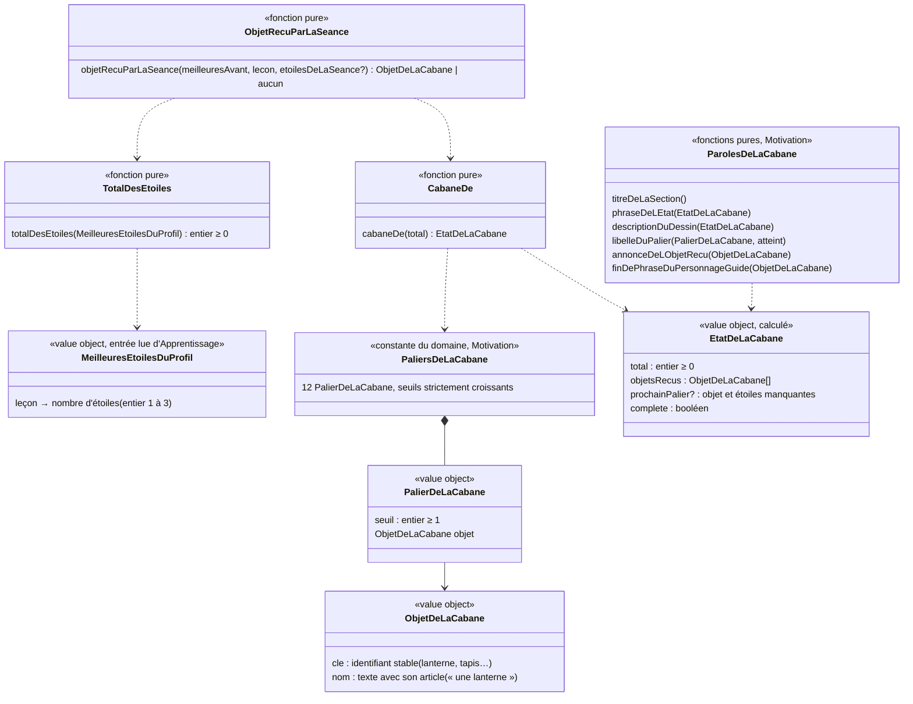

# Modèle du domaine : issue #32, Cabane, des objets débloqués par paliers d'étoiles

> Cadrage. Aucun texte d'univers n'est inventé : les noms des objets et les phrases viennent du legacy (`app/app.js`) ; tout texte nouveau est donné comme **exemple à valider** par le PO.

## Contexte

Bounded context de la story : **Motivation**, avec une lecture seule dans **Apprentissage** (meilleures étoiles de chaque leçon du profil).

Pourquoi Motivation :
- la cabane est une récompense : la context map dit « Motivation décide seule des récompenses (série, badges, cabane, épisodes) ; une récompense ne modifie jamais une note » ;
- elle ne fait que **compter** des étoiles déjà gagnées. Les étoiles, les meilleures étoiles et leur règle « ne baissent jamais » restent à Apprentissage (`ResultatDeLaLecon`, #24) ;
- elle s'affiche à deux endroits que Motivation compose déjà : l'écran « Mes médailles » (#65, section « cabane » déjà réservée en tête de l'ordre des sections) et la phrase de fin du personnage guide (`parolesDeFinDeSeance`, #24).

**Choix de modèle : la cabane n'est pas enregistrée, elle se recalcule.** Le nombre d'objets dépend seulement du total des meilleures étoiles du profil ; or les meilleures étoiles ne baissent jamais (#24, invariant 3). Donc le total ne baisse jamais, donc aucun objet ne se perd, sans rien stocker. C'est le même choix que le parcours (#25) et l'écran des médailles (#65) : une **vue calculée** par des fonctions pures de `@domain/motivation`, à partir de ce que le front lit déjà sous RLS. Motivation **ne s'abonne pas** à `SeanceTerminee` côté serveur dans cette story (question 32.20).

### Sources lues, sans rien écrire

| Source | Contexte | Ce qui est lu | Mécanisme |
|---|---|---|---|
| Meilleures étoiles de chaque leçon du profil en cours | Apprentissage (#24) | `resultats_des_lecons` : `lecon`, `meilleures_etoiles` (1 à 3), pour un seul `profil` | Lecture du front sous RLS (policy de lecture par un parent rattaché), **déjà écrite** pour le parcours : `lireLesMeilleuresEtoilesDuProfil` (`src/seance/fin-de-seance/meilleures-etoiles-du-profil.ts`, #25), qui réunit les étoiles du serveur et les étoiles gagnées pendant l'utilisation (`meilleuresEtoilesReunies`) |
| Étoiles de la séance qui vient de finir | Apprentissage (#24) | `SeanceTerminee.etoiles` (absent pour une séance faite seulement d'une fluence, Q69) | Valeur déjà présente sur l'écran de fin (`useSauvegardeDeLaSeance`), passée à Motivation sous une forme propre (un nombre) |
| Profil en cours | Famille | identifiant, univers, réglage **Tout lire à voix haute** | Customer/Supplier existant (#11, #12), comme #65 |
| Univers et personnage guide | Motivation (#6) | `universDe(cle)` | Interne |

Non lus, volontairement :
- **Résultat du test de départ** (#27, `ResultatDuTestDeDepart`, table à part) : une leçon réussie au test de départ n'a **aucune** étoile (réponse 27.1). Motivation ignore `TestDeDepartTermine` (27.4). Rien à exclure : le total ne lit que `resultats_des_lecons`.
- **Bibliothèque** (Catalogue) : le total n'a pas besoin des leçons. Une leçon retirée de la bibliothèque garde ses meilleures étoiles en base (question 32.15).

### Comportement actuel (`app/app.js`), source des règles

- `totalStars()` (l. 1761) : somme de `p.etoiles` de toutes les progressions du profil, sauf celles du test de départ (`p.test`). Chaque leçon compte son meilleur nombre d'étoiles. Toutes les classes comptent.
- `CABANE` (l. 1762) : 12 paliers `[seuil, objet]`, de 3 (« une lanterne ») à 75 (« l'étoile magique »). `cabaneCount(s)` = nombre de paliers dont le seuil est ≤ s.
- `showTrophees` (l. 622) : section « La cabane de Noisette » : dessin (`cabaneSVG(n)`, libellé accessible « La cabane de Noisette, avec n objet(s) »), phrase « Tu as n étoile(s). Encore k étoile(s) et Noisette recevra `<objet>` ! » ou « La cabane est complète, quelle merveille ! », une pastille par palier (nom de l'objet si atteint, sinon « `<seuil>` ★ »). Section **toujours** affichée, même à 0 étoile. Rien n'est lu à voix haute.
- Écran de fin (l. 1895, 1945) : `before.cab` est calculé **avant** l'enregistrement de la séance, `after` juste après ; si le nombre d'objets augmente, encart « Pour la cabane » : « Noisette a reçu `<objet>` ! », et la phrase du personnage guide se termine par « Noisette a reçu `<objet>` pour sa cabane. ». Seul le **dernier** objet atteint est annoncé. Rien au test de départ.
- La cabane est **toujours celle de Noisette**, quel que soit l'univers.

### Ce que montre la cible (vérifié dans le code)

- L'écran de fin retient les étoiles de la séance **tout de suite** (`retenirLesEtoilesGagnees` dans `useSauvegardeDeLaSeance`) et envoie la séance en arrière-plan. Une lecture des meilleures étoiles faite pendant l'écran de fin **inclut déjà** la séance : elle donne le total « après », jamais le total « avant ». Le total « avant » se déduit donc autrement (voir « Objet reçu à la fin de la séance »).
- Une séance faite seulement d'une fluence ne donne pas d'étoiles (Q69, `terminee.etoiles === undefined`) : elle ne peut rien apporter à la cabane.
- Bibliothèque : environ 63 leçons au CP, 265 en tout. À 3 étoiles par leçon, la cabane est complète après 25 leçons ; un enfant de CP peut la compléter en cours d'année (question 32.3).

## Termes

| Terme | Statut | Remarque |
|---|---|---|
| Cabane | au glossaire, `(à valider)` | Définition gardée. Synonymes interdits : maison, collection. |
| Étoile, Meilleures étoiles | au glossaire (Apprentissage, validés) | La cabane compte les **meilleures étoiles**, jamais les dernières. |
| Total des étoiles | **nouveau**, `(à valider)` | Somme des meilleures étoiles de toutes les leçons du profil. Interface : « Tu as 12 étoiles ». Ce n'est **pas** un score ni une note (synonymes interdits d'Étoile). |
| Palier de la cabane | **nouveau**, `(à valider)` | Seuil du total des étoiles qui fait recevoir un objet (3, 6, 10, 15, 20, 26, 33, 40, 48, 56, 65, 75). Interface : la pastille « 10 ★ ». |
| Objet de la cabane | **nouveau**, `(à valider)` | Ce que le personnage reçoit pour sa cabane en atteignant un palier (« une lanterne »). Ce n'est pas un badge. Les noms des objets sont du **contenu**, pas des termes du domaine. |
| Cabane complète | **nouveau**, dans la définition d'Objet de la cabane | Les 12 objets sont reçus (total ≥ 75 aujourd'hui). |
| « Recevoir » un objet | verbe du legacy | « Noisette a reçu une lanterne ! ». On ne dit ni « débloquer » (interface de l'issue seulement), ni « gagner un objet » (réservé aux étoiles, badges, records). À valider avec la question 32.1 (le sujet de la phrase dépend de l'univers). |
| « un trophée » (objet n°11) | **conflit** | « Trophée » est un synonyme interdit de **Badge**, et l'écran a été renommé « Mes médailles » pour l'éviter (65.1). Question 32.5. |
| « l'étoile magique » (objet n°12) | **conflit** (même famille que le conflit n°1 du glossaire, « Étoile du savoir ») | C'est un objet, pas une étoile au sens du domaine : il ne compte pas dans le total. Question 32.6. |
| « Pour la cabane » (encart de l'écran de fin) | mot d'interface | Hors glossaire, comme « écran de fin ». |
| Zone « nouveautés » de l'écran de fin | mot d'interface (#24) | #32 est la **première** story qui la remplit ; #31 (badges) et #33 (épisodes) y ajouteront leur encart. |
| Écran des récompenses de l'enfant, Section de l'écran | au glossaire, `(à valider)` (#65) | La section `cabane` existe déjà dans l'ordre des sections. |

## Modèle

Pas d'agrégat : aucune commande d'écriture, aucun état gardé, aucun invariant d'écriture. Des **value objects** et des **fonctions pures** dans `motivation/domain/`.



Les noms sont des propositions de travail ; ceux qui portent « Noisette » attendent la question 32.1.

### Value objects

| Value object | Règles de validité |
|---|---|
| `ObjetDeLaCabane` | `cle` unique parmi les objets (le dessin du front s'y accroche, jamais au nom affiché) ; `nom` non vide, avec son article, tel qu'il sera dit (« un tapis tout doux »). |
| `PalierDeLaCabane` | `seuil` entier ≥ 1. |
| `PaliersDeLaCabane` | les 12 paliers du legacy ; seuils **strictement croissants** ; deux seuils consécutifs séparés d'**au moins 3** (une séance ajoute au plus 3 au total, donc elle fait recevoir au plus un objet) ; clés uniques. Constante vérifiée par les tests. |
| `MeilleuresEtoilesDuProfil` | forme propre à Motivation : une valeur par leçon, entier de 1 à 3 (Motivation n'importe pas `Etoiles` ni `ResultatDeLaLecon` d'Apprentissage). Valeur hors de 1 à 3 : erreur `NombreDEtoilesInvalide`. |
| `EtatDeLaCabane` | `objetsRecus` = objets des paliers dont le seuil est ≤ total, dans l'ordre des paliers ; `prochainPalier` = premier palier dont le seuil est > total, avec `etoilesManquantes` = seuil − total (≥ 1) ; `complete` ⇔ aucun prochain palier. |

### Fonctions pures

1. `totalDesEtoiles(meilleures)` : somme des valeurs. 0 sans aucune leçon.
2. `cabaneDe(total)` : `EtatDeLaCabane`. Exemples (pistes de l'issue) : 2 → aucun objet, prochain « une lanterne », 1 manquante ; 3 → la lanterne ; 75 et plus → complète.
3. `objetRecuParLaSeance(meilleuresAvant, lecon, etoilesDeLaSeance)` :
   - `etoilesDeLaSeance` absent (fluence seule) → aucun objet ;
   - total avant = `totalDesEtoiles(meilleuresAvant)` ;
   - total après = total avant − (meilleures avant de la leçon, 0 si absente) + max(meilleures avant de la leçon, étoiles de la séance) ;
   - si `cabaneDe(après)` a plus d'objets que `cabaneDe(avant)`, l'objet reçu est le **dernier** objet de `cabaneDe(après)` (règle du legacy ; avec des paliers espacés d'au moins 3, il n'y en a jamais deux) ; sinon aucun.
   - Exemples : avant 5 (leçon nouvelle), séance 1 étoile → 6 → « un tapis tout doux » ; leçon à 3 étoiles rejouée à 1 → total inchangé → aucun objet, aucun retiré ; leçon à 1 rejouée à 3 → +2.
4. Paroles (textes du legacy, voir question 32.1 pour « Noisette ») :
   - titre de la section : « La cabane de Noisette » ;
   - phrase de l'état : « Tu as `<n>` étoile(s). Encore `<k>` étoile(s) et Noisette recevra `<objet>` ! », ou « Tu as `<n>` étoile(s). La cabane est complète, quelle merveille ! » (pluriel dès 2, « 0 étoile » au singulier, comme le legacy) ;
   - description du dessin : « La cabane de Noisette, avec `<n>` objet(s) » (« avec 0 objet ») ;
   - libellé d'un palier : le nom de l'objet s'il est atteint, sinon « `<seuil>` ★ » (forme lue : question 32.11) ;
   - annonce de l'écran de fin : « Noisette a reçu `<objet>` ! », sous le titre « Pour la cabane » ;
   - fin de la phrase du personnage guide : « Noisette a reçu `<objet>` pour sa cabane. », ajoutée **après** `parolesDeFinDeSeance` (sans modifier cette fonction : une composition de plus).

### Objet reçu à la fin de la séance, sans rien écrire en base

Le total « avant » ne peut pas être relu après la séance (voir « Ce que montre la cible »). Le calcul pur de la règle 3 a besoin des **meilleures étoiles du profil telles qu'elles étaient avant la fin de la séance**, qu'il complète lui-même avec les étoiles de la séance. Contrainte pour le câblage (pas une question au PO) : le front prend ces meilleures étoiles **avant** `retenirLesEtoilesGagnees` de cette séance (par exemple au lancement de la séance, avec `lireLesMeilleuresEtoilesDuProfil`), et les passe à l'écran de fin. Si elles n'ont pas pu être lues du serveur (sans réseau, lecture impossible), aucune annonce n'est faite (question 32.13), pour ne jamais annoncer un objet déjà reçu.

Ce calcul ne donne au front aucun pouvoir : il n'écrit rien, et le serveur reste la source de vérité des étoiles. Un écart (séance refusée par le serveur, `SeanceIncoherente`) peut au pire faire annoncer un objet que l'écran « Mes médailles » ne montrera pas ensuite : même compromis que l'écran de fin de #24, qui affiche les étoiles avant la revalidation (décision Q78).

### Section « cabane » de l'écran « Mes médailles » (#65)

- `sectionsDeLEcran` reçoit en plus l'état de la cabane : la section `cabane` est disponible selon la question 32.8 (reco : toujours), et reste **en tête** (ordre de #65, inchangé).
- `parolesALOuverture` et `parolesDuGuideALOuverture` ne déduisent plus « rien à montrer » des seules pastilles de record (point relevé par la revue de #65) : elles reçoivent les sections et l'état de la cabane (question 32.9).
- Lecture des meilleures étoiles : `lireLesMeilleuresEtoilesDuProfil(profil en cours)`, déjà utilisée par le parcours ; filtre sur le profil en cours (deux enfants d'un même parent ne partagent rien).

### Commandes et lectures

| Commande ou lecture | Effet | Erreurs métier | Où |
|---|---|---|---|
| Lecture des meilleures étoiles du profil en cours | Existante (#25) : serveur sous RLS, réunies avec les étoiles gagnées pendant l'utilisation | aucune (lecture impossible : question 32.13) | front, JWT du parent |
| `totalDesEtoiles`, `cabaneDe`, `objetRecuParLaSeance`, paroles de la cabane | Calcul pur | `NombreDEtoilesInvalide` (entrée hors de 1 à 3) | navigateur (et serveur s'il en a besoin un jour) |

Aucune commande d'écriture, aucun événement nouveau.

### Migration et Edge Function

- **Pas de migration.** `resultats_des_lecons (profil, lecon, meilleures_etoiles)` contient tout ce que la cabane compte ; la policy de lecture par un parent rattaché, la cascade avec le profil et l'inclusion dans l'export existent (#24). Le verrou `base` n'est **pas** nécessaire.
- **Pas d'Edge Function.** Lecture directe sous RLS (décisions 0013 et 0016 : seules les écritures d'Apprentissage passent par le serveur). `terminer-la-seance` et `ResultatDeLaLecon` ne changent pas.
- Si le PO voulait un jour des objets qui **ne** dépendent **pas** que du total (objets choisis, objets perdus, objets par univers gardés après un changement), il faudrait un agrégat enregistré, une table et une réaction à `SeanceTerminee` : hors de cette story.

## Invariants

L'état étant calculé, ce sont des **règles du calcul**, à couvrir par les tests des fonctions pures :

1. Le total des étoiles est la somme des **meilleures étoiles** de toutes les leçons du profil ; les dernières étoiles n'y entrent jamais.
2. Le test de départ n'ajoute rien au total (une leçon réussie au test de départ n'a pas d'étoile) ; une séance faite seulement d'une fluence non plus.
3. Le nombre d'objets reçus est le nombre de paliers dont le seuil est inférieur ou égal au total ; les objets sont reçus dans l'ordre des paliers.
4. Le total ne baisse jamais (meilleures étoiles, #24) : **aucun objet ne se perd**, même en rejouant une leçon avec moins d'étoiles.
5. Une séance fait recevoir **au plus un** objet (paliers espacés d'au moins 3, une séance ajoute au plus 3).
6. Un objet n'est annoncé à la fin d'une séance que si cette séance a fait franchir son palier.
7. Motivation ne modifie jamais une étoile, ne lit jamais les dernières étoiles et n'écrit rien.
8. La cabane ne montre que les étoiles du profil en cours (même entre deux enfants d'un même parent).
9. La cabane ne dépend que des étoiles : ni du temps passé, ni de l'heure, ni de la date (pas de temps d'écran).
10. Les mêmes meilleures étoiles donnent toujours la même cabane (calcul déterministe).

## Événements

Aucun nouvel événement, aucun abonnement. `SeanceTerminee` reste publié par Apprentissage et n'est pas consommé ici : la cabane se recalcule à la lecture (question 32.20). `TestDeDepartTermine` est ignoré (27.4).

## Relations avec les autres contextes

| Amont | Aval | Relation | Mécanisme |
|---|---|---|---|
| Apprentissage | Motivation (cabane) | Lecture seule, calcul dans le domaine | Le front lit les meilleures étoiles du profil en cours sous RLS (`resultats_des_lecons`) et les passe à `@domain/motivation` sous une forme propre (leçon → 1 à 3). Pas d'import de `ResultatDeLaLecon` |
| Apprentissage (écran de fin) | Motivation (cabane) | Appel depuis le front | L'écran de fin passe à Motivation les meilleures étoiles d'avant la séance et les étoiles de la séance ; Motivation rend l'objet reçu et ses paroles, que le front ajoute à la zone « nouveautés » et à la phrase du personnage guide |
| Famille | Motivation | Customer/Supplier existant (#6, #12) | Univers et réglage Tout lire du profil en cours |
| Famille | Motivation | Contrat de données personnelles (#14) | Rien de nouveau : aucune donnée enregistrée par #32 |

## Partage avec le front

- Dans `@domain/motivation` (`index.ts`, ajouts seulement) : `PALIERS_DE_LA_CABANE`, les types `ObjetDeLaCabane`, `PalierDeLaCabane`, `EtatDeLaCabane`, `MeilleuresEtoilesDuProfil`, les fonctions `totalDesEtoiles`, `cabaneDe`, `objetRecuParLaSeance`, les paroles de la cabane et l'erreur `NombreDEtoilesInvalide`.
- React affiche : dessin de la cabane (illustration, à partir des `cle` des objets reçus), phrase, pastilles des paliers, encart « Pour la cabane ». Aucun calcul de total, de palier ni de pluriel dans un composant.
- Hors ligne : le calcul est pur ; ce qui manque sans réseau, ce sont les meilleures étoiles du serveur (question 32.13 ; copie sur l'appareil : #44).
- Accessibilité (front) : section en `h2` sous « Mes médailles », dessin en `role="img"` avec la description du domaine, pastilles en liste, bouton « Écouter » de 44 px, 360 px sans défilement horizontal, encart de fin annoncé (`role="status"`), arrivée d'un objet sans mouvement avec `prefers-reduced-motion`, mode dys.

## Données d'enfants

Aucune nouvelle donnée personnelle : rien n'est enregistré (ni total, ni objets). La cabane lit les meilleures étoiles déjà enregistrées par #24, déjà couvertes par la cascade et l'export (#14). Rien n'est gardé sur l'appareil au-delà de ce que fait déjà #24, rien n'est envoyé à l'IA.

## Emplacement

```
supabase/functions/_shared/motivation/domain/
  cabane.ts                              # ObjetDeLaCabane, PalierDeLaCabane, PALIERS_DE_LA_CABANE, MeilleuresEtoilesDuProfil,
                                         # totalDesEtoiles, cabaneDe, objetRecuParLaSeance, NombreDEtoilesInvalide
  cabane_test.ts
  paroles-de-la-cabane.ts                # titre, phrase de l'état, description du dessin, libellé d'un palier,
                                         # annonce de fin, fin de phrase du personnage guide
  paroles-de-la-cabane_test.ts
  sections-de-l-ecran.ts                 # (#65, modifié) section cabane disponible
  paroles-de-l-ecran-des-medailles.ts    # (#65, modifié) paroles à l'ouverture avec la cabane
  index.ts                               # ajouts seulement
src/medailles/
  SectionDeLaCabane.tsx, DessinDeLaCabane.tsx, useCabane.ts   # lecture par lireLesMeilleuresEtoilesDuProfil
src/seance/fin-de-seance/EcranDeFin.tsx  # encart « Pour la cabane » (zone « nouveautés »)
src/seance/                              # meilleures étoiles prises avant la fin de la séance ; fin de phrase du personnage guide
```

Pas de migration, pas d'Edge Function, rien dans `apprentissage/` (ni `ResultatDeLaLecon`, ni `terminer-la-seance`). Fichiers partagés à surveiller avec les équipes en parallèle : `EcranDeFin.tsx` et `useDeroulementDeSeance.ts` (#28 pourrait y toucher pour la fin d'une séance de révision).

## Hors de cette story

- Badges (#31), épisodes (#33), série et objectif du jour (#29, #30) : seulement la zone « nouveautés » de l'écran de fin, que #32 ouvre.
- Paliers au-delà de 75 étoiles, cabanes par univers (questions 32.1 et 32.3 : nouvelle story si le PO le veut, avec textes et dessins fournis).
- Copie des meilleures étoiles sur l'appareil (#44).
- Leçons personnelles (Accompagnement, lot 6) : la règle les compte d'office si elles ont des meilleures étoiles (question 32.4).

## Remarques (pas des questions au PO)

- **Révisions (#28, en parallèle)** : une séance de révision ne doit pas changer les meilleures étoiles d'une leçon (le legacy n'enregistre aucune progression pour une révision). Si c'est le cas dans le modèle de #28, la cabane n'est pas touchée par une révision ; à confirmer par le responsable des équipes avec #28, sans toucher à `FileDeRevision` ni `SeanceDeRevision`.
- **Dessin** : les 12 dessins du legacy (`cabaneSVG`) sont une illustration, pas une règle ; ils peuvent être repris dans le front, accrochés aux `cle` des objets (question 32.18).
- **Revue de #65** : elle avait prévu que `parolesALOuverture` reçoive les sections disponibles quand une autre section existerait ; #32 est ce cas.
- **Décision d'architecture** : « la cabane se recalcule, sans abonnement à `SeanceTerminee` » suit le même chemin que #25 et #65 ; une ligne de la context map suffit, sauf si le PO répond non à 32.20.

## Questions ouvertes

Les questions 32.1 à 32.7 sont celles de l'issue ; les suivantes sont nées du modèle. Chaque recommandation est celle de l'équipe ; le PO tranche.

1. **32.1 La cabane suit-elle l'univers, ou reste-t-elle celle de Noisette pour tous ?** Aujourd'hui, un enfant de l'univers Sports entend Coach Léo dire « Noisette a reçu une lanterne pour sa cabane. ». **Recommandation** : **Noisette pour tous** dans #32 (titre, objets, phrases du legacy, aucun texte à inventer). Suivre l'univers demanderait 6 jeux de textes, d'objets et de dessins fournis par le PO : une story à part si vous le souhaitez. D'accord ?
2. **32.2 Si l'enfant change d'univers, garde-t-il ses objets ?** **Recommandation** : oui, et c'est automatique : les objets ne sont pas enregistrés, ils se recalculent à partir des étoiles, qui ne changent pas avec l'univers. D'accord ?
3. **32.3 De nouveaux paliers au-delà de 75 étoiles ?** Un enfant de CP peut atteindre 75 en 25 leçons à 3 étoiles (environ 63 leçons au CP, 795 étoiles possibles en tout). **Recommandation** : non dans #32 (on livre les 12 paliers du legacy et « La cabane est complète, quelle merveille ! ») ; une suite (nouvelle pièce, nouveaux objets) serait une story à part, objets et dessins fournis. D'accord ?
4. **32.4 Les étoiles des classes d'avant et des leçons personnelles comptent-elles ?** **Recommandation** : oui, toutes les meilleures étoiles du profil, quel que soit le niveau de la leçon (comme le legacy). Les leçons personnelles (lot 6) compteront d'office si elles ont des meilleures étoiles comme les autres leçons ; rien à coder dans #32. D'accord ?
5. **32.5 Renommer l'objet « un trophée » ?** « Trophée » est interdit pour Badge, et l'écran a été renommé pour l'éviter (65.1). **Recommandation** : oui, renommer l'objet n°11 ; le dessin du legacy est une coupe dorée. Exemple à valider : « une coupe dorée ». Quel nom ?
6. **32.6 « L'étoile magique » au glossaire ?** **Recommandation** : garder le nom de l'objet (c'est du contenu, pas un terme du domaine) et l'ajouter au conflit n°1 du glossaire (« Étoile du savoir ») : **Étoile** reste la récompense d'une séance ; « l'étoile magique » ne compte pas dans le total. D'accord ?
7. **32.7 Le défaut « un seul jeu = étoiles de la leçon » est-il traité au lot 3 ?** Oui : décision Q69 du lot 3 (« une séance d'un seul exercice donne les étoiles de la leçon, sauf une fluence seule »). **Recommandation** : ce n'est plus un défaut mais une règle ; la cabane compte les meilleures étoiles telles qu'Apprentissage les donne, sans exception propre. D'accord ?
8. **32.8 La section de la cabane s'affiche-t-elle toujours, même à 0 étoile ?** Le legacy : oui (« Tu as 0 étoile. Encore 3 étoiles et Noisette recevra une lanterne ! »). **Recommandation** : oui, toujours, en tête de « Mes médailles » : c'est l'accroche qui donne envie de gagner des étoiles. D'accord ?
9. **32.9 Que dit le personnage guide à l'ouverture de « Mes médailles » quand la cabane est vide et qu'il n'y a aucun record ?** Aujourd'hui (65.7) : « Fais un calcul rapide pour gagner ton premier record ! ». **Recommandation** : « Regarde tout ce que tu as gagné ! » dès qu'il y a au moins un objet ou un record ; sinon une phrase d'état vide qui parle des étoiles, texte à fournir (exemple à valider : « Gagne des étoiles pour remplir la cabane ! »). Quel texte ?
10. **32.10 Que lit-on de la section de la cabane ?** **Recommandation** : comme les records (65.12) : avec **Tout lire à voix haute**, à l'ouverture, le titre de la section puis la phrase de l'état ; sans Tout lire, un bouton « Écouter » sur la section lit les mêmes textes. Les 12 pastilles ne sont pas lues (trop longues à écouter ; le lecteur d'écran les donne). D'accord ?
11. **32.11 Comment se dit une pastille non atteinte « 10 ★ » ?** **Recommandation** : affichée « 10 ★ », dite « 10 étoiles » par le lecteur d'écran (le signe ★ n'est pas lu tel quel) ; une pastille atteinte dit le nom de l'objet. D'accord ?
12. **32.12 L'annonce de l'écran de fin : encart et phrase lue, comme le legacy ?** **Recommandation** : oui : encart « Pour la cabane » : « Noisette a reçu un tapis tout doux ! » dans la zone « nouveautés », et la phrase de fin du personnage guide se termine par « Noisette a reçu un tapis tout doux pour sa cabane. » (lue même sans Tout lire, comme la phrase de fin). Jamais au test de départ ni après une fluence seule. D'accord ?
13. **32.13 Sans réseau (ou lecture impossible des étoiles du serveur) ?** Les étoiles d'avant ne sont alors connues qu'en partie : la cabane paraîtrait plus vide et l'écran de fin pourrait annoncer un objet déjà reçu. **Recommandation** : sans les étoiles du serveur, la section de la cabane n'apparaît pas dans « Mes médailles » et l'écran de fin n'annonce aucun objet, sans message d'erreur, jusqu'à la copie sur l'appareil (#44) ; comme les records (65.14). D'accord ?
14. **32.14 Profil de démonstration ou profil préparé (sans étoiles en base) ?** **Recommandation** : la cabane compte les étoiles gagnées pendant l'utilisation, comme le parcours (#25) : l'enfant voit sa lanterne arriver dès 3 étoiles. D'accord ?
15. **32.15 Une leçon retirée de la bibliothèque garde-t-elle ses étoiles dans le total ?** **Recommandation** : oui : rien ne se perd, et le total n'a pas besoin de la bibliothèque. D'accord ?
16. **32.16 Une pastille atteinte ou le dessin ouvrent-ils quelque chose ?** Le legacy : non. **Recommandation** : non (comme les pastilles de record, 65.13). D'accord ?
17. **32.17 L'arrivée d'un objet est-elle animée ?** **Recommandation** : sur l'écran de fin seulement, une animation courte de l'encart « Pour la cabane », supprimée avec les mouvements réduits ; aucune animation dans « Mes médailles ». D'accord ?
18. **32.18 Reprendre le dessin du legacy (pièce en planches, fenêtre ronde, 12 objets à leur place) ?** **Recommandation** : oui, tel quel, adapté à 360 px sans défilement horizontal ; un dessin pour l'objet renommé en 32.5 reste celui de la coupe. D'accord ?
19. **32.19 « Tu as `<n>` étoiles » compte-t-il les étoiles de la séance encore en cours d'envoi ?** **Recommandation** : oui : « Mes médailles » réunit les étoiles du serveur et celles gagnées pendant l'utilisation (comme le parcours), pour que la lanterne annoncée à l'écran de fin soit tout de suite dans la cabane. D'accord ?
20. **32.20** *(architecture)* **La cabane se recalcule à la lecture, sans être enregistrée et sans réagir à `SeanceTerminee` côté serveur ?** L'issue disait « réagit à l'événement `SeanceTerminee` (à valider) ». **Recommandation** : oui : comme les objets ne dépendent que du total et que le total ne baisse jamais, enregistrer les objets n'apporterait rien, demanderait une table, une migration et une donnée de plus à supprimer et exporter (#14). La règle reste unique, pure, dans `@domain/motivation`. D'accord ?
