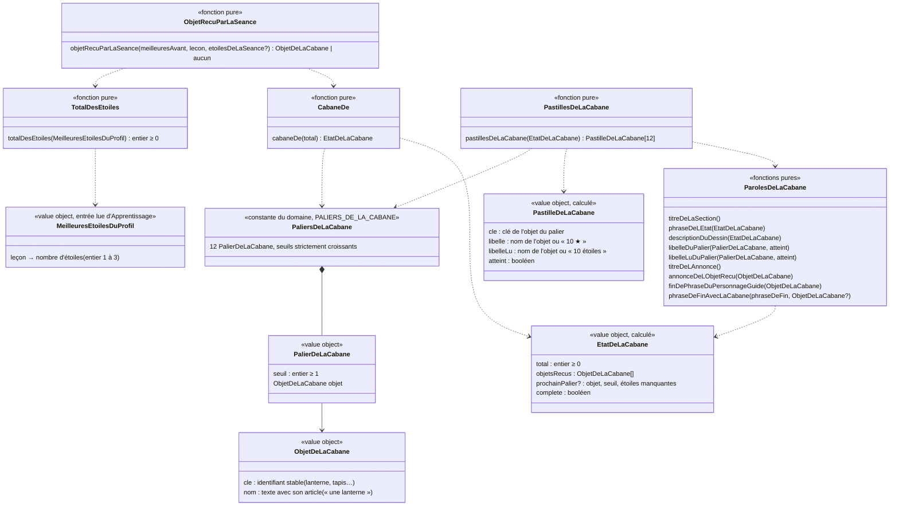

# Modèle du domaine : issue #32, Cabane, des objets débloqués par paliers d'étoiles

> Modèle **livré** (mis à jour en fin de story, 2026-10-25). Toutes les questions du cadrage (32.1 à 32.25) ont été tranchées par le PO le 2026-10-25 (« OK #32 reco partout ») : voir la section « Décisions » ci-dessous et `docs/stories/32/acceptance.md` (« Validation du PO »). Les noms des objets et les phrases viennent du legacy (`app/app.js`), sauf « une coupe dorée » (32.5) et « Gagne des étoiles pour remplir la cabane ! » (32.9), validés par le PO.

## Contexte

Bounded context de la story : **Motivation**, avec une lecture seule dans **Apprentissage** (meilleures étoiles de chaque leçon du profil).

Pourquoi Motivation :
- la cabane est une récompense : la context map dit « Motivation décide seule des récompenses (série, badges, cabane, épisodes) ; une récompense ne modifie jamais une note » ;
- elle ne fait que **compter** des étoiles déjà gagnées. Les étoiles, les meilleures étoiles et leur règle « ne baissent jamais » restent à Apprentissage (`ResultatDeLaLecon`, #24) ;
- elle s'affiche à deux endroits que Motivation compose déjà : l'écran « Mes médailles » (#65, section « cabane » déjà réservée en tête de l'ordre des sections) et la phrase de fin du personnage guide (`parolesDeFinDeSeance`, #24).

**Choix de modèle (décision 32.20) : la cabane n'est pas enregistrée, elle se recalcule.** Le nombre d'objets dépend seulement du total des meilleures étoiles du profil ; or les meilleures étoiles ne baissent jamais (#24, invariant 3). Donc le total ne baisse jamais, donc aucun objet ne se perd, sans rien stocker. C'est le même choix que le parcours (#25) et l'écran des médailles (#65) : une **vue calculée** par des fonctions pures de `@domain/motivation`, à partir de ce que le front lit déjà sous RLS. Motivation **ne s'abonne pas** à `SeanceTerminee`.

### Sources lues, sans rien écrire

| Source | Contexte | Ce qui est lu | Mécanisme |
|---|---|---|---|
| Meilleures étoiles de chaque leçon du profil en cours | Apprentissage (#24) | `resultats_des_lecons` : `lecon`, `meilleures_etoiles` (1 à 3), pour un seul `profil` | Lecture du front sous RLS (policy de lecture par un parent rattaché) : `lireToutesLesMeilleuresEtoilesSiPossible` (`src/seance/fin-de-seance/lecture-des-meilleures-etoiles-supabase.ts`), réunie avec les étoiles gagnées pendant l'utilisation (`meilleuresEtoilesReunies`, #25) par `lireLesMeilleuresEtoilesPourLaCabane` (`src/seance/fin-de-seance/meilleures-etoiles-pour-la-cabane.ts`). Voir « Lecture des meilleures étoiles par le front » |
| Étoiles de la séance qui vient de finir | Apprentissage (#24) | `SeanceTerminee.etoiles` (absent pour une séance faite seulement d'une fluence, Q69) | Valeur déjà présente sur l'écran de fin, passée à Motivation sous une forme propre (un nombre) |
| Profil en cours | Famille | identifiant, univers, réglage **Tout lire à voix haute** | Customer/Supplier existant (#11, #12), comme #65 |
| Univers et personnage guide | Motivation (#6) | `universDe(cle)` | Interne |

Non lus, volontairement :
- **Résultat du test de départ** (#27, `ResultatDuTestDeDepart`, table à part) : une leçon réussie au test de départ n'a **aucune** étoile (réponse 27.1). Motivation ignore `TestDeDepartTermine` (27.4). Rien à exclure : le total ne lit que `resultats_des_lecons`.
- **Bibliothèque** (Catalogue) : le total n'a pas besoin des leçons. Une leçon retirée de la bibliothèque garde ses meilleures étoiles en base et elles comptent (décision 32.15).

### Comportement du legacy (`app/app.js`), source des règles

- `totalStars()` (l. 1761) : somme de `p.etoiles` de toutes les progressions du profil, sauf celles du test de départ (`p.test`). Chaque leçon compte son meilleur nombre d'étoiles. Toutes les classes comptent.
- `CABANE` (l. 1762) : 12 paliers `[seuil, objet]`, de 3 (« une lanterne ») à 75 (« l'étoile magique »). `cabaneCount(s)` = nombre de paliers dont le seuil est ≤ s.
- `showTrophees` (l. 622) : section « La cabane de Noisette » : dessin (`cabaneSVG(n)`, libellé accessible « La cabane de Noisette, avec n objet(s) »), phrase « Tu as n étoile(s). Encore k étoile(s) et Noisette recevra `<objet>` ! » ou « La cabane est complète, quelle merveille ! », une pastille par palier (nom de l'objet si atteint, sinon « `<seuil>` ★ »). Section **toujours** affichée, même à 0 étoile. Rien n'est lu à voix haute.
- Écran de fin (l. 1895, 1945) : `before.cab` est calculé **avant** l'enregistrement de la séance, `after` juste après ; si le nombre d'objets augmente, encart « Pour la cabane » : « Noisette a reçu `<objet>` ! », et la phrase du personnage guide se termine par « Noisette a reçu `<objet>` pour sa cabane. ». Seul le **dernier** objet atteint est annoncé. Rien au test de départ.
- La cabane est **toujours celle de Noisette**, quel que soit l'univers.

### Ce que montre la cible

- L'écran de fin retient les étoiles de la séance **tout de suite** (`retenirLesEtoilesGagnees`) et envoie la séance en arrière-plan. Une lecture des meilleures étoiles faite pendant l'écran de fin **inclut déjà** la séance : elle donne le total « après », jamais le total « avant ». Le total « avant » est donc lu au lancement de la séance (voir « Objet reçu à la fin de la séance »).
- Une séance faite seulement d'une fluence ne donne pas d'étoiles (Q69, `terminee.etoiles === undefined`) : elle ne peut rien apporter à la cabane.
- Bibliothèque : environ 63 leçons au CP, 265 en tout. À 3 étoiles par leçon, la cabane est complète après 25 leçons (pas de palier au-delà de 75 dans #32, décision 32.3).

## Termes

| Terme | Statut | Remarque |
|---|---|---|
| Cabane | au glossaire, `(à valider)` (ligne antérieure à #32) | Définition gardée. Synonymes interdits : maison, collection. |
| Étoile, Meilleures étoiles | au glossaire (Apprentissage, validés) | La cabane compte les **meilleures étoiles**, jamais les dernières. |
| Total des étoiles | **nouveau, validé** (#32) | Somme des meilleures étoiles de toutes les leçons du profil. Interface : « Tu as 12 étoiles ». Ce n'est **pas** un score ni une note (synonymes interdits d'Étoile). |
| Palier de la cabane | **nouveau, validé** (#32) | Seuil du total des étoiles qui fait recevoir un objet (3, 6, 10, 15, 20, 26, 33, 40, 48, 56, 65, 75). Interface : la pastille « 10 ★ », dite « 10 étoiles » (32.11). |
| Objet de la cabane | **nouveau, validé** (#32) | Ce que la cabane reçoit en atteignant un palier (« une lanterne »). Ce n'est pas un badge. Les noms des objets sont du **contenu**, pas des termes du domaine. |
| Cabane complète | dans la définition d'Objet de la cabane | Les 12 objets sont reçus (total ≥ 75). |
| « Recevoir » un objet | verbe du legacy, gardé | « Noisette a reçu une lanterne ! ». On ne dit ni « débloquer », ni « gagner un objet » (réservé aux étoiles, badges, records). Le sujet est toujours Noisette (32.1). |
| « un trophée » (objet n°11) | **conflit tranché** (conflit n°8 du glossaire) | Objet renommé « une coupe dorée » (décision 32.5) ; « trophée » reste un synonyme interdit de Badge. |
| « l'étoile magique » (objet n°12) | **conflit tranché** (conflit n°9 du glossaire) | Nom gardé ; c'est un objet, pas une étoile au sens du domaine : il ne compte pas dans le total (décision 32.6). |
| « Pour la cabane » (encart de l'écran de fin) | mot d'interface | Hors glossaire, comme « écran de fin ». |
| Zone « nouveautés » de l'écran de fin | mot d'interface (#24) | #32 est la **première** story qui la remplit ; #31 (badges) et #33 (épisodes) y ajouteront leur encart. |
| Pastille de la cabane | mot d'interface | Une pastille par palier dans la section ; type `PastilleDeLaCabane` du domaine, pas un terme du glossaire (comme « Pastille de record », #65). |
| Écran des récompenses de l'enfant, Section de l'écran | au glossaire, `(à valider)` (#65) | La section `cabane` existe dans l'ordre des sections. |

## Modèle

Pas d'agrégat : aucune commande d'écriture, aucun état gardé, aucun invariant d'écriture. Des **value objects** et des **fonctions pures** dans `motivation/domain/`.



La cabane est celle de Noisette dans tous les univers (décision 32.1) : le nom « Noisette » est une constante des paroles de la cabane, il ne vient pas de l'univers du profil.

### Value objects

| Value object | Règles de validité |
|---|---|
| `ObjetDeLaCabane` | `cle` unique parmi les objets (le dessin du front s'y accroche, jamais au nom affiché) ; `nom` non vide, avec son article, tel qu'il sera dit (« un tapis tout doux »). Objet n°11 : clé `coupe`, nom « une coupe dorée » (32.5). |
| `PalierDeLaCabane` | `seuil` entier ≥ 1. |
| `PALIERS_DE_LA_CABANE` | les 12 paliers du legacy ; seuils **strictement croissants** ; deux seuils consécutifs séparés d'**au moins 3** (une séance ajoute au plus 3 au total, donc elle fait recevoir au plus un objet) ; clés uniques. Constante vérifiée par les tests. |
| `MeilleuresEtoilesDuProfil` | forme propre à Motivation : une valeur par leçon, entier de 1 à 3 (Motivation n'importe pas `Etoiles` ni `ResultatDeLaLecon` d'Apprentissage). Valeur hors de 1 à 3 ou non entière : erreur `NombreDEtoilesInvalide`. |
| `EtatDeLaCabane` | `objetsRecus` = objets des paliers dont le seuil est ≤ total, dans l'ordre des paliers ; `prochainPalier` = premier palier dont le seuil est > total, avec son `seuil` et `etoilesManquantes` = seuil − total (≥ 1) ; `complete` ⇔ aucun prochain palier. |
| `PastilleDeLaCabane` | une par palier, dans l'ordre des paliers ; `cle` = clé de l'objet du palier ; `atteint` ⇔ seuil ≤ total ; `libelle` = `libelleDuPalier`, `libelleLu` = `libelleLuDuPalier` (même palier, même `atteint`). |

### Erreurs métier

| Erreur | Quand |
|---|---|
| `NombreDEtoilesInvalide` | Une meilleure étoile d'une leçon, ou les étoiles de la séance, ne sont pas un entier de 1 à 3 (`totalDesEtoiles`, `objetRecuParLaSeance`). |
| `TotalDEtoilesInvalide` | `cabaneDe` reçoit un total négatif, non entier ou infini. |

### Fonctions pures

1. `totalDesEtoiles(meilleures)` : somme des valeurs. 0 sans aucune leçon.
2. `cabaneDe(total)` : `EtatDeLaCabane`. Exemples : 2 → aucun objet, prochain « une lanterne », 1 manquante ; 3 → la lanterne ; 75 et plus → complète. Total invalide : `TotalDEtoilesInvalide`.
3. `objetRecuParLaSeance(meilleuresAvant, lecon, etoilesDeLaSeance)` :
   - `etoilesDeLaSeance` absent (fluence seule) → aucun objet ;
   - total avant = `totalDesEtoiles(meilleuresAvant)` ;
   - total après = total avant − (meilleures avant de la leçon, 0 si absente) + max(meilleures avant de la leçon, étoiles de la séance) ;
   - si `cabaneDe(après)` a plus d'objets que `cabaneDe(avant)`, l'objet reçu est le **dernier** objet de `cabaneDe(après)` (règle du legacy ; avec des paliers espacés d'au moins 3, il n'y en a jamais deux) ; sinon aucun.
   - Exemples : avant 5 (leçon nouvelle), séance 1 étoile → 6 → « un tapis tout doux » ; leçon à 3 étoiles rejouée à 1 → total inchangé → aucun objet, aucun retiré ; leçon à 1 rejouée à 3 → +2.
4. `pastillesDeLaCabane(etat)` : les 12 `PastilleDeLaCabane`, dans l'ordre des paliers. Une pastille n'ouvre rien (32.16).
5. Paroles (`paroles-de-la-cabane.ts`) :
   - `titreDeLaSection()` : « La cabane de Noisette », quel que soit l'univers (32.1) ;
   - `phraseDeLEtat(etat)` : « Tu as `<n>` étoile(s). Encore `<k>` étoile(s) et Noisette recevra `<objet>` ! », ou « Tu as `<n>` étoile(s). La cabane est complète, quelle merveille ! » (pluriel dès 2, « 0 étoile » au singulier, comme le legacy) ;
   - `descriptionDuDessin(etat)` : « La cabane de Noisette, avec `<n>` objet(s) » (« avec 0 objet ») ;
   - `libelleDuPalier(palier, atteint)` : le nom de l'objet s'il est atteint, sinon « `<seuil>` ★ » (affiché) ;
   - `libelleLuDuPalier(palier, atteint)` : le nom de l'objet s'il est atteint, sinon « `<seuil>` étoiles » (forme dite par le lecteur d'écran, décision 32.11) ;
   - `titreDeLAnnonce()` : « Pour la cabane », titre de l'encart de l'écran de fin ;
   - `annonceDeLObjetRecu(objet)` : « Noisette a reçu `<objet>` ! » ; l'encart est annoncé aux lecteurs d'écran mais n'est pas dit par la voix, même avec « tout lire » (32.23) ;
   - `finDePhraseDuPersonnageGuide(objet)` : « Noisette a reçu `<objet>` pour sa cabane. » ;
   - `phraseDeFinAvecLaCabane(phraseDeFin, objet)` : la phrase de fin du personnage guide (`parolesDeFinDeSeance`, inchangée), suivie de la fin de phrase de la cabane quand un objet est reçu ; la phrase de fin seule sinon. Cette composition est dans le domaine, pas dans React (32.12).

### Objet reçu à la fin de la séance, sans rien écrire en base

Le total « avant » ne peut pas être relu après la séance (voir « Ce que montre la cible »). Le calcul pur de la règle 3 a besoin des **meilleures étoiles du profil telles qu'elles étaient avant la fin de la séance**, qu'il complète lui-même avec les étoiles de la séance.

Câblage livré : l'écran de séance lit ces meilleures étoiles **au lancement de la séance** (`lireLesMeilleuresEtoilesAvantLaSeance`, `src/seance/fin-de-seance/meilleures-etoiles-pour-la-cabane.ts`), et l'écran de fin s'en sert. Cette lecture a un **délai maximal de 5 s** (`DELAI_MAXIMAL_DE_LECTURE_EN_MS = 5000`) : au-delà, elle est abandonnée et donne `undefined`, pour que la félicitation de fin soit dite sans objet plutôt que d'attendre sans fin. Sans ces étoiles (`undefined` : sans réseau, lecture en échec ou trop lente), aucune annonce n'est faite (décision 32.13), pour ne jamais annoncer un objet déjà reçu.

Ce calcul ne donne au front aucun pouvoir : il n'écrit rien, et le serveur reste la source de vérité des étoiles. Un écart (séance refusée par le serveur, `SeanceIncoherente`) peut au pire faire annoncer un objet que l'écran « Mes médailles » ne montrera pas ensuite : même compromis que l'écran de fin de #24, qui affiche les étoiles avant la revalidation (décision Q78).

### Lecture des meilleures étoiles par le front

- `lireToutesLesMeilleuresEtoilesSiPossible(profil)` : lecture sous RLS de `resultats_des_lecons` pour le **profil en cours**. Une lecture en **échec** (erreur ou exception) donne `undefined`, distinct d'une lecture réussie et vide. Pour un identifiant qui n'est pas celui d'un profil réel (profil préparé, sans profil réel au serveur), elle donne une lecture vide, pas `undefined`.
- `lireLesMeilleuresEtoilesPourLaCabane(profil)` : `undefined` sans réseau ou si la lecture du serveur a donné `undefined` ; sinon les étoiles du serveur réunies avec les étoiles gagnées pendant l'utilisation (`meilleuresEtoilesReunies`), sous la forme `MeilleuresEtoilesDuProfil`.
- Conséquences :
  - `undefined` → ni section de la cabane dans « Mes médailles », ni annonce à l'écran de fin, sans message d'erreur (décisions 32.13 et 32.22) ;
  - profil préparé → la cabane compte les étoiles gagnées sur l'appareil et l'écran de fin annonce l'objet reçu (décisions 32.14 et 32.22) ;
  - les étoiles de la séance en cours d'envoi sont comptées tout de suite (décision 32.19).

### Section « cabane » de l'écran « Mes médailles » (#65)

- `sectionsDeLEcran({ pastilles, cabane })` : `cabane` est un `EtatDeLaCabane` ou `undefined`. La section `cabane` est disponible dès que `cabane` est défini, même à 0 étoile (décision 32.8), et reste **en tête** (ordre de #65, inchangé) ; la section des records reste disponible dès qu'il y a une pastille de record.
- `parolesDuGuideALOuverture({ pastilles, cabane })` : « Regarde tout ce que tu as gagné ! » dès qu'il y a au moins un objet reçu ou une pastille de record ; sinon « Gagne des étoiles pour remplir la cabane ! » (décision 32.9, remplace « Fais un calcul rapide pour gagner ton premier record ! »).
- `parolesALOuverture({ toutLire, pastilles, cabane })` : sans « tout lire », la seule phrase du personnage guide ; avec « tout lire », la phrase du personnage guide, le nom de l'écran, puis, si `cabane` est défini, `titreDeLaSection()` et `phraseDeLEtat(cabane)`, puis la section des records si elle est disponible (décision 32.10). « Rien à montrer » ne coupe plus la lecture de l'écran. Les 12 pastilles ne sont pas lues.
- Sans « tout lire », un bouton « Écouter » sur la section lit le titre puis la phrase (32.10).

### Commandes et lectures

| Commande ou lecture | Effet | Erreurs métier | Où |
|---|---|---|---|
| Lecture des meilleures étoiles du profil en cours | Serveur sous RLS, réunies avec les étoiles gagnées pendant l'utilisation ; `undefined` en cas d'échec ; 5 s au plus avant la séance | aucune (échec : `undefined`, décision 32.13) | front, JWT du parent |
| `totalDesEtoiles`, `cabaneDe`, `objetRecuParLaSeance`, `pastillesDeLaCabane`, paroles de la cabane | Calcul pur | `NombreDEtoilesInvalide`, `TotalDEtoilesInvalide` | navigateur (et serveur s'il en a besoin un jour) |

Aucune commande d'écriture, aucun événement nouveau.

### Migration et Edge Function

- **Pas de migration.** `resultats_des_lecons (profil, lecon, meilleures_etoiles)` contient tout ce que la cabane compte ; la policy de lecture par un parent rattaché, la cascade avec le profil et l'inclusion dans l'export existent (#24). Le verrou `base` n'a pas été nécessaire.
- **Pas d'Edge Function.** Lecture directe sous RLS (décisions 0013 et 0016 : seules les écritures d'Apprentissage passent par le serveur). `terminer-la-seance` et `ResultatDeLaLecon` ne changent pas.
- Des objets qui **ne** dépendent **pas** que du total (objets choisis, objets perdus, cabanes par univers) demanderaient un agrégat enregistré, une table et une réaction à `SeanceTerminee` : hors de cette story (décisions 32.1, 32.3, 32.20).

## Invariants

L'état étant calculé, ce sont des **règles du calcul**, couvertes par les tests des fonctions pures :

1. Le total des étoiles est la somme des **meilleures étoiles** de toutes les leçons du profil, toutes classes confondues (32.4), y compris celles d'une leçon retirée de la bibliothèque (32.15) ; les dernières étoiles n'y entrent jamais.
2. Le test de départ n'ajoute rien au total (une leçon réussie au test de départ n'a pas d'étoile) ; une séance faite seulement d'une fluence non plus (32.7).
3. Le nombre d'objets reçus est le nombre de paliers dont le seuil est inférieur ou égal au total ; les objets sont reçus dans l'ordre des paliers.
4. Le total ne baisse jamais (meilleures étoiles, #24) : **aucun objet ne se perd**, même en rejouant une leçon avec moins d'étoiles, ni en changeant d'univers (32.2).
5. Une séance fait recevoir **au plus un** objet (paliers espacés d'au moins 3, une séance ajoute au plus 3).
6. Un objet n'est annoncé à la fin d'une séance que si cette séance a fait franchir son palier, et seulement si les étoiles d'avant la séance ont été lues (32.13).
7. Motivation ne modifie jamais une étoile, ne lit jamais les dernières étoiles et n'écrit rien.
8. La cabane ne montre que les étoiles du profil en cours (même entre deux enfants d'un même parent).
9. La cabane ne dépend que des étoiles : ni du temps passé, ni de l'heure, ni de la date (pas de temps d'écran).
10. Les mêmes meilleures étoiles donnent toujours la même cabane (calcul déterministe).
11. La cabane est celle de Noisette, quel que soit l'univers du profil (32.1).

## Événements

Aucun nouvel événement, aucun abonnement. `SeanceTerminee` reste publié par Apprentissage et n'est pas consommé ici : la cabane se recalcule à la lecture (décision 32.20). `TestDeDepartTermine` est ignoré (27.4).

## Relations avec les autres contextes

| Amont | Aval | Relation | Mécanisme |
|---|---|---|---|
| Apprentissage | Motivation (cabane) | Lecture seule, calcul dans le domaine (décision 32.20) | Le front lit les meilleures étoiles du profil en cours sous RLS (`resultats_des_lecons`) et les passe à `@domain/motivation` sous une forme propre (leçon → 1 à 3). Pas d'import de `ResultatDeLaLecon` |
| Apprentissage (écran de fin) | Motivation (cabane) | Appel depuis le front | L'écran de fin passe à Motivation les meilleures étoiles d'avant la séance (lues au lancement, 5 s au plus) et les étoiles de la séance ; Motivation rend l'objet reçu, l'annonce et la phrase de fin complétée (`phraseDeFinAvecLaCabane`), que le front affiche dans la zone « nouveautés » et fait dire au personnage guide |
| Famille | Motivation | Customer/Supplier existant (#6, #12) | Univers (pour le personnage guide qui parle, pas pour la cabane) et réglage Tout lire du profil en cours |
| Famille | Motivation | Contrat de données personnelles (#14) | Rien de nouveau : aucune donnée enregistrée par #32 |

## Partage avec le front

- Dans `@domain/motivation` (`index.ts`, ajouts seulement) : `PALIERS_DE_LA_CABANE`, les types `ObjetDeLaCabane`, `PalierDeLaCabane`, `EtatDeLaCabane`, `MeilleuresEtoilesDuProfil`, `PastilleDeLaCabane`, les fonctions `totalDesEtoiles`, `cabaneDe`, `objetRecuParLaSeance`, `pastillesDeLaCabane`, les paroles de la cabane (dont `libelleLuDuPalier`, `titreDeLAnnonce`, `phraseDeFinAvecLaCabane`) et les erreurs `NombreDEtoilesInvalide`, `TotalDEtoilesInvalide`. Les signatures de `sectionsDeLEcran` et `parolesALOuverture` (#65) reçoivent désormais `cabane`.
- React affiche : dessin de la cabane (illustration du legacy, à partir des `cle` des objets reçus, 32.18), phrase, pastilles (`pastillesDeLaCabane`), encart « Pour la cabane ». Aucun calcul de total, de palier, de pluriel ni de composition de phrase dans un composant.
- Hors ligne : le calcul est pur ; ce qui manque sans réseau, ce sont les meilleures étoiles du serveur (décision 32.13 ; copie sur l'appareil : #44).
- Accessibilité (front) : section en `h2` sous « Mes médailles », dessin en `role="img"` avec la description du domaine, pastilles en liste avec leur `libelleLu`, bouton « Écouter » de 44 px, 360 px sans défilement horizontal, encart de fin annoncé (`role="status"`), animation courte de l'encart supprimée avec `prefers-reduced-motion` (32.17), mode dys.

## Données d'enfants

Aucune nouvelle donnée personnelle : rien n'est enregistré (ni total, ni objets). La cabane lit les meilleures étoiles déjà enregistrées par #24, déjà couvertes par la cascade et l'export (#14). Rien n'est gardé sur l'appareil au-delà de ce que fait déjà #24, rien n'est envoyé à l'IA. La cabane n'apparaît pas dans l'Espace parent (32.24).

## Emplacement

```
supabase/functions/_shared/motivation/domain/
  cabane.ts                              # ObjetDeLaCabane, PalierDeLaCabane, PALIERS_DE_LA_CABANE, MeilleuresEtoilesDuProfil,
                                         # EtatDeLaCabane, totalDesEtoiles, cabaneDe, objetRecuParLaSeance,
                                         # NombreDEtoilesInvalide, TotalDEtoilesInvalide
  paroles-de-la-cabane.ts                # titreDeLaSection, phraseDeLEtat, descriptionDuDessin, libelleDuPalier,
                                         # libelleLuDuPalier, titreDeLAnnonce, annonceDeLObjetRecu,
                                         # finDePhraseDuPersonnageGuide, phraseDeFinAvecLaCabane
  pastilles-de-la-cabane.ts              # PastilleDeLaCabane, pastillesDeLaCabane
  sections-de-l-ecran.ts                 # (#65, modifié) sectionsDeLEcran({ pastilles, cabane })
  paroles-de-l-ecran-des-medailles.ts    # (#65, modifié) parolesDuGuideALOuverture, parolesALOuverture({ toutLire, pastilles, cabane })
  index.ts                               # ajouts seulement
  *_test.ts                              # cabane, total-des-etoiles, etat-de-la-cabane, objet-recu-par-la-seance,
                                         # paroles-de-la-cabane, pastilles-de-la-cabane, sections, paroles de l'écran
src/medailles/
  SectionDeLaCabane.tsx, DessinDeLaCabane.tsx, useCabane.ts
src/seance/fin-de-seance/
  meilleures-etoiles-pour-la-cabane.ts   # lireLesMeilleuresEtoilesPourLaCabane, lireLesMeilleuresEtoilesAvantLaSeance (5 s)
  lecture-des-meilleures-etoiles-supabase.ts  # lireToutesLesMeilleuresEtoilesSiPossible (undefined en cas d'échec)
  EcranDeFin.tsx                         # encart « Pour la cabane » (zone « nouveautés »)
src/seance/EcranDeSeance.tsx, useDeroulementDeSeance.ts   # étoiles d'avant lues au lancement ; phraseDeFinAvecLaCabane
```

Pas de migration, pas d'Edge Function, rien dans `apprentissage/` (ni `ResultatDeLaLecon`, ni `terminer-la-seance`).

## Hors de cette story

- Badges (#31), épisodes (#33), série et objectif du jour (#29, #30) : seulement la zone « nouveautés » de l'écran de fin, que #32 ouvre.
- Paliers au-delà de 75 étoiles, cabanes par univers (décisions 32.1 et 32.3 : nouvelle story si le PO le veut, avec textes et dessins fournis).
- Copie des meilleures étoiles sur l'appareil (#44).
- Leçons personnelles (Accompagnement, lot 6) : comptées d'office si elles ont des meilleures étoiles (décision 32.4).
- La cabane dans l'Espace parent (décision 32.24).

## Remarques

- **Révisions (#28)** : une séance de révision ne doit pas changer les meilleures étoiles d'une leçon (le legacy n'enregistre aucune progression pour une révision). Si c'est le cas dans le modèle de #28, la cabane n'est pas touchée par une révision ; à confirmer avec #28.
- **Scénarios d'autres stories mis à jour** : 5 scénarios de #65 (décision 32.21) et un scénario de #24 (décision 32.25), sans changer leurs règles.

## Dette

- La règle « lecture en échec **en ligne** » (`lireToutesLesMeilleuresEtoilesSiPossible` donne `undefined` alors que le réseau est disponible : ni section, ni annonce, décisions 32.13 et 32.22) **n'a pas de scénario E2E**. Les scénarios « Sans réseau… » ne couvrent que le cas hors ligne (`reseauDisponible()` faux). Le délai maximal de 5 s de la lecture d'avant la séance n'a pas non plus de scénario E2E.

## Décisions

Toutes les questions du cadrage sont tranchées : le PO a retenu chaque recommandation de l'équipe le 2026-10-25 (« OK #32 reco partout », puis « 32.25 OK »). Le tableau complet (décision, statut, scénarios) est dans `docs/stories/32/acceptance.md`, section « Validation du PO (2026-10-25) ».

| Décision | Sujet | Retenu |
|---|---|---|
| 32.1 | Cabane de Noisette ou par univers | Noisette pour tous (titre, objets, phrases du legacy) ; une cabane par univers serait une story à part |
| 32.2 | Objets gardés au changement d'univers | Oui, automatiquement : ils se recalculent à partir des étoiles |
| 32.3 | Paliers au-delà de 75 | Non dans #32 ; les 12 paliers du legacy et « La cabane est complète, quelle merveille ! » |
| 32.4 | Classes d'avant, leçons personnelles | Toutes les meilleures étoiles du profil comptent |
| 32.5 | Objet « un trophée » | Renommé « une coupe dorée » (conflit n°8 du glossaire, tranché) |
| 32.6 | « L'étoile magique » | Nom gardé, ne compte pas dans le total (conflit n°9 du glossaire, tranché) |
| 32.7 | Un seul jeu = étoiles de la leçon | Règle Q69 d'Apprentissage, rien de propre à la cabane |
| 32.8 | Section toujours affichée | Oui, même à 0 étoile, en tête de « Mes médailles » |
| 32.9 | Phrase d'ouverture sans objet ni record | « Gagne des étoiles pour remplir la cabane ! » ; sinon « Regarde tout ce que tu as gagné ! » |
| 32.10 | Ce qui est lu de la section | Titre puis phrase (« tout lire » ou bouton « Écouter ») ; pas les pastilles |
| 32.11 | Pastille « 10 ★ » | Dite « 10 étoiles » (`libelleLuDuPalier`) |
| 32.12 | Annonce de l'écran de fin | Encart « Pour la cabane » et fin de la phrase du personnage guide, comme le legacy |
| 32.13 | Sans réseau ou lecture impossible | Ni section ni annonce, sans message d'erreur |
| 32.14 | Profil sans étoiles en base | Étoiles gagnées pendant l'utilisation |
| 32.15 | Leçon retirée de la bibliothèque | Ses étoiles comptent |
| 32.16 | Pastille ou dessin cliquable | Non |
| 32.17 | Animation de l'arrivée d'un objet | Courte, sur l'écran de fin seulement, supprimée avec les mouvements réduits |
| 32.18 | Dessin du legacy | Repris tel quel, à 360 px ; la coupe pour l'objet renommé |
| 32.19 | Étoiles de la séance en cours d'envoi | Comptées tout de suite |
| 32.20 | Recalcul sans enregistrement ni abonnement à `SeanceTerminee` | Oui |
| 32.21 | Scénarios livrés de #65 | Mis à jour dans la même PR |
| 32.22 | Profil préparé | La cabane compte les étoiles de l'appareil ; 32.13 ne vaut que pour un profil réel dont la lecture a échoué |
| 32.23 | Encart lu avec « tout lire » | Non : seule la phrase du personnage guide est dite |
| 32.24 | Cabane dans l'Espace parent | Non dans #32 |
| 32.25 | Scénario de #24 à 3 étoiles | Part de 6 étoiles en tout, règle et phrase inchangées |

## Questions ouvertes

Aucune.

Note (#31) : la lecture `lireLesMeilleuresEtoilesPourLaCabane` (`src/seance/fin-de-seance/meilleures-etoiles-pour-la-cabane.ts`) s'appelle désormais `lireLesMeilleuresEtoilesDuProfilSiLisibles` (`src/seance/fin-de-seance/meilleures-etoiles-du-profil-lues.ts`), même règle, partagée par la cabane et les badges.
